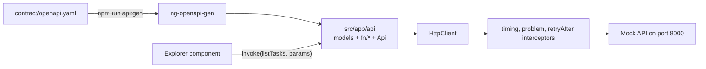

# 05. A typed API client from OpenAPI (ng-openapi-gen)

> **Draft: written but not yet run.** The code and the expected output in this lesson were prepared by reading the code and the official documentation. They have not been executed yet. If something does not behave as described, trust your tool's real output and report it.

## What you will be able to do
By the end of this lesson you will be able to:
- Explain why a client is generated from the OpenAPI contract instead of being written by hand.
- Configure `ng-openapi-gen` 1.1.0, run it, and read what it produces (models, one function per operation, an `Api` service).
- Call operations with `Api.invoke` (the body) and `Api.invoke$Response` (body and headers such as `ETag`), with typed parameters and answers.
- Show that your interceptors from lesson 04 still apply to generated calls.

## Recap
1. Which interceptor sees a raw 429 before it becomes an `ApiProblem`? <details><summary>Answer</summary>`retryAfterInterceptor`, because it is last in the list and so closest to the network (201.04).</details>
2. What does `firstValueFrom` do to an Observable? <details><summary>Answer</summary>It subscribes, takes the first value and returns it as a Promise; errors become rejections (201.04).</details>
3. What does the `ETag` of a task look like in this API? <details><summary>Answer</summary>The quoted version, for example `"3"`; updates send it back as `If-Match` (201.03).</details>

## Why it matters
A restaurant has a **menu**: it says which dishes exist, what they cost and what you may ask for ("no onions"). The waiter does not invent dishes and the kitchen does not guess what you meant. An **OpenAPI file** is the menu of an API: every address, every parameter, every answer shape. Until now you wrote each call by hand and described the answer with a type you invented. Two problems follow: the type can be wrong (nobody checks it against the server), and when the server changes, nothing tells you which calls broke.

A **generated client** turns the menu into code. Each operation becomes a typed function (`listTasks`), each schema becomes a type (`Task`), and a change in the contract shows up as a **compile error** in the places that need to change. In the platform family the contract is owned by `capstones/platform` and every backend and client follows it. The Angular capstone chapter "01 Create the app and generate the client" does exactly this with the full 27-operation file; here you use a mini copy with eight operations.

## What you will build
You continue the `task-board` project of lesson 04. You delete the hand-written `ApiClient`, add a mini OpenAPI file, let `ng-openapi-gen` generate `src/app/api`, and replace the demo page by an **Explorer** with six buttons: `getHealth`, `getMe`, `listTasks` (with a typed `status` filter), `createTask` (with an `Idempotency-Key`), `getTask` (reading the `ETag` header) and `updateTask` with a stale `If-Match` (an expected 412).



## Before you start
- Lesson 04 done, the `task-board` project, the mock API and its three interceptors. Time: about 80 minutes.
- Stop `npm start` and `npm run mock` if they are running (Ctrl+C).
- Source pack (optional): every file is shown in full in this lesson. The finished code, the exercise starter and the solution are in the
  course repository https://github.com/Uee03/Code101 under `source/angular/201-hero-to-super-hero/phase-2-http-and-auth/05-typed-api-client-from-openapi/` (**Code, Download ZIP**, or `git clone https://github.com/Uee03/Code101.git`).
- Two terminals again: `npm run mock` (port 8000) and `npm start` (port 4200).

## Steps

### Step 1. Remove the hand-written client
The hand-written `ApiClient` and the demo page are replaced in this lesson. Delete them from the project folder.

Windows (PowerShell):
```powershell
Remove-Item src\app\api-client.ts
Remove-Item -Recurse src\app\features\demo
```
macOS and Linux:
```bash
rm src/app/api-client.ts
rm -r src/app/features/demo
```

The `http` folder (interceptors, `ApiProblem`, `isApiUrl`) and `shared/problem-view` stay: they are not tied to how calls are written.

### Step 2. Add the generator
**File: `package.json`**
```json
{
  "name": "task-board",
  "version": "1.0.0",
  "private": true,
  "scripts": {
    "ng": "ng",
    "api:gen": "ng-openapi-gen",
    "prestart": "npm run api:gen",
    "start": "ng serve --host localhost --port 4200",
    "prebuild": "npm run api:gen",
    "build": "ng build",
    "mock": "node server/mock-api.mjs",
    "mock:auth": "node server/mock-api.mjs --require-auth"
  },
  "dependencies": {
    "@angular/common": "22.3.0",
    "@angular/compiler": "22.3.0",
    "@angular/core": "22.3.0",
    "@angular/forms": "22.3.0",
    "@angular/platform-browser": "22.3.0",
    "@angular/router": "22.3.0",
    "rxjs": "7.8.2",
    "tslib": "2.8.1"
  },
  "devDependencies": {
    "@angular/build": "22.3.0",
    "@angular/cli": "22.3.0",
    "@angular/compiler-cli": "22.3.0",
    "ng-openapi-gen": "1.1.0",
    "typescript": "6.0.3"
  }
}
```

What changed compared with lesson 04:
- `ng-openapi-gen` 1.1.0 is a **dev dependency**: it runs on your machine to write code, and is not part of the app you ship.
- `api:gen` runs the generator. `prestart` and `prebuild` are npm **lifecycle scripts**: npm runs `prestart` automatically before `npm start` and `prebuild` before `npm run build`, so the client is never older than the contract.

Install it (this also creates `package-lock.json`, which this lesson does not ship):
```text
npm install
```

### Step 3. The contract
Create the folder `contract` and the file below. It is a **mini copy** of the platform contract: eight of the 27 operations and the schemas they use, with the same names and shapes. The full file lives in `capstones/platform` and is copied verbatim into `capstones/web-angular`; never edit a copy to make a client compile, change the owner's file instead.

**File: `contract/openapi.yaml`**
```yaml
openapi: 3.1.1
info:
  title: Tasks and Teams API (mini copy for the Angular 201 lessons)
  version: 1.0.0
  summary: Eight operations and their schemas, copied from the platform contract in capstones/platform.
  description: |
    This is a small copy of the shared contract, enough for lessons 05 to 10.
    The full file (27 operations) is owned by capstones/platform and is copied verbatim in capstones/web-angular.
    Conventions: version prefix /v1, errors are RFC 9457 problem details, lists use cursor pagination,
    single resources carry a strong ETag (the quoted version), updates need If-Match,
    creates accept an optional Idempotency-Key.
servers:
  - url: http://localhost:8000
    description: Local backend (the mock API of lesson 04 or any platform backend, port 8000)
tags:
  - name: Platform
  - name: Teams
  - name: Projects
  - name: Tasks
security:
  - oidc: [tasks:read]
paths:
  /health:
    get:
      operationId: getHealth
      tags: [Platform]
      summary: Liveness and database check
      security: []
      responses:
        '200':
          description: The service and its database are reachable.
          content:
            application/json:
              schema: { $ref: '#/components/schemas/Health' }
  /v1/me:
    get:
      operationId: getMe
      tags: [Platform]
      summary: The calling user, roles, scopes and team memberships
      responses:
        '200':
          description: The caller.
          content:
            application/json:
              schema: { $ref: '#/components/schemas/Me' }
        '401': { $ref: '#/components/responses/Unauthorized' }
        '429': { $ref: '#/components/responses/TooManyRequests' }
  /v1/teams:
    get:
      operationId: listTeams
      tags: [Teams]
      summary: Teams the caller belongs to (admins see every team)
      parameters:
        - { $ref: '#/components/parameters/Limit' }
        - { $ref: '#/components/parameters/Cursor' }
        - name: q
          in: query
          description: Case-insensitive prefix of the team name.
          schema: { type: string, minLength: 1, maxLength: 100 }
      responses:
        '200':
          description: One page of teams.
          content:
            application/json:
              schema: { $ref: '#/components/schemas/TeamPage' }
        '400': { $ref: '#/components/responses/BadRequest' }
        '401': { $ref: '#/components/responses/Unauthorized' }
  /v1/teams/{teamId}/projects:
    parameters:
      - { $ref: '#/components/parameters/TeamId' }
    get:
      operationId: listProjects
      tags: [Projects]
      summary: Projects of a team
      parameters:
        - { $ref: '#/components/parameters/Limit' }
        - { $ref: '#/components/parameters/Cursor' }
        - name: archived
          in: query
          description: Default false (hide archived projects).
          schema: { type: boolean, default: false }
      responses:
        '200':
          description: One page of projects.
          content:
            application/json:
              schema: { $ref: '#/components/schemas/ProjectPage' }
        '400': { $ref: '#/components/responses/BadRequest' }
        '401': { $ref: '#/components/responses/Unauthorized' }
        '403': { $ref: '#/components/responses/Forbidden' }
        '404': { $ref: '#/components/responses/NotFound' }
  /v1/projects/{projectId}/tasks:
    parameters:
      - { $ref: '#/components/parameters/ProjectId' }
    get:
      operationId: listTasks
      tags: [Tasks]
      summary: Tasks of a project, filtered and paged
      parameters:
        - { $ref: '#/components/parameters/Limit' }
        - { $ref: '#/components/parameters/Cursor' }
        - name: status
          in: query
          description: Repeat the parameter to match several statuses.
          style: form
          explode: true
          schema:
            type: array
            items: { $ref: '#/components/schemas/TaskStatus' }
        - name: q
          in: query
          description: Case-insensitive substring of the title.
          schema: { type: string, minLength: 1, maxLength: 100 }
      responses:
        '200':
          description: One page of tasks.
          content:
            application/json:
              schema: { $ref: '#/components/schemas/TaskPage' }
        '400': { $ref: '#/components/responses/BadRequest' }
        '401': { $ref: '#/components/responses/Unauthorized' }
        '403': { $ref: '#/components/responses/Forbidden' }
        '404': { $ref: '#/components/responses/NotFound' }
    post:
      operationId: createTask
      tags: [Tasks]
      summary: Create a task
      security:
        - oidc: [tasks:write]
      parameters:
        - { $ref: '#/components/parameters/IdempotencyKey' }
      requestBody:
        required: true
        content:
          application/json:
            schema: { $ref: '#/components/schemas/TaskCreate' }
      responses:
        '201':
          description: Created.
          headers:
            Location: { $ref: '#/components/headers/Location' }
            ETag: { $ref: '#/components/headers/ETag' }
            Idempotent-Replayed: { $ref: '#/components/headers/IdempotentReplayed' }
          content:
            application/json:
              schema: { $ref: '#/components/schemas/Task' }
        '400': { $ref: '#/components/responses/BadRequest' }
        '401': { $ref: '#/components/responses/Unauthorized' }
        '403': { $ref: '#/components/responses/Forbidden' }
        '404': { $ref: '#/components/responses/NotFound' }
        '409': { $ref: '#/components/responses/Conflict' }
        '422': { $ref: '#/components/responses/UnprocessableContent' }
  /v1/tasks/{taskId}:
    parameters:
      - { $ref: '#/components/parameters/TaskId' }
    get:
      operationId: getTask
      tags: [Tasks]
      summary: One task and its ETag
      responses:
        '200':
          description: The task.
          headers:
            ETag: { $ref: '#/components/headers/ETag' }
          content:
            application/json:
              schema: { $ref: '#/components/schemas/Task' }
        '401': { $ref: '#/components/responses/Unauthorized' }
        '403': { $ref: '#/components/responses/Forbidden' }
        '404': { $ref: '#/components/responses/NotFound' }
    patch:
      operationId: updateTask
      tags: [Tasks]
      summary: Change fields, status, assignee or due date (JSON Merge Patch)
      description: |
        Send only the fields to change. `null` clears `assigneeId` and `dueDate`.
        Setting `status` to `done` stamps `completedAt`; any other status clears it.
        The platform file also lists `application/merge-patch+json` as a second request type; this copy keeps only `application/json`.
      security:
        - oidc: [tasks:write]
      parameters:
        - { $ref: '#/components/parameters/IfMatch' }
      requestBody:
        required: true
        content:
          application/json:
            schema: { $ref: '#/components/schemas/TaskUpdate' }
      responses:
        '200':
          description: The updated task with its new ETag.
          headers:
            ETag: { $ref: '#/components/headers/ETag' }
          content:
            application/json:
              schema: { $ref: '#/components/schemas/Task' }
        '400': { $ref: '#/components/responses/BadRequest' }
        '401': { $ref: '#/components/responses/Unauthorized' }
        '403': { $ref: '#/components/responses/Forbidden' }
        '404': { $ref: '#/components/responses/NotFound' }
        '412': { $ref: '#/components/responses/PreconditionFailed' }
        '422': { $ref: '#/components/responses/UnprocessableContent' }
        '428': { $ref: '#/components/responses/PreconditionRequired' }
components:
  securitySchemes:
    oidc:
      type: openIdConnect
      description: |
        Keycloak realm `tasksteams`. Web clients use the authorization code flow with PKCE (S256).
        The API only validates the bearer access token.
      openIdConnectUrl: http://localhost:8180/realms/tasksteams/.well-known/openid-configuration
  parameters:
    TeamId:
      name: teamId
      in: path
      required: true
      schema: { type: string, format: uuid }
    ProjectId:
      name: projectId
      in: path
      required: true
      schema: { type: string, format: uuid }
    TaskId:
      name: taskId
      in: path
      required: true
      schema: { type: string, format: uuid }
    Limit:
      name: limit
      in: query
      description: Page size.
      schema: { type: integer, minimum: 1, maximum: 100, default: 25 }
    Cursor:
      name: cursor
      in: query
      description: Opaque value copied from `page.nextCursor`. Do not build or parse it.
      schema: { type: string, minLength: 1, maxLength: 512 }
    IfMatch:
      name: If-Match
      in: header
      required: true
      description: The `ETag` of the version being changed, quotes included, for example `"3"`.
      schema: { type: string, minLength: 3, maxLength: 20 }
    IdempotencyKey:
      name: Idempotency-Key
      in: header
      required: false
      description: |
        A unique value (a UUID is fine) per create. Same key and same body replays the first response;
        same key and a different body gives 422.
      schema: { type: string, minLength: 8, maxLength: 128 }
  headers:
    ETag:
      description: Strong validator, the quoted resource `version`, for example `"3"`.
      schema: { type: string }
    Location:
      description: Absolute URL of the created resource.
      schema: { type: string, format: uri }
    IdempotentReplayed:
      description: "`true` when the response is a replay of an earlier request with the same Idempotency-Key."
      schema: { type: string, enum: ['true'] }
    RetryAfter:
      description: Seconds to wait before retrying.
      schema: { type: integer }
    WWWAuthenticate:
      description: The Bearer challenge, for example `Bearer realm="tasksteams"`.
      schema: { type: string }
  responses:
    BadRequest:
      description: Malformed JSON, a bad query parameter or a bad cursor.
      content:
        application/problem+json:
          schema: { $ref: '#/components/schemas/Problem' }
    Unauthorized:
      description: Missing, expired or invalid bearer token.
      headers:
        WWW-Authenticate: { $ref: '#/components/headers/WWWAuthenticate' }
      content:
        application/problem+json:
          schema: { $ref: '#/components/schemas/Problem' }
    Forbidden:
      description: The token is valid but the role, scope or team membership does not allow this.
      content:
        application/problem+json:
          schema: { $ref: '#/components/schemas/Problem' }
    NotFound:
      description: The resource does not exist, or the caller may not know that it exists.
      content:
        application/problem+json:
          schema: { $ref: '#/components/schemas/Problem' }
    Conflict:
      description: Duplicate name or key, a business rule, or an Idempotency-Key still in progress.
      content:
        application/problem+json:
          schema: { $ref: '#/components/schemas/Problem' }
    PreconditionFailed:
      description: The If-Match value is stale. Fetch the resource again and retry.
      content:
        application/problem+json:
          schema: { $ref: '#/components/schemas/Problem' }
    PreconditionRequired:
      description: The request must include If-Match.
      content:
        application/problem+json:
          schema: { $ref: '#/components/schemas/Problem' }
    UnprocessableContent:
      description: The JSON is well formed but a field is invalid, or an Idempotency-Key was reused with another body.
      content:
        application/problem+json:
          schema: { $ref: '#/components/schemas/ValidationProblem' }
    TooManyRequests:
      description: Rate limit exceeded.
      headers:
        Retry-After: { $ref: '#/components/headers/RetryAfter' }
      content:
        application/problem+json:
          schema: { $ref: '#/components/schemas/Problem' }
  schemas:
    Problem:
      type: object
      description: RFC 9457 problem details with two extension members, `traceId` and `code`.
      required: [type, title, status]
      properties:
        type:
          type: string
          format: uri-reference
          description: Stable identifier of the problem type.
        title: { type: string }
        status: { type: integer, minimum: 400, maximum: 599 }
        detail: { type: string }
        instance: { type: string, description: The request path. }
        traceId: { type: string, description: Correlates with the server log. }
        code:
          type: string
          description: Optional machine-readable code, for example `last_lead`.
    ValidationProblem:
      allOf:
        - $ref: '#/components/schemas/Problem'
        - type: object
          properties:
            errors:
              type: array
              items:
                type: object
                required: [pointer, detail]
                properties:
                  pointer:
                    type: string
                    description: JSON Pointer (RFC 6901) to the invalid field in the request body.
                  detail: { type: string }
    Health:
      type: object
      required: [status]
      properties:
        status: { type: string, enum: [ok, degraded] }
        version: { type: string, examples: ['1.0.0'] }
        database: { type: string, enum: [up, down] }
    PageInfo:
      type: object
      required: [limit, nextCursor]
      properties:
        limit: { type: integer }
        nextCursor:
          type: [string, 'null']
          description: "`null` on the last page."
    Role:
      type: string
      enum: [admin, member]
    TeamRole:
      type: string
      enum: [lead, member]
    TaskStatus:
      type: string
      enum: [todo, in_progress, blocked, done, cancelled]
    TaskPriority:
      type: string
      enum: [low, medium, high, urgent]
    Me:
      type: object
      required: [id, username, email, displayName, roles, scopes, teams]
      properties:
        id: { type: string, format: uuid }
        username: { type: string }
        email: { type: string, format: email }
        displayName: { type: string }
        roles:
          type: array
          items: { $ref: '#/components/schemas/Role' }
        scopes:
          type: array
          items: { type: string }
        teams:
          type: array
          items:
            type: object
            required: [teamId, name, role]
            properties:
              teamId: { type: string, format: uuid }
              name: { type: string }
              role: { $ref: '#/components/schemas/TeamRole' }
    Team:
      type: object
      required: [id, name, description, memberCount, createdBy, version, createdAt, updatedAt]
      properties:
        id: { type: string, format: uuid, readOnly: true }
        name: { type: string, minLength: 1, maxLength: 80 }
        description: { type: string, maxLength: 500 }
        memberCount: { type: integer, readOnly: true }
        createdBy: { type: string, format: uuid, readOnly: true }
        version: { type: integer, minimum: 1, readOnly: true }
        createdAt: { type: string, format: date-time, readOnly: true }
        updatedAt: { type: string, format: date-time, readOnly: true }
    TeamPage:
      type: object
      required: [items, page]
      properties:
        items: { type: array, items: { $ref: '#/components/schemas/Team' } }
        page: { $ref: '#/components/schemas/PageInfo' }
    Project:
      type: object
      required: [id, teamId, key, name, description, archived, version, createdAt, updatedAt]
      properties:
        id: { type: string, format: uuid, readOnly: true }
        teamId: { type: string, format: uuid, readOnly: true }
        key:
          type: string
          pattern: '^[A-Z][A-Z0-9]{1,9}$'
          description: Short uppercase code, unique inside the team.
        name: { type: string, minLength: 1, maxLength: 120 }
        description: { type: string, maxLength: 2000 }
        archived: { type: boolean }
        version: { type: integer, minimum: 1, readOnly: true }
        createdAt: { type: string, format: date-time, readOnly: true }
        updatedAt: { type: string, format: date-time, readOnly: true }
    ProjectPage:
      type: object
      required: [items, page]
      properties:
        items: { type: array, items: { $ref: '#/components/schemas/Project' } }
        page: { $ref: '#/components/schemas/PageInfo' }
    Task:
      type: object
      required: [id, projectId, title, description, status, priority, assigneeId, dueDate, completedAt, createdBy, version, createdAt, updatedAt]
      properties:
        id: { type: string, format: uuid, readOnly: true }
        projectId: { type: string, format: uuid, readOnly: true }
        title: { type: string, minLength: 1, maxLength: 200 }
        description: { type: string, maxLength: 10000 }
        status: { $ref: '#/components/schemas/TaskStatus' }
        priority: { $ref: '#/components/schemas/TaskPriority' }
        assigneeId: { type: [string, 'null'], format: uuid }
        dueDate: { type: [string, 'null'], format: date }
        completedAt: { type: [string, 'null'], format: date-time, readOnly: true }
        createdBy: { type: string, format: uuid, readOnly: true }
        version: { type: integer, minimum: 1, readOnly: true }
        createdAt: { type: string, format: date-time, readOnly: true }
        updatedAt: { type: string, format: date-time, readOnly: true }
    TaskCreate:
      type: object
      required: [title]
      additionalProperties: false
      properties:
        title: { type: string, minLength: 1, maxLength: 200 }
        description: { type: string, maxLength: 10000, default: '' }
        priority: { $ref: '#/components/schemas/TaskPriority' }
        assigneeId: { type: [string, 'null'], format: uuid }
        dueDate: { type: [string, 'null'], format: date }
    TaskUpdate:
      type: object
      additionalProperties: false
      minProperties: 1
      properties:
        title: { type: string, minLength: 1, maxLength: 200 }
        description: { type: string, maxLength: 10000 }
        status: { $ref: '#/components/schemas/TaskStatus' }
        priority: { $ref: '#/components/schemas/TaskPriority' }
        assigneeId: { type: [string, 'null'], format: uuid }
        dueDate: { type: [string, 'null'], format: date }
    TaskPage:
      type: object
      required: [items, page]
      properties:
        items: { type: array, items: { $ref: '#/components/schemas/Task' } }
        page: { $ref: '#/components/schemas/PageInfo' }
```

How to read it (you do not need to memorise it):
- `paths` lists addresses. Each method has an `operationId` (`listTasks`): this becomes the **function name** in TypeScript. `tags` (`Tasks`) becomes the **folder name** (`api/fn/tasks/`).
- `parameters` under an operation (or `$ref` to `components/parameters`) become the typed **params object**. `If-Match` is `required: true`, so TypeScript will refuse a call without it. `status` has `explode: true`, so an array becomes `status=todo&status=in_progress`.
- `requestBody` becomes the `body` property. `responses` with `content` decide the **return type**; the `headers` listed under `201` and `200` document headers such as `ETag`.
- `components/schemas` become the model types. `type: [string, 'null']` (OpenAPI 3.1) becomes `string | null`. `enum` becomes a union such as `'todo' | 'in_progress' | ...`. `required` decides which properties are optional (`?`).
- The error responses are described as `application/problem+json`. The generator does not turn them into types; your `problemInterceptor` does the work at run time.
- Dates stay **strings** (`format: date-time` is not converted to `Date`). That is on purpose: a string survives JSON and time zones, you convert at the edge where you show it.

**Does the mock match the contract?** The mock of lesson 04 was written before this file. Reading both side by side, the JSON shapes for `Health`, `Me`, `Team`, `Project`, `Task` and the page wrapper `{ items, page: { limit, nextCursor } }` carry every required property. The mock ignores some optional query parameters (`q` on teams, `archived`) and `sort`; the lesson does not use them.

### Step 4. Configure and run the generator
**File: `ng-openapi-gen.json`**
```json
{
  "$schema": "./node_modules/ng-openapi-gen/ng-openapi-gen-schema.json",
  "input": "contract/openapi.yaml",
  "output": "src/app/api",
  "apiService": "Api",
  "promises": true,
  "services": false
}
```

- `input` and `output`: read this file, write into `src/app/api`.
- `apiService: "Api"`: one injectable class `Api` that runs any generated function.
- `promises: true`: `Api.invoke` returns a **Promise** instead of an Observable. For request and response calls that is simpler to `await`; you still get Observables where you want them by using the generated functions directly with `HttpClient`.
- `services: false`: no class per tag (`TasksService`, ...). Only functions plus `Api`; this keeps the output small and matches the capstone.
- `$schema` gives your editor completion for the file.

**File: `.gitignore`**
```
node_modules/
dist/
.angular/
.env
*.log
src/app/api/
```

`src/app/api/` is now ignored: generated code is **rebuilt**, not edited and not committed. The contract and the config are the source of truth.

Run the generator:
```text
npm run api:gen
```

Expected: the command prints a line that it is generating from `contract/openapi.yaml`, and the folder `src/app/api` appears. The exact text and file list come from the tool; typically you see (abbreviated):
```text
src/app/api/
  api.ts                  the Api class (invoke, invoke$Response)
  api-configuration.ts    the class that holds rootUrl
  functions.ts            re-exports every operation function
  models.ts               re-exports every model type
  request-builder.ts, strict-http-response.ts
  models/                 task.ts, task-create.ts, task-page.ts, ...
  fn/platform/            get-health.ts, get-me.ts
  fn/teams/               list-teams.ts
  fn/projects/            list-projects.ts
  fn/tasks/               list-tasks.ts, create-task.ts, get-task.ts, update-task.ts
```

Open `src/app/api/fn/tasks/list-tasks.ts`. Its parameters type looks like this (typical shape, abbreviated; the real file has more comments):
```ts
export interface ListTasks$Params {
  projectId: string;
  limit?: number;
  cursor?: string;
  status?: Array<TaskStatus>;
  q?: string;
}
export function listTasks(http: HttpClient, rootUrl: string, params: ListTasks$Params, context?: HttpContext): Observable<StrictHttpResponse<TaskPage>>
```
A generated function is a plain function: it takes the `HttpClient`, the root URL and your params, builds the request and returns an Observable of the full response. `Api` supplies the first two for you.

### Step 5. Tell the client where the API lives
**File: `src/app/app.config.ts`**
```ts
import { ApplicationConfig, provideBrowserGlobalErrorListeners } from '@angular/core';
import { provideHttpClient, withFetch, withInterceptors } from '@angular/common/http';
import { provideRouter } from '@angular/router';

import { ApiConfiguration } from './api/api-configuration';
import { environment } from '../environments/environment';
import { routes } from './app.routes';
import { problemInterceptor } from './http/problem.interceptor';
import { retryAfterInterceptor } from './http/retry-after.interceptor';
import { timingInterceptor } from './http/timing.interceptor';

export const appConfig: ApplicationConfig = {
  providers: [
    provideBrowserGlobalErrorListeners(),
    provideHttpClient(withFetch(), withInterceptors([timingInterceptor, problemInterceptor, retryAfterInterceptor])),
    provideRouter(routes),
    { provide: ApiConfiguration, useValue: { rootUrl: environment.apiBaseUrl } }
  ]
};
```

- `ApiConfiguration` is generated; it only holds `rootUrl`. We provide a plain object with the address from `environment.ts`, so the URL still lives in one place.
- The interceptors are registered as before. Generated calls use the same `HttpClient`, so `timingInterceptor`, `problemInterceptor` and `retryAfterInterceptor` see every generated request: that is the payoff of lesson 04.

### Step 6. The Explorer page
**File: `src/app/features/explorer/explorer.ts`**
```ts
import { ChangeDetectionStrategy, Component, inject, signal } from '@angular/core';
import { Api } from '../../api/api';
import { createTask, getHealth, getMe, getTask, listProjects, listTasks, listTeams, updateTask } from '../../api/functions';
import { ApiProblem, isApiProblem } from '../../http/problem';
import { ProblemView } from '../../shared/problem-view';

interface Probe {
  label: string;
  run: () => Promise<unknown>;
}

type Outcome = { kind: 'idle' } | { kind: 'loading'; label: string } | { kind: 'ok'; label: string; data: string } | { kind: 'problem'; label: string; problem: ApiProblem };

@Component({
  selector: 'app-explorer',
  imports: [ProblemView],
  changeDetection: ChangeDetectionStrategy.OnPush,
  templateUrl: './explorer.html',
  styleUrl: './explorer.css'
})
export class Explorer {
  private readonly api = inject(Api);
  private lastTaskId: string | null = null;

  protected readonly probes: readonly Probe[] = [
    { label: 'getHealth', run: () => this.api.invoke(getHealth) },
    { label: 'getMe', run: () => this.api.invoke(getMe) },
    { label: 'listTasks (open tasks of the first project)', run: () => this.openTasks() },
    { label: 'createTask', run: () => this.create() },
    { label: 'getTask (read the ETag header)', run: () => this.readEtag() },
    { label: 'updateTask with a stale If-Match (expect 412)', run: () => this.updateStale() }
  ];
  protected readonly outcome = signal<Outcome>({ kind: 'idle' });

  protected async run(probe: Probe): Promise<void> {
    this.outcome.set({ kind: 'loading', label: probe.label });
    try {
      const data = await probe.run();
      this.outcome.set({ kind: 'ok', label: probe.label, data: JSON.stringify(data, null, 2) });
    } catch (error) {
      if (isApiProblem(error)) {
        this.outcome.set({ kind: 'problem', label: probe.label, problem: error });
      } else {
        throw error;
      }
    }
  }

  private async firstProjectId(): Promise<string> {
    const teams = await this.api.invoke(listTeams, { limit: 1 });
    const team = teams.items[0];
    if (!team) {
      throw new Error('The API returned no team.');
    }
    const projects = await this.api.invoke(listProjects, { teamId: team.id, limit: 1 });
    const project = projects.items[0];
    if (!project) {
      throw new Error('The team has no project.');
    }
    return project.id;
  }

  private async openTasks(): Promise<unknown> {
    const projectId = await this.firstProjectId();
    const page = await this.api.invoke(listTasks, { projectId, limit: 3, status: ['todo', 'in_progress'] });
    return { titles: page.items.map((task) => `${task.title} (${task.status})`), nextCursor: page.page.nextCursor };
  }

  private async create(): Promise<unknown> {
    const projectId = await this.firstProjectId();
    const task = await this.api.invoke(createTask, {
      projectId,
      'Idempotency-Key': crypto.randomUUID(),
      body: { title: 'Written with the typed client', priority: 'low' }
    });
    this.lastTaskId = task.id;
    return { id: task.id, status: task.status, version: task.version };
  }

  private async taskId(): Promise<string> {
    if (this.lastTaskId) {
      return this.lastTaskId;
    }
    const projectId = await this.firstProjectId();
    const page = await this.api.invoke(listTasks, { projectId, limit: 1 });
    const task = page.items[0];
    if (!task) {
      throw new Error('The project has no task yet. Press createTask first.');
    }
    return task.id;
  }

  private async readEtag(): Promise<unknown> {
    const response = await this.api.invoke$Response(getTask, { taskId: await this.taskId() });
    return { title: response.body.title, etag: response.headers.get('ETag') };
  }

  private async updateStale(): Promise<unknown> {
    return this.api.invoke(updateTask, { taskId: await this.taskId(), 'If-Match': '"999"', body: { status: 'done' } });
  }
}
```

Read the parts that matter:
- `inject(Api)` gives the generated service. `this.api.invoke(getMe)` has **no params** because `getMe` has none; the answer is typed `Me`.
- `listTasks` needs `projectId`; leave it out and the compiler stops you. `status: ['todo', 'in_progress']` is checked against `TaskStatus`: `status: ['finished']` does not compile.
- `createTask` takes the header as the property `'Idempotency-Key'` (quoted, because of the dash) and the JSON body as `body`. A new random key per press means every press creates a new task; lesson 03 explained how one key per user action makes a *retry* safe.
- `invoke$Response` returns the whole response: `response.body` is the typed `Task` and `response.headers.get('ETag')` is the header. The mock lists `ETag` in `Access-Control-Expose-Headers`, otherwise the browser would hide it from the page.
- `updateTask` sends `'If-Match': '"999"'`: a version that does not exist, to provoke a 412 on purpose. The rejection is an `ApiProblem` (made by `problemInterceptor`), caught in `run`.
- `firstProjectId` walks the chain `listTeams` then `listProjects` because a task list needs a project id and the page does not know one. Later lessons move this into a service.

**File: `src/app/features/explorer/explorer.html`**
```html
<section aria-labelledby="explorer-heading">
  <h2 id="explorer-heading">Call the API with generated functions</h2>
  <p>Start the mock API in a second terminal (<code>npm run mock</code>), then press a button.</p>

  <ul class="probes">
    @for (probe of probes; track probe.label) {
      <li><button type="button" (click)="run(probe)">{{ probe.label }}</button></li>
    }
  </ul>

  <div role="status">
    @switch (outcome().kind) {
      @case ('loading') {
        <p>Waiting for the answer...</p>
      }
    }
  </div>

  @let current = outcome();
  @if (current.kind === 'ok') {
    <p>{{ current.label }}:</p>
    <pre>{{ current.data }}</pre>
  } @else if (current.kind === 'problem') {
    <p>{{ current.label }}:</p>
    <app-problem-view [problem]="current.problem" />
  }
</section>
```

**File: `src/app/features/explorer/explorer.css`**
```css
.probes {
  padding: 0;
  list-style: none;
}

.probes li {
  margin: 0.5rem 0;
}

button {
  min-height: 2.25rem;
  padding: 0.25rem 0.75rem;
}

pre {
  padding: 0.75rem;
  overflow-x: auto;
  background: #f3f4f6;
  color: #1f2937;
}
```

**File: `src/app/app.ts`**
```ts
import { ChangeDetectionStrategy, Component } from '@angular/core';
import { Explorer } from './features/explorer/explorer';

@Component({
  selector: 'app-root',
  imports: [Explorer],
  changeDetection: ChangeDetectionStrategy.OnPush,
  templateUrl: './app.html',
  styleUrl: './app.css'
})
export class App {}
```

**File: `src/app/app.html`**
```html
<main class="page">
  <h1>Task board</h1>
  <app-explorer />
</main>
```

## Run it
Terminal 1: `npm run mock`. Terminal 2: `npm start` (runs `api:gen` first, then serves). Open http://localhost:4200/ and the browser console.

**Predict:** you press `createTask` twice and then `getTask`. Which task's ETag do you read, and what is its value?

Expected behaviour (derived by reading the code and the mock, not yet seen in a browser; ids and times vary):
1. **getHealth**: `{ "status": "ok", "version": "mock", "database": "up" }` (pretty printed over several lines). Console: `GET /health -> 200 in N ms`.
2. **getMe**: the object of alice, with `"roles": ["admin"]`, `"scopes"` and one team "Platform Team".
3. **listTasks**: three titles, then the cursor:
```json
{
  "titles": [
    "Add the health check (in_progress)",
    "Seed the database (todo)",
    "Explain signals (todo)"
  ],
  "nextCursor": "3"
}
```
   The console shows three timing lines first (teams, projects, tasks), then the page. `status=todo&status=in_progress` is visible in the Network tab. Task 1 (done) and task 5 (blocked) are filtered out by the server.
4. **createTask**: `{ "id": "5d1b8d9e-0000-4000-8000-000000000007", "status": "todo", "version": 1 }`. A second press gives `...008`.
5. **getTask**: after two creates it reads the **last created** task (`lastTaskId`): title "Written with the typed client", `"etag": "\"1\""` (the quotes belong to the value, so JSON shows them escaped). Without a create first, it reads the first task, "Write the OpenAPI file".
6. **updateTask stale**: a red box "Precondition failed (412)" with "The task changed since you read it (current version 1)." and a support code. The 412 is a **normal** answer of the contract, not a bug; the page shows it through `ProblemView`.
7. Stop the mock and press **getHealth**: "Request failed (0)", as in lesson 04. The generated client changed how calls are written, not how failures arrive.

## How it works
1. `ng-openapi-gen` parses the YAML and writes TypeScript: one file per schema in `models/`, one file per operation in `fn/<tag>/`, plus `Api`.
2. `Api.invoke(fn, params)` calls `fn(this.http, this.rootUrl, params)`, takes the first response and returns `response.body`. `invoke$Response` returns the `StrictHttpResponse` so you can read headers and status.
3. Because everything goes through `HttpClient`, the interceptor chain from lesson 04 runs unchanged.
4. When the contract changes, you run `npm run api:gen` and the compiler lists every call that no longer fits.

**Why this, not that.**
- *Generated client* versus *hand-written calls*: hand-written types drift silently; generated types fail the build when they drift. Cost: a build step and generated code you do not read line by line.
- *`ng-openapi-gen`* versus *OpenAPI Generator (`typescript-angular`)*: the latter supports many languages but needs Java and writes more code. For an Angular-only client the smaller generator is enough. The capstone records the same decision.
- *Promises* versus *Observables* for request-response: a Promise reads naturally with `await`; keep Observables for real streams (search-as-you-type, events), as in lesson 02.
- *Commit generated code* versus *generate on build*: committing gives reviewable diffs but can go stale; generating on `prestart` and `prebuild` can never be stale but needs the contract in every build context. We generate.

**Security note.** The generator runs code from an npm package at install and build time, so pin its version (we do: `1.1.0`) and review upgrades. The contract may describe `security` schemes, but a generated client does **not** add tokens by itself: that is the job of an interceptor, written in lesson 06, and it must check the target address.

**Misconception:** "typed means validated." Types vanish at run time. If a server answers with a different shape, the generated code still hands it to you as a `Task`. The contract is a promise, checked by conformance tests on the backend side, not by your client.

## Try it
Starter file: `exercise/starter/src/app/open-tasks.ts`.
1. **Guided:** write `allOpenTasks(api, projectId)` (the TODOs): call `listTasks` with `limit: 2` and `status: ['todo', 'in_progress', 'blocked']`, collect `page.items` and follow `page.page.nextCursor` until it is `null`. Predict how many requests the mock needs for its six tasks (open ones: tasks 2, 3, 4, 5 and 6).
2. **Change:** add a seventh button to the Explorer that calls `allOpenTasks` and prints only the titles. Look at the Network tab: which `cursor` values appear?
3. **Stretch (optional):** change `status` in the contract to be required, run `npm run api:gen`, and read the compiler errors. Undo the change afterwards. What does this tell you about contract changes?

<details><summary>Solution for rung 1</summary>

**File: `exercise/solution/src/app/open-tasks.ts`**
```ts
import { Api } from './api/api';
import { listTasks } from './api/functions';
import { Task } from './api/models';

// Returns every task that is not done or cancelled, page after page.
export async function allOpenTasks(api: Api, projectId: string): Promise<Task[]> {
  const tasks: Task[] = [];
  let cursor: string | undefined;
  do {
    const page = await api.invoke(listTasks, { projectId, limit: 2, cursor, status: ['todo', 'in_progress', 'blocked'] });
    tasks.push(...page.items);
    cursor = page.page.nextCursor ?? undefined;
  } while (cursor);
  return tasks;
}
```

Open tasks are 2, 3, 4, 5 and 6 (five), so with `limit: 2` the mock needs three requests: cursors none, `2` and `4`. The loop ends when `nextCursor` is `null`.

</details>

## Check yourself
1. Where does the function name `listTasks` come from, and where does the folder `fn/tasks` come from? <details><summary>Answer</summary>`operationId` gives the function name; the first tag gives the folder.</details>
2. Why is `src/app/api` in `.gitignore`? <details><summary>Answer</summary>It is generated from the contract on every start and build, so it cannot be stale and nobody edits it by hand.</details>
3. When do you use `invoke$Response` instead of `invoke`? <details><summary>Answer</summary>When you need headers or the status, for example `ETag`, `Location` or `Retry-After`.</details>
4. The server starts answering `dueDate` as a number. What does the generated client do? <details><summary>Answer</summary>Nothing: types are not checked at run time. A contract test or a runtime check would catch it.</details>

## Common mistakes
| Symptom or error text | Cause | Fix |
|---|---|---|
| Typical message: `Cannot find module './api/api'` (TS2307) | The generator did not run, so `src/app/api` does not exist | Run `npm run api:gen`, or use `npm start` / `npm run build` which run it first |
| Typical message: `'ng-openapi-gen' is not recognized` or `command not found` | `npm install` was not run after editing `package.json` | Run `npm install` in the project folder |
| A type or function you expect is missing | The contract was changed but the client not regenerated | Run `npm run api:gen` again |
| `Object literal may only specify known properties` on `'Idempotency-Key'` | The header was written as `idempotencyKey` | Use the exact header name as a quoted property |
| The browser shows a CORS error | The mock is not running, or the page is not on `http://localhost:4200` | Start `npm run mock`; open `localhost`, not `127.0.0.1` |
| `getTask` shows `"etag": null` | The server did not list `ETag` in `Access-Control-Expose-Headers` | The mock does; with another backend check its CORS settings |

## Best practice
Treat the OpenAPI file as the single source of truth, generate the client from it on every start and build, and keep hand-written code out of the generated folder. Source: OpenAPI Specification 3.1.1 https://spec.openapis.org/oas/v3.1.1.html and ng-openapi-gen https://github.com/cyclosproject/ng-openapi-gen

## Going further
- ng-openapi-gen options (`promises`, `services`, `enumStyle`): https://github.com/cyclosproject/ng-openapi-gen
- Angular HttpClient setup: https://angular.dev/guide/http/setup
- Capstone: `capstones/web-angular` chapter 01 "Create the app and generate the client" (the full contract and a Node smoke script).
- JSON Merge Patch RFC 7396 explains the `updateTask` body: only the fields to change.

## Summary
- You replaced a hand-written client by one generated from the contract.
- You called typed operations with `Api.invoke` and read a header with `invoke$Response`.
- You saw that interceptors apply to generated calls without any change.

## Next lesson
06. OIDC login with PKCE and route guards: sign in against Keycloak (realm `tasksteams`), keep the token in memory, add the bearer header in an interceptor and protect routes.

<details>
<summary>Files that did not change in this lesson (listed so this page is complete)</summary>

**File: `angular.json`**

```json
{
  "$schema": "./node_modules/@angular/cli/lib/config/schema.json",
  "version": 1,
  "cli": {
    "packageManager": "npm",
    "analytics": false
  },
  "newProjectRoot": "projects",
  "projects": {
    "task-board": {
      "projectType": "application",
      "schematics": {
        "@schematics/angular:class": {
          "skipTests": true
        },
        "@schematics/angular:component": {
          "skipTests": true
        },
        "@schematics/angular:directive": {
          "skipTests": true
        },
        "@schematics/angular:guard": {
          "skipTests": true
        },
        "@schematics/angular:interceptor": {
          "skipTests": true
        },
        "@schematics/angular:pipe": {
          "skipTests": true
        },
        "@schematics/angular:resolver": {
          "skipTests": true
        },
        "@schematics/angular:service": {
          "skipTests": true
        }
      },
      "root": "",
      "sourceRoot": "src",
      "prefix": "app",
      "architect": {
        "build": {
          "builder": "@angular/build:application",
          "options": {
            "browser": "src/main.ts",
            "tsConfig": "tsconfig.app.json",
            "assets": [
              {
                "glob": "**/*",
                "input": "public"
              }
            ],
            "styles": [
              "src/styles.css"
            ]
          },
          "configurations": {
            "production": {
              "budgets": [
                {
                  "type": "initial",
                  "maximumWarning": "500kB",
                  "maximumError": "1MB"
                },
                {
                  "type": "anyComponentStyle",
                  "maximumWarning": "4kB",
                  "maximumError": "8kB"
                }
              ],
              "outputHashing": "all"
            },
            "development": {
              "optimization": false,
              "extractLicenses": false,
              "sourceMap": true
            }
          },
          "defaultConfiguration": "production"
        },
        "serve": {
          "builder": "@angular/build:dev-server",
          "configurations": {
            "production": {
              "buildTarget": "task-board:build:production"
            },
            "development": {
              "buildTarget": "task-board:build:development"
            }
          },
          "defaultConfiguration": "development"
        }
      }
    }
  }
}
```

**File: `public/favicon.svg`**

```xml
<svg xmlns="http://www.w3.org/2000/svg" viewBox="0 0 24 24" width="24" height="24" fill="none" stroke="#1d6fb8" stroke-width="2" stroke-linecap="round" stroke-linejoin="round">
  <path d="M22 11.08V12a10 10 0 1 1-5.93-9.14"/><polyline points="22 4 12 14.01 9 11.01"/>
</svg>
```

**File: `server/mock-api.mjs`**

```js
// A tiny stand-in for the Tasks and Teams backend, for lessons 04 to 10 of the Angular 201 track.
// It speaks a small part of the platform contract on port 8000. It is NOT a real backend: no database,
// no token validation (it only checks that a bearer header exists when started with --require-auth).
// Stop it before you start a real backend: both want port 8000.
import { createServer } from 'node:http';
import { randomUUID } from 'node:crypto';

const PORT = 8000;
const ORIGIN = 'http://localhost:4200';
const REQUIRE_AUTH = process.argv.includes('--require-auth');

const USER_ID = '33333333-3333-4333-8333-333333333333';
const TEAM_ID = '11111111-1111-4111-8111-111111111111';
const PROJECT_ID = '22222222-2222-4222-8222-222222222222';
const taskId = (number) => `5d1b8d9e-0000-4000-8000-${String(number).padStart(12, '0')}`;
const STATUSES = ['todo', 'in_progress', 'blocked', 'done', 'cancelled'];
const PRIORITIES = ['low', 'medium', 'high', 'urgent'];

const ME = {
  id: USER_ID,
  username: 'alice',
  email: 'alice@example.test',
  displayName: 'Alice Admin',
  roles: ['admin'],
  scopes: ['tasks:read', 'tasks:write'],
  teams: [{ teamId: TEAM_ID, name: 'Platform Team', role: 'lead' }]
};

const timestamp = () => new Date().toISOString();
const makeTask = (number, title, status, priority) => ({
  id: taskId(number),
  projectId: PROJECT_ID,
  title,
  description: '',
  status,
  priority,
  assigneeId: null,
  dueDate: null,
  completedAt: status === 'done' ? timestamp() : null,
  createdBy: USER_ID,
  version: 1,
  createdAt: timestamp(),
  updatedAt: timestamp()
});

const tasks = [
  makeTask(1, 'Write the OpenAPI file', 'done', 'high'),
  makeTask(2, 'Add the health check', 'in_progress', 'medium'),
  makeTask(3, 'Seed the database', 'todo', 'medium'),
  makeTask(4, 'Explain signals', 'todo', 'low'),
  makeTask(5, 'Record a demo', 'blocked', 'high'),
  makeTask(6, 'Review the release notes', 'todo', 'urgent')
];
let nextNumber = 7;
const replays = new Map();
let limitedCalls = 0;

function send(res, status, body, headers = {}) {
  res.writeHead(status, {
    'Access-Control-Allow-Origin': ORIGIN,
    'Access-Control-Expose-Headers': 'ETag, Location, Retry-After, Idempotent-Replayed, RateLimit-Remaining',
    Vary: 'Origin',
    'RateLimit-Limit': '100',
    'RateLimit-Remaining': '99',
    'Content-Type': 'application/json',
    ...headers
  });
  res.end(body === undefined ? undefined : JSON.stringify(body));
}

function problem(req, res, status, title, detail, extra = {}, headers = {}) {
  const slug = title.toLowerCase().replaceAll(' ', '-');
  send(
    res,
    status,
    {
      type: `https://code101.example/problems/${slug}`,
      title,
      status,
      detail,
      instance: new URL(req.url, 'http://localhost').pathname,
      traceId: randomUUID().replaceAll('-', ''),
      ...extra
    },
    { 'Content-Type': 'application/problem+json', ...headers }
  );
}

async function readJson(req) {
  const chunks = [];
  for await (const chunk of req) {
    chunks.push(chunk);
  }
  try {
    return JSON.parse(Buffer.concat(chunks).toString('utf8') || '{}');
  } catch {
    return null;
  }
}

const page = (items, limit, nextCursor) => ({ items, page: { limit, nextCursor } });

function validate(body, partial) {
  const errors = [];
  if (!partial || 'title' in body) {
    if (typeof body.title !== 'string' || body.title.length < 1 || body.title.length > 200) {
      errors.push({ pointer: '/title', detail: 'must be between 1 and 200 characters' });
    } else if (/[<>]/.test(body.title)) {
      errors.push({ pointer: '/title', detail: 'must not contain < or >' });
    }
  }
  if ('status' in body && !STATUSES.includes(body.status)) {
    errors.push({ pointer: '/status', detail: `must be one of ${STATUSES.join(', ')}` });
  }
  if ('priority' in body && !PRIORITIES.includes(body.priority)) {
    errors.push({ pointer: '/priority', detail: `must be one of ${PRIORITIES.join(', ')}` });
  }
  if ('dueDate' in body && body.dueDate !== null && !/^\d{4}-\d{2}-\d{2}$/.test(body.dueDate)) {
    errors.push({ pointer: '/dueDate', detail: 'must be a date like 2026-12-31' });
  }
  return errors;
}

const server = createServer(async (req, res) => {
  const url = new URL(req.url, 'http://localhost');
  const path = url.pathname;
  const method = req.method;

  if (method === 'OPTIONS') {
    res.writeHead(204, {
      'Access-Control-Allow-Origin': ORIGIN,
      'Access-Control-Allow-Methods': 'GET, POST, PATCH, PUT, DELETE, OPTIONS',
      'Access-Control-Allow-Headers': 'Authorization, Content-Type, If-Match, If-None-Match, Idempotency-Key',
      'Access-Control-Max-Age': '600',
      Vary: 'Origin'
    });
    res.end();
    return;
  }

  if (method === 'GET' && path === '/health') {
    send(res, 200, { status: 'ok', version: 'mock', database: 'up' });
    return;
  }

  if (path.startsWith('/v1/') && REQUIRE_AUTH && !(req.headers.authorization ?? '').startsWith('Bearer ')) {
    problem(req, res, 401, 'Unauthorized', 'A bearer access token is required.', {}, { 'WWW-Authenticate': 'Bearer realm="tasksteams"' });
    return;
  }

  let match = path.match(/^\/v1\/demo\/error\/(\d{3})$/);
  if (method === 'GET' && match) {
    const status = Number(match[1]);
    const extra = status === 422 ? { errors: [{ pointer: '/title', detail: 'must be between 1 and 200 characters' }] } : {};
    const headers = status === 429 ? { 'Retry-After': '2' } : {};
    problem(req, res, status, `Demo error ${status}`, `This is a demo answer with status ${status}.`, extra, headers);
    return;
  }
  if (method === 'GET' && path === '/v1/demo/limited') {
    limitedCalls++;
    if (limitedCalls % 2 === 1) {
      problem(req, res, 429, 'Too many requests', 'Slow down.', {}, { 'Retry-After': '1' });
    } else {
      send(res, 200, { ok: true, message: 'The retry worked.' });
    }
    return;
  }
  if (method === 'GET' && path === '/v1/demo/drop') {
    req.socket.destroy();
    return;
  }

  if (method === 'GET' && path === '/v1/me') {
    send(res, 200, ME);
    return;
  }
  if (method === 'GET' && path === '/v1/teams') {
    const team = { id: TEAM_ID, name: 'Platform Team', description: 'Builds the platform', memberCount: 1, createdBy: USER_ID, version: 1, createdAt: timestamp(), updatedAt: timestamp() };
    send(res, 200, page([team], 25, null));
    return;
  }
  match = path.match(/^\/v1\/teams\/([^/]+)\/projects$/);
  if (method === 'GET' && match) {
    const project = { id: PROJECT_ID, teamId: match[1], key: 'PLAT', name: 'Platform', description: 'The platform project', archived: false, version: 1, createdAt: timestamp(), updatedAt: timestamp() };
    send(res, 200, page([project], 25, null));
    return;
  }

  match = path.match(/^\/v1\/projects\/([^/]+)\/tasks$/);
  if (match && method === 'GET') {
    const limit = Math.min(100, Math.max(1, Number(url.searchParams.get('limit') ?? 25) || 25));
    const start = Number(url.searchParams.get('cursor') ?? 0);
    if (!Number.isInteger(start) || start < 0) {
      problem(req, res, 400, 'Bad request', 'The cursor is not valid.');
      return;
    }
    const wanted = url.searchParams.getAll('status');
    const text = (url.searchParams.get('q') ?? '').toLowerCase();
    const rows = tasks.filter((task) => (wanted.length === 0 || wanted.includes(task.status)) && task.title.toLowerCase().includes(text));
    const end = start + limit;
    send(res, 200, page(rows.slice(start, end), limit, end < rows.length ? String(end) : null));
    return;
  }
  if (match && method === 'POST') {
    const body = await readJson(req);
    if (body === null) {
      problem(req, res, 400, 'Bad request', 'The body is not valid JSON.');
      return;
    }
    const errors = validate(body, false);
    if (errors.length > 0) {
      problem(req, res, 422, 'Validation failed', 'One or more fields are invalid.', { errors });
      return;
    }
    const key = req.headers['idempotency-key'];
    const fingerprint = JSON.stringify(body);
    if (typeof key === 'string' && replays.has(key)) {
      const first = replays.get(key);
      if (first.fingerprint !== fingerprint) {
        problem(req, res, 422, 'Validation failed', 'The Idempotency-Key was used with another body.');
        return;
      }
      send(res, 201, first.task, { Location: `http://localhost:${PORT}/v1/tasks/${first.task.id}`, ETag: '"1"', 'Idempotent-Replayed': 'true' });
      return;
    }
    const task = makeTask(nextNumber++, body.title, 'todo', body.priority ?? 'medium');
    task.description = body.description ?? '';
    task.dueDate = body.dueDate ?? null;
    tasks.push(task);
    if (typeof key === 'string') {
      replays.set(key, { fingerprint, task });
    }
    send(res, 201, task, { Location: `http://localhost:${PORT}/v1/tasks/${task.id}`, ETag: '"1"' });
    return;
  }

  match = path.match(/^\/v1\/tasks\/([^/]+)$/);
  if (match) {
    const task = tasks.find((row) => row.id === match[1]);
    if (!task) {
      problem(req, res, 404, 'Not found', 'The task does not exist, or you may not know that it exists.');
      return;
    }
    const etag = `"${task.version}"`;
    if (method === 'GET') {
      if (req.headers['if-none-match'] === etag) {
        send(res, 304, undefined, { ETag: etag });
        return;
      }
      send(res, 200, task, { ETag: etag });
      return;
    }
    if (method === 'PATCH') {
      if (!req.headers['if-match']) {
        problem(req, res, 428, 'Precondition required', 'Send the If-Match header with the ETag you read.');
        return;
      }
      if (req.headers['if-match'] !== etag) {
        problem(req, res, 412, 'Precondition failed', `The task changed since you read it (current version ${task.version}).`);
        return;
      }
      const body = await readJson(req);
      if (body === null) {
        problem(req, res, 400, 'Bad request', 'The body is not valid JSON.');
        return;
      }
      const errors = validate(body, true);
      if (errors.length > 0) {
        problem(req, res, 422, 'Validation failed', 'One or more fields are invalid.', { errors });
        return;
      }
      Object.assign(task, body, { version: task.version + 1, updatedAt: timestamp() });
      task.completedAt = task.status === 'done' ? timestamp() : null;
      send(res, 200, task, { ETag: `"${task.version}"` });
      return;
    }
  }

  problem(req, res, 404, 'Not found', 'This mock server does not know that address.');
});

server.listen(PORT, 'localhost', () => {
  console.log(`Mock API on http://localhost:${PORT}${REQUIRE_AUTH ? ' (bearer header required)' : ''}`);
});
```

**File: `src/app/app.css`**

```css
.page {
  max-width: 44rem;
  margin: 0 auto;
}
```

**File: `src/app/app.routes.ts`**

```ts
import { Routes } from '@angular/router';

export const routes: Routes = [];
```

**File: `src/app/http/api-url.ts`**

```ts
import { environment } from '../../environments/environment';

// True only for addresses under the API base URL. Interceptors use it so that nothing is added to,
// or changed for, requests to other hosts (a token must never go to a third party).
export function isApiUrl(value: string): boolean {
  const target = new URL(value, environment.apiBaseUrl);
  const base = new URL(environment.apiBaseUrl);
  const path = base.pathname.replace(/\/$/, '');
  return target.origin === base.origin && (target.pathname === path || target.pathname.startsWith(path + '/'));
}
```

**File: `src/app/http/problem.interceptor.ts`**

```ts
import { HttpErrorResponse, HttpInterceptorFn } from '@angular/common/http';
import { catchError, throwError } from 'rxjs';
import { isApiUrl } from './api-url';
import { parseProblem } from './problem';

export const problemInterceptor: HttpInterceptorFn = (request, next) => {
  if (!isApiUrl(request.url)) {
    return next(request);
  }
  return next(request).pipe(
    catchError((error: unknown) => {
      if (!(error instanceof HttpErrorResponse) || error.status === 304) {
        return throwError(() => error);
      }
      const isProblem = error.headers.get('Content-Type')?.includes('application/problem+json') ?? false;
      return throwError(() => parseProblem(error.status, isProblem ? error.error : null, error.headers));
    })
  );
};
```

**File: `src/app/http/problem.ts`**

```ts
export interface ApiProblem {
  type: string;
  title: string;
  status: number;
  detail?: string;
  instance?: string;
  traceId?: string;
  code?: string;
  errors?: { pointer: string; detail: string }[];
  retryAfter?: number;
}

export function isApiProblem(value: unknown): value is ApiProblem {
  return typeof value === 'object' && value !== null && typeof (value as ApiProblem).status === 'number' && typeof (value as ApiProblem).title === 'string';
}

// Turns an error answer into one shape. It does not depend on Angular, so any code can use it.
export function parseProblem(status: number, body: unknown, headers: { get(name: string): string | null }): ApiProblem {
  const data = body && typeof body === 'object' ? (body as Record<string, unknown>) : {};
  const text = (key: string): string | undefined => (typeof data[key] === 'string' ? (data[key] as string) : undefined);
  const retry = headers.get('Retry-After');
  const seconds = retry === null ? undefined : /^\d+$/.test(retry) ? Number(retry) : Math.max(0, Math.ceil((Date.parse(retry) - Date.now()) / 1000));
  const errors = Array.isArray(data['errors'])
    ? data['errors'].filter((item): item is { pointer: string; detail: string } => !!item && typeof item.pointer === 'string' && typeof item.detail === 'string')
    : undefined;
  return {
    type: text('type') ?? 'about:blank',
    title: text('title') ?? 'Request failed',
    status,
    detail: text('detail') ?? (status === 0 ? 'Cannot reach the API. Check your connection, then try again.' : 'The request could not be completed.'),
    instance: text('instance'),
    traceId: text('traceId'),
    code: text('code'),
    errors,
    retryAfter: seconds !== undefined && Number.isFinite(seconds) ? seconds : undefined
  };
}

// "/title" becomes "title" (a form control name). Nested pointers such as "/a/b" return null.
export function fieldName(pointer: string): string | null {
  if (!pointer.startsWith('/') || pointer.slice(1).includes('/')) {
    return null;
  }
  return pointer.slice(1).replace(/~1/g, '/').replace(/~0/g, '~');
}
```

**File: `src/app/http/retry-after.interceptor.ts`**

```ts
import { HttpErrorResponse, HttpInterceptorFn } from '@angular/common/http';
import { catchError, switchMap, throwError, timer } from 'rxjs';
import { isApiUrl } from './api-url';
import { parseProblem } from './problem';

// A GET that gets "429 Too Many Requests" waits for Retry-After seconds and is sent once more.
// Writes are not repeated here: a human must decide whether to send them again.
export const retryAfterInterceptor: HttpInterceptorFn = (request, next) => {
  if (!isApiUrl(request.url) || request.method !== 'GET') {
    return next(request);
  }
  return next(request).pipe(
    catchError((error: unknown) => {
      if (!(error instanceof HttpErrorResponse) || error.status !== 429) {
        return throwError(() => error);
      }
      const seconds = parseProblem(429, null, error.headers).retryAfter ?? 1;
      return timer(Math.min(seconds, 10) * 1000).pipe(switchMap(() => next(request)));
    })
  );
};
```

**File: `src/app/http/timing.interceptor.ts`**

```ts
import { HttpInterceptorFn, HttpResponse } from '@angular/common/http';
import { tap } from 'rxjs';
import { isApiUrl } from './api-url';

// Logs method, path, status and duration of every API call to the console.
// It never logs headers or bodies, so it cannot leak a token.
export const timingInterceptor: HttpInterceptorFn = (request, next) => {
  if (!isApiUrl(request.url)) {
    return next(request);
  }
  const started = performance.now();
  const path = new URL(request.url).pathname;
  const report = (status: number): void => {
    console.log(`${request.method} ${path} -> ${status} in ${Math.round(performance.now() - started)} ms`);
  };
  return next(request).pipe(
    tap({
      next: (event) => {
        if (event instanceof HttpResponse) {
          report(event.status);
        }
      },
      error: (error: unknown) => report((error as { status?: number }).status ?? 0)
    })
  );
};
```

**File: `src/app/shared/problem-view.css`**

```css
.problem {
  padding: 0.75rem 1rem;
  border-left: 0.25rem solid #b42318;
  background: #fdecea;
  color: #1f2937;
}

h3 {
  margin: 0 0 0.25rem;
}

.trace {
  margin-bottom: 0;
  color: #4b5563;
  font-size: 0.875rem;
}
```

**File: `src/app/shared/problem-view.html`**

```html
<div class="problem" role="alert">
  <h3>{{ problem().title }} ({{ problem().status }})</h3>
  <p>{{ problem().detail }}</p>
  @if (problem().errors; as errors) {
    <ul>
      @for (error of errors; track error.pointer) {
        <li>Field <strong>{{ field(error.pointer) }}</strong>: {{ error.detail }}</li>
      }
    </ul>
  }
  @if (problem().traceId; as trace) {
    <p class="trace">Support code: {{ trace }}</p>
  }
</div>
```

**File: `src/app/shared/problem-view.ts`**

```ts
import { ChangeDetectionStrategy, Component, input } from '@angular/core';
import { ApiProblem, fieldName } from '../http/problem';

@Component({
  selector: 'app-problem-view',
  changeDetection: ChangeDetectionStrategy.OnPush,
  templateUrl: './problem-view.html',
  styleUrl: './problem-view.css'
})
export class ProblemView {
  readonly problem = input.required<ApiProblem>();

  protected field(pointer: string): string {
    return fieldName(pointer) ?? pointer;
  }
}
```

**File: `src/environments/environment.ts`**

```ts
export const environment = {
  apiBaseUrl: 'http://localhost:8000'
};
```

**File: `src/index.html`**

```html
<!doctype html>
<html lang="en">
<head>
  <meta charset="utf-8">
  <title>Task Board</title>
  <base href="/">
  <meta name="viewport" content="width=device-width, initial-scale=1">
  <link rel="icon" type="image/svg+xml" href="favicon.svg">
</head>
<body>
  <app-root></app-root>
</body>
</html>
```

**File: `src/main.ts`**

```ts
import { bootstrapApplication } from '@angular/platform-browser';
import { appConfig } from './app/app.config';
import { App } from './app/app';

bootstrapApplication(App, appConfig)
  .catch((err) => console.error(err));
```

**File: `src/styles.css`**

```css
body {
  font-family: system-ui, sans-serif;
  line-height: 1.5;
  margin: 2rem;
}
```

**File: `tsconfig.app.json`**

```json
/* To learn more about Typescript configuration file: https://www.typescriptlang.org/docs/handbook/tsconfig-json.html. */
/* To learn more about Angular compiler options: https://angular.dev/reference/configs/angular-compiler-options. */
{
  "extends": "./tsconfig.json",
  "compilerOptions": {
    "types": []
  },
  "include": [
    "src/**/*.ts"
  ],
  "exclude": [
    "src/**/*.spec.ts"
  ]
}
```

**File: `tsconfig.json`**

```json
/* To learn more about Typescript configuration file: https://www.typescriptlang.org/docs/handbook/tsconfig-json.html. */
/* To learn more about Angular compiler options: https://angular.dev/reference/configs/angular-compiler-options. */
{
  "compileOnSave": false,
  "compilerOptions": {
    "strict": true,
    "noImplicitOverride": true,
    "noPropertyAccessFromIndexSignature": true,
    "noImplicitReturns": true,
    "noFallthroughCasesInSwitch": true,
    "skipLibCheck": true,
    "isolatedModules": true,
    "experimentalDecorators": true,
    "importHelpers": true,
    "target": "ES2022",
    "module": "preserve"
  },
  "angularCompilerOptions": {
    "enableI18nLegacyMessageIdFormat": false,
    "strictInjectionParameters": true,
    "strictInputAccessModifiers": true,
    "strictTemplates": true
  },
  "files": [],
  "references": [
    {
      "path": "./tsconfig.app.json"
    }
  ]
}
```

</details>
