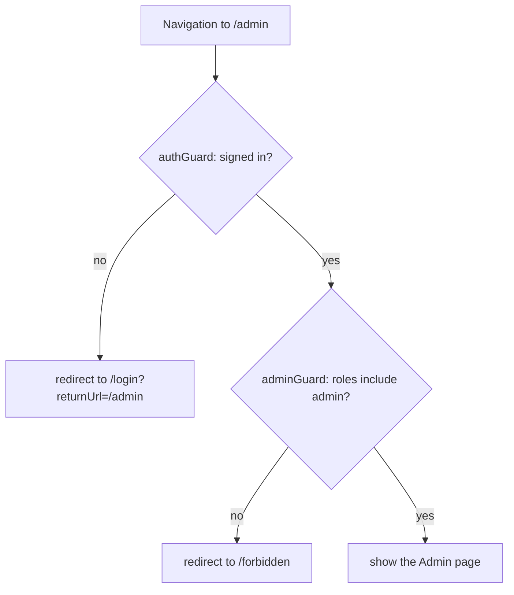

# 06. OIDC login with PKCE and route guards (angular-oauth2-oidc, Keycloak realm tasksteams)

> **Draft: written but not yet run.** The code and the expected output in this lesson were prepared by reading the code and the official documentation. They have not been executed yet. If something does not behave as described, trust your tool's real output and report it.

## What you will be able to do
By the end of this lesson you will be able to:
- Explain the authorization code flow with PKCE and why a browser app (a "public client") uses it instead of a client secret.
- Sign in against Keycloak with `angular-oauth2-oidc` 22.0.2, keep the tokens in memory only, and survive a page reload with a silent re-entry.
- Add the bearer token in an interceptor that only touches your API, and renew an expired token once, shared by all callers.
- Protect routes with functional guards (`CanActivateFn`) and send users back to where they wanted to go, without an open redirect.

## Recap
1. Why does every interceptor start with `isApiUrl(request.url)`? <details><summary>Answer</summary>So nothing (soon a token) is added to requests for other hosts (201.04).</details>
2. In `withInterceptors([a, b, c])`, which one sees a raw error first? <details><summary>Answer</summary>The last one, `c`, because it is closest to the network (201.04).</details>
3. What does `Api.invoke(getMe)` return, and where is the URL of the API configured? <details><summary>Answer</summary>A Promise of a `Me` object; `ApiConfiguration.rootUrl`, filled from `environment.apiBaseUrl` (201.05).</details>

## Why it matters
Think of a **hotel**. You do not hand your passport to every shop in town. You show it once at the reception (the **identity provider**, here Keycloak), and you get a **key card** that opens the doors you may use, for a short time. A shop (the **API**) only checks the key card. Your app is a visitor too: it must never see your password. It sends you to the reception, and gets a card back.

The standard for this is **OpenID Connect (OIDC)** on top of OAuth 2.0. A browser app cannot keep a secret (anyone can read its JavaScript), so it uses the **authorization code flow with PKCE** ("pixy"): before leaving, the app invents a random secret (`code_verifier`) and sends only its hash (`code_challenge`). The reception hands back a one-time **code**; to swap the code for tokens the app must show the original secret. A thief who steals the code from the address bar cannot use it.

The platform capstone sets up Keycloak with a realm `tasksteams` and a public client `tasks-web` for exactly this. The Angular capstone chapter "02 Sign in with Keycloak" builds the full version; this lesson builds the core of it step by step.

## What you will build
You extend `task-board`: a login page, a callback page, a home page that shows who you are (from `getMe`), a guarded explorer, an admin page for the `admin` role, a "no access" page, an `AuthService`, an `authInterceptor` and two guards.

```mermaid
sequenceDiagram
    autonumber
    participant B as Browser (Angular app)
    participant K as Keycloak 8180
    participant A as Mock API 8000
    B->>K: GET discovery document
    B->>B: make code_verifier and code_challenge (S256), state, nonce
    B->>K: redirect to authorize with client tasks-web and the challenge
    K->>B: login page; user types the password there
    K->>B: redirect to /auth/callback with code and state
    B->>K: POST token with code and code_verifier
    K->>B: access token, refresh token, id token
    B->>B: keep tokens in memory; remove code and state from the address bar
    B->>A: GET /v1/me with Authorization Bearer
    A->>B: 200 the caller, roles and scopes
```



## Before you start
- Lesson 05 done. Time: about 110 minutes (break after Step 5).
- **Docker is needed for Keycloak** (temporary, you remove it at the end). If you cannot run Docker, you can still read the lesson and write the code, but the app cannot sign in: its login page will show a discovery error.
- Source pack (optional): every file is shown in this lesson or in lesson 05. The finished code, the exercise starter and the solution are in the
  course repository https://github.com/Uee03/Code101 under `source/angular/201-hero-to-super-hero/phase-2-http-and-auth/06-oidc-login-pkce-and-route-guards/` (**Code, Download ZIP**, or `git clone https://github.com/Uee03/Code101.git`).
- Not repeated here because it did not change: `contract/openapi.yaml` (lesson 05). Files that did not change at all are listed at the end of the page.
- Three things run at the same time: Keycloak (Docker), the mock API (`npm run mock:auth`, port 8000) and the app (`npm start`, port 4200).

## Steps

### Step 1. Dependency and environment
**File: `package.json`**
```json
{
  "name": "task-board",
  "version": "1.0.0",
  "private": true,
  "scripts": {
    "ng": "ng",
    "api:gen": "ng-openapi-gen",
    "prestart": "npm run api:gen",
    "start": "ng serve --host localhost --port 4200",
    "prebuild": "npm run api:gen",
    "build": "ng build",
    "mock": "node server/mock-api.mjs",
    "mock:auth": "node server/mock-api.mjs --require-auth"
  },
  "dependencies": {
    "@angular/common": "22.3.0",
    "@angular/compiler": "22.3.0",
    "@angular/core": "22.3.0",
    "@angular/forms": "22.3.0",
    "@angular/platform-browser": "22.3.0",
    "@angular/router": "22.3.0",
    "angular-oauth2-oidc": "22.0.2",
    "rxjs": "7.8.2",
    "tslib": "2.8.1"
  },
  "devDependencies": {
    "@angular/build": "22.3.0",
    "@angular/cli": "22.3.0",
    "@angular/compiler-cli": "22.3.0",
    "ng-openapi-gen": "1.1.0",
    "typescript": "6.0.3"
  }
}
```

The only change: `angular-oauth2-oidc` 22.0.2 (its major version follows Angular's). Run `npm install`.

**File: `src/environments/environment.ts`**
```ts
export const environment = {
  apiBaseUrl: 'http://localhost:8000',
  issuer: 'http://localhost:8180/realms/tasksteams',
  clientId: 'tasks-web',
  scopes: 'openid profile email tasks:read tasks:write'
};
```

- `issuer` is the realm address. It must match **exactly** what Keycloak reports as its issuer: `http://localhost:8180/realms/tasksteams`. Use `localhost` in the browser too, never `127.0.0.1`.
- `clientId: 'tasks-web'` is a **public** client of the realm: no secret, PKCE required, redirect addresses `http://localhost:4200/*` allowed.
- `scopes` are the permissions the app asks for: `openid` (identity), `profile`, `email`, and the API scopes `tasks:read` and `tasks:write`.

### Step 2. Start Keycloak from the platform capstone
The realm file, users and compose file already exist in `capstones/platform`. In a **third** terminal, change to its identity lesson folder, copy the example settings (local practice values only, never reuse them anywhere real) and start only Keycloak.

Windows (PowerShell), from the repository root:
```powershell
cd capstones\platform\source\phase-3-identity\03-keycloak-identity\code
Copy-Item .env.example .env
docker compose -p platform up -d --wait keycloak
```
macOS and Linux:
```bash
cd capstones/platform/source/phase-3-identity/03-keycloak-identity/code
cp .env.example .env
docker compose -p platform up -d --wait keycloak
```
The first start pulls the image and imports the realm; it can take a few minutes. When the command returns, check that the discovery document answers: open http://localhost:8180/realms/tasksteams/.well-known/openid-configuration in the browser; you should see JSON with `issuer`, `authorization_endpoint` and `token_endpoint`.

The realm has three practice users (fake local passwords from the platform capstone): `alice` / `alice-local-fake` (role `admin`) and `bob` / `bob-local-fake` (role `member`). The password is typed on the Keycloak page only.

### Step 3. Configuration and storage
**File: `src/app/auth/auth.config.ts`**
```ts
import { AuthConfig } from 'angular-oauth2-oidc';
import { environment } from '../../environments/environment';

export function authConfig(origin: string): AuthConfig {
  return {
    issuer: environment.issuer,
    clientId: environment.clientId,
    redirectUri: origin + '/auth/callback',
    postLogoutRedirectUri: origin + '/login',
    responseType: 'code',
    scope: environment.scopes,
    requireHttps: 'remoteOnly',
    strictDiscoveryDocumentValidation: true,
    disablePKCE: false,
    timeoutFactor: 0.75,
    showDebugInformation: false,
    clearHashAfterLogin: true
  };
}

// Accepts only paths inside this app: "/explorer" is fine, "//evil.example" and "https://evil.example" fall back to "/".
export function safeReturn(value: string | null | undefined): string {
  return value?.startsWith('/') && !value.startsWith('//') && !/[\\\r\n]/.test(value) ? value : '/';
}
```

- `redirectUri`: where Keycloak sends the browser back; it must be allowed in the client. `postLogoutRedirectUri`: where it lands after sign-out.
- `responseType: 'code'` selects the authorization code flow. `disablePKCE: false` keeps PKCE on (the default; written out so nobody turns it off by accident).
- `requireHttps: 'remoteOnly'`: plain `http` is accepted for `localhost` only. Real hosts need https.
- `strictDiscoveryDocumentValidation: true`: refuse a discovery document whose URLs do not match the issuer.
- `timeoutFactor: 0.75`: the library announces "token about to expire" at 75 percent of the token lifetime, so we renew early.
- `safeReturn` protects against an **open redirect**: the address to return to travels in a query parameter that an attacker can edit. We only accept paths that start with one `/`.

**File: `src/app/auth/split-storage.ts`**
```ts
import { Injectable } from '@angular/core';
import { OAuthStorage } from 'angular-oauth2-oidc';

// Only these two entries must survive the redirect to Keycloak and back (the PKCE proof).
const transientKeys = new Set(['nonce', 'PKCE_verifier']);

// Tokens, expiry and claims live in a Map (memory only); the proof lives in sessionStorage.
@Injectable({ providedIn: 'root' })
export class SplitStorage implements OAuthStorage {
  private readonly memory = new Map<string, string>();

  getItem(key: string): string | null {
    return transientKeys.has(key) ? sessionStorage.getItem(key) : (this.memory.get(key) ?? null);
  }

  setItem(key: string, value: string): void {
    if (transientKeys.has(key)) {
      sessionStorage.setItem(key, value);
    } else {
      this.memory.set(key, value);
    }
  }

  removeItem(key: string): void {
    if (transientKeys.has(key)) {
      sessionStorage.removeItem(key);
    } else {
      this.memory.delete(key);
    }
  }

  clear(): void {
    this.memory.clear();
    transientKeys.forEach((key) => sessionStorage.removeItem(key));
  }
}
```

The library stores tokens in an `OAuthStorage`; by default that is `sessionStorage`, which any script on the page can read. Our `SplitStorage` keeps **tokens in a `Map` in memory**. Only `nonce` and `PKCE_verifier` go to `sessionStorage`, because they must survive the full-page redirect to Keycloak and back; they are useless without the code and are not tokens.

The price of memory-only tokens: a reload loses them. Step 4 handles that.

### Step 4. The AuthService
**File: `src/app/auth/auth.service.ts`**
```ts
import { computed, inject, Injectable, signal } from '@angular/core';
import { Router } from '@angular/router';
import { OAuthService } from 'angular-oauth2-oidc';
import { Api } from '../api/api';
import { getMe } from '../api/functions';
import { Me } from '../api/models';
import { authConfig, safeReturn } from './auth.config';
import { SplitStorage } from './split-storage';

@Injectable({ providedIn: 'root' })
export class AuthService {
  private readonly oauth = inject(OAuthService);
  private readonly storage = inject(SplitStorage);
  private readonly api = inject(Api);
  private readonly router = inject(Router);
  private renewal: Promise<void> | null = null;

  readonly user = signal<Me | null>(null);
  readonly error = signal('');
  readonly roles = computed(() => this.user()?.roles ?? []);
  readonly isAdmin = computed(() => this.roles().includes('admin'));

  token(): string {
    return this.oauth.getAccessToken();
  }

  signedIn(): boolean {
    return this.oauth.hasValidAccessToken();
  }

  // Runs once before the first screen (see provideAppInitializer in app.config.ts).
  async boot(): Promise<void> {
    this.oauth.configure(authConfig(location.origin));
    this.oauth.events.subscribe((event) => {
      if (event.type === 'token_expires' && 'info' in event && event.info === 'access_token') {
        void this.renew().catch(() => this.expired());
      }
    });
    try {
      await this.oauth.loadDiscoveryDocument();
      if (location.pathname === '/auth/callback') {
        const callbackError = new URLSearchParams(location.search).get('error');
        if (callbackError) {
          throw new Error(callbackError === 'login_required' ? 'Your session ended. Please sign in again.' : callbackError);
        }
        await this.oauth.tryLoginCodeFlow();
        if (!this.signedIn()) {
          throw new Error('Sign-in did not return an access token.');
        }
        await this.loadMe();
        localStorage.setItem('ts.hint', '1');
      } else if (localStorage.getItem('ts.hint') === '1' && !this.signedIn()) {
        this.signIn(location.pathname + location.search, true);
      }
    } catch (error) {
      this.error.set(error instanceof Error ? error.message : 'Sign-in failed. Try again.');
      localStorage.removeItem('ts.hint');
    } finally {
      if (location.pathname === '/auth/callback') {
        history.replaceState(null, '', '/auth/callback');
      }
    }
  }

  async loadMe(): Promise<void> {
    this.user.set(await this.api.invoke(getMe));
  }

  signIn(returnUrl = '/', silent = false): void {
    sessionStorage.setItem('ts.return', safeReturn(returnUrl));
    this.oauth.initCodeFlow('', silent ? { prompt: 'none' } : {});
  }

  // Called by the callback page: go back to where the user wanted to be.
  async finish(): Promise<void> {
    const target = safeReturn(sessionStorage.getItem('ts.return'));
    sessionStorage.removeItem('ts.return');
    await this.router.navigateByUrl(this.signedIn() ? target : '/login', { replaceUrl: true });
  }

  // One renewal at a time: every caller that arrives meanwhile shares the same Promise.
  renew(): Promise<void> {
    if (!this.renewal) {
      this.renewal = this.oauth
        .refreshToken()
        .then(() => undefined)
        .finally(() => {
          this.renewal = null;
        });
    }
    return this.renewal;
  }

  expired(): void {
    this.oauth.logOut(true);
    this.storage.clear();
    this.user.set(null);
    localStorage.removeItem('ts.hint');
    void this.router.navigate(['/login'], { queryParams: { returnUrl: safeReturn(this.router.url) } });
  }

  signOut(): void {
    localStorage.removeItem('ts.hint');
    this.user.set(null);
    // The library reads id_token_hint before it clears its token entries, so call logOut first.
    this.oauth.logOut();
    this.storage.clear();
  }
}
```

Read it in this order:
- **`boot()`** runs before the first screen (Step 6 registers it with `provideAppInitializer`). It configures the library, loads the discovery document, and then does one of three things:
  1. The path is `/auth/callback`: Keycloak has just sent us back. If the URL has `error=`, show it. Otherwise `tryLoginCodeFlow()` swaps the code for tokens using the stored `PKCE_verifier`, then `loadMe()` asks the API who we are, and the non-secret flag `ts.hint=1` is written to `localStorage`.
  2. The flag `ts.hint` is set but memory is empty (a reload): start a **silent** sign-in with `prompt: 'none'`. If the Keycloak session still lives, Keycloak answers with a code at once and no login page appears. If not, it answers `error=login_required`; the user sees "Your session ended" and the flag is removed, so there is no redirect loop.
  3. Otherwise nothing: the guards will send the user to `/login`.
  `finally` replaces the address bar entry, so `?code=...&state=...` does not stay in the browser history.
- **`user`, `roles`, `isAdmin`** are signals filled from `getMe`. The UI reads signals; roles come from the **API**, not from decoding the token in the browser.
- **`signIn()`** remembers the return path in `sessionStorage` (after `safeReturn`) and calls `initCodeFlow`, which redirects.
- **`finish()`** (called by the callback page) navigates to the remembered path with `replaceUrl: true`, so the Back button does not return to the callback.
- **`renew()`** is **single flight**: if five requests need a new token at once, they all share one `refreshToken()` Promise. This matters because Keycloak here rotates refresh tokens: a second parallel refresh with the same old token would fail.
- **`expired()`** and **`signOut()`** clear memory and the hint. `signOut` calls `logOut()` first, because the library needs the id token for `id_token_hint` before it clears its entries.

### Step 5. The interceptor and the guards
**File: `src/app/http/auth.interceptor.ts`**
```ts
import { HttpErrorResponse, HttpInterceptorFn } from '@angular/common/http';
import { inject } from '@angular/core';
import { catchError, from, switchMap, throwError } from 'rxjs';
import { AuthService } from '../auth/auth.service';
import { isApiUrl } from './api-url';

// Adds "Authorization: Bearer <token>" to API calls only. On a 401 it renews the token once and sends the request again.
export const authInterceptor: HttpInterceptorFn = (request, next) => {
  if (!isApiUrl(request.url)) {
    return next(request);
  }
  const auth = inject(AuthService);
  const originalToken = auth.token();
  const attach = () => (auth.token() ? request.clone({ setHeaders: { Authorization: `Bearer ${auth.token()}` } }) : request);

  return next(attach()).pipe(
    catchError((error: unknown) => {
      if (!(error instanceof HttpErrorResponse) || error.status !== 401) {
        return throwError(() => error);
      }
      // If another request already renewed the token, do not renew again.
      const renewal =
        auth.token() !== originalToken
          ? Promise.resolve()
          : auth.renew().catch((renewError: unknown) => {
              auth.expired();
              throw renewError;
            });
      return from(renewal).pipe(
        switchMap(() => next(attach())),
        catchError((retryError: unknown) => {
          if (retryError instanceof HttpErrorResponse && retryError.status === 401) {
            auth.expired();
          }
          return throwError(() => retryError);
        })
      );
    })
  );
};
```

- Not an API address: pass through unchanged. Keycloak calls (discovery, token) never get the API token.
- `attach()` clones the request (requests are immutable) and adds `Authorization: Bearer <token>`.
- On a **401** it renews once (or reuses a renewal another request already did: `auth.token() !== originalToken`) and sends the request again. A second 401 means the session is over: `expired()` sends the user to `/login`.
- The interceptor sits **after** `problemInterceptor` in the list (closer to the network), so it sees the raw `HttpErrorResponse` with status 401 before it becomes an `ApiProblem`.

**Take a break here.**

**File: `src/app/auth/guards.ts`**
```ts
import { inject } from '@angular/core';
import { CanActivateFn, Router } from '@angular/router';
import { safeReturn } from './auth.config';
import { AuthService } from './auth.service';

// Not signed in: go to /login and remember where the user wanted to go.
export const authGuard: CanActivateFn = (_route, state) => {
  const auth = inject(AuthService);
  return auth.signedIn() || inject(Router).createUrlTree(['/login'], { queryParams: { returnUrl: safeReturn(state.url) } });
};

// Signed in but not an administrator: show the "no access" page. Roles come from getMe, not from the token.
export const adminGuard: CanActivateFn = () => {
  const auth = inject(AuthService);
  return auth.isAdmin() || inject(Router).createUrlTree(['/forbidden']);
};
```

A **functional guard** is a function that runs inside an injection context (so `inject` works) and returns `true`, `false` or a `UrlTree` (a redirect). Returning a `UrlTree` is the recommended way to redirect: the router cancels the current navigation and starts the new one.
- `authGuard` reads `signedIn()` (a plain method on the library: guards want an answer now).
- `adminGuard` reads the `isAdmin` signal.

### Step 6. Wire it up
**File: `src/app/app.config.ts`**
```ts
import { ApplicationConfig, inject, provideAppInitializer, provideBrowserGlobalErrorListeners } from '@angular/core';
import { provideHttpClient, withFetch, withInterceptors } from '@angular/common/http';
import { provideRouter } from '@angular/router';
import { OAuthStorage, provideOAuthClient } from 'angular-oauth2-oidc';

import { ApiConfiguration } from './api/api-configuration';
import { environment } from '../environments/environment';
import { routes } from './app.routes';
import { AuthService } from './auth/auth.service';
import { SplitStorage } from './auth/split-storage';
import { authInterceptor } from './http/auth.interceptor';
import { problemInterceptor } from './http/problem.interceptor';
import { retryAfterInterceptor } from './http/retry-after.interceptor';
import { timingInterceptor } from './http/timing.interceptor';

export const appConfig: ApplicationConfig = {
  providers: [
    provideBrowserGlobalErrorListeners(),
    provideHttpClient(withFetch(), withInterceptors([timingInterceptor, problemInterceptor, authInterceptor, retryAfterInterceptor])),
    provideRouter(routes),
    provideOAuthClient(),
    { provide: OAuthStorage, useExisting: SplitStorage },
    { provide: ApiConfiguration, useValue: { rootUrl: environment.apiBaseUrl } },
    provideAppInitializer(() => inject(AuthService).boot())
  ]
};
```

- Order in the interceptor list: `timing`, `problem`, `auth`, `retryAfter`. The auth interceptor must be inside `problem` (to see the raw 401) and outside `retryAfter` (so a retried request after a 429 also carries the token).
- `provideOAuthClient()` registers the library's services. `{ provide: OAuthStorage, useExisting: SplitStorage }` makes the library use our memory storage.
- `provideAppInitializer(() => inject(AuthService).boot())`: Angular waits for the returned Promise before it shows the first screen. `boot` catches its own errors, so a Keycloak outage shows a message on the login page instead of a blank app.

**File: `src/app/app.routes.ts`**
```ts
import { Routes } from '@angular/router';
import { adminGuard, authGuard } from './auth/guards';
import { Admin } from './features/admin/admin';
import { Callback } from './features/callback/callback';
import { Explorer } from './features/explorer/explorer';
import { Forbidden } from './features/forbidden/forbidden';
import { Home } from './features/home/home';
import { Login } from './features/login/login';

export const routes: Routes = [
  { path: 'login', component: Login, title: 'Sign in' },
  { path: 'auth/callback', component: Callback, title: 'Signing in' },
  { path: '', component: Home, canActivate: [authGuard], title: 'Home' },
  { path: 'explorer', component: Explorer, canActivate: [authGuard], title: 'API explorer' },
  { path: 'admin', component: Admin, canActivate: [authGuard, adminGuard], title: 'Admin' },
  { path: 'forbidden', component: Forbidden, title: 'No access' },
  { path: '**', redirectTo: '' }
];
```

`login`, `auth/callback` and `forbidden` are public. The others use `canActivate`. In the `canActivate: [authGuard, adminGuard]` list order matters: the router prefers the first guard's non-`true` answer, so a signed-out visitor to `/admin` is sent to the login, not to "no access". The `title` option sets the browser tab title.

**File: `src/app/features/login/login.ts`**
```ts
import { ChangeDetectionStrategy, Component, inject } from '@angular/core';
import { ActivatedRoute } from '@angular/router';
import { safeReturn } from '../../auth/auth.config';
import { AuthService } from '../../auth/auth.service';

@Component({
  selector: 'app-login',
  changeDetection: ChangeDetectionStrategy.OnPush,
  template: `
    <h1>Sign in</h1>
    <p>You sign in on the Keycloak page. This app never sees your password.</p>
    @if (auth.error(); as message) {
      <p role="alert">{{ message }}</p>
    }
    <button type="button" (click)="signIn()">Sign in with Keycloak</button>
  `
})
export class Login {
  protected readonly auth = inject(AuthService);
  private readonly route = inject(ActivatedRoute);

  protected signIn(): void {
    this.auth.signIn(safeReturn(this.route.snapshot.queryParamMap.get('returnUrl')));
  }
}
```

**File: `src/app/features/callback/callback.ts`**
```ts
import { ChangeDetectionStrategy, Component, inject, OnInit } from '@angular/core';
import { AuthService } from '../../auth/auth.service';

@Component({
  selector: 'app-callback',
  changeDetection: ChangeDetectionStrategy.OnPush,
  template: `
    <h1>Signing in</h1>
    <p role="status">One moment, finishing the sign-in.</p>
  `
})
export class Callback implements OnInit {
  private readonly auth = inject(AuthService);

  ngOnInit(): void {
    void this.auth.finish();
  }
}
```

**File: `src/app/features/forbidden/forbidden.ts`**
```ts
import { ChangeDetectionStrategy, Component } from '@angular/core';
import { RouterLink } from '@angular/router';

@Component({
  selector: 'app-forbidden',
  imports: [RouterLink],
  changeDetection: ChangeDetectionStrategy.OnPush,
  template: `
    <h1>You do not have access</h1>
    <p>This page needs a role that your account does not have.</p>
    <a routerLink="/">Go home</a>
  `
})
export class Forbidden {}
```

**File: `src/app/features/home/home.ts`**
```ts
import { ChangeDetectionStrategy, Component, inject } from '@angular/core';
import { AuthService } from '../../auth/auth.service';

@Component({
  selector: 'app-home',
  changeDetection: ChangeDetectionStrategy.OnPush,
  template: `
    <h1>Home</h1>
    @if (auth.user(); as user) {
      <p>Hello, {{ user.displayName }}.</p>
      <p>Roles: {{ user.roles.join(', ') }}. Scopes: {{ user.scopes.join(', ') }}.</p>
      <h2>Your teams</h2>
      <ul>
        @for (team of user.teams; track team.teamId) {
          <li>{{ team.name }} ({{ team.role }})</li>
        }
      </ul>
    }
  `
})
export class Home {
  protected readonly auth = inject(AuthService);
}
```

**File: `src/app/features/admin/admin.ts`**
```ts
import { ChangeDetectionStrategy, Component } from '@angular/core';

@Component({
  selector: 'app-admin',
  changeDetection: ChangeDetectionStrategy.OnPush,
  template: `
    <h1>Admin</h1>
    <p>Only administrators reach this page. The guard decides in the browser; the API still checks the role on every call.</p>
  `
})
export class Admin {}
```

**File: `src/app/features/explorer/explorer.html`**
```html
<section aria-labelledby="explorer-heading">
  <h1 id="explorer-heading">Call the API with generated functions</h1>
  <p>Start the mock API in a second terminal (<code>npm run mock:auth</code>), then press a button.</p>

  <ul class="probes">
    @for (probe of probes; track probe.label) {
      <li><button type="button" (click)="run(probe)">{{ probe.label }}</button></li>
    }
  </ul>

  <div role="status">
    @switch (outcome().kind) {
      @case ('loading') {
        <p>Waiting for the answer...</p>
      }
    }
  </div>

  @let current = outcome();
  @if (current.kind === 'ok') {
    <p>{{ current.label }}:</p>
    <pre>{{ current.data }}</pre>
  } @else if (current.kind === 'problem') {
    <p>{{ current.label }}:</p>
    <app-problem-view [problem]="current.problem" />
  }
</section>
```

Two small changes: the explorer's top heading is now an `<h1>` (every page has exactly one `h1`, and the app shell no longer has one), and the hint says `npm run mock:auth`.

**File: `src/app/app.ts`**
```ts
import { ChangeDetectionStrategy, Component, inject } from '@angular/core';
import { RouterLink, RouterLinkActive, RouterOutlet } from '@angular/router';
import { AuthService } from './auth/auth.service';

@Component({
  selector: 'app-root',
  imports: [RouterLink, RouterLinkActive, RouterOutlet],
  changeDetection: ChangeDetectionStrategy.OnPush,
  templateUrl: './app.html',
  styleUrl: './app.css'
})
export class App {
  protected readonly auth = inject(AuthService);
}
```

**File: `src/app/app.html`**
```html
<header class="bar">
  <a routerLink="/" class="brand">Task board</a>
  <nav aria-label="Main">
    @if (auth.user(); as user) {
      <a routerLink="/" routerLinkActive="active" [routerLinkActiveOptions]="{ exact: true }" ariaCurrentWhenActive="page">Home</a>
      <a routerLink="/explorer" routerLinkActive="active" ariaCurrentWhenActive="page">API explorer</a>
      @if (auth.isAdmin()) {
        <a routerLink="/admin" routerLinkActive="active" ariaCurrentWhenActive="page">Admin</a>
      }
      <span>{{ user.displayName }}</span>
      <button type="button" (click)="auth.signOut()">Sign out</button>
    } @else {
      <a routerLink="/login">Sign in</a>
    }
  </nav>
</header>

<main class="page">
  <router-outlet />
</main>
```

**File: `src/app/app.css`**
```css
.bar {
  display: flex;
  flex-wrap: wrap;
  align-items: center;
  gap: 1rem;
  padding-bottom: 0.75rem;
  border-bottom: 1px solid #9ca3af;
}

.brand {
  font-weight: 700;
}

nav {
  display: flex;
  flex-wrap: wrap;
  align-items: center;
  gap: 1rem;
}

nav a.active {
  text-decoration: underline;
}

.page {
  display: block;
  max-width: 44rem;
  margin: 1rem auto;
}
```

The shell reads the **signal** `auth.user()` to show links, not `signedIn()`: a signal tells Angular to redraw when it changes, a plain method does not. `ariaCurrentWhenActive="page"` sets `aria-current="page"` on the link of the current page for screen readers.

### Step 7. The mock learns who is calling
**File: `server/mock-api.mjs`**
```js
// A tiny stand-in for the Tasks and Teams backend, for lessons 04 to 10 of the Angular 201 track.
// Since lesson 06 GET /v1/me answers as bob when the bearer token says so (see currentUser).
// It speaks a small part of the platform contract on port 8000. It is NOT a real backend: no database,
// no token validation (it only checks that a bearer header exists when started with --require-auth).
// Stop it before you start a real backend: both want port 8000.
import { createServer } from 'node:http';
import { randomUUID } from 'node:crypto';

const PORT = 8000;
const ORIGIN = 'http://localhost:4200';
const REQUIRE_AUTH = process.argv.includes('--require-auth');

const USER_ID = '33333333-3333-4333-8333-333333333333';
const TEAM_ID = '11111111-1111-4111-8111-111111111111';
const PROJECT_ID = '22222222-2222-4222-8222-222222222222';
const taskId = (number) => `5d1b8d9e-0000-4000-8000-${String(number).padStart(12, '0')}`;
const STATUSES = ['todo', 'in_progress', 'blocked', 'done', 'cancelled'];
const PRIORITIES = ['low', 'medium', 'high', 'urgent'];

const ME = {
  id: USER_ID,
  username: 'alice',
  email: 'alice@example.test',
  displayName: 'Alice Admin',
  roles: ['admin'],
  scopes: ['tasks:read', 'tasks:write'],
  teams: [{ teamId: TEAM_ID, name: 'Platform Team', role: 'lead' }]
};

const BOB = {
  id: '44444444-4444-4444-8444-444444444444',
  username: 'bob',
  email: 'bob@example.test',
  displayName: 'Bob Member',
  roles: ['member'],
  scopes: ['tasks:read', 'tasks:write'],
  teams: [{ teamId: TEAM_ID, name: 'Platform Team', role: 'member' }]
};

// A mock shortcut: it reads the user name from the token payload WITHOUT checking the signature.
// A real backend validates signature, issuer, audience and expiry before it trusts any claim.
function currentUser(req) {
  const token = (req.headers.authorization ?? '').slice('Bearer '.length);
  try {
    const payload = JSON.parse(Buffer.from(token.split('.')[1], 'base64url').toString('utf8'));
    return payload.preferred_username === 'bob' ? BOB : ME;
  } catch {
    return ME;
  }
}

const timestamp = () => new Date().toISOString();
const makeTask = (number, title, status, priority) => ({
  id: taskId(number),
  projectId: PROJECT_ID,
  title,
  description: '',
  status,
  priority,
  assigneeId: null,
  dueDate: null,
  completedAt: status === 'done' ? timestamp() : null,
  createdBy: USER_ID,
  version: 1,
  createdAt: timestamp(),
  updatedAt: timestamp()
});

const tasks = [
  makeTask(1, 'Write the OpenAPI file', 'done', 'high'),
  makeTask(2, 'Add the health check', 'in_progress', 'medium'),
  makeTask(3, 'Seed the database', 'todo', 'medium'),
  makeTask(4, 'Explain signals', 'todo', 'low'),
  makeTask(5, 'Record a demo', 'blocked', 'high'),
  makeTask(6, 'Review the release notes', 'todo', 'urgent')
];
let nextNumber = 7;
const replays = new Map();
let limitedCalls = 0;

function send(res, status, body, headers = {}) {
  res.writeHead(status, {
    'Access-Control-Allow-Origin': ORIGIN,
    'Access-Control-Expose-Headers': 'ETag, Location, Retry-After, Idempotent-Replayed, RateLimit-Remaining',
    Vary: 'Origin',
    'RateLimit-Limit': '100',
    'RateLimit-Remaining': '99',
    'Content-Type': 'application/json',
    ...headers
  });
  res.end(body === undefined ? undefined : JSON.stringify(body));
}

function problem(req, res, status, title, detail, extra = {}, headers = {}) {
  const slug = title.toLowerCase().replaceAll(' ', '-');
  send(
    res,
    status,
    {
      type: `https://code101.example/problems/${slug}`,
      title,
      status,
      detail,
      instance: new URL(req.url, 'http://localhost').pathname,
      traceId: randomUUID().replaceAll('-', ''),
      ...extra
    },
    { 'Content-Type': 'application/problem+json', ...headers }
  );
}

async function readJson(req) {
  const chunks = [];
  for await (const chunk of req) {
    chunks.push(chunk);
  }
  try {
    return JSON.parse(Buffer.concat(chunks).toString('utf8') || '{}');
  } catch {
    return null;
  }
}

const page = (items, limit, nextCursor) => ({ items, page: { limit, nextCursor } });

function validate(body, partial) {
  const errors = [];
  if (!partial || 'title' in body) {
    if (typeof body.title !== 'string' || body.title.length < 1 || body.title.length > 200) {
      errors.push({ pointer: '/title', detail: 'must be between 1 and 200 characters' });
    } else if (/[<>]/.test(body.title)) {
      errors.push({ pointer: '/title', detail: 'must not contain < or >' });
    }
  }
  if ('status' in body && !STATUSES.includes(body.status)) {
    errors.push({ pointer: '/status', detail: `must be one of ${STATUSES.join(', ')}` });
  }
  if ('priority' in body && !PRIORITIES.includes(body.priority)) {
    errors.push({ pointer: '/priority', detail: `must be one of ${PRIORITIES.join(', ')}` });
  }
  if ('dueDate' in body && body.dueDate !== null && !/^\d{4}-\d{2}-\d{2}$/.test(body.dueDate)) {
    errors.push({ pointer: '/dueDate', detail: 'must be a date like 2026-12-31' });
  }
  return errors;
}

const server = createServer(async (req, res) => {
  const url = new URL(req.url, 'http://localhost');
  const path = url.pathname;
  const method = req.method;

  if (method === 'OPTIONS') {
    res.writeHead(204, {
      'Access-Control-Allow-Origin': ORIGIN,
      'Access-Control-Allow-Methods': 'GET, POST, PATCH, PUT, DELETE, OPTIONS',
      'Access-Control-Allow-Headers': 'Authorization, Content-Type, If-Match, If-None-Match, Idempotency-Key',
      'Access-Control-Max-Age': '600',
      Vary: 'Origin'
    });
    res.end();
    return;
  }

  if (method === 'GET' && path === '/health') {
    send(res, 200, { status: 'ok', version: 'mock', database: 'up' });
    return;
  }

  if (path.startsWith('/v1/') && REQUIRE_AUTH && !(req.headers.authorization ?? '').startsWith('Bearer ')) {
    problem(req, res, 401, 'Unauthorized', 'A bearer access token is required.', {}, { 'WWW-Authenticate': 'Bearer realm="tasksteams"' });
    return;
  }

  let match = path.match(/^\/v1\/demo\/error\/(\d{3})$/);
  if (method === 'GET' && match) {
    const status = Number(match[1]);
    const extra = status === 422 ? { errors: [{ pointer: '/title', detail: 'must be between 1 and 200 characters' }] } : {};
    const headers = status === 429 ? { 'Retry-After': '2' } : {};
    problem(req, res, status, `Demo error ${status}`, `This is a demo answer with status ${status}.`, extra, headers);
    return;
  }
  if (method === 'GET' && path === '/v1/demo/limited') {
    limitedCalls++;
    if (limitedCalls % 2 === 1) {
      problem(req, res, 429, 'Too many requests', 'Slow down.', {}, { 'Retry-After': '1' });
    } else {
      send(res, 200, { ok: true, message: 'The retry worked.' });
    }
    return;
  }
  if (method === 'GET' && path === '/v1/demo/drop') {
    req.socket.destroy();
    return;
  }

  if (method === 'GET' && path === '/v1/me') {
    send(res, 200, currentUser(req));
    return;
  }
  if (method === 'GET' && path === '/v1/teams') {
    const team = { id: TEAM_ID, name: 'Platform Team', description: 'Builds the platform', memberCount: 1, createdBy: USER_ID, version: 1, createdAt: timestamp(), updatedAt: timestamp() };
    send(res, 200, page([team], 25, null));
    return;
  }
  match = path.match(/^\/v1\/teams\/([^/]+)\/projects$/);
  if (method === 'GET' && match) {
    const project = { id: PROJECT_ID, teamId: match[1], key: 'PLAT', name: 'Platform', description: 'The platform project', archived: false, version: 1, createdAt: timestamp(), updatedAt: timestamp() };
    send(res, 200, page([project], 25, null));
    return;
  }

  match = path.match(/^\/v1\/projects\/([^/]+)\/tasks$/);
  if (match && method === 'GET') {
    const limit = Math.min(100, Math.max(1, Number(url.searchParams.get('limit') ?? 25) || 25));
    const start = Number(url.searchParams.get('cursor') ?? 0);
    if (!Number.isInteger(start) || start < 0) {
      problem(req, res, 400, 'Bad request', 'The cursor is not valid.');
      return;
    }
    const wanted = url.searchParams.getAll('status');
    const text = (url.searchParams.get('q') ?? '').toLowerCase();
    const rows = tasks.filter((task) => (wanted.length === 0 || wanted.includes(task.status)) && task.title.toLowerCase().includes(text));
    const end = start + limit;
    send(res, 200, page(rows.slice(start, end), limit, end < rows.length ? String(end) : null));
    return;
  }
  if (match && method === 'POST') {
    const body = await readJson(req);
    if (body === null) {
      problem(req, res, 400, 'Bad request', 'The body is not valid JSON.');
      return;
    }
    const errors = validate(body, false);
    if (errors.length > 0) {
      problem(req, res, 422, 'Validation failed', 'One or more fields are invalid.', { errors });
      return;
    }
    const key = req.headers['idempotency-key'];
    const fingerprint = JSON.stringify(body);
    if (typeof key === 'string' && replays.has(key)) {
      const first = replays.get(key);
      if (first.fingerprint !== fingerprint) {
        problem(req, res, 422, 'Validation failed', 'The Idempotency-Key was used with another body.');
        return;
      }
      send(res, 201, first.task, { Location: `http://localhost:${PORT}/v1/tasks/${first.task.id}`, ETag: '"1"', 'Idempotent-Replayed': 'true' });
      return;
    }
    const task = makeTask(nextNumber++, body.title, 'todo', body.priority ?? 'medium');
    task.description = body.description ?? '';
    task.dueDate = body.dueDate ?? null;
    tasks.push(task);
    if (typeof key === 'string') {
      replays.set(key, { fingerprint, task });
    }
    send(res, 201, task, { Location: `http://localhost:${PORT}/v1/tasks/${task.id}`, ETag: '"1"' });
    return;
  }

  match = path.match(/^\/v1\/tasks\/([^/]+)$/);
  if (match) {
    const task = tasks.find((row) => row.id === match[1]);
    if (!task) {
      problem(req, res, 404, 'Not found', 'The task does not exist, or you may not know that it exists.');
      return;
    }
    const etag = `"${task.version}"`;
    if (method === 'GET') {
      if (req.headers['if-none-match'] === etag) {
        send(res, 304, undefined, { ETag: etag });
        return;
      }
      send(res, 200, task, { ETag: etag });
      return;
    }
    if (method === 'PATCH') {
      if (!req.headers['if-match']) {
        problem(req, res, 428, 'Precondition required', 'Send the If-Match header with the ETag you read.');
        return;
      }
      if (req.headers['if-match'] !== etag) {
        problem(req, res, 412, 'Precondition failed', `The task changed since you read it (current version ${task.version}).`);
        return;
      }
      const body = await readJson(req);
      if (body === null) {
        problem(req, res, 400, 'Bad request', 'The body is not valid JSON.');
        return;
      }
      const errors = validate(body, true);
      if (errors.length > 0) {
        problem(req, res, 422, 'Validation failed', 'One or more fields are invalid.', { errors });
        return;
      }
      Object.assign(task, body, { version: task.version + 1, updatedAt: timestamp() });
      task.completedAt = task.status === 'done' ? timestamp() : null;
      send(res, 200, task, { ETag: `"${task.version}"` });
      return;
    }
  }

  problem(req, res, 404, 'Not found', 'This mock server does not know that address.');
});

server.listen(PORT, 'localhost', () => {
  console.log(`Mock API on http://localhost:${PORT}${REQUIRE_AUTH ? ' (bearer header required)' : ''}`);
});
```

Only three things changed compared with lesson 04: a second user `BOB` (role `member`), the function `currentUser(req)`, and `GET /v1/me` answering `currentUser(req)`. It reads `preferred_username` from the **payload** of the bearer token **without checking the signature**. That is acceptable for a classroom mock and is exactly what a real backend must not do: it validates signature (JWKS keys), issuer, audience and expiry first. With this change you can see the admin guard work for alice and refuse bob.

## Run it
1. Keycloak is running (Step 2). Terminal 1: `npm run mock:auth` (it answers 401 for `/v1/*` without a bearer header). Terminal 2: `npm start`. Open http://localhost:4200/.

**Predict:** you are signed in as alice on `/explorer` and press F5. Does the page ask for your password again? How many redirects happen, and which stored value makes that possible?

Expected behaviour (derived by reading the code and the realm; not yet seen in a browser):
1. You open `/`: memory is empty and there is no hint, so `authGuard` redirects to `/login?returnUrl=%2F`. The page shows "Sign in" and a button.
2. **Sign in with Keycloak**: the browser goes to `http://localhost:8180/realms/tasksteams/protocol/openid-connect/auth?...` with, among others, `response_type=code`, `client_id=tasks-web`, `code_challenge=...` and `code_challenge_method=S256`. Keycloak shows its own login form.
3. Sign in as `alice` / `alice-local-fake`. The browser returns to `/auth/callback?code=...&state=...`, shows "Signing in" for a moment, and lands on **Home**: "Hello, Alice Admin.", roles `admin`, one team. The address bar shows `/` without `code` or `state`. The header shows Home, API explorer, Admin, "Alice Admin" and **Sign out**.
4. **API explorer**, then `getMe`: in the Network tab the request has an `Authorization: Bearer ...` header. (Do not copy token values anywhere.)
5. DevTools, Application, Storage: `localStorage` has `ts.hint` = `1` and no token. `sessionStorage` has at most `nonce` and `PKCE_verifier`. No key holds a token.
6. **F5 on `/explorer`**: the page reloads, the memory is empty, `ts.hint` is `1`, so `boot()` starts a silent sign-in: one redirect to Keycloak with `prompt=none` and one back to `/auth/callback`. No password is asked while the Keycloak session lives (30 minutes idle in this realm), and you land on `/explorer`.
7. After about 4 minutes (75 percent of a 5-minute access token) the Network tab shows a `POST .../protocol/openid-connect/token` with `grant_type=refresh_token`, once, even if several calls ran meanwhile.
8. **Sign out**: the browser visits Keycloak's end-session address and returns to `/login`. Opening `/explorer` now redirects to `/login?returnUrl=%2Fexplorer`.
9. Sign in as `bob` / `bob-local-fake`: the header has no **Admin** link. Type `http://localhost:4200/admin` in the address bar: you land on "You do not have access". Press F5 on `/forbidden`; it stays (no sign-in needed to see that page).

## How it works
1. **Discovery**: `/.well-known/openid-configuration` lists the endpoints, so the app needs only the issuer address.
2. **Authorization code + PKCE**: the app sends the challenge, Keycloak authenticates the user and returns a one-time code, and the token request proves possession of the verifier.
3. **Tokens**: the **access token** goes to the API (short life, about 5 minutes); the **refresh token** gets a new access token without asking the user; the **id token** says who signed in and is used for `id_token_hint` at sign-out.
4. **Guards** only decide what the router shows. They protect nothing on the server: anyone can call the API with a script. The API still validates the token and the role on every request.

Where each value lives:
| Value | Where | Why |
|---|---|---|
| access, refresh and id tokens, expiry | a `Map` in memory | gone on reload, not readable from storage by injected scripts |
| `nonce`, `PKCE_verifier` | `sessionStorage` | must survive the redirect; useless alone |
| `ts.hint` (`1`) | `localStorage` | not a secret; only says "try a silent sign-in" |
| `ts.return` (a path) | `sessionStorage` | where to go after the callback; checked by `safeReturn` |

**Why this, not that.**
- *`angular-oauth2-oidc`* versus *`keycloak-js` with `keycloak-angular`*: the first is a generic OIDC client (works with other providers); the second is Keycloak-only. The capstone uses the generic one.
- *Tokens in memory* versus *`localStorage`*: storage survives reloads but is readable by any injected script (XSS). Memory costs one redirect after a reload. A **backend-for-frontend** (the server keeps the tokens, the browser only has a cookie) is stronger still, but needs server code and is out of scope.
- *Guard `CanActivateFn`* versus *checking in each component*: one rule in the route table cannot be forgotten; components stay simple.

**Security note.** (1) Never put a token in a URL, a log line or an error message. (2) `safeReturn` stops open redirects. (3) The bearer header is added only to the API origin (`isApiUrl`): without it, a call to any other site would receive your token. (4) A guard is user experience, not security. (5) The mock's `currentUser` shortcut is for the classroom only.

**Misconception:** "if the user cannot see the Admin link, the admin data is safe." Hiding a link is not access control. The API must refuse non-admins itself, and the platform backends do (403).

## Try it
Starter file: `exercise/starter/src/app/auth/role-guard.ts`.
1. **Guided:** write `roleGuard(role)` (the TODOs): a guard factory that returns `true` when `AuthService.roles()` includes the role, otherwise a `UrlTree` for `/forbidden`. Predict what happens for bob if you use it as `roleGuard('admin')`.
2. **Change:** in `app.routes.ts` replace `adminGuard` by `roleGuard('admin')` and delete `adminGuard` from `guards.ts` (and its import in the routes). Which lines change?
3. **Stretch (optional):** make `forbidden` show which role is missing. Hint: a guard can pass data in the redirect with `queryParams`; the page reads it with `ActivatedRoute`. What must the page do with that text before it shows it?

<details><summary>Solution for rung 1</summary>

**File: `exercise/solution/src/app/auth/role-guard.ts`**
```ts
import { inject } from '@angular/core';
import { CanActivateFn, Router } from '@angular/router';
import { Role } from '../api/models';
import { AuthService } from './auth.service';

// A guard factory: roleGuard('admin') returns a guard that only lets users with that role in.
export function roleGuard(role: Role): CanActivateFn {
  return () => inject(AuthService).roles().includes(role) || inject(Router).createUrlTree(['/forbidden']);
}
```

Bob has the role `member`, so `roles().includes('admin')` is `false` and the guard returns the `UrlTree` for `/forbidden`. For rung 2 the route becomes `{ path: 'admin', component: Admin, canActivate: [authGuard, roleGuard('admin')], title: 'Admin' }` with `import { roleGuard } from './auth/role-guard';`.

</details>

## Check yourself
1. Why can a stolen authorization `code` not be used by a thief? <details><summary>Answer</summary>The token request also needs the `code_verifier` that only the original app holds; the code alone is useless.</details>
2. Why is the renewal "single flight"? <details><summary>Answer</summary>Refresh tokens rotate: a second parallel request with the old refresh token would be rejected. All callers share one renewal Promise.</details>
3. What does the app store in `localStorage`, and why is it safe? <details><summary>Answer</summary>Only the flag `ts.hint=1`. It is not a secret; it only triggers a silent sign-in attempt.</details>
4. Bob types `/admin` in the address bar. Which layer stops him, and which layer must stop him even if he skips the browser? <details><summary>Answer</summary>`adminGuard` stops him in the browser; the API must refuse him with 403 even for a direct call.</details>

## Common mistakes
| Symptom or error text | Cause | Fix |
|---|---|---|
| Keycloak page: typical text `Invalid parameter: redirect_uri` | The app runs on another origin (`127.0.0.1`, or a port other than 4200 or 5173) | Open `http://localhost:4200/` |
| Login page shows a discovery or network error | Keycloak is not running or not ready yet | `docker compose -p platform ps` in the platform folder; wait for healthy; open the discovery URL |
| Typical message about an issuer mismatch | The `issuer` in `environment.ts` differs from the issuer in the discovery document | Use exactly `http://localhost:8180/realms/tasksteams` |
| After sign-in the page returns to the login with "Your session ended" | The silent sign-in found no Keycloak session | Press the button and type the password again |
| Every API call is 401 with the Explorer | The mock runs with `--require-auth` and the call carries no bearer header (not signed in, or a URL outside `apiBaseUrl`) | Sign in; check `environment.apiBaseUrl` |
| The header never shows the user after sign-in | A template reads `auth.signedIn()` (a plain method) instead of the `auth.user()` signal | Read the signal in templates |
| Docker error about port 8180 in use | Another Keycloak is running | Stop it, or stop the old `platform` project |

## Best practice
Use the authorization code flow with PKCE for browser apps, keep tokens out of storage and URLs, add the token only for your API's origin, renew once for all callers, and let the server be the real gatekeeper. Source: OAuth 2.0 for Browser-Based Applications (IETF) https://datatracker.ietf.org/doc/draft-ietf-oauth-browser-based-apps/ , RFC 7636 (PKCE) https://www.rfc-editor.org/info/rfc7636 and Angular route guards https://angular.dev/guide/routing/route-guards

## Clean up
When you finish the Keycloak lessons, remove the temporary container. In the platform folder of Step 2:
```text
docker compose -p platform down -v
```
`-v` also removes the volumes. The `.env` file you copied is for you only: do not commit it.

## Going further
- `angular-oauth2-oidc` documentation: https://manfredsteyer.github.io/angular-oauth2-oidc/docs/
- OpenID Connect Core 1.0: https://openid.net/specs/openid-connect-core-1_0.html
- Capstone: `capstones/web-angular` chapter 02 "Sign in with Keycloak" (step-up scope `tasks:admin`, admin guard, the Node check script) and `capstones/platform` chapter 03 (the realm).
- Keycloak documentation: https://www.keycloak.org/documentation

## Summary
- You signed in with the authorization code flow and PKCE and kept tokens in memory.
- You attached the bearer token only to API calls and renewed it once for all callers.
- You protected routes with guards and returned users to their page safely.

## Next lesson
07. Reactive forms and validation: build a create-task form with typed controls, built-in, custom and async validators, and server errors mapped to fields. Phase 3 continues from the lesson 05 project, so you only need the mock (no sign-in) there.

<details>
<summary>Files that did not change in this lesson (listed so this page is complete)</summary>

**File: `.gitignore`**

```
node_modules/
dist/
.angular/
.env
*.log
src/app/api/
```

**File: `angular.json`**

```json
{
  "$schema": "./node_modules/@angular/cli/lib/config/schema.json",
  "version": 1,
  "cli": {
    "packageManager": "npm",
    "analytics": false
  },
  "newProjectRoot": "projects",
  "projects": {
    "task-board": {
      "projectType": "application",
      "schematics": {
        "@schematics/angular:class": {
          "skipTests": true
        },
        "@schematics/angular:component": {
          "skipTests": true
        },
        "@schematics/angular:directive": {
          "skipTests": true
        },
        "@schematics/angular:guard": {
          "skipTests": true
        },
        "@schematics/angular:interceptor": {
          "skipTests": true
        },
        "@schematics/angular:pipe": {
          "skipTests": true
        },
        "@schematics/angular:resolver": {
          "skipTests": true
        },
        "@schematics/angular:service": {
          "skipTests": true
        }
      },
      "root": "",
      "sourceRoot": "src",
      "prefix": "app",
      "architect": {
        "build": {
          "builder": "@angular/build:application",
          "options": {
            "browser": "src/main.ts",
            "tsConfig": "tsconfig.app.json",
            "assets": [
              {
                "glob": "**/*",
                "input": "public"
              }
            ],
            "styles": [
              "src/styles.css"
            ]
          },
          "configurations": {
            "production": {
              "budgets": [
                {
                  "type": "initial",
                  "maximumWarning": "500kB",
                  "maximumError": "1MB"
                },
                {
                  "type": "anyComponentStyle",
                  "maximumWarning": "4kB",
                  "maximumError": "8kB"
                }
              ],
              "outputHashing": "all"
            },
            "development": {
              "optimization": false,
              "extractLicenses": false,
              "sourceMap": true
            }
          },
          "defaultConfiguration": "production"
        },
        "serve": {
          "builder": "@angular/build:dev-server",
          "configurations": {
            "production": {
              "buildTarget": "task-board:build:production"
            },
            "development": {
              "buildTarget": "task-board:build:development"
            }
          },
          "defaultConfiguration": "development"
        }
      }
    }
  }
}
```

**File: `ng-openapi-gen.json`**

```json
{
  "$schema": "./node_modules/ng-openapi-gen/ng-openapi-gen-schema.json",
  "input": "contract/openapi.yaml",
  "output": "src/app/api",
  "apiService": "Api",
  "promises": true,
  "services": false
}
```

**File: `public/favicon.svg`**

```xml
<svg xmlns="http://www.w3.org/2000/svg" viewBox="0 0 24 24" width="24" height="24" fill="none" stroke="#1d6fb8" stroke-width="2" stroke-linecap="round" stroke-linejoin="round">
  <path d="M22 11.08V12a10 10 0 1 1-5.93-9.14"/><polyline points="22 4 12 14.01 9 11.01"/>
</svg>
```

**File: `src/app/features/explorer/explorer.css`**

```css
.probes {
  padding: 0;
  list-style: none;
}

.probes li {
  margin: 0.5rem 0;
}

button {
  min-height: 2.25rem;
  padding: 0.25rem 0.75rem;
}

pre {
  padding: 0.75rem;
  overflow-x: auto;
  background: #f3f4f6;
  color: #1f2937;
}
```

**File: `src/app/features/explorer/explorer.ts`**

```ts
import { ChangeDetectionStrategy, Component, inject, signal } from '@angular/core';
import { Api } from '../../api/api';
import { createTask, getHealth, getMe, getTask, listProjects, listTasks, listTeams, updateTask } from '../../api/functions';
import { ApiProblem, isApiProblem } from '../../http/problem';
import { ProblemView } from '../../shared/problem-view';

interface Probe {
  label: string;
  run: () => Promise<unknown>;
}

type Outcome = { kind: 'idle' } | { kind: 'loading'; label: string } | { kind: 'ok'; label: string; data: string } | { kind: 'problem'; label: string; problem: ApiProblem };

@Component({
  selector: 'app-explorer',
  imports: [ProblemView],
  changeDetection: ChangeDetectionStrategy.OnPush,
  templateUrl: './explorer.html',
  styleUrl: './explorer.css'
})
export class Explorer {
  private readonly api = inject(Api);
  private lastTaskId: string | null = null;

  protected readonly probes: readonly Probe[] = [
    { label: 'getHealth', run: () => this.api.invoke(getHealth) },
    { label: 'getMe', run: () => this.api.invoke(getMe) },
    { label: 'listTasks (open tasks of the first project)', run: () => this.openTasks() },
    { label: 'createTask', run: () => this.create() },
    { label: 'getTask (read the ETag header)', run: () => this.readEtag() },
    { label: 'updateTask with a stale If-Match (expect 412)', run: () => this.updateStale() }
  ];
  protected readonly outcome = signal<Outcome>({ kind: 'idle' });

  protected async run(probe: Probe): Promise<void> {
    this.outcome.set({ kind: 'loading', label: probe.label });
    try {
      const data = await probe.run();
      this.outcome.set({ kind: 'ok', label: probe.label, data: JSON.stringify(data, null, 2) });
    } catch (error) {
      if (isApiProblem(error)) {
        this.outcome.set({ kind: 'problem', label: probe.label, problem: error });
      } else {
        throw error;
      }
    }
  }

  private async firstProjectId(): Promise<string> {
    const teams = await this.api.invoke(listTeams, { limit: 1 });
    const team = teams.items[0];
    if (!team) {
      throw new Error('The API returned no team.');
    }
    const projects = await this.api.invoke(listProjects, { teamId: team.id, limit: 1 });
    const project = projects.items[0];
    if (!project) {
      throw new Error('The team has no project.');
    }
    return project.id;
  }

  private async openTasks(): Promise<unknown> {
    const projectId = await this.firstProjectId();
    const page = await this.api.invoke(listTasks, { projectId, limit: 3, status: ['todo', 'in_progress'] });
    return { titles: page.items.map((task) => `${task.title} (${task.status})`), nextCursor: page.page.nextCursor };
  }

  private async create(): Promise<unknown> {
    const projectId = await this.firstProjectId();
    const task = await this.api.invoke(createTask, {
      projectId,
      'Idempotency-Key': crypto.randomUUID(),
      body: { title: 'Written with the typed client', priority: 'low' }
    });
    this.lastTaskId = task.id;
    return { id: task.id, status: task.status, version: task.version };
  }

  private async taskId(): Promise<string> {
    if (this.lastTaskId) {
      return this.lastTaskId;
    }
    const projectId = await this.firstProjectId();
    const page = await this.api.invoke(listTasks, { projectId, limit: 1 });
    const task = page.items[0];
    if (!task) {
      throw new Error('The project has no task yet. Press createTask first.');
    }
    return task.id;
  }

  private async readEtag(): Promise<unknown> {
    const response = await this.api.invoke$Response(getTask, { taskId: await this.taskId() });
    return { title: response.body.title, etag: response.headers.get('ETag') };
  }

  private async updateStale(): Promise<unknown> {
    return this.api.invoke(updateTask, { taskId: await this.taskId(), 'If-Match': '"999"', body: { status: 'done' } });
  }
}
```

**File: `src/app/http/api-url.ts`**

```ts
import { environment } from '../../environments/environment';

// True only for addresses under the API base URL. Interceptors use it so that nothing is added to,
// or changed for, requests to other hosts (a token must never go to a third party).
export function isApiUrl(value: string): boolean {
  const target = new URL(value, environment.apiBaseUrl);
  const base = new URL(environment.apiBaseUrl);
  const path = base.pathname.replace(/\/$/, '');
  return target.origin === base.origin && (target.pathname === path || target.pathname.startsWith(path + '/'));
}
```

**File: `src/app/http/problem.interceptor.ts`**

```ts
import { HttpErrorResponse, HttpInterceptorFn } from '@angular/common/http';
import { catchError, throwError } from 'rxjs';
import { isApiUrl } from './api-url';
import { parseProblem } from './problem';

export const problemInterceptor: HttpInterceptorFn = (request, next) => {
  if (!isApiUrl(request.url)) {
    return next(request);
  }
  return next(request).pipe(
    catchError((error: unknown) => {
      if (!(error instanceof HttpErrorResponse) || error.status === 304) {
        return throwError(() => error);
      }
      const isProblem = error.headers.get('Content-Type')?.includes('application/problem+json') ?? false;
      return throwError(() => parseProblem(error.status, isProblem ? error.error : null, error.headers));
    })
  );
};
```

**File: `src/app/http/problem.ts`**

```ts
export interface ApiProblem {
  type: string;
  title: string;
  status: number;
  detail?: string;
  instance?: string;
  traceId?: string;
  code?: string;
  errors?: { pointer: string; detail: string }[];
  retryAfter?: number;
}

export function isApiProblem(value: unknown): value is ApiProblem {
  return typeof value === 'object' && value !== null && typeof (value as ApiProblem).status === 'number' && typeof (value as ApiProblem).title === 'string';
}

// Turns an error answer into one shape. It does not depend on Angular, so any code can use it.
export function parseProblem(status: number, body: unknown, headers: { get(name: string): string | null }): ApiProblem {
  const data = body && typeof body === 'object' ? (body as Record<string, unknown>) : {};
  const text = (key: string): string | undefined => (typeof data[key] === 'string' ? (data[key] as string) : undefined);
  const retry = headers.get('Retry-After');
  const seconds = retry === null ? undefined : /^\d+$/.test(retry) ? Number(retry) : Math.max(0, Math.ceil((Date.parse(retry) - Date.now()) / 1000));
  const errors = Array.isArray(data['errors'])
    ? data['errors'].filter((item): item is { pointer: string; detail: string } => !!item && typeof item.pointer === 'string' && typeof item.detail === 'string')
    : undefined;
  return {
    type: text('type') ?? 'about:blank',
    title: text('title') ?? 'Request failed',
    status,
    detail: text('detail') ?? (status === 0 ? 'Cannot reach the API. Check your connection, then try again.' : 'The request could not be completed.'),
    instance: text('instance'),
    traceId: text('traceId'),
    code: text('code'),
    errors,
    retryAfter: seconds !== undefined && Number.isFinite(seconds) ? seconds : undefined
  };
}

// "/title" becomes "title" (a form control name). Nested pointers such as "/a/b" return null.
export function fieldName(pointer: string): string | null {
  if (!pointer.startsWith('/') || pointer.slice(1).includes('/')) {
    return null;
  }
  return pointer.slice(1).replace(/~1/g, '/').replace(/~0/g, '~');
}
```

**File: `src/app/http/retry-after.interceptor.ts`**

```ts
import { HttpErrorResponse, HttpInterceptorFn } from '@angular/common/http';
import { catchError, switchMap, throwError, timer } from 'rxjs';
import { isApiUrl } from './api-url';
import { parseProblem } from './problem';

// A GET that gets "429 Too Many Requests" waits for Retry-After seconds and is sent once more.
// Writes are not repeated here: a human must decide whether to send them again.
export const retryAfterInterceptor: HttpInterceptorFn = (request, next) => {
  if (!isApiUrl(request.url) || request.method !== 'GET') {
    return next(request);
  }
  return next(request).pipe(
    catchError((error: unknown) => {
      if (!(error instanceof HttpErrorResponse) || error.status !== 429) {
        return throwError(() => error);
      }
      const seconds = parseProblem(429, null, error.headers).retryAfter ?? 1;
      return timer(Math.min(seconds, 10) * 1000).pipe(switchMap(() => next(request)));
    })
  );
};
```

**File: `src/app/http/timing.interceptor.ts`**

```ts
import { HttpInterceptorFn, HttpResponse } from '@angular/common/http';
import { tap } from 'rxjs';
import { isApiUrl } from './api-url';

// Logs method, path, status and duration of every API call to the console.
// It never logs headers or bodies, so it cannot leak a token.
export const timingInterceptor: HttpInterceptorFn = (request, next) => {
  if (!isApiUrl(request.url)) {
    return next(request);
  }
  const started = performance.now();
  const path = new URL(request.url).pathname;
  const report = (status: number): void => {
    console.log(`${request.method} ${path} -> ${status} in ${Math.round(performance.now() - started)} ms`);
  };
  return next(request).pipe(
    tap({
      next: (event) => {
        if (event instanceof HttpResponse) {
          report(event.status);
        }
      },
      error: (error: unknown) => report((error as { status?: number }).status ?? 0)
    })
  );
};
```

**File: `src/app/shared/problem-view.css`**

```css
.problem {
  padding: 0.75rem 1rem;
  border-left: 0.25rem solid #b42318;
  background: #fdecea;
  color: #1f2937;
}

h3 {
  margin: 0 0 0.25rem;
}

.trace {
  margin-bottom: 0;
  color: #4b5563;
  font-size: 0.875rem;
}
```

**File: `src/app/shared/problem-view.html`**

```html
<div class="problem" role="alert">
  <h3>{{ problem().title }} ({{ problem().status }})</h3>
  <p>{{ problem().detail }}</p>
  @if (problem().errors; as errors) {
    <ul>
      @for (error of errors; track error.pointer) {
        <li>Field <strong>{{ field(error.pointer) }}</strong>: {{ error.detail }}</li>
      }
    </ul>
  }
  @if (problem().traceId; as trace) {
    <p class="trace">Support code: {{ trace }}</p>
  }
</div>
```

**File: `src/app/shared/problem-view.ts`**

```ts
import { ChangeDetectionStrategy, Component, input } from '@angular/core';
import { ApiProblem, fieldName } from '../http/problem';

@Component({
  selector: 'app-problem-view',
  changeDetection: ChangeDetectionStrategy.OnPush,
  templateUrl: './problem-view.html',
  styleUrl: './problem-view.css'
})
export class ProblemView {
  readonly problem = input.required<ApiProblem>();

  protected field(pointer: string): string {
    return fieldName(pointer) ?? pointer;
  }
}
```

**File: `src/index.html`**

```html
<!doctype html>
<html lang="en">
<head>
  <meta charset="utf-8">
  <title>Task Board</title>
  <base href="/">
  <meta name="viewport" content="width=device-width, initial-scale=1">
  <link rel="icon" type="image/svg+xml" href="favicon.svg">
</head>
<body>
  <app-root></app-root>
</body>
</html>
```

**File: `src/main.ts`**

```ts
import { bootstrapApplication } from '@angular/platform-browser';
import { appConfig } from './app/app.config';
import { App } from './app/app';

bootstrapApplication(App, appConfig)
  .catch((err) => console.error(err));
```

**File: `src/styles.css`**

```css
body {
  font-family: system-ui, sans-serif;
  line-height: 1.5;
  margin: 2rem;
}
```

**File: `tsconfig.app.json`**

```json
/* To learn more about Typescript configuration file: https://www.typescriptlang.org/docs/handbook/tsconfig-json.html. */
/* To learn more about Angular compiler options: https://angular.dev/reference/configs/angular-compiler-options. */
{
  "extends": "./tsconfig.json",
  "compilerOptions": {
    "types": []
  },
  "include": [
    "src/**/*.ts"
  ],
  "exclude": [
    "src/**/*.spec.ts"
  ]
}
```

**File: `tsconfig.json`**

```json
/* To learn more about Typescript configuration file: https://www.typescriptlang.org/docs/handbook/tsconfig-json.html. */
/* To learn more about Angular compiler options: https://angular.dev/reference/configs/angular-compiler-options. */
{
  "compileOnSave": false,
  "compilerOptions": {
    "strict": true,
    "noImplicitOverride": true,
    "noPropertyAccessFromIndexSignature": true,
    "noImplicitReturns": true,
    "noFallthroughCasesInSwitch": true,
    "skipLibCheck": true,
    "isolatedModules": true,
    "experimentalDecorators": true,
    "importHelpers": true,
    "target": "ES2022",
    "module": "preserve"
  },
  "angularCompilerOptions": {
    "enableI18nLegacyMessageIdFormat": false,
    "strictInjectionParameters": true,
    "strictInputAccessModifiers": true,
    "strictTemplates": true
  },
  "files": [],
  "references": [
    {
      "path": "./tsconfig.app.json"
    }
  ]
}
```

</details>
