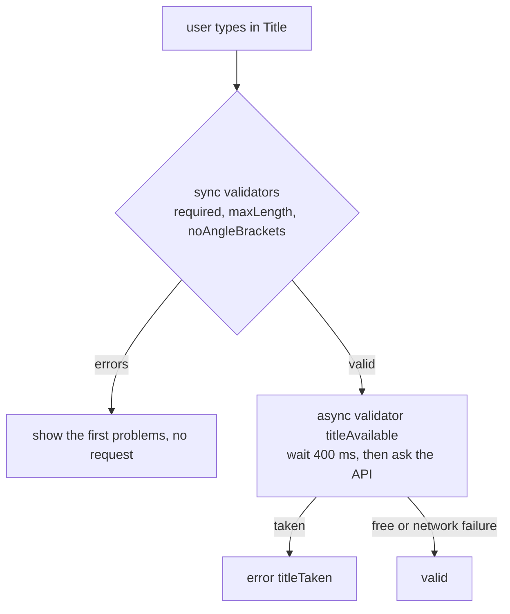

# 07. Reactive forms and validation

> **Draft: written but not yet run.** The code and the expected output in this lesson were prepared by reading the code and the official documentation. They have not been executed yet. If something does not behave as described, trust your tool's real output and report it.

## What you will be able to do
By the end of this lesson you will be able to:
- Build a typed reactive form with `NonNullableFormBuilder` and read its value with `getRawValue()`.
- Combine built-in, custom synchronous and asynchronous validators, and explain in which order they run.
- Map `errors[].pointer` of a 422 problem answer onto the right form control.
- Show accessible error messages (label, `aria-describedby`, `aria-invalid`) and keep a zoneless, `OnPush` component in sync with form state.
- Send one `Idempotency-Key` per user action so a retried create cannot make a duplicate.

## Recap
1. What does `fieldName('/title')` return, and what does `fieldName('/a/b')` return? <details><summary>Answer</summary>`'title'` and `null` (201.04).</details>
2. Why does a debounce built with `timer(...)` inside `switchMap` cancel the earlier request? <details><summary>Answer</summary>`switchMap` unsubscribes from the previous inner stream when a new value arrives (201.02).</details>
3. How is a retried create made safe? <details><summary>Answer</summary>The same `Idempotency-Key` is sent again, and the server replays the first answer (201.03).</details>

## Why it matters
A form is a **customs desk**. A traveller (the user) hands over a declaration; officers check it: "is every box filled?" (required), "is this allowed?" (custom rules), "is this name already registered?" (a check that needs a phone call to the head office, which is **asynchronous**). The **client-side** checks are good manners: they save the user a trip. The **server-side** checks are the law: the head office always checks again, because anybody can bypass your form with a script.

Angular offers two form models. You used template-driven forms (`ngModel`) and a first reactive form in 101. **Reactive forms** keep the form as an object in the class (`FormGroup`, `FormControl`), so validators are plain functions you can reuse, read and extend. That is the model the capstone uses for its team, project and task forms; its form chapters add focus handling and conflict dialogs on top of what you build here.

## What you will build
A **New task** page for the `task-board` project: title (required, at most 200 characters, no `<` or `>`, and not already used), description, priority and due date (not in the past). A `TaskService` owns the API calls; a small `validators.ts` holds three reusable validators; server errors appear under the right field.



## Before you start
- Lessons 04 and 05 done. Time: about 90 minutes (break after Step 3).
- **Which project?** Phase 3 continues from the project **as it was after lesson 05** (generated client, no sign-in), so you need only the mock API. If your folder already contains the sign-in code of lesson 06, rename it `task-board-auth` and make a fresh `task-board` from the lesson 05 files (the course repository has them under `source/angular/201-hero-to-super-hero/phase-2-http-and-auth/05-typed-api-client-from-openapi/code/`), then apply this lesson on top. Lesson 10 brings sign-in back as an option.
- Source pack (optional): every file is shown in this lesson. The finished code, the exercise starter and the solution are in the
  course repository https://github.com/Uee03/Code101 under `source/angular/201-hero-to-super-hero/phase-3-architecture-and-quality/07-reactive-forms-and-validation/` (**Code, Download ZIP**, or `git clone https://github.com/Uee03/Code101.git`).
- Not repeated here because it did not change: `server/mock-api.mjs` (lesson 04) and `contract/openapi.yaml` (lesson 05). Other unchanged files are listed at the end.
- Two terminals: `npm run mock` and `npm start`.

## Steps

### Step 1. A service owns the API calls
Until now the explorer page called `Api` directly. A page that creates tasks needs the same "first project" logic, so it moves into a service.

**File: `src/app/core/task-service.ts`**
```ts
import { Injectable, inject } from '@angular/core';
import { Api } from '../api/api';
import { createTask, listProjects, listTasks, listTeams } from '../api/functions';
import { Project, Task, TaskCreate } from '../api/models';

// The one place that knows how the app talks to the task endpoints. Components never call Api directly.
@Injectable({ providedIn: 'root' })
export class TaskService {
  private readonly api = inject(Api);
  private project: Promise<Project> | null = null;

  // The board works on the first project of the first team. A cached Promise, cleared again when it fails.
  firstProject(): Promise<Project> {
    this.project ??= this.loadFirstProject().catch((error: unknown) => {
      this.project = null;
      throw error;
    });
    return this.project;
  }

  async create(body: TaskCreate, idempotencyKey: string): Promise<Task> {
    const project = await this.firstProject();
    return this.api.invoke(createTask, { projectId: project.id, 'Idempotency-Key': idempotencyKey, body });
  }

  async titleExists(title: string): Promise<boolean> {
    const project = await this.firstProject();
    const page = await this.api.invoke(listTasks, { projectId: project.id, q: title, limit: 100 });
    return page.items.some((task) => task.title.toLowerCase() === title.trim().toLowerCase());
  }

  private async loadFirstProject(): Promise<Project> {
    const teams = await this.api.invoke(listTeams, { limit: 1 });
    const team = teams.items[0];
    if (!team) {
      throw new Error('The API returned no team.');
    }
    const projects = await this.api.invoke(listProjects, { teamId: team.id, limit: 1 });
    const project = projects.items[0];
    if (!project) {
      throw new Error('The team has no project.');
    }
    return project;
  }
}
```

- `firstProject()` caches a **Promise**, not the value: if two parts of the page ask at the same time, they share one request. `??=` assigns only when the field is still `null`. If the request fails, the cache is cleared so the next call tries again.
- `create` sends the generated `createTask` with the idempotency key it is given. The service does not generate keys: the component knows what one "user action" is.
- `titleExists` asks the server for tasks whose title contains the text (`q`) and compares the exact title, ignoring case. The server filter is a substring match, so the exact comparison happens here.

### Step 2. Reusable validators
A **validator** is a function that gets the control and returns either `null` (valid) or an object that names the error (`{ angleBrackets: true }`). The object is the error you test with `hasError('angleBrackets')`.

**File: `src/app/forms/validators.ts`**
```ts
import { AsyncValidatorFn, ValidatorFn } from '@angular/forms';
import { catchError, from, map, of, switchMap, timer } from 'rxjs';

// The contract forbids < and > in a title.
export const noAngleBrackets: ValidatorFn = (control) => (/[<>]/.test(String(control.value ?? '')) ? { angleBrackets: true } : null);

// A date input gives 'YYYY-MM-DD' or ''. ISO dates compare correctly as plain strings.
export function notInPast(today: () => Date = () => new Date()): ValidatorFn {
  return (control) => {
    const value = String(control.value ?? '');
    if (!value) {
      return null;
    }
    const now = today();
    const minimum = `${now.getFullYear()}-${String(now.getMonth() + 1).padStart(2, '0')}-${String(now.getDate()).padStart(2, '0')}`;
    return value < minimum ? { pastDate: { minimum } } : null;
  };
}

// Asks the server whether a title is taken. The timer is the debounce: Angular unsubscribes the previous run
// when the value changes again, so only the last pause of typing reaches the server.
export function titleAvailable(exists: (title: string) => Promise<boolean>, delayMs = 400): AsyncValidatorFn {
  return (control) => {
    const title = String(control.value ?? '').trim();
    if (!title) {
      return of(null);
    }
    return timer(delayMs).pipe(
      switchMap(() => from(exists(title))),
      map((taken) => (taken ? { titleTaken: true } : null)),
      catchError(() => of(null))
    );
  };
}
```

- `noAngleBrackets` is the contract's rule for titles.
- `notInPast` compares the `YYYY-MM-DD` text of a date input with today's local date. The parameter `today` defaults to the real date and exists so the function can be given another date later (for example in a test). It returns the minimum date so the message can say it.
- `titleAvailable` is **asynchronous**: it returns an Observable. `timer(400)` waits; if the user types again within 400 ms, Angular unsubscribes from the old run and the timer never fires. That is a **debounce** for free. `catchError(() => of(null))` treats a network failure as "valid": the server decides at submit time, so a broken check must not block the user.
- Async validators run **only when all synchronous validators of that control pass**. Typing `a<b` shows the bracket error and sends no request.

### Step 3. The component class
**File: `src/app/features/new-task/new-task.ts`**
```ts
import { ChangeDetectionStrategy, Component, inject, signal } from '@angular/core';
import { toSignal } from '@angular/core/rxjs-interop';
import { NonNullableFormBuilder, ReactiveFormsModule, Validators } from '@angular/forms';
import { Task, TaskCreate, TaskPriority } from '../../api/models';
import { TaskService } from '../../core/task-service';
import { noAngleBrackets, notInPast, titleAvailable } from '../../forms/validators';
import { ApiProblem, fieldName, isApiProblem } from '../../http/problem';
import { ProblemView } from '../../shared/problem-view';

@Component({
  selector: 'app-new-task',
  imports: [ReactiveFormsModule, ProblemView],
  changeDetection: ChangeDetectionStrategy.OnPush,
  templateUrl: './new-task.html',
  styleUrl: './new-task.css'
})
export class NewTask {
  private readonly tasks = inject(TaskService);
  private readonly builder = inject(NonNullableFormBuilder);
  private idempotencyKey: string | null = null;
  private lastBody = '';

  protected readonly priorities: readonly TaskPriority[] = ['low', 'medium', 'high', 'urgent'];
  protected readonly form = this.builder.group({
    title: this.builder.control('', {
      validators: [Validators.required, Validators.maxLength(200), noAngleBrackets],
      asyncValidators: [titleAvailable((title) => this.tasks.titleExists(title))]
    }),
    description: this.builder.control('', [Validators.maxLength(10000)]),
    priority: this.builder.control<TaskPriority>('medium'),
    dueDate: this.builder.control('', [notInPast()])
  });

  // Form state is not a signal. Reading this one in the template makes Angular redraw when validation changes.
  protected readonly status = toSignal(this.form.statusChanges, { initialValue: this.form.status });
  protected readonly saving = signal(false);
  protected readonly created = signal<Task[]>([]);
  protected readonly problem = signal<ApiProblem | null>(null);

  protected get title() {
    return this.form.controls.title;
  }

  protected get description() {
    return this.form.controls.description;
  }

  protected get dueDate() {
    return this.form.controls.dueDate;
  }

  protected async submit(): Promise<void> {
    this.form.markAllAsTouched();
    if (this.form.invalid || this.form.pending || this.saving()) {
      return;
    }
    const value = this.form.getRawValue();
    const body: TaskCreate = {
      title: value.title.trim(),
      description: value.description,
      priority: value.priority,
      dueDate: value.dueDate || null
    };
    // One key per user action: the same content sent again after a failure reuses the key, new content gets a new one.
    const fingerprint = JSON.stringify(body);
    if (this.idempotencyKey === null || fingerprint !== this.lastBody) {
      this.idempotencyKey = crypto.randomUUID();
      this.lastBody = fingerprint;
    }
    this.saving.set(true);
    this.problem.set(null);
    try {
      const task = await this.tasks.create(body, this.idempotencyKey);
      this.created.update((list) => [task, ...list]);
      this.idempotencyKey = null;
      this.form.reset({ priority: value.priority });
    } catch (error) {
      if (!isApiProblem(error)) {
        throw error;
      }
      this.problem.set(error);
      this.showServerErrors(error);
    } finally {
      this.saving.set(false);
    }
  }

  // Put each "errors[].pointer" message on its form control. Server errors vanish when the user edits the field.
  private showServerErrors(problem: ApiProblem): void {
    for (const item of problem.errors ?? []) {
      const name = fieldName(item.pointer);
      const control = name ? this.form.get(name) : null;
      if (control) {
        control.setErrors({ server: item.detail });
        control.markAsTouched();
      }
    }
  }
}
```

Read the parts that matter:
- `NonNullableFormBuilder` makes controls whose value is never `null`, also after `reset()`. So `value.title` is a `string`, not `string | null`.
- `builder.control('', { validators, asyncValidators })` attaches both kinds. `priority` is typed `TaskPriority` (a union from the generated models), so the `<select>` cannot hold an invalid value from the TypeScript point of view.
- **`status`** is the zoneless detail. Form state (`touched`, `pending`, `errors`) is not signals. With `OnPush` and no Zone.js, nothing tells Angular to redraw when an async validator finishes after 400 ms. `toSignal(this.form.statusChanges)` turns the status stream into a signal; the template reads `status()`, so Angular redraws whenever the status changes.
- `submit()` first marks every control touched (so every error shows), then refuses to continue while the form is invalid, **pending** (an async check is still running) or already saving.
- **One key per user action**: a new key is made when there is none yet or when the content changed. If the request fails and the user presses the button again with the same content, the same key is sent: if the first request had in fact succeeded, the server replays its answer instead of creating a second task. After a success the key is dropped.
- `showServerErrors` walks `problem.errors`, converts each pointer with `fieldName` and calls `control.setErrors({ server: detail })`. A control's errors are recomputed when its value changes, so the server message disappears as soon as the user edits that field.

**Take a break here.**

### Step 4. The template
**File: `src/app/features/new-task/new-task.html`**
```html
<h1>New task</h1>

<form [formGroup]="form" (ngSubmit)="submit()" novalidate [attr.aria-busy]="status() === 'PENDING'">
  <div class="field">
    <label for="title">Title</label>
    <input
      id="title"
      type="text"
      formControlName="title"
      autocomplete="off"
      aria-describedby="title-hint title-errors"
      [attr.aria-invalid]="title.invalid && title.touched ? 'true' : null"
    />
    <p id="title-hint" class="hint">Required. Up to 200 characters, without &lt; or &gt;.</p>
    <div id="title-errors" class="errors">
      @if (title.touched || title.dirty) {
        @if (title.hasError('required')) {
          <p>Enter a title.</p>
        }
        @if (title.getError('maxlength'); as max) {
          <p>Use at most {{ max.requiredLength }} characters. You typed {{ max.actualLength }}.</p>
        }
        @if (title.hasError('angleBrackets')) {
          <p>Remove the characters &lt; and &gt; from the title.</p>
        }
        @if (title.hasError('titleTaken')) {
          <p>A task with this title exists already. Choose another title.</p>
        }
        @if (title.getError('server'); as message) {
          <p>{{ message }}</p>
        }
      }
      @if (title.pending) {
        <p role="status" class="hint">Checking whether the title is free...</p>
      }
    </div>
  </div>

  <div class="field">
    <label for="description">Description (optional)</label>
    <textarea
      id="description"
      rows="3"
      formControlName="description"
      aria-describedby="description-errors"
      [attr.aria-invalid]="description.invalid && description.touched ? 'true' : null"
    ></textarea>
    <div id="description-errors" class="errors">
      @if (description.touched && description.getError('maxlength'); as max) {
        <p>Use at most {{ max.requiredLength }} characters.</p>
      }
      @if (description.getError('server'); as message) {
        <p>{{ message }}</p>
      }
    </div>
  </div>

  <div class="field">
    <label for="priority">Priority</label>
    <select id="priority" formControlName="priority">
      @for (priority of priorities; track priority) {
        <option [value]="priority">{{ priority }}</option>
      }
    </select>
  </div>

  <div class="field">
    <label for="dueDate">Due date (optional)</label>
    <input
      id="dueDate"
      type="date"
      formControlName="dueDate"
      aria-describedby="dueDate-errors"
      [attr.aria-invalid]="dueDate.invalid && dueDate.touched ? 'true' : null"
    />
    <div id="dueDate-errors" class="errors">
      @if (dueDate.touched && dueDate.getError('pastDate'); as past) {
        <p>The due date must be {{ past.minimum }} or later.</p>
      }
      @if (dueDate.getError('server'); as message) {
        <p>{{ message }}</p>
      }
    </div>
  </div>

  <button type="submit" [disabled]="saving()">{{ saving() ? 'Saving...' : 'Create task' }}</button>
</form>

@if (problem(); as current) {
  <app-problem-view [problem]="current" />
}

<div role="status">
  @if (created().length > 0) {
    <p>Created: {{ created()[0].title }}</p>
  }
</div>

@if (created().length > 0) {
  <h2>Created in this session</h2>
  <ul>
    @for (task of created(); track task.id) {
      <li>{{ task.title }} ({{ task.priority }}, version {{ task.version }})</li>
    }
  </ul>
}
```

What makes it accessible (more in lesson 09):
- Every input has a visible `<label for="...">` with the same `id`. Placeholder text is **not** a label.
- `aria-describedby` points at the hint and the error container, so a screen reader reads them with the field. The error container exists even when empty, so the reference is always valid.
- `[attr.aria-invalid]` is `'true'` only for a touched, invalid control; `null` removes the attribute.
- Error messages are plain `<p>` text next to the field, in text (not only red colour), and say what to do.
- `novalidate` on the form turns off the browser's own bubbles; Angular's messages replace them. The submit button stays enabled so a keyboard user can press it and learn what is wrong; the form refuses in `submit()`.
- `role="status"` marks a live region: "Checking whether the title is free..." and "Created: ..." are announced politely. Note that the live region element (`<div role="status">`) is always in the page and only its content changes; that is what makes announcements reliable.

**File: `src/app/features/new-task/new-task.css`**
```css
.errors p {
  margin: 0;
  color: #b42318;
  font-size: 0.875rem;
}

.errors p.hint {
  color: #4b5563;
}

textarea {
  resize: vertical;
}
```

### Step 5. Global form styles
**File: `src/styles.css`**
```css
body {
  font-family: system-ui, sans-serif;
  line-height: 1.5;
  margin: 2rem;
}

.field {
  display: grid;
  gap: 0.25rem;
  max-width: 28rem;
  margin: 1rem 0;
}

label {
  font-weight: 600;
}

input,
select,
textarea {
  font: inherit;
  padding: 0.4rem;
  border: 1px solid #4b5563;
  border-radius: 0.25rem;
}

input[aria-invalid='true'],
textarea[aria-invalid='true'] {
  border: 2px solid #b42318;
}

.hint {
  margin: 0;
  color: #4b5563;
  font-size: 0.875rem;
}

button {
  min-height: 2.25rem;
  padding: 0.25rem 0.75rem;
}
```

Border and text colours were chosen for contrast: the error red `#b42318` and the hint grey `#4b5563` both have more than 4.5:1 contrast on white, the WCAG 2.2 minimum for normal text. The red border of an invalid field is 2 px thick, so the state does not rely on colour alone (there is also text).

### Step 6. Routes and shell
**File: `src/app/app.routes.ts`**
```ts
import { Routes } from '@angular/router';
import { Explorer } from './features/explorer/explorer';
import { NewTask } from './features/new-task/new-task';

export const routes: Routes = [
  { path: '', component: Explorer, title: 'API explorer' },
  { path: 'tasks/new', component: NewTask, title: 'New task' },
  { path: '**', redirectTo: '' }
];
```

**File: `src/app/app.ts`**
```ts
import { ChangeDetectionStrategy, Component } from '@angular/core';
import { RouterLink, RouterLinkActive, RouterOutlet } from '@angular/router';

@Component({
  selector: 'app-root',
  imports: [RouterLink, RouterLinkActive, RouterOutlet],
  changeDetection: ChangeDetectionStrategy.OnPush,
  templateUrl: './app.html',
  styleUrl: './app.css'
})
export class App {}
```

**File: `src/app/app.html`**
```html
<header class="bar">
  <a routerLink="/" class="brand">Task board</a>
  <nav aria-label="Main">
    <a routerLink="/" routerLinkActive="active" [routerLinkActiveOptions]="{ exact: true }" ariaCurrentWhenActive="page">API explorer</a>
    <a routerLink="/tasks/new" routerLinkActive="active" ariaCurrentWhenActive="page">New task</a>
  </nav>
</header>

<main class="page">
  <router-outlet />
</main>
```

**File: `src/app/app.css`**
```css
.bar {
  display: flex;
  flex-wrap: wrap;
  align-items: center;
  gap: 1rem;
  padding-bottom: 0.75rem;
  border-bottom: 1px solid #9ca3af;
}

.brand {
  font-weight: 700;
}

nav {
  display: flex;
  flex-wrap: wrap;
  gap: 1rem;
}

nav a.active {
  text-decoration: underline;
}

.page {
  display: block;
  max-width: 44rem;
  margin: 1rem auto;
}
```

**File: `src/app/features/explorer/explorer.html`**
```html
<section aria-labelledby="explorer-heading">
  <h1 id="explorer-heading">Call the API with generated functions</h1>
  <p>Start the mock API in a second terminal (<code>npm run mock</code>), then press a button.</p>

  <ul class="probes">
    @for (probe of probes; track probe.label) {
      <li><button type="button" (click)="run(probe)">{{ probe.label }}</button></li>
    }
  </ul>

  <div role="status">
    @switch (outcome().kind) {
      @case ('loading') {
        <p>Waiting for the answer...</p>
      }
    }
  </div>

  @let current = outcome();
  @if (current.kind === 'ok') {
    <p>{{ current.label }}:</p>
    <pre>{{ current.data }}</pre>
  } @else if (current.kind === 'problem') {
    <p>{{ current.label }}:</p>
    <app-problem-view [problem]="current.problem" />
  }
</section>
```

The shell now has a router outlet and two links; the explorer is the home route. The explorer's heading became an `<h1>` because the shell no longer has one: every page needs exactly one `h1`.

## Run it
Terminal 1: `npm run mock`. Terminal 2: `npm start`. Open http://localhost:4200/tasks/new (or use the **New task** link).

**Predict:** you type three spaces in the title and press **Create task**. Is the form valid for the browser? What does the server say, and where do you see it?

Expected behaviour (derived by reading the code and the mock; not yet seen in a browser):
1. Press **Create task** with an empty form: no request is sent (Network tab), the Title field turns red-bordered and shows "Enter a title.".
2. Type `Seed the database` (an existing task): about 0.4 s after you stop typing, "Checking whether the title is free..." appears briefly, then "A task with this title exists already. Choose another title.". While you type quickly, only one request is made: a GET to `/v1/projects/.../tasks` with `q=Seed the database`.
3. Replace it by `a<b`: "Remove the characters < and > from the title." and **no** request.
4. Type a past date in **Due date**: "The due date must be YYYY-MM-DD or later." with today's date in place of `YYYY-MM-DD`.
5. Fill in `Prepare the demo`, priority `high`, leave the date empty, press the button: the button reads "Saving...", a POST with an `Idempotency-Key` header goes out, and the page shows "Created: Prepare the demo" and, under "Created in this session", `Prepare the demo (high, version 1)`. The form is empty again.
6. Three spaces in the title, press the button: the browser-side rules pass (`required` only checks for an empty string), the body is sent with `title: ""` (after trimming) and the mock answers 422. You see the red `ProblemView` ("Validation failed (422)", "Field **title**: must be between 1 and 200 characters") **and** the same sentence under the Title input. Typing one more character removes the sentence under the input; the box above stays until the next submit.
7. Stop the mock, create a task: "Request failed (0)". Start the mock again and press the button once more with the same content: the task is created once.

## How it works
1. A `FormControl` holds a value and a status: `VALID`, `INVALID`, `PENDING` (an async validator is running) or `DISABLED`.
2. On every change Angular runs the synchronous validators; only if they pass, it runs the async ones, and cancels an earlier async run that is still going.
3. `getRawValue()` includes disabled controls and has the exact type of the group; `value` can be partial.
4. A server answer is just another source of errors: `setErrors` puts it on the control, so the same template shows it.

**Why this, not that.**
- *Reactive forms* versus *template-driven*: validators and rules live in TypeScript where you can reuse and combine them; the template only displays. Template-driven forms are fine for tiny forms (101 lesson 06).
- *Reactive forms* versus *Signal Forms*: Angular 22 also has an experimental or newly stable signal-based forms API (check https://angular.dev before you use it; its status was not verified for this lesson). Reactive forms are stable, widely documented and used in the capstone, so they are the safe choice here.
- *Async validator on every keystroke* versus *check on blur* (`updateOn: 'blur'`): blur means fewer requests but later feedback. The debounce keeps instant feedback and still limits requests.
- *Client rules* versus *server rules*: both. The client rules save time; the server rules are the only ones you can trust.

**Security note.** Validation is not sanitising. Angular escapes interpolated text (`{{ }}`), so a title with markup is shown as text; never bind user text with `innerHTML`. The rule "no `<` or `>`" is a contract rule that the server enforces; the client mirrors it only for convenience.

**Misconception:** "if the form is valid, the server will accept it." The server may know more (a title that is taken at the very moment, a role that changed). Always handle a 422 or 409 answer.

## Try it
Starter file: `exercise/starter/src/app/forms/validators.ts` (the lesson's file plus a `maxWords` stub).
1. **Guided:** write `maxWords(limit)` (the TODOs). Predict the result for `''`, for `'one two three'` with limit 2, and for `'  one   two '` with limit 2.
2. **Change:** use it on the description: `Validators.maxLength(10000)` becomes `[Validators.maxLength(10000), maxWords(50)]` in `new-task.ts`, and add a message to `new-task.html` for `description.getError('maxWords')` that says how many words were typed and how many are allowed.
3. **Stretch (optional):** write a **group-level** validator: "an urgent task needs a due date". Attach it to the whole group (the second argument of `builder.group`). Where must the message be shown, since the error belongs to the group and not to one control?

<details><summary>Solution for rung 1</summary>

**File: `exercise/solution/src/app/forms/validators.ts`**
```ts
import { AsyncValidatorFn, ValidatorFn } from '@angular/forms';
import { catchError, from, map, of, switchMap, timer } from 'rxjs';

// The contract forbids < and > in a title.
export const noAngleBrackets: ValidatorFn = (control) => (/[<>]/.test(String(control.value ?? '')) ? { angleBrackets: true } : null);

// A date input gives 'YYYY-MM-DD' or ''. ISO dates compare correctly as plain strings.
export function notInPast(today: () => Date = () => new Date()): ValidatorFn {
  return (control) => {
    const value = String(control.value ?? '');
    if (!value) {
      return null;
    }
    const now = today();
    const minimum = `${now.getFullYear()}-${String(now.getMonth() + 1).padStart(2, '0')}-${String(now.getDate()).padStart(2, '0')}`;
    return value < minimum ? { pastDate: { minimum } } : null;
  };
}

// Asks the server whether a title is taken. The timer is the debounce: Angular unsubscribes the previous run
// when the value changes again, so only the last pause of typing reaches the server.
export function titleAvailable(exists: (title: string) => Promise<boolean>, delayMs = 400): AsyncValidatorFn {
  return (control) => {
    const title = String(control.value ?? '').trim();
    if (!title) {
      return of(null);
    }
    return timer(delayMs).pipe(
      switchMap(() => from(exists(title))),
      map((taken) => (taken ? { titleTaken: true } : null)),
      catchError(() => of(null))
    );
  };
}

// Valid for an empty value and for at most `limit` words.
export function maxWords(limit: number): ValidatorFn {
  return (control) => {
    const text = String(control.value ?? '').trim();
    if (!text) {
      return null;
    }
    const actual = text.split(/\s+/).length;
    return actual > limit ? { maxWords: { limit, actual } } : null;
  };
}
```

`''` gives `null` (valid). `'one two three'` with limit 2 gives `{ maxWords: { limit: 2, actual: 3 } }`. `'  one   two '` is trimmed and split on runs of white space, so it has 2 words and is valid.

</details>

## Check yourself
1. Why does an async validator not run while a synchronous one fails? <details><summary>Answer</summary>It would waste a request on a value that is already invalid; Angular runs async validators only when the sync validators of that control pass.</details>
2. Why read `status()` in the template when the template already reads `title.pending`? <details><summary>Answer</summary>Form state is not a signal; without a signal read, a zoneless `OnPush` view is not redrawn when an async validator finishes.</details>
3. Why is the idempotency key kept after a failed submit but dropped after a successful one? <details><summary>Answer</summary>A retry of the same action must reuse the key; a successful action is finished, so the next create needs a new key.</details>
4. Where does a server error on `/title` disappear? <details><summary>Answer</summary>When the title control is edited and revalidated; its errors are recomputed without the `server` entry.</details>

## Common mistakes
| Symptom or error text | Cause | Fix |
|---|---|---|
| Typical message: `Can't bind to 'formGroup' since it isn't a known property of 'form'` (NG8002) | `ReactiveFormsModule` is missing in the component's `imports` | Add it |
| Typical message: `No value accessor for form control with name: 'title'` | The `formControlName` is on an element that is not an input, or `ReactiveFormsModule` is missing | Put it on `input`, `select` or `textarea` and import the module |
| The "Checking..." text never disappears | The view was not redrawn after the async validator ended (no signal was read) | Read `status()` (from `toSignal(statusChanges)`) in the template |
| A type error such as `Type 'string | null' is not assignable to type 'string'` on `value.title` | `FormBuilder` used instead of `NonNullableFormBuilder`, so values may be `null` | Use `inject(NonNullableFormBuilder)` |
| Every keystroke sends a request | The debounce `timer` was removed or the validator calls the API directly | Keep the `timer(...)` before `switchMap` |
| A `422` appears but nothing shows under the field | The pointer is nested (`/a/b`) or the control name differs | `fieldName` returns `null` for nested pointers: show those in the problem box only |
| The CORS error again | The mock is not running | `npm run mock` |

## Best practice
Validate on the client for the user and on the server for safety, keep validators small and reusable, tie every message to its field with `aria-describedby`, and let the server's field errors flow through the same form model. Source: Angular, Reactive forms https://angular.dev/guide/forms/reactive-forms and Validating form input https://angular.dev/guide/forms/form-validation

## Going further
- Typed forms: https://angular.dev/guide/forms/typed-forms
- WCAG 2.2, 3.3.1 Error Identification and 3.3.3 Error Suggestion: https://www.w3.org/TR/WCAG22/
- Capstone: `capstones/web-angular` chapter 03 "Screens, stores and pagination" (create team, project and task forms) and chapter 04 (409 and 422 messages, WCAG 3.3.7 redundant entry).

## Summary
- You built a typed reactive form with built-in, custom and async validators.
- You kept a zoneless `OnPush` view in step with form status through a signal.
- You mapped server field errors to controls and made a retried create safe.

## Next lesson
08. Lazy routes, resolvers and performance: load pages on demand, fetch data before a page opens, and make the app cheap to redraw (`OnPush`, zoneless).

<details>
<summary>Files that did not change in this lesson (listed so this page is complete)</summary>

**File: `.gitignore`**

```
node_modules/
dist/
.angular/
.env
*.log
src/app/api/
```

**File: `angular.json`**

```json
{
  "$schema": "./node_modules/@angular/cli/lib/config/schema.json",
  "version": 1,
  "cli": {
    "packageManager": "npm",
    "analytics": false
  },
  "newProjectRoot": "projects",
  "projects": {
    "task-board": {
      "projectType": "application",
      "schematics": {
        "@schematics/angular:class": {
          "skipTests": true
        },
        "@schematics/angular:component": {
          "skipTests": true
        },
        "@schematics/angular:directive": {
          "skipTests": true
        },
        "@schematics/angular:guard": {
          "skipTests": true
        },
        "@schematics/angular:interceptor": {
          "skipTests": true
        },
        "@schematics/angular:pipe": {
          "skipTests": true
        },
        "@schematics/angular:resolver": {
          "skipTests": true
        },
        "@schematics/angular:service": {
          "skipTests": true
        }
      },
      "root": "",
      "sourceRoot": "src",
      "prefix": "app",
      "architect": {
        "build": {
          "builder": "@angular/build:application",
          "options": {
            "browser": "src/main.ts",
            "tsConfig": "tsconfig.app.json",
            "assets": [
              {
                "glob": "**/*",
                "input": "public"
              }
            ],
            "styles": [
              "src/styles.css"
            ]
          },
          "configurations": {
            "production": {
              "budgets": [
                {
                  "type": "initial",
                  "maximumWarning": "500kB",
                  "maximumError": "1MB"
                },
                {
                  "type": "anyComponentStyle",
                  "maximumWarning": "4kB",
                  "maximumError": "8kB"
                }
              ],
              "outputHashing": "all"
            },
            "development": {
              "optimization": false,
              "extractLicenses": false,
              "sourceMap": true
            }
          },
          "defaultConfiguration": "production"
        },
        "serve": {
          "builder": "@angular/build:dev-server",
          "configurations": {
            "production": {
              "buildTarget": "task-board:build:production"
            },
            "development": {
              "buildTarget": "task-board:build:development"
            }
          },
          "defaultConfiguration": "development"
        }
      }
    }
  }
}
```

**File: `ng-openapi-gen.json`**

```json
{
  "$schema": "./node_modules/ng-openapi-gen/ng-openapi-gen-schema.json",
  "input": "contract/openapi.yaml",
  "output": "src/app/api",
  "apiService": "Api",
  "promises": true,
  "services": false
}
```

**File: `package.json`**

```json
{
  "name": "task-board",
  "version": "1.0.0",
  "private": true,
  "scripts": {
    "ng": "ng",
    "api:gen": "ng-openapi-gen",
    "prestart": "npm run api:gen",
    "start": "ng serve --host localhost --port 4200",
    "prebuild": "npm run api:gen",
    "build": "ng build",
    "mock": "node server/mock-api.mjs",
    "mock:auth": "node server/mock-api.mjs --require-auth"
  },
  "dependencies": {
    "@angular/common": "22.3.0",
    "@angular/compiler": "22.3.0",
    "@angular/core": "22.3.0",
    "@angular/forms": "22.3.0",
    "@angular/platform-browser": "22.3.0",
    "@angular/router": "22.3.0",
    "rxjs": "7.8.2",
    "tslib": "2.8.1"
  },
  "devDependencies": {
    "@angular/build": "22.3.0",
    "@angular/cli": "22.3.0",
    "@angular/compiler-cli": "22.3.0",
    "ng-openapi-gen": "1.1.0",
    "typescript": "6.0.3"
  }
}
```

**File: `public/favicon.svg`**

```xml
<svg xmlns="http://www.w3.org/2000/svg" viewBox="0 0 24 24" width="24" height="24" fill="none" stroke="#1d6fb8" stroke-width="2" stroke-linecap="round" stroke-linejoin="round">
  <path d="M22 11.08V12a10 10 0 1 1-5.93-9.14"/><polyline points="22 4 12 14.01 9 11.01"/>
</svg>
```

**File: `src/app/app.config.ts`**

```ts
import { ApplicationConfig, provideBrowserGlobalErrorListeners } from '@angular/core';
import { provideHttpClient, withFetch, withInterceptors } from '@angular/common/http';
import { provideRouter } from '@angular/router';

import { ApiConfiguration } from './api/api-configuration';
import { environment } from '../environments/environment';
import { routes } from './app.routes';
import { problemInterceptor } from './http/problem.interceptor';
import { retryAfterInterceptor } from './http/retry-after.interceptor';
import { timingInterceptor } from './http/timing.interceptor';

export const appConfig: ApplicationConfig = {
  providers: [
    provideBrowserGlobalErrorListeners(),
    provideHttpClient(withFetch(), withInterceptors([timingInterceptor, problemInterceptor, retryAfterInterceptor])),
    provideRouter(routes),
    { provide: ApiConfiguration, useValue: { rootUrl: environment.apiBaseUrl } }
  ]
};
```

**File: `src/app/features/explorer/explorer.css`**

```css
.probes {
  padding: 0;
  list-style: none;
}

.probes li {
  margin: 0.5rem 0;
}

button {
  min-height: 2.25rem;
  padding: 0.25rem 0.75rem;
}

pre {
  padding: 0.75rem;
  overflow-x: auto;
  background: #f3f4f6;
  color: #1f2937;
}
```

**File: `src/app/features/explorer/explorer.ts`**

```ts
import { ChangeDetectionStrategy, Component, inject, signal } from '@angular/core';
import { Api } from '../../api/api';
import { createTask, getHealth, getMe, getTask, listProjects, listTasks, listTeams, updateTask } from '../../api/functions';
import { ApiProblem, isApiProblem } from '../../http/problem';
import { ProblemView } from '../../shared/problem-view';

interface Probe {
  label: string;
  run: () => Promise<unknown>;
}

type Outcome = { kind: 'idle' } | { kind: 'loading'; label: string } | { kind: 'ok'; label: string; data: string } | { kind: 'problem'; label: string; problem: ApiProblem };

@Component({
  selector: 'app-explorer',
  imports: [ProblemView],
  changeDetection: ChangeDetectionStrategy.OnPush,
  templateUrl: './explorer.html',
  styleUrl: './explorer.css'
})
export class Explorer {
  private readonly api = inject(Api);
  private lastTaskId: string | null = null;

  protected readonly probes: readonly Probe[] = [
    { label: 'getHealth', run: () => this.api.invoke(getHealth) },
    { label: 'getMe', run: () => this.api.invoke(getMe) },
    { label: 'listTasks (open tasks of the first project)', run: () => this.openTasks() },
    { label: 'createTask', run: () => this.create() },
    { label: 'getTask (read the ETag header)', run: () => this.readEtag() },
    { label: 'updateTask with a stale If-Match (expect 412)', run: () => this.updateStale() }
  ];
  protected readonly outcome = signal<Outcome>({ kind: 'idle' });

  protected async run(probe: Probe): Promise<void> {
    this.outcome.set({ kind: 'loading', label: probe.label });
    try {
      const data = await probe.run();
      this.outcome.set({ kind: 'ok', label: probe.label, data: JSON.stringify(data, null, 2) });
    } catch (error) {
      if (isApiProblem(error)) {
        this.outcome.set({ kind: 'problem', label: probe.label, problem: error });
      } else {
        throw error;
      }
    }
  }

  private async firstProjectId(): Promise<string> {
    const teams = await this.api.invoke(listTeams, { limit: 1 });
    const team = teams.items[0];
    if (!team) {
      throw new Error('The API returned no team.');
    }
    const projects = await this.api.invoke(listProjects, { teamId: team.id, limit: 1 });
    const project = projects.items[0];
    if (!project) {
      throw new Error('The team has no project.');
    }
    return project.id;
  }

  private async openTasks(): Promise<unknown> {
    const projectId = await this.firstProjectId();
    const page = await this.api.invoke(listTasks, { projectId, limit: 3, status: ['todo', 'in_progress'] });
    return { titles: page.items.map((task) => `${task.title} (${task.status})`), nextCursor: page.page.nextCursor };
  }

  private async create(): Promise<unknown> {
    const projectId = await this.firstProjectId();
    const task = await this.api.invoke(createTask, {
      projectId,
      'Idempotency-Key': crypto.randomUUID(),
      body: { title: 'Written with the typed client', priority: 'low' }
    });
    this.lastTaskId = task.id;
    return { id: task.id, status: task.status, version: task.version };
  }

  private async taskId(): Promise<string> {
    if (this.lastTaskId) {
      return this.lastTaskId;
    }
    const projectId = await this.firstProjectId();
    const page = await this.api.invoke(listTasks, { projectId, limit: 1 });
    const task = page.items[0];
    if (!task) {
      throw new Error('The project has no task yet. Press createTask first.');
    }
    return task.id;
  }

  private async readEtag(): Promise<unknown> {
    const response = await this.api.invoke$Response(getTask, { taskId: await this.taskId() });
    return { title: response.body.title, etag: response.headers.get('ETag') };
  }

  private async updateStale(): Promise<unknown> {
    return this.api.invoke(updateTask, { taskId: await this.taskId(), 'If-Match': '"999"', body: { status: 'done' } });
  }
}
```

**File: `src/app/http/api-url.ts`**

```ts
import { environment } from '../../environments/environment';

// True only for addresses under the API base URL. Interceptors use it so that nothing is added to,
// or changed for, requests to other hosts (a token must never go to a third party).
export function isApiUrl(value: string): boolean {
  const target = new URL(value, environment.apiBaseUrl);
  const base = new URL(environment.apiBaseUrl);
  const path = base.pathname.replace(/\/$/, '');
  return target.origin === base.origin && (target.pathname === path || target.pathname.startsWith(path + '/'));
}
```

**File: `src/app/http/problem.interceptor.ts`**

```ts
import { HttpErrorResponse, HttpInterceptorFn } from '@angular/common/http';
import { catchError, throwError } from 'rxjs';
import { isApiUrl } from './api-url';
import { parseProblem } from './problem';

export const problemInterceptor: HttpInterceptorFn = (request, next) => {
  if (!isApiUrl(request.url)) {
    return next(request);
  }
  return next(request).pipe(
    catchError((error: unknown) => {
      if (!(error instanceof HttpErrorResponse) || error.status === 304) {
        return throwError(() => error);
      }
      const isProblem = error.headers.get('Content-Type')?.includes('application/problem+json') ?? false;
      return throwError(() => parseProblem(error.status, isProblem ? error.error : null, error.headers));
    })
  );
};
```

**File: `src/app/http/problem.ts`**

```ts
export interface ApiProblem {
  type: string;
  title: string;
  status: number;
  detail?: string;
  instance?: string;
  traceId?: string;
  code?: string;
  errors?: { pointer: string; detail: string }[];
  retryAfter?: number;
}

export function isApiProblem(value: unknown): value is ApiProblem {
  return typeof value === 'object' && value !== null && typeof (value as ApiProblem).status === 'number' && typeof (value as ApiProblem).title === 'string';
}

// Turns an error answer into one shape. It does not depend on Angular, so any code can use it.
export function parseProblem(status: number, body: unknown, headers: { get(name: string): string | null }): ApiProblem {
  const data = body && typeof body === 'object' ? (body as Record<string, unknown>) : {};
  const text = (key: string): string | undefined => (typeof data[key] === 'string' ? (data[key] as string) : undefined);
  const retry = headers.get('Retry-After');
  const seconds = retry === null ? undefined : /^\d+$/.test(retry) ? Number(retry) : Math.max(0, Math.ceil((Date.parse(retry) - Date.now()) / 1000));
  const errors = Array.isArray(data['errors'])
    ? data['errors'].filter((item): item is { pointer: string; detail: string } => !!item && typeof item.pointer === 'string' && typeof item.detail === 'string')
    : undefined;
  return {
    type: text('type') ?? 'about:blank',
    title: text('title') ?? 'Request failed',
    status,
    detail: text('detail') ?? (status === 0 ? 'Cannot reach the API. Check your connection, then try again.' : 'The request could not be completed.'),
    instance: text('instance'),
    traceId: text('traceId'),
    code: text('code'),
    errors,
    retryAfter: seconds !== undefined && Number.isFinite(seconds) ? seconds : undefined
  };
}

// "/title" becomes "title" (a form control name). Nested pointers such as "/a/b" return null.
export function fieldName(pointer: string): string | null {
  if (!pointer.startsWith('/') || pointer.slice(1).includes('/')) {
    return null;
  }
  return pointer.slice(1).replace(/~1/g, '/').replace(/~0/g, '~');
}
```

**File: `src/app/http/retry-after.interceptor.ts`**

```ts
import { HttpErrorResponse, HttpInterceptorFn } from '@angular/common/http';
import { catchError, switchMap, throwError, timer } from 'rxjs';
import { isApiUrl } from './api-url';
import { parseProblem } from './problem';

// A GET that gets "429 Too Many Requests" waits for Retry-After seconds and is sent once more.
// Writes are not repeated here: a human must decide whether to send them again.
export const retryAfterInterceptor: HttpInterceptorFn = (request, next) => {
  if (!isApiUrl(request.url) || request.method !== 'GET') {
    return next(request);
  }
  return next(request).pipe(
    catchError((error: unknown) => {
      if (!(error instanceof HttpErrorResponse) || error.status !== 429) {
        return throwError(() => error);
      }
      const seconds = parseProblem(429, null, error.headers).retryAfter ?? 1;
      return timer(Math.min(seconds, 10) * 1000).pipe(switchMap(() => next(request)));
    })
  );
};
```

**File: `src/app/http/timing.interceptor.ts`**

```ts
import { HttpInterceptorFn, HttpResponse } from '@angular/common/http';
import { tap } from 'rxjs';
import { isApiUrl } from './api-url';

// Logs method, path, status and duration of every API call to the console.
// It never logs headers or bodies, so it cannot leak a token.
export const timingInterceptor: HttpInterceptorFn = (request, next) => {
  if (!isApiUrl(request.url)) {
    return next(request);
  }
  const started = performance.now();
  const path = new URL(request.url).pathname;
  const report = (status: number): void => {
    console.log(`${request.method} ${path} -> ${status} in ${Math.round(performance.now() - started)} ms`);
  };
  return next(request).pipe(
    tap({
      next: (event) => {
        if (event instanceof HttpResponse) {
          report(event.status);
        }
      },
      error: (error: unknown) => report((error as { status?: number }).status ?? 0)
    })
  );
};
```

**File: `src/app/shared/problem-view.css`**

```css
.problem {
  padding: 0.75rem 1rem;
  border-left: 0.25rem solid #b42318;
  background: #fdecea;
  color: #1f2937;
}

h3 {
  margin: 0 0 0.25rem;
}

.trace {
  margin-bottom: 0;
  color: #4b5563;
  font-size: 0.875rem;
}
```

**File: `src/app/shared/problem-view.html`**

```html
<div class="problem" role="alert">
  <h3>{{ problem().title }} ({{ problem().status }})</h3>
  <p>{{ problem().detail }}</p>
  @if (problem().errors; as errors) {
    <ul>
      @for (error of errors; track error.pointer) {
        <li>Field <strong>{{ field(error.pointer) }}</strong>: {{ error.detail }}</li>
      }
    </ul>
  }
  @if (problem().traceId; as trace) {
    <p class="trace">Support code: {{ trace }}</p>
  }
</div>
```

**File: `src/app/shared/problem-view.ts`**

```ts
import { ChangeDetectionStrategy, Component, input } from '@angular/core';
import { ApiProblem, fieldName } from '../http/problem';

@Component({
  selector: 'app-problem-view',
  changeDetection: ChangeDetectionStrategy.OnPush,
  templateUrl: './problem-view.html',
  styleUrl: './problem-view.css'
})
export class ProblemView {
  readonly problem = input.required<ApiProblem>();

  protected field(pointer: string): string {
    return fieldName(pointer) ?? pointer;
  }
}
```

**File: `src/environments/environment.ts`**

```ts
export const environment = {
  apiBaseUrl: 'http://localhost:8000'
};
```

**File: `src/index.html`**

```html
<!doctype html>
<html lang="en">
<head>
  <meta charset="utf-8">
  <title>Task Board</title>
  <base href="/">
  <meta name="viewport" content="width=device-width, initial-scale=1">
  <link rel="icon" type="image/svg+xml" href="favicon.svg">
</head>
<body>
  <app-root></app-root>
</body>
</html>
```

**File: `src/main.ts`**

```ts
import { bootstrapApplication } from '@angular/platform-browser';
import { appConfig } from './app/app.config';
import { App } from './app/app';

bootstrapApplication(App, appConfig)
  .catch((err) => console.error(err));
```

**File: `tsconfig.app.json`**

```json
/* To learn more about Typescript configuration file: https://www.typescriptlang.org/docs/handbook/tsconfig-json.html. */
/* To learn more about Angular compiler options: https://angular.dev/reference/configs/angular-compiler-options. */
{
  "extends": "./tsconfig.json",
  "compilerOptions": {
    "types": []
  },
  "include": [
    "src/**/*.ts"
  ],
  "exclude": [
    "src/**/*.spec.ts"
  ]
}
```

**File: `tsconfig.json`**

```json
/* To learn more about Typescript configuration file: https://www.typescriptlang.org/docs/handbook/tsconfig-json.html. */
/* To learn more about Angular compiler options: https://angular.dev/reference/configs/angular-compiler-options. */
{
  "compileOnSave": false,
  "compilerOptions": {
    "strict": true,
    "noImplicitOverride": true,
    "noPropertyAccessFromIndexSignature": true,
    "noImplicitReturns": true,
    "noFallthroughCasesInSwitch": true,
    "skipLibCheck": true,
    "isolatedModules": true,
    "experimentalDecorators": true,
    "importHelpers": true,
    "target": "ES2022",
    "module": "preserve"
  },
  "angularCompilerOptions": {
    "enableI18nLegacyMessageIdFormat": false,
    "strictInjectionParameters": true,
    "strictInputAccessModifiers": true,
    "strictTemplates": true
  },
  "files": [],
  "references": [
    {
      "path": "./tsconfig.app.json"
    }
  ]
}
```

</details>
