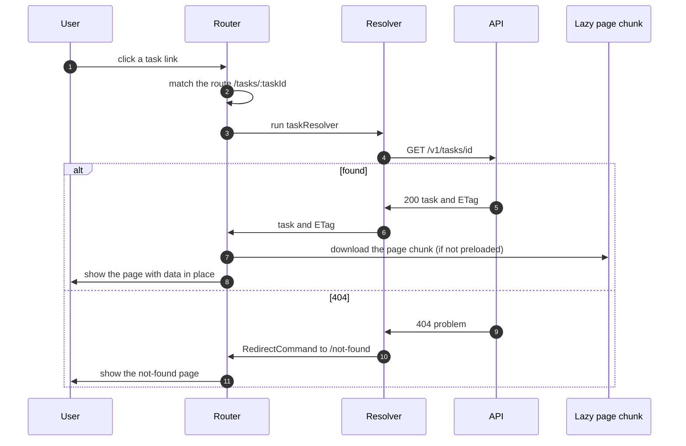

# 08. Lazy routes, resolvers and performance (OnPush, zoneless note)

> **Draft: written but not yet run.** The code and the expected output in this lesson were prepared by reading the code and the official documentation. They have not been executed yet. If something does not behave as described, trust your tool's real output and report it.

## What you will be able to do
By the end of this lesson you will be able to:
- Split an app into lazily loaded pieces with `loadComponent` and `@defer`, and say how to see the pieces in the build output.
- Write resolvers (`ResolveFn`) that load data before a page opens and redirect with `RedirectCommand` when a task does not exist.
- Receive route data, resolved data and route texts as component inputs with `withComponentInputBinding()`.
- Explain why `OnPush`, signals and `track` keep redraws cheap, and what "zoneless" means for your code.

## Recap
1. Which API call returns the `ETag` of a task, and why `invoke$Response`? <details><summary>Answer</summary>`getTask`; `invoke` returns only the body, `invoke$Response` also gives the headers (201.05).</details>
2. What does `linkedSignal` do that `computed` does not? <details><summary>Answer</summary>It is derived like a computed, but you can also write to it; it resets when its source changes (201.01).</details>
3. Why did the form lesson read `toSignal(statusChanges)` in the template? <details><summary>Answer</summary>Form state is not a signal; reading a signal makes a zoneless `OnPush` view redraw (201.07).</details>

## Why it matters
A big shop has many rooms. If you have to **carry the whole shop** to the customer before they can look at one shelf, the first visit is slow. **Lazy loading** hands over a room only when the customer walks to its door. A **resolver** is the shop assistant who fetches the item from the back store *before* the door opens, so the room is never shown half empty. And **performance** is mostly about not repainting the whole shop when one price tag changes.

For the web this is real: the JavaScript your page needs before it can show anything (the *initial bundle*) decides how fast a visitor on a phone sees something. The capstone sets a target for it (under 250 kB gzip, read from the build output) and lazy-loads every screen except login. This lesson shows the tools; the numbers come from **your** build, never from this page.

## What you will build
You turn the `task-board` project into a lazily loaded app: a **Tasks** list (resolver, "Load more", a deferred summary), a **Task detail** page (resolver, a 404 redirect, "Mark as done" with `If-Match`) and one **notice** page for "not found" and "unavailable" whose texts come from the route.



## Before you start
- Lesson 07 done (the project with the form and `TaskService`). Time: about 90 minutes.
- Source pack (optional): every file is shown in this lesson. The finished code, the exercise starter and the solution are in the
  course repository https://github.com/Uee03/Code101 under `source/angular/201-hero-to-super-hero/phase-3-architecture-and-quality/08-lazy-routes-resolvers-and-performance/` (**Code, Download ZIP**, or `git clone https://github.com/Uee03/Code101.git`).
- Not repeated here because it did not change: `server/mock-api.mjs` (lesson 04) and `contract/openapi.yaml` (lesson 05). Other unchanged files are listed at the end.
- Two terminals: `npm run mock` and `npm start`.

## Steps

### Step 1. Grow the service
**File: `src/app/core/task-service.ts`**
```ts
import { Injectable, inject } from '@angular/core';
import { Api } from '../api/api';
import { createTask, getTask, listProjects, listTasks, listTeams, updateTask } from '../api/functions';
import { Project, Task, TaskCreate, TaskPage, TaskUpdate } from '../api/models';

// A task together with the ETag of the version we read. Updates must send that ETag back as If-Match.
export interface TaskWithEtag {
  task: Task;
  etag: string;
}

// The one place that knows how the app talks to the task endpoints. Components never call Api directly.
@Injectable({ providedIn: 'root' })
export class TaskService {
  private readonly api = inject(Api);
  private project: Promise<Project> | null = null;

  // The board works on the first project of the first team. A cached Promise, cleared again when it fails.
  firstProject(): Promise<Project> {
    this.project ??= this.loadFirstProject().catch((error: unknown) => {
      this.project = null;
      throw error;
    });
    return this.project;
  }

  async list(options: { limit?: number; cursor?: string } = {}): Promise<TaskPage> {
    const project = await this.firstProject();
    return this.api.invoke(listTasks, { projectId: project.id, ...options });
  }

  async get(taskId: string): Promise<TaskWithEtag> {
    const response = await this.api.invoke$Response(getTask, { taskId });
    return this.withEtag(response.body, response.headers.get('ETag'));
  }

  async update(taskId: string, etag: string, body: TaskUpdate): Promise<TaskWithEtag> {
    const response = await this.api.invoke$Response(updateTask, { taskId, 'If-Match': etag, body });
    return this.withEtag(response.body, response.headers.get('ETag'));
  }

  async create(body: TaskCreate, idempotencyKey: string): Promise<Task> {
    const project = await this.firstProject();
    return this.api.invoke(createTask, { projectId: project.id, 'Idempotency-Key': idempotencyKey, body });
  }

  async titleExists(title: string): Promise<boolean> {
    const project = await this.firstProject();
    const page = await this.api.invoke(listTasks, { projectId: project.id, q: title, limit: 100 });
    return page.items.some((task) => task.title.toLowerCase() === title.trim().toLowerCase());
  }

  // The contract says the ETag is the quoted version, so it can be rebuilt when a header is hidden by CORS.
  private withEtag(task: Task, header: string | null): TaskWithEtag {
    return { task, etag: header ?? `"${task.version}"` };
  }

  private async loadFirstProject(): Promise<Project> {
    const teams = await this.api.invoke(listTeams, { limit: 1 });
    const team = teams.items[0];
    if (!team) {
      throw new Error('The API returned no team.');
    }
    const projects = await this.api.invoke(listProjects, { teamId: team.id, limit: 1 });
    const project = projects.items[0];
    if (!project) {
      throw new Error('The team has no project.');
    }
    return project;
  }
}
```

New compared with lesson 07: `list` (one page, optional cursor), `get` and `update` (both return a task **together with its ETag**) and the small interface `TaskWithEtag`. The ETag comes from the response header; when a server hides it (CORS), the contract lets you rebuild it: the quoted `version`.

### Step 2. Resolvers
A **resolver** is a function the router runs **after the route matches and the guards passed, and before the page is created**. The router waits for it; its result becomes **route data**.

**File: `src/app/tasks/task.resolvers.ts`**
```ts
import { inject } from '@angular/core';
import { RedirectCommand, ResolveFn, Router } from '@angular/router';
import { TaskPage } from '../api/models';
import { TaskService, TaskWithEtag } from '../core/task-service';
import { isApiProblem } from '../http/problem';

// Runs before the Tasks page opens. The router waits for the Promise; the result becomes route data named "page".
export const tasksResolver: ResolveFn<TaskPage> = () => inject(TaskService).list({ limit: 5 });

// A missing task redirects to /not-found instead of opening an empty page. Other failures go to /unavailable.
export const taskResolver: ResolveFn<TaskWithEtag> = async (route) => {
  const tasks = inject(TaskService);
  const router = inject(Router);
  try {
    return await tasks.get(route.paramMap.get('taskId') ?? '');
  } catch (error) {
    if (isApiProblem(error) && error.status === 404) {
      return new RedirectCommand(router.parseUrl('/not-found'));
    }
    return new RedirectCommand(router.parseUrl('/unavailable'));
  }
};
```

- `ResolveFn<T>` is a plain function in an injection context, so `inject` works as long as you call it **before** the first `await`; both resolvers do.
- `tasksResolver` returns a Promise; the router waits for it.
- `taskResolver` may return a `RedirectCommand`, which cancels the navigation and starts another one. A 404 means the task does not exist (or you may not know it exists): `/not-found`. Anything else (for example "no answer") goes to `/unavailable`. `route.paramMap` gives the `:taskId` of the matched route.

### Step 3. Lazy routes
**File: `src/app/app.routes.ts`**
```ts
import { Routes } from '@angular/router';
import { taskResolver, tasksResolver } from './tasks/task.resolvers';

export const routes: Routes = [
  { path: '', pathMatch: 'full', redirectTo: 'tasks' },
  {
    path: 'tasks',
    title: 'Tasks',
    resolve: { page: tasksResolver },
    loadComponent: () => import('./features/tasks/tasks').then((m) => m.Tasks)
  },
  {
    path: 'tasks/new',
    title: 'New task',
    loadComponent: () => import('./features/new-task/new-task').then((m) => m.NewTask)
  },
  {
    path: 'tasks/:taskId',
    title: 'Task',
    resolve: { detail: taskResolver },
    loadComponent: () => import('./features/task-detail/task-detail').then((m) => m.TaskDetail)
  },
  {
    path: 'explorer',
    title: 'API explorer',
    loadComponent: () => import('./features/explorer/explorer').then((m) => m.Explorer)
  },
  {
    path: 'not-found',
    title: 'Not found',
    data: { heading: 'Not found', text: 'We could not find that page or task.' },
    loadComponent: () => import('./features/notice/notice').then((m) => m.Notice)
  },
  {
    path: 'unavailable',
    title: 'Unavailable',
    data: { heading: 'Something went wrong', text: 'The API did not answer. Check that it is running, then try again.' },
    loadComponent: () => import('./features/notice/notice').then((m) => m.Notice)
  },
  { path: '**', redirectTo: 'not-found' }
];
```

- `loadComponent: () => import('...').then(...)` is a **dynamic import**: the bundler puts that file (and what only it uses) in its own **chunk**, downloaded when the route is first needed.
- `resolve: { page: tasksResolver }` names the resolved value `page`. With `withComponentInputBinding()` (next step) the router sets a component input called `page`.
- `data: { heading, text }` is static route data; the `Notice` page reads it through inputs, so one component serves two routes.
- Route order matters: `tasks/new` is listed before `tasks/:taskId`, otherwise `new` would be read as a task id.
- `title` sets the browser tab title on each navigation.

**File: `src/app/app.config.ts`**
```ts
import { ApplicationConfig, provideBrowserGlobalErrorListeners } from '@angular/core';
import { provideHttpClient, withFetch, withInterceptors } from '@angular/common/http';
import { PreloadAllModules, provideRouter, withComponentInputBinding, withPreloading } from '@angular/router';

import { ApiConfiguration } from './api/api-configuration';
import { environment } from '../environments/environment';
import { routes } from './app.routes';
import { problemInterceptor } from './http/problem.interceptor';
import { retryAfterInterceptor } from './http/retry-after.interceptor';
import { timingInterceptor } from './http/timing.interceptor';

export const appConfig: ApplicationConfig = {
  providers: [
    provideBrowserGlobalErrorListeners(),
    provideHttpClient(withFetch(), withInterceptors([timingInterceptor, problemInterceptor, retryAfterInterceptor])),
    provideRouter(routes, withComponentInputBinding(), withPreloading(PreloadAllModules)),
    { provide: ApiConfiguration, useValue: { rootUrl: environment.apiBaseUrl } }
  ]
};
```

- `withComponentInputBinding()` binds route params, query params, `data` and resolved data to inputs with the **same name**.
- `withPreloading(PreloadAllModules)` downloads all lazy chunks quietly after the first page, so later clicks feel instant. Trade-off: it spends the user's bandwidth on pages they may never open. For a big app prefer a custom strategy or none.

### Step 4. The Tasks page
**File: `src/app/features/tasks/tasks.ts`**
```ts
import { ChangeDetectionStrategy, Component, inject, input, linkedSignal, signal } from '@angular/core';
import { RouterLink } from '@angular/router';
import { TaskPage } from '../../api/models';
import { TaskService } from '../../core/task-service';
import { ApiProblem, isApiProblem } from '../../http/problem';
import { ProblemView } from '../../shared/problem-view';
import { StatusSummary } from '../summary/status-summary';

@Component({
  selector: 'app-tasks',
  imports: [RouterLink, ProblemView, StatusSummary],
  changeDetection: ChangeDetectionStrategy.OnPush,
  templateUrl: './tasks.html',
  styleUrl: './tasks.css'
})
export class Tasks {
  private readonly tasks = inject(TaskService);

  // Filled by the router: the resolver key "page" is bound to this input (withComponentInputBinding).
  readonly page = input.required<TaskPage>();

  // Start from the resolved page, then grow when "Load more" appends. A new resolved page resets both.
  protected readonly items = linkedSignal(() => this.page().items);
  protected readonly nextCursor = linkedSignal(() => this.page().page.nextCursor);
  protected readonly loading = signal(false);
  protected readonly problem = signal<ApiProblem | null>(null);

  protected async loadMore(): Promise<void> {
    const cursor = this.nextCursor();
    if (!cursor || this.loading()) {
      return;
    }
    this.loading.set(true);
    this.problem.set(null);
    try {
      const next = await this.tasks.list({ limit: 5, cursor });
      this.items.update((list) => [...list, ...next.items]);
      this.nextCursor.set(next.page.nextCursor);
    } catch (error) {
      if (!isApiProblem(error)) {
        throw error;
      }
      this.problem.set(error);
    } finally {
      this.loading.set(false);
    }
  }
}
```

- `page = input.required<TaskPage>()` receives the resolved page. It is the one input of this component and the router fills it.
- `items` and `nextCursor` are `linkedSignal`s that **start from the resolved page** and then grow when "Load more" appends. If the router delivers a new `page` (a new navigation to the same component), both reset.
- `loadMore` guards against double clicks (`loading`) and shows a failure through `ProblemView`.
- `OnPush` is written explicitly. Angular 22 uses it by default, but explicit code survives copy and paste into older projects, and reminds the reader of the rule: the view is redrawn when an input changes, an event from the template fires, or a signal read by the template changes.

**File: `src/app/features/tasks/tasks.html`**
```html
<h1>Tasks</h1>

<p>
  Showing {{ items().length }} tasks.
  <a routerLink="/tasks/new">Create a task</a>
</p>

<ul class="tasks">
  @for (task of items(); track task.id) {
    <li>
      <a [routerLink]="['/tasks', task.id]">{{ task.title }}</a>
      <span class="meta">{{ task.status }}, {{ task.priority }}</span>
    </li>
  } @empty {
    <li>There are no tasks yet.</li>
  }
</ul>

@if (problem(); as current) {
  <app-problem-view [problem]="current" />
}

@if (nextCursor()) {
  <button type="button" (click)="loadMore()" [disabled]="loading()">{{ loading() ? 'Loading...' : 'Load more' }}</button>
} @else {
  <p>That is every task.</p>
}

<h2>Summary</h2>
@defer (on viewport) {
  <app-status-summary [tasks]="items()" />
} @placeholder {
  <p class="placeholder">The summary loads when this area scrolls into view.</p>
} @loading (minimum 300ms) {
  <p class="placeholder">Loading the summary...</p>
}
```

- `@for ... track task.id` lets Angular **reuse** the DOM of rows that did not change; without a stable key, a changed list would rebuild every row. `@empty` handles the empty case.
- `@defer (on viewport) { ... } @placeholder { ... } @loading (minimum 300ms) { ... }` loads the summary component **only when the placeholder scrolls into view**. `minimum 300ms` avoids a flash of the loading text. The placeholder has a minimum height (see CSS), so the page does not jump when the summary appears.

**File: `src/app/features/tasks/tasks.css`**
```css
.tasks {
  padding: 0;
  list-style: none;
}

.tasks li {
  display: flex;
  flex-wrap: wrap;
  gap: 0.75rem;
  padding: 0.5rem 0;
  border-bottom: 1px solid #d1d5db;
}

.meta {
  color: #4b5563;
}

.placeholder {
  min-height: 4rem;
  margin: 0;
  color: #4b5563;
}
```

**File: `src/app/features/summary/status-summary.ts`**
```ts
import { ChangeDetectionStrategy, Component, computed, input } from '@angular/core';
import { Task } from '../../api/models';

// Loaded on demand: the tasks page uses it only inside an @defer block, so the build puts it in its own chunk.
@Component({
  selector: 'app-status-summary',
  changeDetection: ChangeDetectionStrategy.OnPush,
  template: `
    <ul>
      @for (row of rows(); track row.status) {
        <li>{{ row.status }}: {{ row.count }}</li>
      }
    </ul>
  `
})
export class StatusSummary {
  readonly tasks = input.required<readonly Task[]>();

  // Recomputed only when the tasks signal changes, not on every redraw.
  protected readonly rows = computed(() => {
    const counts = new Map<string, number>();
    for (const task of this.tasks()) {
      counts.set(task.status, (counts.get(task.status) ?? 0) + 1);
    }
    return [...counts].map(([status, count]) => ({ status, count }));
  });
}
```

It is used only inside the `@defer` block, so the compiler moves it into its own chunk. `computed` caches the counts and recomputes only when the `tasks` input changes.

### Step 5. The detail and notice pages
**File: `src/app/features/task-detail/task-detail.ts`**
```ts
import { DatePipe } from '@angular/common';
import { ChangeDetectionStrategy, Component, inject, input, linkedSignal, signal } from '@angular/core';
import { RouterLink } from '@angular/router';
import { TaskService, TaskWithEtag } from '../../core/task-service';
import { ApiProblem, isApiProblem } from '../../http/problem';
import { ProblemView } from '../../shared/problem-view';

@Component({
  selector: 'app-task-detail',
  imports: [DatePipe, RouterLink, ProblemView],
  changeDetection: ChangeDetectionStrategy.OnPush,
  templateUrl: './task-detail.html',
  styleUrl: './task-detail.css'
})
export class TaskDetail {
  private readonly tasks = inject(TaskService);

  // Filled by the router: the resolver key "detail" is bound to this input.
  readonly detail = input.required<TaskWithEtag>();

  // The page starts from the resolved value and replaces it after a successful update.
  protected readonly current = linkedSignal(() => this.detail());
  protected readonly saving = signal(false);
  protected readonly problem = signal<ApiProblem | null>(null);

  protected async markDone(): Promise<void> {
    const { task, etag } = this.current();
    this.saving.set(true);
    this.problem.set(null);
    try {
      this.current.set(await this.tasks.update(task.id, etag, { status: 'done' }));
    } catch (error) {
      if (!isApiProblem(error)) {
        throw error;
      }
      this.problem.set(error);
    } finally {
      this.saving.set(false);
    }
  }
}
```

`detail` is the resolved `{ task, etag }`. `current` starts from it. `markDone` sends the ETag we hold as `If-Match`; on success the answer (new task and **new ETag**) replaces `current`. If somebody else changed the task meanwhile the API answers 412 and `ProblemView` shows it.

**File: `src/app/features/task-detail/task-detail.html`**
```html
@let item = current();
<h1>{{ item.task.title }}</h1>

<dl>
  <dt>Status</dt>
  <dd>{{ item.task.status }}</dd>
  <dt>Priority</dt>
  <dd>{{ item.task.priority }}</dd>
  <dt>Due date</dt>
  <dd>{{ item.task.dueDate ? (item.task.dueDate | date: 'mediumDate') : 'none' }}</dd>
  <dt>Version (ETag)</dt>
  <dd>{{ item.etag }}</dd>
</dl>

<button type="button" (click)="markDone()" [disabled]="saving() || item.task.status === 'done'">
  {{ saving() ? 'Saving...' : 'Mark as done' }}
</button>

@if (problem(); as failure) {
  <app-problem-view [problem]="failure" />
}

<p><a routerLink="/tasks">Back to the tasks</a></p>
```

`@let item = current();` reads the signal once and names the result for the rest of the template. The `date` pipe formats the due date for the current locale.

**File: `src/app/features/task-detail/task-detail.css`**
```css
dl {
  display: grid;
  grid-template-columns: max-content 1fr;
  gap: 0.25rem 1rem;
}

dt {
  font-weight: 600;
}

dd {
  margin: 0;
}
```

**File: `src/app/features/notice/notice.ts`**
```ts
import { ChangeDetectionStrategy, Component, input } from '@angular/core';
import { RouterLink } from '@angular/router';

// One page for "not found" and "unavailable": the router passes the texts from the route's data object.
@Component({
  selector: 'app-notice',
  imports: [RouterLink],
  changeDetection: ChangeDetectionStrategy.OnPush,
  template: `
    <h1>{{ heading() }}</h1>
    <p>{{ text() }}</p>
    <a routerLink="/tasks">Back to the tasks</a>
  `
})
export class Notice {
  readonly heading = input.required<string>();
  readonly text = input.required<string>();
}
```

**File: `src/app/app.html`**
```html
<header class="bar">
  <a routerLink="/" class="brand">Task board</a>
  <nav aria-label="Main">
    <a routerLink="/tasks" routerLinkActive="active" [routerLinkActiveOptions]="{ exact: true }" ariaCurrentWhenActive="page">Tasks</a>
    <a routerLink="/tasks/new" routerLinkActive="active" ariaCurrentWhenActive="page">New task</a>
    <a routerLink="/explorer" routerLinkActive="active" ariaCurrentWhenActive="page">API explorer</a>
  </nav>
</header>

<main class="page">
  <router-outlet />
</main>
```

The new-task form and the explorer are unchanged; they are now loaded lazily by the routes. The shell lists the three pages.

## Run it
Terminal 1: `npm run mock`. Terminal 2: `npm start`. Open http://localhost:4200/.

**Predict:** you open two browser tabs on the same task, press **Mark as done** in the first, then in the second. What does the second tab show, and which header decided it?

Expected behaviour (derived by reading the code and the mock; not yet seen in a browser):
1. `/` redirects to `/tasks`. The tab title is "Tasks". The list shows five tasks (the page size) with "Showing 5 tasks." and a **Load more** button. In the Network tab the `GET .../tasks?limit=5` request is finished **before** the page appears: that is the resolver.
2. **Load more**: one more task appears ("Showing 6 tasks.") and the button is replaced by "That is every task.".
3. The summary area: because the page is short, its placeholder is visible at once, so a separate JavaScript chunk is requested and then the list `done: 1`, `in_progress: 1`, `todo: 2`, `blocked: 1` appears (after "Load more", `todo` becomes 3).
4. Click **Write the OpenAPI file**: the URL becomes `/tasks/<id>`, the title is "Task", the heading is the task title, **Version (ETag)** shows `"1"`, and the button is disabled because the task is already done.
5. Open **Seed the database** and press **Mark as done**: a `PATCH` with `If-Match: "1"`; the status becomes `done` and the version `"2"`.
6. Two tabs: open **Explain signals** in both. Press the button in tab 1 (200). In tab 2, which still holds `"1"`, press it: the mock answers 412 and the red box says "Precondition failed (412)" with "The task changed since you read it (current version 2).". The `If-Match` header decided it.
7. Open `http://localhost:4200/tasks/does-not-exist`: the resolver gets a 404, redirects, and the page "Not found" with the link back is shown.
8. Stop the mock and click a task link in the list: the resolver gets no answer (status 0) and the page "Something went wrong" appears. If you **reload** `/tasks` while the mock is stopped, the `tasksResolver` fails during the first navigation: you get a blank page and a console error. Handling that is rung 3 of the exercise.

## Measure it
Performance claims need measurements. Do these three, and write down **your** numbers:
1. `npm run build`. The CLI prints a table **Initial chunk files** and a table **Lazy chunk files** with raw and estimated transfer sizes. The task detail, new-task form, explorer and the summary should appear as separate lazy chunks. The budgets in `angular.json` (500 kB warning for the initial bundle) fail or warn the build when the initial part grows.
2. In Chrome or Edge DevTools, Network tab, throttle to "Fast 4G" or "Slow 4G", reload `/tasks` and compare the time until the list appears with and without `withPreloading(PreloadAllModules)`.
3. With the Angular DevTools extension (Profiler), record a click on **Load more** and look at which components were checked. With `OnPush` and signals only the list and the summary should be.

## How it works
1. **Route matching** picks the route; guards run; then **resolvers** run in parallel; only when all have finished does the router create the component and bind inputs.
2. **Lazy chunks**: the bundler turns every dynamic `import()` into a separate file. `@defer` does the same for the components used in the block.
3. **Change detection**: a component marked `OnPush` is checked when an input changed by reference, an event came from its template, an `async` pipe or a **signal read in its template** changed. A signal that changes marks exactly the views that read it.
4. **Zoneless**: Zone.js used to patch browser APIs (timers, events, promises) and tell Angular "something may have changed, check everything". Since Angular 21 new apps are zoneless: Angular is told only by signals, template events, `markForCheck` and the `async` pipe. This project has no `zone.js` in `package.json` and no `provideZoneChangeDetection`, so it already runs without it. What to watch for: a plain field changed in a `setTimeout`, a promise or a library callback does **not** redraw anything unless it is a signal (that is why lesson 07 read `toSignal(statusChanges)`).

**Why this, not that.**
- *Resolver* versus *load in `ngOnInit` with a loading spinner*: a resolver means the page appears complete and a failure is handled by the route (redirect) before anything is shown. Cost: the old page stays on screen while data loads (the user sees nothing happen) unless you show your own progress indicator (the router emits navigation events you can listen to). If you want an instant frame with skeletons, load in the component.
- *`loadComponent`* versus *`@defer`*: the first splits at a **route** boundary, the second at a **template** boundary (a heavy chart, a comments panel below the fold).
- *Preload everything* versus *on demand*: preloading trades bandwidth for speed; a small app usually wins, a large one needs a strategy.
- *Signals and `OnPush`* versus *`ChangeDetectionStrategy.Default` with Zone.js*: less work per event, and the data flow is visible in the code.

**Security note.** A resolver redirect after a 404 means the app never reveals whether a task "exists but is forbidden": the API answers 404 for both, and the page shows the same text. Do not build different messages for the two cases. Route data, params and query parameters are user-controlled text: they are shown with `{{ }}` (escaped), never with `innerHTML`.

**Misconception:** "lazy loading makes everything faster." It makes the **first** load smaller and the first visit to a lazy page slightly slower (a download). Preloading and `@defer` placement decide whether users notice.

## Try it
Starter file: `exercise/starter/src/app/core/project.resolver.ts`.
1. **Guided:** write `projectResolver` (the TODO): return `inject(TaskService).firstProject()`. Predict how many extra requests it causes when `tasksResolver` runs at the same time (hint: `firstProject()` caches its Promise).
2. **Change:** register it: `resolve: { page: tasksResolver, project: projectResolver }` for the `tasks` route, add `readonly project = input<Project>();` to `Tasks`, and show `{{ project()?.key }}: {{ project()?.name }}` above the list. Why is `input<Project>()` (not `input.required`) a sensible choice here?
3. **Stretch (optional):** make a **reload of `/tasks` with the mock stopped** show the "unavailable" page: add `withNavigationErrorHandler` to `provideRouter` and return a `RedirectCommand` to `/unavailable`.

<details><summary>Solution for rung 1</summary>

**File: `exercise/solution/src/app/core/project.resolver.ts`**
```ts
import { inject } from '@angular/core';
import { ResolveFn } from '@angular/router';
import { Project } from '../api/models';
import { TaskService } from './task-service';

// A resolver that makes the project (key and name) available to a page before it opens.
export const projectResolver: ResolveFn<Project> = () => inject(TaskService).firstProject();
```

Both resolvers call `firstProject()` through `TaskService`, which caches one Promise, so the teams and projects are requested **once**, not twice.

</details>

## Check yourself
1. Why must `inject()` be called before the first `await` in a resolver? <details><summary>Answer</summary>`inject` only works in an injection context; after an `await` the function continues outside it.</details>
2. What happens to the old page while a resolver is running? <details><summary>Answer</summary>It stays on screen; the new page is created only after all resolvers finished.</details>
3. How does the `Notice` page get its texts? <details><summary>Answer</summary>From the route's `data`, bound to the inputs `heading` and `text` by `withComponentInputBinding()`.</details>
4. What does `@defer (on viewport)` need to work? <details><summary>Answer</summary>A `@placeholder` block: its element is what the browser watches to know when it enters the viewport.</details>

## Common mistakes
| Symptom or error text | Cause | Fix |
|---|---|---|
| The component never receives `page` | `withComponentInputBinding()` is missing, or the input name differs from the resolve key | Add the feature to `provideRouter`; use the same name |
| `/tasks/new` shows a task page | `tasks/:taskId` is listed before `tasks/new` | Put the static path first |
| Typical message: `NG0203: inject() must be called from an injection context` in a resolver | `inject` was called after an `await` | Call `inject` at the top of the function |
| A blank page and a console error after a reload with the API stopped | A resolver of the **first** navigation failed and nothing handles it | Add `withNavigationErrorHandler` (rung 3) |
| The summary never appears | The placeholder is not visible, or the component is also listed in an eager import of the same file | Scroll the placeholder into view; use the component only inside the `@defer` block |
| Typical type error saying the input is of type `unknown` | `input.required()` written without a type argument | Write `input.required<TaskPage>()` |
| 412 on "Mark as done" in a single tab | The ETag in memory is older than the server version (another tab changed it) | Reload the page to resolve the task again |

## Best practice
Split by route first, defer heavy template parts second, resolve data the page cannot be useful without, keep components `OnPush` and signal-driven, and judge performance by measuring your own build. Source: Angular, Lazy-loading routes https://angular.dev/guide/routing/loading-strategies , Data resolvers https://angular.dev/guide/routing/data-resolvers , Deferrable views https://angular.dev/guide/templates/defer and Zoneless change detection https://angular.dev/guide/zoneless

## Going further
- Router `withNavigationErrorHandler`, `withViewTransitions`: https://angular.dev/guide/routing
- Angular DevTools profiler: https://angular.dev/tools/devtools
- Capstone: `capstones/web-angular` chapter 03 (every screen except login is lazy-loaded; the performance target is checked from the build output).

## Summary
- You loaded pages and a heavy component on demand.
- You resolved data before a page opens and redirected on a 404.
- You received route data as inputs, and you know what zoneless asks of your code.

## Next lesson
09. Accessibility and i18n basics: skip link, landmarks, focus after navigation, live regions, an error summary, and German translations with explicit message ids.

<details>
<summary>Files that did not change in this lesson (listed so this page is complete)</summary>

**File: `.gitignore`**

```
node_modules/
dist/
.angular/
.env
*.log
src/app/api/
```

**File: `angular.json`**

```json
{
  "$schema": "./node_modules/@angular/cli/lib/config/schema.json",
  "version": 1,
  "cli": {
    "packageManager": "npm",
    "analytics": false
  },
  "newProjectRoot": "projects",
  "projects": {
    "task-board": {
      "projectType": "application",
      "schematics": {
        "@schematics/angular:class": {
          "skipTests": true
        },
        "@schematics/angular:component": {
          "skipTests": true
        },
        "@schematics/angular:directive": {
          "skipTests": true
        },
        "@schematics/angular:guard": {
          "skipTests": true
        },
        "@schematics/angular:interceptor": {
          "skipTests": true
        },
        "@schematics/angular:pipe": {
          "skipTests": true
        },
        "@schematics/angular:resolver": {
          "skipTests": true
        },
        "@schematics/angular:service": {
          "skipTests": true
        }
      },
      "root": "",
      "sourceRoot": "src",
      "prefix": "app",
      "architect": {
        "build": {
          "builder": "@angular/build:application",
          "options": {
            "browser": "src/main.ts",
            "tsConfig": "tsconfig.app.json",
            "assets": [
              {
                "glob": "**/*",
                "input": "public"
              }
            ],
            "styles": [
              "src/styles.css"
            ]
          },
          "configurations": {
            "production": {
              "budgets": [
                {
                  "type": "initial",
                  "maximumWarning": "500kB",
                  "maximumError": "1MB"
                },
                {
                  "type": "anyComponentStyle",
                  "maximumWarning": "4kB",
                  "maximumError": "8kB"
                }
              ],
              "outputHashing": "all"
            },
            "development": {
              "optimization": false,
              "extractLicenses": false,
              "sourceMap": true
            }
          },
          "defaultConfiguration": "production"
        },
        "serve": {
          "builder": "@angular/build:dev-server",
          "configurations": {
            "production": {
              "buildTarget": "task-board:build:production"
            },
            "development": {
              "buildTarget": "task-board:build:development"
            }
          },
          "defaultConfiguration": "development"
        }
      }
    }
  }
}
```

**File: `ng-openapi-gen.json`**

```json
{
  "$schema": "./node_modules/ng-openapi-gen/ng-openapi-gen-schema.json",
  "input": "contract/openapi.yaml",
  "output": "src/app/api",
  "apiService": "Api",
  "promises": true,
  "services": false
}
```

**File: `package.json`**

```json
{
  "name": "task-board",
  "version": "1.0.0",
  "private": true,
  "scripts": {
    "ng": "ng",
    "api:gen": "ng-openapi-gen",
    "prestart": "npm run api:gen",
    "start": "ng serve --host localhost --port 4200",
    "prebuild": "npm run api:gen",
    "build": "ng build",
    "mock": "node server/mock-api.mjs",
    "mock:auth": "node server/mock-api.mjs --require-auth"
  },
  "dependencies": {
    "@angular/common": "22.3.0",
    "@angular/compiler": "22.3.0",
    "@angular/core": "22.3.0",
    "@angular/forms": "22.3.0",
    "@angular/platform-browser": "22.3.0",
    "@angular/router": "22.3.0",
    "rxjs": "7.8.2",
    "tslib": "2.8.1"
  },
  "devDependencies": {
    "@angular/build": "22.3.0",
    "@angular/cli": "22.3.0",
    "@angular/compiler-cli": "22.3.0",
    "ng-openapi-gen": "1.1.0",
    "typescript": "6.0.3"
  }
}
```

**File: `public/favicon.svg`**

```xml
<svg xmlns="http://www.w3.org/2000/svg" viewBox="0 0 24 24" width="24" height="24" fill="none" stroke="#1d6fb8" stroke-width="2" stroke-linecap="round" stroke-linejoin="round">
  <path d="M22 11.08V12a10 10 0 1 1-5.93-9.14"/><polyline points="22 4 12 14.01 9 11.01"/>
</svg>
```

**File: `src/app/app.css`**

```css
.bar {
  display: flex;
  flex-wrap: wrap;
  align-items: center;
  gap: 1rem;
  padding-bottom: 0.75rem;
  border-bottom: 1px solid #9ca3af;
}

.brand {
  font-weight: 700;
}

nav {
  display: flex;
  flex-wrap: wrap;
  gap: 1rem;
}

nav a.active {
  text-decoration: underline;
}

.page {
  display: block;
  max-width: 44rem;
  margin: 1rem auto;
}
```

**File: `src/app/app.ts`**

```ts
import { ChangeDetectionStrategy, Component } from '@angular/core';
import { RouterLink, RouterLinkActive, RouterOutlet } from '@angular/router';

@Component({
  selector: 'app-root',
  imports: [RouterLink, RouterLinkActive, RouterOutlet],
  changeDetection: ChangeDetectionStrategy.OnPush,
  templateUrl: './app.html',
  styleUrl: './app.css'
})
export class App {}
```

**File: `src/app/features/explorer/explorer.css`**

```css
.probes {
  padding: 0;
  list-style: none;
}

.probes li {
  margin: 0.5rem 0;
}

button {
  min-height: 2.25rem;
  padding: 0.25rem 0.75rem;
}

pre {
  padding: 0.75rem;
  overflow-x: auto;
  background: #f3f4f6;
  color: #1f2937;
}
```

**File: `src/app/features/explorer/explorer.html`**

```html
<section aria-labelledby="explorer-heading">
  <h1 id="explorer-heading">Call the API with generated functions</h1>
  <p>Start the mock API in a second terminal (<code>npm run mock</code>), then press a button.</p>

  <ul class="probes">
    @for (probe of probes; track probe.label) {
      <li><button type="button" (click)="run(probe)">{{ probe.label }}</button></li>
    }
  </ul>

  <div role="status">
    @switch (outcome().kind) {
      @case ('loading') {
        <p>Waiting for the answer...</p>
      }
    }
  </div>

  @let current = outcome();
  @if (current.kind === 'ok') {
    <p>{{ current.label }}:</p>
    <pre>{{ current.data }}</pre>
  } @else if (current.kind === 'problem') {
    <p>{{ current.label }}:</p>
    <app-problem-view [problem]="current.problem" />
  }
</section>
```

**File: `src/app/features/explorer/explorer.ts`**

```ts
import { ChangeDetectionStrategy, Component, inject, signal } from '@angular/core';
import { Api } from '../../api/api';
import { createTask, getHealth, getMe, getTask, listProjects, listTasks, listTeams, updateTask } from '../../api/functions';
import { ApiProblem, isApiProblem } from '../../http/problem';
import { ProblemView } from '../../shared/problem-view';

interface Probe {
  label: string;
  run: () => Promise<unknown>;
}

type Outcome = { kind: 'idle' } | { kind: 'loading'; label: string } | { kind: 'ok'; label: string; data: string } | { kind: 'problem'; label: string; problem: ApiProblem };

@Component({
  selector: 'app-explorer',
  imports: [ProblemView],
  changeDetection: ChangeDetectionStrategy.OnPush,
  templateUrl: './explorer.html',
  styleUrl: './explorer.css'
})
export class Explorer {
  private readonly api = inject(Api);
  private lastTaskId: string | null = null;

  protected readonly probes: readonly Probe[] = [
    { label: 'getHealth', run: () => this.api.invoke(getHealth) },
    { label: 'getMe', run: () => this.api.invoke(getMe) },
    { label: 'listTasks (open tasks of the first project)', run: () => this.openTasks() },
    { label: 'createTask', run: () => this.create() },
    { label: 'getTask (read the ETag header)', run: () => this.readEtag() },
    { label: 'updateTask with a stale If-Match (expect 412)', run: () => this.updateStale() }
  ];
  protected readonly outcome = signal<Outcome>({ kind: 'idle' });

  protected async run(probe: Probe): Promise<void> {
    this.outcome.set({ kind: 'loading', label: probe.label });
    try {
      const data = await probe.run();
      this.outcome.set({ kind: 'ok', label: probe.label, data: JSON.stringify(data, null, 2) });
    } catch (error) {
      if (isApiProblem(error)) {
        this.outcome.set({ kind: 'problem', label: probe.label, problem: error });
      } else {
        throw error;
      }
    }
  }

  private async firstProjectId(): Promise<string> {
    const teams = await this.api.invoke(listTeams, { limit: 1 });
    const team = teams.items[0];
    if (!team) {
      throw new Error('The API returned no team.');
    }
    const projects = await this.api.invoke(listProjects, { teamId: team.id, limit: 1 });
    const project = projects.items[0];
    if (!project) {
      throw new Error('The team has no project.');
    }
    return project.id;
  }

  private async openTasks(): Promise<unknown> {
    const projectId = await this.firstProjectId();
    const page = await this.api.invoke(listTasks, { projectId, limit: 3, status: ['todo', 'in_progress'] });
    return { titles: page.items.map((task) => `${task.title} (${task.status})`), nextCursor: page.page.nextCursor };
  }

  private async create(): Promise<unknown> {
    const projectId = await this.firstProjectId();
    const task = await this.api.invoke(createTask, {
      projectId,
      'Idempotency-Key': crypto.randomUUID(),
      body: { title: 'Written with the typed client', priority: 'low' }
    });
    this.lastTaskId = task.id;
    return { id: task.id, status: task.status, version: task.version };
  }

  private async taskId(): Promise<string> {
    if (this.lastTaskId) {
      return this.lastTaskId;
    }
    const projectId = await this.firstProjectId();
    const page = await this.api.invoke(listTasks, { projectId, limit: 1 });
    const task = page.items[0];
    if (!task) {
      throw new Error('The project has no task yet. Press createTask first.');
    }
    return task.id;
  }

  private async readEtag(): Promise<unknown> {
    const response = await this.api.invoke$Response(getTask, { taskId: await this.taskId() });
    return { title: response.body.title, etag: response.headers.get('ETag') };
  }

  private async updateStale(): Promise<unknown> {
    return this.api.invoke(updateTask, { taskId: await this.taskId(), 'If-Match': '"999"', body: { status: 'done' } });
  }
}
```

**File: `src/app/features/new-task/new-task.css`**

```css
.errors p {
  margin: 0;
  color: #b42318;
  font-size: 0.875rem;
}

.errors p.hint {
  color: #4b5563;
}

textarea {
  resize: vertical;
}
```

**File: `src/app/features/new-task/new-task.html`**

```html
<h1>New task</h1>

<form [formGroup]="form" (ngSubmit)="submit()" novalidate [attr.aria-busy]="status() === 'PENDING'">
  <div class="field">
    <label for="title">Title</label>
    <input
      id="title"
      type="text"
      formControlName="title"
      autocomplete="off"
      aria-describedby="title-hint title-errors"
      [attr.aria-invalid]="title.invalid && title.touched ? 'true' : null"
    />
    <p id="title-hint" class="hint">Required. Up to 200 characters, without &lt; or &gt;.</p>
    <div id="title-errors" class="errors">
      @if (title.touched || title.dirty) {
        @if (title.hasError('required')) {
          <p>Enter a title.</p>
        }
        @if (title.getError('maxlength'); as max) {
          <p>Use at most {{ max.requiredLength }} characters. You typed {{ max.actualLength }}.</p>
        }
        @if (title.hasError('angleBrackets')) {
          <p>Remove the characters &lt; and &gt; from the title.</p>
        }
        @if (title.hasError('titleTaken')) {
          <p>A task with this title exists already. Choose another title.</p>
        }
        @if (title.getError('server'); as message) {
          <p>{{ message }}</p>
        }
      }
      @if (title.pending) {
        <p role="status" class="hint">Checking whether the title is free...</p>
      }
    </div>
  </div>

  <div class="field">
    <label for="description">Description (optional)</label>
    <textarea
      id="description"
      rows="3"
      formControlName="description"
      aria-describedby="description-errors"
      [attr.aria-invalid]="description.invalid && description.touched ? 'true' : null"
    ></textarea>
    <div id="description-errors" class="errors">
      @if (description.touched && description.getError('maxlength'); as max) {
        <p>Use at most {{ max.requiredLength }} characters.</p>
      }
      @if (description.getError('server'); as message) {
        <p>{{ message }}</p>
      }
    </div>
  </div>

  <div class="field">
    <label for="priority">Priority</label>
    <select id="priority" formControlName="priority">
      @for (priority of priorities; track priority) {
        <option [value]="priority">{{ priority }}</option>
      }
    </select>
  </div>

  <div class="field">
    <label for="dueDate">Due date (optional)</label>
    <input
      id="dueDate"
      type="date"
      formControlName="dueDate"
      aria-describedby="dueDate-errors"
      [attr.aria-invalid]="dueDate.invalid && dueDate.touched ? 'true' : null"
    />
    <div id="dueDate-errors" class="errors">
      @if (dueDate.touched && dueDate.getError('pastDate'); as past) {
        <p>The due date must be {{ past.minimum }} or later.</p>
      }
      @if (dueDate.getError('server'); as message) {
        <p>{{ message }}</p>
      }
    </div>
  </div>

  <button type="submit" [disabled]="saving()">{{ saving() ? 'Saving...' : 'Create task' }}</button>
</form>

@if (problem(); as current) {
  <app-problem-view [problem]="current" />
}

<div role="status">
  @if (created().length > 0) {
    <p>Created: {{ created()[0].title }}</p>
  }
</div>

@if (created().length > 0) {
  <h2>Created in this session</h2>
  <ul>
    @for (task of created(); track task.id) {
      <li>{{ task.title }} ({{ task.priority }}, version {{ task.version }})</li>
    }
  </ul>
}
```

**File: `src/app/features/new-task/new-task.ts`**

```ts
import { ChangeDetectionStrategy, Component, inject, signal } from '@angular/core';
import { toSignal } from '@angular/core/rxjs-interop';
import { NonNullableFormBuilder, ReactiveFormsModule, Validators } from '@angular/forms';
import { Task, TaskCreate, TaskPriority } from '../../api/models';
import { TaskService } from '../../core/task-service';
import { noAngleBrackets, notInPast, titleAvailable } from '../../forms/validators';
import { ApiProblem, fieldName, isApiProblem } from '../../http/problem';
import { ProblemView } from '../../shared/problem-view';

@Component({
  selector: 'app-new-task',
  imports: [ReactiveFormsModule, ProblemView],
  changeDetection: ChangeDetectionStrategy.OnPush,
  templateUrl: './new-task.html',
  styleUrl: './new-task.css'
})
export class NewTask {
  private readonly tasks = inject(TaskService);
  private readonly builder = inject(NonNullableFormBuilder);
  private idempotencyKey: string | null = null;
  private lastBody = '';

  protected readonly priorities: readonly TaskPriority[] = ['low', 'medium', 'high', 'urgent'];
  protected readonly form = this.builder.group({
    title: this.builder.control('', {
      validators: [Validators.required, Validators.maxLength(200), noAngleBrackets],
      asyncValidators: [titleAvailable((title) => this.tasks.titleExists(title))]
    }),
    description: this.builder.control('', [Validators.maxLength(10000)]),
    priority: this.builder.control<TaskPriority>('medium'),
    dueDate: this.builder.control('', [notInPast()])
  });

  // Form state is not a signal. Reading this one in the template makes Angular redraw when validation changes.
  protected readonly status = toSignal(this.form.statusChanges, { initialValue: this.form.status });
  protected readonly saving = signal(false);
  protected readonly created = signal<Task[]>([]);
  protected readonly problem = signal<ApiProblem | null>(null);

  protected get title() {
    return this.form.controls.title;
  }

  protected get description() {
    return this.form.controls.description;
  }

  protected get dueDate() {
    return this.form.controls.dueDate;
  }

  protected async submit(): Promise<void> {
    this.form.markAllAsTouched();
    if (this.form.invalid || this.form.pending || this.saving()) {
      return;
    }
    const value = this.form.getRawValue();
    const body: TaskCreate = {
      title: value.title.trim(),
      description: value.description,
      priority: value.priority,
      dueDate: value.dueDate || null
    };
    // One key per user action: the same content sent again after a failure reuses the key, new content gets a new one.
    const fingerprint = JSON.stringify(body);
    if (this.idempotencyKey === null || fingerprint !== this.lastBody) {
      this.idempotencyKey = crypto.randomUUID();
      this.lastBody = fingerprint;
    }
    this.saving.set(true);
    this.problem.set(null);
    try {
      const task = await this.tasks.create(body, this.idempotencyKey);
      this.created.update((list) => [task, ...list]);
      this.idempotencyKey = null;
      this.form.reset({ priority: value.priority });
    } catch (error) {
      if (!isApiProblem(error)) {
        throw error;
      }
      this.problem.set(error);
      this.showServerErrors(error);
    } finally {
      this.saving.set(false);
    }
  }

  // Put each "errors[].pointer" message on its form control. Server errors vanish when the user edits the field.
  private showServerErrors(problem: ApiProblem): void {
    for (const item of problem.errors ?? []) {
      const name = fieldName(item.pointer);
      const control = name ? this.form.get(name) : null;
      if (control) {
        control.setErrors({ server: item.detail });
        control.markAsTouched();
      }
    }
  }
}
```

**File: `src/app/forms/validators.ts`**

```ts
import { AsyncValidatorFn, ValidatorFn } from '@angular/forms';
import { catchError, from, map, of, switchMap, timer } from 'rxjs';

// The contract forbids < and > in a title.
export const noAngleBrackets: ValidatorFn = (control) => (/[<>]/.test(String(control.value ?? '')) ? { angleBrackets: true } : null);

// A date input gives 'YYYY-MM-DD' or ''. ISO dates compare correctly as plain strings.
export function notInPast(today: () => Date = () => new Date()): ValidatorFn {
  return (control) => {
    const value = String(control.value ?? '');
    if (!value) {
      return null;
    }
    const now = today();
    const minimum = `${now.getFullYear()}-${String(now.getMonth() + 1).padStart(2, '0')}-${String(now.getDate()).padStart(2, '0')}`;
    return value < minimum ? { pastDate: { minimum } } : null;
  };
}

// Asks the server whether a title is taken. The timer is the debounce: Angular unsubscribes the previous run
// when the value changes again, so only the last pause of typing reaches the server.
export function titleAvailable(exists: (title: string) => Promise<boolean>, delayMs = 400): AsyncValidatorFn {
  return (control) => {
    const title = String(control.value ?? '').trim();
    if (!title) {
      return of(null);
    }
    return timer(delayMs).pipe(
      switchMap(() => from(exists(title))),
      map((taken) => (taken ? { titleTaken: true } : null)),
      catchError(() => of(null))
    );
  };
}
```

**File: `src/app/http/api-url.ts`**

```ts
import { environment } from '../../environments/environment';

// True only for addresses under the API base URL. Interceptors use it so that nothing is added to,
// or changed for, requests to other hosts (a token must never go to a third party).
export function isApiUrl(value: string): boolean {
  const target = new URL(value, environment.apiBaseUrl);
  const base = new URL(environment.apiBaseUrl);
  const path = base.pathname.replace(/\/$/, '');
  return target.origin === base.origin && (target.pathname === path || target.pathname.startsWith(path + '/'));
}
```

**File: `src/app/http/problem.interceptor.ts`**

```ts
import { HttpErrorResponse, HttpInterceptorFn } from '@angular/common/http';
import { catchError, throwError } from 'rxjs';
import { isApiUrl } from './api-url';
import { parseProblem } from './problem';

export const problemInterceptor: HttpInterceptorFn = (request, next) => {
  if (!isApiUrl(request.url)) {
    return next(request);
  }
  return next(request).pipe(
    catchError((error: unknown) => {
      if (!(error instanceof HttpErrorResponse) || error.status === 304) {
        return throwError(() => error);
      }
      const isProblem = error.headers.get('Content-Type')?.includes('application/problem+json') ?? false;
      return throwError(() => parseProblem(error.status, isProblem ? error.error : null, error.headers));
    })
  );
};
```

**File: `src/app/http/problem.ts`**

```ts
export interface ApiProblem {
  type: string;
  title: string;
  status: number;
  detail?: string;
  instance?: string;
  traceId?: string;
  code?: string;
  errors?: { pointer: string; detail: string }[];
  retryAfter?: number;
}

export function isApiProblem(value: unknown): value is ApiProblem {
  return typeof value === 'object' && value !== null && typeof (value as ApiProblem).status === 'number' && typeof (value as ApiProblem).title === 'string';
}

// Turns an error answer into one shape. It does not depend on Angular, so any code can use it.
export function parseProblem(status: number, body: unknown, headers: { get(name: string): string | null }): ApiProblem {
  const data = body && typeof body === 'object' ? (body as Record<string, unknown>) : {};
  const text = (key: string): string | undefined => (typeof data[key] === 'string' ? (data[key] as string) : undefined);
  const retry = headers.get('Retry-After');
  const seconds = retry === null ? undefined : /^\d+$/.test(retry) ? Number(retry) : Math.max(0, Math.ceil((Date.parse(retry) - Date.now()) / 1000));
  const errors = Array.isArray(data['errors'])
    ? data['errors'].filter((item): item is { pointer: string; detail: string } => !!item && typeof item.pointer === 'string' && typeof item.detail === 'string')
    : undefined;
  return {
    type: text('type') ?? 'about:blank',
    title: text('title') ?? 'Request failed',
    status,
    detail: text('detail') ?? (status === 0 ? 'Cannot reach the API. Check your connection, then try again.' : 'The request could not be completed.'),
    instance: text('instance'),
    traceId: text('traceId'),
    code: text('code'),
    errors,
    retryAfter: seconds !== undefined && Number.isFinite(seconds) ? seconds : undefined
  };
}

// "/title" becomes "title" (a form control name). Nested pointers such as "/a/b" return null.
export function fieldName(pointer: string): string | null {
  if (!pointer.startsWith('/') || pointer.slice(1).includes('/')) {
    return null;
  }
  return pointer.slice(1).replace(/~1/g, '/').replace(/~0/g, '~');
}
```

**File: `src/app/http/retry-after.interceptor.ts`**

```ts
import { HttpErrorResponse, HttpInterceptorFn } from '@angular/common/http';
import { catchError, switchMap, throwError, timer } from 'rxjs';
import { isApiUrl } from './api-url';
import { parseProblem } from './problem';

// A GET that gets "429 Too Many Requests" waits for Retry-After seconds and is sent once more.
// Writes are not repeated here: a human must decide whether to send them again.
export const retryAfterInterceptor: HttpInterceptorFn = (request, next) => {
  if (!isApiUrl(request.url) || request.method !== 'GET') {
    return next(request);
  }
  return next(request).pipe(
    catchError((error: unknown) => {
      if (!(error instanceof HttpErrorResponse) || error.status !== 429) {
        return throwError(() => error);
      }
      const seconds = parseProblem(429, null, error.headers).retryAfter ?? 1;
      return timer(Math.min(seconds, 10) * 1000).pipe(switchMap(() => next(request)));
    })
  );
};
```

**File: `src/app/http/timing.interceptor.ts`**

```ts
import { HttpInterceptorFn, HttpResponse } from '@angular/common/http';
import { tap } from 'rxjs';
import { isApiUrl } from './api-url';

// Logs method, path, status and duration of every API call to the console.
// It never logs headers or bodies, so it cannot leak a token.
export const timingInterceptor: HttpInterceptorFn = (request, next) => {
  if (!isApiUrl(request.url)) {
    return next(request);
  }
  const started = performance.now();
  const path = new URL(request.url).pathname;
  const report = (status: number): void => {
    console.log(`${request.method} ${path} -> ${status} in ${Math.round(performance.now() - started)} ms`);
  };
  return next(request).pipe(
    tap({
      next: (event) => {
        if (event instanceof HttpResponse) {
          report(event.status);
        }
      },
      error: (error: unknown) => report((error as { status?: number }).status ?? 0)
    })
  );
};
```

**File: `src/app/shared/problem-view.css`**

```css
.problem {
  padding: 0.75rem 1rem;
  border-left: 0.25rem solid #b42318;
  background: #fdecea;
  color: #1f2937;
}

h3 {
  margin: 0 0 0.25rem;
}

.trace {
  margin-bottom: 0;
  color: #4b5563;
  font-size: 0.875rem;
}
```

**File: `src/app/shared/problem-view.html`**

```html
<div class="problem" role="alert">
  <h3>{{ problem().title }} ({{ problem().status }})</h3>
  <p>{{ problem().detail }}</p>
  @if (problem().errors; as errors) {
    <ul>
      @for (error of errors; track error.pointer) {
        <li>Field <strong>{{ field(error.pointer) }}</strong>: {{ error.detail }}</li>
      }
    </ul>
  }
  @if (problem().traceId; as trace) {
    <p class="trace">Support code: {{ trace }}</p>
  }
</div>
```

**File: `src/app/shared/problem-view.ts`**

```ts
import { ChangeDetectionStrategy, Component, input } from '@angular/core';
import { ApiProblem, fieldName } from '../http/problem';

@Component({
  selector: 'app-problem-view',
  changeDetection: ChangeDetectionStrategy.OnPush,
  templateUrl: './problem-view.html',
  styleUrl: './problem-view.css'
})
export class ProblemView {
  readonly problem = input.required<ApiProblem>();

  protected field(pointer: string): string {
    return fieldName(pointer) ?? pointer;
  }
}
```

**File: `src/environments/environment.ts`**

```ts
export const environment = {
  apiBaseUrl: 'http://localhost:8000'
};
```

**File: `src/index.html`**

```html
<!doctype html>
<html lang="en">
<head>
  <meta charset="utf-8">
  <title>Task Board</title>
  <base href="/">
  <meta name="viewport" content="width=device-width, initial-scale=1">
  <link rel="icon" type="image/svg+xml" href="favicon.svg">
</head>
<body>
  <app-root></app-root>
</body>
</html>
```

**File: `src/main.ts`**

```ts
import { bootstrapApplication } from '@angular/platform-browser';
import { appConfig } from './app/app.config';
import { App } from './app/app';

bootstrapApplication(App, appConfig)
  .catch((err) => console.error(err));
```

**File: `src/styles.css`**

```css
body {
  font-family: system-ui, sans-serif;
  line-height: 1.5;
  margin: 2rem;
}

.field {
  display: grid;
  gap: 0.25rem;
  max-width: 28rem;
  margin: 1rem 0;
}

label {
  font-weight: 600;
}

input,
select,
textarea {
  font: inherit;
  padding: 0.4rem;
  border: 1px solid #4b5563;
  border-radius: 0.25rem;
}

input[aria-invalid='true'],
textarea[aria-invalid='true'] {
  border: 2px solid #b42318;
}

.hint {
  margin: 0;
  color: #4b5563;
  font-size: 0.875rem;
}

button {
  min-height: 2.25rem;
  padding: 0.25rem 0.75rem;
}
```

**File: `tsconfig.app.json`**

```json
/* To learn more about Typescript configuration file: https://www.typescriptlang.org/docs/handbook/tsconfig-json.html. */
/* To learn more about Angular compiler options: https://angular.dev/reference/configs/angular-compiler-options. */
{
  "extends": "./tsconfig.json",
  "compilerOptions": {
    "types": []
  },
  "include": [
    "src/**/*.ts"
  ],
  "exclude": [
    "src/**/*.spec.ts"
  ]
}
```

**File: `tsconfig.json`**

```json
/* To learn more about Typescript configuration file: https://www.typescriptlang.org/docs/handbook/tsconfig-json.html. */
/* To learn more about Angular compiler options: https://angular.dev/reference/configs/angular-compiler-options. */
{
  "compileOnSave": false,
  "compilerOptions": {
    "strict": true,
    "noImplicitOverride": true,
    "noPropertyAccessFromIndexSignature": true,
    "noImplicitReturns": true,
    "noFallthroughCasesInSwitch": true,
    "skipLibCheck": true,
    "isolatedModules": true,
    "experimentalDecorators": true,
    "importHelpers": true,
    "target": "ES2022",
    "module": "preserve"
  },
  "angularCompilerOptions": {
    "enableI18nLegacyMessageIdFormat": false,
    "strictInjectionParameters": true,
    "strictInputAccessModifiers": true,
    "strictTemplates": true
  },
  "files": [],
  "references": [
    {
      "path": "./tsconfig.app.json"
    }
  ]
}
```

</details>
