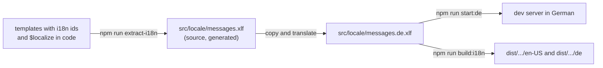

# 09. Accessibility and i18n basics

> **Draft: written but not yet run.** The code and the expected output in this lesson were prepared by reading the code and the official documentation. They have not been executed yet. If something does not behave as described, trust your tool's real output and report it.

## What you will be able to do
By the end of this lesson you will be able to:
- Make a single-page app usable with a keyboard and a screen reader: skip link, landmarks, one `h1` per page, focus and tab title after navigation, a live region, a form error summary, a visible focus ring.
- Name the WCAG 2.2 success criteria each of those measures serves.
- Mark texts for translation with explicit ids (`i18n="@@id"`, `i18n-aria-label`, `$localize`), keep a hand-written German XLIFF file, and run or build the app in German.
- Explain Angular's compile-time i18n model and its trade-offs.

## Recap
1. Which attribute connects an error message to its input for a screen reader? <details><summary>Answer</summary>`aria-describedby` on the input, pointing at the id of the message (201.07).</details>
2. What does `withComponentInputBinding()` do? <details><summary>Answer</summary>It binds route params, `data` and resolved data to component inputs with the same name (201.08).</details>
3. What does `ariaCurrentWhenActive="page"` put on a link? <details><summary>Answer</summary>`aria-current="page"` when the link matches the current route (201.06).</details>

## Why it matters
Picture a **public building**. A ramp next to the stairs, large signs, a sign in the visitor's language and an announcement over the loudspeaker when something happens: nobody is shut out. A web app is a building too. People use it with a keyboard only (motor impairments, or just a broken trackpad), with a screen reader (blindness), with large text or high contrast (low vision), on a small phone, in another language, in bright sun. **Accessibility** (often written a11y) and **internationalisation** (i18n) are the ramps and signs of the web.

An accessible, translatable app is also simply a better app, and in many countries accessibility is a legal duty for public services and a growing number of commercial ones. The reference is **WCAG 2.2** (level AA is the usual target). The capstone applies a full checklist in its chapter "04 Problem details, 412, offline, WCAG"; this lesson teaches the core techniques on the `task-board` project, plus Angular's built-in translation workflow. Angular's i18n is **compile-time**: you build one copy of the app per language.

## What you will build
The `task-board` project gets: a skip link; landmarks; a `TitleStrategy` that sets the tab title and focuses the new page's heading after each navigation; a polite live region and an `Announcer` service; an error summary on the new-task form; a visible focus style; German translations for the shell, the task list and the form; and scripts to serve, extract and build with translations.



## Before you start
- Lessons 07 and 08 done (the project with the form, lazy routes and resolvers). Time: about 110 minutes (break after Step 3).
- Source pack (optional): every file is shown in this lesson. The finished code, the exercise starter and the solution are in the
  course repository https://github.com/Uee03/Code101 under `source/angular/201-hero-to-super-hero/phase-3-architecture-and-quality/09-accessibility-and-i18n-basics/` (**Code, Download ZIP**, or `git clone https://github.com/Uee03/Code101.git`).
- Not repeated here because it did not change: `server/mock-api.mjs` (lesson 04) and `contract/openapi.yaml` (lesson 05). Other unchanged files are listed at the end.
- Optional tools: a screen reader (NVDA on Windows, VoiceOver on macOS) and the axe DevTools browser extension. Neither is required; the keyboard walk below needs nothing.
- Two terminals: `npm run mock` and `npm start`.

## Steps

### Step 1. i18n plumbing
Angular's translation support lives in the package `@angular/localize`. The official way to add it is `ng add @angular/localize`; it makes three edits, which you make by hand here so you see them: a dependency, a polyfill and a TypeScript type.

**File: `package.json`**
```json
{
  "name": "task-board",
  "version": "1.0.0",
  "private": true,
  "scripts": {
    "ng": "ng",
    "api:gen": "ng-openapi-gen",
    "prestart": "npm run api:gen",
    "start": "ng serve --host localhost --port 4200",
    "prestart:de": "npm run api:gen",
    "start:de": "ng serve --host localhost --port 4200 --configuration=de",
    "prebuild": "npm run api:gen",
    "build": "ng build",
    "prebuild:i18n": "npm run api:gen",
    "build:i18n": "ng build --localize",
    "extract-i18n": "ng extract-i18n --output-path src/locale",
    "mock": "node server/mock-api.mjs",
    "mock:auth": "node server/mock-api.mjs --require-auth"
  },
  "dependencies": {
    "@angular/common": "22.3.0",
    "@angular/compiler": "22.3.0",
    "@angular/core": "22.3.0",
    "@angular/forms": "22.3.0",
    "@angular/localize": "22.3.0",
    "@angular/platform-browser": "22.3.0",
    "@angular/router": "22.3.0",
    "rxjs": "7.8.2",
    "tslib": "2.8.1"
  },
  "devDependencies": {
    "@angular/build": "22.3.0",
    "@angular/cli": "22.3.0",
    "@angular/compiler-cli": "22.3.0",
    "ng-openapi-gen": "1.1.0",
    "typescript": "6.0.3"
  }
}
```

- `@angular/localize` 22.3.0 (same version as the other Angular packages).
- `start:de` serves the German build; `extract-i18n` writes the source language file; `build:i18n` builds every locale. The `pre...` scripts regenerate the API client first, as in lesson 05.

Run `npm install`.

**File: `angular.json`**
```json
{
  "$schema": "./node_modules/@angular/cli/lib/config/schema.json",
  "version": 1,
  "cli": {
    "packageManager": "npm",
    "analytics": false
  },
  "newProjectRoot": "projects",
  "projects": {
    "task-board": {
      "projectType": "application",
      "schematics": {
        "@schematics/angular:class": {
          "skipTests": true
        },
        "@schematics/angular:component": {
          "skipTests": true
        },
        "@schematics/angular:directive": {
          "skipTests": true
        },
        "@schematics/angular:guard": {
          "skipTests": true
        },
        "@schematics/angular:interceptor": {
          "skipTests": true
        },
        "@schematics/angular:pipe": {
          "skipTests": true
        },
        "@schematics/angular:resolver": {
          "skipTests": true
        },
        "@schematics/angular:service": {
          "skipTests": true
        }
      },
      "root": "",
      "sourceRoot": "src",
      "prefix": "app",
      "i18n": {
        "sourceLocale": "en-US",
        "locales": {
          "de": {
            "translation": "src/locale/messages.de.xlf"
          }
        }
      },
      "architect": {
        "build": {
          "builder": "@angular/build:application",
          "options": {
            "browser": "src/main.ts",
            "tsConfig": "tsconfig.app.json",
            "polyfills": [
              "@angular/localize/init"
            ],
            "i18nMissingTranslation": "warning",
            "assets": [
              {
                "glob": "**/*",
                "input": "public"
              }
            ],
            "styles": [
              "src/styles.css"
            ]
          },
          "configurations": {
            "production": {
              "budgets": [
                {
                  "type": "initial",
                  "maximumWarning": "500kB",
                  "maximumError": "1MB"
                },
                {
                  "type": "anyComponentStyle",
                  "maximumWarning": "4kB",
                  "maximumError": "8kB"
                }
              ],
              "outputHashing": "all"
            },
            "development": {
              "optimization": false,
              "extractLicenses": false,
              "sourceMap": true
            },
            "de": {
              "localize": ["de"]
            }
          },
          "defaultConfiguration": "production"
        },
        "serve": {
          "builder": "@angular/build:dev-server",
          "configurations": {
            "production": {
              "buildTarget": "task-board:build:production"
            },
            "development": {
              "buildTarget": "task-board:build:development"
            },
            "de": {
              "buildTarget": "task-board:build:development,de"
            }
          },
          "defaultConfiguration": "development"
        },
        "extract-i18n": {
          "builder": "@angular/build:extract-i18n"
        }
      }
    }
  }
}
```

What changed (everything else is as before):
- `"i18n"` under the project: the **source locale** `en-US` (the language written in the templates) and the **locales** with their translation files.
- `"polyfills": ["@angular/localize/init"]` defines the global `$localize` function that compiled templates call.
- `"i18nMissingTranslation": "warning"`: a message without a translation builds with a warning and shows the source text. (`"error"` would stop the build; use that in CI.)
- build configuration `de`: `"localize": ["de"]` builds only German; serve configuration `de` points the dev server at it (`build:development,de`). The dev server can only serve **one** locale at a time.
- target `extract-i18n` for `ng extract-i18n`.

**File: `tsconfig.app.json`**
```json
/* To learn more about Typescript configuration file: https://www.typescriptlang.org/docs/handbook/tsconfig-json.html. */
/* To learn more about Angular compiler options: https://angular.dev/reference/configs/angular-compiler-options. */
{
  "extends": "./tsconfig.json",
  "compilerOptions": {
    "types": ["@angular/localize"]
  },
  "include": [
    "src/**/*.ts"
  ],
  "exclude": [
    "src/**/*.spec.ts"
  ]
}
```

`"types": ["@angular/localize"]` makes `$localize` known to TypeScript.

### Step 2. The accessible shell
**File: `src/app/core/announcer.ts`**
```ts
import { Injectable, signal } from '@angular/core';

// Puts a sentence into a live region (see app.html) so screen readers announce it without moving focus.
@Injectable({ providedIn: 'root' })
export class Announcer {
  private readonly text = signal('');
  readonly message = this.text.asReadonly();

  // The text is cleared first: a live region only announces a change, so the same sentence twice needs a gap.
  say(message: string): void {
    this.text.set('');
    setTimeout(() => this.text.set(message), 50);
  }
}
```

A **live region** is an element a screen reader watches: when its text changes, the new text is read out, **without moving focus**. This is how "The task was created." reaches someone who cannot see the list change. The rules: the region must **already exist** in the page before its text changes (inserting the element together with its text is unreliable); `aria-live="polite"` waits for the reader to finish, `assertive` interrupts and is for emergencies only; and a region only announces a *change*, hence the clear-then-set trick.

**File: `src/app/core/title-focus.ts`**
```ts
import { afterNextRender, inject, Injectable, Injector } from '@angular/core';
import { Title } from '@angular/platform-browser';
import { RouterStateSnapshot, TitleStrategy } from '@angular/router';

// After each navigation: set the tab title from the route's `title`, then move focus to the page heading.
// Without it, a keyboard or screen-reader user stays on the link they pressed and hears nothing about the new page.
@Injectable({ providedIn: 'root' })
export class TitleFocus extends TitleStrategy {
  private readonly title = inject(Title);
  private readonly injector = inject(Injector);
  private firstNavigation = true;

  override updateTitle(snapshot: RouterStateSnapshot): void {
    this.title.setTitle(`${this.buildTitle(snapshot) ?? 'Page'} | Task board`);
    // Leave focus alone on the first page load: the skip link must stay the first Tab stop.
    if (this.firstNavigation) {
      this.firstNavigation = false;
      return;
    }
    afterNextRender(
      () => {
        const heading = document.querySelector<HTMLElement>('main h1');
        heading?.setAttribute('tabindex', '-1');
        heading?.focus();
      },
      { injector: this.injector }
    );
  }
}
```

In a classic website every click loads a new page: the screen reader reads the title and starts at the top. In a single-page app **nothing of that happens**: focus stays on the link the user pressed and the tab title does not change, unless you do it. `TitleStrategy` is the router's hook for setting the document title from the route's `title`; we extend it to also focus the new `h1` (`tabindex="-1"` makes a non-interactive element focusable by script only). It serves WCAG 2.4.2 (Page Titled) and 2.4.3 (Focus Order). On the **first** load we do not move focus, so the skip link stays the first Tab stop.

**File: `src/app/app.config.ts`**
```ts
import { ApplicationConfig, provideBrowserGlobalErrorListeners } from '@angular/core';
import { provideHttpClient, withFetch, withInterceptors } from '@angular/common/http';
import { PreloadAllModules, provideRouter, TitleStrategy, withComponentInputBinding, withPreloading } from '@angular/router';

import { ApiConfiguration } from './api/api-configuration';
import { environment } from '../environments/environment';
import { routes } from './app.routes';
import { TitleFocus } from './core/title-focus';
import { problemInterceptor } from './http/problem.interceptor';
import { retryAfterInterceptor } from './http/retry-after.interceptor';
import { timingInterceptor } from './http/timing.interceptor';

export const appConfig: ApplicationConfig = {
  providers: [
    provideBrowserGlobalErrorListeners(),
    provideHttpClient(withFetch(), withInterceptors([timingInterceptor, problemInterceptor, retryAfterInterceptor])),
    provideRouter(routes, withComponentInputBinding(), withPreloading(PreloadAllModules)),
    { provide: TitleStrategy, useClass: TitleFocus },
    { provide: ApiConfiguration, useValue: { rootUrl: environment.apiBaseUrl } }
  ]
};
```

`{ provide: TitleStrategy, useClass: TitleFocus }` replaces the default strategy.

**File: `src/app/app.ts`**
```ts
import { ChangeDetectionStrategy, Component, inject } from '@angular/core';
import { RouterLink, RouterLinkActive, RouterOutlet } from '@angular/router';
import { Announcer } from './core/announcer';

@Component({
  selector: 'app-root',
  imports: [RouterLink, RouterLinkActive, RouterOutlet],
  changeDetection: ChangeDetectionStrategy.OnPush,
  templateUrl: './app.html',
  styleUrl: './app.css'
})
export class App {
  protected readonly announcer = inject(Announcer);

  // The app uses <base href="/">, so a plain "#main" link would navigate to "/#main". Move focus by hand instead.
  protected skipToMain(event: Event): void {
    event.preventDefault();
    document.getElementById('main')?.focus();
  }
}
```

**File: `src/app/app.html`**
```html
<a class="skip-link" href="#main" (click)="skipToMain($event)" i18n="@@skip.link">Skip to main content</a>

<header class="bar">
  <a routerLink="/" class="brand">Task board</a>
  <nav aria-label="Main" i18n-aria-label="@@nav.label">
    <a routerLink="/tasks" routerLinkActive="active" [routerLinkActiveOptions]="{ exact: true }" ariaCurrentWhenActive="page" i18n="@@nav.tasks">Tasks</a>
    <a routerLink="/tasks/new" routerLinkActive="active" ariaCurrentWhenActive="page" i18n="@@nav.new">New task</a>
    <a routerLink="/explorer" routerLinkActive="active" ariaCurrentWhenActive="page" i18n="@@nav.explorer">API explorer</a>
  </nav>
</header>

<main id="main" class="page" tabindex="-1">
  <router-outlet />
</main>

<div class="sr-only" role="status" aria-live="polite" aria-atomic="true">{{ announcer.message() }}</div>
```

- **Skip link** (WCAG 2.4.1 Bypass Blocks): the first focusable element; it jumps over the navigation to the main content. It is hidden off screen until it receives focus (CSS below). Because the project uses `<base href="/">`, a plain `href="#main"` would navigate to `/#main` and the router would redirect; so the click handler prevents the default and moves focus itself.
- **Landmarks** (`header`, `nav` with a label, `main`): screen-reader users jump between them. Every page has exactly one `h1` inside `main`, then `h2` and so on in order (WCAG 1.3.1, 2.4.6).
- `main` has `tabindex="-1"` so the skip link can focus it.
- The **live region** `div` is always present; `sr-only` hides it visually only.
- `i18n="@@skip.link"` and `i18n-aria-label="@@nav.label"` mark the visible text and the accessible name for translation (Step 4).

**File: `src/styles.css`**
```css
body {
  font-family: system-ui, sans-serif;
  line-height: 1.5;
  margin: 2rem;
}

.field {
  display: grid;
  gap: 0.25rem;
  max-width: 28rem;
  margin: 1rem 0;
}

label {
  font-weight: 600;
}

input,
select,
textarea {
  font: inherit;
  padding: 0.4rem;
  border: 1px solid #4b5563;
  border-radius: 0.25rem;
}

input[aria-invalid='true'],
textarea[aria-invalid='true'] {
  border: 2px solid #b42318;
}

.hint {
  margin: 0;
  color: #4b5563;
  font-size: 0.875rem;
}

button {
  min-height: 2.25rem;
  padding: 0.25rem 0.75rem;
}

/* A visible focus ring for keyboard users, on every focusable element. */
:focus-visible {
  outline: 3px solid #1d4ed8;
  outline-offset: 2px;
}

/* The skip link is off screen until it receives focus. */
.skip-link {
  position: absolute;
  top: -4rem;
  left: 0.5rem;
  padding: 0.5rem 0.75rem;
  background: #ffffff;
  color: #1d4ed8;
  z-index: 10;
}

.skip-link:focus {
  top: 0.5rem;
}

/* Visually hidden but still read by screen readers (the live region). */
.sr-only {
  position: absolute;
  width: 1px;
  height: 1px;
  margin: -1px;
  padding: 0;
  overflow: hidden;
  clip-path: inset(50%);
  white-space: nowrap;
  border: 0;
}

@media (prefers-reduced-motion: reduce) {
  * {
    scroll-behavior: auto !important;
    transition: none !important;
    animation: none !important;
  }
}
```

- `:focus-visible` gives every focused control a clear ring (WCAG 2.4.7). Never write `outline: none` without a replacement.
- `.skip-link` and `.sr-only` are the two standard hiding patterns: one is revealed on focus, the other stays hidden but readable by assistive technology. (Do not hide with `display: none`: that removes it for screen readers too.)
- Colours: the link and focus blue `#1d4ed8` on white has a contrast ratio above 4.5:1, the minimum for text (WCAG 1.4.3).
- `prefers-reduced-motion` respects people who turn animations off in their system settings. This app has little motion; the rule is a safety net.
- Buttons are at least 2.25 rem high (36 px), above the 24 px minimum target size of WCAG 2.5.8.

**Take a break here.**

### Step 3. The accessible form
Lesson 07's form had inline messages. Now it also gets a **summary** at the top (WCAG 3.3.1 Error Identification, 3.3.3 Error Suggestion) and moves focus to it, so a keyboard or screen-reader user does not have to hunt for what went wrong.

**File: `src/app/features/new-task/issues.ts`**
```ts
import { AbstractControl } from '@angular/forms';

export interface Issue {
  field: string;
  label: string;
  text: string;
}

// One short sentence for the first problem of a control, or null when it has none.
// A server message (from a 422 answer) wins because it is the most specific.
export function issueText(control: AbstractControl): string | null {
  if (control.hasError('server')) {
    return String(control.getError('server'));
  }
  if (control.hasError('required')) {
    return $localize`:@@issue.required:Enter a title.`;
  }
  if (control.hasError('maxlength')) {
    return $localize`:@@issue.tooLong:The text is too long.`;
  }
  if (control.hasError('angleBrackets')) {
    return $localize`:@@issue.brackets:Remove the characters < and >.`;
  }
  if (control.hasError('titleTaken')) {
    return $localize`:@@issue.taken:This title is already used.`;
  }
  if (control.hasError('pastDate')) {
    return $localize`:@@issue.past:Choose today or a later date.`;
  }
  return null;
}
```

`issueText` is the one place that turns an error key into a sentence. The inline messages and the summary both use it, so they never disagree, and each sentence is marked with `$localize` and an id so it can be translated. The `:@@id:` between the colons is the id; the text follows. (Do not put a bare `:` inside a `$localize` text: it must be escaped.)

**File: `src/app/features/new-task/new-task.ts`**
```ts
import { afterNextRender, ChangeDetectionStrategy, Component, ElementRef, inject, Injector, signal, viewChild } from '@angular/core';
import { toSignal } from '@angular/core/rxjs-interop';
import { NonNullableFormBuilder, ReactiveFormsModule, Validators } from '@angular/forms';
import { Task, TaskCreate, TaskPriority } from '../../api/models';
import { Announcer } from '../../core/announcer';
import { TaskService } from '../../core/task-service';
import { noAngleBrackets, notInPast, titleAvailable } from '../../forms/validators';
import { ApiProblem, fieldName, isApiProblem } from '../../http/problem';
import { ProblemView } from '../../shared/problem-view';
import { Issue, issueText } from './issues';

@Component({
  selector: 'app-new-task',
  imports: [ReactiveFormsModule, ProblemView],
  changeDetection: ChangeDetectionStrategy.OnPush,
  templateUrl: './new-task.html',
  styleUrl: './new-task.css'
})
export class NewTask {
  private readonly tasks = inject(TaskService);
  private readonly builder = inject(NonNullableFormBuilder);
  private readonly announcer = inject(Announcer);
  private readonly injector = inject(Injector);
  private readonly summary = viewChild<ElementRef<HTMLElement>>('summary');
  private idempotencyKey: string | null = null;
  private lastBody = '';

  protected readonly priorities: readonly TaskPriority[] = ['low', 'medium', 'high', 'urgent'];
  protected readonly form = this.builder.group({
    title: this.builder.control('', {
      validators: [Validators.required, Validators.maxLength(200), noAngleBrackets],
      asyncValidators: [titleAvailable((title) => this.tasks.titleExists(title))]
    }),
    description: this.builder.control('', [Validators.maxLength(10000)]),
    priority: this.builder.control<TaskPriority>('medium'),
    dueDate: this.builder.control('', [notInPast()])
  });

  // Form state is not a signal. Reading this one in the template makes Angular redraw when validation changes.
  protected readonly status = toSignal(this.form.statusChanges, { initialValue: this.form.status });
  protected readonly saving = signal(false);
  protected readonly created = signal<Task[]>([]);
  protected readonly problem = signal<ApiProblem | null>(null);
  protected readonly issues = signal<Issue[]>([]);

  // The inline messages and the summary use the same sentences. A small function in a template is fine;
  // for heavy work use a computed signal instead.
  protected readonly message = issueText;

  protected get title() {
    return this.form.controls.title;
  }

  protected get description() {
    return this.form.controls.description;
  }

  protected get dueDate() {
    return this.form.controls.dueDate;
  }

  protected async submit(): Promise<void> {
    this.form.markAllAsTouched();
    if (this.form.pending || this.saving()) {
      return;
    }
    if (this.form.invalid) {
      this.showIssues();
      return;
    }
    this.issues.set([]);
    const value = this.form.getRawValue();
    const body: TaskCreate = {
      title: value.title.trim(),
      description: value.description,
      priority: value.priority,
      dueDate: value.dueDate || null
    };
    // One key per user action: the same content sent again after a failure reuses the key, new content gets a new one.
    const fingerprint = JSON.stringify(body);
    if (this.idempotencyKey === null || fingerprint !== this.lastBody) {
      this.idempotencyKey = crypto.randomUUID();
      this.lastBody = fingerprint;
    }
    this.saving.set(true);
    this.problem.set(null);
    try {
      const task = await this.tasks.create(body, this.idempotencyKey);
      this.created.update((list) => [task, ...list]);
      this.idempotencyKey = null;
      this.form.reset({ priority: value.priority });
      this.announcer.say($localize`:@@announce.created:The task was created.`);
    } catch (error) {
      if (!isApiProblem(error)) {
        throw error;
      }
      this.problem.set(error);
      this.showServerErrors(error);
      this.showIssues();
    } finally {
      this.saving.set(false);
    }
  }

  // Used by the buttons in the summary: a "#field" link would clash with <base href="/">.
  protected focusField(field: string): void {
    document.getElementById(field)?.focus();
  }

  // Collect the problems into one list and move focus to it, so keyboard and screen-reader users learn about them.
  private showIssues(): void {
    const fields = [
      { field: 'title', label: $localize`:@@new.title.label:Title`, control: this.title },
      { field: 'description', label: $localize`:@@new.description.label:Description (optional)`, control: this.description },
      { field: 'dueDate', label: $localize`:@@new.due.label:Due date (optional)`, control: this.dueDate }
    ];
    const found: Issue[] = [];
    for (const item of fields) {
      const text = issueText(item.control);
      if (text) {
        found.push({ field: item.field, label: item.label, text });
      }
    }
    this.issues.set(found);
    afterNextRender(() => this.summary()?.nativeElement.focus(), { injector: this.injector });
  }

  // Put each "errors[].pointer" message on its form control. Server errors vanish when the user edits the field.
  private showServerErrors(problem: ApiProblem): void {
    for (const item of problem.errors ?? []) {
      const name = fieldName(item.pointer);
      const control = name ? this.form.get(name) : null;
      if (control) {
        control.setErrors({ server: item.detail });
        control.markAsTouched();
      }
    }
  }
}
```

New compared with lesson 07:
- `showIssues()` builds the list for the summary from the controls and, after the next render, **focuses the summary** (`viewChild` finds it, `afterNextRender` waits until it exists). It runs when the user presses the button on an invalid form, and again after a 422 answer.
- `focusField(id)` moves focus to a field from the summary; it exists because `<a href="#title">` would clash with `<base href="/">`.
- The success path calls `announcer.say(...)` with a translated sentence.
- `message = issueText` exposes the function to the template.

**File: `src/app/features/new-task/new-task.html`**
```html
<h1 i18n="@@new.heading">New task</h1>

@if (issues().length > 0) {
  <div #summary class="summary" role="group" tabindex="-1" aria-labelledby="summary-heading">
    <h2 id="summary-heading" i18n="@@new.summary.heading">Please fix these problems</h2>
    <ul>
      @for (issue of issues(); track issue.field) {
        <li>
          <button type="button" class="link" (click)="focusField(issue.field)">{{ issue.label }}: {{ issue.text }}</button>
        </li>
      }
    </ul>
  </div>
}

<form [formGroup]="form" (ngSubmit)="submit()" novalidate [attr.aria-busy]="status() === 'PENDING'">
  <div class="field">
    <label for="title" i18n="@@new.title.label">Title</label>
    <input
      id="title"
      type="text"
      formControlName="title"
      autocomplete="off"
      aria-describedby="title-hint title-errors"
      [attr.aria-invalid]="title.invalid && title.touched ? 'true' : null"
    />
    <p id="title-hint" class="hint" i18n="@@new.title.hint">Required. Up to 200 characters, without &lt; or &gt;.</p>
    <div id="title-errors" class="errors">
      @if ((title.touched || title.dirty) && message(title); as text) {
        <p>{{ text }}</p>
      }
      @if (title.pending) {
        <p role="status" class="hint" i18n="@@new.title.checking">Checking whether the title is free...</p>
      }
    </div>
  </div>

  <div class="field">
    <label for="description" i18n="@@new.description.label">Description (optional)</label>
    <textarea
      id="description"
      rows="3"
      formControlName="description"
      aria-describedby="description-errors"
      [attr.aria-invalid]="description.invalid && description.touched ? 'true' : null"
    ></textarea>
    <div id="description-errors" class="errors">
      @if (description.touched && message(description); as text) {
        <p>{{ text }}</p>
      }
    </div>
  </div>

  <div class="field">
    <label for="priority" i18n="@@new.priority.label">Priority</label>
    <select id="priority" formControlName="priority">
      @for (priority of priorities; track priority) {
        <option [value]="priority">{{ priority }}</option>
      }
    </select>
  </div>

  <div class="field">
    <label for="dueDate" i18n="@@new.due.label">Due date (optional)</label>
    <input
      id="dueDate"
      type="date"
      formControlName="dueDate"
      aria-describedby="dueDate-errors"
      [attr.aria-invalid]="dueDate.invalid && dueDate.touched ? 'true' : null"
    />
    <div id="dueDate-errors" class="errors">
      @if (dueDate.touched && message(dueDate); as text) {
        <p>{{ text }}</p>
      }
    </div>
  </div>

  <button type="submit" [disabled]="saving()">
    @if (saving()) {
      <span i18n="@@new.saving">Saving...</span>
    } @else {
      <span i18n="@@new.submit">Create task</span>
    }
  </button>
</form>

@if (problem(); as current) {
  <app-problem-view [problem]="current" />
}

@if (created().length > 0) {
  <h2 i18n="@@new.created.heading">Created in this session</h2>
  <ul>
    @for (task of created(); track task.id) {
      <li>{{ task.title }} ({{ task.priority }}, version {{ task.version }})</li>
    }
  </ul>
}
```

- The summary has an `h2` (referenced by `aria-labelledby`), `tabindex="-1"` (focusable by script), and **buttons** styled as links: they run code, they do not navigate, so a `button` is the honest element.
- Inline messages use `message(control)`. A function call in a template runs on every check, which is fine for this tiny, pure function; for heavy work use a `computed` signal.
- The old "Created: ..." live paragraph is gone: the `Announcer` is now the one voice, otherwise a screen reader would read it twice.
- Each visible text has `i18n="@@id"`. The button label switches with `@if` between two separately translatable texts instead of a ternary inside `{{ }}`.

**File: `src/app/features/new-task/new-task.css`**
```css
.errors p {
  margin: 0;
  color: #b42318;
  font-size: 0.875rem;
}

.errors p.hint {
  color: #4b5563;
}

textarea {
  resize: vertical;
}

.summary {
  max-width: 36rem;
  margin: 1rem 0;
  padding: 0.75rem 1rem;
  border: 2px solid #b42318;
  border-radius: 0.25rem;
}

.summary h2 {
  margin-top: 0;
  font-size: 1.1rem;
}

.link {
  min-height: 1.5rem;
  padding: 0;
  border: 0;
  background: none;
  color: #1d4ed8;
  font: inherit;
  text-align: left;
  text-decoration: underline;
  cursor: pointer;
}
```

### Step 4. Mark texts for translation
**File: `src/app/features/tasks/tasks.html`**
```html
<h1 i18n="@@tasks.heading">Tasks</h1>

<p>
  @if (items().length === 1) {
    <span i18n="@@tasks.count.one">One task</span>
  } @else {
    <span i18n="@@tasks.count.other">{{ items().length }} tasks</span>
  }
  <a routerLink="/tasks/new" i18n="@@tasks.create">Create a task</a>
</p>

<ul class="tasks">
  @for (task of items(); track task.id) {
    <li>
      <a [routerLink]="['/tasks', task.id]">{{ task.title }}</a>
      <span class="meta">{{ task.status }}, {{ task.priority }}</span>
    </li>
  } @empty {
    <li i18n="@@tasks.empty">There are no tasks yet.</li>
  }
</ul>

@if (problem(); as current) {
  <app-problem-view [problem]="current" />
}

@if (nextCursor()) {
  <button type="button" (click)="loadMore()" [disabled]="loading()">
    @if (loading()) {
      <span i18n="@@tasks.loading">Loading...</span>
    } @else {
      <span i18n="@@tasks.more">Load more</span>
    }
  </button>
} @else {
  <p i18n="@@tasks.all">That is every task.</p>
}

<h2 i18n="@@tasks.summary">Summary</h2>
@defer (on viewport) {
  <app-status-summary [tasks]="items()" />
} @placeholder {
  <p class="placeholder">The summary loads when this area scrolls into view.</p>
} @loading (minimum 300ms) {
  <p class="placeholder">Loading the summary...</p>
}
```

**File: `src/app/app.routes.ts`**
```ts
import { Routes } from '@angular/router';
import { taskResolver, tasksResolver } from './tasks/task.resolvers';

export const routes: Routes = [
  { path: '', pathMatch: 'full', redirectTo: 'tasks' },
  {
    path: 'tasks',
    title: $localize`:@@title.tasks:Tasks`,
    resolve: { page: tasksResolver },
    loadComponent: () => import('./features/tasks/tasks').then((m) => m.Tasks)
  },
  {
    path: 'tasks/new',
    title: $localize`:@@title.new:New task`,
    loadComponent: () => import('./features/new-task/new-task').then((m) => m.NewTask)
  },
  {
    path: 'tasks/:taskId',
    title: 'Task',
    resolve: { detail: taskResolver },
    loadComponent: () => import('./features/task-detail/task-detail').then((m) => m.TaskDetail)
  },
  {
    path: 'explorer',
    title: $localize`:@@title.explorer:API explorer`,
    loadComponent: () => import('./features/explorer/explorer').then((m) => m.Explorer)
  },
  {
    path: 'not-found',
    title: 'Not found',
    data: { heading: 'Not found', text: 'We could not find that page or task.' },
    loadComponent: () => import('./features/notice/notice').then((m) => m.Notice)
  },
  {
    path: 'unavailable',
    title: 'Unavailable',
    data: { heading: 'Something went wrong', text: 'The API did not answer. Check that it is running, then try again.' },
    loadComponent: () => import('./features/notice/notice').then((m) => m.Notice)
  },
  { path: '**', redirectTo: 'not-found' }
];
```

Rules of thumb:
- **Explicit ids** (`@@tasks.heading`) instead of the generated hash ids: a hash changes when the English text changes, which orphans the translation. With your own id the translation survives an edit of the English text; the price is that **you** must keep ids unique and meaningful.
- One id, one text: the same id may appear twice only with identical text (the label ids in `new-task.ts` and `new-task.html` do).
- The **count** ("One task" and "N tasks") uses two messages chosen with `@if`. Angular also has an **ICU** `plural` syntax (`{count, plural, =0 {...} =1 {...} other {...}}`) for languages with more plural forms than English and German; its messages get generated ids, so you extract them with `npm run extract-i18n` instead of writing ids by hand. For two-form languages two messages are simpler.
- `i18n-aria-label` marks an attribute. Route `title`s use `$localize` because they are TypeScript. Routes without `$localize` (`Task`, `Not found`, `Unavailable`) stay English: translating **in slices** is normal; unmarked text never causes a warning.

### Step 5. The German file
**File: `src/locale/messages.de.xlf`**
```xml
<?xml version="1.0" encoding="UTF-8" ?>
<xliff version="1.2" xmlns="urn:oasis:names:tc:xliff:document:1.2">
  <file source-language="en-US" target-language="de" datatype="plaintext" original="ng2.template">
    <body>
      <trans-unit id="skip.link" datatype="html">
        <source>Skip to main content</source>
        <target>Zum Hauptinhalt springen</target>
      </trans-unit>
      <trans-unit id="nav.label" datatype="html">
        <source>Main</source>
        <target>Hauptnavigation</target>
      </trans-unit>
      <trans-unit id="nav.tasks" datatype="html">
        <source>Tasks</source>
        <target>Aufgaben</target>
      </trans-unit>
      <trans-unit id="nav.new" datatype="html">
        <source>New task</source>
        <target>Neue Aufgabe</target>
      </trans-unit>
      <trans-unit id="nav.explorer" datatype="html">
        <source>API explorer</source>
        <target>API-Explorer</target>
      </trans-unit>
      <trans-unit id="tasks.heading" datatype="html">
        <source>Tasks</source>
        <target>Aufgaben</target>
      </trans-unit>
      <trans-unit id="tasks.count.one" datatype="html">
        <source>One task</source>
        <target>Eine Aufgabe</target>
      </trans-unit>
      <trans-unit id="tasks.count.other" datatype="html">
        <source><x id="INTERPOLATION" equiv-text="{{ items().length }}"/> tasks</source>
        <target><x id="INTERPOLATION" equiv-text="{{ items().length }}"/> Aufgaben</target>
      </trans-unit>
      <trans-unit id="tasks.create" datatype="html">
        <source>Create a task</source>
        <target>Aufgabe anlegen</target>
      </trans-unit>
      <trans-unit id="tasks.empty" datatype="html">
        <source>There are no tasks yet.</source>
        <target>Es gibt noch keine Aufgaben.</target>
      </trans-unit>
      <trans-unit id="tasks.loading" datatype="html">
        <source>Loading...</source>
        <target>Wird geladen...</target>
      </trans-unit>
      <trans-unit id="tasks.more" datatype="html">
        <source>Load more</source>
        <target>Mehr laden</target>
      </trans-unit>
      <trans-unit id="tasks.all" datatype="html">
        <source>That is every task.</source>
        <target>Das sind alle Aufgaben.</target>
      </trans-unit>
      <trans-unit id="tasks.summary" datatype="html">
        <source>Summary</source>
        <target>Zusammenfassung</target>
      </trans-unit>
      <trans-unit id="new.heading" datatype="html">
        <source>New task</source>
        <target>Neue Aufgabe</target>
      </trans-unit>
      <trans-unit id="new.summary.heading" datatype="html">
        <source>Please fix these problems</source>
        <target>Bitte beheben Sie diese Probleme</target>
      </trans-unit>
      <trans-unit id="new.title.label" datatype="html">
        <source>Title</source>
        <target>Titel</target>
      </trans-unit>
      <trans-unit id="new.title.hint" datatype="html">
        <source>Required. Up to 200 characters, without &lt; or &gt;.</source>
        <target>Pflichtfeld. Höchstens 200 Zeichen, ohne &lt; oder &gt;.</target>
      </trans-unit>
      <trans-unit id="new.title.checking" datatype="html">
        <source>Checking whether the title is free...</source>
        <target>Es wird geprüft, ob der Titel noch frei ist...</target>
      </trans-unit>
      <trans-unit id="new.description.label" datatype="html">
        <source>Description (optional)</source>
        <target>Beschreibung (optional)</target>
      </trans-unit>
      <trans-unit id="new.priority.label" datatype="html">
        <source>Priority</source>
        <target>Priorität</target>
      </trans-unit>
      <trans-unit id="new.due.label" datatype="html">
        <source>Due date (optional)</source>
        <target>Fälligkeitsdatum (optional)</target>
      </trans-unit>
      <trans-unit id="new.saving" datatype="html">
        <source>Saving...</source>
        <target>Wird gespeichert...</target>
      </trans-unit>
      <trans-unit id="new.submit" datatype="html">
        <source>Create task</source>
        <target>Aufgabe anlegen</target>
      </trans-unit>
      <trans-unit id="new.created.heading" datatype="html">
        <source>Created in this session</source>
        <target>In dieser Sitzung angelegt</target>
      </trans-unit>
      <trans-unit id="title.tasks" datatype="html">
        <source>Tasks</source>
        <target>Aufgaben</target>
      </trans-unit>
      <trans-unit id="title.new" datatype="html">
        <source>New task</source>
        <target>Neue Aufgabe</target>
      </trans-unit>
      <trans-unit id="title.explorer" datatype="html">
        <source>API explorer</source>
        <target>API-Explorer</target>
      </trans-unit>
      <trans-unit id="announce.created" datatype="html">
        <source>The task was created.</source>
        <target>Die Aufgabe wurde angelegt.</target>
      </trans-unit>
      <trans-unit id="issue.required" datatype="html">
        <source>Enter a title.</source>
        <target>Geben Sie einen Titel ein.</target>
      </trans-unit>
      <trans-unit id="issue.tooLong" datatype="html">
        <source>The text is too long.</source>
        <target>Der Text ist zu lang.</target>
      </trans-unit>
      <trans-unit id="issue.brackets" datatype="html">
        <source>Remove the characters &lt; and &gt;.</source>
        <target>Entfernen Sie die Zeichen &lt; und &gt;.</target>
      </trans-unit>
      <trans-unit id="issue.taken" datatype="html">
        <source>This title is already used.</source>
        <target>Dieser Titel wird bereits verwendet.</target>
      </trans-unit>
      <trans-unit id="issue.past" datatype="html">
        <source>Choose today or a later date.</source>
        <target>Wählen Sie heute oder ein späteres Datum.</target>
      </trans-unit>
    </body>
  </file>
</xliff>
```

- **XLIFF 1.2** is the default interchange format. Each `trans-unit` has the same `id` as the template and a `source` (the English) and a `target` (the German).
- `&lt;` and `&gt;` are XML escapes for `<` and `>`.
- `<x id="INTERPOLATION" equiv-text="..."/>` is a **placeholder**: it stands for `{{ items().length }}` and must stay in the translation, in whatever position the German sentence needs it.
- Normally you do not write the file from scratch: `npm run extract-i18n` creates `src/locale/messages.xlf` from your templates; you copy it to `messages.de.xlf`, add `<target>` elements, and send it to a translator. When English texts change, extract again and merge by id. We wrote the file by hand so every line is visible.

## Run it
Terminal 1: `npm run mock`. Terminal 2: `npm start`. Open http://localhost:4200/.

**Predict:** you press Tab once on the freshly loaded page and then Enter. Where is the keyboard focus afterwards, and why does the address bar not change?

Expected behaviour (derived by reading the code; not yet seen in a browser or with a screen reader):
1. **Skip link.** First Tab: a link "Skip to main content" slides into view at the top left, with a blue focus ring. Enter: focus moves to the main area (a ring around it) and the address stays `/tasks`, because the handler cancels the link. The next Tab goes to the first control inside the page.
2. **Navigation.** Tab to **New task** and press Enter. The tab title changes to "New task | Task board", and focus lands on the heading "New task" (a ring around the `h1`). A screen reader reads the heading. Tab again: the first form field, **Title**.
3. **Summary.** With an empty form, Tab to **Create task** and press Enter. A bordered box "Please fix these problems" appears above the form and takes focus; it lists "Title: Enter a title." as a button. The Title field has a thick red border and the same sentence below it. Press the button in the box: focus moves to the Title input.
4. **Announcement.** Fill in a valid title and submit. Visually the list "Created in this session" grows. A screen reader says "The task was created." without focus moving.
5. **German.** Stop `npm start`, run `npm run start:de`, open http://localhost:4200/. Navigation reads "Aufgaben", "Neue Aufgabe", "API-Explorer"; the list heading "Aufgaben"; the count "5 Aufgaben" (or "Eine Aufgabe"); "Aufgabe anlegen"; the new-task form is German including the summary sentences. The page source shows the German build with `<html lang="de">` (the CLI sets it per locale; check it in DevTools, Elements). Things that stay English on purpose: the brand "Task board", priority and status values, the problem box, the task detail page, the notices.
6. **Build all locales.** `npm run build:i18n` builds `en-US` and `de`. Typical result: two sub-folders (one per locale) under `dist/task-board/browser/`, each with its own `index.html`. A message without a translation would print a warning such as `Missing translation for message "..."`; with the provided file there should be none.
7. **Extract.** `npm run extract-i18n` writes `src/locale/messages.xlf`. Open it and compare the ids with `messages.de.xlf`. Do **not** copy it over the German file.

## How it works
1. A keyboard user needs: a **logical focus order** (the DOM order), a **visible focus**, **no traps**, and a way to **bypass repeated blocks**. A screen-reader user also needs **names** (labels), **roles** (use native elements: `button`, `a`, `nav`, `main`), **states** (`aria-invalid`, `aria-current`) and **announcements** (live regions, focus on new content).
2. After a route change Angular does not tell assistive technology anything. `TitleFocus` supplies the missing "new page" signal.
3. **Compile-time i18n:** the compiler turns every `i18n` text into a `$localize` call; the build replaces each call with the translation for one locale. The result is one app per language with **no runtime translation library**. The browser formats dates, numbers and currency through Angular's locale data, which the CLI registers for each locale (the `date` pipe in the task detail page follows the build's locale).
4. A user picks a language by **address** (for example `/de/`) or by server-side detection; switching language reloads another build.

**Why this, not that.**
- *Built-in compile-time i18n* versus *a runtime library* (Transloco, ngx-translate): built-in is smallest and fastest and checks translations at build time; a runtime library switches language without a reload and loads translations lazily, but adds code and run-time lookups. Pick runtime when users must switch constantly or one deployment must serve all languages.
- *Native elements* versus *ARIA on divs*: the first rule of ARIA is not to use ARIA when a native element does the job. A `<button>` is focusable, activates with Enter and Space and has the right role for free.
- *`aria-live` for everything* versus *focus management*: use focus when the user must act on the new content (an error summary); use a live region for information they do not need to act on (a success message).

**Security note.** Never build a `$localize` message by concatenating user text into the message itself; pass user data as a **placeholder** (`${name}`) so it stays data. Keep translation files in source control and review them like code: a translation is text that your app shows under its own name. Live-region text is set as plain text, never as HTML.

**Misconception:** "if an automated checker (axe, Lighthouse) shows no errors, the app is accessible." Automated tools find only a part of the problems (typically a minority of WCAG issues). The keyboard walk and a screen-reader pass are required, and so is real user feedback.

## Try it
Starter file: `exercise/starter/src/app/shared/status-badge.ts`.
1. **Guided:** finish `StatusBadge` (the TODOs): a computed `label` with `$localize` ids and a symbol that is `aria-hidden`, so the status is never colour alone. Predict what a screen reader reads for the "done" badge.
2. **Change:** use `<app-status-badge [status]="task.status" />` in `tasks.html` instead of `{{ task.status }}` (add `StatusBadge` to the `imports` of `Tasks`), and add the German `trans-unit`s for the five `status.*` ids to `messages.de.xlf`. Run `npm run build:i18n`: which warnings disappear?
3. **Stretch (optional):** do a keyboard-only walk through **Tasks**, **Task detail** and **Explorer** and write down every problem you find. Fix one: for example "Mark as done" gives no feedback to a screen reader; call `Announcer.say(...)` after a successful update in `task-detail.ts`.

<details><summary>Solution for rung 1</summary>

**File: `exercise/solution/src/app/shared/status-badge.ts`**
```ts
import { ChangeDetectionStrategy, Component, computed, input } from '@angular/core';
import { TaskStatus } from '../api/models';

const symbols: Record<TaskStatus, string> = {
  todo: '○',
  in_progress: '◐',
  blocked: '■',
  done: '✓',
  cancelled: '✕'
};

// A status must never be shown by colour alone: it needs a text label (WCAG 2.2, 1.4.1 Use of Color).
@Component({
  selector: 'app-status-badge',
  changeDetection: ChangeDetectionStrategy.OnPush,
  template: `<span class="badge"><span aria-hidden="true">{{ symbol() }}</span> {{ label() }}</span>`,
  styles: `
    .badge {
      display: inline-block;
      padding: 0 0.5rem;
      border: 1px solid #4b5563;
      border-radius: 0.75rem;
    }
  `
})
export class StatusBadge {
  readonly status = input.required<TaskStatus>();

  protected readonly symbol = computed(() => symbols[this.status()]);

  protected readonly label = computed(() => {
    switch (this.status()) {
      case 'todo':
        return $localize`:@@status.todo:To do`;
      case 'in_progress':
        return $localize`:@@status.in_progress:In progress`;
      case 'blocked':
        return $localize`:@@status.blocked:Blocked`;
      case 'done':
        return $localize`:@@status.done:Done`;
      case 'cancelled':
        return $localize`:@@status.cancelled:Cancelled`;
    }
  });
}
```

The symbol has `aria-hidden="true"`, so a screen reader reads only the label, "Done". Sighted users get both the symbol and the text, so colour is never the only signal (WCAG 1.4.1).

</details>

## Check yourself
1. Why does the skip link handler call `preventDefault()`? <details><summary>Answer</summary>With `<base href="/">` a link `#main` resolves to `/#main`, which would navigate the router; we move focus by script instead.</details>
2. When use focus, and when a live region? <details><summary>Answer</summary>Focus when the user must act on the new content (an error summary); a live region for information that needs no action (a success message).</details>
3. Why explicit ids such as `@@tasks.heading`? <details><summary>Answer</summary>Generated ids change when the English text changes, which loses the translation; explicit ids stay stable.</details>
4. Does `npm run build:i18n` contain a runtime translation library? <details><summary>Answer</summary>No: translations are merged at build time, one app per locale.</details>

## Common mistakes
| Symptom or error text | Cause | Fix |
|---|---|---|
| Typical message: `ReferenceError: $localize is not defined` | The polyfill `@angular/localize/init` is missing in `angular.json` | Add it to `build.options.polyfills` |
| Typical message: `Cannot find name '$localize'` (TS2304) | `"types": ["@angular/localize"]` is missing in `tsconfig.app.json` | Add it |
| `Missing translation for message "..."` warning | The id exists in the template but not in `messages.de.xlf` | Add a `trans-unit` with that id (or set `i18nMissingTranslation` to `error` in CI to catch it) |
| German build still shows English text | The text has no `i18n` mark, or the dev server runs without `--configuration=de` | Mark the text; start with `npm run start:de` |
| Clicking the skip link redirects to `/tasks` and nothing is focused | A plain `href="#main"` with `<base href="/">` | Keep the click handler that cancels the link |
| A screen reader says nothing when the success message appears | The live region element was inserted together with its text | Keep the region in the page from the start; change only its text |
| Focus ring is missing | A CSS rule removes the outline | Delete `outline: none` or provide `:focus-visible` |
| Typical message about duplicate message ids with different text | Two places use the same id but different English text | Make the texts identical or give one a new id |

## Best practice
Build on native HTML, give every page one `h1`, a title and a focus target, announce changes that need no action through a live region, summarise form errors and move focus to the summary, keep a visible focus ring, never rely on colour alone, and test with the keyboard first. For translations use explicit ids, review translation files like code, and fail the CI build on missing translations. Source: WCAG 2.2 https://www.w3.org/TR/WCAG22/ , WAI-ARIA Authoring Practices https://www.w3.org/WAI/ARIA/apg/ and Angular, Internationalization https://angular.dev/guide/i18n

## Going further
- Angular accessibility guide: https://angular.dev/best-practices/a11y
- Angular i18n, "Prepare component for translation": https://angular.dev/guide/i18n/prepare
- Capstone: `capstones/web-angular` chapter 04 (the full WCAG 2.2 checklist, focus handling in dialogs, an offline banner) and its TDD section "Accessibility".
- WCAG 2.2 "What's new": https://www.w3.org/WAI/standards-guidelines/wcag/new-in-22/

## Summary
- You added the techniques that make a single-page app usable by keyboard and screen reader.
- You marked texts for translation with stable ids and ran the app in German.
- You know what automated tools cannot tell you and what to test by hand.

## Next lesson
10. Project: a task board against the platform contract: put lessons 05 to 09 together in a board with columns, optimistic moves with `If-Match`, and optional sign-in, then continue with `capstones/web-angular`.

<details>
<summary>Files that did not change in this lesson (listed so this page is complete)</summary>

**File: `.gitignore`**

```
node_modules/
dist/
.angular/
.env
*.log
src/app/api/
```

**File: `ng-openapi-gen.json`**

```json
{
  "$schema": "./node_modules/ng-openapi-gen/ng-openapi-gen-schema.json",
  "input": "contract/openapi.yaml",
  "output": "src/app/api",
  "apiService": "Api",
  "promises": true,
  "services": false
}
```

**File: `public/favicon.svg`**

```xml
<svg xmlns="http://www.w3.org/2000/svg" viewBox="0 0 24 24" width="24" height="24" fill="none" stroke="#1d6fb8" stroke-width="2" stroke-linecap="round" stroke-linejoin="round">
  <path d="M22 11.08V12a10 10 0 1 1-5.93-9.14"/><polyline points="22 4 12 14.01 9 11.01"/>
</svg>
```

**File: `src/app/app.css`**

```css
.bar {
  display: flex;
  flex-wrap: wrap;
  align-items: center;
  gap: 1rem;
  padding-bottom: 0.75rem;
  border-bottom: 1px solid #9ca3af;
}

.brand {
  font-weight: 700;
}

nav {
  display: flex;
  flex-wrap: wrap;
  gap: 1rem;
}

nav a.active {
  text-decoration: underline;
}

.page {
  display: block;
  max-width: 44rem;
  margin: 1rem auto;
}
```

**File: `src/app/core/task-service.ts`**

```ts
import { Injectable, inject } from '@angular/core';
import { Api } from '../api/api';
import { createTask, getTask, listProjects, listTasks, listTeams, updateTask } from '../api/functions';
import { Project, Task, TaskCreate, TaskPage, TaskUpdate } from '../api/models';

// A task together with the ETag of the version we read. Updates must send that ETag back as If-Match.
export interface TaskWithEtag {
  task: Task;
  etag: string;
}

// The one place that knows how the app talks to the task endpoints. Components never call Api directly.
@Injectable({ providedIn: 'root' })
export class TaskService {
  private readonly api = inject(Api);
  private project: Promise<Project> | null = null;

  // The board works on the first project of the first team. A cached Promise, cleared again when it fails.
  firstProject(): Promise<Project> {
    this.project ??= this.loadFirstProject().catch((error: unknown) => {
      this.project = null;
      throw error;
    });
    return this.project;
  }

  async list(options: { limit?: number; cursor?: string } = {}): Promise<TaskPage> {
    const project = await this.firstProject();
    return this.api.invoke(listTasks, { projectId: project.id, ...options });
  }

  async get(taskId: string): Promise<TaskWithEtag> {
    const response = await this.api.invoke$Response(getTask, { taskId });
    return this.withEtag(response.body, response.headers.get('ETag'));
  }

  async update(taskId: string, etag: string, body: TaskUpdate): Promise<TaskWithEtag> {
    const response = await this.api.invoke$Response(updateTask, { taskId, 'If-Match': etag, body });
    return this.withEtag(response.body, response.headers.get('ETag'));
  }

  async create(body: TaskCreate, idempotencyKey: string): Promise<Task> {
    const project = await this.firstProject();
    return this.api.invoke(createTask, { projectId: project.id, 'Idempotency-Key': idempotencyKey, body });
  }

  async titleExists(title: string): Promise<boolean> {
    const project = await this.firstProject();
    const page = await this.api.invoke(listTasks, { projectId: project.id, q: title, limit: 100 });
    return page.items.some((task) => task.title.toLowerCase() === title.trim().toLowerCase());
  }

  // The contract says the ETag is the quoted version, so it can be rebuilt when a header is hidden by CORS.
  private withEtag(task: Task, header: string | null): TaskWithEtag {
    return { task, etag: header ?? `"${task.version}"` };
  }

  private async loadFirstProject(): Promise<Project> {
    const teams = await this.api.invoke(listTeams, { limit: 1 });
    const team = teams.items[0];
    if (!team) {
      throw new Error('The API returned no team.');
    }
    const projects = await this.api.invoke(listProjects, { teamId: team.id, limit: 1 });
    const project = projects.items[0];
    if (!project) {
      throw new Error('The team has no project.');
    }
    return project;
  }
}
```

**File: `src/app/features/explorer/explorer.css`**

```css
.probes {
  padding: 0;
  list-style: none;
}

.probes li {
  margin: 0.5rem 0;
}

button {
  min-height: 2.25rem;
  padding: 0.25rem 0.75rem;
}

pre {
  padding: 0.75rem;
  overflow-x: auto;
  background: #f3f4f6;
  color: #1f2937;
}
```

**File: `src/app/features/explorer/explorer.html`**

```html
<section aria-labelledby="explorer-heading">
  <h1 id="explorer-heading">Call the API with generated functions</h1>
  <p>Start the mock API in a second terminal (<code>npm run mock</code>), then press a button.</p>

  <ul class="probes">
    @for (probe of probes; track probe.label) {
      <li><button type="button" (click)="run(probe)">{{ probe.label }}</button></li>
    }
  </ul>

  <div role="status">
    @switch (outcome().kind) {
      @case ('loading') {
        <p>Waiting for the answer...</p>
      }
    }
  </div>

  @let current = outcome();
  @if (current.kind === 'ok') {
    <p>{{ current.label }}:</p>
    <pre>{{ current.data }}</pre>
  } @else if (current.kind === 'problem') {
    <p>{{ current.label }}:</p>
    <app-problem-view [problem]="current.problem" />
  }
</section>
```

**File: `src/app/features/explorer/explorer.ts`**

```ts
import { ChangeDetectionStrategy, Component, inject, signal } from '@angular/core';
import { Api } from '../../api/api';
import { createTask, getHealth, getMe, getTask, listProjects, listTasks, listTeams, updateTask } from '../../api/functions';
import { ApiProblem, isApiProblem } from '../../http/problem';
import { ProblemView } from '../../shared/problem-view';

interface Probe {
  label: string;
  run: () => Promise<unknown>;
}

type Outcome = { kind: 'idle' } | { kind: 'loading'; label: string } | { kind: 'ok'; label: string; data: string } | { kind: 'problem'; label: string; problem: ApiProblem };

@Component({
  selector: 'app-explorer',
  imports: [ProblemView],
  changeDetection: ChangeDetectionStrategy.OnPush,
  templateUrl: './explorer.html',
  styleUrl: './explorer.css'
})
export class Explorer {
  private readonly api = inject(Api);
  private lastTaskId: string | null = null;

  protected readonly probes: readonly Probe[] = [
    { label: 'getHealth', run: () => this.api.invoke(getHealth) },
    { label: 'getMe', run: () => this.api.invoke(getMe) },
    { label: 'listTasks (open tasks of the first project)', run: () => this.openTasks() },
    { label: 'createTask', run: () => this.create() },
    { label: 'getTask (read the ETag header)', run: () => this.readEtag() },
    { label: 'updateTask with a stale If-Match (expect 412)', run: () => this.updateStale() }
  ];
  protected readonly outcome = signal<Outcome>({ kind: 'idle' });

  protected async run(probe: Probe): Promise<void> {
    this.outcome.set({ kind: 'loading', label: probe.label });
    try {
      const data = await probe.run();
      this.outcome.set({ kind: 'ok', label: probe.label, data: JSON.stringify(data, null, 2) });
    } catch (error) {
      if (isApiProblem(error)) {
        this.outcome.set({ kind: 'problem', label: probe.label, problem: error });
      } else {
        throw error;
      }
    }
  }

  private async firstProjectId(): Promise<string> {
    const teams = await this.api.invoke(listTeams, { limit: 1 });
    const team = teams.items[0];
    if (!team) {
      throw new Error('The API returned no team.');
    }
    const projects = await this.api.invoke(listProjects, { teamId: team.id, limit: 1 });
    const project = projects.items[0];
    if (!project) {
      throw new Error('The team has no project.');
    }
    return project.id;
  }

  private async openTasks(): Promise<unknown> {
    const projectId = await this.firstProjectId();
    const page = await this.api.invoke(listTasks, { projectId, limit: 3, status: ['todo', 'in_progress'] });
    return { titles: page.items.map((task) => `${task.title} (${task.status})`), nextCursor: page.page.nextCursor };
  }

  private async create(): Promise<unknown> {
    const projectId = await this.firstProjectId();
    const task = await this.api.invoke(createTask, {
      projectId,
      'Idempotency-Key': crypto.randomUUID(),
      body: { title: 'Written with the typed client', priority: 'low' }
    });
    this.lastTaskId = task.id;
    return { id: task.id, status: task.status, version: task.version };
  }

  private async taskId(): Promise<string> {
    if (this.lastTaskId) {
      return this.lastTaskId;
    }
    const projectId = await this.firstProjectId();
    const page = await this.api.invoke(listTasks, { projectId, limit: 1 });
    const task = page.items[0];
    if (!task) {
      throw new Error('The project has no task yet. Press createTask first.');
    }
    return task.id;
  }

  private async readEtag(): Promise<unknown> {
    const response = await this.api.invoke$Response(getTask, { taskId: await this.taskId() });
    return { title: response.body.title, etag: response.headers.get('ETag') };
  }

  private async updateStale(): Promise<unknown> {
    return this.api.invoke(updateTask, { taskId: await this.taskId(), 'If-Match': '"999"', body: { status: 'done' } });
  }
}
```

**File: `src/app/features/notice/notice.ts`**

```ts
import { ChangeDetectionStrategy, Component, input } from '@angular/core';
import { RouterLink } from '@angular/router';

// One page for "not found" and "unavailable": the router passes the texts from the route's data object.
@Component({
  selector: 'app-notice',
  imports: [RouterLink],
  changeDetection: ChangeDetectionStrategy.OnPush,
  template: `
    <h1>{{ heading() }}</h1>
    <p>{{ text() }}</p>
    <a routerLink="/tasks">Back to the tasks</a>
  `
})
export class Notice {
  readonly heading = input.required<string>();
  readonly text = input.required<string>();
}
```

**File: `src/app/features/summary/status-summary.ts`**

```ts
import { ChangeDetectionStrategy, Component, computed, input } from '@angular/core';
import { Task } from '../../api/models';

// Loaded on demand: the tasks page uses it only inside an @defer block, so the build puts it in its own chunk.
@Component({
  selector: 'app-status-summary',
  changeDetection: ChangeDetectionStrategy.OnPush,
  template: `
    <ul>
      @for (row of rows(); track row.status) {
        <li>{{ row.status }}: {{ row.count }}</li>
      }
    </ul>
  `
})
export class StatusSummary {
  readonly tasks = input.required<readonly Task[]>();

  // Recomputed only when the tasks signal changes, not on every redraw.
  protected readonly rows = computed(() => {
    const counts = new Map<string, number>();
    for (const task of this.tasks()) {
      counts.set(task.status, (counts.get(task.status) ?? 0) + 1);
    }
    return [...counts].map(([status, count]) => ({ status, count }));
  });
}
```

**File: `src/app/features/task-detail/task-detail.css`**

```css
dl {
  display: grid;
  grid-template-columns: max-content 1fr;
  gap: 0.25rem 1rem;
}

dt {
  font-weight: 600;
}

dd {
  margin: 0;
}
```

**File: `src/app/features/task-detail/task-detail.html`**

```html
@let item = current();
<h1>{{ item.task.title }}</h1>

<dl>
  <dt>Status</dt>
  <dd>{{ item.task.status }}</dd>
  <dt>Priority</dt>
  <dd>{{ item.task.priority }}</dd>
  <dt>Due date</dt>
  <dd>{{ item.task.dueDate ? (item.task.dueDate | date: 'mediumDate') : 'none' }}</dd>
  <dt>Version (ETag)</dt>
  <dd>{{ item.etag }}</dd>
</dl>

<button type="button" (click)="markDone()" [disabled]="saving() || item.task.status === 'done'">
  {{ saving() ? 'Saving...' : 'Mark as done' }}
</button>

@if (problem(); as failure) {
  <app-problem-view [problem]="failure" />
}

<p><a routerLink="/tasks">Back to the tasks</a></p>
```

**File: `src/app/features/task-detail/task-detail.ts`**

```ts
import { DatePipe } from '@angular/common';
import { ChangeDetectionStrategy, Component, inject, input, linkedSignal, signal } from '@angular/core';
import { RouterLink } from '@angular/router';
import { TaskService, TaskWithEtag } from '../../core/task-service';
import { ApiProblem, isApiProblem } from '../../http/problem';
import { ProblemView } from '../../shared/problem-view';

@Component({
  selector: 'app-task-detail',
  imports: [DatePipe, RouterLink, ProblemView],
  changeDetection: ChangeDetectionStrategy.OnPush,
  templateUrl: './task-detail.html',
  styleUrl: './task-detail.css'
})
export class TaskDetail {
  private readonly tasks = inject(TaskService);

  // Filled by the router: the resolver key "detail" is bound to this input.
  readonly detail = input.required<TaskWithEtag>();

  // The page starts from the resolved value and replaces it after a successful update.
  protected readonly current = linkedSignal(() => this.detail());
  protected readonly saving = signal(false);
  protected readonly problem = signal<ApiProblem | null>(null);

  protected async markDone(): Promise<void> {
    const { task, etag } = this.current();
    this.saving.set(true);
    this.problem.set(null);
    try {
      this.current.set(await this.tasks.update(task.id, etag, { status: 'done' }));
    } catch (error) {
      if (!isApiProblem(error)) {
        throw error;
      }
      this.problem.set(error);
    } finally {
      this.saving.set(false);
    }
  }
}
```

**File: `src/app/features/tasks/tasks.css`**

```css
.tasks {
  padding: 0;
  list-style: none;
}

.tasks li {
  display: flex;
  flex-wrap: wrap;
  gap: 0.75rem;
  padding: 0.5rem 0;
  border-bottom: 1px solid #d1d5db;
}

.meta {
  color: #4b5563;
}

.placeholder {
  min-height: 4rem;
  margin: 0;
  color: #4b5563;
}
```

**File: `src/app/features/tasks/tasks.ts`**

```ts
import { ChangeDetectionStrategy, Component, inject, input, linkedSignal, signal } from '@angular/core';
import { RouterLink } from '@angular/router';
import { TaskPage } from '../../api/models';
import { TaskService } from '../../core/task-service';
import { ApiProblem, isApiProblem } from '../../http/problem';
import { ProblemView } from '../../shared/problem-view';
import { StatusSummary } from '../summary/status-summary';

@Component({
  selector: 'app-tasks',
  imports: [RouterLink, ProblemView, StatusSummary],
  changeDetection: ChangeDetectionStrategy.OnPush,
  templateUrl: './tasks.html',
  styleUrl: './tasks.css'
})
export class Tasks {
  private readonly tasks = inject(TaskService);

  // Filled by the router: the resolver key "page" is bound to this input (withComponentInputBinding).
  readonly page = input.required<TaskPage>();

  // Start from the resolved page, then grow when "Load more" appends. A new resolved page resets both.
  protected readonly items = linkedSignal(() => this.page().items);
  protected readonly nextCursor = linkedSignal(() => this.page().page.nextCursor);
  protected readonly loading = signal(false);
  protected readonly problem = signal<ApiProblem | null>(null);

  protected async loadMore(): Promise<void> {
    const cursor = this.nextCursor();
    if (!cursor || this.loading()) {
      return;
    }
    this.loading.set(true);
    this.problem.set(null);
    try {
      const next = await this.tasks.list({ limit: 5, cursor });
      this.items.update((list) => [...list, ...next.items]);
      this.nextCursor.set(next.page.nextCursor);
    } catch (error) {
      if (!isApiProblem(error)) {
        throw error;
      }
      this.problem.set(error);
    } finally {
      this.loading.set(false);
    }
  }
}
```

**File: `src/app/forms/validators.ts`**

```ts
import { AsyncValidatorFn, ValidatorFn } from '@angular/forms';
import { catchError, from, map, of, switchMap, timer } from 'rxjs';

// The contract forbids < and > in a title.
export const noAngleBrackets: ValidatorFn = (control) => (/[<>]/.test(String(control.value ?? '')) ? { angleBrackets: true } : null);

// A date input gives 'YYYY-MM-DD' or ''. ISO dates compare correctly as plain strings.
export function notInPast(today: () => Date = () => new Date()): ValidatorFn {
  return (control) => {
    const value = String(control.value ?? '');
    if (!value) {
      return null;
    }
    const now = today();
    const minimum = `${now.getFullYear()}-${String(now.getMonth() + 1).padStart(2, '0')}-${String(now.getDate()).padStart(2, '0')}`;
    return value < minimum ? { pastDate: { minimum } } : null;
  };
}

// Asks the server whether a title is taken. The timer is the debounce: Angular unsubscribes the previous run
// when the value changes again, so only the last pause of typing reaches the server.
export function titleAvailable(exists: (title: string) => Promise<boolean>, delayMs = 400): AsyncValidatorFn {
  return (control) => {
    const title = String(control.value ?? '').trim();
    if (!title) {
      return of(null);
    }
    return timer(delayMs).pipe(
      switchMap(() => from(exists(title))),
      map((taken) => (taken ? { titleTaken: true } : null)),
      catchError(() => of(null))
    );
  };
}
```

**File: `src/app/http/api-url.ts`**

```ts
import { environment } from '../../environments/environment';

// True only for addresses under the API base URL. Interceptors use it so that nothing is added to,
// or changed for, requests to other hosts (a token must never go to a third party).
export function isApiUrl(value: string): boolean {
  const target = new URL(value, environment.apiBaseUrl);
  const base = new URL(environment.apiBaseUrl);
  const path = base.pathname.replace(/\/$/, '');
  return target.origin === base.origin && (target.pathname === path || target.pathname.startsWith(path + '/'));
}
```

**File: `src/app/http/problem.interceptor.ts`**

```ts
import { HttpErrorResponse, HttpInterceptorFn } from '@angular/common/http';
import { catchError, throwError } from 'rxjs';
import { isApiUrl } from './api-url';
import { parseProblem } from './problem';

export const problemInterceptor: HttpInterceptorFn = (request, next) => {
  if (!isApiUrl(request.url)) {
    return next(request);
  }
  return next(request).pipe(
    catchError((error: unknown) => {
      if (!(error instanceof HttpErrorResponse) || error.status === 304) {
        return throwError(() => error);
      }
      const isProblem = error.headers.get('Content-Type')?.includes('application/problem+json') ?? false;
      return throwError(() => parseProblem(error.status, isProblem ? error.error : null, error.headers));
    })
  );
};
```

**File: `src/app/http/problem.ts`**

```ts
export interface ApiProblem {
  type: string;
  title: string;
  status: number;
  detail?: string;
  instance?: string;
  traceId?: string;
  code?: string;
  errors?: { pointer: string; detail: string }[];
  retryAfter?: number;
}

export function isApiProblem(value: unknown): value is ApiProblem {
  return typeof value === 'object' && value !== null && typeof (value as ApiProblem).status === 'number' && typeof (value as ApiProblem).title === 'string';
}

// Turns an error answer into one shape. It does not depend on Angular, so any code can use it.
export function parseProblem(status: number, body: unknown, headers: { get(name: string): string | null }): ApiProblem {
  const data = body && typeof body === 'object' ? (body as Record<string, unknown>) : {};
  const text = (key: string): string | undefined => (typeof data[key] === 'string' ? (data[key] as string) : undefined);
  const retry = headers.get('Retry-After');
  const seconds = retry === null ? undefined : /^\d+$/.test(retry) ? Number(retry) : Math.max(0, Math.ceil((Date.parse(retry) - Date.now()) / 1000));
  const errors = Array.isArray(data['errors'])
    ? data['errors'].filter((item): item is { pointer: string; detail: string } => !!item && typeof item.pointer === 'string' && typeof item.detail === 'string')
    : undefined;
  return {
    type: text('type') ?? 'about:blank',
    title: text('title') ?? 'Request failed',
    status,
    detail: text('detail') ?? (status === 0 ? 'Cannot reach the API. Check your connection, then try again.' : 'The request could not be completed.'),
    instance: text('instance'),
    traceId: text('traceId'),
    code: text('code'),
    errors,
    retryAfter: seconds !== undefined && Number.isFinite(seconds) ? seconds : undefined
  };
}

// "/title" becomes "title" (a form control name). Nested pointers such as "/a/b" return null.
export function fieldName(pointer: string): string | null {
  if (!pointer.startsWith('/') || pointer.slice(1).includes('/')) {
    return null;
  }
  return pointer.slice(1).replace(/~1/g, '/').replace(/~0/g, '~');
}
```

**File: `src/app/http/retry-after.interceptor.ts`**

```ts
import { HttpErrorResponse, HttpInterceptorFn } from '@angular/common/http';
import { catchError, switchMap, throwError, timer } from 'rxjs';
import { isApiUrl } from './api-url';
import { parseProblem } from './problem';

// A GET that gets "429 Too Many Requests" waits for Retry-After seconds and is sent once more.
// Writes are not repeated here: a human must decide whether to send them again.
export const retryAfterInterceptor: HttpInterceptorFn = (request, next) => {
  if (!isApiUrl(request.url) || request.method !== 'GET') {
    return next(request);
  }
  return next(request).pipe(
    catchError((error: unknown) => {
      if (!(error instanceof HttpErrorResponse) || error.status !== 429) {
        return throwError(() => error);
      }
      const seconds = parseProblem(429, null, error.headers).retryAfter ?? 1;
      return timer(Math.min(seconds, 10) * 1000).pipe(switchMap(() => next(request)));
    })
  );
};
```

**File: `src/app/http/timing.interceptor.ts`**

```ts
import { HttpInterceptorFn, HttpResponse } from '@angular/common/http';
import { tap } from 'rxjs';
import { isApiUrl } from './api-url';

// Logs method, path, status and duration of every API call to the console.
// It never logs headers or bodies, so it cannot leak a token.
export const timingInterceptor: HttpInterceptorFn = (request, next) => {
  if (!isApiUrl(request.url)) {
    return next(request);
  }
  const started = performance.now();
  const path = new URL(request.url).pathname;
  const report = (status: number): void => {
    console.log(`${request.method} ${path} -> ${status} in ${Math.round(performance.now() - started)} ms`);
  };
  return next(request).pipe(
    tap({
      next: (event) => {
        if (event instanceof HttpResponse) {
          report(event.status);
        }
      },
      error: (error: unknown) => report((error as { status?: number }).status ?? 0)
    })
  );
};
```

**File: `src/app/shared/problem-view.css`**

```css
.problem {
  padding: 0.75rem 1rem;
  border-left: 0.25rem solid #b42318;
  background: #fdecea;
  color: #1f2937;
}

h3 {
  margin: 0 0 0.25rem;
}

.trace {
  margin-bottom: 0;
  color: #4b5563;
  font-size: 0.875rem;
}
```

**File: `src/app/shared/problem-view.html`**

```html
<div class="problem" role="alert">
  <h3>{{ problem().title }} ({{ problem().status }})</h3>
  <p>{{ problem().detail }}</p>
  @if (problem().errors; as errors) {
    <ul>
      @for (error of errors; track error.pointer) {
        <li>Field <strong>{{ field(error.pointer) }}</strong>: {{ error.detail }}</li>
      }
    </ul>
  }
  @if (problem().traceId; as trace) {
    <p class="trace">Support code: {{ trace }}</p>
  }
</div>
```

**File: `src/app/shared/problem-view.ts`**

```ts
import { ChangeDetectionStrategy, Component, input } from '@angular/core';
import { ApiProblem, fieldName } from '../http/problem';

@Component({
  selector: 'app-problem-view',
  changeDetection: ChangeDetectionStrategy.OnPush,
  templateUrl: './problem-view.html',
  styleUrl: './problem-view.css'
})
export class ProblemView {
  readonly problem = input.required<ApiProblem>();

  protected field(pointer: string): string {
    return fieldName(pointer) ?? pointer;
  }
}
```

**File: `src/app/tasks/task.resolvers.ts`**

```ts
import { inject } from '@angular/core';
import { RedirectCommand, ResolveFn, Router } from '@angular/router';
import { TaskPage } from '../api/models';
import { TaskService, TaskWithEtag } from '../core/task-service';
import { isApiProblem } from '../http/problem';

// Runs before the Tasks page opens. The router waits for the Promise; the result becomes route data named "page".
export const tasksResolver: ResolveFn<TaskPage> = () => inject(TaskService).list({ limit: 5 });

// A missing task redirects to /not-found instead of opening an empty page. Other failures go to /unavailable.
export const taskResolver: ResolveFn<TaskWithEtag> = async (route) => {
  const tasks = inject(TaskService);
  const router = inject(Router);
  try {
    return await tasks.get(route.paramMap.get('taskId') ?? '');
  } catch (error) {
    if (isApiProblem(error) && error.status === 404) {
      return new RedirectCommand(router.parseUrl('/not-found'));
    }
    return new RedirectCommand(router.parseUrl('/unavailable'));
  }
};
```

**File: `src/environments/environment.ts`**

```ts
export const environment = {
  apiBaseUrl: 'http://localhost:8000'
};
```

**File: `src/index.html`**

```html
<!doctype html>
<html lang="en">
<head>
  <meta charset="utf-8">
  <title>Task Board</title>
  <base href="/">
  <meta name="viewport" content="width=device-width, initial-scale=1">
  <link rel="icon" type="image/svg+xml" href="favicon.svg">
</head>
<body>
  <app-root></app-root>
</body>
</html>
```

**File: `src/main.ts`**

```ts
import { bootstrapApplication } from '@angular/platform-browser';
import { appConfig } from './app/app.config';
import { App } from './app/app';

bootstrapApplication(App, appConfig)
  .catch((err) => console.error(err));
```

**File: `tsconfig.json`**

```json
/* To learn more about Typescript configuration file: https://www.typescriptlang.org/docs/handbook/tsconfig-json.html. */
/* To learn more about Angular compiler options: https://angular.dev/reference/configs/angular-compiler-options. */
{
  "compileOnSave": false,
  "compilerOptions": {
    "strict": true,
    "noImplicitOverride": true,
    "noPropertyAccessFromIndexSignature": true,
    "noImplicitReturns": true,
    "noFallthroughCasesInSwitch": true,
    "skipLibCheck": true,
    "isolatedModules": true,
    "experimentalDecorators": true,
    "importHelpers": true,
    "target": "ES2022",
    "module": "preserve"
  },
  "angularCompilerOptions": {
    "enableI18nLegacyMessageIdFormat": false,
    "strictInjectionParameters": true,
    "strictInputAccessModifiers": true,
    "strictTemplates": true
  },
  "files": [],
  "references": [
    {
      "path": "./tsconfig.app.json"
    }
  ]
}
```

</details>
