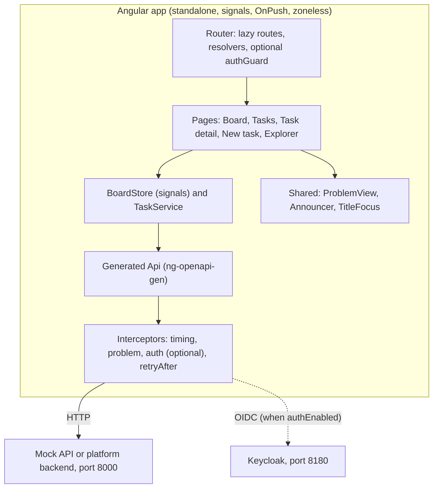

# 10. Project: a task board against the platform contract

> **Draft: written but not yet run.** The code and the expected output in this lesson were prepared by reading the code and the official documentation. They have not been executed yet. If something does not behave as described, trust your tool's real output and report it.

## What you will be able to do
By the end of this project you will be able to:
- Combine a generated client, interceptors, a signal store, lazy routes, an accessible and translated UI and optional OIDC sign-in in one app.
- Move a task between columns with an **optimistic update**, an `If-Match` header, a rollback and a 412 recovery.
- Switch sign-in on and off with one environment flag, and explain what that flag does and does not protect.
- Review your own work against an accessibility, security, performance and i18n checklist, and say which skills the capstone `capstones/web-angular` builds on.

## Recap
1. Which three lessons gave you the pieces of the optimistic update? <details><summary>Answer</summary>201.03 (optimistic update and ETag, with a fake API), 201.05 (the generated `updateTask` with `If-Match`) and 201.04 (the 412 `ApiProblem`).</details>
2. Where does the bearer token get added, and to which requests? <details><summary>Answer</summary>In `authInterceptor`, only for URLs under `environment.apiBaseUrl` (201.06).</details>
3. How do you serve the app in German? <details><summary>Answer</summary>`npm run start:de` (201.09).</details>

## Why it matters
Until now every lesson taught one tool. A **project** is where tools meet: they disagree about where state lives, a guard blocks a page you forgot about, a translation is missing, an interceptor is in the wrong order. Fixing those seams is most of real work. This project is deliberately open at the edges: the lesson gives you a design, the code, a checklist of acceptance criteria and a self-review, and you decide what to extend.

The capstone `capstones/web-angular` builds the full client (teams, projects, tasks, comments, audit log) on the same ideas and the full 27-operation contract. After this project you know every technique its chapters assume.

## What you will build
A **board** page: four columns (To do, In progress, Blocked, Done) fed by `listTasks`, cards with a link to the detail page and a labelled **Move to** select (a keyboard-friendly alternative to drag and drop). Moving a card updates the screen at once and sends `PATCH` with `If-Match`. Everything from lessons 05 to 09 stays: the form, the list, the detail page, the explorer, German, the accessible shell. Sign-in from lesson 06 comes back as an **option**.



Acceptance criteria (your definition of done):
| Id | Criterion | How you check it |
|---|---|---|
| B-01 | The board shows four columns with counts from `listTasks`, using the generated client | Run it, step 1 |
| B-02 | Moving a card updates the screen first, then sends `PATCH` with `If-Match` equal to the quoted `version` | Network tab: header `If-Match: "1"` |
| B-03 | A 412 reloads the board and shows the problem box | Two tabs, run it step 4 |
| B-04 | Any other failure puts the card back and shows the problem box | Stop the mock, move a card |
| B-05 | Keyboard only: skip link, focus returns to the moved card, results are announced | Keyboard walk |
| B-06 | The app runs in German (`npm run start:de`) | Run it, step 6 |
| B-07 | With `authEnabled: true` every page except the login needs sign-in and only API calls carry the token | Run it, step 8 |
| B-08 | Every page except the shell is a lazy chunk; you recorded the build's initial size | `npm run build` output |

## Before you start
- Lessons 05 to 09 done. Time: about 150 minutes (breaks after Step 3 and Step 5).
- **Which folder?** Start from your lesson 09 project (it has the form, the lazy routes and the German file). Sign-in files from lesson 06 are added in Step 1. If your lesson 09 project is not at hand, download `source/angular/201-hero-to-super-hero/phase-3-architecture-and-quality/10-project-task-board/code/` from the course repository https://github.com/Uee03/Code101 (**Code, Download ZIP**, or `git clone https://github.com/Uee03/Code101.git`).
- Not repeated here because it did not change since the lesson that introduced it: `contract/openapi.yaml` (lesson 05) and `server/mock-api.mjs` (the lesson 06 version, which can answer as alice or bob). The files of lessons 06 to 09 that this lesson reuses unchanged are listed at the end of the page.
- Docker and Keycloak are needed **only** for the optional sign-in run (Step 8).
- Two terminals: `npm run mock` and `npm start`.

## Steps

### Step 1. Bring back the sign-in files (unchanged)
From the lesson 06 project copy these eight files to the same paths in your project. They are **not changed**; the end of this page lists them in full.
```text
src/app/auth/auth.config.ts
src/app/auth/split-storage.ts
src/app/auth/auth.service.ts
src/app/auth/guards.ts
src/app/http/auth.interceptor.ts
src/app/features/login/login.ts
src/app/features/callback/callback.ts
src/app/features/forbidden/forbidden.ts
```
Also replace `server/mock-api.mjs` by the lesson 06 version (it knows the user `bob`).

**File: `package.json`**
```json
{
  "name": "task-board",
  "version": "1.0.0",
  "private": true,
  "scripts": {
    "ng": "ng",
    "api:gen": "ng-openapi-gen",
    "prestart": "npm run api:gen",
    "start": "ng serve --host localhost --port 4200",
    "prestart:de": "npm run api:gen",
    "start:de": "ng serve --host localhost --port 4200 --configuration=de",
    "prebuild": "npm run api:gen",
    "build": "ng build",
    "prebuild:i18n": "npm run api:gen",
    "build:i18n": "ng build --localize",
    "extract-i18n": "ng extract-i18n --output-path src/locale",
    "mock": "node server/mock-api.mjs",
    "mock:auth": "node server/mock-api.mjs --require-auth"
  },
  "dependencies": {
    "@angular/common": "22.3.0",
    "@angular/compiler": "22.3.0",
    "@angular/core": "22.3.0",
    "@angular/forms": "22.3.0",
    "@angular/localize": "22.3.0",
    "@angular/platform-browser": "22.3.0",
    "@angular/router": "22.3.0",
    "angular-oauth2-oidc": "22.0.2",
    "rxjs": "7.8.2",
    "tslib": "2.8.1"
  },
  "devDependencies": {
    "@angular/build": "22.3.0",
    "@angular/cli": "22.3.0",
    "@angular/compiler-cli": "22.3.0",
    "ng-openapi-gen": "1.1.0",
    "typescript": "6.0.3"
  }
}
```

The only change from lesson 09: `angular-oauth2-oidc` 22.0.2 is back. Run `npm install`.

### Step 2. One flag for sign-in
**File: `src/environments/environment.ts`**
```ts
export const environment = {
  // false: no sign-in, run against `npm run mock`. true: sign in with Keycloak, run against `npm run mock:auth` or a platform backend.
  authEnabled: false,
  apiBaseUrl: 'http://localhost:8000',
  issuer: 'http://localhost:8180/realms/tasksteams',
  clientId: 'tasks-web',
  scopes: 'openid profile email tasks:read tasks:write'
};
```

`authEnabled: false` is the default so you can work with only the mock. Set it to `true` for the optional run in Step 8.

**ADR (decision record): a flag, not two apps.**
| Decision | Alternatives | Consequence |
|---|---|---|
| One `authEnabled` constant read by `app.config.ts`, `app.routes.ts` and `app.ts` | Angular `fileReplacements` with an environment file per build; two separate apps | Simple to teach and to switch. The OIDC library is still in the initial bundle when the flag is off. In a real project use `fileReplacements` (or a build-time define) so the unused code is removed. |
| Sign-in off means **no protection at all** | Always on | Fine for local work with the mock. Never ship a build with the flag off in front of a real API; the API must still validate tokens itself. |

**File: `src/app/app.config.ts`**
```ts
import { ApplicationConfig, inject, provideAppInitializer, provideBrowserGlobalErrorListeners } from '@angular/core';
import { HttpInterceptorFn, provideHttpClient, withFetch, withInterceptors } from '@angular/common/http';
import { PreloadAllModules, provideRouter, TitleStrategy, withComponentInputBinding, withPreloading } from '@angular/router';
import { OAuthStorage, provideOAuthClient } from 'angular-oauth2-oidc';

import { ApiConfiguration } from './api/api-configuration';
import { environment } from '../environments/environment';
import { routes } from './app.routes';
import { AuthService } from './auth/auth.service';
import { SplitStorage } from './auth/split-storage';
import { TitleFocus } from './core/title-focus';
import { authInterceptor } from './http/auth.interceptor';
import { problemInterceptor } from './http/problem.interceptor';
import { retryAfterInterceptor } from './http/retry-after.interceptor';
import { timingInterceptor } from './http/timing.interceptor';

// Order matters: auth sits inside problem (it must see the raw 401) and outside retryAfter.
const interceptors: HttpInterceptorFn[] = environment.authEnabled
  ? [timingInterceptor, problemInterceptor, authInterceptor, retryAfterInterceptor]
  : [timingInterceptor, problemInterceptor, retryAfterInterceptor];

// The OIDC providers exist only when sign-in is on. Nothing in the app injects AuthService otherwise.
const signIn = environment.authEnabled
  ? [provideOAuthClient(), { provide: OAuthStorage, useExisting: SplitStorage }, provideAppInitializer(() => inject(AuthService).boot())]
  : [];

export const appConfig: ApplicationConfig = {
  providers: [
    provideBrowserGlobalErrorListeners(),
    provideHttpClient(withFetch(), withInterceptors(interceptors)),
    provideRouter(routes, withComponentInputBinding(), withPreloading(PreloadAllModules)),
    { provide: TitleStrategy, useClass: TitleFocus },
    { provide: ApiConfiguration, useValue: { rootUrl: environment.apiBaseUrl } },
    ...signIn
  ]
};
```

- `interceptors` and `signIn` are chosen once, when the module loads, from the flag. With the flag off, no OIDC provider exists, so nothing may inject `AuthService`: the routes and the shell below respect that.
- The interceptor order is the one from lesson 06: timing, problem, auth, retryAfter.

**File: `src/app/app.routes.ts`**
```ts
import { Routes } from '@angular/router';
import { environment } from '../environments/environment';
import { authGuard } from './auth/guards';
import { taskResolver, tasksResolver } from './tasks/task.resolvers';

// Without sign-in the routes have no guard; with sign-in every page except the login pages needs one.
const protect = environment.authEnabled ? [authGuard] : [];

const authRoutes: Routes = environment.authEnabled
  ? [
      { path: 'login', title: 'Sign in', loadComponent: () => import('./features/login/login').then((m) => m.Login) },
      { path: 'auth/callback', title: 'Signing in', loadComponent: () => import('./features/callback/callback').then((m) => m.Callback) },
      { path: 'forbidden', title: 'No access', loadComponent: () => import('./features/forbidden/forbidden').then((m) => m.Forbidden) }
    ]
  : [];

export const routes: Routes = [
  { path: '', pathMatch: 'full', redirectTo: 'board' },
  {
    path: 'board',
    title: $localize`:@@title.board:Board`,
    canActivate: protect,
    loadComponent: () => import('./features/board/board').then((m) => m.Board)
  },
  {
    path: 'tasks',
    title: $localize`:@@title.tasks:Tasks`,
    canActivate: protect,
    resolve: { page: tasksResolver },
    loadComponent: () => import('./features/tasks/tasks').then((m) => m.Tasks)
  },
  {
    path: 'tasks/new',
    title: $localize`:@@title.new:New task`,
    canActivate: protect,
    loadComponent: () => import('./features/new-task/new-task').then((m) => m.NewTask)
  },
  {
    path: 'tasks/:taskId',
    title: 'Task',
    canActivate: protect,
    resolve: { detail: taskResolver },
    loadComponent: () => import('./features/task-detail/task-detail').then((m) => m.TaskDetail)
  },
  {
    path: 'explorer',
    title: $localize`:@@title.explorer:API explorer`,
    canActivate: protect,
    loadComponent: () => import('./features/explorer/explorer').then((m) => m.Explorer)
  },
  ...authRoutes,
  {
    path: 'not-found',
    title: 'Not found',
    data: { heading: 'Not found', text: 'We could not find that page or task.' },
    loadComponent: () => import('./features/notice/notice').then((m) => m.Notice)
  },
  {
    path: 'unavailable',
    title: 'Unavailable',
    data: { heading: 'Something went wrong', text: 'The API did not answer. Check that it is running, then try again.' },
    loadComponent: () => import('./features/notice/notice').then((m) => m.Notice)
  },
  { path: '**', redirectTo: 'not-found' }
];
```

- `protect` is `[authGuard]` or an empty list, used as `canActivate: protect` on every page.
- `authRoutes` adds `login`, `auth/callback` and `forbidden` only when sign-in is on.
- `/` redirects to `/board`; the new route `board` is lazy like the others.

### Step 3. The shell
**File: `src/app/app.ts`**
```ts
import { ChangeDetectionStrategy, Component, inject } from '@angular/core';
import { RouterLink, RouterLinkActive, RouterOutlet } from '@angular/router';
import { environment } from '../environments/environment';
import { AuthService } from './auth/auth.service';
import { Announcer } from './core/announcer';

@Component({
  selector: 'app-root',
  imports: [RouterLink, RouterLinkActive, RouterOutlet],
  changeDetection: ChangeDetectionStrategy.OnPush,
  templateUrl: './app.html',
  styleUrl: './app.css'
})
export class App {
  protected readonly announcer = inject(Announcer);
  // Only inject the AuthService when sign-in is on: its providers do not exist otherwise.
  protected readonly auth = environment.authEnabled ? inject(AuthService) : null;

  // The app uses <base href="/">, so a plain "#main" link would navigate to "/#main". Move focus by hand instead.
  protected skipToMain(event: Event): void {
    event.preventDefault();
    document.getElementById('main')?.focus();
  }
}
```

**File: `src/app/app.html`**
```html
<a class="skip-link" href="#main" (click)="skipToMain($event)" i18n="@@skip.link">Skip to main content</a>

<header class="bar">
  <a routerLink="/" class="brand">Task board</a>
  <nav aria-label="Main" i18n-aria-label="@@nav.label">
    <a routerLink="/board" routerLinkActive="active" ariaCurrentWhenActive="page" i18n="@@nav.board">Board</a>
    <a routerLink="/tasks" routerLinkActive="active" [routerLinkActiveOptions]="{ exact: true }" ariaCurrentWhenActive="page" i18n="@@nav.tasks">Tasks</a>
    <a routerLink="/tasks/new" routerLinkActive="active" ariaCurrentWhenActive="page" i18n="@@nav.new">New task</a>
    <a routerLink="/explorer" routerLinkActive="active" ariaCurrentWhenActive="page" i18n="@@nav.explorer">API explorer</a>
    @if (auth; as session) {
      @if (session.user(); as user) {
        <span>{{ user.displayName }}</span>
        <button type="button" (click)="session.signOut()" i18n="@@nav.signout">Sign out</button>
      } @else {
        <a routerLink="/login" i18n="@@nav.signin">Sign in</a>
      }
    }
  </nav>
</header>

<main id="main" class="page" tabindex="-1">
  <router-outlet />
</main>

<div class="sr-only" role="status" aria-live="polite" aria-atomic="true">{{ announcer.message() }}</div>
```

**File: `src/app/app.css`**
```css
.bar {
  display: flex;
  flex-wrap: wrap;
  align-items: center;
  gap: 1rem;
  padding-bottom: 0.75rem;
  border-bottom: 1px solid #9ca3af;
}

.brand {
  font-weight: 700;
}

nav {
  display: flex;
  flex-wrap: wrap;
  align-items: center;
  gap: 1rem;
}

nav a.active {
  text-decoration: underline;
}

.page {
  display: block;
  max-width: 72rem;
  margin: 1rem auto;
}
```

The class injects `AuthService` only when the flag is on (`auth` is otherwise `null`), and the template shows the user and **Sign out**, or **Sign in**, only when it exists. The page is wider (72 rem) so four columns fit.

**Take a break here.**

### Step 4. The board store
**File: `src/app/core/board-store.ts`**
```ts
import { computed, inject, Injectable, signal } from '@angular/core';
import { Task, TaskStatus } from '../api/models';
import { ApiProblem, isApiProblem } from '../http/problem';
import { Announcer } from './announcer';
import { TaskService } from './task-service';

export interface Column {
  status: TaskStatus;
  title: string;
}

// The four columns of the board. "cancelled" tasks are not shown. The titles are translated at build time.
export const COLUMNS: readonly Column[] = [
  { status: 'todo', title: $localize`:@@col.todo:To do` },
  { status: 'in_progress', title: $localize`:@@col.in_progress:In progress` },
  { status: 'blocked', title: $localize`:@@col.blocked:Blocked` },
  { status: 'done', title: $localize`:@@col.done:Done` }
];

// Server state of the board: the tasks, the loading flag and the last problem. Pages read signals and call methods.
@Injectable({ providedIn: 'root' })
export class BoardStore {
  private readonly tasks = inject(TaskService);
  private readonly announcer = inject(Announcer);
  private readonly items = signal<readonly Task[]>([]);

  readonly loading = signal(false);
  readonly problem = signal<ApiProblem | null>(null);
  readonly columns = computed(() => COLUMNS.map((column) => ({ ...column, tasks: this.items().filter((task) => task.status === column.status) })));

  async load(): Promise<void> {
    this.loading.set(true);
    this.problem.set(null);
    try {
      const all: Task[] = [];
      let cursor: string | undefined;
      // The cap protects against a server that never ends the list.
      for (let pages = 0; pages < 10; pages++) {
        const page = await this.tasks.list({ limit: 100, cursor });
        all.push(...page.items);
        if (!page.page.nextCursor) {
          break;
        }
        cursor = page.page.nextCursor;
      }
      this.items.set(all);
    } catch (error) {
      if (!isApiProblem(error)) {
        throw error;
      }
      this.problem.set(error);
    } finally {
      this.loading.set(false);
    }
  }

  // Optimistic move: show the change at once, send it with If-Match, and put the old task back if it fails.
  async move(taskId: string, status: TaskStatus): Promise<void> {
    const before = this.items().find((task) => task.id === taskId);
    if (!before || before.status === status) {
      return;
    }
    this.replace({ ...before, status });
    this.problem.set(null);
    try {
      // The contract defines the ETag as the quoted version, so a list item carries everything we need.
      const result = await this.tasks.update(taskId, `"${before.version}"`, { status });
      this.replace(result.task);
      this.announcer.say($localize`:@@board.moved:The task was moved.`);
    } catch (error) {
      this.replace(before);
      if (!isApiProblem(error)) {
        throw error;
      }
      this.problem.set(error);
      this.announcer.say($localize`:@@board.failed:The task could not be moved.`);
      if (error.status === 412) {
        // Someone else changed it first: read the board again so the user sees the current state, and keep the message.
        await this.load();
        this.problem.set(error);
      }
    }
  }

  private replace(task: Task): void {
    this.items.update((list) => list.map((item) => (item.id === task.id ? task : item)));
  }
}
```

Read it as a small contract:
- `columns` is a `computed`: the tasks grouped by status, in the order of `COLUMNS`. It reruns only when `items` changes.
- `load()` follows `nextCursor` (up to 10 pages of 100, a safety cap) and fills `items`.
- `move()`:
  1. `before` is the task as it was. If it does not exist or the status is unchanged, do nothing.
  2. `replace({ ...before, status })` is the **optimistic** step: the card jumps at once.
  3. The request sends `If-Match: "<version>"`. The contract defines the ETag as the quoted `version`, so a list item has all that is needed and no extra `GET` is made.
  4. On success the server's task (new `version`) replaces the guess, and the `Announcer` says so.
  5. On failure only **that task** is put back (`replace(before)`), so a second move made meanwhile is not undone. A 412 reloads the board, then shows the message again (`load()` clears the problem first).
- Known limits, on purpose: two moves of the **same** card in quick succession can race (the capstone queues writes per task); an offline banner is not included.

### Step 5. The board page
**File: `src/app/features/board/board.ts`**
```ts
import { afterNextRender, ChangeDetectionStrategy, Component, inject, Injector, OnInit } from '@angular/core';
import { RouterLink } from '@angular/router';
import { BoardStore, COLUMNS } from '../../core/board-store';
import { ProblemView } from '../../shared/problem-view';

@Component({
  selector: 'app-board',
  imports: [RouterLink, ProblemView],
  changeDetection: ChangeDetectionStrategy.OnPush,
  templateUrl: './board.html',
  styleUrl: './board.css'
})
export class Board implements OnInit {
  protected readonly store = inject(BoardStore);
  protected readonly options = COLUMNS;
  private readonly injector = inject(Injector);

  ngOnInit(): void {
    void this.store.load();
  }

  protected move(taskId: string, event: Event): void {
    const value = (event.target as HTMLSelectElement).value;
    const column = COLUMNS.find((item) => item.status === value);
    if (!column) {
      return;
    }
    void this.store.move(taskId, column.status);
    // The card jumps to another column, so its select is a new element: put keyboard focus back on it.
    afterNextRender(() => document.getElementById('move-' + taskId)?.focus(), { injector: this.injector });
  }
}
```

- `ngOnInit` starts the load. The page reads signals from the store and holds no state of its own.
- `move` finds the chosen column in `COLUMNS` (never trusting the raw string), starts the store move, and registers `afterNextRender` to put **keyboard focus back on the card's select**: the card jumps to another column, so the old element is destroyed. Without this, focus would fall to the top of the page and a keyboard user would have to find the card again. (After a *rollback* the element is recreated again and focus is not restored; that is a known gap, see the exercise ideas.)

**File: `src/app/features/board/board.html`**
```html
<h1 i18n="@@board.heading">Board</h1>

<p><a routerLink="/tasks/new" i18n="@@tasks.create">Create a task</a></p>

@if (store.problem(); as problem) {
  <app-problem-view [problem]="problem" />
}

@if (store.loading()) {
  <p role="status" i18n="@@board.loading">Loading the board...</p>
}

<div class="columns">
  @for (column of store.columns(); track column.status) {
    <div class="column">
      <h2 [id]="'col-' + column.status">{{ column.title }} ({{ column.tasks.length }})</h2>
      <ul [attr.aria-labelledby]="'col-' + column.status">
        @for (task of column.tasks; track task.id) {
          <li class="card">
            <a [routerLink]="['/tasks', task.id]">{{ task.title }}</a>
            <span class="meta">{{ task.priority }}</span>
            <label [for]="'move-' + task.id" i18n="@@board.move">Move to</label>
            <select [id]="'move-' + task.id" (change)="move(task.id, $event)">
              @for (option of options; track option.status) {
                <option [value]="option.status" [selected]="option.status === task.status">{{ option.title }}</option>
              }
            </select>
          </li>
        } @empty {
          <li class="empty" i18n="@@board.empty">Nothing here.</li>
        }
      </ul>
    </div>
  }
</div>
```

- One `h1`, an `h2` per column with its count, a list per column named by its heading (`aria-labelledby`).
- Each card has a visible **label** ("Move to") tied to its select by `for` and `id`. The ids are unique per task.
- `@empty` explains an empty column instead of leaving a blank space.
- `role="status"` on the loading text: the paragraph appears while loading and is announced politely.
- Text uses `i18n` ids; the select options use the translated column titles.

**File: `src/app/features/board/board.css`**
```css
.columns {
  display: grid;
  grid-template-columns: repeat(auto-fit, minmax(min(100%, 14rem), 1fr));
  gap: 1rem;
}

.column h2 {
  margin: 0 0 0.5rem;
  font-size: 1.1rem;
}

.column ul {
  margin: 0;
  padding: 0;
  list-style: none;
}

.card {
  display: grid;
  gap: 0.25rem;
  margin-bottom: 0.5rem;
  padding: 0.5rem 0.75rem;
  border: 1px solid #4b5563;
  border-radius: 0.25rem;
  overflow-wrap: anywhere;
}

.meta {
  color: #4b5563;
  font-size: 0.875rem;
}

.empty {
  color: #4b5563;
}
```

`repeat(auto-fit, minmax(min(100%, 14rem), 1fr))` lets the columns wrap to one column on a narrow screen (WCAG 1.4.10 Reflow) without a media query.

**Take a break here.**

### Step 6. Translations
**File: `src/locale/messages.de.xlf`**
```xml
<?xml version="1.0" encoding="UTF-8" ?>
<xliff version="1.2" xmlns="urn:oasis:names:tc:xliff:document:1.2">
  <file source-language="en-US" target-language="de" datatype="plaintext" original="ng2.template">
    <body>
      <trans-unit id="skip.link" datatype="html">
        <source>Skip to main content</source>
        <target>Zum Hauptinhalt springen</target>
      </trans-unit>
      <trans-unit id="nav.label" datatype="html">
        <source>Main</source>
        <target>Hauptnavigation</target>
      </trans-unit>
      <trans-unit id="nav.tasks" datatype="html">
        <source>Tasks</source>
        <target>Aufgaben</target>
      </trans-unit>
      <trans-unit id="nav.new" datatype="html">
        <source>New task</source>
        <target>Neue Aufgabe</target>
      </trans-unit>
      <trans-unit id="nav.explorer" datatype="html">
        <source>API explorer</source>
        <target>API-Explorer</target>
      </trans-unit>
      <trans-unit id="tasks.heading" datatype="html">
        <source>Tasks</source>
        <target>Aufgaben</target>
      </trans-unit>
      <trans-unit id="tasks.count.one" datatype="html">
        <source>One task</source>
        <target>Eine Aufgabe</target>
      </trans-unit>
      <trans-unit id="tasks.count.other" datatype="html">
        <source><x id="INTERPOLATION" equiv-text="{{ items().length }}"/> tasks</source>
        <target><x id="INTERPOLATION" equiv-text="{{ items().length }}"/> Aufgaben</target>
      </trans-unit>
      <trans-unit id="tasks.create" datatype="html">
        <source>Create a task</source>
        <target>Aufgabe anlegen</target>
      </trans-unit>
      <trans-unit id="tasks.empty" datatype="html">
        <source>There are no tasks yet.</source>
        <target>Es gibt noch keine Aufgaben.</target>
      </trans-unit>
      <trans-unit id="tasks.loading" datatype="html">
        <source>Loading...</source>
        <target>Wird geladen...</target>
      </trans-unit>
      <trans-unit id="tasks.more" datatype="html">
        <source>Load more</source>
        <target>Mehr laden</target>
      </trans-unit>
      <trans-unit id="tasks.all" datatype="html">
        <source>That is every task.</source>
        <target>Das sind alle Aufgaben.</target>
      </trans-unit>
      <trans-unit id="tasks.summary" datatype="html">
        <source>Summary</source>
        <target>Zusammenfassung</target>
      </trans-unit>
      <trans-unit id="new.heading" datatype="html">
        <source>New task</source>
        <target>Neue Aufgabe</target>
      </trans-unit>
      <trans-unit id="new.summary.heading" datatype="html">
        <source>Please fix these problems</source>
        <target>Bitte beheben Sie diese Probleme</target>
      </trans-unit>
      <trans-unit id="new.title.label" datatype="html">
        <source>Title</source>
        <target>Titel</target>
      </trans-unit>
      <trans-unit id="new.title.hint" datatype="html">
        <source>Required. Up to 200 characters, without &lt; or &gt;.</source>
        <target>Pflichtfeld. Höchstens 200 Zeichen, ohne &lt; oder &gt;.</target>
      </trans-unit>
      <trans-unit id="new.title.checking" datatype="html">
        <source>Checking whether the title is free...</source>
        <target>Es wird geprüft, ob der Titel noch frei ist...</target>
      </trans-unit>
      <trans-unit id="new.description.label" datatype="html">
        <source>Description (optional)</source>
        <target>Beschreibung (optional)</target>
      </trans-unit>
      <trans-unit id="new.priority.label" datatype="html">
        <source>Priority</source>
        <target>Priorität</target>
      </trans-unit>
      <trans-unit id="new.due.label" datatype="html">
        <source>Due date (optional)</source>
        <target>Fälligkeitsdatum (optional)</target>
      </trans-unit>
      <trans-unit id="new.saving" datatype="html">
        <source>Saving...</source>
        <target>Wird gespeichert...</target>
      </trans-unit>
      <trans-unit id="new.submit" datatype="html">
        <source>Create task</source>
        <target>Aufgabe anlegen</target>
      </trans-unit>
      <trans-unit id="new.created.heading" datatype="html">
        <source>Created in this session</source>
        <target>In dieser Sitzung angelegt</target>
      </trans-unit>
      <trans-unit id="title.tasks" datatype="html">
        <source>Tasks</source>
        <target>Aufgaben</target>
      </trans-unit>
      <trans-unit id="title.new" datatype="html">
        <source>New task</source>
        <target>Neue Aufgabe</target>
      </trans-unit>
      <trans-unit id="title.explorer" datatype="html">
        <source>API explorer</source>
        <target>API-Explorer</target>
      </trans-unit>
      <trans-unit id="announce.created" datatype="html">
        <source>The task was created.</source>
        <target>Die Aufgabe wurde angelegt.</target>
      </trans-unit>
      <trans-unit id="issue.required" datatype="html">
        <source>Enter a title.</source>
        <target>Geben Sie einen Titel ein.</target>
      </trans-unit>
      <trans-unit id="issue.tooLong" datatype="html">
        <source>The text is too long.</source>
        <target>Der Text ist zu lang.</target>
      </trans-unit>
      <trans-unit id="issue.brackets" datatype="html">
        <source>Remove the characters &lt; and &gt;.</source>
        <target>Entfernen Sie die Zeichen &lt; und &gt;.</target>
      </trans-unit>
      <trans-unit id="issue.taken" datatype="html">
        <source>This title is already used.</source>
        <target>Dieser Titel wird bereits verwendet.</target>
      </trans-unit>
      <trans-unit id="issue.past" datatype="html">
        <source>Choose today or a later date.</source>
        <target>Wählen Sie heute oder ein späteres Datum.</target>
      </trans-unit>
      <trans-unit id="nav.board" datatype="html">
        <source>Board</source>
        <target>Board</target>
      </trans-unit>
      <trans-unit id="nav.signin" datatype="html">
        <source>Sign in</source>
        <target>Anmelden</target>
      </trans-unit>
      <trans-unit id="nav.signout" datatype="html">
        <source>Sign out</source>
        <target>Abmelden</target>
      </trans-unit>
      <trans-unit id="title.board" datatype="html">
        <source>Board</source>
        <target>Board</target>
      </trans-unit>
      <trans-unit id="board.heading" datatype="html">
        <source>Board</source>
        <target>Board</target>
      </trans-unit>
      <trans-unit id="board.loading" datatype="html">
        <source>Loading the board...</source>
        <target>Das Board wird geladen...</target>
      </trans-unit>
      <trans-unit id="board.move" datatype="html">
        <source>Move to</source>
        <target>Verschieben nach</target>
      </trans-unit>
      <trans-unit id="board.empty" datatype="html">
        <source>Nothing here.</source>
        <target>Hier ist nichts.</target>
      </trans-unit>
      <trans-unit id="board.moved" datatype="html">
        <source>The task was moved.</source>
        <target>Die Aufgabe wurde verschoben.</target>
      </trans-unit>
      <trans-unit id="board.failed" datatype="html">
        <source>The task could not be moved.</source>
        <target>Die Aufgabe konnte nicht verschoben werden.</target>
      </trans-unit>
      <trans-unit id="col.todo" datatype="html">
        <source>To do</source>
        <target>Zu erledigen</target>
      </trans-unit>
      <trans-unit id="col.in_progress" datatype="html">
        <source>In progress</source>
        <target>In Arbeit</target>
      </trans-unit>
      <trans-unit id="col.blocked" datatype="html">
        <source>Blocked</source>
        <target>Blockiert</target>
      </trans-unit>
      <trans-unit id="col.done" datatype="html">
        <source>Done</source>
        <target>Erledigt</target>
      </trans-unit>
    </body>
  </file>
</xliff>
```

The file of lesson 09 plus 14 new units at the end (navigation, board texts, column titles, announcements). The ids `title.board`, `board.*` and `col.*` come from `app.routes.ts`, `board.html` and `board-store.ts`.

## Run it
**A. Mock only (default).** Terminal 1: `npm run mock`. Terminal 2: `npm start`. Open http://localhost:4200/.

**Predict:** you move "Seed the database" from To do to In progress. Which header proves the optimistic update is safe against a conflicting edit, and what is its value?

Expected behaviour (derived by reading the code and the mock; not yet seen in a browser):
1. `/` redirects to `/board`. The columns read **To do (3)**, **In progress (1)**, **Blocked (1)**, **Done (1)**. To do holds "Seed the database", "Explain signals", "Review the release notes". The tab title is "Board | Task board".
2. In the card "Seed the database" choose **In progress** in **Move to**. The card appears in the In progress column at once (counts become 2 and 2) and stays there. The Network tab shows `PATCH /v1/tasks/<id>` with `If-Match: "1"` and the body `{"status":"in_progress"}`; the answer has a new `ETag` `"2"`. The card's select still has keyboard focus. A screen reader says "The task was moved.".
3. Move the same card again: the header now is `If-Match: "2"` (the server's new version replaced the guess).
4. **Conflict:** open `/board` in two tabs. In tab A move "Explain signals" to Blocked. In tab B (which still holds version 1) move the same card to Done. The mock answers 412; tab B puts the card back, reloads the board (the card appears in Blocked, as tab A left it) and shows "Precondition failed (412)" with "The task changed since you read it (current version 2)."
5. **Failure:** stop the mock and move a card. The card jumps, then returns to its column, and the box says "Request failed (0)".
6. **German:** stop `npm start` and run `npm run start:de`. Navigation, headings, the column titles ("Zu erledigen", "In Arbeit", "Blockiert", "Erledigt"), "Verschieben nach" and the announcements are German. Status and priority words coming from the API stay as the API sends them.
7. **Keyboard walk:** Tab to the skip link, Enter, then Tab through a card: link, "Move to" select. Change the select with the arrow keys: the change applies when the selection changes (some browsers fire it only on Enter or when the list closes).

**B. With sign-in (optional, needs Docker).** 8. Start Keycloak as in lesson 06 Step 2 (`docker compose -p platform up -d --wait keycloak` in `capstones/platform/source/phase-3-identity/03-keycloak-identity/code`). In `src/environments/environment.ts` set `authEnabled: true`. Terminal 1: `npm run mock:auth`. Terminal 2: `npm start`. Open http://localhost:4200/: you are sent to `/login?returnUrl=%2Fboard`. Sign in as `alice` / `alice-local-fake`: you return to `/board`, the header shows "Alice Admin" and **Sign out**, and the Network tab shows the `Authorization` header on API calls only (never on Keycloak calls). Press F5: the silent sign-in brings you back. Set the flag back to `false` and clean up with `docker compose -p platform down -v`.

## Review your work
Go through the table and tick each line with evidence (a screenshot, a Network tab line, a build output). It is also a checklist for the capstone.
| Area | Check | Where it comes from |
|---|---|---|
| Accessibility | Keyboard only: every action reachable, focus visible, focus not lost after a move | 201.09 |
| Accessibility | One `h1` per page, labelled controls, errors tied with `aria-describedby`, status read by a live region | 201.07, 201.09 |
| Accessibility | 200 percent zoom and a 320 px wide window: no horizontal scrolling for the board | WCAG 1.4.4, 1.4.10 |
| Security | No token in `localStorage`, in URLs or in the console; bearer only for the API origin | 201.04, 201.06 |
| Security | User text is shown with `{{ }}`, never `innerHTML`; `returnUrl` goes through `safeReturn` | 201.06, 201.08 |
| Errors | Every failure ends in a visible message and a way back; 412 reloads | 201.04, this lesson |
| Performance | Record the initial and lazy chunk sizes from `npm run build`; compare with the 500 kB budget in `angular.json` | 201.08 |
| i18n | `npm run build:i18n` prints no `Missing translation` warning for the marked messages | 201.09 |

## Where this leads
| What you practised here | Capstone chapter in `capstones/web-angular/tutorials/` |
|---|---|
| Generated client from the contract, environment settings | `phase-1-setup/01-create-app-generate-client.md` |
| PKCE sign-in, memory-only tokens, guards, step-up admin scope | `phase-2-auth/02-sign-in-keycloak.md` |
| Signal stores, cursor lists, create with `Idempotency-Key`, lazy screens | `phase-3-screens/03-screens-stores-pagination.md` |
| Problem details, 412 conflict dialog, offline banner, WCAG checklist | `phase-4-errors/04-problem-details-conflicts-offline-wcag.md` |
| Production build, nginx, Content Security Policy | `phase-5-ship/05-build-run-ship.md` |

Read `capstones/web-angular/TDD.md` first: it lists the screens, the requirement ids and the decisions you just made yourself.

## Try it
Starter file: `exercise/starter/src/app/core/filter-tasks.ts`.
1. **Guided:** write `filterTasks(tasks, text)` (the TODOs). Predict the result for `''`, for `'  SEED '` and for `'xyz'` against the six mock tasks.
2. **Change:** add a search box above the columns: a `query` signal in `BoardStore`, `columns` built from `filterTasks(this.items(), this.query())`, and an input with a visible label bound with `(input)`. Count how often `filterTasks` runs when you move a card (hint: `computed` caches).
3. **Stretch (optional):** debounce the query with `toObservable`, `debounceTime(300)` and `toSignal` (lesson 02), restore focus after a **rollback** (what must the store tell the page?), or add an "Assigned to me" filter using `assigneeId` and `getMe`.

<details><summary>Solution for rung 1</summary>

**File: `exercise/solution/src/app/core/filter-tasks.ts`**
```ts
import { Task } from '../api/models';

// Returns the tasks whose title contains `text`, ignoring case and surrounding spaces.
// An empty text keeps every task. The input list is not changed.
export function filterTasks(tasks: readonly Task[], text: string): Task[] {
  const needle = text.trim().toLowerCase();
  if (!needle) {
    return [...tasks];
  }
  return tasks.filter((task) => task.title.toLowerCase().includes(needle));
}
```

`''` returns a copy of all six tasks. `'  SEED '` is trimmed and lower-cased to `seed` and matches "Seed the database". `'xyz'` matches nothing and returns an empty array.

</details>

## Check yourself
1. Why can the board send `If-Match` without an extra `GET`? <details><summary>Answer</summary>The contract defines the ETag as the quoted `version`, and every task in a list carries its `version`.</details>
2. Why is only the one task rolled back on failure and not the whole list? <details><summary>Answer</summary>Another move may have succeeded meanwhile; restoring a full snapshot would undo it.</details>
3. What does `authEnabled: false` protect? <details><summary>Answer</summary>Nothing. It only turns the browser-side sign-in off; the API must always validate tokens itself.</details>
4. Why does `Board.move` register `afterNextRender`? <details><summary>Answer</summary>The moved card is re-created in another column; focus must be put back on its select after the new element exists.</details>

## Common mistakes
| Symptom or error text | Cause | Fix |
|---|---|---|
| Typical message: `NullInjectorError: No provider for OAuthService` | Something injects `AuthService` while `authEnabled` is `false` | Inject it only behind the flag, as in `app.ts`, and guard routes with `protect` |
| The page loops between `/login` and Keycloak | Redirect URI or issuer mismatch | Open `http://localhost:4200/`; see lesson 06, Common mistakes |
| A moved card jumps back at once | The `PATCH` failed (412, 422, network) | Read the problem box; check `If-Match` in the Network tab |
| Typical message: `Missing translation for message "board.heading"` | The unit is missing or the id differs | Compare the id in `board.html` with `messages.de.xlf` |
| Counts do not change after a move | A component reads a copy of the tasks instead of `store.columns()` | Read the signal in the template |
| `mock:auth` answers 401 to every call in the board | Sign-in is off (`authEnabled: false`) but the mock requires a bearer | Use `npm run mock`, or turn sign-in on |
| Focus jumps to the top after a move | `afterNextRender` was removed or the select id changed | Keep the id `move-<taskId>` in the template and the call |

## Best practice
Compose small, well-understood parts (a contract-driven client, a signal store, interceptors, guards, resolvers) behind clear seams; keep security decisions on the server and treat browser-side switches as convenience; write acceptance criteria first and check each with evidence; then review for accessibility, security, performance and i18n before you call it done. Source: Angular style guide https://angular.dev/style-guide , WCAG 2.2 https://www.w3.org/TR/WCAG22/ and OWASP ASVS https://owasp.org/www-project-application-security-verification-standard/

## Going further
- Capstone: `capstones/web-angular/TDD.md` and chapters 01 to 05; the React sibling `capstones/web-react` has the same screens.
- Drag and drop with the Angular CDK (`@angular/cdk/drag-drop`) as an **addition** to the select, never a replacement: https://material.angular.dev/cdk/drag-drop/overview
- Service workers and offline: https://angular.dev/ecosystem/service-workers

## Summary
- You built a board that follows the platform contract end to end.
- You made an optimistic move safe with `If-Match`, rollback and a 412 recovery.
- You made sign-in optional with one flag and know its limits.
- You have a checklist to review any Angular app, and a map to the capstone.

## Next lesson
This was the last lesson of Angular 201. Continue with the capstone `capstones/web-angular`, starting with `TDD.md` and chapter 01. (Angular has no level 301 track.)

<details>
<summary>Files that did not change in this lesson (listed so this page is complete)</summary>

**File: `.gitignore`**

```
node_modules/
dist/
.angular/
.env
*.log
src/app/api/
```

**File: `angular.json`**

```json
{
  "$schema": "./node_modules/@angular/cli/lib/config/schema.json",
  "version": 1,
  "cli": {
    "packageManager": "npm",
    "analytics": false
  },
  "newProjectRoot": "projects",
  "projects": {
    "task-board": {
      "projectType": "application",
      "schematics": {
        "@schematics/angular:class": {
          "skipTests": true
        },
        "@schematics/angular:component": {
          "skipTests": true
        },
        "@schematics/angular:directive": {
          "skipTests": true
        },
        "@schematics/angular:guard": {
          "skipTests": true
        },
        "@schematics/angular:interceptor": {
          "skipTests": true
        },
        "@schematics/angular:pipe": {
          "skipTests": true
        },
        "@schematics/angular:resolver": {
          "skipTests": true
        },
        "@schematics/angular:service": {
          "skipTests": true
        }
      },
      "root": "",
      "sourceRoot": "src",
      "prefix": "app",
      "i18n": {
        "sourceLocale": "en-US",
        "locales": {
          "de": {
            "translation": "src/locale/messages.de.xlf"
          }
        }
      },
      "architect": {
        "build": {
          "builder": "@angular/build:application",
          "options": {
            "browser": "src/main.ts",
            "tsConfig": "tsconfig.app.json",
            "polyfills": [
              "@angular/localize/init"
            ],
            "i18nMissingTranslation": "warning",
            "assets": [
              {
                "glob": "**/*",
                "input": "public"
              }
            ],
            "styles": [
              "src/styles.css"
            ]
          },
          "configurations": {
            "production": {
              "budgets": [
                {
                  "type": "initial",
                  "maximumWarning": "500kB",
                  "maximumError": "1MB"
                },
                {
                  "type": "anyComponentStyle",
                  "maximumWarning": "4kB",
                  "maximumError": "8kB"
                }
              ],
              "outputHashing": "all"
            },
            "development": {
              "optimization": false,
              "extractLicenses": false,
              "sourceMap": true
            },
            "de": {
              "localize": ["de"]
            }
          },
          "defaultConfiguration": "production"
        },
        "serve": {
          "builder": "@angular/build:dev-server",
          "configurations": {
            "production": {
              "buildTarget": "task-board:build:production"
            },
            "development": {
              "buildTarget": "task-board:build:development"
            },
            "de": {
              "buildTarget": "task-board:build:development,de"
            }
          },
          "defaultConfiguration": "development"
        },
        "extract-i18n": {
          "builder": "@angular/build:extract-i18n"
        }
      }
    }
  }
}
```

**File: `ng-openapi-gen.json`**

```json
{
  "$schema": "./node_modules/ng-openapi-gen/ng-openapi-gen-schema.json",
  "input": "contract/openapi.yaml",
  "output": "src/app/api",
  "apiService": "Api",
  "promises": true,
  "services": false
}
```

**File: `public/favicon.svg`**

```xml
<svg xmlns="http://www.w3.org/2000/svg" viewBox="0 0 24 24" width="24" height="24" fill="none" stroke="#1d6fb8" stroke-width="2" stroke-linecap="round" stroke-linejoin="round">
  <path d="M22 11.08V12a10 10 0 1 1-5.93-9.14"/><polyline points="22 4 12 14.01 9 11.01"/>
</svg>
```

**File: `src/app/auth/auth.config.ts`**

```ts
import { AuthConfig } from 'angular-oauth2-oidc';
import { environment } from '../../environments/environment';

export function authConfig(origin: string): AuthConfig {
  return {
    issuer: environment.issuer,
    clientId: environment.clientId,
    redirectUri: origin + '/auth/callback',
    postLogoutRedirectUri: origin + '/login',
    responseType: 'code',
    scope: environment.scopes,
    requireHttps: 'remoteOnly',
    strictDiscoveryDocumentValidation: true,
    disablePKCE: false,
    timeoutFactor: 0.75,
    showDebugInformation: false,
    clearHashAfterLogin: true
  };
}

// Accepts only paths inside this app: "/explorer" is fine, "//evil.example" and "https://evil.example" fall back to "/".
export function safeReturn(value: string | null | undefined): string {
  return value?.startsWith('/') && !value.startsWith('//') && !/[\\\r\n]/.test(value) ? value : '/';
}
```

**File: `src/app/auth/auth.service.ts`**

```ts
import { computed, inject, Injectable, signal } from '@angular/core';
import { Router } from '@angular/router';
import { OAuthService } from 'angular-oauth2-oidc';
import { Api } from '../api/api';
import { getMe } from '../api/functions';
import { Me } from '../api/models';
import { authConfig, safeReturn } from './auth.config';
import { SplitStorage } from './split-storage';

@Injectable({ providedIn: 'root' })
export class AuthService {
  private readonly oauth = inject(OAuthService);
  private readonly storage = inject(SplitStorage);
  private readonly api = inject(Api);
  private readonly router = inject(Router);
  private renewal: Promise<void> | null = null;

  readonly user = signal<Me | null>(null);
  readonly error = signal('');
  readonly roles = computed(() => this.user()?.roles ?? []);
  readonly isAdmin = computed(() => this.roles().includes('admin'));

  token(): string {
    return this.oauth.getAccessToken();
  }

  signedIn(): boolean {
    return this.oauth.hasValidAccessToken();
  }

  // Runs once before the first screen (see provideAppInitializer in app.config.ts).
  async boot(): Promise<void> {
    this.oauth.configure(authConfig(location.origin));
    this.oauth.events.subscribe((event) => {
      if (event.type === 'token_expires' && 'info' in event && event.info === 'access_token') {
        void this.renew().catch(() => this.expired());
      }
    });
    try {
      await this.oauth.loadDiscoveryDocument();
      if (location.pathname === '/auth/callback') {
        const callbackError = new URLSearchParams(location.search).get('error');
        if (callbackError) {
          throw new Error(callbackError === 'login_required' ? 'Your session ended. Please sign in again.' : callbackError);
        }
        await this.oauth.tryLoginCodeFlow();
        if (!this.signedIn()) {
          throw new Error('Sign-in did not return an access token.');
        }
        await this.loadMe();
        localStorage.setItem('ts.hint', '1');
      } else if (localStorage.getItem('ts.hint') === '1' && !this.signedIn()) {
        this.signIn(location.pathname + location.search, true);
      }
    } catch (error) {
      this.error.set(error instanceof Error ? error.message : 'Sign-in failed. Try again.');
      localStorage.removeItem('ts.hint');
    } finally {
      if (location.pathname === '/auth/callback') {
        history.replaceState(null, '', '/auth/callback');
      }
    }
  }

  async loadMe(): Promise<void> {
    this.user.set(await this.api.invoke(getMe));
  }

  signIn(returnUrl = '/', silent = false): void {
    sessionStorage.setItem('ts.return', safeReturn(returnUrl));
    this.oauth.initCodeFlow('', silent ? { prompt: 'none' } : {});
  }

  // Called by the callback page: go back to where the user wanted to be.
  async finish(): Promise<void> {
    const target = safeReturn(sessionStorage.getItem('ts.return'));
    sessionStorage.removeItem('ts.return');
    await this.router.navigateByUrl(this.signedIn() ? target : '/login', { replaceUrl: true });
  }

  // One renewal at a time: every caller that arrives meanwhile shares the same Promise.
  renew(): Promise<void> {
    if (!this.renewal) {
      this.renewal = this.oauth
        .refreshToken()
        .then(() => undefined)
        .finally(() => {
          this.renewal = null;
        });
    }
    return this.renewal;
  }

  expired(): void {
    this.oauth.logOut(true);
    this.storage.clear();
    this.user.set(null);
    localStorage.removeItem('ts.hint');
    void this.router.navigate(['/login'], { queryParams: { returnUrl: safeReturn(this.router.url) } });
  }

  signOut(): void {
    localStorage.removeItem('ts.hint');
    this.user.set(null);
    // The library reads id_token_hint before it clears its token entries, so call logOut first.
    this.oauth.logOut();
    this.storage.clear();
  }
}
```

**File: `src/app/auth/guards.ts`**

```ts
import { inject } from '@angular/core';
import { CanActivateFn, Router } from '@angular/router';
import { safeReturn } from './auth.config';
import { AuthService } from './auth.service';

// Not signed in: go to /login and remember where the user wanted to go.
export const authGuard: CanActivateFn = (_route, state) => {
  const auth = inject(AuthService);
  return auth.signedIn() || inject(Router).createUrlTree(['/login'], { queryParams: { returnUrl: safeReturn(state.url) } });
};

// Signed in but not an administrator: show the "no access" page. Roles come from getMe, not from the token.
export const adminGuard: CanActivateFn = () => {
  const auth = inject(AuthService);
  return auth.isAdmin() || inject(Router).createUrlTree(['/forbidden']);
};
```

**File: `src/app/auth/split-storage.ts`**

```ts
import { Injectable } from '@angular/core';
import { OAuthStorage } from 'angular-oauth2-oidc';

// Only these two entries must survive the redirect to Keycloak and back (the PKCE proof).
const transientKeys = new Set(['nonce', 'PKCE_verifier']);

// Tokens, expiry and claims live in a Map (memory only); the proof lives in sessionStorage.
@Injectable({ providedIn: 'root' })
export class SplitStorage implements OAuthStorage {
  private readonly memory = new Map<string, string>();

  getItem(key: string): string | null {
    return transientKeys.has(key) ? sessionStorage.getItem(key) : (this.memory.get(key) ?? null);
  }

  setItem(key: string, value: string): void {
    if (transientKeys.has(key)) {
      sessionStorage.setItem(key, value);
    } else {
      this.memory.set(key, value);
    }
  }

  removeItem(key: string): void {
    if (transientKeys.has(key)) {
      sessionStorage.removeItem(key);
    } else {
      this.memory.delete(key);
    }
  }

  clear(): void {
    this.memory.clear();
    transientKeys.forEach((key) => sessionStorage.removeItem(key));
  }
}
```

**File: `src/app/core/announcer.ts`**

```ts
import { Injectable, signal } from '@angular/core';

// Puts a sentence into a live region (see app.html) so screen readers announce it without moving focus.
@Injectable({ providedIn: 'root' })
export class Announcer {
  private readonly text = signal('');
  readonly message = this.text.asReadonly();

  // The text is cleared first: a live region only announces a change, so the same sentence twice needs a gap.
  say(message: string): void {
    this.text.set('');
    setTimeout(() => this.text.set(message), 50);
  }
}
```

**File: `src/app/core/task-service.ts`**

```ts
import { Injectable, inject } from '@angular/core';
import { Api } from '../api/api';
import { createTask, getTask, listProjects, listTasks, listTeams, updateTask } from '../api/functions';
import { Project, Task, TaskCreate, TaskPage, TaskUpdate } from '../api/models';

// A task together with the ETag of the version we read. Updates must send that ETag back as If-Match.
export interface TaskWithEtag {
  task: Task;
  etag: string;
}

// The one place that knows how the app talks to the task endpoints. Components never call Api directly.
@Injectable({ providedIn: 'root' })
export class TaskService {
  private readonly api = inject(Api);
  private project: Promise<Project> | null = null;

  // The board works on the first project of the first team. A cached Promise, cleared again when it fails.
  firstProject(): Promise<Project> {
    this.project ??= this.loadFirstProject().catch((error: unknown) => {
      this.project = null;
      throw error;
    });
    return this.project;
  }

  async list(options: { limit?: number; cursor?: string } = {}): Promise<TaskPage> {
    const project = await this.firstProject();
    return this.api.invoke(listTasks, { projectId: project.id, ...options });
  }

  async get(taskId: string): Promise<TaskWithEtag> {
    const response = await this.api.invoke$Response(getTask, { taskId });
    return this.withEtag(response.body, response.headers.get('ETag'));
  }

  async update(taskId: string, etag: string, body: TaskUpdate): Promise<TaskWithEtag> {
    const response = await this.api.invoke$Response(updateTask, { taskId, 'If-Match': etag, body });
    return this.withEtag(response.body, response.headers.get('ETag'));
  }

  async create(body: TaskCreate, idempotencyKey: string): Promise<Task> {
    const project = await this.firstProject();
    return this.api.invoke(createTask, { projectId: project.id, 'Idempotency-Key': idempotencyKey, body });
  }

  async titleExists(title: string): Promise<boolean> {
    const project = await this.firstProject();
    const page = await this.api.invoke(listTasks, { projectId: project.id, q: title, limit: 100 });
    return page.items.some((task) => task.title.toLowerCase() === title.trim().toLowerCase());
  }

  // The contract says the ETag is the quoted version, so it can be rebuilt when a header is hidden by CORS.
  private withEtag(task: Task, header: string | null): TaskWithEtag {
    return { task, etag: header ?? `"${task.version}"` };
  }

  private async loadFirstProject(): Promise<Project> {
    const teams = await this.api.invoke(listTeams, { limit: 1 });
    const team = teams.items[0];
    if (!team) {
      throw new Error('The API returned no team.');
    }
    const projects = await this.api.invoke(listProjects, { teamId: team.id, limit: 1 });
    const project = projects.items[0];
    if (!project) {
      throw new Error('The team has no project.');
    }
    return project;
  }
}
```

**File: `src/app/core/title-focus.ts`**

```ts
import { afterNextRender, inject, Injectable, Injector } from '@angular/core';
import { Title } from '@angular/platform-browser';
import { RouterStateSnapshot, TitleStrategy } from '@angular/router';

// After each navigation: set the tab title from the route's `title`, then move focus to the page heading.
// Without it, a keyboard or screen-reader user stays on the link they pressed and hears nothing about the new page.
@Injectable({ providedIn: 'root' })
export class TitleFocus extends TitleStrategy {
  private readonly title = inject(Title);
  private readonly injector = inject(Injector);
  private firstNavigation = true;

  override updateTitle(snapshot: RouterStateSnapshot): void {
    this.title.setTitle(`${this.buildTitle(snapshot) ?? 'Page'} | Task board`);
    // Leave focus alone on the first page load: the skip link must stay the first Tab stop.
    if (this.firstNavigation) {
      this.firstNavigation = false;
      return;
    }
    afterNextRender(
      () => {
        const heading = document.querySelector<HTMLElement>('main h1');
        heading?.setAttribute('tabindex', '-1');
        heading?.focus();
      },
      { injector: this.injector }
    );
  }
}
```

**File: `src/app/features/callback/callback.ts`**

```ts
import { ChangeDetectionStrategy, Component, inject, OnInit } from '@angular/core';
import { AuthService } from '../../auth/auth.service';

@Component({
  selector: 'app-callback',
  changeDetection: ChangeDetectionStrategy.OnPush,
  template: `
    <h1>Signing in</h1>
    <p role="status">One moment, finishing the sign-in.</p>
  `
})
export class Callback implements OnInit {
  private readonly auth = inject(AuthService);

  ngOnInit(): void {
    void this.auth.finish();
  }
}
```

**File: `src/app/features/explorer/explorer.css`**

```css
.probes {
  padding: 0;
  list-style: none;
}

.probes li {
  margin: 0.5rem 0;
}

button {
  min-height: 2.25rem;
  padding: 0.25rem 0.75rem;
}

pre {
  padding: 0.75rem;
  overflow-x: auto;
  background: #f3f4f6;
  color: #1f2937;
}
```

**File: `src/app/features/explorer/explorer.html`**

```html
<section aria-labelledby="explorer-heading">
  <h1 id="explorer-heading">Call the API with generated functions</h1>
  <p>Start the mock API in a second terminal (<code>npm run mock</code>), then press a button.</p>

  <ul class="probes">
    @for (probe of probes; track probe.label) {
      <li><button type="button" (click)="run(probe)">{{ probe.label }}</button></li>
    }
  </ul>

  <div role="status">
    @switch (outcome().kind) {
      @case ('loading') {
        <p>Waiting for the answer...</p>
      }
    }
  </div>

  @let current = outcome();
  @if (current.kind === 'ok') {
    <p>{{ current.label }}:</p>
    <pre>{{ current.data }}</pre>
  } @else if (current.kind === 'problem') {
    <p>{{ current.label }}:</p>
    <app-problem-view [problem]="current.problem" />
  }
</section>
```

**File: `src/app/features/explorer/explorer.ts`**

```ts
import { ChangeDetectionStrategy, Component, inject, signal } from '@angular/core';
import { Api } from '../../api/api';
import { createTask, getHealth, getMe, getTask, listProjects, listTasks, listTeams, updateTask } from '../../api/functions';
import { ApiProblem, isApiProblem } from '../../http/problem';
import { ProblemView } from '../../shared/problem-view';

interface Probe {
  label: string;
  run: () => Promise<unknown>;
}

type Outcome = { kind: 'idle' } | { kind: 'loading'; label: string } | { kind: 'ok'; label: string; data: string } | { kind: 'problem'; label: string; problem: ApiProblem };

@Component({
  selector: 'app-explorer',
  imports: [ProblemView],
  changeDetection: ChangeDetectionStrategy.OnPush,
  templateUrl: './explorer.html',
  styleUrl: './explorer.css'
})
export class Explorer {
  private readonly api = inject(Api);
  private lastTaskId: string | null = null;

  protected readonly probes: readonly Probe[] = [
    { label: 'getHealth', run: () => this.api.invoke(getHealth) },
    { label: 'getMe', run: () => this.api.invoke(getMe) },
    { label: 'listTasks (open tasks of the first project)', run: () => this.openTasks() },
    { label: 'createTask', run: () => this.create() },
    { label: 'getTask (read the ETag header)', run: () => this.readEtag() },
    { label: 'updateTask with a stale If-Match (expect 412)', run: () => this.updateStale() }
  ];
  protected readonly outcome = signal<Outcome>({ kind: 'idle' });

  protected async run(probe: Probe): Promise<void> {
    this.outcome.set({ kind: 'loading', label: probe.label });
    try {
      const data = await probe.run();
      this.outcome.set({ kind: 'ok', label: probe.label, data: JSON.stringify(data, null, 2) });
    } catch (error) {
      if (isApiProblem(error)) {
        this.outcome.set({ kind: 'problem', label: probe.label, problem: error });
      } else {
        throw error;
      }
    }
  }

  private async firstProjectId(): Promise<string> {
    const teams = await this.api.invoke(listTeams, { limit: 1 });
    const team = teams.items[0];
    if (!team) {
      throw new Error('The API returned no team.');
    }
    const projects = await this.api.invoke(listProjects, { teamId: team.id, limit: 1 });
    const project = projects.items[0];
    if (!project) {
      throw new Error('The team has no project.');
    }
    return project.id;
  }

  private async openTasks(): Promise<unknown> {
    const projectId = await this.firstProjectId();
    const page = await this.api.invoke(listTasks, { projectId, limit: 3, status: ['todo', 'in_progress'] });
    return { titles: page.items.map((task) => `${task.title} (${task.status})`), nextCursor: page.page.nextCursor };
  }

  private async create(): Promise<unknown> {
    const projectId = await this.firstProjectId();
    const task = await this.api.invoke(createTask, {
      projectId,
      'Idempotency-Key': crypto.randomUUID(),
      body: { title: 'Written with the typed client', priority: 'low' }
    });
    this.lastTaskId = task.id;
    return { id: task.id, status: task.status, version: task.version };
  }

  private async taskId(): Promise<string> {
    if (this.lastTaskId) {
      return this.lastTaskId;
    }
    const projectId = await this.firstProjectId();
    const page = await this.api.invoke(listTasks, { projectId, limit: 1 });
    const task = page.items[0];
    if (!task) {
      throw new Error('The project has no task yet. Press createTask first.');
    }
    return task.id;
  }

  private async readEtag(): Promise<unknown> {
    const response = await this.api.invoke$Response(getTask, { taskId: await this.taskId() });
    return { title: response.body.title, etag: response.headers.get('ETag') };
  }

  private async updateStale(): Promise<unknown> {
    return this.api.invoke(updateTask, { taskId: await this.taskId(), 'If-Match': '"999"', body: { status: 'done' } });
  }
}
```

**File: `src/app/features/forbidden/forbidden.ts`**

```ts
import { ChangeDetectionStrategy, Component } from '@angular/core';
import { RouterLink } from '@angular/router';

@Component({
  selector: 'app-forbidden',
  imports: [RouterLink],
  changeDetection: ChangeDetectionStrategy.OnPush,
  template: `
    <h1>You do not have access</h1>
    <p>This page needs a role that your account does not have.</p>
    <a routerLink="/">Go home</a>
  `
})
export class Forbidden {}
```

**File: `src/app/features/login/login.ts`**

```ts
import { ChangeDetectionStrategy, Component, inject } from '@angular/core';
import { ActivatedRoute } from '@angular/router';
import { safeReturn } from '../../auth/auth.config';
import { AuthService } from '../../auth/auth.service';

@Component({
  selector: 'app-login',
  changeDetection: ChangeDetectionStrategy.OnPush,
  template: `
    <h1>Sign in</h1>
    <p>You sign in on the Keycloak page. This app never sees your password.</p>
    @if (auth.error(); as message) {
      <p role="alert">{{ message }}</p>
    }
    <button type="button" (click)="signIn()">Sign in with Keycloak</button>
  `
})
export class Login {
  protected readonly auth = inject(AuthService);
  private readonly route = inject(ActivatedRoute);

  protected signIn(): void {
    this.auth.signIn(safeReturn(this.route.snapshot.queryParamMap.get('returnUrl')));
  }
}
```

**File: `src/app/features/new-task/issues.ts`**

```ts
import { AbstractControl } from '@angular/forms';

export interface Issue {
  field: string;
  label: string;
  text: string;
}

// One short sentence for the first problem of a control, or null when it has none.
// A server message (from a 422 answer) wins because it is the most specific.
export function issueText(control: AbstractControl): string | null {
  if (control.hasError('server')) {
    return String(control.getError('server'));
  }
  if (control.hasError('required')) {
    return $localize`:@@issue.required:Enter a title.`;
  }
  if (control.hasError('maxlength')) {
    return $localize`:@@issue.tooLong:The text is too long.`;
  }
  if (control.hasError('angleBrackets')) {
    return $localize`:@@issue.brackets:Remove the characters < and >.`;
  }
  if (control.hasError('titleTaken')) {
    return $localize`:@@issue.taken:This title is already used.`;
  }
  if (control.hasError('pastDate')) {
    return $localize`:@@issue.past:Choose today or a later date.`;
  }
  return null;
}
```

**File: `src/app/features/new-task/new-task.css`**

```css
.errors p {
  margin: 0;
  color: #b42318;
  font-size: 0.875rem;
}

.errors p.hint {
  color: #4b5563;
}

textarea {
  resize: vertical;
}

.summary {
  max-width: 36rem;
  margin: 1rem 0;
  padding: 0.75rem 1rem;
  border: 2px solid #b42318;
  border-radius: 0.25rem;
}

.summary h2 {
  margin-top: 0;
  font-size: 1.1rem;
}

.link {
  min-height: 1.5rem;
  padding: 0;
  border: 0;
  background: none;
  color: #1d4ed8;
  font: inherit;
  text-align: left;
  text-decoration: underline;
  cursor: pointer;
}
```

**File: `src/app/features/new-task/new-task.html`**

```html
<h1 i18n="@@new.heading">New task</h1>

@if (issues().length > 0) {
  <div #summary class="summary" role="group" tabindex="-1" aria-labelledby="summary-heading">
    <h2 id="summary-heading" i18n="@@new.summary.heading">Please fix these problems</h2>
    <ul>
      @for (issue of issues(); track issue.field) {
        <li>
          <button type="button" class="link" (click)="focusField(issue.field)">{{ issue.label }}: {{ issue.text }}</button>
        </li>
      }
    </ul>
  </div>
}

<form [formGroup]="form" (ngSubmit)="submit()" novalidate [attr.aria-busy]="status() === 'PENDING'">
  <div class="field">
    <label for="title" i18n="@@new.title.label">Title</label>
    <input
      id="title"
      type="text"
      formControlName="title"
      autocomplete="off"
      aria-describedby="title-hint title-errors"
      [attr.aria-invalid]="title.invalid && title.touched ? 'true' : null"
    />
    <p id="title-hint" class="hint" i18n="@@new.title.hint">Required. Up to 200 characters, without &lt; or &gt;.</p>
    <div id="title-errors" class="errors">
      @if ((title.touched || title.dirty) && message(title); as text) {
        <p>{{ text }}</p>
      }
      @if (title.pending) {
        <p role="status" class="hint" i18n="@@new.title.checking">Checking whether the title is free...</p>
      }
    </div>
  </div>

  <div class="field">
    <label for="description" i18n="@@new.description.label">Description (optional)</label>
    <textarea
      id="description"
      rows="3"
      formControlName="description"
      aria-describedby="description-errors"
      [attr.aria-invalid]="description.invalid && description.touched ? 'true' : null"
    ></textarea>
    <div id="description-errors" class="errors">
      @if (description.touched && message(description); as text) {
        <p>{{ text }}</p>
      }
    </div>
  </div>

  <div class="field">
    <label for="priority" i18n="@@new.priority.label">Priority</label>
    <select id="priority" formControlName="priority">
      @for (priority of priorities; track priority) {
        <option [value]="priority">{{ priority }}</option>
      }
    </select>
  </div>

  <div class="field">
    <label for="dueDate" i18n="@@new.due.label">Due date (optional)</label>
    <input
      id="dueDate"
      type="date"
      formControlName="dueDate"
      aria-describedby="dueDate-errors"
      [attr.aria-invalid]="dueDate.invalid && dueDate.touched ? 'true' : null"
    />
    <div id="dueDate-errors" class="errors">
      @if (dueDate.touched && message(dueDate); as text) {
        <p>{{ text }}</p>
      }
    </div>
  </div>

  <button type="submit" [disabled]="saving()">
    @if (saving()) {
      <span i18n="@@new.saving">Saving...</span>
    } @else {
      <span i18n="@@new.submit">Create task</span>
    }
  </button>
</form>

@if (problem(); as current) {
  <app-problem-view [problem]="current" />
}

@if (created().length > 0) {
  <h2 i18n="@@new.created.heading">Created in this session</h2>
  <ul>
    @for (task of created(); track task.id) {
      <li>{{ task.title }} ({{ task.priority }}, version {{ task.version }})</li>
    }
  </ul>
}
```

**File: `src/app/features/new-task/new-task.ts`**

```ts
import { afterNextRender, ChangeDetectionStrategy, Component, ElementRef, inject, Injector, signal, viewChild } from '@angular/core';
import { toSignal } from '@angular/core/rxjs-interop';
import { NonNullableFormBuilder, ReactiveFormsModule, Validators } from '@angular/forms';
import { Task, TaskCreate, TaskPriority } from '../../api/models';
import { Announcer } from '../../core/announcer';
import { TaskService } from '../../core/task-service';
import { noAngleBrackets, notInPast, titleAvailable } from '../../forms/validators';
import { ApiProblem, fieldName, isApiProblem } from '../../http/problem';
import { ProblemView } from '../../shared/problem-view';
import { Issue, issueText } from './issues';

@Component({
  selector: 'app-new-task',
  imports: [ReactiveFormsModule, ProblemView],
  changeDetection: ChangeDetectionStrategy.OnPush,
  templateUrl: './new-task.html',
  styleUrl: './new-task.css'
})
export class NewTask {
  private readonly tasks = inject(TaskService);
  private readonly builder = inject(NonNullableFormBuilder);
  private readonly announcer = inject(Announcer);
  private readonly injector = inject(Injector);
  private readonly summary = viewChild<ElementRef<HTMLElement>>('summary');
  private idempotencyKey: string | null = null;
  private lastBody = '';

  protected readonly priorities: readonly TaskPriority[] = ['low', 'medium', 'high', 'urgent'];
  protected readonly form = this.builder.group({
    title: this.builder.control('', {
      validators: [Validators.required, Validators.maxLength(200), noAngleBrackets],
      asyncValidators: [titleAvailable((title) => this.tasks.titleExists(title))]
    }),
    description: this.builder.control('', [Validators.maxLength(10000)]),
    priority: this.builder.control<TaskPriority>('medium'),
    dueDate: this.builder.control('', [notInPast()])
  });

  // Form state is not a signal. Reading this one in the template makes Angular redraw when validation changes.
  protected readonly status = toSignal(this.form.statusChanges, { initialValue: this.form.status });
  protected readonly saving = signal(false);
  protected readonly created = signal<Task[]>([]);
  protected readonly problem = signal<ApiProblem | null>(null);
  protected readonly issues = signal<Issue[]>([]);

  // The inline messages and the summary use the same sentences. A small function in a template is fine;
  // for heavy work use a computed signal instead.
  protected readonly message = issueText;

  protected get title() {
    return this.form.controls.title;
  }

  protected get description() {
    return this.form.controls.description;
  }

  protected get dueDate() {
    return this.form.controls.dueDate;
  }

  protected async submit(): Promise<void> {
    this.form.markAllAsTouched();
    if (this.form.pending || this.saving()) {
      return;
    }
    if (this.form.invalid) {
      this.showIssues();
      return;
    }
    this.issues.set([]);
    const value = this.form.getRawValue();
    const body: TaskCreate = {
      title: value.title.trim(),
      description: value.description,
      priority: value.priority,
      dueDate: value.dueDate || null
    };
    // One key per user action: the same content sent again after a failure reuses the key, new content gets a new one.
    const fingerprint = JSON.stringify(body);
    if (this.idempotencyKey === null || fingerprint !== this.lastBody) {
      this.idempotencyKey = crypto.randomUUID();
      this.lastBody = fingerprint;
    }
    this.saving.set(true);
    this.problem.set(null);
    try {
      const task = await this.tasks.create(body, this.idempotencyKey);
      this.created.update((list) => [task, ...list]);
      this.idempotencyKey = null;
      this.form.reset({ priority: value.priority });
      this.announcer.say($localize`:@@announce.created:The task was created.`);
    } catch (error) {
      if (!isApiProblem(error)) {
        throw error;
      }
      this.problem.set(error);
      this.showServerErrors(error);
      this.showIssues();
    } finally {
      this.saving.set(false);
    }
  }

  // Used by the buttons in the summary: a "#field" link would clash with <base href="/">.
  protected focusField(field: string): void {
    document.getElementById(field)?.focus();
  }

  // Collect the problems into one list and move focus to it, so keyboard and screen-reader users learn about them.
  private showIssues(): void {
    const fields = [
      { field: 'title', label: $localize`:@@new.title.label:Title`, control: this.title },
      { field: 'description', label: $localize`:@@new.description.label:Description (optional)`, control: this.description },
      { field: 'dueDate', label: $localize`:@@new.due.label:Due date (optional)`, control: this.dueDate }
    ];
    const found: Issue[] = [];
    for (const item of fields) {
      const text = issueText(item.control);
      if (text) {
        found.push({ field: item.field, label: item.label, text });
      }
    }
    this.issues.set(found);
    afterNextRender(() => this.summary()?.nativeElement.focus(), { injector: this.injector });
  }

  // Put each "errors[].pointer" message on its form control. Server errors vanish when the user edits the field.
  private showServerErrors(problem: ApiProblem): void {
    for (const item of problem.errors ?? []) {
      const name = fieldName(item.pointer);
      const control = name ? this.form.get(name) : null;
      if (control) {
        control.setErrors({ server: item.detail });
        control.markAsTouched();
      }
    }
  }
}
```

**File: `src/app/features/notice/notice.ts`**

```ts
import { ChangeDetectionStrategy, Component, input } from '@angular/core';
import { RouterLink } from '@angular/router';

// One page for "not found" and "unavailable": the router passes the texts from the route's data object.
@Component({
  selector: 'app-notice',
  imports: [RouterLink],
  changeDetection: ChangeDetectionStrategy.OnPush,
  template: `
    <h1>{{ heading() }}</h1>
    <p>{{ text() }}</p>
    <a routerLink="/tasks">Back to the tasks</a>
  `
})
export class Notice {
  readonly heading = input.required<string>();
  readonly text = input.required<string>();
}
```

**File: `src/app/features/summary/status-summary.ts`**

```ts
import { ChangeDetectionStrategy, Component, computed, input } from '@angular/core';
import { Task } from '../../api/models';

// Loaded on demand: the tasks page uses it only inside an @defer block, so the build puts it in its own chunk.
@Component({
  selector: 'app-status-summary',
  changeDetection: ChangeDetectionStrategy.OnPush,
  template: `
    <ul>
      @for (row of rows(); track row.status) {
        <li>{{ row.status }}: {{ row.count }}</li>
      }
    </ul>
  `
})
export class StatusSummary {
  readonly tasks = input.required<readonly Task[]>();

  // Recomputed only when the tasks signal changes, not on every redraw.
  protected readonly rows = computed(() => {
    const counts = new Map<string, number>();
    for (const task of this.tasks()) {
      counts.set(task.status, (counts.get(task.status) ?? 0) + 1);
    }
    return [...counts].map(([status, count]) => ({ status, count }));
  });
}
```

**File: `src/app/features/task-detail/task-detail.css`**

```css
dl {
  display: grid;
  grid-template-columns: max-content 1fr;
  gap: 0.25rem 1rem;
}

dt {
  font-weight: 600;
}

dd {
  margin: 0;
}
```

**File: `src/app/features/task-detail/task-detail.html`**

```html
@let item = current();
<h1>{{ item.task.title }}</h1>

<dl>
  <dt>Status</dt>
  <dd>{{ item.task.status }}</dd>
  <dt>Priority</dt>
  <dd>{{ item.task.priority }}</dd>
  <dt>Due date</dt>
  <dd>{{ item.task.dueDate ? (item.task.dueDate | date: 'mediumDate') : 'none' }}</dd>
  <dt>Version (ETag)</dt>
  <dd>{{ item.etag }}</dd>
</dl>

<button type="button" (click)="markDone()" [disabled]="saving() || item.task.status === 'done'">
  {{ saving() ? 'Saving...' : 'Mark as done' }}
</button>

@if (problem(); as failure) {
  <app-problem-view [problem]="failure" />
}

<p><a routerLink="/tasks">Back to the tasks</a></p>
```

**File: `src/app/features/task-detail/task-detail.ts`**

```ts
import { DatePipe } from '@angular/common';
import { ChangeDetectionStrategy, Component, inject, input, linkedSignal, signal } from '@angular/core';
import { RouterLink } from '@angular/router';
import { TaskService, TaskWithEtag } from '../../core/task-service';
import { ApiProblem, isApiProblem } from '../../http/problem';
import { ProblemView } from '../../shared/problem-view';

@Component({
  selector: 'app-task-detail',
  imports: [DatePipe, RouterLink, ProblemView],
  changeDetection: ChangeDetectionStrategy.OnPush,
  templateUrl: './task-detail.html',
  styleUrl: './task-detail.css'
})
export class TaskDetail {
  private readonly tasks = inject(TaskService);

  // Filled by the router: the resolver key "detail" is bound to this input.
  readonly detail = input.required<TaskWithEtag>();

  // The page starts from the resolved value and replaces it after a successful update.
  protected readonly current = linkedSignal(() => this.detail());
  protected readonly saving = signal(false);
  protected readonly problem = signal<ApiProblem | null>(null);

  protected async markDone(): Promise<void> {
    const { task, etag } = this.current();
    this.saving.set(true);
    this.problem.set(null);
    try {
      this.current.set(await this.tasks.update(task.id, etag, { status: 'done' }));
    } catch (error) {
      if (!isApiProblem(error)) {
        throw error;
      }
      this.problem.set(error);
    } finally {
      this.saving.set(false);
    }
  }
}
```

**File: `src/app/features/tasks/tasks.css`**

```css
.tasks {
  padding: 0;
  list-style: none;
}

.tasks li {
  display: flex;
  flex-wrap: wrap;
  gap: 0.75rem;
  padding: 0.5rem 0;
  border-bottom: 1px solid #d1d5db;
}

.meta {
  color: #4b5563;
}

.placeholder {
  min-height: 4rem;
  margin: 0;
  color: #4b5563;
}
```

**File: `src/app/features/tasks/tasks.html`**

```html
<h1 i18n="@@tasks.heading">Tasks</h1>

<p>
  @if (items().length === 1) {
    <span i18n="@@tasks.count.one">One task</span>
  } @else {
    <span i18n="@@tasks.count.other">{{ items().length }} tasks</span>
  }
  <a routerLink="/tasks/new" i18n="@@tasks.create">Create a task</a>
</p>

<ul class="tasks">
  @for (task of items(); track task.id) {
    <li>
      <a [routerLink]="['/tasks', task.id]">{{ task.title }}</a>
      <span class="meta">{{ task.status }}, {{ task.priority }}</span>
    </li>
  } @empty {
    <li i18n="@@tasks.empty">There are no tasks yet.</li>
  }
</ul>

@if (problem(); as current) {
  <app-problem-view [problem]="current" />
}

@if (nextCursor()) {
  <button type="button" (click)="loadMore()" [disabled]="loading()">
    @if (loading()) {
      <span i18n="@@tasks.loading">Loading...</span>
    } @else {
      <span i18n="@@tasks.more">Load more</span>
    }
  </button>
} @else {
  <p i18n="@@tasks.all">That is every task.</p>
}

<h2 i18n="@@tasks.summary">Summary</h2>
@defer (on viewport) {
  <app-status-summary [tasks]="items()" />
} @placeholder {
  <p class="placeholder">The summary loads when this area scrolls into view.</p>
} @loading (minimum 300ms) {
  <p class="placeholder">Loading the summary...</p>
}
```

**File: `src/app/features/tasks/tasks.ts`**

```ts
import { ChangeDetectionStrategy, Component, inject, input, linkedSignal, signal } from '@angular/core';
import { RouterLink } from '@angular/router';
import { TaskPage } from '../../api/models';
import { TaskService } from '../../core/task-service';
import { ApiProblem, isApiProblem } from '../../http/problem';
import { ProblemView } from '../../shared/problem-view';
import { StatusSummary } from '../summary/status-summary';

@Component({
  selector: 'app-tasks',
  imports: [RouterLink, ProblemView, StatusSummary],
  changeDetection: ChangeDetectionStrategy.OnPush,
  templateUrl: './tasks.html',
  styleUrl: './tasks.css'
})
export class Tasks {
  private readonly tasks = inject(TaskService);

  // Filled by the router: the resolver key "page" is bound to this input (withComponentInputBinding).
  readonly page = input.required<TaskPage>();

  // Start from the resolved page, then grow when "Load more" appends. A new resolved page resets both.
  protected readonly items = linkedSignal(() => this.page().items);
  protected readonly nextCursor = linkedSignal(() => this.page().page.nextCursor);
  protected readonly loading = signal(false);
  protected readonly problem = signal<ApiProblem | null>(null);

  protected async loadMore(): Promise<void> {
    const cursor = this.nextCursor();
    if (!cursor || this.loading()) {
      return;
    }
    this.loading.set(true);
    this.problem.set(null);
    try {
      const next = await this.tasks.list({ limit: 5, cursor });
      this.items.update((list) => [...list, ...next.items]);
      this.nextCursor.set(next.page.nextCursor);
    } catch (error) {
      if (!isApiProblem(error)) {
        throw error;
      }
      this.problem.set(error);
    } finally {
      this.loading.set(false);
    }
  }
}
```

**File: `src/app/forms/validators.ts`**

```ts
import { AsyncValidatorFn, ValidatorFn } from '@angular/forms';
import { catchError, from, map, of, switchMap, timer } from 'rxjs';

// The contract forbids < and > in a title.
export const noAngleBrackets: ValidatorFn = (control) => (/[<>]/.test(String(control.value ?? '')) ? { angleBrackets: true } : null);

// A date input gives 'YYYY-MM-DD' or ''. ISO dates compare correctly as plain strings.
export function notInPast(today: () => Date = () => new Date()): ValidatorFn {
  return (control) => {
    const value = String(control.value ?? '');
    if (!value) {
      return null;
    }
    const now = today();
    const minimum = `${now.getFullYear()}-${String(now.getMonth() + 1).padStart(2, '0')}-${String(now.getDate()).padStart(2, '0')}`;
    return value < minimum ? { pastDate: { minimum } } : null;
  };
}

// Asks the server whether a title is taken. The timer is the debounce: Angular unsubscribes the previous run
// when the value changes again, so only the last pause of typing reaches the server.
export function titleAvailable(exists: (title: string) => Promise<boolean>, delayMs = 400): AsyncValidatorFn {
  return (control) => {
    const title = String(control.value ?? '').trim();
    if (!title) {
      return of(null);
    }
    return timer(delayMs).pipe(
      switchMap(() => from(exists(title))),
      map((taken) => (taken ? { titleTaken: true } : null)),
      catchError(() => of(null))
    );
  };
}
```

**File: `src/app/http/api-url.ts`**

```ts
import { environment } from '../../environments/environment';

// True only for addresses under the API base URL. Interceptors use it so that nothing is added to,
// or changed for, requests to other hosts (a token must never go to a third party).
export function isApiUrl(value: string): boolean {
  const target = new URL(value, environment.apiBaseUrl);
  const base = new URL(environment.apiBaseUrl);
  const path = base.pathname.replace(/\/$/, '');
  return target.origin === base.origin && (target.pathname === path || target.pathname.startsWith(path + '/'));
}
```

**File: `src/app/http/auth.interceptor.ts`**

```ts
import { HttpErrorResponse, HttpInterceptorFn } from '@angular/common/http';
import { inject } from '@angular/core';
import { catchError, from, switchMap, throwError } from 'rxjs';
import { AuthService } from '../auth/auth.service';
import { isApiUrl } from './api-url';

// Adds "Authorization: Bearer <token>" to API calls only. On a 401 it renews the token once and sends the request again.
export const authInterceptor: HttpInterceptorFn = (request, next) => {
  if (!isApiUrl(request.url)) {
    return next(request);
  }
  const auth = inject(AuthService);
  const originalToken = auth.token();
  const attach = () => (auth.token() ? request.clone({ setHeaders: { Authorization: `Bearer ${auth.token()}` } }) : request);

  return next(attach()).pipe(
    catchError((error: unknown) => {
      if (!(error instanceof HttpErrorResponse) || error.status !== 401) {
        return throwError(() => error);
      }
      // If another request already renewed the token, do not renew again.
      const renewal =
        auth.token() !== originalToken
          ? Promise.resolve()
          : auth.renew().catch((renewError: unknown) => {
              auth.expired();
              throw renewError;
            });
      return from(renewal).pipe(
        switchMap(() => next(attach())),
        catchError((retryError: unknown) => {
          if (retryError instanceof HttpErrorResponse && retryError.status === 401) {
            auth.expired();
          }
          return throwError(() => retryError);
        })
      );
    })
  );
};
```

**File: `src/app/http/problem.interceptor.ts`**

```ts
import { HttpErrorResponse, HttpInterceptorFn } from '@angular/common/http';
import { catchError, throwError } from 'rxjs';
import { isApiUrl } from './api-url';
import { parseProblem } from './problem';

export const problemInterceptor: HttpInterceptorFn = (request, next) => {
  if (!isApiUrl(request.url)) {
    return next(request);
  }
  return next(request).pipe(
    catchError((error: unknown) => {
      if (!(error instanceof HttpErrorResponse) || error.status === 304) {
        return throwError(() => error);
      }
      const isProblem = error.headers.get('Content-Type')?.includes('application/problem+json') ?? false;
      return throwError(() => parseProblem(error.status, isProblem ? error.error : null, error.headers));
    })
  );
};
```

**File: `src/app/http/problem.ts`**

```ts
export interface ApiProblem {
  type: string;
  title: string;
  status: number;
  detail?: string;
  instance?: string;
  traceId?: string;
  code?: string;
  errors?: { pointer: string; detail: string }[];
  retryAfter?: number;
}

export function isApiProblem(value: unknown): value is ApiProblem {
  return typeof value === 'object' && value !== null && typeof (value as ApiProblem).status === 'number' && typeof (value as ApiProblem).title === 'string';
}

// Turns an error answer into one shape. It does not depend on Angular, so any code can use it.
export function parseProblem(status: number, body: unknown, headers: { get(name: string): string | null }): ApiProblem {
  const data = body && typeof body === 'object' ? (body as Record<string, unknown>) : {};
  const text = (key: string): string | undefined => (typeof data[key] === 'string' ? (data[key] as string) : undefined);
  const retry = headers.get('Retry-After');
  const seconds = retry === null ? undefined : /^\d+$/.test(retry) ? Number(retry) : Math.max(0, Math.ceil((Date.parse(retry) - Date.now()) / 1000));
  const errors = Array.isArray(data['errors'])
    ? data['errors'].filter((item): item is { pointer: string; detail: string } => !!item && typeof item.pointer === 'string' && typeof item.detail === 'string')
    : undefined;
  return {
    type: text('type') ?? 'about:blank',
    title: text('title') ?? 'Request failed',
    status,
    detail: text('detail') ?? (status === 0 ? 'Cannot reach the API. Check your connection, then try again.' : 'The request could not be completed.'),
    instance: text('instance'),
    traceId: text('traceId'),
    code: text('code'),
    errors,
    retryAfter: seconds !== undefined && Number.isFinite(seconds) ? seconds : undefined
  };
}

// "/title" becomes "title" (a form control name). Nested pointers such as "/a/b" return null.
export function fieldName(pointer: string): string | null {
  if (!pointer.startsWith('/') || pointer.slice(1).includes('/')) {
    return null;
  }
  return pointer.slice(1).replace(/~1/g, '/').replace(/~0/g, '~');
}
```

**File: `src/app/http/retry-after.interceptor.ts`**

```ts
import { HttpErrorResponse, HttpInterceptorFn } from '@angular/common/http';
import { catchError, switchMap, throwError, timer } from 'rxjs';
import { isApiUrl } from './api-url';
import { parseProblem } from './problem';

// A GET that gets "429 Too Many Requests" waits for Retry-After seconds and is sent once more.
// Writes are not repeated here: a human must decide whether to send them again.
export const retryAfterInterceptor: HttpInterceptorFn = (request, next) => {
  if (!isApiUrl(request.url) || request.method !== 'GET') {
    return next(request);
  }
  return next(request).pipe(
    catchError((error: unknown) => {
      if (!(error instanceof HttpErrorResponse) || error.status !== 429) {
        return throwError(() => error);
      }
      const seconds = parseProblem(429, null, error.headers).retryAfter ?? 1;
      return timer(Math.min(seconds, 10) * 1000).pipe(switchMap(() => next(request)));
    })
  );
};
```

**File: `src/app/http/timing.interceptor.ts`**

```ts
import { HttpInterceptorFn, HttpResponse } from '@angular/common/http';
import { tap } from 'rxjs';
import { isApiUrl } from './api-url';

// Logs method, path, status and duration of every API call to the console.
// It never logs headers or bodies, so it cannot leak a token.
export const timingInterceptor: HttpInterceptorFn = (request, next) => {
  if (!isApiUrl(request.url)) {
    return next(request);
  }
  const started = performance.now();
  const path = new URL(request.url).pathname;
  const report = (status: number): void => {
    console.log(`${request.method} ${path} -> ${status} in ${Math.round(performance.now() - started)} ms`);
  };
  return next(request).pipe(
    tap({
      next: (event) => {
        if (event instanceof HttpResponse) {
          report(event.status);
        }
      },
      error: (error: unknown) => report((error as { status?: number }).status ?? 0)
    })
  );
};
```

**File: `src/app/shared/problem-view.css`**

```css
.problem {
  padding: 0.75rem 1rem;
  border-left: 0.25rem solid #b42318;
  background: #fdecea;
  color: #1f2937;
}

h3 {
  margin: 0 0 0.25rem;
}

.trace {
  margin-bottom: 0;
  color: #4b5563;
  font-size: 0.875rem;
}
```

**File: `src/app/shared/problem-view.html`**

```html
<div class="problem" role="alert">
  <h3>{{ problem().title }} ({{ problem().status }})</h3>
  <p>{{ problem().detail }}</p>
  @if (problem().errors; as errors) {
    <ul>
      @for (error of errors; track error.pointer) {
        <li>Field <strong>{{ field(error.pointer) }}</strong>: {{ error.detail }}</li>
      }
    </ul>
  }
  @if (problem().traceId; as trace) {
    <p class="trace">Support code: {{ trace }}</p>
  }
</div>
```

**File: `src/app/shared/problem-view.ts`**

```ts
import { ChangeDetectionStrategy, Component, input } from '@angular/core';
import { ApiProblem, fieldName } from '../http/problem';

@Component({
  selector: 'app-problem-view',
  changeDetection: ChangeDetectionStrategy.OnPush,
  templateUrl: './problem-view.html',
  styleUrl: './problem-view.css'
})
export class ProblemView {
  readonly problem = input.required<ApiProblem>();

  protected field(pointer: string): string {
    return fieldName(pointer) ?? pointer;
  }
}
```

**File: `src/app/tasks/task.resolvers.ts`**

```ts
import { inject } from '@angular/core';
import { RedirectCommand, ResolveFn, Router } from '@angular/router';
import { TaskPage } from '../api/models';
import { TaskService, TaskWithEtag } from '../core/task-service';
import { isApiProblem } from '../http/problem';

// Runs before the Tasks page opens. The router waits for the Promise; the result becomes route data named "page".
export const tasksResolver: ResolveFn<TaskPage> = () => inject(TaskService).list({ limit: 5 });

// A missing task redirects to /not-found instead of opening an empty page. Other failures go to /unavailable.
export const taskResolver: ResolveFn<TaskWithEtag> = async (route) => {
  const tasks = inject(TaskService);
  const router = inject(Router);
  try {
    return await tasks.get(route.paramMap.get('taskId') ?? '');
  } catch (error) {
    if (isApiProblem(error) && error.status === 404) {
      return new RedirectCommand(router.parseUrl('/not-found'));
    }
    return new RedirectCommand(router.parseUrl('/unavailable'));
  }
};
```

**File: `src/index.html`**

```html
<!doctype html>
<html lang="en">
<head>
  <meta charset="utf-8">
  <title>Task Board</title>
  <base href="/">
  <meta name="viewport" content="width=device-width, initial-scale=1">
  <link rel="icon" type="image/svg+xml" href="favicon.svg">
</head>
<body>
  <app-root></app-root>
</body>
</html>
```

**File: `src/main.ts`**

```ts
import { bootstrapApplication } from '@angular/platform-browser';
import { appConfig } from './app/app.config';
import { App } from './app/app';

bootstrapApplication(App, appConfig)
  .catch((err) => console.error(err));
```

**File: `src/styles.css`**

```css
body {
  font-family: system-ui, sans-serif;
  line-height: 1.5;
  margin: 2rem;
}

.field {
  display: grid;
  gap: 0.25rem;
  max-width: 28rem;
  margin: 1rem 0;
}

label {
  font-weight: 600;
}

input,
select,
textarea {
  font: inherit;
  padding: 0.4rem;
  border: 1px solid #4b5563;
  border-radius: 0.25rem;
}

input[aria-invalid='true'],
textarea[aria-invalid='true'] {
  border: 2px solid #b42318;
}

.hint {
  margin: 0;
  color: #4b5563;
  font-size: 0.875rem;
}

button {
  min-height: 2.25rem;
  padding: 0.25rem 0.75rem;
}

/* A visible focus ring for keyboard users, on every focusable element. */
:focus-visible {
  outline: 3px solid #1d4ed8;
  outline-offset: 2px;
}

/* The skip link is off screen until it receives focus. */
.skip-link {
  position: absolute;
  top: -4rem;
  left: 0.5rem;
  padding: 0.5rem 0.75rem;
  background: #ffffff;
  color: #1d4ed8;
  z-index: 10;
}

.skip-link:focus {
  top: 0.5rem;
}

/* Visually hidden but still read by screen readers (the live region). */
.sr-only {
  position: absolute;
  width: 1px;
  height: 1px;
  margin: -1px;
  padding: 0;
  overflow: hidden;
  clip-path: inset(50%);
  white-space: nowrap;
  border: 0;
}

@media (prefers-reduced-motion: reduce) {
  * {
    scroll-behavior: auto !important;
    transition: none !important;
    animation: none !important;
  }
}
```

**File: `tsconfig.app.json`**

```json
/* To learn more about Typescript configuration file: https://www.typescriptlang.org/docs/handbook/tsconfig-json.html. */
/* To learn more about Angular compiler options: https://angular.dev/reference/configs/angular-compiler-options. */
{
  "extends": "./tsconfig.json",
  "compilerOptions": {
    "types": ["@angular/localize"]
  },
  "include": [
    "src/**/*.ts"
  ],
  "exclude": [
    "src/**/*.spec.ts"
  ]
}
```

**File: `tsconfig.json`**

```json
/* To learn more about Typescript configuration file: https://www.typescriptlang.org/docs/handbook/tsconfig-json.html. */
/* To learn more about Angular compiler options: https://angular.dev/reference/configs/angular-compiler-options. */
{
  "compileOnSave": false,
  "compilerOptions": {
    "strict": true,
    "noImplicitOverride": true,
    "noPropertyAccessFromIndexSignature": true,
    "noImplicitReturns": true,
    "noFallthroughCasesInSwitch": true,
    "skipLibCheck": true,
    "isolatedModules": true,
    "experimentalDecorators": true,
    "importHelpers": true,
    "target": "ES2022",
    "module": "preserve"
  },
  "angularCompilerOptions": {
    "enableI18nLegacyMessageIdFormat": false,
    "strictInjectionParameters": true,
    "strictInputAccessModifiers": true,
    "strictTemplates": true
  },
  "files": [],
  "references": [
    {
      "path": "./tsconfig.app.json"
    }
  ]
}
```

</details>
