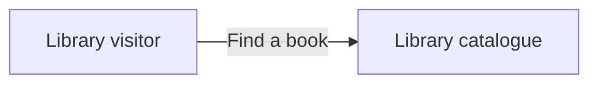

# 01. What architecture is and why diagrams

> **Draft: written but not yet run.** The code and the expected output in this lesson were prepared by reading the code and the official documentation. They have not been executed yet. If something does not behave as described, trust your tool's real output and report it.

## What you will be able to do
By the end of this lesson you will be able to:
- Explain architecture as choices about parts, responsibilities and relationships.
- Match a diagram to its reader and question.
- Draw a small system with a labelled relationship.

## Recap
None, this is the start.

## Why it matters
A city map helps a visitor find a museum; a water-pipe map helps a repair crew fix a leak. Neither map is the whole city. A useful system diagram makes the same choice: show the details this reader needs and leave the rest out.

## What you will build
A two-box map of a library visitor using a catalogue. You will also decide who the map helps and what it cannot answer. No application programming or terminal is needed.

## Before you start
- No prior lessons. Use an ordinary text editor and a current browser such as Edge, Firefox or Chrome. A browser displays websites; an editor changes saved text. You do not need to install a programming language.
- Time: 40 minutes including reading, saving the files and the exercise.
- Source pack (optional): every file is shown in full in this lesson, so you can follow without it. The finished code, the exercise starter and the solution are in the course repository https://github.com/Uee03/Code101 under `source/architecture/101-zero-to-hero/phase-1-thinking-in-systems/01-what-architecture-is/` (on that page choose **Code, Download ZIP**, or run `git clone https://github.com/Uee03/Code101.git`). Cloning is optional; no terminal is used in the steps below.
- If using a downloaded ZIP: Windows, right-click it and choose **Extract All**; macOS, double-click it; Linux, right-click it in the file manager and choose **Extract Here** or **Extract**. Open the extracted folder, not the compressed ZIP. Phase packs start at the phase's folder; the full repository starts above `source/`.
- Here, “source code” means editable diagram text and short documents, not an application. No command, server or database needs to run. The picture descriptions below are expected output, not yet run or rendered by the author.

## Steps
### Step 1. Prepare a separate work folder
A **folder** groups files; a **file** stores saved content. Open your home folder: on Windows press **Win+E**, type `%USERPROFILE%` in the address bar and press Enter; on macOS use **Finder > Go > Home**; on Linux open your file manager's **Home**. Create `code101` if it is absent, open it, create `architecture` if absent, then open it and create `lesson01`. Windows uses **right-click > New > Folder**, macOS **File > New Folder**, and Linux the file manager's **New Folder** action. Do not put this work inside the optional source pack.

Use a plain-text editor. On Windows open **Notepad** from Start. On macOS open **TextEdit**, choose **Format > Make Plain Text**, and use UTF-8 if an encoding choice appears when saving. On Linux use the desktop's text editor. VS Code, if already available, is also suitable. For each file below choose **File > New**, paste the complete listing and use **File > Save As** in `code101/architecture/lesson01` with the exact shown filename. On Windows choose **All files** if offered so `.txt` is not appended. On macOS decline an offer to append `.txt`. Use UTF-8, a text encoding for international characters, and plain text rather than a word processor's rich-text format. In VS Code an unsaved dot on the tab means save with **Ctrl+S** (macOS **Command+S**).

Windows: enable **File Explorer > View > Show > File name extensions** (Windows 10: **View > File name extensions**) to check filenames. In every OS inspect the final name in the file manager. The folder should now exist and contain only this lesson's files as you add them.

### Step 2. Name the reader and question
An **architecture** is the important arrangement of a system: its parts, their responsibilities, their relationships and the decisions behind them. A **responsibility** is a part's job; a **relationship** explains how two parts interact. A **system** is a set of cooperating parts considered together. A **diagram** is a selective picture, not the system itself.

Write this purpose on paper: **Reader:** a new library volunteer. **Question:** who uses the catalogue, and why? **Scope:** finding books, not borrowing or payments. **Scope** means what the picture includes and excludes.

### Step 3. Map one person and one system
In `code101/architecture/lesson01`, create `system.mmd`. A **flowchart** connects shapes to show structure or steps. A **node** is a named shape. An **edge** is a connecting line; its label explains the relationship. **Mermaid** turns small text descriptions into diagrams. A `.mmd` file holds only that description. Copy the full listing, but not the surrounding backticks.

**File: `lesson01/system.mmd`**
```text
flowchart LR
  reader["Library visitor"]
  system["Library catalogue"]
  reader -->|"Find a book"| system
```

`flowchart LR` chooses a left-to-right map. `reader` and `system` are identifiers, or internal names. The quoted text is the visible label. `-->` points from the user to the system; the text between vertical bars explains why. No colour is needed to understand it.

Expected saved result: `lesson01/system.mmd` contains the listing above. This is a file-content expectation, not a captured renderer result.

### Step 4. Save the readable companion
In `code101/architecture/lesson01`, create `diagram-sources.md` with the complete content below. **Markdown** is plain text with lightweight formatting markers; `.md` is its usual extension. A **fence** is a line of backticks marking a block. This companion repeats the diagram files inside fences so a Markdown **preview**, a displayed view of the source, can render them. The outer four-backtick boundary is only this lesson's display wrapper; copy the content inside it, including the inner three-backtick lines. If you change a raw diagram later, replace its corresponding fenced content here too; the two files do not synchronise automatically. No hidden file or configuration is required.

<details><summary>Complete companion document</summary>

**File: `lesson01/diagram-sources.md`**
````markdown
# Diagram source listings

These listings reproduce the editable diagram sources in this folder.

## system.mmd


````

</details>

### Step 5. Predict, then inspect
Before opening the preview, predict: how many boxes and arrows will appear? Which way will the arrow point?

## Run it
No application command is needed. Open one saved `.mmd` file from `code101/architecture/lesson01` in your text editor, select its text and copy it. In a browser open [Mermaid Live Editor](https://mermaid.live/), select all existing text in its **Code** panel and paste the raw `.mmd` content, without Markdown backticks. Read the resulting preview. Use only the invented/public examples here; do not paste confidential architecture into a hosted tool.

For each additional diagram, repeat those same preview actions. The only differences are the `.mmd` filename and the selected contents: `system.mmd`. Preview one file at a time; do not concatenate different diagram types.
Local preview is optional and its setup first appears in lesson 05. The browser route above is enough today.

**Expected output, not yet run:** Two boxes, Library visitor and Library catalogue, with one arrow from the visitor to the catalogue labelled Find a book. Position, font and colour may differ between renderers.

<details><summary>Recorded documentation-only check</summary>

The repository's static check reported the following. This checks source-text coverage and verification specifications, not diagram rendering or application behaviour. It does not remove this lesson's draft notice.

**Recorded output (not application output):**
```text
0 passed, 10 static-checked (not run), 0 failed, 0 unverified (missing tools)
```

</details>

## How it works
Read the picture as a sentence: a library visitor uses the catalogue to find a book. The catalogue's responsibility is finding books, while the visitor chooses what to seek. The labelled relationship records how they interact.

Different readers need different questions answered. A volunteer needs purpose and users. An implementer needs internal parts. A support colleague needs failure points. Architecture includes choices and reasons that one picture cannot hold.

**Misconception:** more boxes mean better architecture. **Correction:** extra detail can hide the answer. This picture deliberately cannot say where records are stored; lesson 04 adds that view.

## Try it
### 1. Guided practice
Fill the three TODO labels to show a museum visitor buying admission from a ticket desk. Keep two nodes and one edge. The picture should answer a visitor-service question, not show card-payment internals.

In your file manager open `code101/architecture` and create `lesson01-try`. If using the optional source pack, delete this empty folder, then copy this lesson's `exercise/starter` folder beside `lesson01` and rename the **copy itself** to `lesson01-try`; do not put a folder named starter inside it. Otherwise create each starter file listed below directly inside `lesson01-try` using **File > New > Save As** in your editor. The full starters are shown; no earlier file is assumed to exist in this exercise folder. A `TODO` is an instruction placeholder to replace, not a special Mermaid command.

<details><summary>Complete starter files</summary>

**File: `lesson01-try/system.mmd` (starter)**
```text
flowchart LR
  reader["TODO reader"]
  system["TODO system"]
  reader -->|"TODO purpose"| system
```

</details>

Save every changed file. For a diagram, use the same raw-source preview procedure from Run it with the exercise file, not the original. For Markdown, reopen the saved exercise document and check its headings and claims. Do not edit the solution before trying.

### 2. Change practice
Change the relationship to asking about opening hours. Keep the same two parts and explain what the new picture now answers.

### 3. Stretch (optional)
Choose a map for a nurse, a bookkeeper or a musician. State its reader and one question before drawing.

<details><summary>Solution to guided practice</summary>

**File: `lesson01-try/system.mmd` (solution)**
```text
flowchart LR
  reader["Museum visitor"]
  system["Ticket desk"]
  reader -->|"Buys admission"| system
```

Compare the saved sources, not just their appearance. The solution addresses the guided goal; your change and stretch choices may differ. All displayed behaviour remains an expectation, not a captured execution result.

</details>

## Check yourself
1. What three things does architecture arrange?
   <details><summary>Answer</summary>Parts, responsibilities and relationships; decisions explain why they are arranged that way.</details>

2. Would this volunteer map answer which database to back up?
   <details><summary>Answer</summary>No. The reader and question require another view, such as the storage view in lesson 04.</details>

3. Predict the number of arrows if only the catalogue label changes.
   <details><summary>Answer</summary>Still one. A node label changes the name, not the relationships.</details>

## Common mistakes
These are likely symptoms to inspect, not captured error messages.

| Symptom | Cause | Fix |
|---|---|---|
| A saved file has .mmd.txt at the end | The editor appended its text-file extension | Use Save As with All files on Windows and check file extensions. |
| The arrow tells the reader nothing | Its purpose label was deleted | Restore a short verb phrase describing the relationship. |
| The picture mixes book searches with every department | Scope was not chosen | Write one question and remove unrelated boxes. |

## Best practice
Choose the audience and question before choosing symbols. Source: freeCodeCamp, [System Architecture Documentation Best Practices and Tools](https://www.freecodecamp.org/news/system-architecture-documentation-best-practices-and-tools/) (Tier 2).

## Going further
The [C4 context guide](https://c4model.com/diagrams/system-context) shows why people and neighbouring systems make a useful first view. Lesson 06 applies it to the real platform.

## Summary
- You practised how to explain architecture as choices about parts, responsibilities and relationships.
- You practised how to match a diagram to its reader and question.
- You practised how to draw a small system with a labelled relationship.

## Next lesson
[02. Client, server and the request journey](../phase-1-thinking-in-systems/02-client-server-request-journey.md): follow one web request in order.
