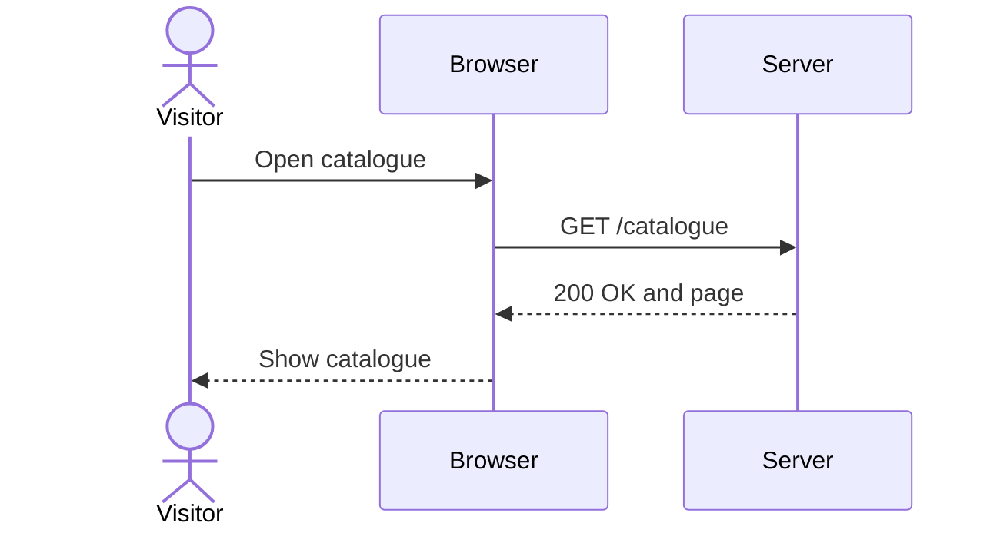

# 02. Client, server and the request journey

> **Draft: written but not yet run.** The code and the expected output in this lesson were prepared by reading the code and the official documentation. They have not been executed yet. If something does not behave as described, trust your tool's real output and report it.

## What you will be able to do
By the end of this lesson you will be able to:
- Identify the client, server, request and response in a web visit.
- Read message order in a sequence diagram.
- Predict what the diagram does not promise about timing or failures.

## Recap
1. What should you name before drawing?
   <details><summary>Answer</summary>The reader, one question and the scope.</details>

2. What does an arrow label add?
   <details><summary>Answer</summary>It explains the meaning of the relationship, not merely that two boxes are connected.</details>

## Why it matters
At a restaurant, a guest asks a waiter for a menu and the waiter brings one back. The two directions are different jobs. A web visit has the same request-and-reply shape, even when both programs happen to run on one computer.

## What you will build
A sequence diagram of one successful catalogue-page request. The scope begins with a visitor opening the page and ends when the browser displays it; it does not model every internet step.

## Before you start
- Complete lesson 01. Use the same text editor and browser; no server or website installation is required.
- Time: 35 minutes including reading, saving the files and the exercise.
- Source pack (optional): every file is shown in full in this lesson, so you can follow without it. The finished code, the exercise starter and the solution are in the course repository https://github.com/Uee03/Code101 under `source/architecture/101-zero-to-hero/phase-1-thinking-in-systems/02-client-server-request-journey/` (on that page choose **Code, Download ZIP**, or run `git clone https://github.com/Uee03/Code101.git`). Cloning is optional; no terminal is used in the steps below.
- If using a downloaded ZIP: Windows, right-click it and choose **Extract All**; macOS, double-click it; Linux, right-click it in the file manager and choose **Extract Here** or **Extract**. Open the extracted folder, not the compressed ZIP. Phase packs start at the phase's folder; the full repository starts above `source/`.
- Here, “source code” means editable diagram text and short documents, not an application. No command, server or database needs to run. The picture descriptions below are expected output, not yet run or rendered by the author.

## Steps
### Step 1. Prepare a separate work folder
A **folder** groups files; a **file** stores saved content. Open your home folder: on Windows press **Win+E**, type `%USERPROFILE%` in the address bar and press Enter; on macOS use **Finder > Go > Home**; on Linux open your file manager's **Home**. Create `code101` if it is absent, open it, create `architecture` if absent, then open it and create `lesson02`. Windows uses **right-click > New > Folder**, macOS **File > New Folder**, and Linux the file manager's **New Folder** action. Do not put this work inside the optional source pack.

Use a plain-text editor. On Windows open **Notepad** from Start. On macOS open **TextEdit**, choose **Format > Make Plain Text**, and use UTF-8 if an encoding choice appears when saving. On Linux use the desktop's text editor. VS Code, if already available, is also suitable. For each file below choose **File > New**, paste the complete listing and use **File > Save As** in `code101/architecture/lesson02` with the exact shown filename. On Windows choose **All files** if offered so `.txt` is not appended. On macOS decline an offer to append `.txt`. Use UTF-8, a text encoding for international characters, and plain text rather than a word processor's rich-text format. In VS Code an unsaved dot on the tab means save with **Ctrl+S** (macOS **Command+S**).

Windows: enable **File Explorer > View > Show > File name extensions** (Windows 10: **View > File name extensions**) to check filenames. In every OS inspect the final name in the file manager. The folder should now exist and contain only this lesson's files as you add them.

### Step 2. Name the reader and question
A **client** is a program that asks another program for something. A **server** is a program that answers requests. A **request** is the message asking for work; a **response** is its reply. A **sequence diagram** lists participants across the top and messages in order down the page. A **participant** is one person or program in that interaction.

**HTTP**, Hypertext Transfer Protocol, is a set of web request and response rules. `GET` asks to retrieve a resource, such as the page at `/catalogue`. `200 OK` is an HTTP success status. **HTTPS** protects HTTP in transit with encryption; it does not by itself decide who may read a record.

### Step 3. Write one web-request journey
In `code101/architecture/lesson02`, create `request.mmd`. The visitor is a human actor. Browser and Server are programs. Read the arrows from top to bottom, not left to right.

**File: `lesson02/request.mmd`**
```text
sequenceDiagram
  actor Visitor
  participant Browser
  participant Server
  Visitor->>Browser: Open catalogue
  Browser->>Server: GET /catalogue
  Server-->>Browser: 200 OK and page
  Browser-->>Visitor: Show catalogue
```

`sequenceDiagram` selects the notation. `actor` gives the human a distinct symbol; `participant` declares the two programs in display order. `->>` marks a request or action here. `-->>` marks a reply here. The colon separates each arrow from its message. These are our conventions; dashed lines do not inherently mean failure.

Expected saved result: `lesson02/request.mmd` contains the listing above. This is a file-content expectation, not a captured renderer result.

### Step 4. Save the readable companion
In `code101/architecture/lesson02`, create `diagram-sources.md` with the complete content below. **Markdown** is plain text with lightweight formatting markers; `.md` is its usual extension. A **fence** is a line of backticks marking a block. This companion repeats the diagram files inside fences so a Markdown **preview**, a displayed view of the source, can render them. The outer four-backtick boundary is only this lesson's display wrapper; copy the content inside it, including the inner three-backtick lines. If you change a raw diagram later, replace its corresponding fenced content here too; the two files do not synchronise automatically. No hidden file or configuration is required.

<details><summary>Complete companion document</summary>

**File: `lesson02/diagram-sources.md`**
````markdown
# Diagram source listings

These listings reproduce the editable diagram sources in this folder.

## request.mmd


````

</details>

### Step 5. Predict, then inspect
Predict which message must come immediately before Show catalogue. Is a response the same as the screen being drawn?

## Run it
No application command is needed. Open one saved `.mmd` file from `code101/architecture/lesson02` in your text editor, select its text and copy it. In a browser open [Mermaid Live Editor](https://mermaid.live/), select all existing text in its **Code** panel and paste the raw `.mmd` content, without Markdown backticks. Read the resulting preview. Use only the invented/public examples here; do not paste confidential architecture into a hosted tool.

For each additional diagram, repeat those same preview actions. The only differences are the `.mmd` filename and the selected contents: `request.mmd`. Preview one file at a time; do not concatenate different diagram types.
Local preview is optional and its setup first appears in lesson 05. The browser route above is enough today.

**Expected output, not yet run:** Visitor, Browser and Server appear across the top. Four messages descend in order: Open catalogue; GET /catalogue; 200 OK and page; Show catalogue.

<details><summary>Recorded documentation-only check</summary>

The repository's static check reported the following. This checks source-text coverage and verification specifications, not diagram rendering or application behaviour. It does not remove this lesson's draft notice.

**Recorded output (not application output):**
```text
0 passed, 10 static-checked (not run), 0 failed, 0 unverified (missing tools)
```

</details>

## How it works
The visitor asks the browser to open the catalogue. The browser requests the page. The server replies with the page; then the browser displays it. The browser is the client in this interaction. A server may itself become a client when asking another service for help.

Vertical position gives message order, not elapsed seconds. The diagram does not promise instant replies. It shows a **happy path**, one successful scenario. A **scenario** is one concrete interaction under stated conditions.

**Misconception:** every arrow is a separate machine. **Correction:** arrows join participants; participants are roles or programs and need not be separate computers. We intentionally omit address lookup, connection setup, extra image requests and failure replies. Lesson 05 uses a longer sequence for Tasks and Teams.

## Try it
### 1. Guided practice
Replace the TODO messages with a visit to an opening-hours page. Use `/hours` as its path. Keep the same three participants and four messages. The last message should describe what the visitor sees.

In your file manager open `code101/architecture` and create `lesson02-try`. If using the optional source pack, delete this empty folder, then copy this lesson's `exercise/starter` folder beside `lesson02` and rename the **copy itself** to `lesson02-try`; do not put a folder named starter inside it. Otherwise create each starter file listed below directly inside `lesson02-try` using **File > New > Save As** in your editor. The full starters are shown; no earlier file is assumed to exist in this exercise folder. A `TODO` is an instruction placeholder to replace, not a special Mermaid command.

<details><summary>Complete starter files</summary>

**File: `lesson02-try/request.mmd` (starter)**
```text
sequenceDiagram
  actor Visitor
  participant Browser
  participant Server
  Visitor->>Browser: TODO action
  Browser->>Server: TODO request
  Server-->>Browser: TODO response
  Browser-->>Visitor: TODO display
```

</details>

Save every changed file. For a diagram, use the same raw-source preview procedure from Run it with the exercise file, not the original. For Markdown, reopen the saved exercise document and check its headings and claims. Do not edit the solution before trying.

### 2. Change practice
Change the example to a page that is unavailable. Use the plain response label Page unavailable rather than guessing an error number, and make the last message consistent.

### 3. Stretch (optional)
Explain where a slow reply might keep the visitor waiting. Do not invent a time measurement.

<details><summary>Solution to guided practice</summary>

**File: `lesson02-try/request.mmd` (solution)**
```text
sequenceDiagram
  actor Visitor
  participant Browser
  participant Server
  Visitor->>Browser: Open opening hours
  Browser->>Server: GET /hours
  Server-->>Browser: 200 OK and hours page
  Browser-->>Visitor: Show opening hours
```

Compare the saved sources, not just their appearance. The solution addresses the guided goal; your change and stretch choices may differ. All displayed behaviour remains an expectation, not a captured execution result.

</details>

## Check yourself
1. Which program is the client when Browser asks Server for the page?
   <details><summary>Answer</summary>Browser. Client and server describe roles in an interaction, not permanent kinds of computer.</details>

2. Predict what happens in the picture if Show catalogue is moved above the response.
   <details><summary>Answer</summary>The picture would claim the browser shows the received page before receiving it. The order would contradict this scenario.</details>

3. Does the gap between messages measure network delay?
   <details><summary>Answer</summary>No. This simple diagram shows order only, and the happy path does not describe failure handling.</details>

## Common mistakes
These are likely symptoms to inspect, not captured error messages.

| Symptom | Cause | Fix |
|---|---|---|
| The human appears to send HTTP directly | Browser was omitted | Keep the visitor action separate from the browser request. |
| The page is displayed before the reply | Message lines are out of order | Put receiving the page before showing it. |
| A dashed reply is read as a failed reply | Line appearance was mistaken for a status code | Read its message; the example uses dashed lines for replies. |

## Best practice
Declare participants first and show one named scenario rather than every possible journey. Source: Mermaid, [Sequence diagrams](https://mermaid.js.org/syntax/sequenceDiagram.html).

## Going further
[Lesson 05](../phase-2-diagram-toolkit/05-mermaid-in-depth.md) adds an already-signed-in request with an explicit access check.

## Summary
- You practised how to identify the client, server, request and response in a web visit.
- You practised how to read message order in a sequence diagram.
- You practised how to predict what the diagram does not promise about timing or failures.

## Next lesson
[03. Layers and responsibilities](../phase-1-thinking-in-systems/03-layers-and-responsibilities.md): assign jobs to parts instead of mixing every concern.
