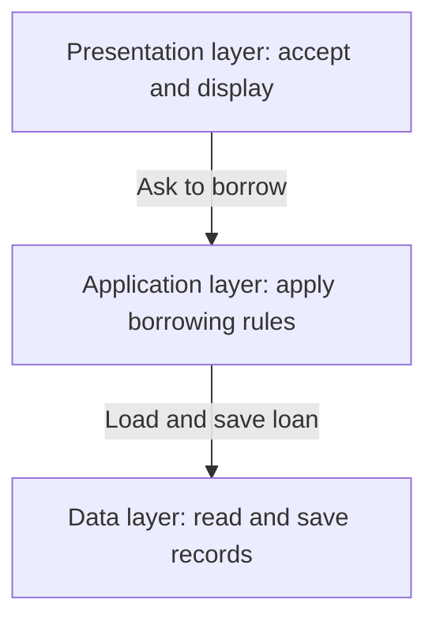

# 03. Layers and responsibilities

> **Draft: written but not yet run.** The code and the expected output in this lesson were prepared by reading the code and the official documentation. They have not been executed yet. If something does not behave as described, trust your tool's real output and report it.

## What you will be able to do
By the end of this lesson you will be able to:
- Assign presentation, application and data responsibilities.
- Read the call direction in a layered flowchart.
- Distinguish a logical layer from a separate computer.

## Recap
1. What order does a sequence diagram show?
   <details><summary>Answer</summary>Message order from top to bottom.</details>

2. Why label relationships?
   <details><summary>Answer</summary>So a reader can explain the purpose of each connection without guessing.</details>

## Why it matters
In a restaurant, the counter receives orders, the kitchen applies recipes and the stockroom tracks supplies. Moving every job to the counter would make mistakes hard to isolate. Layers give software similarly clear jobs without requiring a separate building for each one.

## What you will build
A top-to-bottom borrowing map with three responsibilities. The arrows mean calls from one layer to the next, not a timeline or a deployment plan.

## Before you start
- Complete lessons 01 and 02. Use your existing text editor and browser. No programming tools are needed.
- Time: 35 minutes including reading, saving the files and the exercise.
- Source pack (optional): every file is shown in full in this lesson, so you can follow without it. The finished code, the exercise starter and the solution are in the course repository https://github.com/Uee03/Code101 under `source/architecture/101-zero-to-hero/phase-1-thinking-in-systems/03-layers-and-responsibilities/` (on that page choose **Code, Download ZIP**, or run `git clone https://github.com/Uee03/Code101.git`). Cloning is optional; no terminal is used in the steps below.
- If using a downloaded ZIP: Windows, right-click it and choose **Extract All**; macOS, double-click it; Linux, right-click it in the file manager and choose **Extract Here** or **Extract**. Open the extracted folder, not the compressed ZIP. Phase packs start at the phase's folder; the full repository starts above `source/`.
- Here, “source code” means editable diagram text and short documents, not an application. No command, server or database needs to run. The picture descriptions below are expected output, not yet run or rendered by the author.

## Steps
### Step 1. Prepare a separate work folder
A **folder** groups files; a **file** stores saved content. Open your home folder: on Windows press **Win+E**, type `%USERPROFILE%` in the address bar and press Enter; on macOS use **Finder > Go > Home**; on Linux open your file manager's **Home**. Create `code101` if it is absent, open it, create `architecture` if absent, then open it and create `lesson03`. Windows uses **right-click > New > Folder**, macOS **File > New Folder**, and Linux the file manager's **New Folder** action. Do not put this work inside the optional source pack.

Use a plain-text editor. On Windows open **Notepad** from Start. On macOS open **TextEdit**, choose **Format > Make Plain Text**, and use UTF-8 if an encoding choice appears when saving. On Linux use the desktop's text editor. VS Code, if already available, is also suitable. For each file below choose **File > New**, paste the complete listing and use **File > Save As** in `code101/architecture/lesson03` with the exact shown filename. On Windows choose **All files** if offered so `.txt` is not appended. On macOS decline an offer to append `.txt`. Use UTF-8, a text encoding for international characters, and plain text rather than a word processor's rich-text format. In VS Code an unsaved dot on the tab means save with **Ctrl+S** (macOS **Command+S**).

Windows: enable **File Explorer > View > Show > File name extensions** (Windows 10: **View > File name extensions**) to check filenames. In every OS inspect the final name in the file manager. The folder should now exist and contain only this lesson's files as you add them.

### Step 2. Name the reader and question
A **layer** groups related responsibilities at a chosen level of detail. The **presentation layer** accepts user input and displays results. The **application layer** coordinates work and applies the use-case rules. The **data layer** reads and saves records.

For this simple layered design, a borrowing request moves from presentation to application to data. A real borrowing rule might limit active loans. We are drawing responsibilities, not implementing or proving that rule.

### Step 3. Give three layers distinct jobs
In `code101/architecture/lesson03`, create `layers.mmd`. The question is: which part accepts the borrowing request, which decides, and which saves?

**File: `lesson03/layers.mmd`**
```text
flowchart TD
  presentation["Presentation layer: accept and display"]
  application["Application layer: apply borrowing rules"]
  data["Data layer: read and save records"]
  presentation -->|"Ask to borrow"| application
  application -->|"Load and save loan"| data
```

`TD` means top to bottom. Each quoted label combines a layer name with its responsibility. The two labelled edges show calls downward. Replies travel back to callers but are omitted to avoid drawing every relationship twice.

Expected saved result: `lesson03/layers.mmd` contains the listing above. This is a file-content expectation, not a captured renderer result.

### Step 4. Save the readable companion
In `code101/architecture/lesson03`, create `diagram-sources.md` with the complete content below. **Markdown** is plain text with lightweight formatting markers; `.md` is its usual extension. A **fence** is a line of backticks marking a block. This companion repeats the diagram files inside fences so a Markdown **preview**, a displayed view of the source, can render them. The outer four-backtick boundary is only this lesson's display wrapper; copy the content inside it, including the inner three-backtick lines. If you change a raw diagram later, replace its corresponding fenced content here too; the two files do not synchronise automatically. No hidden file or configuration is required.

<details><summary>Complete companion document</summary>

**File: `lesson03/diagram-sources.md`**
````markdown
# Diagram source listings

These listings reproduce the editable diagram sources in this folder.

## layers.mmd


````

</details>

### Step 5. Predict, then inspect
Predict the path of a borrowing request. If the loan limit changes, which layer owns the decision?

## Run it
No application command is needed. Open one saved `.mmd` file from `code101/architecture/lesson03` in your text editor, select its text and copy it. In a browser open [Mermaid Live Editor](https://mermaid.live/), select all existing text in its **Code** panel and paste the raw `.mmd` content, without Markdown backticks. Read the resulting preview. Use only the invented/public examples here; do not paste confidential architecture into a hosted tool.

For each additional diagram, repeat those same preview actions. The only differences are the `.mmd` filename and the selected contents: `layers.mmd`. Preview one file at a time; do not concatenate different diagram types.
Local preview is optional and its setup first appears in lesson 05. The browser route above is enough today.

**Expected output, not yet run:** Three boxes stack from Presentation to Application to Data. The first arrow reads Ask to borrow; the second reads Load and save loan.

<details><summary>Recorded documentation-only check</summary>

The repository's static check reported the following. This checks source-text coverage and verification specifications, not diagram rendering or application behaviour. It does not remove this lesson's draft notice.

**Recorded output (not application output):**
```text
0 passed, 10 static-checked (not run), 0 failed, 0 unverified (missing tools)
```

</details>

## How it works
The presentation part collects the action and later displays confirmation. The application part decides whether borrowing is allowed and asks the data part to save the resulting loan. The data part handles stored records.

A **logical view** groups ideas by responsibility, regardless of where they run. A **deployment view** shows where programs run. This is a logical view: all three layers may be in one program on one computer.

**Misconception:** three layers require three servers. **Correction:** responsibility boundaries and machine boundaries answer different questions. This is a simple layered call structure, not a claim that every architecture must use it or that it is the same as inward-dependency designs.

## Try it
### 1. Guided practice
Fill the TODO labels with these jobs in their appropriate layers: display a loan confirmation; decide borrowing eligibility; save the loan record. Keep the labelled call directions.

In your file manager open `code101/architecture` and create `lesson03-try`. If using the optional source pack, delete this empty folder, then copy this lesson's `exercise/starter` folder beside `lesson03` and rename the **copy itself** to `lesson03-try`; do not put a folder named starter inside it. Otherwise create each starter file listed below directly inside `lesson03-try` using **File > New > Save As** in your editor. The full starters are shown; no earlier file is assumed to exist in this exercise folder. A `TODO` is an instruction placeholder to replace, not a special Mermaid command.

<details><summary>Complete starter files</summary>

**File: `lesson03-try/layers.mmd` (starter)**
```text
flowchart TD
  presentation["TODO show the result"]
  application["TODO decide eligibility"]
  data["TODO store the fact"]
  presentation -->|"Ask to borrow"| application
  application -->|"Load and save loan"| data
```

</details>

Save every changed file. For a diagram, use the same raw-source preview procedure from Run it with the exercise file, not the original. For Markdown, reopen the saved exercise document and check its headings and claims. Do not edit the solution before trying.

### 2. Change practice
Add a due-date calculation to the responsibility description of the layer that decides the borrowing outcome. Explain why the display-only part should not be its only owner.

### 3. Stretch (optional)
Imagine a second interface used by a librarian. Describe which rules should be shared rather than copied into both interfaces.

<details><summary>Solution to guided practice</summary>

**File: `lesson03-try/layers.mmd` (solution)**
```text
flowchart TD
  presentation["Presentation: display loan confirmation"]
  application["Application: decide borrowing eligibility"]
  data["Data: save the loan record"]
  presentation -->|"Ask to borrow"| application
  application -->|"Load and save loan"| data
```

Compare the saved sources, not just their appearance. The solution addresses the guided goal; your change and stretch choices may differ. All displayed behaviour remains an expectation, not a captured execution result.

</details>

## Check yourself
1. Which layer should decide whether a member may borrow another book?
   <details><summary>Answer</summary>The application layer in this simplified design. The presentation displays the decision and the data layer stores records.</details>

2. Predict the call path if presentation bypasses application and saves a loan directly.
   <details><summary>Answer</summary>The map would bypass the part assigned to borrowing rules. That risks saving a loan without the intended decision.</details>

3. Must the three boxes be deployed to three computers?
   <details><summary>Answer</summary>No. These are logical responsibility groups, not machines.</details>

## Common mistakes
These are likely symptoms to inspect, not captured error messages.

| Symptom | Cause | Fix |
|---|---|---|
| Two boxes both claim sole ownership of a rule | Responsibilities overlap without explanation | Choose the rule owner and label other parts as callers. |
| The arrows are described as seconds passing | A structure view was read as a sequence | Use lesson 02 notation for message order. |
| A database brand replaces the entire data responsibility | A tool name was substituted for a job | State what records are read or saved; add technology only when relevant. |

## Best practice
Judge an architecture against its responsibilities and constraints, not its number of layers. Source: ByteByteGo, [Software Architecture](https://bytebytego.com/guides/software-architecture/) (Tier 2).

## Going further
Lesson 04 opens the storage question; [lesson 06](../phase-2-diagram-toolkit/06-c4-context-and-containers.md) groups running applications rather than logical layers.

## Summary
- You practised how to assign presentation, application and data responsibilities.
- You practised how to read the call direction in a layered flowchart.
- You practised how to distinguish a logical layer from a separate computer.

## Next lesson
[04. Data and storage](../phase-1-thinking-in-systems/04-data-and-storage.md): separate authoritative records from temporary copies.
