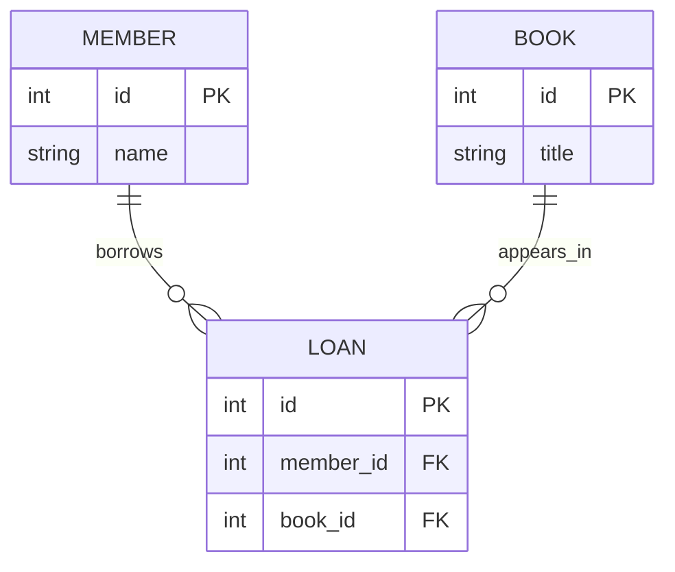
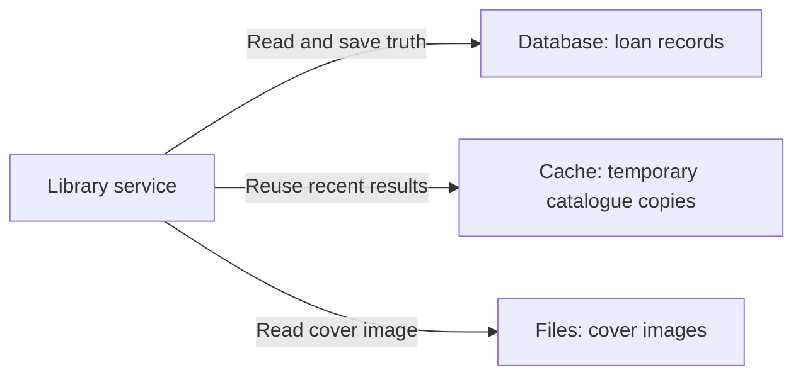

# 04. Data and storage

> **Draft: written but not yet run.** The code and the expected output in this lesson were prepared by reading the code and the official documentation. They have not been executed yet. If something does not behave as described, trust your tool's real output and report it.

## What you will be able to do
By the end of this lesson you will be able to:
- Choose between a database, cache and file store for a stated need.
- Read one-to-many relationships in an entity relationship diagram.
- Identify primary and foreign keys in a small loan model.

## Recap
1. Which layer saves a loan record?
   <details><summary>Answer</summary>The data layer in lesson 03's simplified design.</details>

2. Does a map of layers tell you what order messages occur?
   <details><summary>Answer</summary>No. Use a sequence diagram for message order.</details>

## Why it matters
A post office keeps an official delivery register, a convenient copy of today's route and parcels on shelves. Losing the temporary route copy should not erase the official register. Software storage also needs an explicit distinction between authoritative records and replaceable copies.

## What you will build
A storage-choice map plus a small loan data model. For this teaching library, each BOOK record means one physical copy. The model includes historical loans; it does not yet enforce a one-active-loan rule.

## Before you start
- Complete lessons 01 to 03. Use the same editor and browser. You will draw a database, not install one.
- Time: 45 minutes including reading, saving the files and the exercise.
- Source pack (optional): every file is shown in full in this lesson, so you can follow without it. The finished code, the exercise starter and the solution are in the course repository https://github.com/Uee03/Code101 under `source/architecture/101-zero-to-hero/phase-1-thinking-in-systems/04-data-and-storage/` (on that page choose **Code, Download ZIP**, or run `git clone https://github.com/Uee03/Code101.git`). Cloning is optional; no terminal is used in the steps below.
- If using a downloaded ZIP: Windows, right-click it and choose **Extract All**; macOS, double-click it; Linux, right-click it in the file manager and choose **Extract Here** or **Extract**. Open the extracted folder, not the compressed ZIP. Phase packs start at the phase's folder; the full repository starts above `source/`.
- Here, “source code” means editable diagram text and short documents, not an application. No command, server or database needs to run. The picture descriptions below are expected output, not yet run or rendered by the author.

## Steps
### Step 1. Prepare a separate work folder
A **folder** groups files; a **file** stores saved content. Open your home folder: on Windows press **Win+E**, type `%USERPROFILE%` in the address bar and press Enter; on macOS use **Finder > Go > Home**; on Linux open your file manager's **Home**. Create `code101` if it is absent, open it, create `architecture` if absent, then open it and create `lesson04`. Windows uses **right-click > New > Folder**, macOS **File > New Folder**, and Linux the file manager's **New Folder** action. Do not put this work inside the optional source pack.

Use a plain-text editor. On Windows open **Notepad** from Start. On macOS open **TextEdit**, choose **Format > Make Plain Text**, and use UTF-8 if an encoding choice appears when saving. On Linux use the desktop's text editor. VS Code, if already available, is also suitable. For each file below choose **File > New**, paste the complete listing and use **File > Save As** in `code101/architecture/lesson04` with the exact shown filename. On Windows choose **All files** if offered so `.txt` is not appended. On macOS decline an offer to append `.txt`. Use UTF-8, a text encoding for international characters, and plain text rather than a word processor's rich-text format. In VS Code an unsaved dot on the tab means save with **Ctrl+S** (macOS **Command+S**).

Windows: enable **File Explorer > View > Show > File name extensions** (Windows 10: **View > File name extensions**) to check filenames. In every OS inspect the final name in the file manager. The folder should now exist and contain only this lesson's files as you add them.

### Step 2. Name the reader and question
A **database** organises records and can enforce relationships between them. A **cache** keeps a reusable copy that may be discarded and rebuilt. A **file** stores a named block of data, such as a cover image. A **source of truth** is the authoritative place to resolve conflicting copies.

Our source of truth for loans is the database. A cached catalogue can be briefly old, so it must not decide whether a copy is available to borrow. Cover images are files; their location could be recorded in the database without storing the image there.

### Step 3. Choose storage by purpose
In `code101/architecture/lesson04`, create `storage.mmd`. This is a conceptual storage sketch. A box represents a storage role, not necessarily a separate server.

**File: `lesson04/storage.mmd`**
```text
flowchart LR
  app["Library service"]
  db["Database: loan records"]
  cache["Cache: temporary catalogue copies"]
  files["Files: cover images"]
  app -->|"Read and save truth"| db
  app -->|"Reuse recent results"| cache
  app -->|"Read cover image"| files
```

All arrows begin at the library service. Database stores authoritative loans, cache reuses temporary catalogue results, and files hold cover images. Nothing says the cache is required in every app.

Expected saved result: `lesson04/storage.mmd` contains the listing above. This is a file-content expectation, not a captured renderer result.

### Step 4. Connect members, books and loans
In `code101/architecture/lesson04`, create `data.mmd`. An **entity** is a kind of thing represented by records. An **entity relationship diagram**, or **ER diagram**, shows these things and how their records relate. A **primary key** (`PK`) uniquely identifies a record. A **foreign key** (`FK`) refers to another record's key. **Cardinality** means how many records may participate in a relationship.

**File: `lesson04/data.mmd`**
```text
erDiagram
  MEMBER ||--o{ LOAN : borrows
  BOOK ||--o{ LOAN : appears_in
  MEMBER {
    int id PK
    string name
  }
  BOOK {
    int id PK
    string title
  }
  LOAN {
    int id PK
    int member_id FK
    int book_id FK
  }
```

`||` means exactly one, while `o{` means zero or many. One member can have zero or many loan records; every loan belongs to exactly one member. The same applies to a physical book copy across its loan history. `int` means whole number; `string` means text. The LOAN foreign keys connect each loan to its member and book.

Expected saved result: `lesson04/data.mmd` contains the listing above. This is a file-content expectation, not a captured renderer result.

### Step 5. Save the readable companion
In `code101/architecture/lesson04`, create `diagram-sources.md` with the complete content below. **Markdown** is plain text with lightweight formatting markers; `.md` is its usual extension. A **fence** is a line of backticks marking a block. This companion repeats the diagram files inside fences so a Markdown **preview**, a displayed view of the source, can render them. The outer four-backtick boundary is only this lesson's display wrapper; copy the content inside it, including the inner three-backtick lines. If you change a raw diagram later, replace its corresponding fenced content here too; the two files do not synchronise automatically. No hidden file or configuration is required.

<details><summary>Complete companion document</summary>

**File: `lesson04/diagram-sources.md`**
````markdown
# Diagram source listings

These listings reproduce the editable diagram sources in this folder.

## data.mmd



## storage.mmd


````

</details>

### Step 6. Predict, then inspect
Predict whether a new member with no loans fits the diagram. What information must survive if the cache is emptied?

## Run it
No application command is needed. Open one saved `.mmd` file from `code101/architecture/lesson04` in your text editor, select its text and copy it. In a browser open [Mermaid Live Editor](https://mermaid.live/), select all existing text in its **Code** panel and paste the raw `.mmd` content, without Markdown backticks. Read the resulting preview. Use only the invented/public examples here; do not paste confidential architecture into a hosted tool.

For each additional diagram, repeat those same preview actions. The only differences are the `.mmd` filename and the selected contents: `storage.mmd`, `data.mmd`. Preview one file at a time; do not concatenate different diagram types.
Local preview is optional and its setup first appears in lesson 05. The browser route above is enough today.

**Expected output, not yet run:** The storage view has four boxes and three labelled arrows. The ER view has MEMBER, BOOK and LOAN, with two one-to-zero-or-many relationships. Each LOAN lists its own id and two foreign keys.

<details><summary>Recorded documentation-only check</summary>

The repository's static check reported the following. This checks source-text coverage and verification specifications, not diagram rendering or application behaviour. It does not remove this lesson's draft notice.

**Recorded output (not application output):**
```text
0 passed, 10 static-checked (not run), 0 failed, 0 unverified (missing tools)
```

</details>

## How it works
The storage diagram answers where different kinds of data belong. The ER diagram answers how stored facts relate; it does not show requests. Reading the symbols from the loan end prevents a common mistake: the many marker belongs by LOAN, not by MEMBER.

A **record** is one stored instance, such as one member. Primary keys distinguish records even when names match. Foreign keys express references; the diagram is documentation, not a working database constraint.

**Misconception:** a cache is a faster replacement for all permanent storage. **Correction:** a cache must be safe to rebuild or lose under its stated design. A stale copy must not override authoritative loan decisions. Never place private borrowing histories in a public cache or public file folder.

## Try it
### 1. Guided practice
Replace the TODO field with a text field named return_note on LOAN. Keep the two foreign keys and both relationships. The result should attach the note to one borrowing event, not to the member forever.

In your file manager open `code101/architecture` and create `lesson04-try`. If using the optional source pack, delete this empty folder, then copy this lesson's `exercise/starter` folder beside `lesson04` and rename the **copy itself** to `lesson04-try`; do not put a folder named starter inside it. Otherwise create each starter file listed below directly inside `lesson04-try` using **File > New > Save As** in your editor. The full starters are shown; no earlier file is assumed to exist in this exercise folder. A `TODO` is an instruction placeholder to replace, not a special Mermaid command.

<details><summary>Complete starter files</summary>

**File: `lesson04-try/data.mmd` (starter)**
```text
erDiagram
  MEMBER ||--o{ LOAN : borrows
  BOOK ||--o{ LOAN : appears_in
  LOAN {
    int id PK
    int member_id FK
    int book_id FK
    string TODO_field
  }
```

</details>

Save every changed file. For a diagram, use the same raw-source preview procedure from Run it with the exercise file, not the original. For Markdown, reopen the saved exercise document and check its headings and claims. Do not edit the solution before trying.

### 2. Change practice
Describe, in one sentence, what could go wrong if the cache alone decided whether a copy is available. You do not need to build a cache.

### 3. Stretch (optional)
Draw the difference between a book title and several physical copies. State which entity a loan should refer to.

<details><summary>Solution to guided practice</summary>

**File: `lesson04-try/data.mmd` (solution)**
```text
erDiagram
  MEMBER ||--o{ LOAN : borrows
  BOOK ||--o{ LOAN : appears_in
  LOAN {
    int id PK
    int member_id FK
    int book_id FK
    string return_note
  }
```

Compare the saved sources, not just their appearance. The solution addresses the guided goal; your change and stretch choices may differ. All displayed behaviour remains an expectation, not a captured execution result.

</details>

## Check yourself
1. Which store can be discarded without losing authoritative loans?
   <details><summary>Answer</summary>The cache, because it contains replaceable copies. Loan records belong in the authoritative database.</details>

2. Predict whether one member with zero loans violates MEMBER ||--o{ LOAN.
   <details><summary>Answer</summary>It does not. Zero loans is allowed; each loan still refers to exactly one member.</details>

3. Why does LOAN need member_id when MEMBER already has id?
   <details><summary>Answer</summary>LOAN.id identifies the loan. LOAN.member_id is the foreign key identifying the member for that loan.</details>

## Common mistakes
These are likely symptoms to inspect, not captured error messages.

| Symptom | Cause | Fix |
|---|---|---|
| The many end is beside MEMBER | Cardinality was reversed | Read aloud: one member has many loans; each loan has one member. |
| A return note is placed on MEMBER | A per-event fact was stored on a person | Place the field on LOAN. |
| Cached results decide whether a loan is allowed | Temporary copies became accidental truth | Read and update authoritative loan facts for that decision. |

## Best practice
Choose a small logical or physical ER scope and state which one it is. This example shows a small table-oriented subset with keys. Source: Mermaid, [Entity Relationship Diagrams](https://mermaid.js.org/syntax/entityRelationshipDiagram.html).

## Going further
Phase 1 mixed review: explain the reader for the catalogue map, trace the four sequence messages, assign the borrowing decision to a layer, then read both ER relationships aloud. Answers: volunteer; visitor to browser to server and back; application; one member and one book per loan, each with zero or many loans. Lesson 05 reuses these views on the real platform.

## Summary
- You practised how to choose between a database, cache and file store for a stated need.
- You practised how to read one-to-many relationships in an entity relationship diagram.
- You practised how to identify primary and foreign keys in a small loan model.

## Next lesson
[05. Mermaid in depth](../phase-2-diagram-toolkit/05-mermaid-in-depth.md): choose and edit five diagram types on the real platform.
