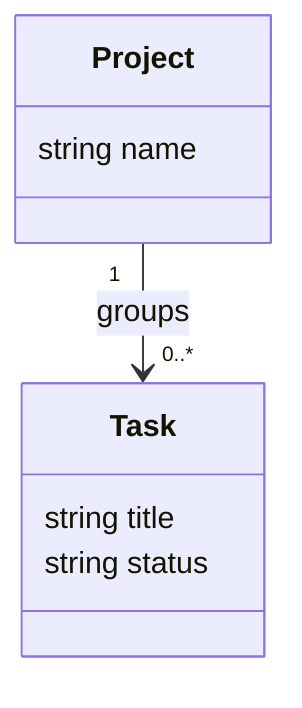
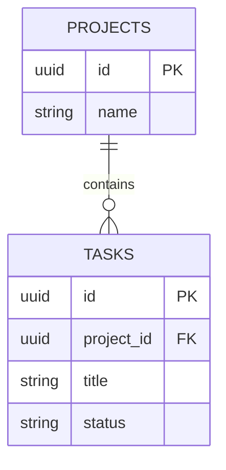
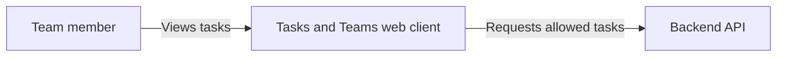
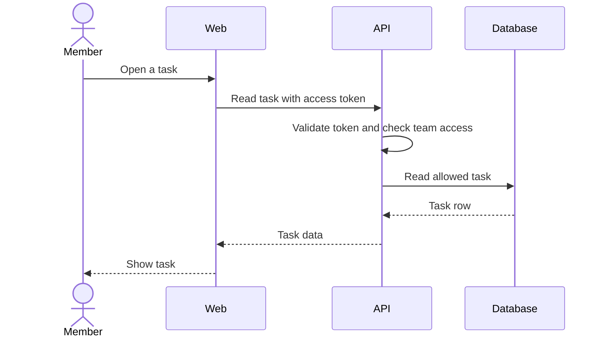
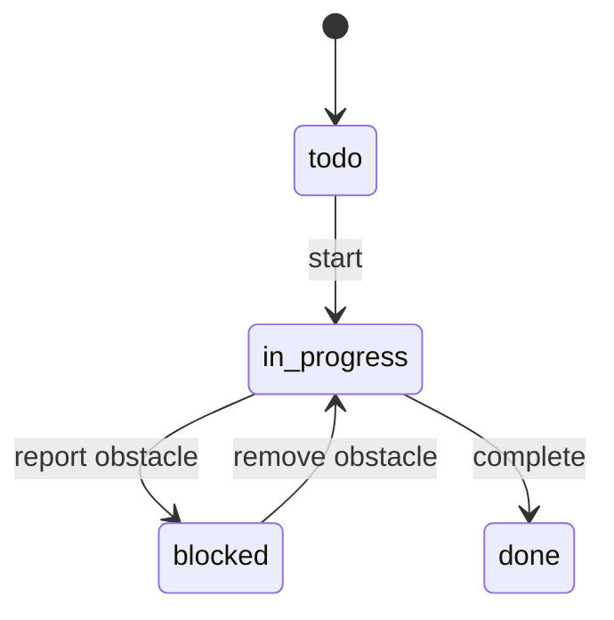

# 05. Mermaid in depth

> **Draft: written but not yet run.** The code and the expected output in this lesson were prepared by reading the code and the official documentation. They have not been executed yet. If something does not behave as described, trust your tool's real output and report it.

## What you will be able to do
By the end of this lesson you will be able to:
- Choose flowchart, sequence, class, ER or state notation for a question.
- Edit simple Mermaid identifiers, labels and relationships safely.
- Prepare Mermaid Markdown for GitHub and VS Code preview.

## Recap
1. What distinguishes a cache from a source of truth?
   <details><summary>Answer</summary>A cache is replaceable; authoritative records settle the fact.</details>

2. What do the two ends of MEMBER ||--o{ LOAN mean?
   <details><summary>Answer</summary>Each loan has exactly one member; each member can have zero or many loans.</details>

3. When is a sequence diagram better than a flowchart?
   <details><summary>Answer</summary>When the question is what happens in order for one scenario.</details>

## Why it matters
A city has street maps, train timetables and building floor plans. Trying to use a timetable as a street map creates confusion. Mermaid also has several notations; choosing the right one matters more than decorating it.

## What you will build
Five tiny views of Tasks and Teams: structure, one request, concepts, stored relationships and a sample task lifecycle. Each is a separate file answering one question. Take two sittings: pause after the sequence diagram.

## Before you start
- Complete phase 1. Keep the text editor and browser. VS Code is optional for local preview; the precise setup is shown below. This lesson needs no backend, account or database.
- Time: 70 minutes including reading, saving the files and the exercise.
- Source pack (optional): every file is shown in full in this lesson, so you can follow without it. The finished code, the exercise starter and the solution are in the course repository https://github.com/Uee03/Code101 under `source/architecture/101-zero-to-hero/phase-2-diagram-toolkit/05-mermaid-in-depth/` (on that page choose **Code, Download ZIP**, or run `git clone https://github.com/Uee03/Code101.git`). Cloning is optional; no terminal is used in the steps below.
- If using a downloaded ZIP: Windows, right-click it and choose **Extract All**; macOS, double-click it; Linux, right-click it in the file manager and choose **Extract Here** or **Extract**. Open the extracted folder, not the compressed ZIP. Phase packs start at the phase's folder; the full repository starts above `source/`.
- Here, “source code” means editable diagram text and short documents, not an application. No command, server or database needs to run. The picture descriptions below are expected output, not yet run or rendered by the author.

## Steps
### Step 1. Prepare a separate work folder
A **folder** groups files; a **file** stores saved content. Open your home folder: on Windows press **Win+E**, type `%USERPROFILE%` in the address bar and press Enter; on macOS use **Finder > Go > Home**; on Linux open your file manager's **Home**. Create `code101` if it is absent, open it, create `architecture` if absent, then open it and create `lesson05`. Windows uses **right-click > New > Folder**, macOS **File > New Folder**, and Linux the file manager's **New Folder** action. Do not put this work inside the optional source pack.

Use a plain-text editor. On Windows open **Notepad** from Start. On macOS open **TextEdit**, choose **Format > Make Plain Text**, and use UTF-8 if an encoding choice appears when saving. On Linux use the desktop's text editor. VS Code, if already available, is also suitable. For each file below choose **File > New**, paste the complete listing and use **File > Save As** in `code101/architecture/lesson05` with the exact shown filename. On Windows choose **All files** if offered so `.txt` is not appended. On macOS decline an offer to append `.txt`. Use UTF-8, a text encoding for international characters, and plain text rather than a word processor's rich-text format. In VS Code an unsaved dot on the tab means save with **Ctrl+S** (macOS **Command+S**).

Windows: enable **File Explorer > View > Show > File name extensions** (Windows 10: **View > File name extensions**) to check filenames. In every OS inspect the final name in the file manager. The folder should now exist and contain only this lesson's files as you add them.

### Step 2. Name the reader and question
From now on our real example is [Tasks and Teams](../../../../capstones/platform/README.md), a shared platform for teams, projects and tasks. Its [technical design document (TDD)](../../../../capstones/platform/TDD.md), a written account of the platform design, is the evidence for the names here. A **contract** is an agreed description of interactions between programs. The platform supplies that shared contract; clients and alternative backends implement it.

An **API**, application programming interface, is an agreed way for programs to request work. The **web client** presents work in a browser. The **backend** handles requests and work rules behind that interface. A **token** is a credential presented to a service; never put a real token in a diagram. These sequences assume the member is already signed in.

### Step 3. Answer who connects to what
In `code101/architecture/lesson05`, create `flow.mmd`. Use a flowchart for the main relationship: a member views tasks through the web client and backend API.

**File: `lesson05/flow.mmd`**
```text
flowchart LR
  member["Team member"]
  web["Tasks and Teams web client"]
  api["Backend API"]
  member -->|"Views tasks"| web
  web -->|"Requests allowed tasks"| api
```

Keep identifiers short and unchanged when only renaming visible labels. Quoted labels can contain spaces or punctuation safely. Edge labels use quoted text between vertical bars. Use spaces, not tabs, and one statement per line.

Expected saved result: `lesson05/flow.mmd` contains the listing above. This is a file-content expectation, not a captured renderer result.

### Step 4. Answer what happens in order
In `code101/architecture/lesson05`, create `sequence.mmd`. This sequence shows only a successful read of a task the member is allowed to see. Access is checked before work data is returned.

**File: `lesson05/sequence.mmd`**
```text
sequenceDiagram
  actor Member
  participant Web
  participant API
  participant Database
  Member->>Web: Open a task
  Web->>API: Read task with access token
  API->>API: Validate token and check team access
  API->>Database: Read allowed task
  Database-->>API: Task row
  API-->>Web: Task data
  Web-->>Member: Show task
```

The API self-message is an internal check, not another machine. It summarises token validation and team-access checks; detailed checks can require their own stored-data reads, omitted here. The token is validated, not merely accepted because it exists. **Break here** if taking two sittings.

Expected saved result: `lesson05/sequence.mmd` contains the listing above. This is a file-content expectation, not a captured renderer result.

### Step 5. Answer which concepts are related
In `code101/architecture/lesson05`, create `class.mmd`. A **class diagram** shows types of things, their properties and relationships. **UML**, Unified Modeling Language, is a family of modelling notations that includes class and sequence diagrams. This is a conceptual view using platform field names, not a claim about a particular backend's source classes.

**File: `lesson05/class.mmd`**
```text
classDiagram
  class Project {
    string name
  }
  class Task {
    string title
    string status
  }
  Project "1" --> "0..*" Task : groups
```

Project has a name; Task has a title and status. Quoted multiplicities `1` and `0..*` mean one and zero-or-many. This is an association, a stated relationship, not inheritance. No methods or programming-language syntax are needed.

Expected saved result: `lesson05/class.mmd` contains the listing above. This is a file-content expectation, not a captured renderer result.

### Step 6. Answer which stored records refer to which
In `code101/architecture/lesson05`, create `er.mmd`. Use ER notation when keys and stored references are the question. `uuid` denotes a universally unique identifier, a kind of identifier used by the platform; `string` denotes text.

**File: `lesson05/er.mmd`**
```text
erDiagram
  PROJECTS ||--o{ TASKS : contains
  PROJECTS {
    uuid id PK
    string name
  }
  TASKS {
    uuid id PK
    uuid project_id FK
    string title
    string status
  }
```

A task has one project, recorded by project_id. The actual platform has more fields and tables. This deliberate subset is neither a complete database schema nor a migration script.

Expected saved result: `lesson05/er.mmd` contains the listing above. This is a file-content expectation, not a captured renderer result.

### Step 7. Answer how one task changes state
In `code101/architecture/lesson05`, create `state.mmd`. A **state** is a named condition. A **transition** is a move in the illustrated workflow. A **state diagram** follows one thing over time, not messages between several programs.

**File: `lesson05/state.mmd`**
```text
stateDiagram-v2
  [*] --> todo
  todo --> in_progress : start
  in_progress --> blocked : report obstacle
  blocked --> in_progress : remove obstacle
  in_progress --> done : complete
```

`[*]` marks the start here. The labels after colons name events. The sample follows todo, in_progress, blocked and done. It omits cancelled and other possible changes in the platform; it is a teaching workflow, not an exhaustive rule enforced by the API.

Expected saved result: `lesson05/state.mmd` contains the listing above. This is a file-content expectation, not a captured renderer result.

### Step 8. Save the readable companion
In `code101/architecture/lesson05`, create `diagram-sources.md` with the complete content below. **Markdown** is plain text with lightweight formatting markers; `.md` is its usual extension. A **fence** is a line of backticks marking a block. This companion repeats the diagram files inside fences so a Markdown **preview**, a displayed view of the source, can render them. The outer four-backtick boundary is only this lesson's display wrapper; copy the content inside it, including the inner three-backtick lines. If you change a raw diagram later, replace its corresponding fenced content here too; the two files do not synchronise automatically. No hidden file or configuration is required.

<details><summary>Complete companion document</summary>

**File: `lesson05/diagram-sources.md`**
````markdown
# Diagram source listings

These listings reproduce the editable diagram sources in this folder.

## class.mmd



## er.mmd



## flow.mmd



## sequence.mmd



## state.mmd


````

</details>

### Step 9. Predict, then inspect
Predict which file answers: what can happen after blocked? Then predict whether renaming the visible web-client label changes the number of flowchart arrows.

### Preview choices: local editor or GitHub
The companion document puts `mermaid` after each three-backtick opening fence. The `.mmd` files themselves must not contain those fences.

**VS Code local preview:** if VS Code is already installed, open it and choose **File > Open Folder**, then select `code101/architecture/lesson05`. Otherwise visit [the official download page](https://code.visualstudio.com/download). On Windows choose the installer matching **Settings > System > About > System type**, open it, accept the license and complete **Next > Install > Finish**. On macOS open the downloaded archive, move Visual Studio Code to Applications and open it. On Ubuntu/Debian open the downloaded `.deb` in the software installer and choose Install, then launch it. Other Linux distributions should follow [official Linux setup](https://code.visualstudio.com/docs/setup/linux). Do not install anything on a managed device without approval.

Open `diagram-sources.md` using **File > Open File**. Right-click its editor tab and select **Open Preview**; or press **Ctrl+Shift+V** on Windows/Linux, **Command+Shift+V** on macOS. Current VS Code has Mermaid in its built-in Markdown preview. Check **Help > About** (macOS **Code > About Visual Studio Code**) if an older installation shows source instead. The former extension `bierner.markdown-mermaid` is deprecated because it was merged into VS Code 1.121; prefer updating VS Code. If updating is not permitted, use the browser preview described in Run it instead of assuming every older editor supports it.

**GitHub rendering:** open this course repository in a browser, navigate to this lesson's `code/diagram-sources.md`, and choose **Preview** if a source view is selected. GitHub renders Mermaid fences in Markdown files; opening a raw `.mmd` file is not the same action. You need no GitHub account to read this public file. Editing your own diagrams locally needs no account either. Publishing your own document requires a repository and is outside this lesson; never upload private diagrams just to preview them.


## Run it
No application command is needed. Open one saved `.mmd` file from `code101/architecture/lesson05` in your text editor, select its text and copy it. In a browser open [Mermaid Live Editor](https://mermaid.live/), select all existing text in its **Code** panel and paste the raw `.mmd` content, without Markdown backticks. Read the resulting preview. Use only the invented/public examples here; do not paste confidential architecture into a hosted tool.

For each additional diagram, repeat those same preview actions. The only differences are the `.mmd` filename and the selected contents: `flow.mmd`, `sequence.mmd`, `class.mmd`, `er.mmd`, `state.mmd`. Preview one file at a time; do not concatenate different diagram types.
For local or GitHub Markdown rendering, use lesson 05's Preview choices and open this lesson's diagram-sources.md.

**Expected output, not yet run:** Five separate pictures: a three-node flow; an ordered task-read interaction; Project linked to Task; PROJECTS linked to TASKS with keys; and a lifecycle with a route from blocked back to in_progress. Layout is renderer-dependent.

<details><summary>Recorded documentation-only check</summary>

The repository's static check reported the following. This checks source-text coverage and verification specifications, not diagram rendering or application behaviour. It does not remove this lesson's draft notice.

**Recorded output (not application output):**
```text
0 passed, 10 static-checked (not run), 0 failed, 0 unverified (missing tools)
```

</details>

## How it works
The first line selects the grammar. Flowcharts explain connections. Sequences explain message order. Classes explain concepts and their properties. ER views explain stored keys and cardinality. States explain one item's lifecycle.

**Rendering** means turning source text into a picture. GitHub and VS Code may bundle different Mermaid versions. These files deliberately use long-established syntax, not experimental C4 commands or new styling features. The Markdown companion can show all five in one document.

**Misconception:** an ER diagram and a class diagram are interchangeable. **Correction:** they can describe related ideas, but foreign keys answer a storage question and class properties answer a concept/type question. Neither proves code follows the drawing.

## Try it
### 1. Guided practice
Replace the two TODO transition labels in the starter. Make a task become blocked while awaiting review, then resume after review is received. Keep the same states and transitions; do not add a direct blocked-to-done move.

In your file manager open `code101/architecture` and create `lesson05-try`. If using the optional source pack, delete this empty folder, then copy this lesson's `exercise/starter` folder beside `lesson05` and rename the **copy itself** to `lesson05-try`; do not put a folder named starter inside it. Otherwise create each starter file listed below directly inside `lesson05-try` using **File > New > Save As** in your editor. The full starters are shown; no earlier file is assumed to exist in this exercise folder. A `TODO` is an instruction placeholder to replace, not a special Mermaid command.

<details><summary>Complete starter files</summary>

**File: `lesson05-try/state.mmd` (starter)**
```text
stateDiagram-v2
  [*] --> todo
  todo --> in_progress : start
  in_progress --> blocked : TODO cause
  blocked --> in_progress : TODO recovery
  in_progress --> done : complete
```

</details>

Save every changed file. For a diagram, use the same raw-source preview procedure from Run it with the exercise file, not the original. For Markdown, reopen the saved exercise document and check its headings and claims. Do not edit the solution before trying.

### 2. Change practice
In your file manager, open `code101/architecture/lesson05`, select `flow.mmd` and copy it. Open `code101/architecture/lesson05-try` and paste it there beside `state.mmd`. Open this copied `flow.mmd` in the editor and rename only the quoted visible web-client label; keep its identifier and both relationships unchanged. Save, then preview that copied file with the raw-source procedure from Run it. Explain why structure stays the same. The copied source is identical to Step 3 before this one-label change; no other file is needed.

### 3. Stretch (optional)
Pick one question a non-technical teammate asked. Choose just one of these five diagram types and explain your choice.

<details><summary>Solution to guided practice</summary>

**File: `lesson05-try/state.mmd` (solution)**
```text
stateDiagram-v2
  [*] --> todo
  todo --> in_progress : start
  in_progress --> blocked : awaiting review
  blocked --> in_progress : review received
  in_progress --> done : complete
```

Compare the saved sources, not just their appearance. The solution addresses the guided goal; your change and stretch choices may differ. All displayed behaviour remains an expectation, not a captured execution result.

</details>

## Check yourself
1. Which view answers what can happen after blocked?
   <details><summary>Answer</summary>The state diagram. This teaching workflow has a transition back to in_progress; it is not the complete platform state contract.</details>

2. Predict the arrow count after only a quoted flowchart label is renamed.
   <details><summary>Answer</summary>It stays two. The identifiers and edge statements did not change.</details>

3. Why might a .mmd file show text while diagram-sources.md shows pictures?
   <details><summary>Answer</summary>Markdown previews and GitHub render mermaid fenced blocks in .md documents. A raw .mmd file is diagram source and may require a dedicated editor.</details>

## Common mistakes
These are likely symptoms to inspect, not captured error messages.

| Symptom | Cause | Fix |
|---|---|---|
| Backticks appear inside a .mmd file | Markdown wrapper was copied into raw source | Keep fences only in the Markdown companion, not in .mmd files. |
| A class view is expected to define database foreign keys | The diagram type does not match the question | Use the ER file for stored keys and references. |
| A local preview shows literal text | An older editor or wrong file/view is open | Open the .md companion and its Markdown preview; check editor support before adding extensions. |

## Best practice
Choose the diagram type by the question and use documented, simple syntax. Sources: Mermaid [Introduction](https://mermaid.js.org/intro/), [Class diagrams](https://mermaid.js.org/syntax/classDiagram.html) and [State diagrams](https://mermaid.js.org/syntax/stateDiagram.html).

## Going further
Rendering sources: [GitHub diagrams](https://docs.github.com/en/get-started/writing-on-github/working-with-advanced-formatting/creating-diagrams), [VS Code Markdown preview](https://code.visualstudio.com/docs/languages/markdown), and the [former extension notice](https://marketplace.visualstudio.com/items?itemName=bierner.markdown-mermaid). Lesson 06 applies a consistent zoom level to the platform.

## Summary
- You practised how to choose flowchart, sequence, class, ER or state notation for a question.
- You practised how to edit simple Mermaid identifiers, labels and relationships safely.
- You practised how to prepare Mermaid Markdown for GitHub and VS Code preview.

## Next lesson
[06. The C4 model: context and containers](../phase-2-diagram-toolkit/06-c4-context-and-containers.md): keep context and container views at consistent zoom levels.
