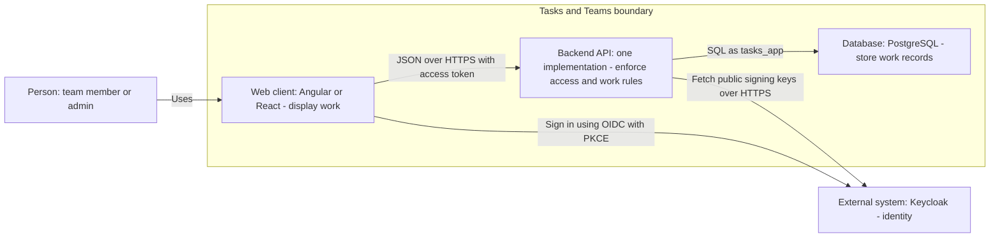
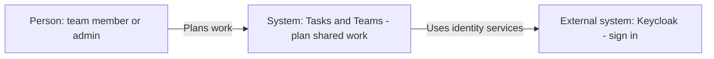

# 06. The C4 model: context and containers

> **Draft: written but not yet run.** The code and the expected output in this lesson were prepared by reading the code and the official documentation. They have not been executed yet. If something does not behave as described, trust your tool's real output and report it.

## What you will be able to do
By the end of this lesson you will be able to:
- Draw a context view for a named audience and system boundary.
- Draw a container view of applications and a data store.
- Explain C4 containers without confusing them with Docker or logical layers.

## Recap
1. Which diagram shows a successful task read in order?
   <details><summary>Answer</summary>The sequence diagram in lesson 05.</details>

2. Why is a conceptual Task class not automatically a database table?
   <details><summary>Answer</summary>Conceptual types and stored records answer different questions, even when their names are similar.</details>

## Why it matters
A city map shows a hospital and its neighbours. A hospital floor plan then shows departments inside the same boundary. Both are useful, but mixing ward beds into the city map would confuse its reader. The C4 model uses a similar change of zoom.

## What you will build
A system context view and a container view for the web project-board slice of Tasks and Teams. We use ordinary Mermaid flowcharts with C4 meaning, not Mermaid's experimental C4 syntax.

## Before you start
- Complete lesson 05. Use the same text editor and browser, or the local Markdown preview taught there. No Docker, backend or database is started.
- Time: 50 minutes including reading, saving the files and the exercise.
- Source pack (optional): every file is shown in full in this lesson, so you can follow without it. The finished code, the exercise starter and the solution are in the course repository https://github.com/Uee03/Code101 under `source/architecture/101-zero-to-hero/phase-2-diagram-toolkit/06-c4-context-and-containers/` (on that page choose **Code, Download ZIP**, or run `git clone https://github.com/Uee03/Code101.git`). Cloning is optional; no terminal is used in the steps below.
- If using a downloaded ZIP: Windows, right-click it and choose **Extract All**; macOS, double-click it; Linux, right-click it in the file manager and choose **Extract Here** or **Extract**. Open the extracted folder, not the compressed ZIP. Phase packs start at the phase's folder; the full repository starts above `source/`.
- Here, “source code” means editable diagram text and short documents, not an application. No command, server or database needs to run. The picture descriptions below are expected output, not yet run or rendered by the author.

## Steps
### Step 1. Prepare a separate work folder
A **folder** groups files; a **file** stores saved content. Open your home folder: on Windows press **Win+E**, type `%USERPROFILE%` in the address bar and press Enter; on macOS use **Finder > Go > Home**; on Linux open your file manager's **Home**. Create `code101` if it is absent, open it, create `architecture` if absent, then open it and create `lesson06`. Windows uses **right-click > New > Folder**, macOS **File > New Folder**, and Linux the file manager's **New Folder** action. Do not put this work inside the optional source pack.

Use a plain-text editor. On Windows open **Notepad** from Start. On macOS open **TextEdit**, choose **Format > Make Plain Text**, and use UTF-8 if an encoding choice appears when saving. On Linux use the desktop's text editor. VS Code, if already available, is also suitable. For each file below choose **File > New**, paste the complete listing and use **File > Save As** in `code101/architecture/lesson06` with the exact shown filename. On Windows choose **All files** if offered so `.txt` is not appended. On macOS decline an offer to append `.txt`. Use UTF-8, a text encoding for international characters, and plain text rather than a word processor's rich-text format. In VS Code an unsaved dot on the tab means save with **Ctrl+S** (macOS **Command+S**).

Windows: enable **File Explorer > View > Show > File name extensions** (Windows 10: **View > File name extensions**) to check filenames. In every OS inspect the final name in the file manager. The folder should now exist and contain only this lesson's files as you add them.

### Step 2. Name the reader and question
**C4** names four zoom levels: Context, Containers, Components and Code. This lesson uses only the first two. A **context diagram** shows one system, its people and neighbouring systems. Its audience includes non-technical colleagues. A **container diagram** zooms into that system's main applications and data stores; its readers include implementers and support staff. A **system boundary** says which responsibilities are inside the system being described.

Our boundary is **work planning**: clients, work API and work records. **Keycloak** is the platform's identity service: it signs people in and issues tokens. We treat that identity responsibility as external to work planning, even if the same team operates it locally. The platform TDD groups it inside the operational stack in another view. Different scopes are valid when explicitly named; do not silently change a boundary between views.

### Read the technology labels without starting anything
**PostgreSQL**, also called Postgres, is the platform's relational database. **SQL**, Structured Query Language, is a language for reading and changing relational data. `tasks_app` names the limited database role used by backends. **JSON**, JavaScript Object Notation, is a text format for exchanged data. **OIDC**, OpenID Connect, is a sign-in standard. **PKCE**, Proof Key for Code Exchange, binds the interactive sign-in exchange to the client that began it. These names document responsibilities; you do not need to implement them here.

The API fetches **public signing keys** to validate token signatures. Public keys are not passwords or private signing keys. The diagram does not show the sign-in exchange in full, and access still requires the API's team-permission checks.

HTTPS labels show intended production protection. The platform's local teaching setup uses HTTP on local ports; this diagram is not a command to reconfigure it. An implementation choice means one backend alternative, not all four on a single request. The platform supports Angular or React web clients and Python, ASP.NET, Go or Rust backends; our boxes deliberately avoid selecting a programming stack.

### Step 3. Draw the outside view
In `code101/architecture/lesson06`, create `context.mmd`. Reader: a new team member. Question: who uses Tasks and Teams and which neighbouring capability does it rely on? Do not add a web-client box or database here.

**File: `lesson06/context.mmd`**
```text
flowchart LR
  person["Person: team member or admin"]
  platform["System: Tasks and Teams - plan shared work"]
  identity["External system: Keycloak - sign in"]
  person -->|"Plans work"| platform
  platform -->|"Uses identity services"| identity
```

Person, system and external-system labels make the roles clear without colour. The arrow to Keycloak means uses identity services, not that passwords pass through the work API.

Expected saved result: `lesson06/context.mmd` contains the listing above. This is a file-content expectation, not a captured renderer result.

### Step 4. Zoom into the same work-planning boundary
In `code101/architecture/lesson06`, create `containers.mmd`. Reader: an implementer. Question: which applications store or move work data? Scope: one web client and one backend, not every supported alternative at once. Mobile clients are intentionally omitted from this web slice.

**File: `lesson06/containers.mmd`**
```text
flowchart LR
  person["Person: team member or admin"]
  identity["External system: Keycloak - identity"]
  subgraph platform["Tasks and Teams boundary"]
    web["Web client: Angular or React - display work"]
    api["Backend API: one implementation - enforce access and work rules"]
    db["Database: PostgreSQL - store work records"]
  end
  person -->|"Uses"| web
  web -->|"Sign in using OIDC with PKCE"| identity
  web -->|"JSON over HTTPS with access token"| api
  api -->|"SQL as tasks_app"| db
  api -->|"Fetch public signing keys over HTTPS"| identity
```

`subgraph` begins a labelled boundary and `end` closes it; lowercase end is a keyword, never a node identifier here. The three inside boxes are the web client, backend API and PostgreSQL database. The person and Keycloak remain outside. Every relationship has a direction and purpose.

Expected saved result: `lesson06/containers.mmd` contains the listing above. This is a file-content expectation, not a captured renderer result.

### Step 5. Save the readable companion
In `code101/architecture/lesson06`, create `diagram-sources.md` with the complete content below. **Markdown** is plain text with lightweight formatting markers; `.md` is its usual extension. A **fence** is a line of backticks marking a block. This companion repeats the diagram files inside fences so a Markdown **preview**, a displayed view of the source, can render them. The outer four-backtick boundary is only this lesson's display wrapper; copy the content inside it, including the inner three-backtick lines. If you change a raw diagram later, replace its corresponding fenced content here too; the two files do not synchronise automatically. No hidden file or configuration is required.

<details><summary>Complete companion document</summary>

**File: `lesson06/diagram-sources.md`**
````markdown
# Diagram source listings

These listings reproduce the editable diagram sources in this folder.

## containers.mmd



## context.mmd


````

</details>

### Step 6. Predict, then inspect
Predict which view should contain PostgreSQL. If it appears outside the work-planning boundary in only one picture, what question must you ask?

## Run it
No application command is needed. Open one saved `.mmd` file from `code101/architecture/lesson06` in your text editor, select its text and copy it. In a browser open [Mermaid Live Editor](https://mermaid.live/), select all existing text in its **Code** panel and paste the raw `.mmd` content, without Markdown backticks. Read the resulting preview. Use only the invented/public examples here; do not paste confidential architecture into a hosted tool.

For each additional diagram, repeat those same preview actions. The only differences are the `.mmd` filename and the selected contents: `context.mmd`, `containers.mmd`. Preview one file at a time; do not concatenate different diagram types.
For local or GitHub Markdown rendering, use lesson 05's Preview choices and open this lesson's diagram-sources.md.

**Expected output, not yet run:** The context view has a person, the whole Tasks and Teams system and external Keycloak. The container view replaces the single work-system box with a boundary containing web client, API and database, with the same external identity capability.

<details><summary>Recorded documentation-only check</summary>

The repository's static check reported the following. This checks source-text coverage and verification specifications, not diagram rendering or application behaviour. It does not remove this lesson's draft notice.

**Recorded output (not application output):**
```text
0 passed, 10 static-checked (not run), 0 failed, 0 unverified (missing tools)
```

</details>

## How it works
The context view hides implementation detail to explain purpose and surroundings. The container view distributes responsibilities across applications and storage. Relationship labels distinguish sign-in, API calls, database work and key retrieval.

A **C4 container** is an application or data store at this zoom level. A **Docker container** is a runtime packaging mechanism; the two meanings are not equivalent. A browser application can be a C4 container even though it runs in the user's browser. A logical layer from lesson 03 can live inside one of these applications.

**Misconception:** every C4 view must display every platform part. **Correction:** state the slice and omissions. Keep that slice consistent across your views. A separate mobile view could add clients without claiming they all use every backend.

## Try it
### 1. Guided practice
Fill the starter's three TODO node labels to identify the person, the work-planning system and the external identity capability. Keep it a context view with no internal database box.

In your file manager open `code101/architecture` and create `lesson06-try`. If using the optional source pack, delete this empty folder, then copy this lesson's `exercise/starter` folder beside `lesson06` and rename the **copy itself** to `lesson06-try`; do not put a folder named starter inside it. Otherwise create each starter file listed below directly inside `lesson06-try` using **File > New > Save As** in your editor. The full starters are shown; no earlier file is assumed to exist in this exercise folder. A `TODO` is an instruction placeholder to replace, not a special Mermaid command.

<details><summary>Complete starter files</summary>

**File: `lesson06-try/context.mmd` (starter)**
```text
flowchart LR
  person["TODO person"]
  platform["TODO system"]
  identity["TODO external system"]
  person -->|"Plans work"| platform
  platform -->|"Uses identity services"| identity
```

</details>

Save every changed file. For a diagram, use the same raw-source preview procedure from Run it with the exercise file, not the original. For Markdown, reopen the saved exercise document and check its headings and claims. Do not edit the solution before trying.

### 2. Change practice
In your file manager, open `code101/architecture/lesson06`, select `containers.mmd` and copy it. Open `code101/architecture/lesson06-try` and paste it beside `context.mmd`. Open the copied file in your editor. In the quoted web-client technology label, choose just Angular or just React; keep the identifier, responsibility, boundary and relationships unchanged. Save and preview this copied file using Run it. This repeats the complete container source from Step 4 with only that technology-label change; no hidden file is needed. A framework name is not a person.

### 3. Stretch (optional)
Describe a second valid boundary in which your operations team includes identity. List the changes both views would need so they remain consistent.

<details><summary>Solution to guided practice</summary>

**File: `lesson06-try/context.mmd` (solution)**
```text
flowchart LR
  person["Person: team member or admin"]
  platform["System: Tasks and Teams - plan shared work"]
  identity["External system: Keycloak - sign in"]
  person -->|"Plans work"| platform
  platform -->|"Uses identity services"| identity
```

Compare the saved sources, not just their appearance. The solution addresses the guided goal; your change and stretch choices may differ. All displayed behaviour remains an expectation, not a captured execution result.

</details>

## Check yourself
1. Should a non-technical context view include a database schema?
   <details><summary>Answer</summary>No. It should show the system, people and directly connected neighbouring systems.</details>

2. Predict where PostgreSQL belongs in this lesson's two views.
   <details><summary>Answer</summary>It is hidden inside the whole system in context and shown inside the work-planning boundary in the container view.</details>

3. Is a C4 web-client container necessarily a Docker container?
   <details><summary>Answer</summary>No. C4 uses container to mean an application or data store; runtime packaging is a different question.</details>

## Common mistakes
These are likely symptoms to inspect, not captured error messages.

| Symptom | Cause | Fix |
|---|---|---|
| The context view contains every table | Zoom levels were mixed | Keep one whole-system box; move internal stores to the container view. |
| Keycloak silently moves inside the boundary | Ownership and deployment were confused | Keep the stated work-planning boundary, or explicitly redraw both views for a new scope. |
| One call appears to pass through all backend alternatives | Options were mistaken for simultaneous services | Show one implementation box and state the alternatives in prose. |

## Best practice
Keep context technology-light, then add application and store responsibilities at container level. Sources: C4 [System context](https://c4model.com/diagrams/system-context) and [Container diagram](https://c4model.com/diagrams/container).

## Going further
Compare the stated scope with [platform TDD section 4](../../../../capstones/platform/TDD.md#4-architecture). Lesson 07 makes a small editable canvas view, not a replacement for the scope statement.

## Summary
- You practised how to draw a context view for a named audience and system boundary.
- You practised how to draw a container view of applications and a data store.
- You practised how to explain C4 containers without confusing them with Docker or logical layers.

## Next lesson
[07. draw.io: editable diagrams](../phase-2-diagram-toolkit/07-drawio-editable-diagrams.md): preserve a small editable canvas diagram.
