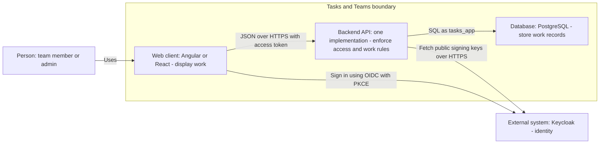
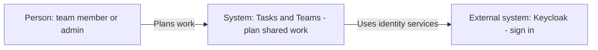
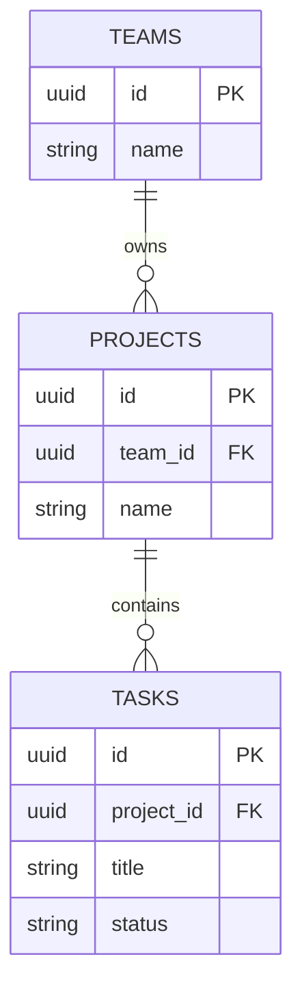
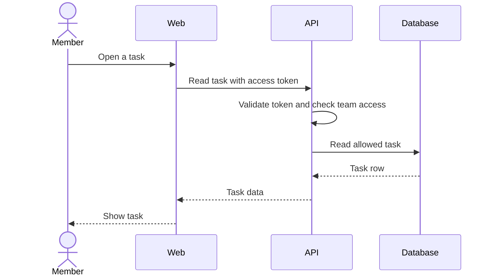

# 10. Project: document a system end to end

> **Draft: written but not yet run.** The code and the expected output in this lesson were prepared by reading the code and the official documentation. They have not been executed yet. If something does not behave as described, trust your tool's real output and report it.

## What you will be able to do
By the end of this lesson you will be able to:
- Produce consistent context, container, sequence and ER views for a small app.
- Write two ADRs with alternatives, consequences and review triggers.
- Review another reader's understanding using a traceable checklist.

## Recap
1. Which C4 view contains applications and stores?
   <details><summary>Answer</summary>The container view; context keeps the system as one box.</details>

2. Why can a weighted winner still be rejected?
   <details><summary>Answer</summary>It may fail a hard gate, and scores are not measured evidence.</details>

3. What does an ADR add that a diagram cannot?
   <details><summary>Answer</summary>The alternatives, constraints and reasons behind a choice, including costs and review triggers.</details>

## Why it matters
A city visitor needs a map, a timetable and a reason a bridge is closed. Separate accurate pages can still be confusing if they use different place names. An architecture handover succeeds when its pictures and decisions tell one consistent story.

## What you will build
A complete documentation bundle for the Tasks and Teams project-board slice, then a bundle for a small app you choose. The worked example has context and container diagrams, a task-read sequence, an ER subset, two ADRs and a review checklist. Plan three sittings: views, decisions, then your own app and review.

## Before you start
- Complete lessons 01 to 09. Use your editor and your chosen Mermaid preview from lesson 05. You will document an app, not implement or deploy it. Allow 120 minutes, longer if you expand the app scope.
- Time: 120 minutes including reading, saving the files and the exercise.
- Source pack (optional): every file is shown in full in this lesson, so you can follow without it. The finished code, the exercise starter and the solution are in the course repository https://github.com/Uee03/Code101 under `source/architecture/101-zero-to-hero/phase-3-documenting-decisions/10-document-a-system/` (on that page choose **Code, Download ZIP**, or run `git clone https://github.com/Uee03/Code101.git`). Cloning is optional; no terminal is used in the steps below.
- If using a downloaded ZIP: Windows, right-click it and choose **Extract All**; macOS, double-click it; Linux, right-click it in the file manager and choose **Extract Here** or **Extract**. Open the extracted folder, not the compressed ZIP. Phase packs start at the phase's folder; the full repository starts above `source/`.
- Here, “source code” means editable diagram text and short documents, not an application. No command, server or database needs to run. The picture descriptions below are expected output, not yet run or rendered by the author.

## Steps
### Step 1. Prepare a separate work folder
A **folder** groups files; a **file** stores saved content. Open your home folder: on Windows press **Win+E**, type `%USERPROFILE%` in the address bar and press Enter; on macOS use **Finder > Go > Home**; on Linux open your file manager's **Home**. Create `code101` if it is absent, open it, create `architecture` if absent, then open it and create `lesson10`. Windows uses **right-click > New > Folder**, macOS **File > New Folder**, and Linux the file manager's **New Folder** action. Do not put this work inside the optional source pack.

Use a plain-text editor. On Windows open **Notepad** from Start. On macOS open **TextEdit**, choose **Format > Make Plain Text**, and use UTF-8 if an encoding choice appears when saving. On Linux use the desktop's text editor. VS Code, if already available, is also suitable. For each file below choose **File > New**, paste the complete listing and use **File > Save As** in `code101/architecture/lesson10` with the exact shown filename. On Windows choose **All files** if offered so `.txt` is not appended. On macOS decline an offer to append `.txt`. Use UTF-8, a text encoding for international characters, and plain text rather than a word processor's rich-text format. In VS Code an unsaved dot on the tab means save with **Ctrl+S** (macOS **Command+S**).

Windows: enable **File Explorer > View > Show > File name extensions** (Windows 10: **View > File name extensions**) to check filenames. In every OS inspect the final name in the file manager. The folder should now exist and contain only this lesson's files as you add them.

### Step 2. Name the reader and question
Choose a small app before drawing: a library loan tracker, a club booking board, a household inventory or another familiar service. Limit it to one reader, one main scenario and a few stored entities. You do not have to choose the same technologies as Tasks and Teams.

First complete the worked example using the same real platform evidence as lessons 05 to 09. Scope it to an already-signed-in member reading an allowed task. Exclude mobile clients, comments and full field lists. A **review checklist** is a list of concrete consistency questions, not a certificate that the system is safe or implemented.

### Step 3. State the outside story
In `code101/architecture/lesson10`, create `context.mmd`. Reader: a new team member. Keep one work-planning system, its person and the external identity service. This file is identical to lesson 06's context source; its full listing is included so this project stands alone.

**File: `lesson10/context.mmd`**
```text
flowchart LR
  person["Person: team member or admin"]
  platform["System: Tasks and Teams - plan shared work"]
  identity["External system: Keycloak - sign in"]
  person -->|"Plans work"| platform
  platform -->|"Uses identity services"| identity
```

The question stays who uses it and which neighbour it relies on. Do not introduce the database at this zoom level.

Expected saved result: `lesson10/context.mmd` contains the listing above. This is a file-content expectation, not a captured renderer result.

### Step 4. State the inside story
In `code101/architecture/lesson10`, create `containers.mmd`. Use the same work-planning boundary. This file repeats lesson 06's web slice exactly; only its new location is different.

**File: `lesson10/containers.mmd`**
```text
flowchart LR
  person["Person: team member or admin"]
  identity["External system: Keycloak - identity"]
  subgraph platform["Tasks and Teams boundary"]
    web["Web client: Angular or React - display work"]
    api["Backend API: one implementation - enforce access and work rules"]
    db["Database: PostgreSQL - store work records"]
  end
  person -->|"Uses"| web
  web -->|"Sign in using OIDC with PKCE"| identity
  web -->|"JSON over HTTPS with access token"| api
  api -->|"SQL as tasks_app"| db
  api -->|"Fetch public signing keys over HTTPS"| identity
```

Every program in the request sequence must be accounted for here. HTTPS describes intended production protection, not the local teaching setup.

Expected saved result: `lesson10/containers.mmd` contains the listing above. This is a file-content expectation, not a captured renderer result.

### Step 5. Trace one allowed read
In `code101/architecture/lesson10`, create `sequence.mmd`. This is the same already-signed-in success scenario as lesson 05, shown in full in its new project location. It is not a sign-in sequence or an exhaustive access algorithm.

**File: `lesson10/sequence.mmd`**
```text
sequenceDiagram
  actor Member
  participant Web
  participant API
  participant Database
  Member->>Web: Open a task
  Web->>API: Read task with access token
  API->>API: Validate token and check team access
  API->>Database: Read allowed task
  Database-->>API: Task row
  API-->>Web: Task data
  Web-->>Member: Show task
```

The API validates identity and checks team access before returning the task. Database reads needed by access checks are deliberately abstracted into that check; never infer that a token alone authorizes all records.

Expected saved result: `lesson10/sequence.mmd` contains the listing above. This is a file-content expectation, not a captured renderer result.

### Step 6. State the stored relationships
In `code101/architecture/lesson10`, create `data.mmd`. This subset connects TEAMS to PROJECTS and PROJECTS to TASKS. It uses actual platform names and selected fields. Other platform tables and fields are intentionally omitted.

**File: `lesson10/data.mmd`**
```text
erDiagram
  TEAMS ||--o{ PROJECTS : owns
  PROJECTS ||--o{ TASKS : contains
  TEAMS {
    uuid id PK
    string name
  }
  PROJECTS {
    uuid id PK
    uuid team_id FK
    string name
  }
  TASKS {
    uuid id PK
    uuid project_id FK
    string title
    string status
  }
```

Each project belongs to one team; each task belongs to one project. This supports explaining what team access means without pretending the subset is the complete database schema. **First break:** finish the four views before recording decisions.

Expected saved result: `lesson10/data.mmd` contains the listing above. This is a file-content expectation, not a captured renderer result.

### Step 7. Record the data decision
In `code101/architecture/lesson10`, create `001-postgres.md`. Copy the established teaching ADR into this self-contained bundle. It is identical to lesson 08's source, including its scope and costs.

**File: `lesson10/001-postgres.md`**
````markdown
# ADR 001: Keep shared work records in PostgreSQL

Status: Accepted for the teaching platform
Date: 2026-11-23
Owner: Tasks and Teams maintainers

## Context
Four alternative backends must share teams, projects and tasks.
Related changes must be saved together or not at all.

## Options
- PostgreSQL with relationships and transactions.
- Separate JSON files with application-managed consistency.

## Decision
Use PostgreSQL as the source of truth for work records.
Keep shared atomic work rules in the platform stored functions.

## Consequences
- Benefit: constraints and atomic changes are shared by all backends.
- Cost or risk: schema changes need migrations and database skills.

## Revisit when
Maintainers review if a required client cannot use the shared schema.
````

The choice supports related work records and shared atomic rules. It does not mean every learner app must use PostgreSQL.

Expected saved result: `lesson10/001-postgres.md` contains the listing above. This is a file-content expectation, not a captured renderer result.

### Step 8. Record the identity decision
In `code101/architecture/lesson10`, create `002-keycloak.md`. Copy the established identity ADR unchanged. It is the second important choice in this bundle, not a new identity implementation.

**File: `lesson10/002-keycloak.md`**
````markdown
# ADR 002: Delegate sign-in to Keycloak

Status: Accepted for the teaching platform
Date: 2026-11-23
Owner: Tasks and Teams maintainers

## Context
Web and mobile clients need one identity service.
Backends must not collect or store user passwords.

## Options
- Keycloak as a separate identity service.
- A custom password and sign-in implementation per backend.

## Decision
Use Keycloak with OpenID Connect and PKCE for interactive clients.
Backends validate access tokens and still check team permissions.

## Consequences
- Benefit: clients share sign-in rather than duplicating passwords.
- Cost or risk: sign-in depends on another service and its configuration.

## Revisit when
Maintainers review if identity operations exceed the support budget.
````

The API still owns authorization. Finish the review document before the second break.

Expected saved result: `lesson10/002-keycloak.md` contains the listing above. This is a file-content expectation, not a captured renderer result.

### Step 9. Make the bundle reviewable
In `code101/architecture/lesson10`, create `review.md`. A **trace** follows one named idea across views. Trace task from the context purpose through the API interaction to TASKS in the data view. Then trace the database and identity choices to their ADRs.

**File: `lesson10/review.md`**
````markdown
# Tasks and Teams: project-board documentation review

Audience: a new team member and a maintainer.
Question: how does an allowed member read a task?
Scope: web client, one backend, work database and external identity.
Omitted: mobile clients, comments, audit records and full field lists.
Evidence: capstones/platform/README.md and capstones/platform/TDD.md.
Identity is external to this work-planning boundary even if locally operated.
HTTPS labels describe intended production communication, not local setup.

## Files
- context.mmd: people and neighbouring systems.
- containers.mmd: applications, data store and responsibilities.
- sequence.mmd: one already-signed-in member reads an allowed task.
- data.mmd: the teams, projects and tasks subset of stored relationships.
- 001-postgres.md: why work records use PostgreSQL.
- 002-keycloak.md: why sign-in is delegated.

## Review checklist
- [ ] Title, audience, question, scope and omissions are explicit.
- [ ] Context has no database or internal client boxes.
- [ ] Container boundary matches the context boundary.
- [ ] Every relationship has a direction and a readable meaning.
- [ ] Sequence participants exist in the container view.
- [ ] Token validation and team access happen before the task is returned.
- [ ] Stored record names agree with the sequence and the platform.
- [ ] Each task belongs to one project; each project belongs to one team.
- [ ] Both ADRs contain options, reasons, a cost, an owner and a review trigger.
- [ ] No secrets, real personal data or colour-only meanings appear.
- [ ] A second reader can describe the request journey without guessing.
- [ ] Diagram sources remain editable and the Markdown listings match them.

## Known limits
These are documentation sources, not a running system or proof of its security.
The simplified state and entity views elsewhere are not the complete platform contract.
````

Ask a second reader to use this checklist. Tick a box only after checking its claim against the actual saved sources. A diagram that renders is not automatically a diagram that explains the system correctly. **Second break:** start your own app in a separate folder after saving the companion.

Expected saved result: `lesson10/review.md` contains the listing above. This is a file-content expectation, not a captured renderer result.

### Step 10. Save the readable companion
In `code101/architecture/lesson10`, create `diagram-sources.md` with the complete content below. **Markdown** is plain text with lightweight formatting markers; `.md` is its usual extension. A **fence** is a line of backticks marking a block. This companion repeats the diagram files inside fences so a Markdown **preview**, a displayed view of the source, can render them. The outer four-backtick boundary is only this lesson's display wrapper; copy the content inside it, including the inner three-backtick lines. If you change a raw diagram later, replace its corresponding fenced content here too; the two files do not synchronise automatically. No hidden file or configuration is required.

<details><summary>Complete companion document</summary>

**File: `lesson10/diagram-sources.md`**
````markdown
# Diagram source listings

These listings reproduce the editable diagram sources in this folder.

## containers.mmd



## context.mmd



## data.mmd



## sequence.mmd


````

</details>

### Step 11. Predict, then inspect
Predict two contradictions a reviewer could spot without running the app: what if the sequence adds a new service, or the ER view gives each task several projects?

## Run it
No application command is needed. Open one saved `.mmd` file from `code101/architecture/lesson10` in your text editor, select its text and copy it. In a browser open [Mermaid Live Editor](https://mermaid.live/), select all existing text in its **Code** panel and paste the raw `.mmd` content, without Markdown backticks. Read the resulting preview. Use only the invented/public examples here; do not paste confidential architecture into a hosted tool.

For each additional diagram, repeat those same preview actions. The only differences are the `.mmd` filename and the selected contents: `context.mmd`, `containers.mmd`, `sequence.mmd`, `data.mmd`. Preview one file at a time; do not concatenate different diagram types.
For local or GitHub Markdown rendering, use lesson 05's Preview choices and open this lesson's diagram-sources.md.

**Expected output, not yet run:** Seven main documents: four diagram sources, two ADRs and a review file, plus a Markdown diagram companion. The names, boundaries and allowed-task journey agree. No backend, database or identity service is executed.

<details><summary>Recorded documentation-only check</summary>

The repository's static check reported the following. This checks source-text coverage and verification specifications, not diagram rendering or application behaviour. It does not remove this lesson's draft notice.

**Recorded output (not application output):**
```text
0 passed, 10 static-checked (not run), 0 failed, 0 unverified (missing tools)
```

</details>

## How it works
The context view gives purpose and neighbours. The container view assigns work to applications and storage. The sequence traces a single scenario using those applications. The ER view explains the task's project and team relationships. The ADRs explain data and identity choices. The checklist ties them together.

**Misconception:** a complete handover means drawing every detail. **Correction:** completeness is relative to the stated reader, question and scope. A narrow, consistent bundle with explicit omissions is more useful than an unreadable diagram pretending to answer everything. Add a separate failure scenario later rather than silently changing the meaning of the success view.

This project documents a design. It does not establish that an implementation enforces the design, that performance targets are met or that a deployment is production-ready.

## Try it
### 1. Guided practice
In a separate exercise folder, complete a Community Library bundle first, or adapt it to another app you know. For the library route, replace every TODO: reader and system purpose in context; responsibilities in containers; action and permitted read in sequence; full decisions in both ADRs; and audience and omissions in review. The starter ER view is already complete for members, physical book copies and loans. For your own app, replace all library names and relationships consistently, including that ER view. Deliver the same four diagram roles, two decision records and a review checklist.

In your file manager open `code101/architecture` and create `lesson10-try`. If using the optional source pack, delete this empty folder, then copy this lesson's `exercise/starter` folder beside `lesson10` and rename the **copy itself** to `lesson10-try`; do not put a folder named starter inside it. Otherwise create each starter file listed below directly inside `lesson10-try` using **File > New > Save As** in your editor. The full starters are shown; no earlier file is assumed to exist in this exercise folder. A `TODO` is an instruction placeholder to replace, not a special Mermaid command.

<details><summary>Complete starter files</summary>

**File: `lesson10-try/001-storage.md` (starter)**
````markdown
# ADR NNN: Decision title

Status: Proposed
Date: YYYY-MM-DD
Owner: Named team

## Context
What problem and constraints require a decision?

## Options
- Option A and its cost.
- Option B and its cost.

## Decision
Choose one option and explain why it fits the context.

## Consequences
- Benefit:
- Cost or risk:

## Revisit when
Name an observable trigger and the person who reviews it.
````

**File: `lesson10-try/002-identity.md` (starter)**
````markdown
# ADR NNN: Decision title

Status: Proposed
Date: YYYY-MM-DD
Owner: Named team

## Context
What problem and constraints require a decision?

## Options
- Option A and its cost.
- Option B and its cost.

## Decision
Choose one option and explain why it fits the context.

## Consequences
- Benefit:
- Cost or risk:

## Revisit when
Name an observable trigger and the person who reviews it.
````

**File: `lesson10-try/containers.mmd` (starter)**
```text
flowchart LR
  person["Person: library member"]
  identity["External system: identity provider"]
  subgraph library["Community Library boundary"]
    web["Web client: TODO client responsibility"]
    api["Library API: TODO server responsibility"]
    db["Database: PostgreSQL - TODO stored records"]
  end
  person -->|"Uses"| web
  web -->|"Sign in over HTTPS"| identity
  web -->|"Read own loans over HTTPS"| api
  api -->|"Read loan records using SQL"| db
  api -->|"Fetch public signing keys over HTTPS"| identity
```

**File: `lesson10-try/context.mmd` (starter)**
```text
flowchart LR
  person["Person: TODO reader"]
  app["System: TODO system purpose"]
  identity["External system: TODO neighbour"]
  person -->|"Checks own loans"| app
  app -->|"Uses sign in"| identity
```

**File: `lesson10-try/data.mmd` (starter)**
```text
erDiagram
  MEMBER ||--o{ LOAN : borrows
  BOOK ||--o{ LOAN : appears_in
  MEMBER {
    int id PK
    string name
  }
  BOOK {
    int id PK
    string title
  }
  LOAN {
    int id PK
    int member_id FK
    int book_id FK
  }
```

**File: `lesson10-try/review.md` (starter)**
````markdown
# Community Library review

Audience: TODO audience.
Question: how does a signed-in member view only their own loans?
Scope: TODO scope and omissions.
Assumption: the library maintains member-to-identity mappings.
This is a learner design, not an existing Tasks and Teams feature.

## Review checklist
- [ ] Context and container boundaries both describe Community Library.
- [ ] Sequence participants match the container view.
- [ ] Every loan refers to one member and one book.
- [ ] The API identifies the member before reading loans.
- [ ] Both ADRs show alternatives and costs.
- [ ] A second reader can explain the journey and one failure case.
- [ ] Sources contain no secrets or real borrowing histories.
````

**File: `lesson10-try/sequence.mmd` (starter)**
```text
sequenceDiagram
  actor Member
  participant Web
  participant API
  participant Database
  Member->>Web: TODO user action
  Web->>API: Read own loans with access token
  API->>API: Validate token and identify member
  API->>Database: TODO authorised read
  Database-->>API: Matching loan rows
  API-->>Web: Loan data
  Web-->>Member: Show own loans
```

</details>

Save every changed file. For a diagram, use the same raw-source preview procedure from Run it with the exercise file, not the original. For Markdown, reopen the saved exercise document and check its headings and claims. Do not edit the solution before trying.

### 2. Change practice
Ask a reader to explain your main scenario using only the documents. Record one misunderstood label, revise it in every affected view, and say which source files changed. Then discuss one denied-access or dependency-failure case without pretending it was executed.

### 3. Stretch (optional)
Add lesson 09's quality worksheet for your own app, with one hard gate and a review trigger that links to one of your ADRs.

<details><summary>Solution to guided practice</summary>

This is one possible Community Library design, not the only correct app. It preserves member-only loan access and makes its assumptions explicit. Other app choices need equally consistent views and decisions.

**File: `lesson10-try/001-storage.md` (solution)**
````markdown
# ADR 001: Store loans in PostgreSQL

Status: Proposed
Date: 2026-11-23
Owner: Community Library team

## Context
Each loan must refer to an existing member and book.

## Options
- PostgreSQL: relationships but database administration.
- JSON files: simple files but manual consistency rules.

## Decision
Use PostgreSQL for member, book and loan records.

## Consequences
- Benefit: the database can enforce references.
- Cost or risk: the team must manage schema changes and backups.

## Revisit when
The library team reviews when its support budget changes.
````

**File: `lesson10-try/002-identity.md` (solution)**
````markdown
# ADR 002: Use an external identity provider

Status: Proposed
Date: 2026-11-23
Owner: Community Library team

## Context
Members must see only their own loans; the library cannot maintain passwords.

## Options
- External identity provider: shared expertise but an extra dependency.
- Build sign-in: local control but ongoing password security work.

## Decision
Delegate sign-in and validate access tokens in the Library API.
The API derives member identity from the validated token, not a requested member id.

## Consequences
- Benefit: the library does not collect passwords.
- Cost or risk: identity outages can prevent new sign-ins.

## Revisit when
The library team reviews when provider terms or availability needs change.
````

**File: `lesson10-try/containers.mmd` (solution)**
```text
flowchart LR
  person["Person: library member"]
  identity["External system: identity provider"]
  subgraph library["Community Library boundary"]
    web["Web client: display loans"]
    api["Library API: enforce member access"]
    db["Database: PostgreSQL - store loans"]
  end
  person -->|"Uses"| web
  web -->|"Sign in over HTTPS"| identity
  web -->|"Read own loans over HTTPS"| api
  api -->|"Read loan records using SQL"| db
  api -->|"Fetch public signing keys over HTTPS"| identity
```

**File: `lesson10-try/context.mmd` (solution)**
```text
flowchart LR
  person["Person: library member"]
  app["System: Community Library - track loans"]
  identity["External system: identity provider"]
  person -->|"Checks own loans"| app
  app -->|"Uses sign in"| identity
```

**File: `lesson10-try/data.mmd` (solution)**
```text
erDiagram
  MEMBER ||--o{ LOAN : borrows
  BOOK ||--o{ LOAN : appears_in
  MEMBER {
    int id PK
    string name
  }
  BOOK {
    int id PK
    string title
  }
  LOAN {
    int id PK
    int member_id FK
    int book_id FK
  }
```

**File: `lesson10-try/review.md` (solution)**
````markdown
# Community Library review

Audience: library staff and a new maintainer.
Question: how does a signed-in member view only their own loans?
Scope: read-only loan view; no reservations, payments or notifications.
Assumption: the library maintains member-to-identity mappings.
This is a learner design, not an existing Tasks and Teams feature.

## Review checklist
- [ ] Context and container boundaries both describe Community Library.
- [ ] Sequence participants match the container view.
- [ ] Every loan refers to one member and one book.
- [ ] The API identifies the member before reading loans.
- [ ] Both ADRs show alternatives and costs.
- [ ] A second reader can explain the journey and one failure case.
- [ ] Sources contain no secrets or real borrowing histories.
````

**File: `lesson10-try/sequence.mmd` (solution)**
```text
sequenceDiagram
  actor Member
  participant Web
  participant API
  participant Database
  Member->>Web: Open my loans
  Web->>API: Read own loans with access token
  API->>API: Validate token and identify member
  API->>Database: Read loans for this member only
  Database-->>API: Matching loan rows
  API-->>Web: Loan data
  Web-->>Member: Show own loans
```

Compare the saved sources, not just their appearance. The solution addresses the guided goal; your change and stretch choices may differ. All displayed behaviour remains an expectation, not a captured execution result.

</details>

## Check yourself
1. Predict the review finding if a sequence participant appears nowhere in the container view.
   <details><summary>Answer</summary>Either a component is missing from the stated scope or the sequence has introduced an unexplained service. Reconcile the views or state and justify the different scope.</details>

2. What makes the two ADRs more than a technology list?
   <details><summary>Answer</summary>They explain the context, alternatives, reasons, consequences, ownership and when the choices should be reviewed.</details>

3. Does checking every review box prove that a deployed system is secure?
   <details><summary>Answer</summary>No. It checks documentation consistency and reader understanding, not implementation behaviour or operational evidence.</details>

## Common mistakes
These are likely symptoms to inspect, not captured error messages.

| Symptom | Cause | Fix |
|---|---|---|
| The app has different names in different views | An exercise rename was only partly applied | Trace the same person, app and record names across all seven documents. |
| A checklist is ticked from memory | The saved sources were not inspected | Reopen each file and point to the exact supporting label or section. |
| The project grows into implementation and hosting | Scope expanded beyond a documentation handover | Keep one scenario and explicit omissions; implementation is a separate project. |

## Best practice
Keep each view at a consistent zoom level and connect it to the reader's question. Sources: C4 [System context](https://c4model.com/diagrams/system-context) and [Container diagram](https://c4model.com/diagrams/container); freeCodeCamp [architecture documentation](https://www.freecodecamp.org/news/system-architecture-documentation-best-practices-and-tools/) (Tier 2).

## Going further
Phase 3 mixed review: identify an ADR cost, recalculate a score with a new weight, distinguish sign-in from team permission, and trace one record across all four views. Answers depend on your app; a reviewer should find explicit text supporting each one. The [platform README](../../../../capstones/platform/README.md) shows where this documentation skill is used in later implementation capstones; do not run its setup as part of this track.

## Summary
- You practised how to produce consistent context, container, sequence and ER views for a small app.
- You practised how to write two ADRs with alternatives, consequences and review triggers.
- You practised how to review another reader's understanding using a traceable checklist.

## Next lesson
None; this completes Architecture 101. Keep your editable sources and review them when the design changes. The platform capstones are an optional next application of these documentation skills, not required execution for this track.
