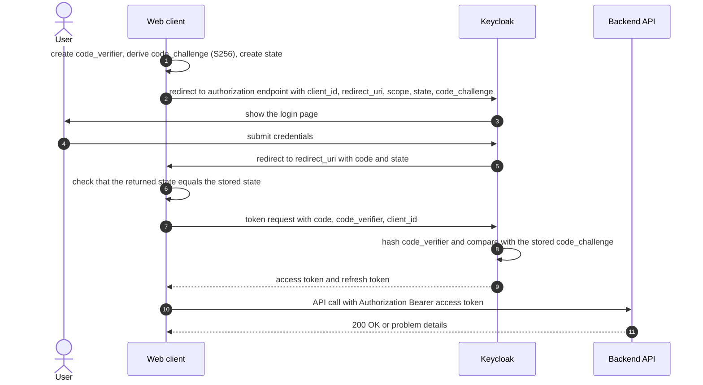
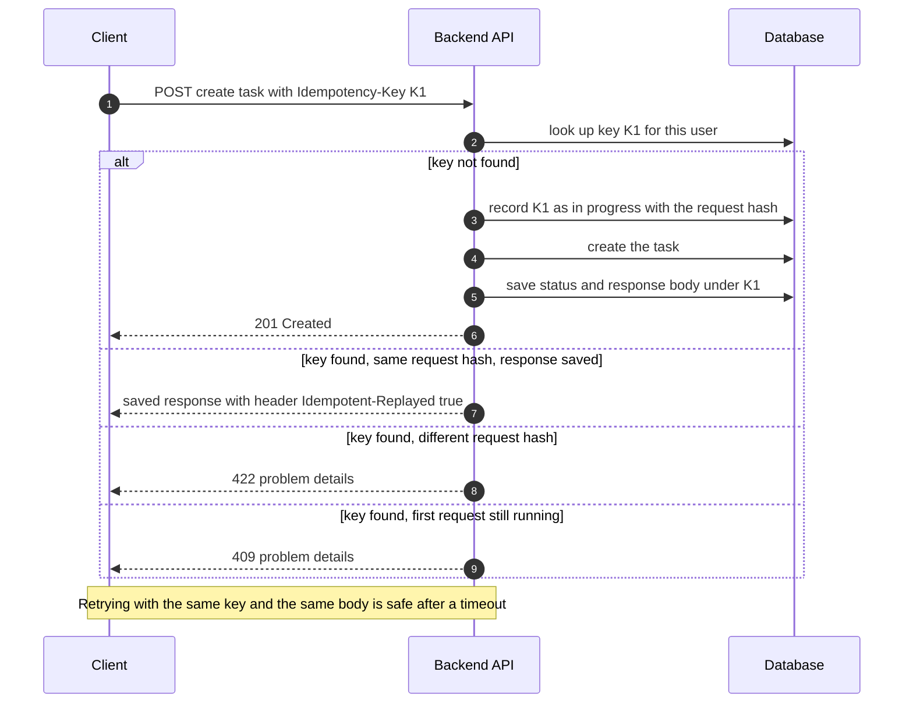
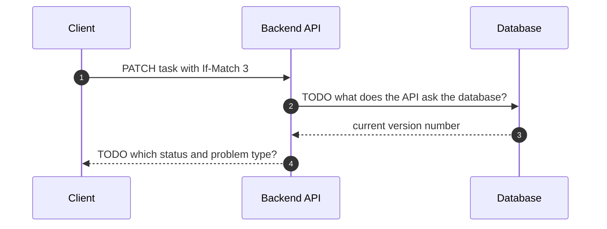
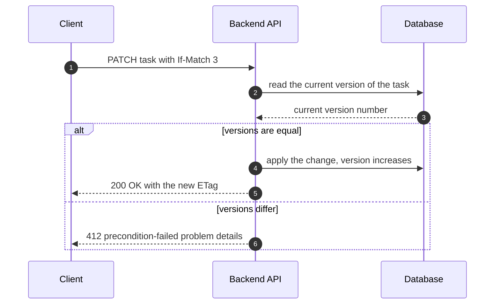

# 01. Sequence diagrams for real flows

> **Draft: written but not yet run.** The code and the expected output in this lesson were prepared by reading the code and the official documentation. They have not been executed yet. If something does not behave as described, trust your tool's real output and report it.

## What you will be able to do
By the end of this lesson you will be able to:
- Draw a real sign-in flow (authorization code with PKCE) as a Mermaid sequence diagram and explain each message.
- Show every branch of an idempotent create with `alt` and `else` blocks, naming the HTTP status of each branch.
- Review a sequence diagram for missing failure paths, missing actors and unreadable length.

## Recap
1. In 101 you wrote a sequence diagram of one web request. What did the vertical axis mean?
   <details><summary>Answer</summary>Time, running downwards: the first message is at the top, later messages are lower.</details>
2. What question does a C4 container view answer that a sequence diagram does not?
   <details><summary>Answer</summary>Which applications and data stores exist and who talks to whom. A sequence diagram shows the order of messages in one scenario, not the whole structure.</details>

## Why it matters
A sequence diagram is the cheapest way to find a design bug before any code exists: wrong order, a missing check, an unanswered request. At 201 level the interesting flows are not the happy path. They are the flows where something is retried, replayed or refused. Sign-in and "create something safely twice" are two of the most error-prone flows in any web system, and both are part of the Tasks and Teams platform (`capstones/platform/TDD.md`, sections 6 and 7).

## What you will build
Two Mermaid sequence diagrams of the platform, saved as `.mmd` files and as one Markdown preview file:
1. `signin-pkce.mmd`: the browser sign-in with the authorization code flow and PKCE (Proof Key for Code Exchange).
2. `idempotent-create.mmd`: `POST` creating a task with an `Idempotency-Key`, with four outcomes.

You then draw a third diagram yourself: a stale update that the API refuses with 412.

## Before you start
- **Prerequisites:** Architecture 101 lessons [05, Mermaid in depth](../../101-zero-to-hero/phase-2-diagram-toolkit/05-mermaid-in-depth.md) and [06, C4 context and containers](../../101-zero-to-hero/phase-2-diagram-toolkit/06-c4-context-and-containers.md).
- You finished Architecture 101 (lessons 05 and 06 especially). Tools: a text editor and one Markdown preview that renders Mermaid (VS Code's built-in preview, see 101 lesson 05) or https://mermaid.live/ for one raw diagram at a time. No terminal, compiler or server. Do not paste confidential diagrams into a hosted editor.
- Time: 60 minutes for a first run (reading 15, typing 20, predicting and checking 10, exercise 15).
- Work folder: `code101/architecture/201-lesson01` in your home folder (create it the same way as in 101). A dot on an editor tab means the file is not saved.
- Source pack (optional): every file is shown in full in this lesson, so you can follow without it. The finished code, the exercise starter and the solution are in the course repository https://github.com/Uee03/Code101 under `source/architecture/201-hero-to-super-hero/phase-1-diagram-depth/01-sequence-diagrams-real-flows/` (on that page choose **Code, Download ZIP**, or run `git clone https://github.com/Uee03/Code101.git`). Cloning is optional.
- "Source code" here means diagram text and short documents. Everything described as a picture below is expected, not yet rendered by the author.

## Steps
### Step 1. Choose the question before the notation
Write one sentence in your notes for each diagram: the reader and the question.
- Sign-in: "A developer joining the web client team asks: which messages carry which secret, and what does the API trust at the end?"
- Idempotent create: "A client developer asks: what happens if my create request times out and I send it again?"

A sequence diagram with no question grows until nobody reads it.

> **Why this, not that.** A sequence diagram, not a flowchart, because both questions are about *who sends what to whom, in which order*. A flowchart hides the participants. Choose a flowchart when the question is "what are the steps of one process" and a sequence diagram when the question is "which parties talk, and in which order".

### Step 2. Save the sign-in diagram
In `code101/architecture/201-lesson01` create `signin-pkce.mmd`. A `.mmd` file holds only raw Mermaid text, with no code fences.

**File: `signin-pkce.mmd`**



Only the lines between the fence lines go into the `.mmd` file. Expected result: a 17-line text file whose first line is `sequenceDiagram`.

### Step 3. Save the idempotent-create diagram
Create `idempotent-create.mmd` the same way.

**File: `idempotent-create.mmd`**



The statuses follow the platform TDD (section 6, "Idempotency"): same key and body replays the stored response, same key with another body is 422, a first request still running is 409. The internal order of the database steps is a teaching view of that rule, not a copy of any backend's code.

### Step 4. Save the Markdown preview file
Most previews render Mermaid only inside Markdown. Create `diagram-sources.md` that repeats both diagrams inside `mermaid` fences. Start the file with these three lines (the heading, a blank line, the sentence):

```text
# Diagram sources, lesson 01

Each fenced block is the content of the .mmd file named above it.
```

Then add, in this order, the **File** line, a blank line and the fenced diagram exactly as shown in Steps 2 and 3: first `signin-pkce.mmd`, then `idempotent-create.mmd`. Separate blocks with a blank line. The two copies do not synchronise automatically: when you change one, change the other.

### Step 5. Predict, then preview
Before you open the preview, predict:
1. How many numbered arrows does the sign-in diagram have? (Count the message lines.)
2. In the create diagram, which messages are inside the `alt`, and how many `else` lines are there?

Now open `diagram-sources.md` in the preview (VS Code: **Ctrl+Shift+V**, macOS **Command+Shift+V**). For a single raw file, paste it into mermaid.live.

## Run it
There is no program to run. Open the preview as in Step 5.

Expected result, not yet rendered by the author: the first diagram shows four lifelines (User, Web client, Keycloak, Backend API) with 11 numbered arrows, three of them self-arrows (two on Web client, one on Keycloak). The second shows three lifelines, a labelled box with four compartments separated by dashed lines, and a note across the Client and Backend API lifelines.

Your predictions: the sign-in diagram has 11 message lines (the `sequenceDiagram`, `autonumber`, `actor` and `participant` lines are not messages); the create diagram has one `alt` and three `else` lines.

## How it works
Read `signin-pkce.mmd` from top to bottom.
- `participant` and `actor` declare lifelines. `as` gives a short identifier (`W`) and a readable label ("Web client"). `actor` draws a person symbol.
- `->>` is a solid arrow with a head (a request or action); `-->>` is a dashed arrow (a reply). `A->>A` is a self message: the participant does something internally.
- `autonumber` numbers the messages, so a review can say "message 9 needs a timeout".

**PKCE**, Proof Key for Code Exchange, protects the authorization code. The client creates a random `code_verifier` and sends only its hash, the `code_challenge`, in the first redirect. When it later redeems the `code` at the token endpoint it sends the original verifier. Keycloak hashes it and compares. Someone who steals only the code (for example from a redirect) cannot redeem it without the verifier. `state` is a different protection: a random value the client checks when the browser returns, so it ignores a response it did not ask for. Message 9 (Keycloak returning tokens) is the end of sign-in; message 10 is the first call the API sees, and the API validates the token itself (lesson 07 covers this in detail).

Read `idempotent-create.mmd` next. `alt` ... `else` ... `end` draws mutually exclusive branches; exactly one runs. `Note over C,A:` puts a note across two lifelines. The branches show what the platform promises a retrying client: the same key and the same body gives the stored answer, not a second task.

**Misconception:** "idempotent means the server ignores the second request." It does not ignore it. It answers it, with the same result as the first, and creates nothing new.

**Reviewing a sequence diagram.** Check four things: every request has a reply or an explicit "no reply" note; every failure the reader will meet has a branch; no lifeline is unused; and the whole diagram fits one screen (about 15 to 20 messages). If it is longer, split it into several diagrams: a diagram nobody finishes reading does not document anything.

## Try it
### 1. Guided practice
Draw the stale update. The platform requires `If-Match` on `PATCH`; if the version does not match, the answer is 412 (`precondition-failed`). Copy the `exercise/starter` folder and rename the **copy** to `201-lesson01-try` (do not put a folder named `starter` inside it), or create the file below by hand. Replace both `TODO` messages and add an `alt` with two branches.

**File: `201-lesson01-try/stale-update.mmd` (starter)**


Goal: the finished diagram shows both outcomes, success with a new ETag and refusal with 412.

### 2. Change practice
Add a second failure branch for a `PATCH` with no `If-Match` header at all. Check the platform TDD, section 6 ("Concurrency"), for the status.

### 3. Stretch (optional)
The platform's `Idempotency-Key` applies to `POST` creates, while `PATCH` uses `If-Match`. Write two sentences on why one mechanism does not replace the other.

<details><summary>Solution to guided practice</summary>

**File: `201-lesson01-try/stale-update.mmd` (solution)**


For change practice the missing header is answered with 428 (`precondition-required`); add a third branch before the comparison. For the stretch: `If-Match` protects against a *lost update* (two writers overwriting each other) on a record that already exists, whereas an idempotency key protects against a *duplicate create* when no record exists yet to carry a version.

</details>

## Check yourself
1. What does the `code_challenge` protect, and what must the client send later to prove it started the flow? <details><summary>Answer</summary>It protects the authorization code. The client later sends the original `code_verifier`, which the server hashes and compares.</details>
2. Predict: a client sends the same `Idempotency-Key` with a different body. Which status does the diagram show? <details><summary>Answer</summary>422 problem details.</details>
3. Find the bug: a diagram has `alt` and two branches but no `end`. What happens? <details><summary>Answer</summary>Mermaid reports a parse error (the exact text depends on the version) and shows no picture. Every `alt`, `opt`, `loop` needs a matching `end`.</details>
4. Why is the sign-in diagram split from the create diagram? <details><summary>Answer</summary>Each answers one question. Combining them would make a long diagram that answers neither.</details>

## Common mistakes
These are typical symptoms, not captured messages: the exact text differs by Mermaid version.

| Symptom | Cause | Fix |
|---|---|---|
| Preview shows a parse error or the diagram source as text | A missing `end`, or a `;` in a message (Mermaid treats it as a line break) | Close every `alt`; remove semicolons from message text |
| An arrow draws to a new, unwanted lifeline | The identifier in the message differs from the declared one (`Api` instead of `A`) | Use the declared identifier exactly |
| The preview of the `.mmd` file shows nothing in VS Code | Many previews render only Markdown fences | Open `diagram-sources.md`, or paste the raw file into mermaid.live |
| The numbers skip or the diagram is unreadable | Too many messages in one diagram | Split by question; keep to about 20 messages |

## Best practice
Give each sequence diagram one scenario and one question, show the failure branches readers will actually meet, and keep it on one screen. Source: Mermaid, [Sequence diagrams](https://mermaid.js.org/syntax/sequenceDiagram.html); RFC 7636, [PKCE](https://www.rfc-editor.org/rfc/rfc7636).

## Going further
- Platform TDD, section 7: the full sign-in, mobile sign-in and token-validation diagrams. Compare yours with them and note what you left out.
- The IETF draft [The Idempotency-Key HTTP Header Field](https://datatracker.ietf.org/doc/draft-ietf-httpapi-idempotency-key-header/) describes the same idea in general terms; it is a draft, so treat details as subject to change.

## Summary
- You drew the code-plus-PKCE sign-in and explained why the verifier, the challenge and the state exist.
- You drew four branches of an idempotent create and named their statuses.
- You reviewed a sequence diagram for failure paths, unused lifelines and length.

## Next lesson
02. ER and data-flow diagrams: show what the platform stores and how data moves through it.
