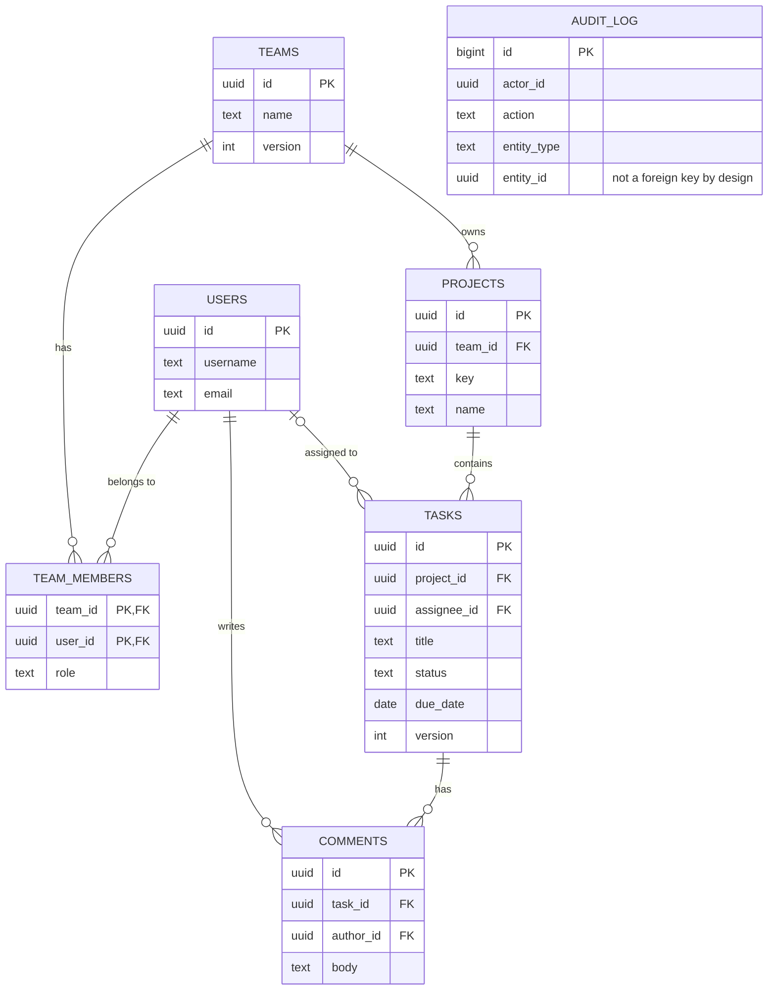
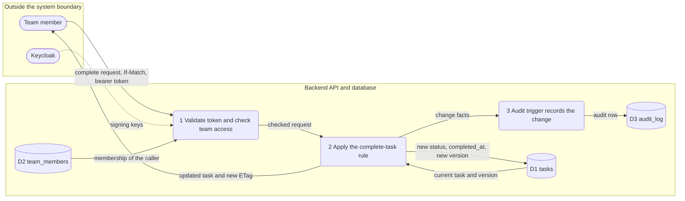
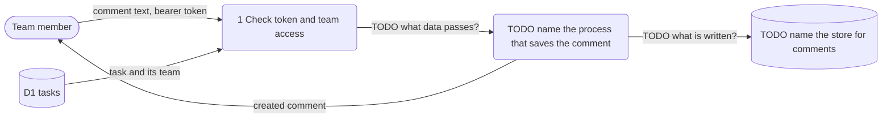
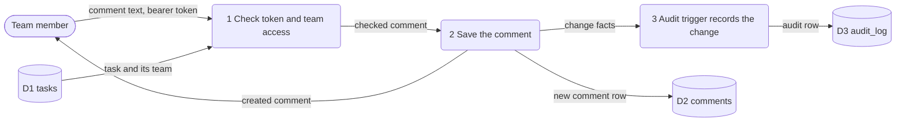

# 02. ER and data-flow diagrams

> **Draft: written but not yet run.** The code and the expected output in this lesson were prepared by reading the code and the official documentation. They have not been executed yet. If something does not behave as described, trust your tool's real output and report it.

## What you will be able to do
By the end of this lesson you will be able to:
- Draw an entity-relationship (ER) diagram with keys and cardinalities from a written schema description.
- Draw a data-flow diagram (DFD) with external parties, processes and data stores for one use case.
- Choose between an ER diagram and a data-flow diagram for a stated question.

## Recap
1. In lesson 01, what did `alt` and `else` express?
   <details><summary>Answer</summary>Mutually exclusive branches of one scenario: exactly one of them happens.</details>
2. In 101 lesson 04 you read `||--o{`. What does the `o{` end mean?
   <details><summary>Answer</summary>Zero or many instances on that side of the relationship.</details>

## Why it matters
Two questions come up in every design review. "What do we store, and how are the pieces related?" is answered by an ER diagram. "Where does a piece of data come from, which step changes it, and where does it end up?" is answered by a data-flow diagram. They are not interchangeable: an ER diagram has no time or behaviour, and a data-flow diagram says nothing about the stored structure. Tasks and Teams needs both: the schema in `capstones/platform/TDD.md` section 5, and the path of a write through checks, rule and audit.

## What you will build
1. `tasks-er.mmd`: an ER diagram of the platform's seven tables, with selected columns.
2. `dataflow-complete-task.mmd`: a data-flow diagram of "complete a task": one outside party that acts (the team member), one that supplies keys (Keycloak), three processes, three stores.

## Before you start
- **Prerequisites:** [Architecture 201 lesson 01, sequence diagrams for real flows](01-sequence-diagrams-real-flows.md) and [Architecture 101 lesson 04, data and storage](../../101-zero-to-hero/phase-1-thinking-in-systems/04-data-and-storage.md).
- Lesson 01 done; the same editor and preview. Work folder: `code101/architecture/201-lesson02`.
- Time: 60 minutes (reading 15, typing 20, checking 10, exercise 15).
- Source pack (optional): every file is shown in full in this lesson, so you can follow without it. The finished code, the exercise starter and the solution are in the course repository https://github.com/Uee03/Code101 under `source/architecture/201-hero-to-super-hero/phase-1-diagram-depth/02-er-and-data-flow-diagrams/` (on that page choose **Code, Download ZIP**, or run `git clone https://github.com/Uee03/Code101.git`).
- Pictures described below are expected, not yet rendered by the author.

## Steps
### Step 1. Write the question for each diagram
- ER: "A backend developer asks: which tables exist, how are they related, and which columns identify and link them?"
- DFD: "A reviewer asks: when a member completes a task, which data enters, which checks and rules touch it, and what is stored?"

### Step 2. Save the ER diagram
Create `tasks-er.mmd` in `code101/architecture/201-lesson02`.

**File: `tasks-er.mmd`**



The diagram shows selected columns only (the TDD lists many more, such as timestamps and `created_by`). A diagram that copies the whole schema duplicates `schema.sql` and goes stale.

### Step 3. Save the data-flow diagram
Create `dataflow-complete-task.mmd`. Mermaid has no special data-flow diagram type, so we use a flowchart and a shape convention: stadium shapes `([...])` for outside parties, rounded rectangles `(...)` for processes, cylinders `[(...)]` for data stores.

**File: `dataflow-complete-task.mmd`**



The platform keeps the rule inside a stored function (`complete_task`) and the audit entry in a trigger (TDD sections 4 and 5). The three processes are therefore a *logical* split for reading, not three programs.

### Step 4. Save the preview file
Create `diagram-sources.md`. Start with these three lines, then add the two **File** blocks above, in order (`tasks-er.mmd`, then `dataflow-complete-task.mmd`), each with its blank line and fenced diagram.

```text
# Diagram sources, lesson 02

Each fenced block is the content of the .mmd file named above it.
```

### Step 5. Predict, then preview
Predict: (1) how many entities have no line attached to them? (2) in the DFD, which arrow carries the longest list of data items, and into which store does it go?

Open `diagram-sources.md` in your Markdown preview.

## Run it
There is nothing to run; open the preview.

Expected result, not yet rendered: the ER diagram has seven boxes. Six are connected by seven labelled lines; `AUDIT_LOG` stands alone. The DFD has two grouped regions (outside and inside), two stadium shapes, three rounded process boxes and three cylinders; one dashed arrow comes from Keycloak.

Predictions: (1) one entity, `AUDIT_LOG`; (2) the arrow from process 2 into `D1 tasks`: "new status, completed_at, new version".

## How it works
**Reading the ER lines.** The marks beside an entity say how many instances of it may take part. `||` is exactly one, `o|` zero or one, `o{` zero or many, `|{` one or many. In `TEAMS ||--o{ PROJECTS` one team has zero or many projects, and each project belongs to exactly one team. In `USERS |o--o{ TASKS` a task has zero or one assignee, so an unassigned task is legal. `PK` marks a primary key, `FK` a foreign key; `PK, FK` together mean the key column is also a reference (the `TEAM_MEMBERS` link table).

**Why `AUDIT_LOG` stands alone.** The TDD says it has no foreign keys: an audit entry must outlive the row it describes. The quoted comment on `entity_id` records that decision where a reader will meet it.

**Reading the DFD.** Each arrow carries a *named piece of data*, never "calls". A process must have at least one input and one output; a store is only read or written by a process, never directly by an outside party. Rule of thumb: if an arrow has no data label, the diagram is hiding something. The `Outside` subgraph is the system boundary: what crosses it (request in, response out, keys in) is exactly what the API contract and the security review must cover.

> **Why this, not that.** An ER diagram, not a class diagram, for stored data: it models what the database holds, including link tables and keys. A class diagram models types in code. A data-flow diagram, not a sequence diagram, when the question is *where data is stored and transformed* rather than *which message follows which*.

**Misconception:** "a data store is a database." A store can be a table, a queue, a file or a cache. In the DFD, `D1` is one table; the database as a whole is not a box.

## Try it
### 1. Guided practice
Draw the data flow for "add a comment to a task". Copy the `exercise/starter` folder and rename the **copy** `201-lesson02-try`, or create the file by hand. Replace each `TODO`, then add the audit path (a process and a store) so that the diagram ends with the same audit idea as the lesson.

**File: `201-lesson02-try/comment-flow.mmd` (starter)**


Goal: seven arrows, each with a data label, and no arrow from the member directly to a store.

### 2. Change practice
Add a second outside party, "Keycloak", and the dashed `signing keys` arrow into process 1, as in the worked example.

### 3. Stretch (optional)
Pick one quality that an ER diagram can show but a DFD cannot, and one that only a DFD shows. Write one sentence each.

<details><summary>Solution to guided practice</summary>

**File: `201-lesson02-try/comment-flow.mmd` (solution)**


Your labels can differ. For the stretch: an ER diagram shows cardinality and keys (a task has at most one assignee); a DFD shows which process changes which store and which data leaves the system boundary.

</details>

## Check yourself
1. Read `PROJECTS ||--o{ TASKS`. Can a task exist without a project? <details><summary>Answer</summary>No. Each task belongs to exactly one project; a project may have zero or many tasks.</details>
2. Predict: you add an arrow from `U` straight to `D1` in the DFD. What rule does it break? <details><summary>Answer</summary>Outside parties talk to processes, never directly to stores; the checks in process 1 would be bypassed in the picture.</details>
3. Which diagram would you draw to show that the audit log has no foreign keys, and why? <details><summary>Answer</summary>The ER diagram, because keys and relationships are its subject.</details>
4. Find the bug: `TEAMS ||--o{ PROJECTS : owns` is written as `TEAMS ||--o{ PROJECT : owns`, while the entity block is named `PROJECTS`. <details><summary>Answer</summary>Mermaid creates a second, empty entity called `PROJECT`; the relationship no longer joins the real one. Entity names must match exactly.</details>

## Common mistakes
Typical symptoms; exact messages depend on the Mermaid version.

| Symptom | Cause | Fix |
|---|---|---|
| ER diagram shows an extra empty box | Entity name spelled differently in a relationship and in its block | Use one spelling everywhere |
| Parse error in an entity block | An attribute with a space in its type or name, or a missing closing brace | Use `type name` pairs without spaces; close every `{` |
| DFD labels disappear or the diagram fails | A label with special characters not in quotes | Quote every flowchart label and edge label |
| Reviewers ask "what is this arrow?" | Arrow without a data label | Name the data on every arrow |

## Best practice
Show only the columns and flows the reader's question needs, and keep a diagram's subject to either structure (ER) or movement (DFD). Source: Mermaid, [Entity relationship diagrams](https://mermaid.js.org/syntax/entityRelationshipDiagram.html) and [Flowcharts](https://mermaid.js.org/syntax/flowchart.html).

## Going further
Platform TDD section 5 lists every column and index. Compare one table with your diagram and note what you chose to omit and why.

## Summary
- You drew an ER diagram with keys, cardinalities and a deliberate lone entity.
- You drew a data-flow diagram with an outside boundary, processes and stores.
- You chose between the two diagram types by the question asked.

## Next lesson
03. Deployment and network diagrams in draw.io: show where the platform's parts run and which ports are open.
