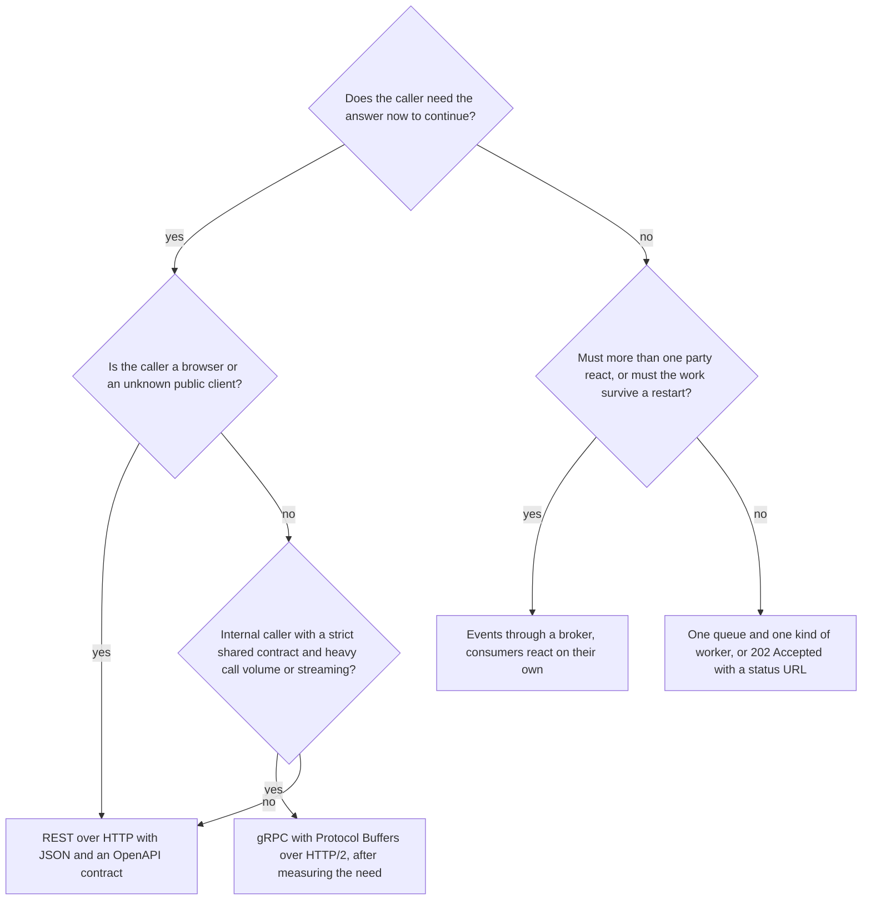
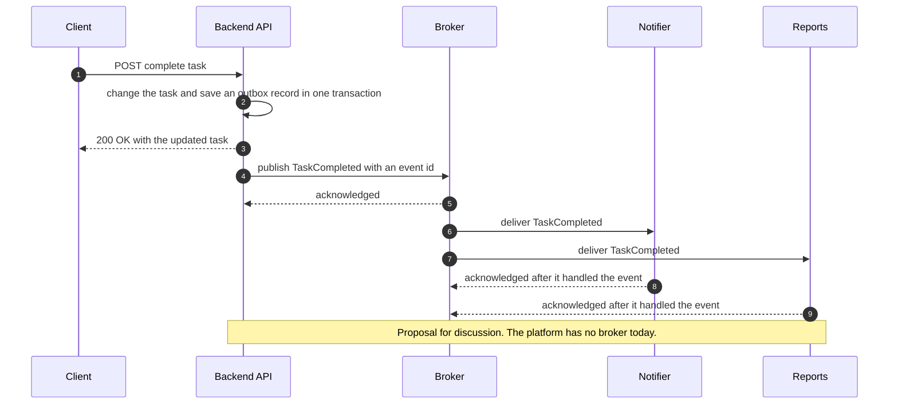

# 04. REST, events or gRPC: when each

> **Draft: written but not yet run.** The code and the expected output in this lesson were prepared by reading the code and the official documentation. They have not been executed yet. If something does not behave as described, trust your tool's real output and report it.

## What you will be able to do
By the end of this lesson you will be able to:
- Choose between request-response REST, event-based messaging and gRPC for an interaction, giving reasons tied to the caller, the wait and the failure behaviour.
- Draw the same business step as a synchronous call and as an event flow and name what changes.
- Record the choice as a short ADR with a trigger for revisiting it.

## Recap
1. From lesson 01: what does an `Idempotency-Key` let a client do safely?
   <details><summary>Answer</summary>Retry a create after a timeout without creating a duplicate.</details>
2. From 101: what is a trade-off?
   <details><summary>Answer</summary>A benefit accepted together with a cost elsewhere.</details>

## Why it matters
Teams often pick an interaction style by habit ("we always use REST", "events are modern"). The style decides who waits, what fails together, and how much the two sides must agree beforehand. It is expensive to change once several clients depend on it. This lesson gives you questions to ask before the choice is made.

## What you will build
Four small documents about Tasks and Teams and the P07 order system:
1. `style-chooser.mmd`: a decision flowchart.
2. `task-completed-events.mmd`: a sequence diagram of an event-based design for "task completed" (a proposal, not a platform feature).
3. `style-comparison.md`: a comparison table.
4. `0001-keep-rest.md`: an ADR that records the platform's existing REST choice.

## Before you start
- **Prerequisites:** [Architecture 201 lesson 01, sequence diagrams for real flows](../phase-1-diagram-depth/01-sequence-diagrams-real-flows.md) and [Architecture 101 lesson 09, quality attributes and trade-offs](../../101-zero-to-hero/phase-3-documenting-decisions/09-quality-attributes-and-trade-offs.md).
- Lessons 01 and 03 done; the same editor and preview. Work folder: `code101/architecture/201-lesson04`.
- Time: 60 minutes (reading 20, typing 15, exercise 25).
- Source pack (optional): every file is shown in full in this lesson, so you can follow without it. The finished code, the exercise starter and the solution are in the course repository https://github.com/Uee03/Code101 under `source/architecture/201-hero-to-super-hero/phase-2-design-choices/04-rest-events-grpc/` (on that page choose **Code, Download ZIP**, or run `git clone https://github.com/Uee03/Code101.git`).
- Pictures described below are expected, not yet rendered by the author.

## Steps
### Step 1. Define the three styles in one sentence each
- **REST over HTTP** (here: JSON over HTTP, described by an OpenAPI file): the client sends a request and waits for the response. This is **synchronous**: the caller is blocked until it gets an answer or gives up.
- **Events through a broker**: a part publishes a fact ("TaskCompleted") to a **broker**, a program that stores and forwards messages. Other parts **consume** it when they can. This is **asynchronous**: the publisher does not wait for the consumers.
- **gRPC**: a remote call style that uses a Protocol Buffers file as its contract and HTTP/2 as its transport. It is synchronous like REST, with a stricter, binary contract.

**Coupling** is how much one part must know about, or wait for, another. REST and gRPC couple parts *in time* (both must be up together). Events couple them only through the event's shape.

### Step 2. Save the decision flowchart
Create `style-chooser.mmd` in `code101/architecture/201-lesson04`.

**File: `style-chooser.mmd`**



### Step 3. Save the event-flow sequence
Create `task-completed-events.mmd`. It shows the platform's "complete a task" step if other parties had to react to it. The transaction that saves the change *and* a record of the event is the **outbox** idea, covered fully in lesson 03 of level 301; here, only note that the API must not lose the event if it crashes after saving.

**File: `task-completed-events.mmd`**



### Step 4. Save the preview file
Create `diagram-sources.md`: the three lines below, then the two **File** blocks above in order (`style-chooser.mmd`, then `task-completed-events.mmd`).

```text
# Diagram sources, lesson 04

Each fenced block is the content of the .mmd file named above it.
```

### Step 5. Save the comparison table
**File: `style-comparison.md`**

````markdown
# Interaction styles compared

| Question | REST over HTTP and JSON | Events through a broker | gRPC |
|---|---|---|---|
| Who waits | The caller waits for the answer | Nobody waits for the consumer; the producer waits only for the broker | The caller waits, usually for a short call |
| Coupling in time | Both sides must be up together | Producer and consumer can be down at different times | Both sides must be up together |
| Contract | OpenAPI file | Event schema, for example JSON Schema or AsyncAPI | Protocol Buffers file |
| Browser as caller | Native | Not directly; the browser talks to an API that publishes | Needs a gRPC-Web translation layer |
| Caching | Standard HTTP caching and ETags | Not applicable; consumers keep their own state | No standard shared caching |
| Failure behaviour | Timeout, retry, error status | Redelivery, duplicates, dead-letter queue | Deadline, retry, status code |
| Debugging | Easy with curl and browser tools | Needs correlation ids and tracing | Needs gRPC-aware tools |
| Fit in Tasks and Teams | Client to API: yes, today | Task changes reaching other parties: proposal | Not needed today |
````

### Step 6. Save the ADR
An **ADR** (architecture decision record, 101 lesson 08) records one decision. This one documents a choice the platform already made in TDD section 4 ("Contract first, one `openapi.yaml`"), written down after the fact; the status says so.

**File: `0001-keep-rest.md`**

````markdown
# ADR 0001: Keep REST for the client-facing API

Status: Accepted (recorded after the fact from the platform TDD, section 4)
Date: 2026-11-23
Owner: Platform maintainers

## Context
Web and mobile clients call one backend. Four backends in different languages must implement the same interface, and browsers are among the callers.

## Options
- REST over HTTP and JSON, described by one OpenAPI file. Cost: chatty for some screens and no push.
- gRPC. Cost: browsers need a translation layer, and the cost of the extra tooling is paid by every client.
- Events only. Cost: a client that must show the result of its own action cannot wait for a consumer.

## Decision
Use REST with OpenAPI as the client-facing contract. Events remain an option for work between backend parts.

## Consequences
- Benefit: every client and every backend language reads the same contract; HTTP caching and curl-based debugging work.
- Cost or risk: other parties that want to react to task changes would have to poll.

## Revisit when
A second consumer needs to react to task changes and polling is measured to be a problem. Reviewer: the platform maintainers.
````

## Run it
Nothing to run. Open `diagram-sources.md` in your preview and read the two files in Markdown.

Expected result, not yet rendered: a flowchart of four diamonds and four rounded boxes (eight arrows, each labelled yes or no), and a sequence diagram with five lifelines, nine numbered arrows and a note across the Backend API and Reports lifelines.

## How it works
**The questions, in order.** *Does the caller need the answer now?* If a person waits for a screen, yes: an event cannot give an immediate result. *Is the caller a browser or an unknown public client?* Then use the style every browser speaks natively, REST, and a contract (OpenAPI) strangers can read. *Heavy internal calls with a strict shared contract?* This is where gRPC earns its extra tooling, and only after you measured that the REST cost is a problem. If nobody waits: *must several parties react, or must the work survive a restart?* Then an event through a durable broker. Otherwise a queue with one worker, or REST that answers `202 Accepted` and offers a status URL (lesson 06).

**What events change.** In the event flow the client gets its answer (message 3) *before* anyone else reacts. Notifier and Reports receive the same fact independently and acknowledge it only after handling it, so a crash makes the broker deliver it again. That redelivery is why consumers must tolerate duplicates (the same idea as the idempotency key in lesson 01, on the consuming side). Adding a third consumer does not change the API at all, which is the main benefit; the main cost is that the system's behaviour is now spread over several programs and eventually consistent.

**P07.** The practice capstone `P07-event-driven-order-processing` uses events between Orders, Inventory, Payments and Fulfilment, and plain HTTP to the payment and courier fakes. Same questions, different answers: Orders must not wait for a slow courier, but the payment provider's answer is part of one step.

> **Why this, not that.** REST for the platform's client API, not gRPC: the callers are browsers and phones, the contract must be readable by four backend languages and two web frameworks, and HTTP caching (lesson 05) helps. Not events-only: a user who clicks "complete" needs the updated task back. The decision is a trade-off, not a verdict on the styles.

**Misconceptions.** "Events make a system faster": they remove waiting for *other* parties, but add a broker, duplicates and delay in the consumers. "gRPC is the REST replacement": it is a different set of trade-offs and does not reach browsers natively.

## Try it
### 1. Guided practice
Choose a style for five interactions. Copy `exercise/starter` as `201-lesson04-try` (rename the **copy**) or create the file below, then replace every `TODO`. Use the flowchart and the table; write a reason in your own words.

**File: `201-lesson04-try/classify.md` (starter)**
```markdown
# Choose a style for each interaction

| Interaction | Style (REST, event or gRPC) | Reason |
|---|---|---|
| A browser asks for the list of tasks | TODO | TODO |
| The Orders service tells Inventory that an order was placed | TODO | TODO |
| The gateway asks the payment fake to charge an order | TODO | TODO |
| One internal service calls a pricing service many times per request and both teams share one schema | TODO | TODO |
| A weekly report must include every completed task | TODO | TODO |
```

### 2. Change practice
Rewrite the ADR's "Revisit when" line with an observable trigger of your own (a number you would measure, not a feeling). Do not invent a number: name what you would measure and who decides.

### 3. Stretch (optional)
Draw the second diagram again with an orchestrating service that calls Notifier and Reports with REST instead of publishing an event. List two things that get worse and one that gets better.

<details><summary>Solution to guided practice</summary>

**File: `201-lesson04-try/classify.md` (solution)**
```markdown
# Choose a style for each interaction

| Interaction | Style (REST, event or gRPC) | Reason |
|---|---|---|
| A browser asks for the list of tasks | REST | The caller is a browser and waits for the answer; HTTP caching and the OpenAPI contract apply |
| The Orders service tells Inventory that an order was placed | Event | Orders must not wait for Inventory, and more parties will react later |
| The gateway asks the payment fake to charge an order | REST (HTTP) | A synchronous call to an external-style service; protect it with a timeout, a limited retry and an idempotency key |
| One internal service calls a pricing service many times per request and both teams share one schema | gRPC candidate | A strict shared contract and call volume make it worth testing, but only after measuring the REST cost |
| A weekly report must include every completed task | Event or batch read | The report can consume TaskCompleted events or read stored data later; no caller waits |
```

Your reasons may differ. For the stretch: worse, the API now waits for and depends on both services, so a slow Reports slows every completion, and a new consumer needs a code change in the API; better, the order and the result of each call are explicit and easy to follow.

</details>

## Check yourself
1. Why can a browser user not be served by an event alone? <details><summary>Answer</summary>The user waits for a result on screen; an event gives no response to the publisher. The API must answer the request itself.</details>
2. Predict: the broker delivers `TaskCompleted` twice to Reports. What must Reports do? <details><summary>Answer</summary>Handle the second delivery without a second effect, for example by remembering event ids it already processed.</details>
3. Which row of the comparison table explains why gRPC is not the platform's client API? <details><summary>Answer</summary>"Browser as caller": browsers need a translation layer for gRPC.</details>
4. Find the weakness: "We use events everywhere because they scale." <details><summary>Answer</summary>No measured need is stated, and events add a broker, duplicates and eventual consistency. The choice must follow the questions in the flowchart, not fashion.</details>

## Common mistakes
| Symptom | Cause | Fix |
|---|---|---|
| A flowchart diamond label breaks the parse (typical symptom: an error or a missing label) | Unquoted label with special characters | Put every label in double quotes |
| The ADR reads like a sales pitch | Only the winner's benefits are listed | List each rejected option with its cost |
| "Revisit when: if needed" | No observable trigger | Name what is measured and who reviews it |
| Events drawn with no acknowledgement | The reliability story is missing | Show acknowledgements, and say consumers handle duplicates |

## Best practice
Choose the interaction style from who waits and what must survive failure, and record the choice with its costs. Source: Microsoft Azure Architecture Center, [Cloud design patterns](https://learn.microsoft.com/azure/architecture/patterns/); gRPC documentation, [Introduction to gRPC](https://grpc.io/docs/what-is-grpc/introduction/).

## Going further
- Platform TDD section 4 (decisions table) lists related choices; find one more you could write as an ADR.
- Practice capstone P07, section 5, lists ten decisions to record, several of them about messaging.

## Summary
- You chose between REST, events and gRPC using the caller, the wait and the failure behaviour.
- You drew the same business step as an event flow and named what changes for the client and the consumers.
- You wrote an ADR with options, costs and a trigger for revisiting it.

## Next lesson
05. Caching and CDNs: make repeated reads cheap without serving wrong data.
