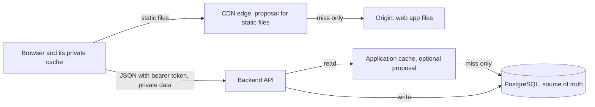
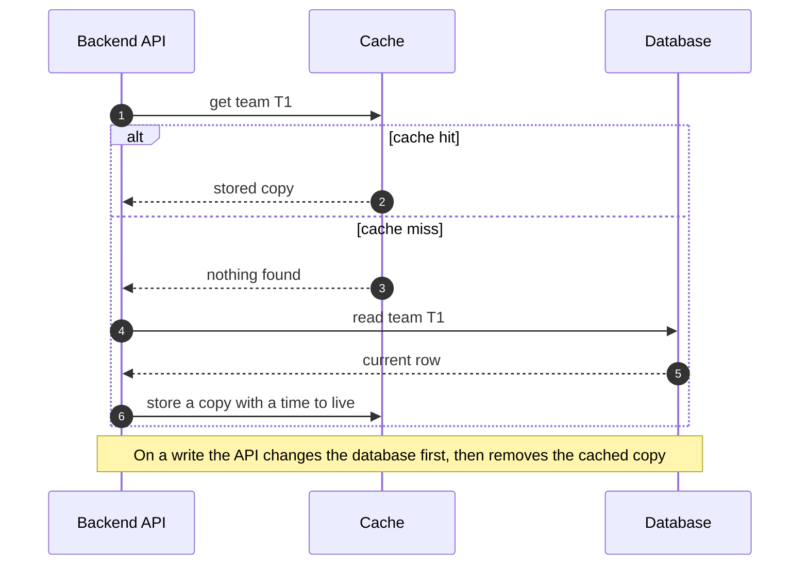
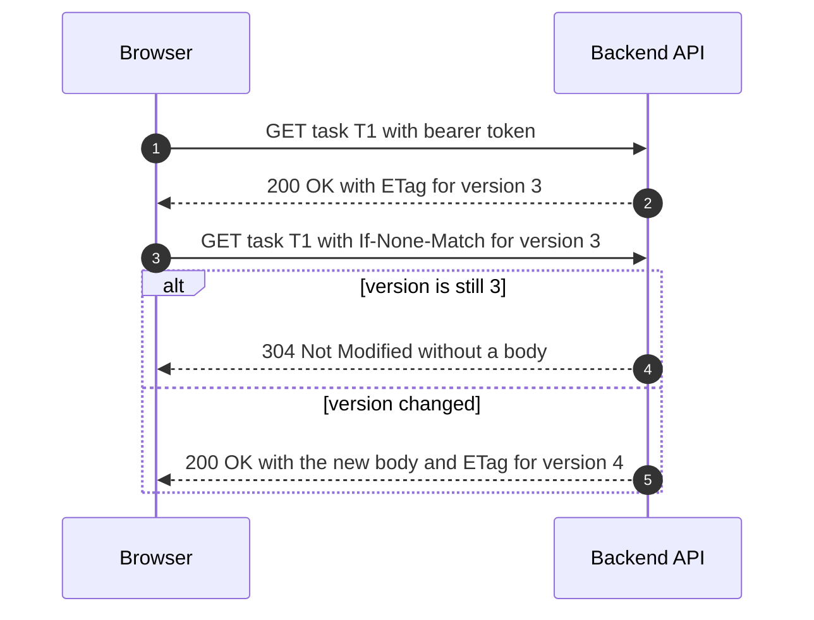

# 05. Caching and CDNs

> **Draft: written but not yet run.** The code and the expected output in this lesson were prepared by reading the code and the official documentation. They have not been executed yet. If something does not behave as described, trust your tool's real output and report it.

## What you will be able to do
By the end of this lesson you will be able to:
- Place caches at the right layer (browser, CDN, application, database) and say what each layer may hold.
- Draw the cache-aside read and the conditional GET with ETag, and explain what makes a copy stale.
- Write a cache policy table that names who may keep a copy, the freshness rule and the risk of staleness, without inventing lifetimes.

## Recap
1. What does a strong ETag equal in the platform contract?
   <details><summary>Answer</summary>The quoted `version` of the record (for example `"3"`), TDD section 4.</details>
2. From 101: what is a source of truth?
   <details><summary>Answer</summary>The authoritative place used to resolve disagreements between copies; for the platform, PostgreSQL.</details>

## Why it matters
A **cache** is a replaceable copy kept closer to the reader so repeated reads are cheap. It makes a system faster and cheaper to run, and it adds one new class of bug: the copy can be wrong, or shown to the wrong person. A good design says in advance which data may be copied, by whom, and what makes the copy invalid.

## What you will build
Three diagrams and a table about Tasks and Teams. The platform contract defines no application cache and no CDN, so every cache below is labelled a proposal, except the ETag which the contract defines.
1. `cache-layers.mmd` (flowchart), 2. `cache-aside.mmd` (sequence), 3. `conditional-get.mmd` (sequence), 4. `cache-policy.md` (table).

## Before you start
- **Prerequisites:** [Architecture 201 lesson 04, REST, events and gRPC](04-rest-events-grpc.md) and [Architecture 101 lesson 04, data and storage](../../101-zero-to-hero/phase-1-thinking-in-systems/04-data-and-storage.md).
- Lesson 04 done; same editor and preview. Work folder: `code101/architecture/201-lesson05`.
- Time: 60 minutes (reading 20, typing 20, exercise 20).
- Source pack (optional): every file is shown in full in this lesson, so you can follow without it. The finished code, the exercise starter and the solution are in the course repository https://github.com/Uee03/Code101 under `source/architecture/201-hero-to-super-hero/phase-2-design-choices/05-caching-and-cdns/` (on that page choose **Code, Download ZIP**, or run `git clone https://github.com/Uee03/Code101.git`).
- Pictures described below are expected, not yet rendered by the author.

## Steps
### Step 1. Learn the vocabulary
- **Cache hit / miss**: the copy was found / was not found, so the original must be read.
- **Time to live (TTL)**: how long a copy may be used without checking again. Choose it from measurements, never by guess.
- **Invalidation**: removing or replacing a copy because the original changed.
- **CDN** (content delivery network): many servers near users that keep copies of files and answer for the origin server. It is best for files that are the same for everyone.
- **Cache-aside**: the application, not the cache, decides: look in the cache, on a miss read the database and store a copy.
- **Conditional request**: the client says "I have version 3, send it only if it changed" using `If-None-Match`. The server answers `304 Not Modified` with no body when nothing changed.

### Step 2. Save the layers flowchart
Create `cache-layers.mmd` in `code101/architecture/201-lesson05`.

**File: `cache-layers.mmd`**



### Step 3. Save the cache-aside sequence
**File: `cache-aside.mmd`**



### Step 4. Save the conditional GET sequence
The platform contract says a task `GET` returns an `ETag` and honours `If-None-Match` with `304` (TDD section 6, "Concurrency").

**File: `conditional-get.mmd`**



### Step 5. Save the preview file
Create `diagram-sources.md`: these three lines, then the three **File** blocks above in order (`cache-layers.mmd`, `cache-aside.mmd`, `conditional-get.mmd`).

```text
# Diagram sources, lesson 05

Each fenced block is the content of the .mmd file named above it.
```

### Step 6. Save the cache policy
**File: `cache-policy.md`**

````markdown
# Cache policy: Tasks and Teams

Numbers such as lifetimes are decided from measurements. This table names the rule, not the number.

| Data | Who may keep a copy | Where | Freshness rule | What makes it stale | Risk if stale or shared |
|---|---|---|---|---|---|
| Web app files with a content hash in the name | Anyone | Browser and CDN | Keep for a long time; the name changes when the content changes | Nothing; a new build has a new name | None |
| The web app's entry page | Anyone | Browser and CDN | Revalidate on every use | A new release | Users run an old shell |
| One task by id | Only the signed-in user | Browser, private | Revalidate with the ETag every time | Any change raises the version | Low, a stale copy is never shown without a check |
| A list of a user's teams | Only that user | Application cache keyed by user id | Short lifetime chosen from measurements; also remove on a membership change | A membership change | A removed member still sees a team |
| Signing keys from Keycloak | The backend | Backend memory | Keep until an unknown key id appears, then refetch | Key rotation | Wrong keys are trusted or good tokens are refused |
| The audit log | Nobody | Not cached | Always read current data | Not applicable | An admin sees an incomplete trail |
````

### Step 7. Predict, then preview
Predict: (1) in the cache-layers diagram, which arrow bypasses the CDN, and why? (2) in the conditional GET, which message carries no body?

## Run it
Open `diagram-sources.md` in your preview.

Expected result, not yet rendered: a flowchart with six boxes and six arrows (the database drawn as a cylinder); a sequence with three lifelines, six messages and an `alt` with two compartments; a sequence with two lifelines, five messages and an `alt` with two compartments.

Your predictions: (1) the arrow from Browser to Backend API, because the JSON is private to one signed-in user and must not sit in a copy anyone can read; (2) message 4 in the first branch, the `304`.

## How it works
**Layers.** The further a cache is from the database, the cheaper a hit, and the harder it is to invalidate: the browser's copy cannot be removed by the server, so freshness there is controlled by headers and revalidation (RFC 9111 defines them). Typical header ideas: `Cache-Control: max-age` says how long a copy is fresh; `private` says only the end user's browser may keep it; `no-store` says keep no copy; a content hash in a file name lets a file be cached for a long time because a change creates a *new name*.

**Why the JSON bypasses the CDN.** A shared cache serves one stored response to many people. If it stored `GET /v1/me`, a second user could receive the first user's data. That is a security failure, not a performance one. Rule: personalised or authorised responses are `private` (or `no-store`) unless the cache key includes the user, and you can prove invalidation.

**Cache-aside.** The cache is only a copy; PostgreSQL remains the source of truth. On a write, change the database first, then remove the copy. Removing (not updating) is simpler and avoids races. Two classic problems: a *stampede* (a popular copy expires and many requests hit the database at once) and *stale reads* between the write and the removal. Name both in the design review even if you accept them.

**Conditional GET.** The platform already gives you a cheap cache: the browser keeps the task with its ETag and asks "still version 3?". The server skips sending the body on a match. The check still travels to the server, so authorisation is still applied: a user removed from the team gets no `304` for a task they may not see (the platform returns 404 for non-members, TDD section 6). Freshness here is exact because the version changes on every real change.

**The policy table** forces four answers for each kind of data: who, where, how fresh, what is the damage. The "Risk" column is the part reviewers read first.

> **Why this, not that.** Revalidate (ETag) instead of a fixed TTL for single records: the answer is always correct and costs a small request, so the saving is bandwidth, not round trips. A TTL cache saves the round trip but accepts staleness; use it only where the policy table says stale data is acceptable and bounded. And cache-aside, not write-through, as a first choice: the application stays in control of invalidation, which is the hard part.

**Misconception:** "caching is a performance feature only." Every cache changes correctness (staleness) and security (who may see a copy).

## Try it
### 1. Guided practice
Complete the cache policy for three more kinds of data. Copy `exercise/starter` as `201-lesson05-try` (rename the **copy**) or create the file below. Replace each `TODO`.

**File: `201-lesson05-try/cache-decisions.md` (starter)**
```markdown
# Cache decisions to complete

| Data | Who may keep a copy | Where | Freshness rule | What makes it stale | Risk if stale or shared |
|---|---|---|---|---|---|
| The current user's profile from GET /v1/me | TODO | TODO | TODO | TODO | TODO |
| The list of projects of one team | TODO | TODO | TODO | TODO | TODO |
| The health endpoint GET /health | TODO | TODO | TODO | TODO | TODO |
```

### 2. Change practice
Add a row for task lists filtered by status, using cursor pagination. What goes into the cache key, and what makes a cached page stale?

### 3. Stretch (optional)
The TDD requires `RateLimit-*` headers on every response, including cached ones. Where in the layers diagram would a rate limiter have to sit so that cache hits are still counted? State your assumption.

<details><summary>Solution to guided practice</summary>

**File: `201-lesson05-try/cache-decisions.md` (solution)**
```markdown
# Cache decisions to complete

| Data | Who may keep a copy | Where | Freshness rule | What makes it stale | Risk if stale or shared |
|---|---|---|---|---|---|
| The current user's profile from GET /v1/me | Only that user | Browser, private | Short lifetime chosen from measurements, or revalidate | A role or team change | A user keeps seeing old roles and teams |
| The list of projects of one team | Only members of that team | Application cache keyed by team id and user id | Short lifetime chosen from measurements; remove on a project change | A project is created, renamed or archived | A new project is missing for a while |
| The health endpoint GET /health | Nobody | Not cached | Always current | Not applicable | A monitor reads an old state and misses an outage |
```

For change practice the key must include the user, the filter values and the cursor; any change to a task in the project can make a page stale, so such lists are poor cache candidates. For the stretch: the limiter must sit in front of the cache (at the API entry), so each request is counted even if answered from a copy; if a CDN answered it, the API would never see it.

</details>

## Check yourself
1. Why must `GET /v1/me` not be stored in a shared CDN cache? <details><summary>Answer</summary>The response is specific to one user; a shared cache could hand it to another user.</details>
2. Predict: a task changes from version 3 to 4, then the browser sends `If-None-Match` for version 3. What comes back? <details><summary>Answer</summary>`200 OK` with the new body and the ETag for version 4.</details>
3. In cache-aside, why remove the copy on a write instead of updating it? <details><summary>Answer</summary>It is simpler and avoids races where an older update overwrites a newer copy; the next read reloads the current row.</details>
4. Find the bug: a policy says "teams list, cache for as long as possible". <details><summary>Answer</summary>No freshness rule or staleness risk is stated: a removed member could keep seeing a team. Add a bounded lifetime from measurements and invalidation on membership changes.</details>

## Common mistakes
| Symptom | Cause | Fix |
|---|---|---|
| Users see each other's data (a design flaw, not a tool error) | A shared cache stored a personalised response | Mark such responses private or no-store; include the user in any cache key |
| "We cached it and it got faster, so it is correct" | Speed was measured, correctness was not | Add the stale-data scenario to the quality scenarios (lesson 09) |
| A list stays old after a write | The copy was not removed or the key differs | Define invalidation next to the cache; name the key in the policy |
| A lifetime of "5 minutes" appears with no source | Guessed number | Replace it with "chosen from measurements" and say what you will measure |

## Best practice
For every cache, write the rule that says who may share a copy and what makes it invalid before choosing a lifetime. Source: RFC 9111, [HTTP Caching](https://www.rfc-editor.org/rfc/rfc9111); Microsoft Azure Architecture Center, [Cache-Aside pattern](https://learn.microsoft.com/azure/architecture/patterns/cache-aside).

## Going further
Level 301 lesson 01 puts caches into a scaling path (stateless services, load balancers, read replicas). Measure before adding any layer.

## Summary
- You placed caches in the layers and named what each layer may hold.
- You drew cache-aside and the conditional GET with an ETag.
- You wrote a policy table with an explicit staleness risk for every row.

## Next lesson
06. Queues, streams and async work: move slow or unreliable work out of the request.
