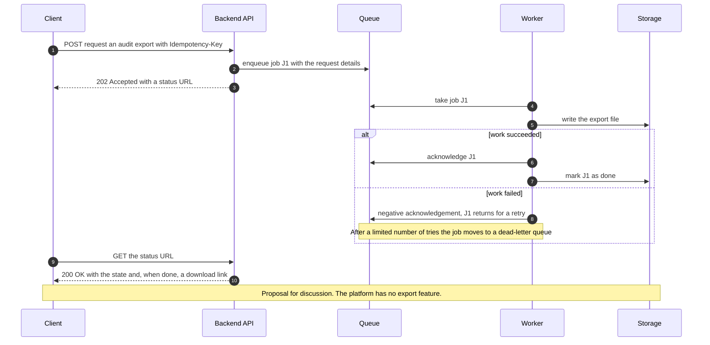
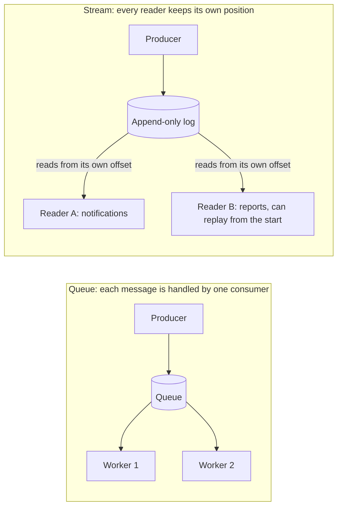
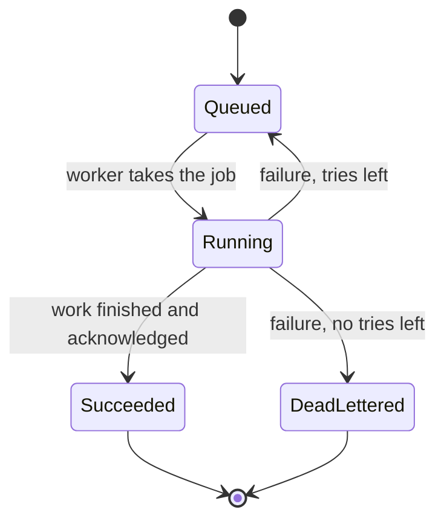

# 06. Queues, streams and async work

> **Draft: written but not yet run.** The code and the expected output in this lesson were prepared by reading the code and the official documentation. They have not been executed yet. If something does not behave as described, trust your tool's real output and report it.

## What you will be able to do
By the end of this lesson you will be able to:
- Explain the difference between a queue and a stream and choose one for a stated need.
- Draw an asynchronous job flow (`202 Accepted`, worker, acknowledgement, retry, dead-letter) and its state machine.
- Complete a design checklist for an async feature: delivery guarantee, idempotency, retries, dead-letter, ordering, backlog.

## Recap
1. From lesson 04: why must a consumer tolerate duplicate events?
   <details><summary>Answer</summary>Brokers usually deliver at least once. A crash before the acknowledgement makes the broker deliver the same message again.</details>
2. From 101: what is a state diagram for?
   <details><summary>Answer</summary>It shows the named conditions of one item and the allowed moves between them.</details>

## Why it matters
Some work is slow, unreliable or not needed by the caller *now*: producing a large export, sending an e-mail, calling a courier. If the request waits for it, a slow partner freezes your users, which is exactly what happened to the shop in practice capstone P07. Moving the work to a queue turns "the caller waits for everything" into "the caller waits for a short hand-off". You pay with new things to design: duplicates, retries, ordering and a backlog you must watch.

## What you will build
A design package for an **audit export** feature that does not exist in the platform (the platform has `GET /v1/audit-log` for admins and nothing that runs long). Treat it as a worked proposal.
1. `async-export.mmd`: the request, job and status flow. 2. `queue-vs-stream.mmd`: the two shapes of messaging. 3. `job-state.mmd`: the job's states. 4. `async-checklist.md`: nine questions every async design must answer.

## Before you start
- **Prerequisites:** Architecture 201 lessons [04, REST, events and gRPC](04-rest-events-grpc.md) and [05, caching and CDNs](05-caching-and-cdns.md).
- Lessons 04 and 05 done; same editor and preview. Work folder: `code101/architecture/201-lesson06`.
- Time: 65 minutes (reading 20, typing 20, exercise 25).
- Source pack (optional): every file is shown in full in this lesson, so you can follow without it. The finished code, the exercise starter and the solution are in the course repository https://github.com/Uee03/Code101 under `source/architecture/201-hero-to-super-hero/phase-2-design-choices/06-queues-streams-async-work/` (on that page choose **Code, Download ZIP**, or run `git clone https://github.com/Uee03/Code101.git`).
- Pictures described below are expected, not yet rendered by the author.

## Steps
### Step 1. Vocabulary
- **Queue**: a line of messages. A **producer** adds, a **consumer** or **worker** takes one, handles it and **acknowledges** it (tells the queue "done, remove it"). With several workers on one queue each message goes to one of them (**competing consumers**). This spreads load.
- **Stream** (an append-only log): messages are stored in order and kept. Each reader remembers its own **offset**, its position, and can start again from an earlier one (**replay**). Several readers get every message.
- **Dead-letter queue**: a side queue for messages that failed after the allowed number of tries, kept for diagnosis.
- **Backpressure**: slowing or limiting producers (or bounding the backlog) when consumers cannot keep up.
- **At-least-once delivery**: a message may arrive more than once, but is not lost. Claims of "exactly once" usually mean "at least once plus an idempotent consumer".

### Step 2. Save the async flow
Create `async-export.mmd` in `code101/architecture/201-lesson06`.

**File: `async-export.mmd`**



### Step 3. Save the queue-versus-stream picture
**File: `queue-vs-stream.mmd`**



### Step 4. Save the job state machine
**File: `job-state.mmd`**



### Step 5. Save the preview file
Create `diagram-sources.md`: these three lines, then the three **File** blocks above in order (`async-export.mmd`, `queue-vs-stream.mmd`, `job-state.mmd`).

```text
# Diagram sources, lesson 06

Each fenced block is the content of the .mmd file named above it.
```

### Step 6. Save the checklist
**File: `async-checklist.md`**

````markdown
# Async design checklist

| Question | Why it matters |
|---|---|
| What is the delivery guarantee? Assume at least once | Most brokers can deliver a message more than once, so the consumer must cope |
| Is the consumer idempotent? How is a repeat recognised? | A repeat must not create a second effect, for example a second charge |
| How many tries, with what waiting time between tries? | Unlimited immediate retries turn one failure into a flood |
| Where does a message go after the last try? | A dead-letter destination keeps the evidence and unblocks the rest |
| Does order matter? Per what key? | Strict global order limits parallel workers; order per entity is usually enough |
| What is the payload? | Send an id or a small fact; keep large files in storage and pass a reference |
| How do you see the backlog? | Queue depth and age of the oldest message show trouble before users do |
| What happens when producers are faster than consumers? | Without a limit the backlog grows; decide on a bound, a slower producer or more workers |
| Who can read the messages? | A broker holds copies of data; apply the same access rules as for the database |
````

### Step 7. Predict, then preview
Predict: (1) how many numbered messages are in `async-export.mmd`? (2) which transition in the state machine models a retry?

## Run it
Open `diagram-sources.md` in your preview.

Expected result, not yet rendered: a sequence with five lifelines, ten numbered messages, an `alt` with two compartments and two notes; a flowchart with two titled groups (eight shapes, six arrows); a state diagram with five states and seven transitions, two of which end at the final marker.

Predictions: (1) ten; (2) `Running --> Queued : failure, tries left`.

## How it works
**The hand-off.** Message 3 is the point of the pattern: the API answers `202 Accepted` and a status URL after *only* putting the job on the queue (message 2). The client's wait is as short as that hand-off, whatever the worker does later. The client learns the result by asking the status URL (message 9). A push channel (a webhook or server-sent events) is an alternative; polling is the simplest.

**Why the idempotency key is on the POST.** If the client's request times out *after* the job was queued, the client will retry. The key from lesson 01 makes the API return the original job's status URL instead of queuing a second export.

**Acknowledge after the work.** The worker acknowledges only after it finished (message 6). If it crashes first, the broker returns the job to the queue: at-least-once. That is the whole reason for "idempotent consumer": here the file name derived from the job id means a rerun overwrites the same file.

**The state machine** makes the allowed moves explicit. `DeadLettered` is a final state a person must handle; a design with no such state hides lost work.

**Queue or stream?** Use a queue when each message is a *task to do once* (send this e-mail). Use a stream when several independent readers need *the same facts*, or when you need to rebuild something by replaying history (P07's read model). Practice capstone P07 uses events with a stream-like replay for exactly that reason (its read model can be dropped and rebuilt).

**Backpressure and the platform.** The platform already applies one form: per-user rate limits answer `429` with `Retry-After` (TDD section 6). A queue gives you a second place to apply it: a bound on depth.

> **Why this, not that.** A queue plus worker, not a longer HTTP timeout: a timeout just makes the user wait longer and ties up a connection, and a lost connection loses the work. Not a stream for the export: only one party needs each job, and nobody needs to replay it. Is a database table polled by a worker a valid first design? Yes, for small systems it is simpler (no new broker to run), and the checklist questions apply to it unchanged.

**Misconception:** "a queue makes work reliable." It makes work *durable* if configured so; reliability comes from acknowledgements, idempotent consumers, bounded retries and a dead-letter path.

## Try it
### 1. Guided practice
Answer the checklist for the audit export. Copy `exercise/starter` as `201-lesson06-try` (rename the **copy**) or create the file below, then replace each `TODO` with a decision and a short reason. Do not invent numbers: say what you would measure to choose them.

**File: `201-lesson06-try/async-export-design.md` (starter)**
```markdown
# Async export design

| Question | Decision |
|---|---|
| Delivery guarantee | TODO |
| How a repeated job is recognised | TODO |
| Tries and waiting time between tries | TODO |
| What happens after the last try | TODO |
| Ordering | TODO |
| What the message contains | TODO |
| How the backlog is observed | TODO |
```

### 2. Change practice
Change the design so that two other parts also react when an export finishes (a notifier and an archiver). Which of the three diagrams changes, and would you switch from a queue to something else?

### 3. Stretch (optional)
Practice capstone P07 requires a dead-letter destination (R-13) and a bounded in-flight limit (R-17). Which checklist rows do these requirements answer?

<details><summary>Solution to guided practice</summary>

**File: `201-lesson06-try/async-export-design.md` (solution)**
```markdown
# Async export design

| Question | Decision |
|---|---|
| Delivery guarantee | At least once; the worker may receive a job twice |
| How a repeated job is recognised | The job id is the key; a finished job is not run again, and the file name is derived from the job id so a rerun overwrites the same file |
| Tries and waiting time between tries | A small fixed number of tries with growing, randomised waits; the numbers are chosen from measuring how long failures last |
| What happens after the last try | The job moves to a dead-letter queue with the error and trace id, the status URL shows failed, and an operator is alerted |
| Ordering | Not needed; exports are independent of each other |
| What the message contains | The job id, the requesting user id and the filter; the file itself is written to storage |
| How the backlog is observed | Queue depth, age of the oldest job and dead-letter count as metrics |
```

For change practice: the flow diagram changes (a finished-event is published), and a stream or a topic with two subscribers fits better than the single queue, because both react to the same fact. For the stretch: R-13 answers "where a message goes after the last try"; R-17 answers "what happens when producers are faster than consumers".

</details>

## Check yourself
1. Why does the API answer `202` and not `200` in message 3? <details><summary>Answer</summary>The work is accepted but not finished; `200` would claim a completed result.</details>
2. Predict: the worker crashes after writing the file but before acknowledging. What happens next? <details><summary>Answer</summary>The job is delivered again and the worker repeats it; the repeat must produce the same result, so the design derives the file name from the job id.</details>
3. When is a stream a better fit than a queue? <details><summary>Answer</summary>When several readers need every message, or when you must replay history to rebuild a view.</details>
4. Find the weakness: "Retry immediately, forever." <details><summary>Answer</summary>A permanent failure loops, and a partner outage becomes a flood. Bound the tries, wait between them and dead-letter the job.</details>

## Common mistakes
| Symptom | Cause | Fix |
|---|---|---|
| Diagram preview fails on the state diagram (typical: a parse error) | A state name with a space, or `-->` without both ends | Use names without spaces; check every arrow has two states |
| Reviewers ask "what if it fails?" | The flow has only the success path | Add the `else` branch and the dead-letter state |
| A job runs twice with two effects | The consumer is not idempotent | Derive keys from the job id; record processed ids |
| "Eventually" with no bound | No backlog metric or alert | Name queue depth and oldest-job age in the design |

## Best practice
For every async hand-off, write down what happens on a duplicate, a failure and a full queue before drawing the happy path. Source: Microsoft Azure Architecture Center, [Queue-Based Load Leveling](https://learn.microsoft.com/azure/architecture/patterns/queue-based-load-leveling) and [Competing Consumers](https://learn.microsoft.com/azure/architecture/patterns/competing-consumers).

## Going further
Level 301 lesson 03 adds the **transactional outbox** and the **saga**, the patterns that make multi-step async work reliable, using P07 as the running example.

## Summary
- You separated queues from streams by who receives a message and whether history is kept.
- You drew the `202` hand-off with acknowledgement, retry and dead-letter, and its state machine.
- You answered an async design checklist without inventing numbers.

## Next lesson
07. Authentication and authorisation architecture: where tokens are checked and who may do what.
