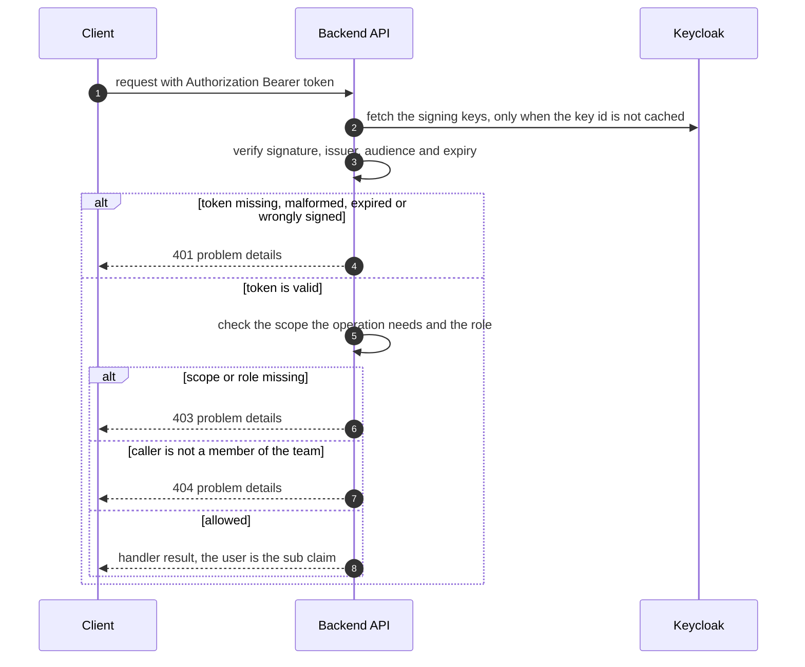
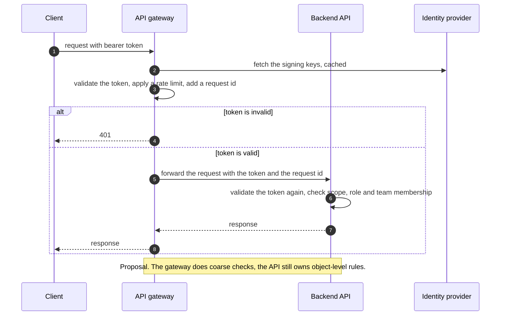
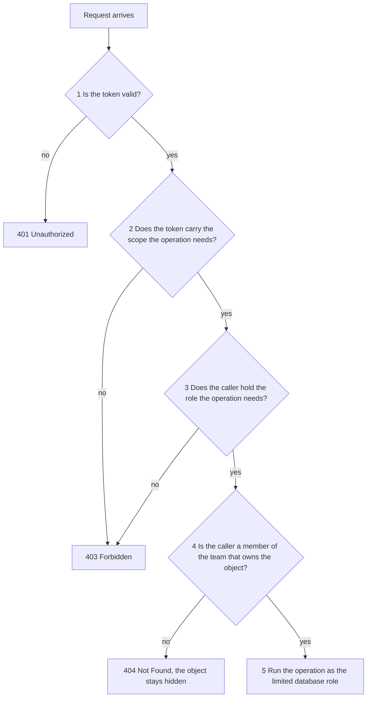

# 07. Authentication and authorisation architecture

> **Draft: written but not yet run.** The code and the expected output in this lesson were prepared by reading the code and the official documentation. They have not been executed yet. If something does not behave as described, trust your tool's real output and report it.

## What you will be able to do
By the end of this lesson you will be able to:
- Explain where sign-in, token issue, token validation and permission decisions happen in a system, without writing code.
- Draw token validation as ordered checks with the status each failure returns (401, 403, 404).
- Compare "validate at a gateway" with "validate in every service" and state what must still be checked in the service.

## Recap
1. From lesson 01: what does PKCE protect?
   <details><summary>Answer</summary>The authorization code: only the client that holds the original `code_verifier` can redeem it.</details>
2. From lesson 05: why must a shared cache never keep `GET /v1/me`?
   <details><summary>Answer</summary>The response is per user; a shared copy could be served to someone else.</details>

## Why it matters
Access control mistakes are the most common serious flaw in web APIs. They rarely come from weak cryptography; they come from an unclear architecture: nobody knows which part checks what, so each part assumes another part did. This lesson is about *where* each decision lives. The implementation (Keycloak realm, token libraries) is taught inside the platform capstone and the backend capstones; no code is written here.

## What you will build
Four documents for the platform: 1. `token-validation.mmd` (sequence), 2. `gateway-variant.mmd` (sequence, a proposal), 3. `authz-layers.mmd` (flowchart), 4. `access-matrix.md` (table), plus `0002-local-token-validation.md` (an ADR).

## Before you start
- **Prerequisites:** Architecture 201 lessons [01, sequence diagrams for real flows](../phase-1-diagram-depth/01-sequence-diagrams-real-flows.md) and [04, REST, events and gRPC](04-rest-events-grpc.md).
- Lessons 01, 04 and 05 done; same editor and preview. Work folder: `code101/architecture/201-lesson07`.
- Time: 70 minutes (reading 25, typing 20, exercise 25).
- Source pack (optional): every file is shown in full in this lesson, so you can follow without it. The finished code, the exercise starter and the solution are in the course repository https://github.com/Uee03/Code101 under `source/architecture/201-hero-to-super-hero/phase-2-design-choices/07-authn-authz-architecture/` (on that page choose **Code, Download ZIP**, or run `git clone https://github.com/Uee03/Code101.git`).
- Pictures described below are expected, not yet rendered by the author. Use only fake users (the platform's alice, bob and carol) in any diagram.

## Steps
### Step 1. Vocabulary
- **Authentication** (who are you?) proves identity. **Authorisation** (what may you do?) decides permissions for that identity. Mixing them up is the root of many bugs.
- **OAuth 2.0** is a framework for letting a client obtain limited access to an API. **OpenID Connect (OIDC)** adds a standard way to sign a user in on top of it.
- **Identity provider (IdP)**: the service that signs users in and issues tokens. In the platform: Keycloak.
- **Access token**: what the client sends to the API in the `Authorization: Bearer` header. Treat it as a key: whoever holds it can use it until it expires. **ID token**: tells the *client* who signed in; it is not meant for the API. **Refresh token**: lets the client get a new access token without a new sign-in; protect it more than the access token.
- **JWT** (JSON Web Token): a token with three parts, header, claims and signature. The claims are *readable by anyone* (they are encoded, not secret); the signature proves they were not changed. Never put secrets in claims.
- **Claims** used here: `iss` (who issued it), `sub` (the user's id), `aud` (who it is for), `exp` (expiry), `scope` (what the client was allowed to ask for).
- **Scope** limits what a *client application's token* may do; a **role** says what a *user* is. Both must allow an action.
- **API gateway**: one entry point in front of the APIs that can handle shared concerns (rate limits, token checks, request ids).

### Step 2. Save the token validation sequence
Create `token-validation.mmd` in `code101/architecture/201-lesson07`. It follows the platform TDD, section 7, in my own words.

**File: `token-validation.mmd`**



### Step 3. Save the gateway variant
Add `gateway-variant.mmd`. The platform has **no gateway**; this is a proposal for discussion, and P07 does have one.

**File: `gateway-variant.mmd`**



### Step 4. Save the layered checks
**File: `authz-layers.mmd`**



### Step 5. Save the preview file
Create `diagram-sources.md`: these three lines, then the three **File** blocks above in order (`token-validation.mmd`, `gateway-variant.mmd`, `authz-layers.mmd`).

```text
# Diagram sources, lesson 07

Each fenced block is the content of the .mmd file named above it.
```

### Step 6. Save the access matrix
**File: `access-matrix.md`**

````markdown
# Access matrix: selected Tasks and Teams operations

Source: platform TDD section 6. Effective permission is the intersection of scope and role, then the team check.

| Operation | Access value | Scope needed | Object-level check |
|---|---|---|---|
| GET /health | public | none | none |
| GET /v1/me | any signed-in user | tasks:read | none, the caller is the subject |
| POST /v1/teams | admin | tasks:write | none |
| DELETE /v1/teams/{teamId} | admin | tasks:admin | none |
| PATCH /v1/teams/{teamId} | team lead or admin | tasks:write | caller leads this team |
| POST /v1/projects/{projectId}/tasks | member or admin | tasks:write | caller belongs to the project's team |
| DELETE /v1/comments/{commentId} | author, team lead or admin | tasks:write | caller wrote it or leads the team |
| GET /v1/audit-log | admin | tasks:admin | none |
````

### Step 7. Save the ADR
**File: `0002-local-token-validation.md`**

````markdown
# ADR 0002: Validate access tokens locally in each backend

Status: Accepted (recorded after the fact from the platform TDD, section 4)
Date: 2026-11-23
Owner: Platform maintainers

## Context
Every request carries a short-lived access token issued by Keycloak. Four backends must check it, and a network call to the identity service on every request would add a delay and a dependency.

## Options
- Check the signature, issuer, audience and expiry locally with cached public keys. Cost: a revoked token stays usable until it expires.
- Ask the identity service about every token (introspection). Cost: one extra network call per request and a hard dependency on the identity service.

## Decision
Validate locally with cached keys. Keep token lifetimes short so the revocation delay stays small.

## Consequences
- Benefit: no per-request hop to Keycloak; a short Keycloak outage does not stop requests that carry valid tokens.
- Cost or risk: revocation takes effect only when the token expires; a leaked token works until then.

## Revisit when
Security review requires immediate revocation for some operations. Reviewer: the platform maintainers. Then protect only those operations with an introspection check.
````

### Step 8. Predict, then preview
Predict: (1) how many numbered messages does `token-validation.mmd` have? (2) in the flowchart, which two failures both return 403?

## Run it
Open `diagram-sources.md` in your preview.

Expected result, not yet rendered: a sequence with three lifelines and eight numbered messages in nested boxes (an inner `alt` with three compartments inside the second compartment of the outer `alt`); a sequence with four lifelines and eight numbered messages plus a note; a flowchart with nine shapes (four diamonds) and nine arrows.

Predictions: (1) eight; (2) a missing scope (check 2) and a missing role (check 3).

## How it works
**Order of checks.** Cheap, general checks come first and object-specific checks last: valid token, then scope, then role, then membership. Each failure has its own status. `401` means "I do not know who you are" and tells a client to sign in again. `403` means "I know who you are and you may not do this". `404` for a non-member is a deliberate choice: answering `403` would confirm that the team exists, so ids could be probed; the TDD calls this the visibility rule.

**Scope and role together.** Bob's token may carry `tasks:admin`, but his *role* is member, so check 3 refuses. This protects against a client that was granted more scopes than its user deserves, and against a user with a powerful role using a client that was never allowed that scope.

**Object-level authorisation** (check 4) is the one most often forgotten. A valid token and the right role say nothing about *which team's* task you may read. This is the number one risk in the OWASP API Security Top 10 (Broken Object Level Authorization), and it can only be decided where the data is known: in the API, using stored membership. A gateway cannot do it.

**Gateway or every service?** In the gateway variant the gateway handles token validity, rate limits and request ids once for all APIs. The API still validates and still checks scope, role and membership. Reasons: a network path might one day reach the API without the gateway (a mistake, another internal client), and only the API knows the objects. This is **defence in depth**: more than one layer, each assuming the other might fail. The cost is double validation work and two places to configure.

**Where each thing lives in the platform:** passwords only in Keycloak (the backends never see one); tokens issued by Keycloak; signature, audience and expiry checks plus scope, role and team checks in each backend; the limited database role as the last line (it cannot alter the schema or the audit log).

**Service-to-service calls** (not in the platform, but in P07, requirement R-20): a service should call another with *its own* client identity, not with the end user's token, unless you deliberately exchange tokens and document why. Otherwise a service gains the user's powers everywhere.

> **Why this, not that.** Local validation (the ADR), not asking Keycloak per request: no extra network call and no hard dependency, at the price that revocation waits for expiry. If your threat model needs instant revocation for a few operations, add an introspection check just there rather than everywhere.

**Misconceptions.** "A JWT is encrypted": its claims are readable by anyone who has it. "HTTPS means the user is authenticated": HTTPS protects the connection; it says nothing about who is calling. "Roles are enough": without the object check, any member can read any team's data.

## Try it
### 1. Guided practice
For each scenario, write the expected status and which check decides it. Copy `exercise/starter` as `201-lesson07-try` (rename the **copy**) or create the file below. Use the flowchart and the access matrix.

**File: `201-lesson07-try/authz-scenarios.md` (starter)**
```markdown
# Authorisation scenarios

| Scenario | Expected status | Which check decides it |
|---|---|---|
| A request has no Authorization header | TODO | TODO |
| Bob (a member, not an admin) holds the scope tasks:admin and calls DELETE on a team | TODO | TODO |
| Bob is not a member of the Mobile Team and asks for that team | TODO | TODO |
| A token expired several minutes ago | TODO | TODO |
| Alice (admin) deletes a comment written by Bob | TODO | TODO |
```

### 2. Change practice
Add a row for a user who is a member of the team but not its lead, calling `PATCH` on the team. What is the status and which check decides?

### 3. Stretch (optional)
Draw the mobile sign-in in your own words as a sequence (the system browser, the app, Keycloak). Why does the TDD insist that the password is typed in the browser and never in the app?

<details><summary>Solution to guided practice</summary>

**File: `201-lesson07-try/authz-scenarios.md` (solution)**
```markdown
# Authorisation scenarios

| Scenario | Expected status | Which check decides it |
|---|---|---|
| A request has no Authorization header | 401 | Check 1, the token is missing |
| Bob (a member, not an admin) holds the scope tasks:admin and calls DELETE on a team | 403 | Check 3, the role admin is missing; the scope alone is not enough |
| Bob is not a member of the Mobile Team and asks for that team | 404 | Check 4, non-members get 404 so ids cannot be probed |
| A token expired several minutes ago | 401 | Check 1, the expiry has passed beyond the allowed clock skew |
| Alice (admin) deletes a comment written by Bob | 204 | Checks 1 to 3 pass; the role admin is allowed to delete any comment |
```

For change practice: a plain member calling `PATCH` on the team is a known team the caller may not change, so `403`; the decision is the role/team-role check (the operation needs team lead or admin). For the stretch: with the sign-in in the system browser the app never handles the password, so a compromised or malicious app cannot capture it, and the identity provider's own protections (for example brute-force limits) apply.

</details>

## Check yourself
1. Why does a non-member get `404` and not `403`? <details><summary>Answer</summary>`403` would confirm that the object exists; `404` keeps ids unprobeable.</details>
2. Predict: a gateway validates the token and forwards. The API skips validation "because the gateway did it". What new risk appears? <details><summary>Answer</summary>Anything that reaches the API without the gateway is unauthenticated, and the API cannot make object-level decisions without its own identity check.</details>
3. Is the content of a JWT secret? <details><summary>Answer</summary>No. It is signed, not encrypted; do not put secrets in claims.</details>
4. Find the gap: "Only admins can delete teams, so the endpoint is secure." <details><summary>Answer</summary>The statement mentions the role but not the scope, the token validity, or whether the audit trail records the action.</details>

## Common mistakes
| Symptom | Cause | Fix |
|---|---|---|
| A diagram shows "check permissions" as one box | The checks are not named | Split into token, scope, role and object checks with statuses |
| `401` and `403` used interchangeably in a design | The meanings were not defined | `401` unknown caller, `403` known caller, not allowed |
| The gateway diagram has no checks in the API | Assumed trust in the network | Add API-side validation and the object check |
| A real token pasted into a diagram or ADR | Convenience | Use the word "token" only; never record real credentials |

## Best practice
Decide each permission at the place that has the information to decide it, and let no layer trust another blindly. Source: OpenID Foundation, [OpenID Connect Core 1.0](https://openid.net/specs/openid-connect-core-1_0.html); OWASP, [API Security Top 10 2023](https://owasp.org/API-Security/editions/2023/en/0x11-t10/); RFC 9700, [OAuth 2.0 Security Best Current Practice](https://www.rfc-editor.org/rfc/rfc9700).

## Going further
Level 301 lesson 06 builds on this with zero trust, STRIDE threat modelling and tenant isolation. The platform capstone chapter 03 (Identity with Keycloak) shows the realm configuration behind these diagrams.

## Summary
- You placed sign-in, token issue, validation and permission decisions in a system without code.
- You drew the ordered checks and the statuses 401, 403 and 404.
- You compared a gateway with per-service validation and kept the object check in the API.

## Next lesson
08. arc42 and documentation as code: keep this material together, in the repository, reviewed like code.
