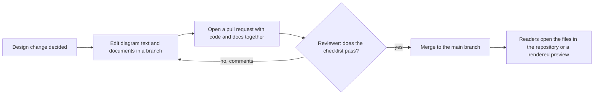

# 08. arc42 and architecture documentation as code

> **Draft: written but not yet run.** The code and the expected output in this lesson were prepared by reading the code and the official documentation. They have not been executed yet. If something does not behave as described, trust your tool's real output and report it.

## What you will be able to do
By the end of this lesson you will be able to:
- Organise architecture documentation using the twelve arc42 sections, writing only what a reader needs.
- Keep diagrams and decisions as text files in the repository so changes are reviewed like code.
- Review an architecture change with a concrete checklist.

## Recap
1. From 101 lesson 08: what are the parts of an ADR?
   <details><summary>Answer</summary>Status, context, options, decision, consequences, and a trigger for revisiting.</details>
2. From lesson 03: why is the `.drawio` source committed and not only a picture?
   <details><summary>Answer</summary>A picture is a copy; the source stays editable and a pull request shows what changed in it.</details>

## Why it matters
Architecture documents rot when they live somewhere other than the code: in a wiki nobody updates, in a slide deck, in one person's head. Two habits fix most of this: a **structure** so readers know where to look (arc42), and **documentation as code**, meaning the documents are text files in the same repository, changed in the same pull request as the design and reviewed with it.

## What you will build
For Tasks and Teams: 1. `docs-layout.md` (where files live), 2. `arc42.md` (a compact arc42 summary of the platform, two sections left as TODO for lesson 09), 3. `review-checklist.md`, 4. `docs-workflow.mmd` (the change process as a flowchart).

## Before you start
- **Prerequisites:** [Architecture 201 lesson 04, REST, events and gRPC](../phase-2-design-choices/04-rest-events-grpc.md) and [Architecture 101 lesson 08, architecture decision records](../../101-zero-to-hero/phase-3-documenting-decisions/08-architecture-decision-records.md).
- Lesson 07 done; same editor and preview. Work folder: `code101/architecture/201-lesson08`.
- Time: 70 minutes (reading 20, typing 25, exercise 25).
- Source pack (optional): every file is shown in full in this lesson, so you can follow without it. The finished code, the exercise starter and the solution are in the course repository https://github.com/Uee03/Code101 under `source/architecture/201-hero-to-super-hero/phase-3-documenting-and-reviewing/08-arc42-docs-as-code/` (on that page choose **Code, Download ZIP**, or run `git clone https://github.com/Uee03/Code101.git`).
- Pictures described below are expected, not yet rendered by the author.

## Steps
### Step 1. What arc42 is
**arc42** is a free template for architecture documentation with twelve numbered sections. You do not fill all of them to the same depth: the template is a table of contents that tells readers where to look and tells authors what they may have forgotten. The twelve sections: 1 Introduction and goals, 2 Architecture constraints, 3 Context and scope, 4 Solution strategy, 5 Building block view, 6 Runtime view, 7 Deployment view, 8 Crosscutting concepts, 9 Architecture decisions, 10 Quality requirements, 11 Risks and technical debt, 12 Glossary.

Map to what you already made: sections 3 and 5 are C4 levels 1 to 3 (lesson 10 writes level 3); 6 is the sequence diagrams (lessons 01 and 07); 7 is the deployment diagram (lesson 03); 9 is the ADRs (lessons 04 and 07); 10 and 11 come in lesson 09.

> **Why this, not that.** arc42 with C4, not C4 alone: C4 gives you diagrams, but not the goals, constraints, decisions, quality needs and risks around them. And not a custom template: a known structure means a new reader already knows where "deployment" is.

### Step 2. Save the layout
Create `docs-layout.md` in `code101/architecture/201-lesson08`. The inner fence is part of the file, so the lesson wraps it in four backticks.

**File: `docs-layout.md`**

````markdown
# Documentation layout

```text
docs/
  architecture/
    README.md                     start here: purpose, reading order, owner
    arc42.md                      the twelve sections, short, linking to the files below
    adr/
      0001-keep-rest.md
      0002-local-token-validation.md
    diagrams/
      context.mmd
      containers.mmd
      components-backend.mmd
      signin-pkce.mmd
      deployment.drawio
    quality/
      scenarios.md
      risks.md
```

Rules:
- One folder, in the same repository as the code it describes.
- Diagrams are text files (.mmd) or uncompressed XML (.drawio) so a pull request shows what changed.
- ADRs are numbered and never edited after acceptance; a later ADR supersedes an earlier one.
- Each file names an owner and a date in its first lines.
- An exported picture is a copy for slides, never the source.
````

### Step 3. Save the arc42 summary
Every statement below comes from the platform TDD. Where a section is not ready, it says TODO and names the lesson that writes it; an honest gap is better than a vague paragraph.

**File: `arc42.md`**

````markdown
# arc42 summary: Tasks and Teams platform

Source of every statement: capstones/platform/TDD.md. Sections that later lessons complete say so.

## 1. Introduction and goals
Tasks and Teams is a shared contract for a task-planning product: one API description, one database schema, one identity realm. Four backends and four clients implement or consume it. Top goals: interchangeable backends, correct access control, safe concurrent edits.

## 2. Architecture constraints
- One OpenAPI 3.1 file describes the API, versioned with the /v1 path prefix.
- PostgreSQL is the source of truth and Keycloak issues the tokens.
- The local stack publishes its ports on 127.0.0.1 only.

## 3. Context and scope
People use web and mobile clients. Clients call one backend API and sign in at Keycloak. See diagrams/context.mmd and diagrams/containers.mmd.

## 4. Solution strategy
- Contract first: clients and backends are checked against the same file.
- Atomic business rules live in Postgres functions, so four backends share one implementation.
- Strong ETags from a version column, cursor pagination and idempotency keys keep clients safe.

## 5. Building block view
Web client, mobile client, backend API, PostgreSQL and Keycloak. The backend has an HTTP layer, an application layer and a data layer; diagrams/components-backend.mmd shows them.

## 6. Runtime view
Sign-in with PKCE, token validation and an idempotent create. See diagrams/signin-pkce.mmd and the sequences in the architecture lessons.

## 7. Deployment view
The local stack runs Postgres and Keycloak in Docker Compose and the backend and web client as host processes. See diagrams/deployment.drawio.

## 8. Crosscutting concepts
- Errors are RFC 9457 problem details.
- Every write to teams, members, projects, tasks and comments is recorded in an audit trail by database triggers.
- Responses carry rate-limit headers; timestamps are UTC ISO 8601.

## 9. Architecture decisions
See adr/0001-keep-rest.md and adr/0002-local-token-validation.md. The TDD section 4 table lists more decisions that can become ADRs.

## 10. Quality requirements
TODO: quality scenarios, written in lesson 09 as quality/scenarios.md.

## 11. Risks and technical debt
TODO: risk register, written in lesson 09 as quality/risks.md.

## 12. Glossary
ETag: a version marker for one record. Idempotency key: a client-chosen value that makes a repeated create safe. Scope: what a token may be used for. Team: the unit that owns projects and tasks.
````

### Step 4. Save the review checklist
**File: `review-checklist.md`**

````markdown
# Architecture documentation review checklist

Use this list in every pull request that changes a design or its documents.

- [ ] The change that altered the design and the document that describes it are in the same pull request.
- [ ] Each diagram answers one stated question and fits on one screen.
- [ ] Every arrow in a diagram has a label that names data, a call or a protocol.
- [ ] Proposals are marked as proposals; nothing planned is drawn as if it exists.
- [ ] Any new decision has an ADR with options, costs and a trigger for revisiting it.
- [ ] Names in diagrams match names in the code, the contract and the glossary.
- [ ] No secrets, real tokens, real people or private addresses appear in text or diagrams.
- [ ] Each file names an owner and a date, and links point to files that exist.
- [ ] A reader outside the team can find the file from the architecture README.
````

### Step 5. Save the workflow diagram
**File: `docs-workflow.mmd`**



### Step 6. Save the preview file
Create `diagram-sources.md`: these three lines, then the **File** block above for `docs-workflow.mmd`.

```text
# Diagram sources, lesson 08

Each fenced block is the content of the .mmd file named above it.
```

### Step 7. Predict, then check
Predict: (1) how many `##` headings does `arc42.md` have, and which two contain TODO? (2) in the workflow diagram, which arrow forms a loop?

## Run it
Open `arc42.md` and `diagram-sources.md` in your preview.

Expected result, not yet rendered: `arc42.md` shows twelve numbered second-level headings; the workflow diagram shows six boxes (one diamond) and six arrows, one of them returning from the diamond to the editing box.

Predictions: (1) twelve; sections 10 and 11; (2) the arrow labelled "no, comments".

## How it works
**Docs as code** means treating documents like source files: versioned in Git, changed in branches, reviewed in pull requests, found next to the code. The workflow diagram is the whole idea: the design change and its documentation travel together, and the reviewer checks both. A reviewer who sees a changed API but no changed document has found a defect.

**Why text diagrams.** Mermaid and uncompressed draw.io XML are text, so a pull request shows "this arrow was added" instead of a changed picture. GitHub and VS Code render Mermaid inside Markdown fences (see 101 lesson 05 and the diagram-rendering page linked below).

**Why "no TODO sections silently".** The two TODO sections tell the reader what is missing. An empty or invented section would be worse than an honest gap.

**Why one source of truth.** The arc42 summary *links* to diagrams and ADRs; it does not copy them. Copies drift apart. Where a short statement is repeated (the goals), it should be derived from a primary document (here the TDD) and say so at the top.

**Review habits that work:** review documents in the same pull request as the change; keep each document short enough to review in one sitting; check names against the contract (the OpenAPI file) and the glossary; check that proposals look different from facts; ask "what would mislead a new reader?" rather than only "is this correct?".

**Misconception:** "documentation as code means generating documents from code." That is a different practice. Here, *humans write* the documents, but in files and workflows developers already use.

## Try it
### 1. Guided practice
Write three arc42 sections for the invented Community Library: goals, context and risks. Copy `exercise/starter` as `201-lesson08-try` (rename the **copy**) or create the file below. Replace each `TODO` with real sentences about a small library system; the facts are yours to invent, but mark them as invented.

**File: `201-lesson08-try/arc42-library.md` (starter)**
```markdown
# arc42 summary: Community Library

The Community Library is an invented small system: members borrow books from branches. Complete the three sections.

## 1. Introduction and goals
TODO: purpose in two sentences and the top three quality goals.

## 3. Context and scope
TODO: who uses it and which outside systems it talks to.

## 11. Risks and technical debt
TODO: two risks, each with a possible mitigation.
```

### 2. Change practice
Walk through the review checklist with the platform's `arc42.md`: find one line that you would challenge in review and write the review comment.

### 3. Stretch (optional)
Decide which of the twelve sections you would write first for a new, tiny project, and which two you would postpone. Give a reason for each.

<details><summary>Solution to guided practice</summary>

**File: `201-lesson08-try/arc42-library.md` (solution)**
```markdown
# arc42 summary: Community Library

The Community Library is an invented small system: members borrow books from branches. Complete the three sections.

## 1. Introduction and goals
The system lets members find books, borrow and return them at any branch, and lets librarians see who holds which copy. Top quality goals: a loan is never recorded twice for one copy, members' personal data stays private, and a branch can keep lending when the network is down for a short time.

## 3. Context and scope
Members use a web app and librarians use a staff screen. The system talks to an e-mail service for reminders and to a sign-in service for identities. Payments and book purchasing are outside the scope.

## 11. Risks and technical debt
- Risk: two branches lend the same copy at the same moment. Possible mitigation: one place decides loan state and refuses a second active loan for a copy.
- Risk: the e-mail service is down when reminders are due. Possible mitigation: queue reminders and retry later, and show overdue items on the staff screen.
```

For change practice, one possible comment: "Section 5 says the backend has three layers, but the file does not say which diagram is authoritative; link it or remove the sentence." For the stretch, a common answer: write 1 (goals), 3 (context) and 9 (decisions) first because they cost little and prevent the most confusion; postpone 7 and 12 until there is something to deploy and enough terms to define.

</details>

## Check yourself
1. What is the difference between arc42 and C4? <details><summary>Answer</summary>arc42 is a documentation structure (goals, constraints, views, decisions, quality, risks); C4 is a way to draw the structure views. They work together.</details>
2. Predict: a pull request changes the OpenAPI file but no architecture document. What should the reviewer ask? <details><summary>Answer</summary>Whether any document (ADR, runtime view, glossary) is now wrong or needs a new entry, or confirm that none is affected.</details>
3. Why are ADRs not edited after acceptance? <details><summary>Answer</summary>They are a record of what was decided and why at the time; a changed decision is a new ADR that supersedes the old one.</details>
4. Find the weakness: "The architecture document lives in the team wiki; the diagrams are screenshots." <details><summary>Answer</summary>The document is separated from the code and the diagrams cannot be reviewed or edited; both will drift out of date.</details>

## Common mistakes
| Symptom | Cause | Fix |
|---|---|---|
| Documents contradict the code | They are changed separately | Same pull request, checklist item one |
| Diagram copies in three files differ | Pasted copies | Keep one source, link to it |
| arc42 file is 40 pages and nobody reads it | Every section filled to the same depth | Write what a reader needs; link to details |
| A fence appears as text inside the Markdown file | The lesson's outer fence was copied | Copy only the content inside the four-backtick wrapper |

## Best practice
Keep the documents in the repository, change them with the code they describe, and review them with a checklist. Source: arc42, [documentation template](https://arc42.org/overview) and [documentation](https://docs.arc42.org/); GitHub Docs, [Creating diagrams](https://docs.github.com/en/get-started/writing-on-github/working-with-advanced-formatting/creating-diagrams).

## Going further
Read `docs.arc42.org` section 10 (quality requirements) before lesson 09, and compare the platform TDD's own structure with the twelve sections.

## Summary
- You organised platform documentation using the twelve arc42 sections and marked honest gaps.
- You kept diagrams and decisions as text files in one folder in the repository.
- You applied a review checklist and described the change workflow.

## Next lesson
09. Quality scenarios and risk analysis: fill sections 10 and 11 with checkable statements.
