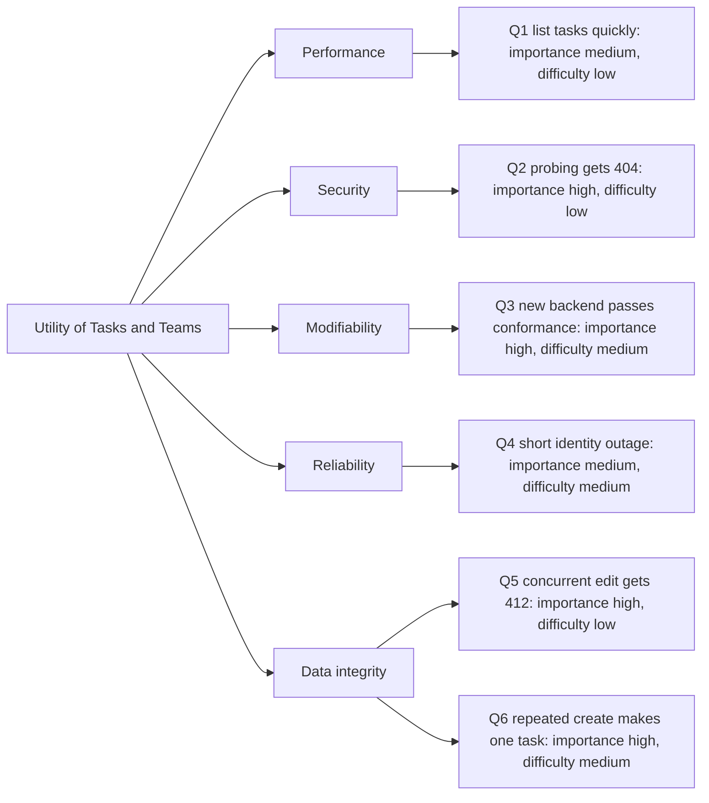

# 09. Quality scenarios and risk analysis (ATAM-lite)

> **Draft: written but not yet run.** The code and the expected output in this lesson were prepared by reading the code and the official documentation. They have not been executed yet. If something does not behave as described, trust your tool's real output and report it.

## What you will be able to do
By the end of this lesson you will be able to:
- Write a quality scenario with six parts (source, stimulus, environment, artifact, response, response measure) and a stated basis for its target.
- Build a small utility tree that ranks scenarios by importance and difficulty.
- Run an ATAM-lite review and record findings in a risk register with mitigation, trigger and owner.

## Recap
1. From 101 lesson 09: what makes a quality scenario better than "the system must be fast"?
   <details><summary>Answer</summary>It names a situation and a checkable result, so two people can agree whether it passed.</details>
2. From lesson 08: which arc42 sections do this lesson's files fill?
   <details><summary>Answer</summary>Section 10 (quality requirements) and section 11 (risks and technical debt).</details>

## Why it matters
Architecture is the set of decisions that are expensive to change, and their value is measured by the qualities they deliver: speed, security, changeability, resilience. A scenario turns a vague wish into a test someone can run, and a risk register turns doubts into owned work. Together they let a team argue about evidence instead of taste. The method here, **ATAM** (Architecture Tradeoff Analysis Method, from the Software Engineering Institute), is a structured review; we use a short form that one small team can finish in an afternoon.

## What you will build
Files for Tasks and Teams: 1. `scenarios.md` (six scenarios), 2. `utility-tree.mmd` (a tree), 3. `risks.md` (five risks), 4. `atam-lite.md` (the run sheet).

## Before you start
- **Prerequisites:** [Architecture 201 lesson 08, arc42 and docs as code](08-arc42-docs-as-code.md) and [Architecture 101 lesson 09, quality attributes and trade-offs](../../101-zero-to-hero/phase-3-documenting-decisions/09-quality-attributes-and-trade-offs.md).
- Lesson 08 done; same editor and preview. Work folder: `code101/architecture/201-lesson09`.
- Time: 75 minutes (reading 20, typing 25, exercise 30).
- Source pack (optional): every file is shown in full in this lesson, so you can follow without it. The finished code, the exercise starter and the solution are in the course repository https://github.com/Uee03/Code101 under `source/architecture/201-hero-to-super-hero/phase-3-documenting-and-reviewing/09-quality-scenarios-and-risks/` (on that page choose **Code, Download ZIP**, or run `git clone https://github.com/Uee03/Code101.git`).
- Pictures described below are expected, not yet rendered by the author.

## Steps
### Step 1. The six parts of a scenario
- **Source**: who or what causes the event. **Stimulus**: the event itself. **Environment**: the conditions (normal load, a failure, a deployment). **Artifact**: the part of the system that receives the stimulus. **Response**: what the system does. **Response measure**: how you decide it passed, with a number or an exact behaviour.

Numbers come from three honest places: a requirement already stated (cite it), a measurement you took (cite it), or a *proposal* marked as such. Never a number you made up to look precise. Each scenario below has a **Basis** line for exactly this.

### Step 2. Save the scenarios
Create `scenarios.md` in `code101/architecture/201-lesson09`. All facts come from the platform TDD sections 3, 5 and 6.

**File: `scenarios.md`**

````markdown
# Quality scenarios: Tasks and Teams platform

Each scenario has the same six parts. "Basis" says where the target comes from. A basis of "proposal" means the number or behaviour has to be agreed and measured first.

## Q1 Performance: listing tasks
- Source: a signed-in team member.
- Stimulus: asks for one page of tasks of a project.
- Environment: normal operation, seed data, local machine.
- Artifact: the backend API and the database.
- Response: the page is returned.
- Response measure: p95 under 200 ms over 25 local requests.
- Basis: platform TDD, non-functional requirements.

## Q2 Security: probing another team's task
- Source: a signed-in member of team A.
- Stimulus: requests a task id that belongs to team B.
- Environment: normal operation.
- Artifact: the backend API authorisation checks.
- Response: the API answers as if the task does not exist.
- Response measure: every such request returns 404 and no response reveals that the task exists.
- Basis: platform TDD, visibility rule. A test for it is a proposal.

## Q3 Modifiability: adding a backend
- Source: a developer.
- Stimulus: implements the contract in a new language.
- Environment: development, with the shared database and identity service.
- Artifact: the new backend.
- Response: the backend is checked against the contract by a black-box script.
- Response measure: the script reports 18 passed and 0 failed before the backend may claim the contract.
- Basis: platform README and TDD.

## Q4 Reliability: short identity outage
- Source: the identity service stops answering.
- Stimulus: clients keep sending requests with unexpired access tokens.
- Environment: normal operation, signing keys already cached by the backend.
- Artifact: the backend token validation.
- Response: requests with valid tokens are still served; new sign-ins fail.
- Response measure: service continues until the access tokens expire, 5 minutes in the realm settings.
- Basis: platform TDD, token lifetime, and ADR 0002.

## Q5 Data integrity: concurrent edit
- Source: two members.
- Stimulus: both send a change to the same task using the same version in If-Match.
- Environment: normal operation.
- Artifact: the task update rule.
- Response: the first change is applied; the second is refused.
- Response measure: the second request returns 412 and no change is lost.
- Basis: platform TDD, concurrency rules.

## Q6 Data integrity: repeated create
- Source: a client that timed out.
- Stimulus: sends the same create request again with the same Idempotency-Key.
- Environment: within the 24 hours the key is kept.
- Artifact: the create endpoint and the key store.
- Response: the first response is replayed.
- Response measure: exactly one task exists and the reply carries Idempotent-Replayed true.
- Basis: platform TDD, idempotency rules.
````

### Step 3. Save the utility tree
A **utility tree** has the overall goal at the root, quality attributes in the middle and scenarios as leaves, each rated. The ratings below are example judgements for discussion; your team would set its own.

**File: `utility-tree.mmd`**



### Step 4. Save the preview file
Create `diagram-sources.md`: these three lines, then the **File** block above for `utility-tree.mmd`.

```text
# Diagram sources, lesson 09

Each fenced block is the content of the .mmd file named above it.
```

### Step 5. Save the risk register
A **risk** here is a decision that may make a scenario fail. Each row has a mitigation (what the design already does), a trigger (the observable event that makes the team act) and an owner.

**File: `risks.md`**

````markdown
# Risk register: Tasks and Teams platform

Likelihood and impact are judgements for discussion (low, medium, high), not measurements. Update them when you measure.

| Id | Risk | Scenario | Likelihood | Impact | Mitigation in the design | Trigger to act | Owner |
|---|---|---|---|---|---|---|---|
| R1 | A leaked or revoked token keeps working until it expires | Q4 | Medium | High | Short access token life, refresh token rotation, tokens never logged | A review demands immediate revocation for some operation | Platform maintainers |
| R2 | Business rules in database functions are harder to unit test and need a migration to change | Q5 | Medium | Medium | One shared implementation, a smoke script for the functions, numbered migrations | A rule changes more often than migrations can be reviewed | Platform maintainers |
| R3 | The identity realm is imported once, so later edits made by hand drift away from the file in the repository | Q4 | Medium | Medium | Document changes made through the admin interface and export them back | A second environment differs from the file | Platform maintainers |
| R4 | The design has one PostgreSQL database with no replica, so its failure stops every operation | Q4 | Low | High | Backups and a tested restore described in a runbook (not yet written), replicas considered in [Architecture 301 lesson 01, scaling to millions](../../301-super-hero-to-legendary/phase-1-scale/01-scaling-to-millions.md) | A recovery objective is agreed that one instance cannot meet | Platform maintainers |
| R5 | Backends could drift from the contract in areas the conformance script does not cover: it runs 14 API checks and the contract has 27 operations | Q3 | Medium | Medium | Backend capstone tests for the remaining operations | A client bug traced to an unchecked operation | Backend owners |
````

### Step 6. Save the run sheet
**File: `atam-lite.md`**

````markdown
# ATAM-lite run sheet

ATAM is the Architecture Tradeoff Analysis Method. This short form fits a team of two to five people and one to two hours.

1. State the system, its purpose and the scope of the review in three sentences.
2. List the business drivers: why the system exists and what must not go wrong.
3. Build a utility tree: quality attributes at the top, concrete scenarios at the leaves.
4. Rate each scenario for importance and for difficulty, high, medium or low, and discuss disagreements.
5. For each scenario rated high on both, name the architecture decision that serves it and ask how it could fail.
6. Record each finding as one of: risk, non-risk, sensitivity point or trade-off point.
7. Write the risks into the register with a mitigation, a trigger and an owner.

Finding types:
- Risk: a decision that may cause a scenario to fail.
- Non-risk: a decision that is sound for the scenario and why.
- Sensitivity point: a property where a small change strongly affects a quality.
- Trade-off point: one decision that improves one quality and worsens another.
````

### Step 7. Predict, then check
Predict: (1) which scenarios have the highest importance in the example ratings? (2) which scenario is linked to the most risks in the register?

## Run it
Open `diagram-sources.md` and the three Markdown files in your preview.

Expected result, not yet rendered: the utility tree has twelve boxes in three columns (root, five attributes, six scenarios) and eleven arrows. `scenarios.md` shows six second-level headings, each with seven bullet lines. `risks.md` shows a table with five rows.

Predictions: (1) Q2, Q3, Q5 and Q6 are rated high importance. None is high on *both* importance and difficulty in the example ratings, so a team with limited time would start with Q3 and Q6, the high-importance scenarios with the greatest difficulty; (2) Q4, which is linked to three risks (R1, R3 and R4).

## How it works
**Scenario Q2** shows the pattern. The response measure is behavioural ("every request returns 404, and no response reveals existence") and the basis admits that the *test* is still a proposal. That is honest: the requirement is in the TDD, the check is not yet written.

**Why a basis line.** Q1's "p95 under 200 ms over 25 local requests" is quoted from the TDD *with its measurement conditions*. Without them (local machine, seed data, 25 requests), the number would suggest a production guarantee it never made.

**The utility tree** forces a ranking. A team that says "everything is important" has not made a decision. Rate importance for the business and difficulty for the architecture; the scenarios high on both are where reviews pay off.

**Reading a risk row.** R4 says: *the design has one PostgreSQL database with no replica*. That is not a bug; it is a decision with a consequence. The mitigation lists what the design already offers (here: a runbook that is *not yet written*, which the row says plainly). The trigger is an observable event, not a feeling.

**Sensitivity and trade-off points.** The 5-minute token life is a *sensitivity point* for Q4 and R1: lengthening it improves outage tolerance but lengthens the window for a leaked token. That one setting is also a *trade-off point*, because it improves one quality (availability under an identity outage) and worsens another (security). Writing such points down is the main benefit of the method.

> **Why this, not that.** ATAM-lite, not a full ATAM: the full method involves many stakeholders over days and suits large systems. The short form keeps the useful steps (scenarios, utility tree, risks, trade-offs) for a team of a few people. Not a checklist of buzzwords either: "scalable, secure, maintainable" are labels, not requirements.

**Misconception:** "a risk register is a list of things that will go wrong." It is a list of *decisions with consequences*, ordered so the team knows what to watch.

## Try it
### 1. Guided practice
Write scenario Q7 about protecting the audit trail. The platform requirement R-23 says the application role cannot alter the schema or the audit log. Copy `exercise/starter` as `201-lesson09-try` (rename the **copy**) or create the file below, then replace each `TODO`.

**File: `201-lesson09-try/q7.md` (starter)**
```markdown
# Scenario to complete

## Q7 Integrity: protecting the audit trail
- Source: TODO
- Stimulus: TODO
- Environment: TODO
- Artifact: TODO
- Response: TODO
- Response measure: TODO
- Basis: platform TDD, requirement R-23.
```

### 2. Change practice
Add a row R6 to the risk register about the rate limit. Look up the platform's limits in TDD section 6 and decide a likelihood, impact, mitigation, trigger and owner.

### 3. Stretch (optional)
Pick one of your trade-off points and write a three-line ADR for it (title, decision, revisit trigger).

<details><summary>Solution to guided practice</summary>

**File: `201-lesson09-try/q7.md` (solution)**
```markdown
# Scenario to complete

## Q7 Integrity: protecting the audit trail
- Source: a compromised or faulty backend process.
- Stimulus: tries to change or delete a row of the audit log.
- Environment: normal operation, connected as the limited application role.
- Artifact: the database permissions of the application role.
- Response: the database refuses the change and the audit rows stay as written.
- Response measure: every such statement fails with a permission error and the row count of the audit log does not decrease.
- Basis: platform TDD, requirement R-23.
```

For change practice, a sound R6: "Clients that legitimately exceed the per-user request limit receive 429 errors (likelihood and impact are judgement); mitigation: the documented `Retry-After` header and client back-off; trigger: support reports of 429 for normal use; owner: backend owners." Do not invent a replacement number; the TDD states the current limits.

</details>

## Check yourself
1. Which part of a scenario makes it testable? <details><summary>Answer</summary>The response measure, together with the stimulus and environment that define when it applies.</details>
2. Predict: a scenario says "response time under 100 ms" with no environment. Why is it weak? <details><summary>Answer</summary>Without load, data size and machine, the number cannot be checked or compared, and it may be an unmeasured guess.</details>
3. What is the difference between a risk and a trade-off point? <details><summary>Answer</summary>A risk is a decision that may make a scenario fail. A trade-off point is a decision that improves one quality and worsens another.</details>
4. Find the weakness: "Trigger: if it becomes a problem." <details><summary>Answer</summary>It is not observable. Name the event, the measurement or the report that causes action.</details>

## Common mistakes
| Symptom | Cause | Fix |
|---|---|---|
| Every scenario is rated "high" | No ranking was forced | Rate importance and difficulty separately; limit the number of highs |
| A precise number with no source | Made up to sound credible | Cite a requirement or measurement, or write "proposal, measure first" |
| Risks without owners | Nobody is asked to watch them | Add an owner and a trigger to every row |
| Scenarios describe features, not qualities | "Users can create tasks" is a feature | Ask how well and under which conditions |

## Best practice
Write quality needs as scenarios with a measurable response and an honest basis, then review the decisions that serve the important ones. Source: arc42, [Quality requirements](https://docs.arc42.org/section-10/) and [Risks and technical debt](https://docs.arc42.org/section-11/); AWS, [Well-Architected Framework](https://aws.amazon.com/architecture/well-architected/).

## Going further
The Well-Architected pillars (reliability, security, performance efficiency, cost optimisation, operational excellence, sustainability) are another checklist of quality attributes to prompt scenarios. Level 301 lesson 09 uses scenarios and risks to review a whole design.

## Summary
- You wrote six-part scenarios with a stated basis and no invented numbers.
- You built a utility tree that ranks scenarios.
- You ran ATAM-lite thinking and recorded risks with mitigation, trigger and owner.

## Next lesson
10. Project: an architecture package for a chosen system: C4 levels 1 to 3, ADRs, scenarios and risks.
