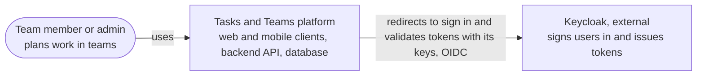
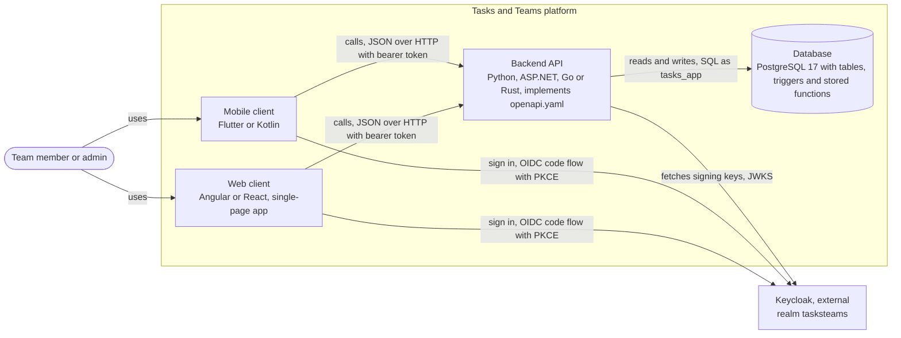
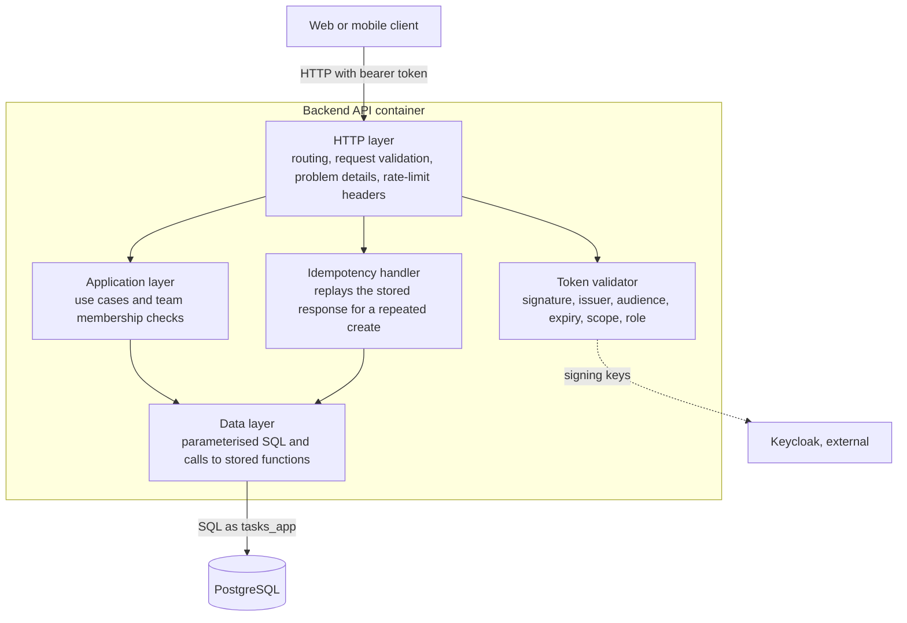
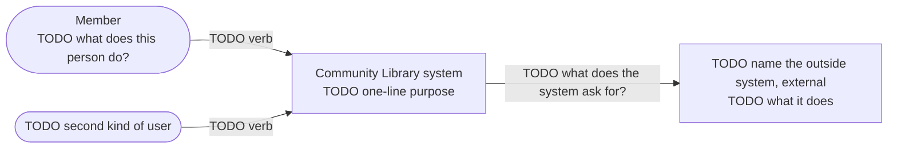
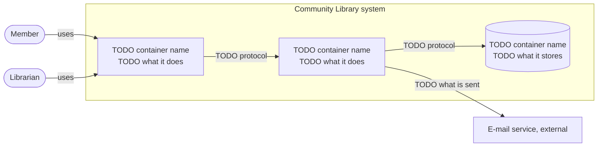
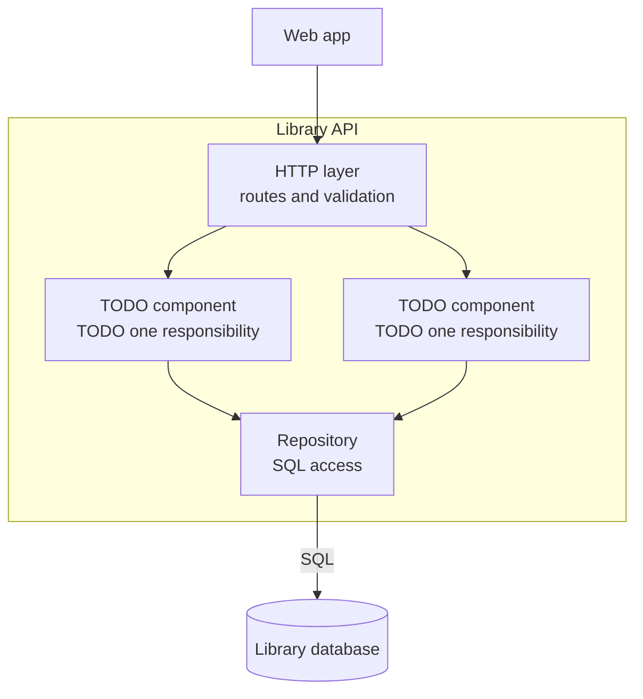
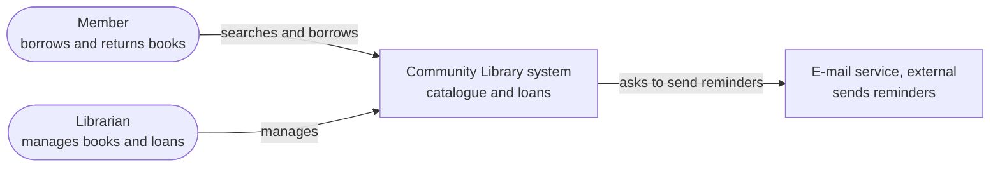
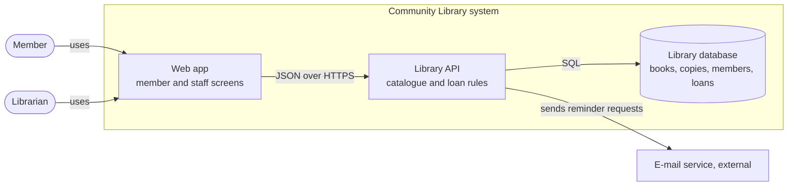
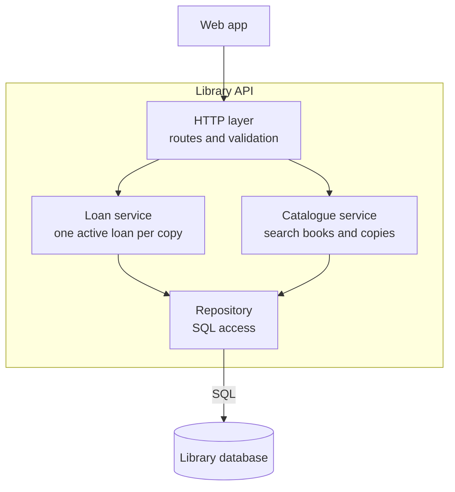

# 10. Project: an architecture package for a system

> **Draft: written but not yet run.** The code and the expected output in this lesson were prepared by reading the code and the official documentation. They have not been executed yet. If something does not behave as described, trust your tool's real output and report it.

## What you will be able to do
By the end of this lesson you will be able to:
- Assemble an architecture package: C4 levels 1 to 3, ADRs, quality scenarios, risks and a traceability table, in one reviewable folder.
- Check that the pieces agree: names, scenarios, decisions and risks trace to each other.
- Produce a complete package for a small system of your choice.

## Recap
1. From lesson 09: what are the six parts of a scenario?
   <details><summary>Answer</summary>Source, stimulus, environment, artifact, response, response measure.</details>
2. From lesson 08: where do diagrams live in the documentation layout, and in what form?
   <details><summary>Answer</summary>In `diagrams/`, as text files (`.mmd`) or uncompressed XML (`.drawio`).</details>
3. From 101 lesson 06: what does a C4 container view show?
   <details><summary>Answer</summary>The applications and data stores inside the system boundary, and how they talk.</details>

## Why it matters
Each earlier lesson produced one document. A reader needs them as one *package* with an order, a stated boundary and links between them. This lesson shows what a complete, reviewable package looks like for a real design (Tasks and Teams) and asks you to build one for a system you choose. It is the portfolio piece of the level.

## What you will build
**Part A (guided, worked example).** You add C4 level 3, a third ADR and a traceability table to the platform package, then assemble the folder from lessons 03 to 09.
**Part B (project).** You build a package for a small system of your own. A complete example answer for the invented Community Library is in the solution.

## Before you start
- **Prerequisites:** Architecture 201 lessons [01, sequence diagrams for real flows](../phase-1-diagram-depth/01-sequence-diagrams-real-flows.md) to [09, quality scenarios and risks](09-quality-scenarios-and-risks.md).
- Lessons 01 to 09 done; the same editor and preview. Work folder: `code101/architecture/201-lesson10`.
- Time: 150 minutes in two sittings. Part A about 60 minutes (break after Step 6), Part B about 90 minutes.
- Source pack (optional): every file is shown in full in this lesson, so you can follow without it. The finished code, the exercise starter and the solution are in the course repository https://github.com/Uee03/Code101 under `source/architecture/201-hero-to-super-hero/phase-3-documenting-and-reviewing/10-project-architecture-package/` (on that page choose **Code, Download ZIP**, or run `git clone https://github.com/Uee03/Code101.git`).
- Pictures described below are expected, not yet rendered by the author.

## Steps
### Step 1. Lay out the package folder
In `code101/architecture/201-lesson10` create a folder `package` with the layout from lesson 08: subfolders `adr`, `diagrams`, `quality`. Copy into it the finished files from your earlier lesson folders:
- `adr/0001-keep-rest.md` (lesson 04) and `adr/0002-local-token-validation.md` (lesson 07);
- `diagrams/signin-pkce.mmd` (lesson 01) and `diagrams/deployment.drawio` (lesson 03);
- `quality/scenarios.md` and `quality/risks.md` (lesson 09);
- `arc42.md` (lesson 08), placed directly in `package`.

Expected result: the folder lists 7 files in total across the subfolders and `package` itself, before you add anything.

### Step 2. C4 level 1 (context)
C4 has four zoom levels: **context** (the system and its neighbours), **containers**, **components** (parts inside one container) and code. We use ordinary Mermaid flowcharts with C4 meaning, as in 101 lesson 06, not Mermaid's experimental C4 syntax. Save as `package/diagrams/context.mmd`.

**File: `context.mmd`**



### Step 3. C4 level 2 (containers)
Save as `package/diagrams/containers.mmd`. Keycloak is external here; the platform TDD draws it inside the boundary. Both are valid; the package README states the choice.

**File: `containers.mmd`**



### Step 4. C4 level 3 (components of the backend)
Zoom into *one* container. This is a teaching decomposition built from the TDD's statement that backends have an HTTP layer, an application layer and a data layer, plus the token and idempotency rules from lessons 01 and 07; each backend capstone organises its own code. Save as `package/diagrams/components-backend.mmd`.

**File: `components-backend.mmd`**



### Step 5. Save the preview file
Create `diagram-sources.md` (anywhere you like, for example `package/diagrams/`): these three lines, then the three **File** blocks above in order (`context.mmd`, `containers.mmd`, `components-backend.mmd`).

```text
# Diagram sources, lesson 10

Each fenced block is the content of the .mmd file named above it.
```

### Step 6. Save the third ADR
**File: `0003-rules-in-database-functions.md`** (save into `package/adr/`)

````markdown
# ADR 0003: Keep atomic business rules in database functions

Status: Accepted (recorded after the fact from the platform TDD, section 4)
Date: 2026-11-23
Owner: Platform maintainers

## Context
Four backends in four languages must complete a task, reassign a task and create a team in exactly the same way, even when two requests arrive at once.

## Options
- Write each rule in every backend. Cost: four implementations that can drift apart.
- Put each rule in one database function that locks the rows and checks the version. Cost: harder to unit test, and every change needs a migration.

## Decision
Keep the atomic rules in database functions and let the backends call them.

## Consequences
- Benefit: the rule exists once, and a concurrent change cannot interleave with it.
- Cost or risk: the rule is tested through the database, and a change to it is a migration, not only a code change.

## Revisit when
A rule changes more often than migrations can be reviewed, or a backend needs a rule the functions cannot express. Reviewer: the platform maintainers.
````

**Break here if you need one.** Part A continues with the traceability table and the package README.

### Step 7. Save the traceability table
Traceability means every quality scenario leads to a decision, a diagram and a risk. Gaps are findings, not failures. Save in `package/quality/traceability.md`.

**File: `traceability.md`**

````markdown
# Traceability: scenarios, decisions, diagrams and risks

Every quality scenario should lead to a decision that serves it, a diagram that shows it and a risk that watches it. Empty cells are gaps to close.

| Scenario | Decision | Diagram | Risk |
|---|---|---|---|
| Q1 listing tasks | Cursor pagination on indexed columns, no ADR yet | components-backend.mmd | none yet |
| Q2 probing another team | Team membership check, 404 for non-members, no ADR yet | components-backend.mmd | none yet |
| Q3 adding a backend | ADR 0001 keep REST, contract first | containers.mmd | R5 |
| Q4 short identity outage | ADR 0002 local token validation | containers.mmd | R1, R3, R4 |
| Q5 concurrent edit | ADR 0003 rules in database functions | components-backend.mmd | R2 |
| Q6 repeated create | Idempotency handler, no ADR yet | components-backend.mmd | none yet |
````

### Step 8. Save the package README
The README is the front door: owner, date, reading order, the boundary choice and what is *not* covered. Save as `package/README.md`.

**File: `README.md`**

````markdown
# Architecture package: Tasks and Teams platform

Owner: Platform maintainers. Date: 2026-11-23. Status: teaching example built from capstones/platform/TDD.md. Proposals are marked as proposals in each file.

## Read in this order
1. arc42.md: the twelve sections in short form (lesson 08).
2. diagrams/context.mmd: who uses the platform and what it depends on (C4 level 1).
3. diagrams/containers.mmd: the applications and the database (C4 level 2).
4. diagrams/components-backend.mmd: the parts inside the backend API (C4 level 3).
5. adr/: decisions with options and costs (0001, 0002, 0003).
6. quality/scenarios.md and quality/risks.md: what must hold and what may go wrong (lesson 09).
7. quality/traceability.md: how the above connect.

## Boundary choice
The context and container views treat Keycloak as an external system. The platform TDD draws it inside the container boundary. Both are valid; this package states its choice so readers do not compare unlike pictures.

## Not covered
Mobile client internals, the full schema, production hosting and any feature marked as a proposal elsewhere.
````

### Step 9. Review the package against the checklist
Open lesson 08's `review-checklist.md` and walk through each item. Fix at least one defect you find (for example, the three scenarios without an ADR in the traceability table).

## Run it
Open `diagram-sources.md` in your preview, then read the README as a new reader would.

Expected result, not yet rendered: three flowcharts. The context has three shapes and two arrows. The containers diagram has a titled group with four shapes, two outside shapes (the user and Keycloak) and eight arrows. The components diagram has a titled group of five shapes, three outside shapes and eight arrows, one of them dashed.

The package folder contains: `README.md`, `arc42.md`, `adr/` (3 files), `diagrams/` (5 files: `signin-pkce.mmd`, `deployment.drawio`, `context.mmd`, `containers.mmd`, `components-backend.mmd`), `quality/` (3 files: `scenarios.md`, `risks.md`, `traceability.md`).

## How it works
**Zoom levels.** Each C4 level answers a different question for a different reader: the manager (context), the developer joining the team (containers), the developer changing one container (components). A level 3 diagram exists only for the containers that need one; most do not.

**Consistency checks you did by hand.** Names match across diagrams (`Backend API`, `Keycloak`, `PostgreSQL`); each external system appears as external in every view; the arrows into the database come only from the API; the scenario ids in the traceability table exist in `scenarios.md`; the risk ids exist in `risks.md`. These are the same checks a reviewer makes. Inconsistent names are the most common defect in architecture packages.

**Traceability shows gaps honestly.** Three of six scenarios have no ADR yet and the same three have no risk. That is useful information: those are the next documents to write, not a reason to hide the table.

**The boundary note** in the README prevents a quiet source of confusion: someone compares your container diagram with the TDD's and thinks one of them is wrong.

> **Why this, not that.** A small package kept in the repository, not a large document produced once: the package is reviewed with every design change (lesson 08), so a short, linked set of files stays true longer than one long file. And C4 levels 1 to 3, not all four: level 4 (code) is better shown by the code itself.

**Misconception:** "more diagrams mean better documentation." Each diagram needs a reader and a question; a diagram without one is maintenance cost.

## Try it
### 1. Guided practice: finish the Community Library package
The Community Library (an invented system) has a starter with five files: three diagrams, one ADR and one quality file. Copy `exercise/starter` as `201-lesson10-try` (rename the **copy**) or create the files below, then replace every `TODO`. Keep names consistent across files.

<details><summary>Complete starter files</summary>

**File: `201-lesson10-try/context.mmd` (starter)**


**File: `201-lesson10-try/containers.mmd` (starter)**


**File: `201-lesson10-try/components.mmd` (starter)**


**File: `201-lesson10-try/adr-0001.md` (starter)**
```markdown
# ADR 0001: TODO decision title

Status: Proposed
Date: 2026-11-23
Owner: TODO

## Context
TODO: why a decision is needed, in two sentences.

## Options
- TODO option A and its cost.
- TODO option B and its cost.

## Decision
TODO: choose one.

## Consequences
- Benefit: TODO
- Cost or risk: TODO

## Revisit when
TODO: an observable trigger and a reviewer.
```

**File: `201-lesson10-try/quality.md` (starter)**
```markdown
# Quality scenarios and risks: Community Library

## Q1 TODO quality name
- Source: TODO
- Stimulus: TODO
- Environment: TODO
- Artifact: TODO
- Response: TODO
- Response measure: TODO
- Basis: proposal, measure first.

## Q2 TODO quality name
- Source: TODO
- Stimulus: TODO
- Environment: TODO
- Artifact: TODO
- Response: TODO
- Response measure: TODO
- Basis: proposal, measure first.

## Risks
| Id | Risk | Scenario | Likelihood | Impact | Mitigation | Trigger to act | Owner |
|---|---|---|---|---|---|---|---|
| R1 | TODO | Q1 | TODO | TODO | TODO | TODO | TODO |
| R2 | TODO | Q2 | TODO | TODO | TODO | TODO | TODO |
```

</details>

### 2. Change practice: your own system
Choose a small system you know (a club booking site, a shop, a school timetable) or use one you invent. Build its package: `README.md`, three C4 diagrams, one ADR, two scenarios, two risks and a traceability table. Mark invented facts as invented. Do not use real credentials, real people or private addresses.

### 3. Stretch (optional)
Give the package to a colleague who has not seen it. Ask them to answer three questions from it alone: who uses the system, what happens if the database is down, and which decision they would challenge. Record what they could not find.

<details><summary>Solution to guided practice (Community Library)</summary>

**File: `201-lesson10-try/context.mmd` (solution)**


**File: `201-lesson10-try/containers.mmd` (solution)**


**File: `201-lesson10-try/components.mmd` (solution)**


**File: `201-lesson10-try/adr-0001.md` (solution)**
```markdown
# ADR 0001: One place decides whether a copy is on loan

Status: Proposed
Date: 2026-11-23
Owner: Library system team

## Context
Two branches may lend the same physical copy at nearly the same moment. A double loan makes one member wait for a book the system said was free.

## Options
- Each branch screen checks availability and then records the loan. Cost: two checks can both pass.
- The Library API records a loan only if the copy has no active loan, as one step in the database. Cost: every branch depends on the API being reachable.

## Decision
The Library API decides, using one database step that refuses a second active loan for a copy.

## Consequences
- Benefit: a copy can never be on loan twice.
- Cost or risk: a branch cannot lend while the API or the database is down.

## Revisit when
Branches report that lending stops during outages often enough to matter. Reviewer: the library system team.
```

**File: `201-lesson10-try/quality.md` (solution)**
```markdown
# Quality scenarios and risks: Community Library

## Q1 Integrity: no double loan
- Source: two librarians at different branches.
- Stimulus: both lend the same copy at nearly the same moment.
- Environment: normal operation.
- Artifact: the loan rule in the Library API and database.
- Response: one loan is recorded and the other is refused with a clear message.
- Response measure: the copy has exactly one active loan afterwards.
- Basis: proposal, measure first.

## Q2 Privacy: member data
- Source: a member.
- Stimulus: asks for another member's loan history.
- Environment: normal operation.
- Artifact: the access checks of the Library API.
- Response: the request is refused without revealing that the history exists.
- Response measure: every such request returns the same not-found answer.
- Basis: proposal, measure first.

## Risks
| Id | Risk | Scenario | Likelihood | Impact | Mitigation | Trigger to act | Owner |
|---|---|---|---|---|---|---|---|
| R1 | Lending stops when the API or database is down | Q1 | Low | High | Backups and a recovery plan; staff write loans on paper during short outages | Outages reported by branches | Library system team |
| R2 | Reminder e-mails fail silently | Q2 | Medium | Low | Show overdue loans on the staff screen as well | Members report missing reminders | Library system team |
```

Your own package will differ. A good one passes the consistency checks above: matching names, external systems drawn as external in every view, ids that exist, and a README with a boundary note. The facts in this solution are invented for teaching.

</details>

## Check yourself
1. What question does C4 level 3 answer that level 2 does not? <details><summary>Answer</summary>What the main parts inside one container are and how they depend on each other.</details>
2. Predict: you rename `Backend API` to `API` in `containers.mmd` only. What breaks? <details><summary>Answer</summary>The package is inconsistent: other diagrams, the README and ADRs still use the old name, so a reader cannot tell if they mean the same part.</details>
3. Why does the README have a "Not covered" section? <details><summary>Answer</summary>It tells readers what they will not find, so missing detail is not mistaken for an oversight.</details>
4. Find the gap: the traceability table shows Q6 with no risk. What do you do? <details><summary>Answer</summary>Decide whether there is a decision worth watching; if so, add a risk with mitigation, trigger and owner, otherwise write why none is needed.</details>

## Common mistakes
| Symptom | Cause | Fix |
|---|---|---|
| A diagram preview fails (typical: a parse error) | An unquoted label with special characters, or `subgraph` without `end` | Quote every label and close every `subgraph` |
| Reviewers cannot match diagrams to the ADRs | Different names for the same part | Use one glossary of names |
| The package has no README | The reading order lives in the author's head | Add the README with an order, a boundary note and a not-covered list |
| Invented facts look real | Not marked | Write "invented" or "proposal" where the source is not a real document |

## Best practice
Ship the architecture as a small, linked package with a stated boundary and traceability from scenarios to decisions, and review it like code. Source: C4 model, [Diagrams](https://c4model.com/diagrams); arc42, [documentation](https://docs.arc42.org/).

## Going further
Level 301 starts with scaling and trade-offs and ends with a written review of the platform and P07 designs, using a package like this as its input.

## Summary
- You added C4 level 3, a third ADR and a traceability table to a package.
- You assembled and checked a package: reading order, boundary note, consistent names.
- You built (or completed) a package for a system of your choice.

## Next lesson
Level 301, lesson 01: Scaling from one server to millions.
