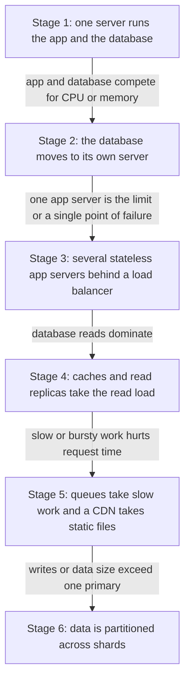
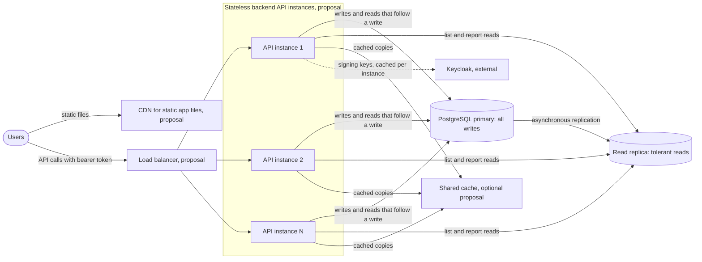
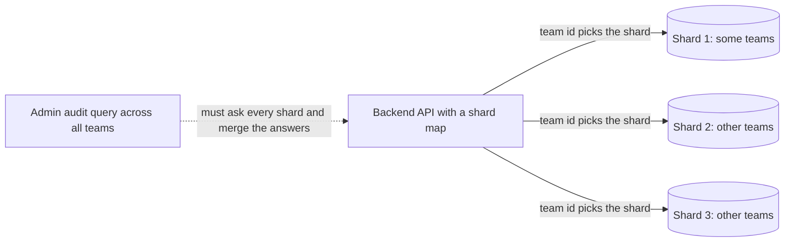

# 01. Scaling from one server to millions

> **Draft: written but not yet run.** The code and the expected output in this lesson were prepared by reading the code and the official documentation. They have not been executed yet. If something does not behave as described, trust your tool's real output and report it.

## What you will be able to do
By the end of this lesson you will be able to:
- Describe the usual scaling path in stages and the measured bottleneck that justifies each step.
- Decide what must be stateless, what may be cached and what must read from the primary database.
- Choose a shard key and list what sharding costs, and state when not to shard.

## Recap
1. From 201 lesson 05: what does a cache-aside read do on a miss?
   <details><summary>Answer</summary>It reads the database, stores a copy with a lifetime, and returns the data; a write removes the copy.</details>
2. From 201 lesson 07: why does a backend validate tokens itself even behind a gateway?
   <details><summary>Answer</summary>Only the backend knows the objects, and the network path might one day bypass the gateway.</details>

## Why it matters
Most systems never need "millions". The danger runs both ways: building for a scale you do not have makes the system slow to change, and waiting until it breaks makes the fix an emergency. The skill is to know the ladder, to climb one rung at a time, and to climb only when a **measurement** says so. This lesson uses Tasks and Teams to show what each rung asks of the design and what it costs.

## What you will build
For Tasks and Teams (all scaled designs are proposals; the platform is a contract and a local stack):
1. `scaling-stages.mmd`: the six-stage ladder with the trigger for each step.
2. `scaled-platform.mmd`: a larger design with a load balancer, stateless instances, a cache and a read replica.
3. `sharding-by-team.mmd`: a shard map chosen by team id.
4. `scaling-worksheet.md`: what to measure at each stage.
5. `0001-read-replica.md`: an ADR about which reads may go to a replica.

## Before you start
- **Prerequisites:** Architecture 201 lessons [05, caching and CDNs](../../201-hero-to-super-hero/phase-2-design-choices/05-caching-and-cdns.md), [06, queues, streams and async work](../../201-hero-to-super-hero/phase-2-design-choices/06-queues-streams-async-work.md) and [10, project architecture package](../../201-hero-to-super-hero/phase-3-documenting-and-reviewing/10-project-architecture-package.md).
- 201 finished. Same editor and preview. Work folder: `code101/architecture/301-lesson01`.
- Time: 80 minutes (reading 25, typing 25, exercise 30).
- Source pack (optional): every file is shown in full in this lesson, so you can follow without it. The finished code, the exercise starter and the solution are in the course repository https://github.com/Uee03/Code101 under `source/architecture/301-super-hero-to-legendary/phase-1-scale/01-scaling-to-millions/` (on that page choose **Code, Download ZIP**, or run `git clone https://github.com/Uee03/Code101.git`).
- Pictures described below are expected, not yet rendered by the author. This lesson contains no performance numbers: a capacity number without your own measurement is a guess.

## Steps
### Step 1. Save the ladder
Create `scaling-stages.mmd` in `code101/architecture/301-lesson01`. Each arrow carries the *trigger* that justifies the move.

**File: `scaling-stages.mmd`**



### Step 2. Save the scaled platform
Create `scaled-platform.mmd`. It is a design proposal: the platform capstone ships one backend on one Postgres.

**File: `scaled-platform.mmd`**



The `&` form means "each of these shapes has this arrow".

### Step 3. Save the shard map
Create `sharding-by-team.mmd`.

**File: `sharding-by-team.mmd`**



### Step 4. Save the preview file
Create `diagram-sources.md`: these three lines, then the three **File** blocks above in order (`scaling-stages.mmd`, `scaled-platform.mmd`, `sharding-by-team.mmd`).

```text
# Diagram sources, lesson 01

Each fenced block is the content of the .mmd file named above it.
```

### Step 5. Save the worksheet
**File: `scaling-worksheet.md`**

````markdown
# Scaling worksheet

Fill the measurement column before you change anything. A stage is added only when a measured bottleneck points to it.

| Stage | Question to answer with a measurement | Signal to read | What the stage adds | How hard it is to undo |
|---|---|---|---|---|
| 2 Separate database | Do the app and the database compete for the same machine? | CPU, memory and disk use of each process | A network hop and a second machine to run | Easy |
| 3 Stateless instances and load balancer | Is one app instance saturated or a single point of failure? | CPU and request queue per instance, error rate during a restart | A load balancer, health checks, shared state moved out of the app | Easy to medium |
| 4 Cache and read replica | Which reads repeat, and do they dominate the database load? | Slow query list, cache hit ratio, replica lag | Stale reads, invalidation, read-after-write rules | Medium |
| 5 Queue and CDN | Which work is slow or bursty, and which files are the same for everyone? | Request time by endpoint, backlog, share of bytes that are static | A broker, duplicates, a backlog to watch | Medium |
| 6 Shards | Does one primary reach its write or size limit even after tuning? | Write rate, storage growth, vacuum and index build time | Cross-shard queries, a shard map, resharding work | Hard |

Measure these at every stage: request rate, p95 latency per endpoint, error rate, CPU, memory, database connections in use, slow queries, cache hit ratio, replica lag.
````

### Step 6. Save the ADR
**File: `0001-read-replica.md`**

````markdown
# ADR 0001: Send only tolerant reads to a read replica

Status: Proposed
Date: 2026-11-23
Owner: Platform maintainers

## Context
If measurement shows that reads dominate the primary database, a read replica can take some of them. Replication is asynchronous, so a replica can lag behind the primary. The platform uses ETag and If-Match: a client that reads an old version from a lagging replica and then sends an update with that version receives a 412.

## Options
- Send every read to the replica. Cost: read-after-write surprises and avoidable 412 responses.
- Send only list and report reads to the replica, and read a single object from the primary when the client is about to change it. Cost: two routes to configure and test.
- Do not add a replica yet. Cost: the primary stays the bottleneck.

## Decision
Adopt the second option only after a measurement shows that reads dominate the primary.

## Consequences
- Benefit: the primary has fewer reads and the update protocol keeps working.
- Cost or risk: lists can be briefly out of date, and the lag must be monitored.

## Revisit when
Measured replica lag makes lists too stale for users, or reads on the primary are no longer the bottleneck. Reviewer: the platform maintainers.
````

### Step 7. Predict, then preview
Predict: (1) how many arrows leave the "API instance" shapes in the scaled platform (count each `&` expansion)? (2) which single arrow in the shard diagram is dashed, and what does it warn about?

## Run it
Open `diagram-sources.md` in your preview.

Expected result, not yet rendered: a vertical chain of six boxes joined by five labelled arrows; a left-to-right design with a titled group of three API instances, two cylinders, a cache, a CDN, a load balancer and Keycloak; a small diagram with one API box, three cylinders and a dashed arrow from the admin query.

Predictions: (1) 10 arrows: the three `&` lines give 3 + 3 + 3 = 9 edges, plus one dashed edge from `a1` to Keycloak; (2) the dashed arrow from the admin audit query: it warns that a query across all teams must visit every shard.

## How it works
**Stage by stage, with the cost.**
- *Separate the database (2).* Cheap and reversible. The new cost is a network hop and a connection limit: every API instance opens connections, so the database's **connection limit** becomes the next wall (a connection pool in front of it is the usual answer).
- *Stateless instances behind a load balancer (3).* **Stateless** means an instance keeps nothing between requests that another instance would need; any instance can answer any request. The platform is already close: identity is in a signed token, and the validator keeps only a key cache that can be refetched. Two things are *not* settled by the TDD and need a decision before stage 3: where the **rate-limit counters** live (per-instance counters multiply the allowed rate by the number of instances), and where **idempotency keys** are stored (the TDD puts them in a database table, which works across instances). The load balancer needs **health checks** that remove a failing instance; avoid **sticky sessions** (pinning a user to one instance) because they undo the benefit.
- *Cache and read replica (4).* Lesson 05 of 201 explained caches. A **read replica** is a copy of the database that follows the primary and serves reads. Replication is usually asynchronous, so the replica is slightly behind (**replica lag**). The ADR shows the real trap in this platform: ETag plus `If-Match` is a read-modify-write protocol; reading a stale version from a replica and then writing causes avoidable `412` responses. Rule: a read that precedes a write goes to the primary.
- *Queue and CDN (5).* Move slow or bursty work behind a queue (201 lesson 06) and let a CDN serve files that are identical for everyone.
- *Shards (6).* **Sharding** splits data across several databases by a **shard key**. Choose the key that almost every query already carries. In Tasks and Teams that is the team: every project, task and comment belongs to one team, and visibility is by team membership. The shard key `team_id` keeps one team's data together, so a normal request touches one shard. The costs: queries that span teams (the admin audit log, user search) must ask every shard; a team that grows large becomes a **hot shard**; **resharding** (moving teams between shards) is a project in itself; foreign keys and transactions do not span shards; and the idempotency and audit tables need a shard-aware design.

**When not to scale (and what to try first).** Before sharding: add indexes and fix slow queries, archive old rows, use table partitioning inside one database, buy a bigger machine (vertical scaling). Each is cheaper to undo. Before a cache: measure whether the database is really the bottleneck. A system that serves its users well on one primary and one replica is not "unscalable".

**Failure modes of scaling.**
- A cache stampede when a popular entry expires and many instances reload it at once.
- A replica that lags far behind and serves old lists.
- A load balancer that keeps sending traffic to an unhealthy instance because the health check only tests that the process is alive.
- Connection exhaustion on the database when the instance count grows.
- A hot shard that holds one very large team.

**Security and operations.** More instances mean more places for secrets: use a secret store, not copied files. A replica holds all the data and needs the same access controls and encryption as the primary. Every added part needs monitoring, an owner and a restore or rollback plan (lesson 05 of this level).

> **Why this, not that.** Stateless instances first, shards last: horizontal app scaling is cheap to build and cheap to undo, while sharding reshapes every query and every report. And stage-by-stage, not "design for the final stage now": the unneeded complexity costs speed of change every day, and you may never need it. Measure, then move one rung.

**Misconceptions.** "Microservices scale better than a monolith." Scale is mostly about state and data access, not the number of deployable units (lesson 07). "A cache fixes a slow database." It hides the slow query and adds staleness; fix the query first.

## Try it
### 1. Guided practice
Complete a bottleneck ladder for four symptoms. Copy `exercise/starter` as `301-lesson01-try` (rename the **copy**) or create the file below, then fill each `TODO`: the stage, the first measurement and the main cost. Use the worksheet.

**File: `301-lesson01-try/ladder.md` (starter)**
```markdown
# Bottleneck ladder

| Symptom | Likely stage | First measurement | Main cost of the stage |
|---|---|---|---|
| App server CPU is saturated while database CPU is low | TODO | TODO | TODO |
| The database spends most of its time on the same few list queries | TODO | TODO | TODO |
| A monthly export makes normal requests slow | TODO | TODO | TODO |
| One table has outgrown the largest affordable machine | TODO | TODO | TODO |
```

### 2. Change practice
The platform has a per-user rate limit. Decide where the counters should live when there are three API instances, and write the consequences (what happens if the counter store is down?) in three lines.

### 3. Stretch (optional)
Pick a different shard key for Tasks and Teams (for example `user_id` or `project_id`) and list which common queries would then cross shards. Why is the team still the better key?

<details><summary>Solution to guided practice</summary>

**File: `301-lesson01-try/ladder.md` (solution)**
```markdown
# Bottleneck ladder

| Symptom | Likely stage | First measurement | Main cost of the stage |
|---|---|---|---|
| App server CPU is saturated while database CPU is low | Stage 3, more stateless instances behind a load balancer | CPU and request queue per instance | State must live outside the instances, and a load balancer with health checks is needed |
| The database spends most of its time on the same few list queries | Stage 4, cache or read replica | The slow query list and the repeat rate of those queries | Stale reads and invalidation rules |
| A monthly export makes normal requests slow | Stage 5, move the export to a queue and a worker | Request time by endpoint during the export | A backlog to watch and duplicate handling |
| One table has outgrown the largest affordable machine | Stage 6, partitioning or shards, after tuning and archiving | Storage growth and the time of maintenance jobs | Cross-shard queries and resharding work |
```

For change practice a defensible answer: counters in a shared fast store, so the limit is per user across all instances; if that store fails, decide explicitly between failing open (allow requests, risk abuse) and failing closed (refuse requests, risk an outage), and write it down. For the stretch: with `user_id` a team's tasks would span shards, so every team page becomes a cross-shard query; `team_id` matches the access rule and keeps a team's reads together.

</details>

## Check yourself
1. What makes an instance stateless? <details><summary>Answer</summary>It keeps nothing between requests that another instance would need, so any instance can serve any request.</details>
2. Predict: a client reads a task from a lagging replica (version 3), then sends `PATCH` with `If-Match` 3, but the primary is at version 4. What happens? <details><summary>Answer</summary>The API refuses with 412, an avoidable error caused by reading from the replica before a write.</details>
3. Why is `team_id` a good shard key for the platform, and what does it make hard? <details><summary>Answer</summary>Almost every query is within one team, so it stays on one shard; queries across teams, such as the admin audit log, must visit every shard.</details>
4. Find the flaw: "We will shard now so we never have to think about scale." <details><summary>Answer</summary>No measured bottleneck justifies the cost. Sharding is the hardest step to undo and should come after tuning, caching, replicas and partitioning.</details>

## Common mistakes
| Symptom | Cause | Fix |
|---|---|---|
| Design adds every stage at once | Designing for an imagined load | Add a stage only for a measured bottleneck |
| Sticky sessions in a "stateless" design | State was left in the instance | Move state to a token or a shared store |
| Replica reads before writes cause 412 | Read-after-write was not considered | Read from the primary when a write follows |
| Diagram preview fails on `a1 & a2 & an` (typical: a parse error) | An older renderer without that syntax | Write one edge per instance |
| Capacity numbers with no source | Guessed | Replace with a measurement plan |

## Best practice
Measure the bottleneck, climb one stage, measure again, and record the move as an ADR. Source: Microsoft Azure Architecture Center, [Cloud design patterns](https://learn.microsoft.com/azure/architecture/patterns/) and the [Cache-Aside pattern](https://learn.microsoft.com/azure/architecture/patterns/cache-aside); AWS, [Well-Architected Framework](https://aws.amazon.com/architecture/well-architected/); ByteByteGo, [Software architecture guides](https://bytebytego.com/guides/software-architecture/).

## Going further
- Production checklist before adding an instance, a cache or a replica: an owner; a metric and an alert for it; a rollback; a test that failure of the new part degrades the system as designed; updated diagrams and ADR.
- Lesson 08 of this level turns the ideas into estimation worksheets without inventing numbers.

## Summary
- You described the scaling ladder and the measured trigger for each rung.
- You separated what must be stateless, what may be cached and what must read from the primary.
- You chose a shard key and listed the costs and the cases in which not to shard.

## Next lesson
02. Consistency, availability and the CAP and PACELC trade-offs in plain language.
