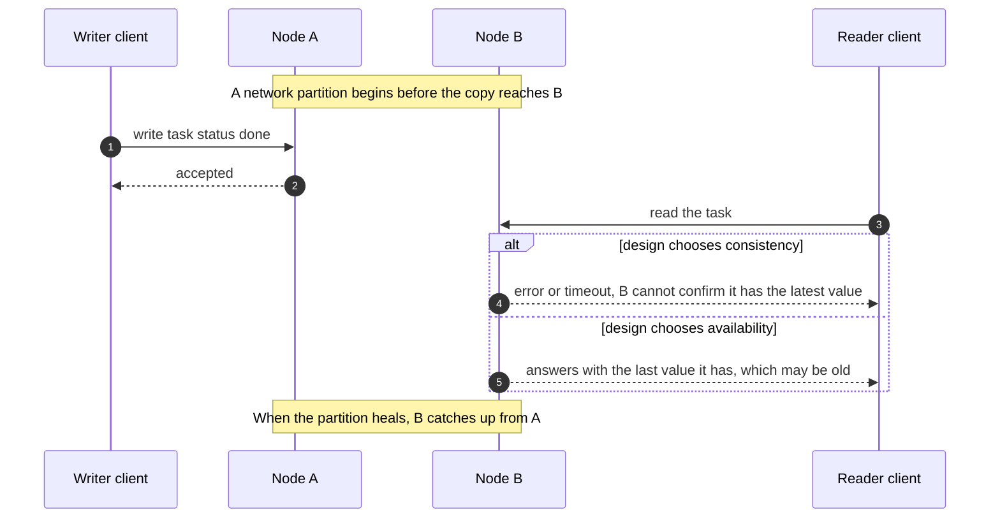
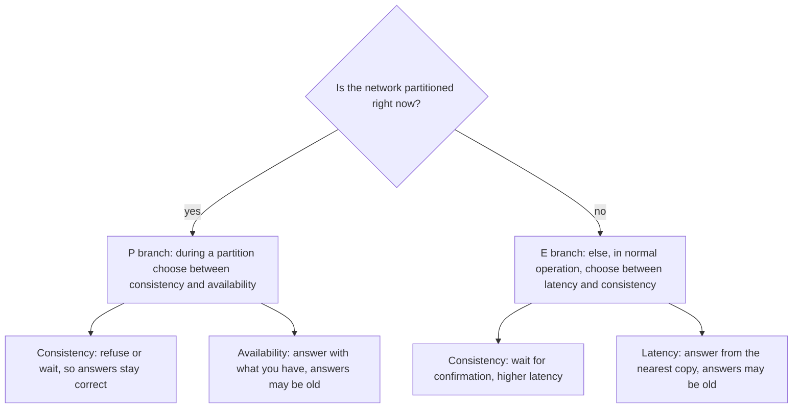

# 02. Consistency, availability and the CAP and PACELC trade-offs

> **Draft: written but not yet run.** The code and the expected output in this lesson were prepared by reading the code and the official documentation. They have not been executed yet. If something does not behave as described, trust your tool's real output and report it.

## What you will be able to do
By the end of this lesson you will be able to:
- Explain consistency, availability and partition tolerance in plain words, and what CAP does and does not say.
- Use PACELC to describe the everyday trade-off between latency and consistency.
- Choose and justify strong or eventual consistency for each operation in a design, and record the choice.

## Recap
1. From lesson 01: why did the ADR keep reads that precede a write on the primary?
   <details><summary>Answer</summary>A lagging replica returns an old version, and the following `If-Match` update would be refused with 412.</details>
2. From 201 lesson 06: what does at-least-once delivery force a consumer to do?
   <details><summary>Answer</summary>Handle duplicates safely (idempotency).</details>

## Why it matters
As soon as data lives in more than one place (replicas, caches, several services), a question appears for every operation: *must the reader see the very latest write, or is a slightly old answer acceptable?* Teams that never ask it get one of two failures: a slow, fragile system that insists on perfect freshness everywhere, or a fast one that loses updates and creates duplicates where freshness mattered. CAP and PACELC are vocabularies for asking the question precisely.

## What you will build
1. `partition-choice.mmd`: a sequence showing what two nodes can do when they cannot talk.
2. `pacelc.mmd`: a decision picture for the full PACELC statement.
3. `consistency-menu.md`: a per-operation table for Tasks and Teams and for P07.
4. `0002-consistency-per-operation.md`: an ADR.

## Before you start
- **Prerequisites:** [Architecture 301 lesson 01, scaling to millions](01-scaling-to-millions.md).
- Lesson 01 done; same editor and preview. Work folder: `code101/architecture/301-lesson02`.
- Time: 75 minutes (reading 25, typing 20, exercise 30).
- Source pack (optional): every file is shown in full in this lesson, so you can follow without it. The finished code, the exercise starter and the solution are in the course repository https://github.com/Uee03/Code101 under `source/architecture/301-super-hero-to-legendary/phase-1-scale/02-consistency-cap-pacelc/` (on that page choose **Code, Download ZIP**, or run `git clone https://github.com/Uee03/Code101.git`).
- Pictures described below are expected, not yet rendered by the author.

## Steps
### Step 1. Plain-language definitions
- **Consistency** (in CAP): every read returns the most recent successful write, or an error. This is stricter than the "consistency" in database ACID, which means "rules such as constraints always hold". Same word, different meaning.
- **Availability** (in CAP): every request to a node that is working gets a real answer (not an error), though the answer may not be the latest.
- **Partition**: the network between parts of the system fails or is so slow that the parts cannot talk, even though each part is running.
- **CAP theorem**, informally: when a partition happens, a system must choose to give up consistency (answer, maybe with old data) or availability (refuse or wait). Partitions are a fact of networks, so the practical choice is between those two *during* the failure. It does *not* say "choose any two of three at all times".
- **PACELC** (Daniel Abadi's extension): if there is a **P**artition, choose **A**vailability or **C**onsistency; **E**lse, when running normally, choose **L**atency or **C**onsistency. It adds the point that even without failures, waiting for all copies to confirm costs time.
- **Strong consistency** here means the reader sees the latest accepted write or gets an error. **Eventual consistency** means copies converge if writes stop, and readers may see older values meanwhile. **Read-your-writes** means a client always sees its own earlier writes, even if others' writes may lag.

### Step 2. Save the partition sequence
Create `partition-choice.mmd` in `code101/architecture/301-lesson02`.

**File: `partition-choice.mmd`**



### Step 3. Save the PACELC picture
**File: `pacelc.mmd`**



### Step 4. Save the preview file
Create `diagram-sources.md`: these three lines, then the two **File** blocks above in order (`partition-choice.mmd`, `pacelc.mmd`).

```text
# Diagram sources, lesson 02

Each fenced block is the content of the .mmd file named above it.
```

### Step 5. Save the consistency menu
The right-hand column is the important one: it says what the design does when the deciding node is unreachable, which is the CAP question in practice.

**File: `consistency-menu.md`**

````markdown
# Consistency menu

Strong means the reader sees the latest accepted write or gets an error. Eventual means the reader may see an older value for a while and the copies converge.

| Operation | Choice | Why | If the deciding node is unreachable |
|---|---|---|---|
| Update a task with If-Match (platform) | Strong | The version check must see the current version, or a change is lost | Refuse the write; do not guess |
| Complete a task (platform, stored function with a row lock) | Strong | Two completions must not interleave | Refuse the write |
| List tasks of a project (platform) | Eventual, if a replica is added | A list that is briefly old does no harm | Serve from the replica and show or monitor the lag |
| Look up an idempotency key (platform) | Strong | A missed key lets a duplicate create through | Refuse the create rather than risk a duplicate |
| Read the audit log (platform, admin) | Eventual is acceptable | An entry may appear late but must never be lost | Serve what is available and say so |
| Validate an access token (platform) | Eventual by design | A revoked token works until it expires (ADR 0002) | Keep serving with cached keys until they must be refreshed |
| Reserve stock (P07 Inventory) | Strong inside Inventory's own database | Stock must never be oversold | Refuse the reservation |
| Show an order's status (P07 read model) | Eventual by design | The view is built from events and can lag | Serve the last known state and expose the projection lag |
````

### Step 6. Save the ADR
This ADR is numbered 0002 within this level's own sequence of examples, separate from the platform package's numbering.

**File: `0002-consistency-per-operation.md`**

````markdown
# ADR 0002: Choose consistency per operation

Status: Proposed
Date: 2026-11-23
Owner: Platform maintainers

## Context
A system with replicas or events cannot be strongly consistent everywhere without paying in availability and latency. Some operations lose data if they read old values; others are harmless when briefly old.

## Options
- Strong consistency for every read and write. Cost: higher latency and more refused requests when a node is unreachable.
- Eventual consistency for everything. Cost: lost updates and duplicates in operations that depend on the latest value.
- Choose per operation and write the choice down. Cost: more design effort and a table to maintain.

## Decision
Choose per operation. Writes and reads that precede a write are strong. Lists, reports and read models may be eventual, with their lag measured and displayed.

## Consequences
- Benefit: correctness where it matters and speed where staleness is harmless.
- Cost or risk: developers must know which operations are which, and a mistake in the table is a defect.

## Revisit when
A user-visible defect is traced to a stale read, or the measured lag of an eventual operation exceeds what users accept. Reviewer: the platform maintainers.
````

### Step 7. Predict, then preview
Predict: (1) in the sequence, which message is the only one that differs between the two designs, and what does each version tell the reader? (2) which row of the menu would change if you removed the idempotency key table from the primary database and used a cache?

## Run it
Open `diagram-sources.md` in your preview.

Expected result, not yet rendered: a sequence with four lifelines, five numbered messages (two of them in the two branches of an `alt`) and two notes; a flowchart with seven shapes (one diamond) and six arrows.

Predictions: (1) message 4 versus message 5 inside the `alt`: the first returns an error, the second returns a possibly old value; (2) the idempotency key row: a cache may lose keys or serve a stale miss, so a duplicate create could get through; the row would have to change to a weaker guarantee, which breaks scenario Q6 of 201 lesson 09.

## How it works
**Reading the sequence.** The partition begins *before* the copy reaches Node B. Node A told the writer "accepted"; Node B does not have the write. The reader asks B. B has two honest choices: say "I cannot be sure" (consistency, at the cost of availability) or answer with what it has (availability, at the cost of freshness). A dishonest third choice, answering with old data *and presenting it as current*, is the bug CAP warns about.

**What CAP is not.** It is not a menu of three of which you pick two. Partitions cannot be ruled out, so for a distributed data store the real choice during a partition is C or A. It also says nothing about normal operation, which is why PACELC adds the "Else" half: with no failure at all, a design that waits for every copy to confirm is slower than one that answers from the nearest copy.

**Choosing per operation, not per system.** The menu shows that one system uses *different* answers: money-like or integrity-critical operations (update with `If-Match`, idempotency key lookup, stock reservation) are strong; reads for display (lists, dashboards, read models) are eventual. The platform's own design already shows this: the version column and row-locking functions are strong consistency tools inside one database; a replica or a read model would introduce eventual consistency, and the ADR in lesson 01 keeps the two apart.

**Techniques to get strong guarantees where needed.** A single primary that decides (what the platform has); optimistic concurrency with a version (`If-Match`); a quorum, where a write must be confirmed by W copies and a read consults R copies out of N, so that R + W > N makes any read overlap the latest write (cost: latency and availability); or serialising decisions through one owner per entity (P07's Inventory owns stock).

**Techniques to live with eventual consistency.** Show freshness ("updated a moment ago"); route a user's reads after their own write to the primary (read-your-writes); make operations idempotent; design reconciliation (compare and repair); expose lag as a metric with an alert.

**Failure modes.** Split brain (two nodes both believe they are the primary and accept writes, which then conflict); lost updates; stale reads after failover; clocks that disagree used to order writes; a "retry on error" loop that turns a short partition into a flood.

**When not to use eventual consistency.** Where a user must see their own action immediately and cannot be told "it takes a moment"; where a rule compares the current state to decide (for example "the last lead of a team"); where money or stock changes.

**Measurements to take.** Replica lag at normal and peak load; how often a client sees a version older than one it already saw; the number of refused requests during a node failure; the time to converge after a partition heals. Never quote a lag you did not measure.

> **Why this, not that.** Per-operation choice, not "eventual everywhere because it scales" and not "strong everywhere because it is simple": the first loses data where it matters and the second turns every node failure into an outage. The table is the design artefact; the slogan is not.

**Misconceptions.** "CAP means a database is either CP or AP forever." Real systems offer settings per operation and often behave differently in normal operation. "Eventual consistency means data may be lost." It means data converges; loss is a separate failure.

## Try it
### 1. Guided practice
Choose strong or eventual for four operations and say what happens when the deciding node is unreachable. Copy `exercise/starter` as `301-lesson02-try` (rename the **copy**) or create the file below, then replace each `TODO`.

**File: `301-lesson02-try/choose.md` (starter)**
```markdown
# Choose per operation

| Operation | Strong or eventual | If the deciding node is unreachable | Reason |
|---|---|---|---|
| Add a user to a team (a lead does this) | TODO | TODO | TODO |
| Refuse to remove the last lead of a team | TODO | TODO | TODO |
| Show how many tasks were completed this week on a dashboard | TODO | TODO | TODO |
| Charge a payment once for an order (P07 Payments) | TODO | TODO | TODO |
```

### 2. Change practice
Add the P07 read model's "projection lag" as a row of measurements for the menu: what would you measure, how would you display it to Sana, the support agent, and when would the lag be too large? Say what you would need to learn before choosing a threshold; do not invent one.

### 3. Stretch (optional)
A team wants both a very fast task list and "always the latest data". Write a short argument, using PACELC, for why they must decide which operation gets which.

<details><summary>Solution to guided practice</summary>

**File: `301-lesson02-try/choose.md` (solution)**
```markdown
# Choose per operation

| Operation | Strong or eventual | If the deciding node is unreachable | Reason |
|---|---|---|---|
| Add a user to a team (a lead does this) | Strong | Refuse the change | The membership check for later requests depends on it, and a stale answer would grant or hide access |
| Refuse to remove the last lead of a team | Strong | Refuse the change | The rule compares the current set of leads; deciding from old data could leave a team with no lead |
| Show how many tasks were completed this week on a dashboard | Eventual | Show the last value with its age | A figure that is briefly old harms nobody |
| Charge a payment once for an order (P07 Payments) | Strong for the charge record, plus an idempotency key | Refuse or retry later, never charge blindly | A second charge cannot be undone silently |
```

For change practice: measure the time between an event being accepted and the read model reflecting it, show the age of the data on Sana's screen, and agree the acceptable lag with Sana's team before setting an alert. For the stretch: with no partition the choice is still latency against consistency; a fast list answers from a nearby copy (possibly old), while "always the latest" means waiting for the primary, so the two wishes apply to different operations.

</details>

## Check yourself
1. Does CAP say you can only have two of three at any time? <details><summary>Answer</summary>No. It says that during a partition a system must give up either consistency or availability.</details>
2. Predict: in the sequence, the design chooses availability. What must the reader's screen do to stay honest? <details><summary>Answer</summary>Show that the data may be old (for example its age), or the user may act on a wrong value.</details>
3. Which operation in the menu uses a quorum-like or single-owner idea, and which uses a version check? <details><summary>Answer</summary>P07 Inventory uses a single owner; the platform's task update uses a version check (`If-Match`).</details>
4. Find the flaw: "We use eventual consistency for the idempotency key lookup because it is faster." <details><summary>Answer</summary>A missed key lets a duplicate create through, which is exactly what the key exists to prevent.</details>

## Common mistakes
| Symptom | Cause | Fix |
|---|---|---|
| "We are CP" or "we are AP" for the whole system | Treating CAP as a label | Choose per operation and write it in the menu |
| Confusing ACID consistency with CAP consistency | Same word | Say "constraints hold" versus "reads see the latest write" |
| An eventual read feeds a write decision | Read-after-write rule forgotten | Read from the deciding node when a write follows |
| Stale data presented as current | No freshness shown | Display the age or avoid the eventual read |

## Best practice
Write the consistency choice next to each operation, with what the system does when the deciding node is unreachable. Source: Microsoft Azure Architecture Center, [Data management patterns](https://learn.microsoft.com/azure/architecture/patterns/category/data-management); Google, [Site Reliability Engineering](https://sre.google/sre-book/table-of-contents/) (chapters on distributed consensus and data integrity).

## Going further
Next lesson shows how events, the outbox and sagas keep several services consistent *enough* without a shared transaction.

## Summary
- You explained consistency, availability, partition, CAP and PACELC in plain words.
- You drew the choice a node faces during a partition.
- You chose consistency per operation and recorded it in a table and an ADR.

## Next lesson
03. Event-driven architecture, the transactional outbox and sagas at design level.
