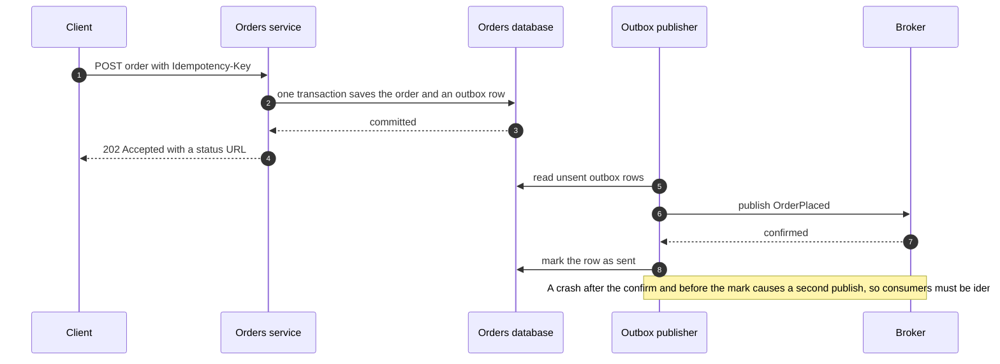
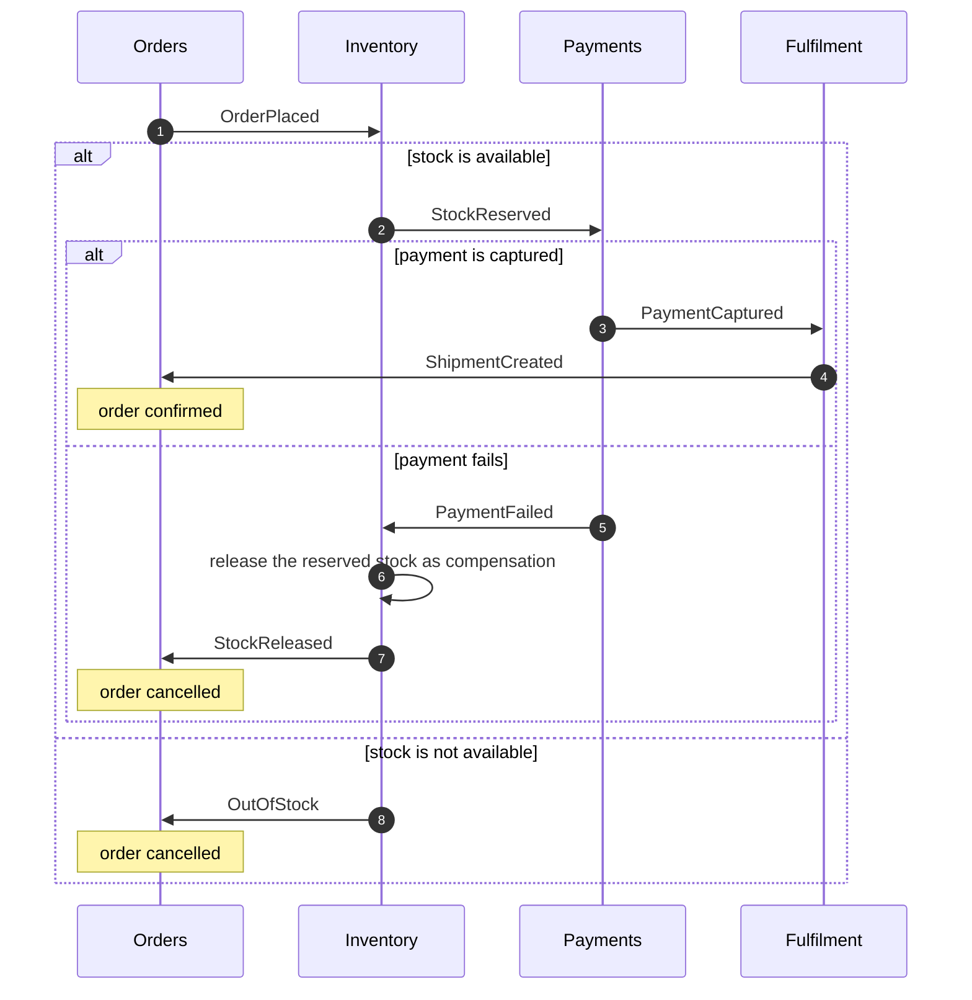
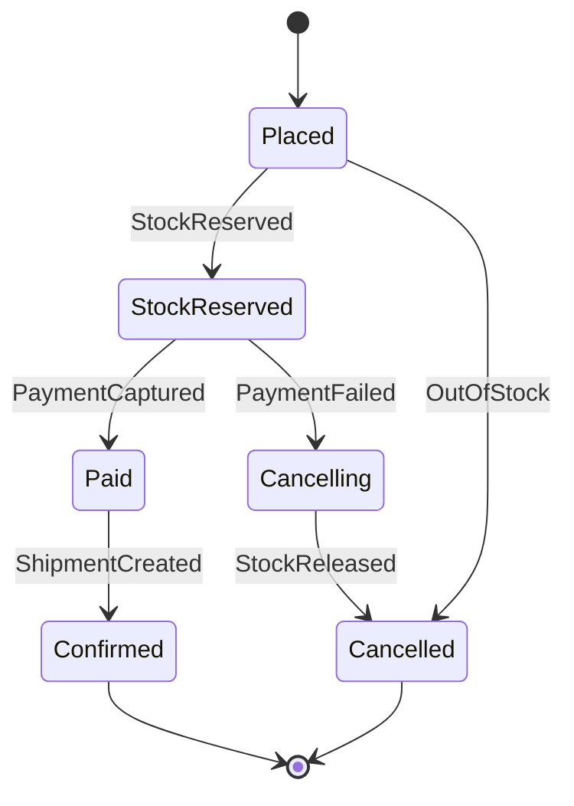
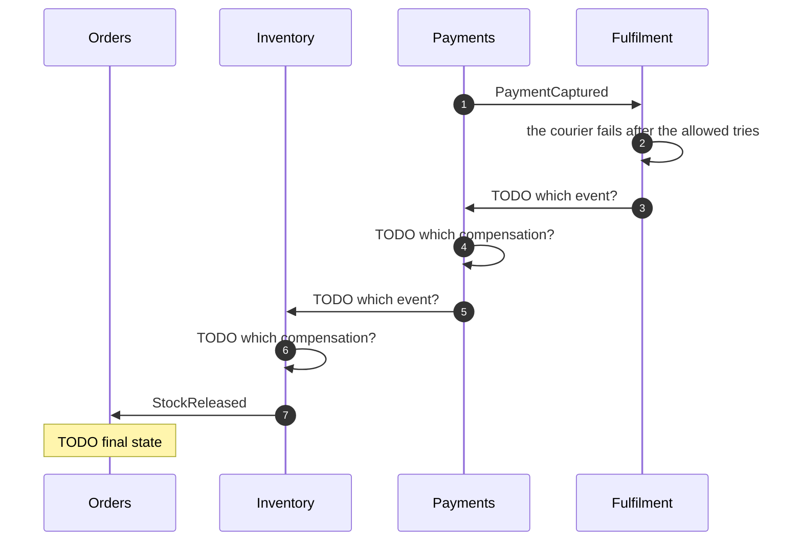
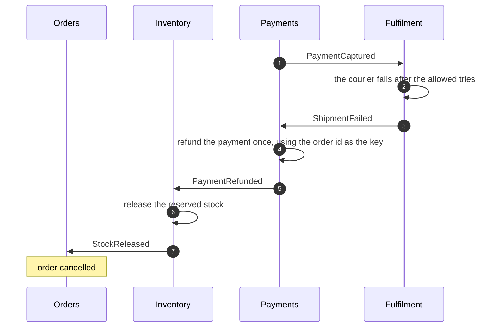

# 03. Event-driven architecture, outbox and saga at design level

> **Draft: written but not yet run.** The code and the expected output in this lesson were prepared by reading the code and the official documentation. They have not been executed yet. If something does not behave as described, trust your tool's real output and report it.

## What you will be able to do
By the end of this lesson you will be able to:
- Explain the dual-write problem and draw the transactional outbox that solves it.
- Design a saga with compensations as a sequence and as a state machine, and say how every instance reaches a final state.
- Specify an event contract (envelope, versioning rules) and the consumer rules that make at-least-once delivery safe.

## Recap
1. From 201 lesson 06: why does a worker acknowledge a job only after the work is done?
   <details><summary>Answer</summary>If it crashes first, the broker redelivers the job, so no work is lost; the repeat must be harmless.</details>
2. From lesson 02: which consistency do you accept for a read model built from events?
   <details><summary>Answer</summary>Eventual, with the lag measured and shown.</details>

## Why it matters
When one business step spans several services with their own databases, a single transaction can no longer protect it. Practice capstone P07 describes exactly this failure: during a sale, stock was reserved twice, cards were charged for orders that never shipped, and the checkout froze when the courier was slow. Events, the outbox and sagas are the standard tools. They trade the comfort of one transaction for independence, and they only work if the design handles duplicates, ordering and failure on purpose.

## What you will build
Design artefacts for P07 (all design level, no code):
1. `outbox.mmd`: the order is saved and published reliably. 2. `order-saga.mmd`: the success and compensation paths. 3. `order-states.mmd`: the order's state machine. 4. `event-envelope.md`: the event contract. 5. `0003-choreographed-saga.md`: an ADR.

## Before you start
- **Prerequisites:** [Architecture 301 lesson 02, consistency, CAP and PACELC](02-consistency-cap-pacelc.md); Architecture 201 lessons [04, REST, events and gRPC](../../201-hero-to-super-hero/phase-2-design-choices/04-rest-events-grpc.md) and [06, queues, streams and async work](../../201-hero-to-super-hero/phase-2-design-choices/06-queues-streams-async-work.md).
- Lesson 02 done; same editor and preview. Read P07 section 5 once (`capstones/_practice/P07-event-driven-order-processing/TDD.md`). Work folder: `code101/architecture/301-lesson03`.
- Time: 90 minutes (reading 30, typing 25, exercise 35).
- Source pack (optional): every file is shown in full in this lesson, so you can follow without it. The finished code, the exercise starter and the solution are in the course repository https://github.com/Uee03/Code101 under `source/architecture/301-super-hero-to-legendary/phase-1-scale/03-events-outbox-saga/` (on that page choose **Code, Download ZIP**, or run `git clone https://github.com/Uee03/Code101.git`).
- Pictures described below are expected, not yet rendered by the author.

## Steps
### Step 1. Vocabulary
- **Dual write**: changing two systems (a database and a broker) in one operation with no shared transaction. If the first succeeds and the second fails, they disagree and nothing records it.
- **Transactional outbox**: write the business change *and* a record of the event to be published, in the same local database transaction. A separate **publisher** reads the unsent records and publishes them, then marks them sent. The database transaction guarantees the order and its event are saved together or not at all.
- **Inbox / idempotent consumer**: the consumer records the ids of events it has handled (or relies on a natural key) so a repeated event has no second effect.
- **Saga**: a business process made of local transactions in several services. If a step fails, **compensating** actions undo the effect of earlier steps. A compensation is a *new* business action (refund, release stock), not a database rollback.
- **Choreography**: services react to each other's events with no central controller. **Orchestration**: one coordinator sends commands to each service in turn and decides what comes next.
- **Command vs event**: a command asks ("ReserveStock"); an event states a fact that already happened ("StockReserved").

### Step 2. Save the outbox sequence
Create `outbox.mmd` in `code101/architecture/301-lesson03`. This is P07 requirements R-03 and R-04 as a picture.

**File: `outbox.mmd`**



### Step 3. Save the saga sequence
**File: `order-saga.mmd`**



All the arrows between services travel through the broker; they are drawn directly to keep the flow readable.

### Step 4. Save the order state machine
**File: `order-states.mmd`**



### Step 5. Save the preview file
Create `diagram-sources.md`: these three lines, then the three **File** blocks above in order (`outbox.mmd`, `order-saga.mmd`, `order-states.mmd`).

```text
# Diagram sources, lesson 03

Each fenced block is the content of the .mmd file named above it.
```

### Step 6. Save the event contract
**File: `event-envelope.md`**

````markdown
# Event envelope and rules

Every event carries the same envelope. The fields follow the practice capstone P07, section 6; the exact names are this lesson's choice.

| Field | Meaning |
|---|---|
| id | A stable unique id of this event, used by consumers to recognise a repeat |
| type | The name of the fact in the past tense, for example OrderPlaced |
| schema_version | The version of the payload shape, a whole number |
| producer | The service that published it |
| occurred_at | When the fact happened, in UTC |
| correlation_id | Ties together every event and request of one order |
| trace_context | The trace identifiers that let one trace follow the order across services |
| data | The facts a consumer needs, kept small |

Rules:
- An event states a fact that already happened. A command asks someone to do something and has a different name and an owner.
- Change an event only by adding optional fields. Removing or renaming a field needs a new schema_version and a period in which both are supported.
- Do not put secrets or card data in an event; anyone who can read the broker can read it.
- Consumers ignore fields they do not know.
````

### Step 7. Save the ADR
**File: `0003-choreographed-saga.md`**

````markdown
# ADR 0003: Choreographed order saga with Orders owning the final state

Status: Proposed
Date: 2026-11-23
Owner: P07 learner team

## Context
Placing an order touches Inventory, Payments and Fulfilment, each with its own database. No single transaction can cover them, so each step is a local transaction and a failure is repaired by compensation. Someone must decide when an order is confirmed or cancelled, and what happens when a step never answers.

## Options
- Orchestration: Orders sends a command to each service in turn and decides what to do on each reply. Cost: Orders knows every step and becomes a central point of change.
- Choreography: each service reacts to events and publishes the next one. Cost: the whole flow exists only as the sum of reactions, so it is harder to see and to debug.
- Choreography for the steps, with Orders listening to every outcome, owning the order state and owning the timeout. Cost: Orders still needs a reliable view of all outcomes.

## Decision
Use choreography for the steps. Orders records each outcome in the order state machine and owns the timeout that cancels an order that stalls.

## Consequences
- Benefit: services stay decoupled and Orders alone answers "what state is this order in".
- Cost or risk: the flow must be documented by diagrams and traced end to end, or nobody can see it.

## Revisit when
The flow grows beyond what one diagram can show, or compensation rules need one owner that sees all steps. Reviewer: the P07 learner team.
````

### Step 8. Predict, then preview
Predict: (1) how many terminal (final) outcomes does the state machine have, and which states lead to each? (2) which message in the outbox diagram can happen twice, and what makes that safe?

## Run it
Open `diagram-sources.md` in your preview.

Expected result, not yet rendered: a sequence with five lifelines, eight messages and a note; a sequence with four lifelines, an outer `alt` with an inner `alt`, and three notes; a state diagram with six states and nine transitions.

Predictions: (1) two final outcomes: `Confirmed` (from `Paid`) and `Cancelled` (from `Placed` on out of stock, or from `Cancelling` after the stock is released); (2) message 6, the publish of `OrderPlaced`, can repeat after a crash; consumers must be idempotent.

## How it works
**Why the outbox.** Without it, the Orders service saves the order, then calls the broker. If it crashes between the two, the order exists and nobody ever hears about it (P07 describes "charged but never shipped" as its real-world symptom). With the outbox the order and the intent to publish are one transaction. The publisher gives **at-least-once** delivery: it removes the *lost* event, at the price of a possible *duplicate* (the crash note on message 8). The duplicate is then made harmless by the idempotent consumer. This pair, outbox plus idempotent consumers, is what practical systems mean by "effectively once".

**Polling or change data capture.** The publisher can poll the outbox table (simple, adds a small delay and load) or read the database's change log (**CDC**, change data capture: more moving parts, lower delay). Start with polling unless a measured delay needs more.

**Ordering.** Events for *one* order must be handled in order; across orders, order rarely matters. Partition or route by order id so one order's events reach one consumer sequentially, and make consumers tolerate an event arriving after one that logically follows it (the state machine rejects impossible moves).

**Reading the saga.** The nested `alt` shows three outcomes. The compensation for a failed payment is *releasing the stock*, a new action, and it appears in the reverse order of the forward steps. `Cancelling` exists in the state machine because compensation takes time; an order is not cancelled until stock has been released. Every path ends in `Confirmed` or `Cancelled`, which is the property P07's requirement R-08 demands. A saga with a path that ends nowhere is a defect: add a timeout in Orders that moves a stalled order to `Cancelling`.

**Compensations can fail.** A refund call can time out. Compensations must be retried and idempotent, and when retries are exhausted the order goes to a dead-letter path with an alert for a person. Place steps that cannot be undone (sending a customer e-mail, shipping goods) as late as possible; a step that cannot be undone is the **pivot**: after it, the saga can only go forward.

**Failure modes.**
- Outbox publisher stops: unsent rows accumulate and orders never progress. Measure the backlog and the age of the oldest unsent row.
- Duplicate or reordered events: handled by idempotent consumers and by the state machine refusing impossible transitions.
- A poison message (one that always fails) blocks a consumer: bounded retries, then dead-letter.
- A saga stuck in a middle state: caught by timeouts and a "stuck orders" metric.
- Schema change breaks a consumer: contract tests and the additive-only rule in the envelope.

**When not to use this.** If all the data is in one database, one local transaction is simpler and safer. Do not split services (lesson 07) only to need a saga. Do not use events for a user who is waiting for the answer (201 lesson 04).

**Measurements to take.** Outbox backlog size and oldest-row age; consumer lag; time from `Placed` to a final state; number of orders in each state; dead-letter count; duplicate rate. P07 asks for most of these (R-12, R-15, R-21).

**Security and operations.** Events carry data: apply the same access control as the databases, avoid personal and card data in payloads, and log event ids, not payloads. A replay tool is powerful; restrict and audit it.

> **Why this, not that.** The outbox, not "publish after commit in the same method": the second approach loses events on a crash between the two lines, and the failure is silent. Choreography with a state owner, not pure choreography with no owner and not heavy orchestration: it keeps services independent but gives one place that answers "where is order 123?".

**Misconceptions.** "Exactly-once delivery exists." You get at-least-once delivery plus idempotent handling, which has the same effect for the business. "A saga rolls back." It compensates forward with new actions; some effects cannot be undone.

## Try it
### 1. Guided practice
The courier cannot create a shipment after the allowed tries, after the payment was already captured. Draw the compensation path. Copy `exercise/starter` as `301-lesson03-try` (rename the **copy**) or create the file below, then replace each `TODO` with an event name or an action. Compensate in reverse order of the forward steps.

**File: `301-lesson03-try/courier-failure.mmd` (starter)**


### 2. Change practice
Add the new states and transitions to `order-states.mmd` for this failure. Which existing state does the new path pass through before `Cancelled`?

### 3. Stretch (optional)
Rewrite the ADR's decision as an *orchestrated* saga. List two things that become easier and two that become harder. Which would you choose for P07's twelve-week sprint, and why?

<details><summary>Solution to guided practice</summary>

**File: `301-lesson03-try/courier-failure.mmd` (solution)**


For change practice, add `Paid --> Cancelling : ShipmentFailed` (Cancelling already goes to Cancelled on StockReleased); the new path passes through `Cancelling`. For the stretch, orchestration makes the flow visible in one place and simplifies timeouts, but makes Orders know every step and every compensation; either answer is defensible if the reason is stated.

</details>

## Check yourself
1. What exactly does the outbox guarantee, and what does it not? <details><summary>Answer</summary>The order and the intent to publish are saved together, so no event is lost; it does not prevent a duplicate publish, which the consumers must tolerate.</details>
2. Predict: `PaymentCaptured` is delivered to Fulfilment twice. What must happen? <details><summary>Answer</summary>Fulfilment creates one shipment only, by recognising the event id or the order id.</details>
3. Why is "refund" a compensation and not a rollback? <details><summary>Answer</summary>The charge already happened and was visible; the refund is a new action recorded as its own business fact.</details>
4. Find the defect: "The saga ends when Payments publishes PaymentCaptured." <details><summary>Answer</summary>The order is not in a final state until shipment is created or compensation completed; a path with no end can leave orders stuck.</details>

## Common mistakes
| Symptom | Cause | Fix |
|---|---|---|
| Orders exist that nobody processed | Publish happened outside the transaction | Use the outbox |
| Customer charged twice | Consumer not idempotent | Record handled event ids or use the order id as the key |
| Order stuck in `Cancelling` | A compensation failed with no retry or alert | Retry with backoff, dead-letter, alert, and a stuck-orders metric |
| State diagram preview fails (typical: a parse error) | A state name with a space, or a missing `:` before the label | Use names without spaces and `A --> B : label` |

## Best practice
Make every step idempotent, give every saga instance a final state and a timeout, and measure the backlog. Source: Microsoft Azure Architecture Center, [Saga pattern](https://learn.microsoft.com/azure/architecture/patterns/saga), [Compensating Transaction pattern](https://learn.microsoft.com/azure/architecture/patterns/compensating-transaction) and [Publisher-Subscriber pattern](https://learn.microsoft.com/azure/architecture/patterns/publisher-subscriber).

## Going further
P07 requirements R-03 to R-09 and R-13 turn this lesson into measurable acceptance tests; its chaos drills (R-21) are the experiments that prove the design. Lesson 04 adds timeouts, retries and breakers around the calls this saga makes.

## Summary
- You explained the dual-write problem and drew the outbox that solves it.
- You designed a saga as a sequence and a state machine with compensations and final states.
- You wrote an event contract and the rules that make at-least-once delivery safe.

## Next lesson
04. Failure modes, timeouts, retries, bulkheads and graceful degradation.
