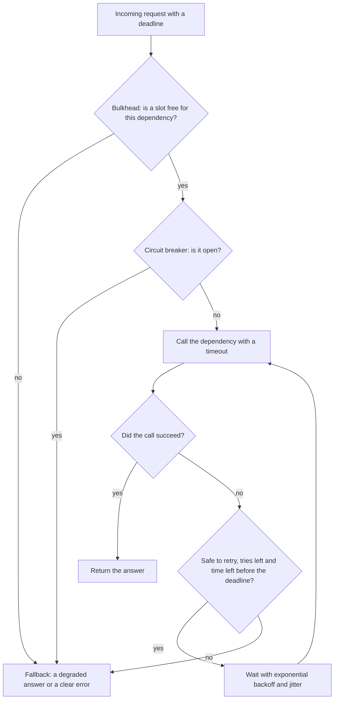
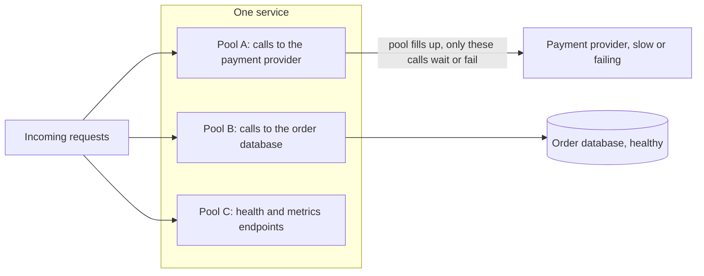

# 04. Failure modes, timeouts, retries, bulkheads and graceful degradation

> **Draft: written but not yet run.** The code and the expected output in this lesson were prepared by reading the code and the official documentation. They have not been executed yet. If something does not behave as described, trust your tool's real output and report it.

## What you will be able to do
By the end of this lesson you will be able to:
- List the failure modes of each call in a design and say how each is detected and contained.
- Combine deadline, bulkhead, circuit breaker, timeout and retry in the right order, and explain why retries can make an outage worse.
- Define a degradation ladder: what the system gives up first, and how it returns to normal.

## Recap
1. From lesson 03: why must a consumer be idempotent?
   <details><summary>Answer</summary>At-least-once delivery can deliver the same message twice; a repeat must have no second effect.</details>
2. From 201 lesson 01: what does an `Idempotency-Key` make safe?
   <details><summary>Answer</summary>Repeating a create request after a timeout.</details>

## Why it matters
In a system of many parts something is always failing: a slow query, a restarting instance, a partner that answers in ten seconds. The question is not "can we prevent failure?" but "does one failure stay small?" The classic disaster is a **cascading failure**: one slow dependency fills the threads of its callers, their callers time out and retry, the retries overload the slow dependency further, and a small problem takes everything down. The tools in this lesson exist to stop that chain.

## What you will build
1. `resilient-call.mmd`: the order of protections around one outbound call. 2. `bulkhead.mmd`: pools that stop one failure from taking all capacity. 3. `failure-modes.md`: a failure-mode table for the platform and P07. 4. `retry-rules.md`: ten rules. 5. `degradation-ladder.md`: what to give up, in order.

## Before you start
- **Prerequisites:** [Architecture 301 lesson 03, events, outbox and saga](../phase-1-scale/03-events-outbox-saga.md) and [Architecture 201 lesson 06, queues, streams and async work](../../201-hero-to-super-hero/phase-2-design-choices/06-queues-streams-async-work.md).
- Lesson 03 done; same editor and preview. Work folder: `code101/architecture/301-lesson04`.
- Time: 85 minutes (reading 30, typing 25, exercise 30).
- Source pack (optional): every file is shown in full in this lesson, so you can follow without it. The finished code, the exercise starter and the solution are in the course repository https://github.com/Uee03/Code101 under `source/architecture/301-super-hero-to-legendary/phase-2-resilience-and-operations/04-failure-modes-resilience/` (on that page choose **Code, Download ZIP**, or run `git clone https://github.com/Uee03/Code101.git`).
- Pictures described below are expected, not yet rendered by the author. No timeout, retry count or threshold is given in this lesson: each comes from your own measurements.

## Steps
### Step 1. Vocabulary
- **Timeout**: the longest a caller waits for an answer before giving up. **Deadline**: the point in time by which the whole request must finish; each layer uses what is left of it.
- **Retry with exponential backoff and jitter**: wait longer after each failed try (the wait grows by a factor), and add a random amount (jitter) so many clients do not retry together.
- **Circuit breaker**: a switch that stops calls to a dependency that is failing. *Closed*: calls pass. *Open*: calls fail immediately without trying. *Half-open*: after a pause a few trial calls test recovery.
- **Bulkhead**: separate pools of capacity (threads, connections) per dependency or per kind of work, so one slow dependency cannot use them all. The name comes from the watertight compartments of a ship.
- **Graceful degradation**: when a part fails, the system keeps the most important functions and gives up optional ones, visibly.
- **Fail fast**: refuse quickly when success is unlikely, instead of waiting and holding resources.
- **Load shedding**: deliberately refusing some requests to protect the rest.

### Step 2. Save the resilient call
Create `resilient-call.mmd` in `code101/architecture/301-lesson04`. Read it as the *order* in which protections apply to one outbound call.

**File: `resilient-call.mmd`**



### Step 3. Save the bulkhead picture
**File: `bulkhead.mmd`**



### Step 4. Save the preview file
Create `diagram-sources.md`: these three lines, then the two **File** blocks above in order (`resilient-call.mmd`, `bulkhead.mmd`).

```text
# Diagram sources, lesson 04

Each fenced block is the content of the .mmd file named above it.
```

### Step 5. Save the failure-mode table
This is a light form of FMEA (failure mode and effects analysis): for each call, how it can fail, how you would know, what happens without protection, and the protection. Platform rows come from the TDD (the health endpoint reports `503` when the database is not reachable); P07 rows from its requirements R-03, R-10, R-16 and R-17.

**File: `failure-modes.md`**

````markdown
# Failure modes table

Detection means how a person or a program finds out. Numbers such as timeouts are chosen from measurements and are not in this table.

| Call | Failure mode | Detection | Effect without protection | Protection and degraded behaviour |
|---|---|---|---|---|
| Client to platform API | Responses become slow | Latency percentile per endpoint, client timeout | Users wait and retry, which adds load | Client timeout; retries only for idempotent calls or with an Idempotency-Key; rate limit answers 429 with Retry-After |
| Platform API to PostgreSQL | All connections in use | Wait time for a connection, health endpoint reporting 503 | Every request waits for a connection and then fails | Bounded pool, short wait for a slot, fail fast with 503, alert |
| Platform API to Keycloak keys | Keys cannot be fetched for an unknown key id | Failed refresh counter | Tokens signed with a new key are rejected | Keep cached keys, refetch with backoff, alert on repeated failure |
| P07 Orders to payment fake | Errors for a period | Error rate and breaker state | Orders hang and threads pile up | Timeout, bounded retries with backoff and jitter, breaker; the saga compensates or retries later |
| P07 Orders to broker | Broker down | Outbox backlog and age of the oldest row | Events are not delivered | Outbox keeps the events; orders are accepted and progress after recovery |
| P07 Fulfilment to courier fake | Very slow answers | Courier call duration | Fulfilment threads blocked, backlog grows | Timeout, own pool, shipment created later; Orders unaffected |
| P07 consumers | Slower than producers | Queue depth and lag | Memory and backlog grow | Prefetch and in-flight limits, more workers, visible lag |
````

### Step 6. Save the retry rules
**File: `retry-rules.md`**

````markdown
# Retry and timeout rules

1. Every call to another process has a timeout. A call without a timeout can wait forever.
2. Choose each timeout from measured latency, not from a feeling. An inner timeout is shorter than the outer one that contains it.
3. Pass a deadline down the chain, so no layer works on a request whose caller has already given up.
4. Retry only operations that are safe to repeat: reads, or writes protected by an idempotency key or a natural key.
5. Wait between tries with exponential backoff and add jitter, a small random amount, so many clients do not retry at the same moment.
6. Limit the number of tries. When the limit is reached, take the fallback; do not loop.
7. Retry in one layer only. If three layers each make three tries, one user action can become twenty-seven calls to the failing dependency.
8. Obey Retry-After when a server sends it with 429 or 503.
9. A circuit breaker has three states: closed (calls go through), open (calls fail fast), half-open (a few trial calls test recovery).
10. Never retry an error that repetition cannot fix, such as a validation failure.
````

### Step 7. Save the degradation ladder
**File: `degradation-ladder.md`**

````markdown
# Degradation ladder

| Level | Trigger | Behaviour | What users see | Return to normal when |
|---|---|---|---|---|
| 0 Normal | none | Everything works | Nothing unusual | Not applicable |
| 1 Optional parts off | A non-essential dependency fails | Features that depend on it are hidden or marked as delayed | A notice that some data may be late | The dependency answers again and its breaker closes |
| 2 Stale reads | The primary is slow but a replica or cache is healthy | Lists are served from copies, each marked with its age | Data with a visible age | The primary meets its latency target again |
| 3 Read only | The primary cannot accept writes | Reads continue, writes are refused with 503 and Retry-After | A clear message that changes cannot be saved now | Writes succeed again; clients retry with idempotency keys |
| 4 Maintenance message | A core dependency is down | A small static page and a status link | An honest outage message | The core dependency is restored |
````

### Step 8. Predict, then preview
Predict: (1) in `resilient-call.mmd`, how many different arrows lead to the fallback, and what does that tell you? (2) which protection comes first, the breaker or the bulkhead, and why?

## Run it
Open `diagram-sources.md` in your preview.

Expected result, not yet rendered: a flowchart with nine shapes (four diamonds) and eleven arrows, with one arrow from the wait step back to the call; a flowchart with a titled group of three pools, two outside shapes and five arrows.

Predictions: (1) three arrows reach the fallback (the bulkhead's "no", the open breaker's "yes" and the retry decision's "no"), so the fallback has three entrances and must be designed as a first-class path; (2) the bulkhead first: it limits how many callers may even reach the breaker and the dependency.

## How it works
**Order of protections.** The deadline limits the total time. The bulkhead limits how many calls may be in flight to one dependency. The breaker stops calls to a dependency known to be failing. The timeout limits one attempt. The retry repeats safe attempts within the deadline. The fallback answers when all of these say "no". Reverse the order and you get strange behaviour: retrying through an open breaker defeats it.

**Why retries make outages worse.** Retries multiply load on the failing dependency at exactly the moment it is weakest. Backoff spreads them in time and jitter stops synchronised waves; rule 7 stops multiplication across layers; the breaker stops the retries altogether once failure is clear. P07's requirement R-16 asks you to *measure* that retry storms do not occur.

**Bulkheads.** Without separate pools, a slow payment provider holds every worker thread and the health endpoint stops answering, so the orchestrator restarts the healthy service, which makes things worse. With pools, only payment calls wait. The pool sizes come from measurement, and a pool that is too small becomes the bottleneck.

**Timeouts.** A timeout is a promise to give up. Too long and resources are held; too short and healthy slow requests fail and are retried. Choose from a percentile of measured normal latency plus margin, and make the inner timeout shorter than the outer, so the outer layer can still answer.

**Degradation as design, not accident.** The ladder defines the order in which the system gives things up: optional features, then freshness, then writes, then everything. Each level says what users see. Test every level on purpose (P07's chaos drills, R-21).

**Failure modes of the protections themselves.** A breaker with thresholds too sensitive flaps open and closed; one too lax never trips. A fallback that calls the same failing dependency is no fallback. A retry on a non-idempotent write creates duplicates. A health check that only tests "the process is alive" keeps a broken instance in the pool.

**When not to retry or break.** Do not retry validation errors, authorisation errors or `4xx` responses that repetition cannot change. Do not wrap a purely local, in-process call in a breaker.

**Measurements to take.** Latency percentiles per dependency; error rate; breaker state changes; retry rate per call (a rising retry rate is an early warning); pool utilisation and wait time; queue depth; the time to recover after a drill. Record results, not guesses.

**Security and operations.** Fallbacks must not weaken security (a failing authorisation service must not mean "allow"; decide fail-closed explicitly). Error responses must not leak internals. Alert on breaker open, on dead-letter growth and on degradation level changes, and write a runbook for each level.

> **Why this, not that.** Fail fast with a clear degraded answer, not "keep waiting and hope": a refusal that comes in milliseconds leaves capacity for the requests that can succeed, whereas a slow failure spends capacity on requests that will fail anyway.

**Misconception:** "more retries mean more reliability." Past a small number they convert partial failure into total failure. Reliability comes from isolation, limits and idempotency.

## Try it
### 1. Guided practice
Decide the policy for three calls. Copy `exercise/starter` as `301-lesson04-try` (rename the **copy**) or create the file below, then replace each `TODO`. Do not write numbers; say what you would measure.

**File: `301-lesson04-try/call-policy.md` (starter)**
```markdown
# Call policy

| Call | Timeout basis | Retries (allowed? how?) | Circuit breaker | Fallback |
|---|---|---|---|---|
| Platform API reads one task from PostgreSQL | TODO | TODO | TODO | TODO |
| P07 Orders asks the payment fake to charge an order | TODO | TODO | TODO | TODO |
| P07 Fulfilment asks the courier fake to create a shipment | TODO | TODO | TODO | TODO |
```

### 2. Change practice
Add a fourth row for the Keycloak signing-key fetch. What is the fail-open or fail-closed decision when the keys cannot be fetched and the key id is unknown? Justify it.

### 3. Stretch (optional)
Design one chaos drill for the degradation ladder: which fault do you inject, which level should the system reach, what do you observe and what makes the drill fail?

<details><summary>Solution to guided practice</summary>

**File: `301-lesson04-try/call-policy.md` (solution)**
```markdown
# Call policy

| Call | Timeout basis | Retries (allowed? how?) | Circuit breaker | Fallback |
|---|---|---|---|---|
| Platform API reads one task from PostgreSQL | Measured p99 of a normal read with margin, shorter than the client's timeout | At most one retry for a read, only on a connection error | Not needed for a single database; a bounded pool protects it | Return 503 with Retry-After |
| P07 Orders asks the payment fake to charge an order | Measured latency of the provider's slowest normal answers | Yes, a few tries with backoff and jitter, always with the order id as the idempotency key | Yes, to stop retry storms when the provider is failing | Leave the order in a waiting state; the saga retries later or compensates |
| P07 Fulfilment asks the courier fake to create a shipment | Longer than the payment call but bounded, from measured courier latency | Yes, with the order id as the key, a limited number of tries | Yes | Keep the shipment pending and tell Orders only when a final result exists; Orders is unaffected meanwhile |
```

For change practice: reject tokens whose key id is unknown (fail closed) because accepting an unverifiable token would be a security failure; keep serving tokens signed with cached keys, alert, and retry the fetch with backoff. For the stretch a sound drill: stop the primary database for a short period, expect level 3 (read only), observe that reads continue and writes answer 503 with `Retry-After`, and fail the drill if the service restarts itself or if writes are silently lost.

</details>

## Check yourself
1. Name the three states of a circuit breaker and what each does. <details><summary>Answer</summary>Closed: calls pass. Open: calls fail immediately. Half-open: a few trial calls test whether the dependency has recovered.</details>
2. Predict: three layers each retry three times against a failing service. How many calls can one user action cause? <details><summary>Answer</summary>Up to twenty-seven (3 x 3 x 3) calls at the bottom layer.</details>
3. Why can retrying a non-idempotent write be dangerous? <details><summary>Answer</summary>The first attempt may have succeeded, so the retry creates a duplicate effect.</details>
4. Find the flaw: "If the identity service is down, let all requests through so users are not blocked." <details><summary>Answer</summary>That is fail-open on authentication, a serious security failure. Keep validating with cached keys and refuse what cannot be verified.</details>

## Common mistakes
| Symptom | Cause | Fix |
|---|---|---|
| Outage lasts longer than the original fault | Retry storm | Backoff with jitter, a retry cap and a breaker |
| Health check passes but the service is useless | It tests only that the process runs | Check the critical dependencies, as the platform's health endpoint does for the database |
| All requests fail when one partner is slow | No bulkhead | Separate pools per dependency |
| A diagram preview fails on a diamond (typical: a parse error) | An unquoted or unbalanced label | Quote every label |
| Timeouts copied from a blog | Not measured for this system | Measure, set, review after incidents |

## Best practice
Bound every call in time, count and concurrency, and design the degraded answer before the failure happens. Source: Google SRE book, [Addressing Cascading Failures](https://sre.google/sre-book/addressing-cascading-failures/) and [Handling Overload](https://sre.google/sre-book/handling-overload/); Microsoft Azure Architecture Center, [Retry](https://learn.microsoft.com/azure/architecture/patterns/retry), [Circuit Breaker](https://learn.microsoft.com/azure/architecture/patterns/circuit-breaker) and [Bulkhead](https://learn.microsoft.com/azure/architecture/patterns/bulkhead) patterns.

## Going further
P07 requirements R-13, R-16, R-17 and R-21 (dead-letter, breaker, backpressure and chaos drills) are the acceptance tests for this lesson. Lesson 05 shows how to see these failures in metrics and alert on them.

## Summary
- You listed failure modes with detection and protection for platform and P07 calls.
- You ordered deadline, bulkhead, breaker, timeout, retry and fallback, and explained retry amplification.
- You defined a degradation ladder and a fail-open or fail-closed decision.

## Next lesson
05. Observability and SLOs: golden signals and error budgets.
