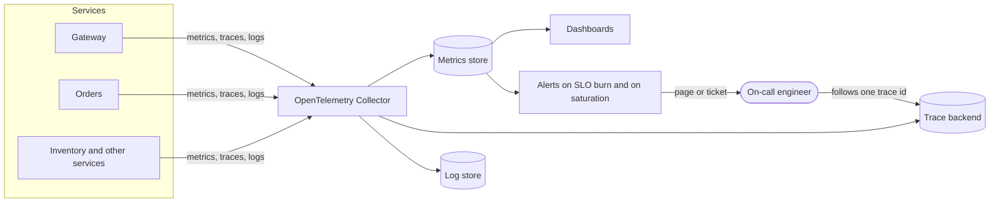
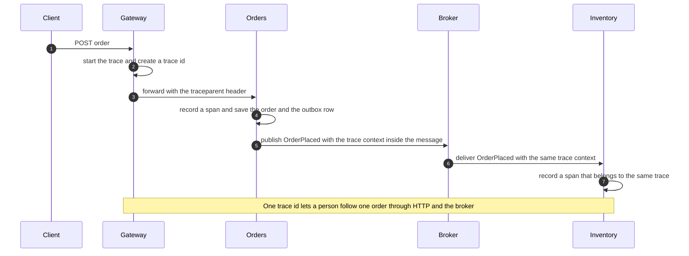

# 05. Observability and SLOs: golden signals and error budgets

> **Draft: written but not yet run.** The code and the expected output in this lesson were prepared by reading the code and the official documentation. They have not been executed yet. If something does not behave as described, trust your tool's real output and report it.

## What you will be able to do
By the end of this lesson you will be able to:
- Choose what to measure for a service using the four golden signals, and avoid labels that explode storage.
- Define an SLI, an SLO and an error budget for a user journey, with a policy that says what the team does when the budget runs low.
- Show how a trace id follows one request across HTTP and a message broker.

## Recap
1. From lesson 04: which signs tell you a retry storm has started?
   <details><summary>Answer</summary>A rising retry rate and growing load on the failing dependency, often with an open or flapping circuit breaker.</details>
2. From 201 lesson 09: what is a "response measure"?
   <details><summary>Answer</summary>The checkable result that decides whether a quality scenario passed.</details>

## Why it matters
You cannot run what you cannot see, and you cannot decide how reliable a system must be without a number the users and the team agree on. **Observability** is the ability to ask new questions about a running system from the data it emits. **SLOs** turn "be reliable" into a target and give a team an honest way to choose between new features and reliability work: the **error budget**.

## What you will build
1. `golden-signals.md`: what to measure for the platform and for P07. 2. `telemetry-flow.mmd`: the path of metrics, traces and logs to dashboards and alerts. 3. `trace-propagation.mmd`: one trace across HTTP and the broker. 4. `slo-template.md`: a template with a platform example whose target is deliberately left open. 5. `error-budget-policy.md`.

## Before you start
- **Prerequisites:** [Architecture 301 lesson 04, failure modes and resilience](04-failure-modes-resilience.md).
- Lesson 04 done; same editor and preview. Work folder: `code101/architecture/301-lesson05`.
- Time: 85 minutes (reading 30, typing 25, exercise 30).
- Source pack (optional): every file is shown in full in this lesson, so you can follow without it. The finished code, the exercise starter and the solution are in the course repository https://github.com/Uee03/Code101 under `source/architecture/301-super-hero-to-legendary/phase-2-resilience-and-operations/05-observability-slos/` (on that page choose **Code, Download ZIP**, or run `git clone https://github.com/Uee03/Code101.git`).
- Pictures described below are expected, not yet rendered by the author. The platform TDD sets no availability target; this lesson therefore does not claim one.

## Steps
### Step 1. Vocabulary
- **Metric**: a number measured over time (a count, a gauge, a histogram of durations). Cheap to store, good for dashboards and alerts.
- **Log**: a record of one event, best as structured JSON with fields such as trace id. Rich but costly in volume.
- **Trace**: the path of one request through many services, made of **spans** (one timed step each). A **trace id** ties the spans together.
- **Observability** is built from these three kinds of data, but the goal is answers, not data collection.
- **Cardinality**: the number of distinct values of a label. A metric label with unlimited values (user ids, order ids) creates one series per value and breaks the metrics system.
- **SLI** (service level indicator): a measured ratio of good events to valid events. **SLO** (service level objective): the target for the SLI over a window. **SLA**: a contract with consequences; do not confuse it with an internal SLO.
- **Error budget**: the amount of badness the SLO allows, which is one minus the target. **Burn rate**: how fast you consume the budget compared with a rate that would use it up exactly at the end of the window.

### Step 2. Save the golden signals
Create `golden-signals.md` in `code101/architecture/301-lesson05`.

**File: `golden-signals.md`**

````markdown
# Golden signals

The four golden signals are latency, traffic, errors and saturation. Measure each for every service that users depend on.

| Signal | Question | Platform API example | P07 example | Caution |
|---|---|---|---|---|
| Latency | How long do requests take? | Time to answer each endpoint, split by successful and failed requests | Time from POST order to a final state | Use percentiles, not averages; keep failed requests apart, because a fast error looks like speed |
| Traffic | How much demand is there? | Requests per second by endpoint and status class | Orders placed per second, events consumed per second | Count by endpoint, not by user id |
| Errors | How many requests fail? | Share of 5xx responses; 4xx counted separately | Failed saga steps, dead-letter count | A wrong answer with status 200 is an error too |
| Saturation | How full is the most limited resource? | Database connections in use, CPU, memory | Queue depth, consumer lag, outbox backlog | The limit that fills first is the one to watch |

Labels: never put an unbounded value such as an order id, a user id or a full URL with ids in a metric label. Put such values in traces and logs.
````

### Step 3. Save the telemetry flow
**File: `telemetry-flow.mmd`**



### Step 4. Save the trace propagation
P07 requirement R-14 asks for one trace across the gateway, Orders, the outbox publish and the consumers, using W3C trace context. For HTTP the context travels in the `traceparent` header; for a message it must be copied into the message by the publisher and read by the consumer.

**File: `trace-propagation.mmd`**



### Step 5. Save the preview file
Create `diagram-sources.md`: these three lines, then the two **File** blocks above in order (`telemetry-flow.mmd`, `trace-propagation.mmd`).

```text
# Diagram sources, lesson 05

Each fenced block is the content of the .mmd file named above it.
```

### Step 6. Save the SLO template
The platform example leaves the target empty on purpose: the TDD does not give an availability target, and an invented one would look like a commitment.

**File: `slo-template.md`**

````markdown
# SLO template and example

An SLI (service level indicator) is a measured ratio of good events to valid events. An SLO (service level objective) is the target for that ratio over a window. The error budget is the share of events allowed to be bad.

## Template
| Field | Content |
|---|---|
| Service and user journey | What the user is trying to do |
| SLI | Good events divided by valid events, with both defined exactly |
| Where it is measured | The place in the system where the events are counted |
| Window | The period the target applies to, for example a rolling period |
| SLO target | The target ratio, agreed with the product owner |
| Exclusions | Events that do not count, and why |
| Error budget | One minus the target, as a share of valid events |
| Owner and review date | Who is accountable and when the target is reviewed |

## Example: platform API availability (the target is a placeholder)
| Field | Content |
|---|---|
| Service and user journey | A signed-in user reads and changes tasks through the API |
| SLI | Requests under /v1 that do not end in a 5xx status, divided by all requests under /v1 that reach the API |
| Where it is measured | At the API, from its own request metrics |
| Window | A rolling window chosen with the product owner |
| SLO target | To be agreed after measuring a baseline. The TDD gives no availability target |
| Exclusions | Requests answered 429 because a client exceeded its rate limit, and planned maintenance announced in advance |
| Error budget | One minus the target |
| Owner and review date | Platform maintainers, reviewed after each incident |

## Arithmetic for time-based and request-based budgets
This is illustrative arithmetic, not a target. For a time-based view, a window of 30 days has 30 x 24 x 60 = 43,200 minutes. A target of 99.9 percent leaves 0.1 percent of that, which is 43.2 minutes of allowed bad time. For a request-based view, the budget is the number of valid requests multiplied by one minus the target.
````

### Step 7. Save the error budget policy
**File: `error-budget-policy.md`**

````markdown
# Error budget policy

The policy is agreed in advance by the product owner and the engineering team, so nobody argues about it during an incident.

| Budget state | Meaning | What the team does |
|---|---|---|
| Healthy | Much of the budget remains | Ship features and take planned risks, such as experiments and drills |
| Low | The remaining budget is below a level the team agreed | Review the largest causes of bad events; prefer reliability work before new risky changes |
| Spent | The budget for the window is used up | Pause risky changes; only fixes, reliability work and security changes ship until the budget recovers |

Rules:
- An incident that spends a large part of the budget gets a written review with actions and owners.
- If the budget is never used, the target may be too lax or the system over-protected; revisit the target.
- If the budget is always spent, the target is unrealistic or the system needs reliability investment; the owner decides which.
- Alerts follow symptoms users feel, such as a fast burn of the budget, and not every internal cause.
````

### Step 8. Predict, then preview
Predict: (1) in the trace sequence, which two messages carry the trace context across a *process* boundary, and how does each travel? (2) which observation in the telemetry flow lets an engineer reach the trace from an alert?

## Run it
Open `diagram-sources.md` in your preview.

Expected result, not yet rendered: a flowchart with a titled group of three services, a collector, three stores (cylinders), dashboards, alerts and an engineer (ten arrows); a sequence with five lifelines, seven numbered messages and a note.

Predictions: (1) message 3 (HTTP, in the `traceparent` header) and message 5 (inside the message published to the broker); (2) the engineer follows a trace id from the alert and the dashboards to the trace backend (the last arrow).

## How it works
**The four signals.** Latency, traffic, errors and saturation are enough to describe most user-facing trouble: slow, busy, failing or full. Saturation is the early-warning signal; latency and errors are what users feel. The table asks for latency *split by success and failure*, because a failing request that returns immediately lowers the average and hides an outage.

**Why labels are limited.** A metric with an order-id label creates one time series per order: storage and query cost grow without bound. Metrics answer "how many, how fast" across populations; traces and logs answer "what happened to this one order". P07 lists this as decision 10: what is a metric, what is a log, what is a span, and which labels are forbidden.

**The telemetry path.** Services send data to a collector (OpenTelemetry is a vendor-neutral standard and toolkit for this), which forwards each kind to its store. Dashboards read metrics; alerts evaluate them; people use the trace backend to investigate. One trace id also goes into every log line, so a log search by trace id finds every message about one request.

**Trace propagation.** A trace is only whole if every hop passes the context on. HTTP calls carry it in a header. Messages need it added by the publisher and extracted by the consumer, or the trace breaks at the broker. The outbox publisher must therefore store the trace context in the outbox row, because the request that created the row is long gone when the publisher runs.

**From SLI to SLO to budget.** Pick a user journey, define a good event and a valid event exactly, and count them where the user would feel failure. The SLO is the target ratio over a window. The budget (one minus the target) is *permission to fail a little*. The arithmetic in the template is deliberately illustrative: it shows how to turn a target into minutes or requests, not what your target should be.

**Burn rate and alerts.** Alert on how fast the budget is being used, not on every blip. A fast burn pages a person now; a slow burn opens a ticket. The SRE workbook chapters linked below give concrete multi-window approaches; use them as a starting point and tune against your own data.

**Using the budget.** The policy turns reliability into a shared decision: when the budget is healthy, take risks and ship; when it is spent, protect users. This replaces arguments about "should we freeze releases?" with an agreement made in advance.

**Failure modes of observability.** Alert fatigue (too many alerts that need no action); dashboards nobody reads; metrics with unbounded labels; traces broken at queues; logs containing personal data or tokens; an SLI that measures the server's view, not the user's (a load balancer that hides failed requests); an SLO nobody owns.

**When not to define an SLO.** For an internal prototype with no users; for a journey you cannot measure yet (measure first, then agree a target); as a stick to blame a team.

**Measurements to take.** The golden signals per service; the SLI per journey; budget remaining and burn rate; time to detect and time to recover for each incident; alert precision (how many pages needed action). Never publish a target before you have a baseline.

**Security and operations.** Telemetry can leak secrets and personal data: scrub tokens, passwords and personal fields before storage, restrict who can read logs and traces, and set retention. The collector is a privileged component: protect and monitor it.

> **Why this, not that.** An SLO on a user journey, not on a server metric: users do not care that CPU is low if their order fails. And a few alerts tied to the budget, not an alert per metric: people stop responding to alert floods.

**Misconception:** "100 percent is a good target." It is unreachable and unaffordable, and it leaves no room to ship changes. Choose a target that users actually need.

## Try it
### 1. Guided practice
Write an SLO for the P07 journey "an order ends as confirmed or cancelled". Copy `exercise/starter` as `301-lesson05-try` (rename the **copy**) or create the file below, then replace each `TODO`. For the target, use P07's own wording and mark the number as a proposal; do not invent a ratio.

**File: `301-lesson05-try/order-slo.md` (starter)**
```markdown
# SLO for P07: orders reach a final state

| Field | Content |
|---|---|
| Service and user journey | TODO |
| SLI: good events | TODO |
| SLI: valid events | TODO |
| Where it is measured | TODO |
| Window | TODO |
| SLO target | TODO |
| Exclusions | TODO |
| Error budget | TODO |
```

### 2. Change practice
List three metrics you would put on a P07 dashboard (one per golden signal besides latency) and, for each, one label you would use and one label you must not use.

### 3. Stretch (optional)
Explain in five lines why the platform's 200 ms p95 target (a local measurement on seed data) is not an SLO, and what you would measure before turning it into one.

<details><summary>Solution to guided practice</summary>

**File: `301-lesson05-try/order-slo.md` (solution)**
```markdown
# SLO for P07: orders reach a final state

| Field | Content |
|---|---|
| Service and user journey | Chloe places an order and it ends as confirmed or cancelled without manual repair |
| SLI: good events | Orders that reach confirmed or cancelled within the end-to-end time target |
| SLI: valid events | Orders accepted by the gateway with a valid request, excluding orders sent while a drill injects faults on purpose |
| Where it is measured | In the order view, from the recorded state changes and their times |
| Window | A rolling window agreed with the shop owner |
| SLO target | A proposal to confirm after a load test. P07 N-02 gives the starting latency idea: p95 under 2 seconds at 20 orders per second with healthy fakes |
| Exclusions | Orders placed during announced chaos drills, and orders cancelled by the customer |
| Error budget | One minus the target, counted in orders |
```

For change practice, for example: traffic, `orders_placed` labelled by result (never by order id); errors, `saga_failures` labelled by step (never by order id); saturation, `outbox_backlog` labelled by service (never by message id). For the stretch: the number was measured on a local machine with seed data and 25 requests, so it says nothing about production load, variety of data or availability; measure the real distribution under realistic load before using it as an SLI target.

</details>

## Check yourself
1. Why must latency be split between successful and failed requests? <details><summary>Answer</summary>Failures often return fast, which lowers the average and hides an outage.</details>
2. Predict: you add `order_id` as a metric label. What happens as orders accumulate? <details><summary>Answer</summary>One time series per order, so storage and query cost grow without bound; put the id in traces and logs instead.</details>
3. A 30-day window has 43,200 minutes. How many bad minutes does a 99.9 percent target allow? <details><summary>Answer</summary>0.1 percent of 43,200, which is 43.2 minutes (illustrative arithmetic).</details>
4. Find the flaw: "Our SLO is the uptime of the load balancer." <details><summary>Answer</summary>It measures a component, not the user's journey; requests can fail behind a healthy load balancer.</details>

## Common mistakes
| Symptom | Cause | Fix |
|---|---|---|
| Hundreds of alerts, no response | An alert for every metric | Alert on user-felt symptoms and budget burn |
| The trace stops at the broker | Context not copied into the message | Store it in the outbox row and extract it in the consumer |
| An SLO nobody uses | No policy or owner | Write the error budget policy with owners |
| Secrets in logs | Whole requests were logged | Log ids and fields, scrub tokens |
| Invented targets | Wanting a precise number | Measure a baseline, then agree a target |

## Best practice
Define SLIs from the user's journey, agree a target from a measured baseline, and use the error budget to decide between features and reliability. Source: Google SRE book, [Monitoring Distributed Systems](https://sre.google/sre-book/monitoring-distributed-systems/) and [Service Level Objectives](https://sre.google/sre-book/service-level-objectives/); Google SRE workbook, [Implementing SLOs](https://sre.google/workbook/implementing-slos/) and [Alerting on SLOs](https://sre.google/workbook/alerting-on-slos/).

## Going further
P07 requirements R-14, R-15 and R-12 (trace, metrics, projection lag) are the build tasks for this lesson. Lesson 09 of this level uses the SLO as one lens when critiquing a design.

## Summary
- You chose what to measure with the golden signals and kept metric labels bounded.
- You defined an SLI, SLO and error budget with a policy, without inventing a target.
- You traced one request across HTTP and a broker with a propagated trace context.

## Next lesson
06. Security architecture: zero trust, STRIDE threat modelling, secrets and tenant isolation.
