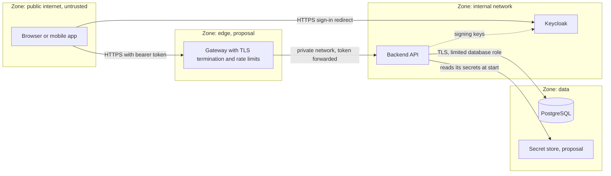

# 06. Security architecture: zero trust, STRIDE, secrets and tenant isolation

> **Draft: written but not yet run.** The code and the expected output in this lesson were prepared by reading the code and the official documentation. They have not been executed yet. If something does not behave as described, trust your tool's real output and report it.

## What you will be able to do
By the end of this lesson you will be able to:
- Draw trust boundaries on an architecture diagram and apply the zero trust idea to each crossing.
- Run a STRIDE threat model on the main flows of a system and record mitigations and open questions.
- Compare tenant isolation options and write a secrets policy with owners and rotation triggers.

## Recap
1. From 201 lesson 07: what is the order of checks the platform applies to a request?
   <details><summary>Answer</summary>Token validity, scope, role, then team membership; the failures are 401, 403 and 404.</details>
2. From lesson 04: what must a fallback never do when authentication cannot be verified?
   <details><summary>Answer</summary>Fail open: allow the request. It must refuse what it cannot verify.</details>

## Why it matters
Security added at the end is expensive and incomplete; security designed at the start is mostly a set of decisions about *boundaries*: who is trusted to do what, and what is checked when something crosses a line. A threat model is a structured way to find the weak crossings before an attacker does. The platform TDD already contains a threat summary and an OWASP API Top 10 mapping (section 7); this lesson shows the method that produces such tables.

## What you will build
1. `trust-boundaries.mmd`: zones and the crossings between them. 2. `stride-table.md`: a threat model of seven flows of the platform. 3. `tenant-isolation.md`: four isolation options compared. 4. `secrets-policy.md`: rules plus an owner table.

## Before you start
- **Prerequisites:** [Architecture 301 lesson 04, failure modes and resilience](04-failure-modes-resilience.md) and [Architecture 201 lesson 07, authn and authz architecture](../../201-hero-to-super-hero/phase-2-design-choices/07-authn-authz-architecture.md).
- Lesson 04 done; same editor and preview. Read the platform TDD section 7 (identity and security design) first. Work folder: `code101/architecture/301-lesson06`.
- Time: 90 minutes (reading 30, typing 25, exercise 35).
- Source pack (optional): every file is shown in full in this lesson, so you can follow without it. The finished code, the exercise starter and the solution are in the course repository https://github.com/Uee03/Code101 under `source/architecture/301-super-hero-to-legendary/phase-2-resilience-and-operations/06-security-architecture/` (on that page choose **Code, Download ZIP**, or run `git clone https://github.com/Uee03/Code101.git`).
- Pictures described below are expected, not yet rendered by the author. This lesson teaches design; it does not certify any system as secure. Use only fake credentials in practice.

## Steps
### Step 1. Vocabulary
- **Trust boundary**: a line where the level of trust changes (internet to your network, your service to a third party, one tenant to another). Threats concentrate where data crosses one.
- **Zero trust**: a design stance, described in NIST SP 800-207, that no request is trusted because of *where it comes from* (such as "inside our network"). Every request is authenticated and authorised on its own merits, access is the least needed, and everything is monitored. It is an approach, not a product.
- **Least privilege**: every person and service gets only the rights it needs.
- **Defence in depth**: several independent layers, so one failure is not fatal.
- **Threat model**: a structured description of what could go wrong, for which assets, from which attackers, and what you do about it. **STRIDE** is a checklist of six threat categories: Spoofing, Tampering, Repudiation, Information disclosure, Denial of service, Elevation of privilege.
- **Tenant**: a customer or group whose data must be kept apart from other tenants' data.

### Step 2. Save the trust-boundary diagram
Create `trust-boundaries.mmd` in `code101/architecture/301-lesson06`. The edge zone and the secret store are proposals; the platform README describes local ports, not a production network.

**File: `trust-boundaries.mmd`**



### Step 3. Save the preview file
Create `diagram-sources.md`: these three lines, then the **File** block above for `trust-boundaries.mmd`.

```text
# Diagram sources, lesson 06

Each fenced block is the content of the .mmd file named above it.
```

### Step 4. Save the STRIDE table
The rows come from the platform TDD sections 7 and 11. The last column holds questions the TDD does not answer; leaving them open is more honest than guessing.

**File: `stride-table.md`**

````markdown
# STRIDE for Tasks and Teams

STRIDE names six kinds of threat: Spoofing (pretending to be someone), Tampering (changing data), Repudiation (denying an action), Information disclosure (leaking data), Denial of service (making the system unavailable) and Elevation of privilege (gaining rights not granted).

| Flow or element | Category | Threat | Mitigation in the design | Open question |
|---|---|---|---|---|
| Browser sends the access token to the API | Spoofing | A stolen token is used by someone else | Short token life, refresh token rotation, tokens kept in memory by production web apps, TLS in production | How quickly must a stolen token stop working? |
| Sign-in redirect and code exchange | Spoofing and tampering | A stolen authorization code is redeemed | PKCE with S256, exact redirect addresses, a short code life | Are all redirect addresses reviewed on every change? |
| API sends SQL to PostgreSQL | Tampering and elevation of privilege | An injected statement changes data or the schema | Parameterised queries, stored functions with typed arguments, a limited database role | Is the limited role used in every environment? |
| Audit log | Repudiation | A user or process denies a change, or removes the evidence | A database trigger records the actor; the application role has no update or delete right | Who may read and archive the log? |
| API responses | Information disclosure | Probing ids reveals which objects exist; errors leak internals | 404 for objects the caller cannot see, problem details without stack traces | Are logs scrubbed of personal data? |
| API endpoints | Denial of service | A client or attacker floods the API | Rate limits with 429, a maximum page size, a body size limit | Where do the counters live when there are several instances? |
| Realm file and environment file in Git | Information disclosure and tampering | Real secrets are committed or the realm is changed unnoticed | Only fake local values in the repository; production secrets from a secret store; reviews of the realm file | Is secret scanning running on every push? |
````

### Step 5. Save the tenant isolation options
**File: `tenant-isolation.md`**

````markdown
# Tenant isolation options

In Tasks and Teams the access boundary is the team. A product with paying customers would add a tenant above it, such as a company that owns several teams.

| Option | How data is separated | Isolation strength | Cost and operations | Main risk |
|---|---|---|---|---|
| Shared tables, checks in application code | Every query filters by team and the code checks membership | Depends on every code path | Cheapest, one schema to migrate | One missed check exposes another team's data |
| Shared tables plus database row-level security | The database itself filters rows by the caller's team | Stronger, the database refuses a missed check | One schema, extra policies to design and test | Policies and the application's idea of the caller can disagree |
| Schema per tenant | Each tenant has its own schema in one database | Strong between tenants | Many schemas to migrate and monitor | Migration time and connection handling grow with tenants |
| Database per tenant | Each tenant has its own database | Strongest, including backup and restore per tenant | Highest cost and most operations | Fleet management and cross-tenant reporting |

What the platform does today: shared tables, with team membership checked in the application, a 404 for objects the caller cannot see, and a limited database role. Row-level security is a proposal worth evaluating, not a feature of the platform.

Questions to answer before choosing: how strong must the guarantee be, who audits it, what happens to one tenant's data on deletion, and how are cross-tenant administrator queries controlled and logged?
````

### Step 6. Save the secrets policy
**File: `secrets-policy.md`**

````markdown
# Secrets policy

A secret is anything that proves identity or unlocks data: passwords, tokens, signing keys, database credentials.

Rules:
- No real secret is committed to Git. The repository holds example files with fake values, and the real file is ignored by Git.
- Each environment has its own secrets. A secret from one environment is never reused in another.
- Production secrets come from a secret store at start-up, not from files baked into an image.
- Each service has its own identity and the smallest rights that work, for example a database role that cannot change the schema.
- Secrets never appear in logs, traces, error messages, events or diagrams.
- Every secret has an owner and a way to rotate it without an outage.
- Secret scanning runs on every push, and a leaked secret is treated as compromised and rotated at once.

| Secret | Owner | Where kept | Rotation trigger |
|---|---|---|---|
| Database password for the application role | Platform maintainers | Secret store | Staff change, suspected leak, or a regular schedule the team sets |
| Keycloak administrator credential | Identity owner | Secret store | Staff change or suspected leak |
| Client secrets of confidential clients | Identity owner | Secret store | Staff change or suspected leak |
| Public signing keys | Keycloak | Published by Keycloak | Rotated by Keycloak; the API refetches on an unknown key id |
````

### Step 7. Predict, then preview
Predict: (1) how many arrows does the diagram show, and which one stays inside a single zone? (2) which row of the STRIDE table has an open question that lesson 01 of this level also raised?

## Run it
Open `diagram-sources.md` in your preview.

Expected result, not yet rendered: four titled zones (internet, edge, internal network, data) holding one, one, two and two shapes; six arrows, one dashed.

Predictions: (1) six arrows; the dashed arrow from the API to Keycloak stays inside the internal zone, but it is still verified by design: in zero trust, being in the same zone is not a reason to skip verification; (2) the denial-of-service row: where the rate-limit counters live when there are several instances.

## How it works
**Method: four questions.** Threat modelling is often summarised as: what are we building (the diagram with boundaries), what can go wrong (STRIDE per flow and element), what are we going to do about it (mitigate, remove, transfer or accept), and did we do a good enough job (review and test). This lesson's files are the first three answers; the fourth is a review and, later, tests and drills.

**Applying STRIDE.** Walk each arrow and each store in the diagram and ask the six questions. Not every cell has a threat; empty cells are fine. The value is in the *rows you would not have thought of*. For instance, row 4 (audit log, repudiation) shows a design choice that is pure threat modelling: the application role has no update or delete right, so even a compromised backend cannot erase the evidence.

**Zero trust, applied.** For each arrow in the diagram, answer: how is the caller authenticated, what is it authorised to do, and what is logged? The API validates every token itself even behind a gateway (201 lesson 07); the database role is limited even though only the API reaches it; Keycloak's keys are fetched, not assumed. "Inside our network" is never the answer. The cost is real: more certificates, more identities, more configuration, more logging. Apply it first at the highest-value crossings (tokens, data stores, administrative access).

**Tenant isolation.** The four options sit on a line from cheap and weakly isolated to expensive and strongly isolated. The platform's choice (shared tables, checks in code) is common and fine *if* every query path is tested; its failure mode is one forgotten check. Row-level security adds a second layer inside the database, which is defence in depth, at the cost of policies you must design, test and keep in step with the application's notion of "the caller". Choose by the strength you must prove to an auditor, not by taste. Whatever you choose, test isolation directly: a test that signs in as a member of team A and tries every endpoint with team B's ids.

**Secrets.** The policy turns "do not commit secrets" into habits: separate per environment, from a store, owned, rotated, scanned. The platform repository already follows its first rule: only fake values, with `.env.example` committed and `.env` ignored (TDD section 7).

**Failure modes.** A threat model written once and never updated; mitigations listed but never tested; a gateway treated as the only checkpoint; shared service accounts nobody owns; "temporary" admin access that becomes permanent; logs that capture tokens; a break-glass account that no one monitors.

**When not to go heavy.** A small internal tool needs a short threat model and the basics (authentication, least privilege, TLS, patching), not schema-per-tenant isolation. Match the effort to the value of the assets and the likelihood of attack, and write down what you chose not to do.

**Measurements to take.** Time to rotate a secret (from decision to complete); number of services with shared credentials (target zero); percentage of data-store accesses by a limited role; findings from isolation tests; time from a vulnerability report to a fix in production.

**Security and operations.** Add security events (failed sign-ins, denied requests, permission changes) to the observability design of lesson 05 and alert on patterns, not on single events. Plan for incident response: who is called, how credentials are revoked, how the audit log is preserved.

> **Why this, not that.** A lightweight STRIDE pass on every significant design change, not a heavyweight review once a year: the cheap method gets used, and the table stays close to the design. And defence in depth, not a single perfect gate: any single control will eventually fail.

**Misconceptions.** "We are behind a firewall, so internal traffic is safe": zero trust assumes a breach somewhere and limits what it can do. "HTTPS makes it secure": it protects the connection, not the authorisation logic. "Security is the security team's job": design decisions made by architects set the ceiling.

## Try it
### 1. Guided practice
Threat-model three flows of P07. Copy `exercise/starter` as `301-lesson06-try` (rename the **copy**) or create the file below, then replace each `TODO`. Use P07's brief: no card data exists anywhere in the system, and operators can replay dead-lettered messages.

**File: `301-lesson06-try/stride-p07.md` (starter)**
```markdown
# STRIDE for P07

| Flow or element | Category | Threat | Mitigation in the design | Open question |
|---|---|---|---|---|
| A service publishes events to the broker | TODO | TODO | TODO | TODO |
| Orders calls the payment fake | TODO | TODO | TODO | TODO |
| An operator replays dead-lettered messages | TODO | TODO | TODO | TODO |
```

### 2. Change practice
Choose a tenant isolation option for a version of Tasks and Teams sold to many companies, each with its own teams. State the strength you need to prove, the option, and the test you would write to demonstrate it.

### 3. Stretch (optional)
Write the three-line "incident response" for a leaked database password: who is told, what is rotated and in what order, and how you check that the old password no longer works.

<details><summary>Solution to guided practice</summary>

**File: `301-lesson06-try/stride-p07.md` (solution)**
```markdown
# STRIDE for P07

| Flow or element | Category | Threat | Mitigation in the design | Open question |
|---|---|---|---|---|
| A service publishes events to the broker | Spoofing and tampering | A rogue process publishes a forged PaymentCaptured event | Each service has its own broker identity and may publish only its own event types; consumers check the producer field | Who may create broker identities? |
| Orders calls the payment fake | Information disclosure | Card data or tokens leak through logs or events | No card data in the system at all, as P07 requires; identifiers only in logs; TLS between services | Are payloads scrubbed in traces? |
| An operator replays dead-lettered messages | Repudiation and elevation of privilege | A replay changes orders and nobody can say who did it | Replay is restricted to named operators and every replay writes an audit entry with the operator and the message id | How is a replay approved for payment events? |
```

For change practice a defensible answer: when customers must be able to prove isolation to an auditor, use shared tables with row-level security (or schema per tenant for stronger separation), and write a test that signs in as a member of company A and requests every endpoint with company B's ids, expecting not-found. For the stretch: tell the owner and the on-call engineer; create the new password in the secret store, deploy it, then revoke the old one; verify by trying the old password and expecting a refusal, then review the audit and database logs for its use.

</details>

## Check yourself
1. What does zero trust replace as a reason to allow a request? <details><summary>Answer</summary>Location ("it came from inside our network"). Each request is authenticated and authorised on its own.</details>
2. Predict: the application role in the database gains update rights on the audit log. Which STRIDE category in the table weakens? <details><summary>Answer</summary>Repudiation: a compromised service could alter or delete the evidence.</details>
3. Why does the platform return 404 and not 403 for another team's task? <details><summary>Answer</summary>To avoid confirming that the object exists (information disclosure through probing).</details>
4. Find the weakness: "Tenant isolation is guaranteed because every query has a WHERE team_id clause." <details><summary>Answer</summary>It depends on every code path doing so. Without an independent layer or a test over all endpoints, one missed filter breaks isolation.</details>

## Common mistakes
| Symptom | Cause | Fix |
|---|---|---|
| Threat model lists only external attackers | Insider and misconfiguration threats were left out | Add a row for each privileged role and each configuration file |
| Mitigations without evidence | Not tested | Link each mitigation to a test, a review or a drill |
| "TLS" is the only mitigation in every row | Treated as a universal answer | Say what TLS does (protects the connection) and what still needs a control |
| A real secret in an example | Convenience | Use fake values and mark them |
| A diagram preview fails on a subgraph (typical: a parse error) | A `subgraph` without `end` or an unquoted title | Quote titles and close each subgraph |

## Best practice
Model threats on the diagram you already have, per crossing, and write each mitigation with an owner and a test. Source: Microsoft Learn, [Threat modeling tool threats (STRIDE)](https://learn.microsoft.com/azure/security/develop/threat-modeling-tool-threats); NIST, [SP 800-207 Zero Trust Architecture](https://csrc.nist.gov/pubs/sp/800/207/final); OWASP, [API Security Top 10 2023](https://owasp.org/API-Security/editions/2023/en/0x11-t10/).

## Going further
Platform TDD section 7 contains its own threat summary and OWASP mapping: compare it with your STRIDE table and list what each caught that the other missed. Lesson 09 of this level uses security findings in a design review.

## Summary
- You drew trust boundaries and applied zero trust to each crossing.
- You ran a STRIDE pass on seven platform flows and three P07 flows, with open questions kept honest.
- You compared tenant isolation options and wrote a secrets policy with owners.

## Next lesson
07. Monolith, modular monolith and microservices: a decision framework and a migration path.
