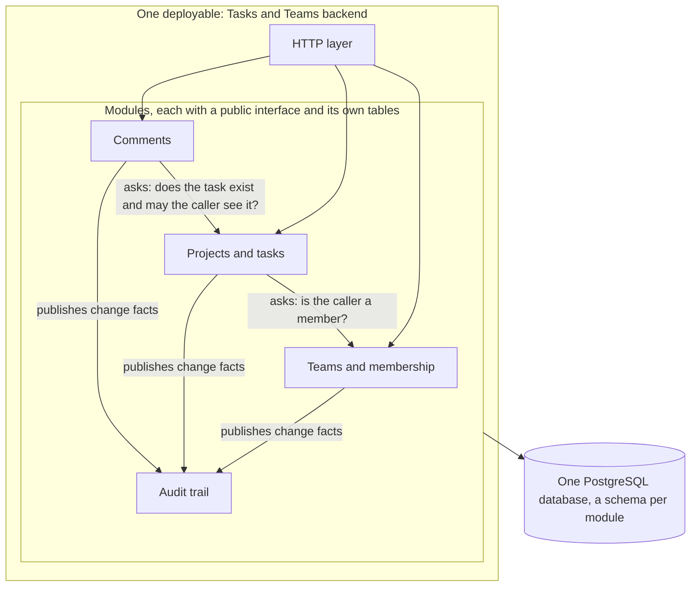
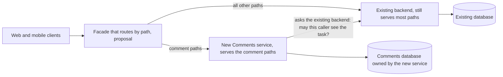
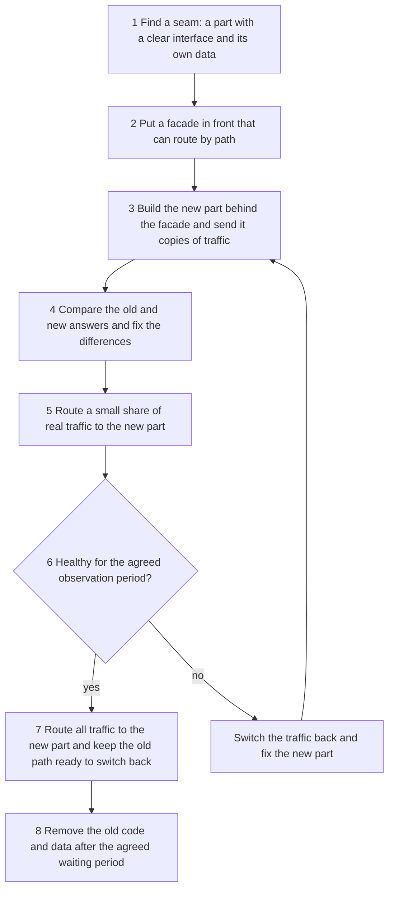

# 07. Monolith, modular monolith and microservices: decision and migration

> **Draft: written but not yet run.** The code and the expected output in this lesson were prepared by reading the code and the official documentation. They have not been executed yet. If something does not behave as described, trust your tool's real output and report it.

## What you will be able to do
By the end of this lesson you will be able to:
- Describe a monolith, a modular monolith and a set of microservices, and the cost each adds.
- Apply a decision framework that asks for evidence, and recommend a structure for a stated situation.
- Plan a migration with the strangler fig pattern, including rollback and removal of the old code.

## Recap
1. From lesson 03: why is a saga needed when services each own a database?
   <details><summary>Answer</summary>No single transaction covers them, so each step is a local transaction and failures are repaired by compensation.</details>
2. From lesson 04: what does a bulkhead protect against?
   <details><summary>Answer</summary>One slow dependency using all the capacity that other work needs.</details>

## Why it matters
Few choices in architecture are discussed with more heat and less evidence. A **monolith** is one deployable program. **Microservices** are many small programs, each owning its data, deployed separately. A **modular monolith** is one deployable with strong internal boundaries. Splitting buys independence (of teams, scaling, failure) and costs a network, distributed data, many more things to operate. A wrong split is very expensive to undo, while a missing split is usually cheap to fix later. This lesson gives you a way to decide from evidence and, when the answer is "split", a safe way to do it.

## What you will build
1. `decision-framework.md`: seven questions with evidence and direction. 2. `modular-monolith.mmd`: the platform backend with explicit modules (a proposal). 3. `strangler-routing.mmd` and `strangler-steps.mmd`: how to extract a module safely. 4. `strangler-checklist.md`. 5. `0004-modular-monolith.md`: an ADR.

## Before you start
- **Prerequisites:** Architecture 301 lessons [03, events, outbox and saga](../phase-1-scale/03-events-outbox-saga.md) and [04, failure modes and resilience](../phase-2-resilience-and-operations/04-failure-modes-resilience.md).
- Lessons 03 and 04 done; same editor and preview. Work folder: `code101/architecture/301-lesson07`.
- Time: 90 minutes (reading 30, typing 25, exercise 35).
- Source pack (optional): every file is shown in full in this lesson, so you can follow without it. The finished code, the exercise starter and the solution are in the course repository https://github.com/Uee03/Code101 under `source/architecture/301-super-hero-to-legendary/phase-3-evolution/07-monolith-to-microservices/` (on that page choose **Code, Download ZIP**, or run `git clone https://github.com/Uee03/Code101.git`).
- Pictures described below are expected, not yet rendered by the author.

## Steps
### Step 1. Vocabulary
- **Module**: a part of one program with a public interface, hidden internals and its own data. In a modular monolith the compiler or the build checks boundaries where it can; reviews do the rest.
- **Distributed monolith**: services that must be deployed together and share a database. They have all the cost of microservices and none of the independence.
- **Seam**: a place where a system can be cut with the least damage, usually where an interface and data ownership are already clear.
- **Strangler fig pattern**: replace a system piece by piece. A **facade** in front routes requests to the old or the new implementation; the old parts shrink until they can be removed. The name comes from a vine that grows around a tree.
- **Anti-corruption layer**: a thin translation layer so that the new part does not copy the old model's quirks.

### Step 2. Save the decision framework
Create `decision-framework.md` in `code101/architecture/301-lesson07`.

**File: `decision-framework.md`**

````markdown
# Decision framework: monolith, modular monolith or microservices

Answer each question with evidence, not opinion. The default is the simplest structure that meets the evidence.

| Question | Evidence to collect | Points toward one deployable | Points toward separate services |
|---|---|---|---|
| Do teams block each other's releases? | Release history, waiting time for shared releases | Few teams, rare conflicts | Many teams with frequent conflicts over one release |
| Do parts need to scale differently? | Load and resource use per part | Similar profiles | One part needs far more instances than the rest, shown by measurement |
| Must one part keep running when another fails? | Incident history, failure effects table | Failures are rare or tolerable | A critical part is repeatedly damaged by a non-critical one |
| Are the data boundaries clear? | A table-by-table ownership map | Tables are tangled across features | Each candidate owns its data and the others rarely read it directly |
| Can the team operate many services? | Automated builds and releases, tracing, on-call rota | Little automation or observability | Mature automation, observability and incident practice |
| Must operations be strongly consistent across the candidate parts? | The consistency menu | Many operations need one atomic transaction across them | Operations cross the boundary rarely and tolerate eventual consistency |
| Is there a different technology or compliance need? | Requirements and audits | None | A part must use another runtime or be isolated for compliance |

Default: start with a modular monolith, one deployable with modules that own their data and talk through public interfaces. Extract a module only when the evidence in one or more rows justifies the cost.
````

### Step 3. Save the modular monolith picture
This is a proposal for how a platform backend could make its modules explicit. In the platform the audit entries are written by database triggers; the picture shows a module-level alternative to illustrate boundaries.

**File: `modular-monolith.mmd`**



### Step 4. Save the strangler routing
**File: `strangler-routing.mmd`**



### Step 5. Save the strangler steps
**File: `strangler-steps.mmd`**



### Step 6. Save the preview file
Create `diagram-sources.md`: these three lines, then the three **File** blocks above for the diagrams, in order (`modular-monolith.mmd`, `strangler-routing.mmd`, `strangler-steps.mmd`).

```text
# Diagram sources, lesson 07

Each fenced block is the content of the .mmd file named above it.
```

### Step 7. Save the checklist and the ADR
**File: `strangler-checklist.md`**

````markdown
# Strangler migration checklist

Before you start:
- [ ] The part to extract has a clear interface and owns its data, or you have a plan to split the data.
- [ ] A facade exists that can route by path or by feature flag.
- [ ] Metrics, traces and alerts exist for the old and the new part.
- [ ] A rollback is defined: how traffic returns to the old part, and how long it stays ready.

During:
- [ ] The new part receives copies of traffic first, and differences are reviewed.
- [ ] A small share of real traffic is routed, then increased in steps agreed in advance.
- [ ] Data is moved with a plan that handles writes during the move, and counts are compared at the end.
- [ ] The new part calls the old one only through its public interface, never through shared tables.

After:
- [ ] The old code and its data are removed after the agreed waiting period.
- [ ] Documents and diagrams show only the new structure.
- [ ] The decision and the measured outcome are recorded in an ADR.
````

**File: `0004-modular-monolith.md`**

````markdown
# ADR 0004: Stay a modular monolith and extract only on evidence

Status: Proposed
Date: 2026-11-23
Owner: Platform maintainers

## Context
Each platform backend is one deployable program with an HTTP layer, an application layer and a data layer, sharing one database. Business rules that must be atomic live in database functions. No measurement shows a part that needs different scaling, a release conflict between teams or a failure that spreads between parts.

## Options
- Keep one deployable and make its modules explicit, each with a public interface and its own tables. Cost: module boundaries must be enforced by review and checks, because the compiler does not enforce them everywhere.
- Split into services now (teams, work, comments, audit). Cost: network calls, distributed transactions and operations for each service, with no measured gain.
- Extract one module later, behind a facade, when evidence appears. Cost: the migration work is paid when needed.

## Decision
Keep the modular monolith. Extract a module, starting with the one that has the clearest data ownership, only when a row of the decision framework shows measured evidence.

## Consequences
- Benefit: atomic rules stay simple, operations stay small, and a later extraction remains possible.
- Cost or risk: modules may erode into a tangle unless their boundaries are checked in review.

## Revisit when
Measurements show one module needs independent scaling, or two teams cannot release independently. Reviewer: the platform maintainers.
````

### Step 8. Predict, then preview
Predict: (1) in the routing diagram, which arrow shows the cost of extracting Comments, and what could go wrong with it? (2) in the steps diagram, what happens after a "no" at step 6?

## Run it
Open `diagram-sources.md` in your preview.

Expected result, not yet rendered: a diagram with an outer group "One deployable" containing an HTTP shape and an inner group of four modules, one cylinder below, and nine arrows; a left-to-right diagram with six shapes (two cylinders) and six arrows; a vertical flowchart of nine shapes (one diamond) with nine arrows including one that loops back.

Predictions: (1) the arrow from the new service back to the existing backend ("may this caller see the task?"): every comment request now makes a network call that can be slow or fail, and the new service depends on the old one's availability; (2) traffic is switched back and the new part is fixed, then the flow returns to step 3.

## How it works
**Why start modular.** A modular monolith keeps what is cheap about a monolith (local calls, one transaction, one deploy, one place to debug) while building the habit that later makes splitting possible: each module owns its data and exposes an interface. The ADR draws the consequence: most of the benefits people attribute to microservices come from *modularity*, which you can have without the network.

**What a split costs.** Calls that were function calls become network calls with timeouts, retries and partial failure (lesson 04). A transaction that spanned two modules becomes a saga (lesson 03). Reads that joined two tables become API calls or duplicated data. Each service needs its own build, deployment, monitoring, alerting, security and on-call knowledge. The routing diagram shows the smallest version of this: even one extracted module needs a facade and a call back to the old system to answer "may this caller see this task?".

**Reading the decision framework.** No row says "microservices are better". Each row asks for evidence you can collect: release history, per-part load, failure effects, a data ownership map, the team's operational maturity, the consistency menu from lesson 02. If the evidence is absent, the answer is one deployable. P07's brief is a useful test: its problems were a slow synchronous call and a non-atomic stock reservation, both fixable inside one deployable with a timeout, a queue and a transaction. P07 splits the system mainly so that you practise the patterns, which is a legitimate goal, but not proof that the shop needed services.

**The strangler steps.** The pattern is incremental and reversible. Copies of real traffic reveal differences before any user depends on the new part; the share routed grows in steps; at each step there is a way back. The final step is the one teams skip: removing the old code and data. Without it you have two systems to maintain.

**Failure modes.**
- *Distributed monolith*: services share a database or must release together.
- *Chatty services*: one user request triggers many calls; latency and failure probability add up.
- *Premature extraction*: a boundary drawn before the data ownership is understood moves again and again.
- *Dual writes during data migration*: the old and new stores disagree (use the outbox idea from lesson 03 and compare counts).
- *No facade rollback*: the new part fails and there is no quick way back.
- *Orphaned old code*: never removed, still deployed, still a security surface.

**When not to extract.** When the benefit is only "it feels more modern"; when one team owns everything and releases without conflict; when the data cannot be split cleanly; when you cannot yet observe the system well enough to compare old and new.

**When to merge back.** Services that always change together, always deploy together and call each other constantly are one service. Merging is a legitimate migration too.

**Measurements to take.** Lead time and deployment frequency per part (and how often one part's release waits for another's); change failure rate; per-part load and resource use; latency added by each inter-module call; the share of requests that cross a module boundary; build and test time; the number of incidents where one part's failure spread.

**Security and operations.** More services mean more identities, more network paths and more secrets (lesson 06). Define service-to-service authentication, audit logging and ownership before the first extraction. A facade is a new critical component: monitor it, secure it and make it highly available.

> **Why this, not that.** A modular monolith first, not "microservices from the start": boundaries are cheap to move while they are inside one program and expensive to move once they are network interfaces. And an incremental strangler, not a "big bang rewrite": a rewrite delivers no value until the end and carries all the risk at once.

**Misconceptions.** "Microservices are the goal of mature architecture." The goal is a system that fits its constraints. "A monolith cannot scale." Many stateless copies of one program behind a load balancer scale well (lesson 01); it is the *data* that is hard to scale.

## Try it
### 1. Guided practice
Apply the framework to the P07 brief. Copy `exercise/starter` as `301-lesson07-try` (rename the **copy**) or create the file below, then replace each `TODO` using only evidence stated in the brief; if the brief gives none, say so.

**File: `301-lesson07-try/saltmarsh.md` (starter)**
```markdown
# Saltmarsh Outfitters: split or not?

Facts from the P07 brief: one application takes orders, reserves stock, charges the card and books the courier in one database transaction. During a sale the courier was slow and checkout froze; stock was reserved twice for one pair of boots; about 40 orders were charged but never shipped.

| Question | Evidence in the brief | Verdict (one deployable or separate) and reason |
|---|---|---|
| Do teams block each other's releases? | TODO | TODO |
| Must one part keep running when another fails? | TODO | TODO |
| Are the data boundaries clear? | TODO | TODO |
| Must operations be strongly consistent across the parts? | TODO | TODO |

Overall recommendation for the business, and what you would try first: TODO
```

### 2. Change practice
Choose the first module to extract from the platform if evidence appeared that comment traffic dwarfs the rest. List the three things from the checklist you would do first and what you would measure to know it worked.

### 3. Stretch (optional)
Write the argument for the opposite position: a case where you *would* split the platform from the start. Which row of the framework would have to be answered with strong evidence?

<details><summary>Solution to guided practice</summary>

**File: `301-lesson07-try/saltmarsh.md` (solution)**
```markdown
# Saltmarsh Outfitters: split or not?

Facts from the P07 brief: one application takes orders, reserves stock, charges the card and books the courier in one database transaction. During a sale the courier was slow and checkout froze; stock was reserved twice for one pair of boots; about 40 orders were charged but never shipped.

| Question | Evidence in the brief | Verdict (one deployable or separate) and reason |
|---|---|---|
| Do teams block each other's releases? | The brief says nothing about teams or release conflicts | No evidence, so no case for splitting on this ground |
| Must one part keep running when another fails? | A slow courier froze the whole checkout | Evidence for isolating the courier call; a timeout and an asynchronous hand-off can achieve this inside one deployable |
| Are the data boundaries clear? | Orders, stock, payments and shipments are separate concepts but live in one transaction today | Boundaries are plausible; the first step is to make them explicit as modules |
| Must operations be strongly consistent across the parts? | Double stock reservation and charged-but-not-shipped orders show weak control today | Stock reservation needs one owner and an atomic step; it is easier to fix inside one database first |

Overall recommendation for the business, and what you would try first: the evidence supports fixing the courier call (timeout, queue, outbox) and the stock reservation inside a modular monolith before splitting. P07 chooses services because its learning goal is to practise the patterns; for the real shop the first move is the cheaper one, and extraction follows only when a measurement shows the need.
```

For change practice, Comments is a reasonable first candidate (clear interface, own table, nothing else depends on it): first build the facade, send it copies of traffic, and agree rollback; measure comment-path latency, error rate and the extra load the new service puts on the old backend. For the stretch: a strong "yes" to the row about operating many services and to the row about scaling differently, together with a team structure that already works as independent groups, would justify starting split.

</details>

## Check yourself
1. What makes a monolith "modular"? <details><summary>Answer</summary>Modules with public interfaces, hidden internals and their own data, with dependencies that are kept under review.</details>
2. Predict: two services share one database and always release together. What are they? <details><summary>Answer</summary>A distributed monolith: the cost of services without independence.</details>
3. Why is the facade the heart of the strangler pattern? <details><summary>Answer</summary>It lets traffic move gradually between old and new and back again, so each step is reversible.</details>
4. Find the flaw: "We will rewrite the system as microservices and switch over at the end." <details><summary>Answer</summary>A big-bang rewrite delivers no value until the end and carries all the risk at once; migrate incrementally with a facade.</details>

## Common mistakes
| Symptom | Cause | Fix |
|---|---|---|
| Services call each other in long chains | Boundaries drawn by technical layers, not by business capability | Redraw along capabilities with their own data |
| A "shared library" with all the business rules | Coupling moved, not removed | Own the rule in one module and call it |
| Extraction never finishes | No removal step | Add the removal of old code to the plan and the checklist |
| Debates without data | No measurements | Collect the evidence in the framework first |
| A diagram preview fails on a nested subgraph (typical: a parse error) | Missing `end` for the inner group | Close every `subgraph` |

## Best practice
Choose the simplest structure the evidence supports, make module boundaries explicit, and migrate incrementally with a facade and a rollback. Source: Microsoft Azure Architecture Center, [Strangler Fig pattern](https://learn.microsoft.com/azure/architecture/patterns/strangler-fig) and [Microservices architecture design](https://learn.microsoft.com/azure/architecture/microservices/); ByteByteGo, [Software architecture guides](https://bytebytego.com/guides/software-architecture/).

## Going further
Platform TDD section 4 lists the decisions that made each backend a single deployable; turn one of them into an ADR with measured triggers. Lesson 09 reviews the platform and P07 with this framework in hand.

## Summary
- You described the three structures and the cost each adds.
- You applied a decision framework that asks for evidence, and recommended a structure.
- You planned a strangler migration with rollback and removal of the old code.

## Next lesson
08. Cost, capacity and performance modelling: how to estimate without inventing numbers.
