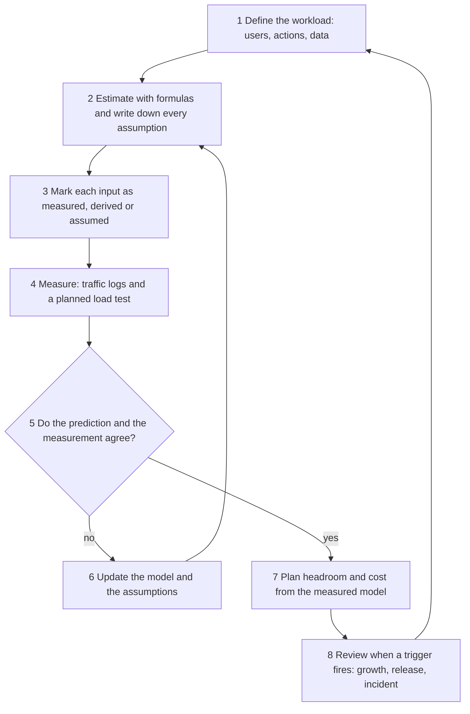

# 08. Cost, capacity and performance modelling

> **Draft: written but not yet run.** The code and the expected output in this lesson were prepared by reading the code and the official documentation. They have not been executed yet. If something does not behave as described, trust your tool's real output and report it.

## What you will be able to do
By the end of this lesson you will be able to:
- Estimate request rate, requests in flight, storage and cost from stated inputs, labelling every input as measured, derived or assumed.
- Use Little's law and a peak factor to turn a throughput target into a concurrency figure.
- Write a measurement plan that tests a prediction, and say what to do when prediction and measurement disagree.

## Recap
1. From lesson 05: why does a latency metric need percentiles?
   <details><summary>Answer</summary>Averages hide the slow tail that users feel; a p95 or p99 shows it.</details>
2. From lesson 01: why does a scaling step need a measurement first?
   <details><summary>Answer</summary>Each stage adds cost and complexity; only a measured bottleneck justifies it.</details>

## Why it matters
"How many servers do we need?" and "what will it cost?" are questions every design must answer, and a wrong answer in either direction hurts: too little capacity means outages, too much means waste and a budget conversation you do not want. Good estimates are not about precision; they are about *showing your assumptions* so they can be checked. This lesson teaches how to estimate honestly: formulas, ranges, and a loop that replaces assumptions with measurements. It contains no invented capacity or price: every number comes from a design document you can open, and every other input is a blank to fill with a measurement.

## What you will build
1. `estimation-worksheet.md`: inputs, symbols and formulas. 2. `worked-examples.md`: four examples using only numbers from the platform and P07 documents. 3. `measurement-plan.md`: a load-test plan template. 4. `capacity-process.mmd`: the estimate-measure-update loop.

## Before you start
- **Prerequisites:** Architecture 301 lessons [01, scaling to millions](../phase-1-scale/01-scaling-to-millions.md) and [05, observability and SLOs](../phase-2-resilience-and-operations/05-observability-slos.md).
- Lessons 01 and 05 done; same editor and preview. Work folder: `code101/architecture/301-lesson08`. A calculator is enough.
- Time: 80 minutes (reading 25, typing 20, exercise 35).
- Source pack (optional): every file is shown in full in this lesson, so you can follow without it. The finished code, the exercise starter and the solution are in the course repository https://github.com/Uee03/Code101 under `source/architecture/301-super-hero-to-legendary/phase-3-evolution/08-cost-capacity-performance/` (on that page choose **Code, Download ZIP**, or run `git clone https://github.com/Uee03/Code101.git`).
- Pictures described below are expected, not yet rendered by the author.

## Steps
### Step 1. Vocabulary
- **Throughput**: work completed per second (requests, orders). **Latency**: time one piece of work takes. **Concurrency** or **requests in flight**: how many are being worked on at the same moment.
- **Little's law**: in a stable system, the average number of items in the system equals the arrival rate times the average time each spends there: L = lambda x W. It holds whatever the internals are.
- **Peak factor**: the busiest second's traffic divided by the average second's. Capacity is planned for the peak, not the average.
- **Headroom**: unused capacity kept in reserve below the point where the most limited resource saturates.
- **Saturation point**: the load at which latency starts to climb sharply or errors begin. Near full utilisation, queues build and latency grows quickly, so running resources close to 100 percent is not "efficient".
- **Back-of-envelope estimate**: a quick calculation with stated assumptions, accurate to the right order of magnitude, to decide whether an idea is plausible before measuring.

### Step 2. Save the estimation worksheet
Create `estimation-worksheet.md` in `code101/architecture/301-lesson08`. The Value column says "to measure" on purpose: filling it from imagination would defeat the worksheet.

**File: `estimation-worksheet.md`**

````markdown
# Estimation worksheet

Every input is marked measured, derived or assumed. An estimate built on assumed inputs is a hypothesis to test, not a result.

## Inputs
| Input | Symbol | Value | Source | Confidence |
|---|---|---|---|---|
| Registered users | U | to measure | Identity provider count | measured |
| Share of users active in the period | a | to measure | Sign-in logs | measured |
| Requests per active user per period | r | to measure | Request logs | measured |
| Seconds in the period | T | derived from the period | Calendar | derived |
| Peak factor, busiest second divided by the average second | k | to measure | Request logs at one-second resolution | measured |
| Mean time a request or order spends in the system | W | to measure | Latency metrics | measured |
| Records of one kind | N | to measure | Row counts | measured |
| Bytes per record, including indexes | b | to measure | Table size divided by row count | measured |
| Copies kept (replicas and backups) | c | design decision | Architecture | derived |
| Retention period | D | policy | Data policy | assumed until agreed |

## Formulas
- Average request rate: lambda = (U x a x r) / T
- Peak request rate: lambda_peak = lambda x k
- Requests in flight (Little's law): L = lambda x W
- Storage: S = N x b x c
- Transfer per second: bandwidth = lambda x average response size
- Cost of one resource: cost = quantity x unit price read from the provider's price page on a stated date
- Cost per unit of work: total cost of the period divided by the number of units of work in the period

## Headroom
Plan capacity from lambda_peak, not lambda. Keep a margin below the measured saturation point of the most limited resource. The size of the margin is a team decision recorded in an ADR and revisited after incidents.
````

### Step 3. Save the worked examples
**File: `worked-examples.md`**

````markdown
# Worked examples from the TDDs

Each example uses only numbers stated in a design document, and says which. None is a measurement of a running system.

## Example A: the per-user ceiling of the platform
Source: platform TDD, rate limits: 100 requests per 60 seconds per user.
- Sustained ceiling per user: 100 / 60 requests per second, which is about 1.67 requests per second.
- For U users all at their limit at once, the ceiling is U x 1.67 requests per second. This is an upper bound for planning the worst case, not an estimate of real traffic. Real traffic needs the measured inputs a, r and k from the worksheet.

## Example B: orders in flight in P07
Source: P07 non-functional requirements N-01 (20 orders per second sustained) and N-02 (p95 end-to-end confirmation under 2 seconds).
- Little's law: L = lambda x W.
- If every order took the full 2 seconds, L = 20 x 2 = 40 orders in flight at once.
- The true mean is normally lower than the p95 target, so 40 is a planning ceiling, provided the mean is not larger than the p95 target. Check this with measured data.

## Example C: broker traffic for the P07 load run
Sources: P07 N-01 and the saga diagram of lesson 03, which has four events on the success path: OrderPlaced, StockReserved, PaymentCaptured and ShipmentCreated.
- Orders in a 5-minute run: 20 x 300 = 6,000.
- Events on the success path per second: 20 x 4 = 80.
- Events in the run: 6,000 x 4 = 24,000.
- Failure paths and retries add more. The figures are a lower bound for the happy path.

## Example D: the shape of a cost estimate (no prices)
- Compute: instances x hours x price per instance-hour.
- Storage: gigabytes x months x price per gigabyte-month, multiplied by copies.
- Transfer: gigabytes out x price per gigabyte.
- Observability: log and trace volume x price per unit. This is often forgotten and can be large.
- People: hours of operation and on-call time.
Fill every price from the provider's price page on a dated check, and record the date.
````

### Step 4. Save the measurement plan
**File: `measurement-plan.md`**

````markdown
# Load test and measurement plan

This is a plan to fill in before a test. It is a template; nothing here has been run.

| Section | What to write |
|---|---|
| Question | The single question the test answers, for example: does the p95 stay within the target at the planned rate? |
| Workload model | The mix of operations and their proportions, taken from real traffic logs |
| Data | Volume and shape of test data, close to production size |
| Environment | How it differs from production, and what that means for the result |
| Ramp | How the load rises, holds and falls |
| Metrics | Latency percentiles, error rate, throughput, and saturation of every resource |
| Pass criteria | Written before the test, tied to the service level objective or to a scenario |
| Stop conditions | When to stop to protect shared systems |
| Report | Percentiles not averages, the saturation point, the limiting resource, the difference from the prediction |

Rules:
- Test one change at a time.
- Repeat a test before trusting a surprising result.
- Never publish a number without its conditions: environment, data size, load shape and date.
- Keep fakes and partner stubs realistic; a stub that always answers instantly hides the slow partner problem.
````

### Step 5. Save the loop diagram
**File: `capacity-process.mmd`**



Create `diagram-sources.md`: these three lines, then the **File** block above.

```text
# Diagram sources, lesson 08

Each fenced block is the content of the .mmd file named above it.
```

### Step 6. Predict, then check
Predict, without a calculator where you can: (1) the sustained per-user ceiling in Example A; (2) the number of events in the 5-minute P07 run in Example C; (3) which arrow in the loop returns you to an earlier step, and when is it taken?

## Run it
Open `diagram-sources.md` and the three Markdown files in your preview. Then check the arithmetic in `worked-examples.md` by hand.

Expected result, not yet rendered: the loop diagram has eight boxes (one diamond) and nine arrows, with two arrows that return to earlier steps (from step 6 to step 2, and from step 8 to step 1).

Your predictions: (1) 100 divided by 60, about 1.67 requests per second; (2) 24,000 events (20 x 300 = 6,000 orders, times four events); (3) the arrow labelled "no" leads to step 6 and then back to step 2, taken when the measurement disagrees with the prediction.

## How it works
**The inputs table is the lesson.** Every formula consumes inputs; each input has a symbol, a value, a source and a confidence. "To measure" is a valid value: it tells the next person what to find out. An estimate with ten *assumed* inputs is a story; one with ten *measured* inputs is a model.

**Little's law in practice.** L = lambda x W lets you move between throughput, latency and concurrency without knowing the internals. In Example B, a rate of 20 per second and 2 seconds per order imply up to 40 orders in flight. That matters because in-flight work occupies connections, threads, memory and consumer slots: sizing a connection pool or a consumer prefetch limit starts from L, not from the rate. The caveat in the example is real: the law uses the *mean* time, while the target is a *p95*; the plan assumes the mean is no larger than the target, and the exercise asks you what to measure to confirm it.

**Ceilings versus estimates.** Example A shows a *ceiling*: the rate limit guarantees no user exceeds about 1.67 requests per second over a minute, which bounds the worst case by the number of users. It is useful for capacity *limits*, but real traffic is far below a ceiling and must be measured.

**Peak versus average.** The worksheet separates lambda from lambda_peak with a measured factor k. Averages hide bursts: a sale, a Monday morning, a retry storm. Plan for the peak and the failure mode under it (lesson 04).

**Costs.** Cost modelling is the same loop with prices as inputs. Three habits help: read prices from the provider's page on a dated check (prices change), compute a *cost per unit of work* (per thousand requests, per order) so growth and efficiency are visible, and include the commonly forgotten items: observability volume, data transfer, backups, and people's time.

**Performance models.** A latency budget adds the parts of a path (gateway, service, database, partner), but percentiles do not add: the p95 of a chain is not the sum of its parts' p95s. Use budgets to find where time goes and measure the whole path.

**Failure modes of estimation.** False precision (three decimals on an assumed input); averages used for peaks; a model never compared with reality; a load test against an unrealistic stub; testing with tiny data; reporting a result without its conditions; sizing for today only, with no growth trigger.

**When not to model in detail.** For a prototype or a low-risk internal tool, a back-of-envelope check and a monitored deployment may be enough. Model in more depth where the cost of being wrong is high: launches, sales events, migrations, expensive resources.

**Measurements to take.** Everything in the inputs table, plus the saturation point of each resource, latency percentiles at several load levels, cost per unit of work each month, and the gap between prediction and measurement each time you check.

**Security and operations.** A load test must never use real personal data or real credentials, and must not hit production dependencies you do not own. Tests against shared environments need approval and a stop condition. Keep capacity documents with the architecture package and review them on triggers: growth, release, incident.

> **Why this, not that.** A model with labelled inputs, not a single "magic number": a labelled model can be corrected when one input changes, while a bare number can only be trusted or ignored. And a measurement loop, not a one-off sizing exercise: systems and traffic change.

**Misconceptions.** "More servers is always the safe answer": it hides the real bottleneck and costs money. "If the average is fine, the system is fine": the tail and the peak decide the user experience.

## Try it
### 1. Guided practice
Estimate four quantities for P07 from its design numbers only. Copy `exercise/starter` as `301-lesson08-try` (rename the **copy**) or create the file below, then replace each `TODO` with a formula and a result. Then answer the closing question.

**File: `301-lesson08-try/p07-estimates.md` (starter)**
```markdown
# P07 estimates from the design documents

Use only numbers stated in the P07 TDD. Write the formula, the result and the source.

| Quantity | Formula | Result | Source numbers |
|---|---|---|---|
| Orders created in a 5-minute run at 20 orders per second | TODO | TODO | N-01 |
| Outbox rows written by Orders in that run, if each order writes one | TODO | TODO | R-03 |
| Orders in flight if each order takes the full 2 seconds | TODO | TODO | N-01, N-02 |
| Stock reservations that fail when 200 parallel orders compete for 50 units | TODO | TODO | R-06 |

What would you measure to replace the "if" in the third row with a real figure?
TODO
```

### 2. Change practice
Using the worksheet's symbols, write the formula for the storage the platform's audit log needs over a retention period, and list which inputs you would have to measure (do not fill in values).

### 3. Stretch (optional)
Draft a one-page load-test plan for the platform's list-tasks endpoint using the measurement plan template. Which workload data would you take from real logs, and why is the local seed-data figure in the TDD not enough?

<details><summary>Solution to guided practice</summary>

**File: `301-lesson08-try/p07-estimates.md` (solution)**
```markdown
# P07 estimates from the design documents

Use only numbers stated in the P07 TDD. Write the formula, the result and the source.

| Quantity | Formula | Result | Source numbers |
|---|---|---|---|
| Orders created in a 5-minute run at 20 orders per second | 20 x 300 | 6,000 | N-01 |
| Outbox rows written by Orders in that run, if each order writes one | 6,000 x 1 | 6,000 | R-03 |
| Orders in flight if each order takes the full 2 seconds | 20 x 2 | 40 | N-01, N-02 |
| Stock reservations that fail when 200 parallel orders compete for 50 units | 200 - 50 | 150 | R-06 |

What would you measure to replace the "if" in the third row with a real figure?
The mean time from order placed to a final state, from the recorded state changes, at the planned rate; compare it with the p95 target to check that the mean is not larger.
```

For change practice: S = N x b x c, where N is the number of audit rows written per period multiplied by the number of periods in the retention policy; measure the audit rows written per day, the bytes per row including indexes, the number of copies and the agreed retention. For the stretch: the workload mix, payload sizes and peak factor come from real logs; the TDD's 200 ms figure was measured locally with seed data and 25 requests, so it cannot predict behaviour with production-sized data or concurrency.

</details>

## Check yourself
1. State Little's law and say what each symbol means. <details><summary>Answer</summary>L = lambda x W: the average number in the system equals the arrival rate times the average time each item spends in the system.</details>
2. Predict: the rate doubles and the time per order stays the same. What happens to requests in flight? <details><summary>Answer</summary>They double.</details>
3. Why is an input marked "assumed" a warning? <details><summary>Answer</summary>The estimate built on it is a hypothesis; it needs a measurement before it is trusted.</details>
4. Find the flaw: "We know the p95 of each of three hops, so the end-to-end p95 is the sum of the three." <details><summary>Answer</summary>Percentiles do not add; measure the whole path.</details>

## Common mistakes
| Symptom | Cause | Fix |
|---|---|---|
| A result with many decimals and no source | False precision on assumed inputs | Show ranges and label the confidence of each input |
| Capacity sized from the average | Peak ignored | Measure k and size for the peak |
| A load test passes and production fails | Unrealistic data, stubs or mix | Use production-like data and realistic partners, state differences |
| The cost estimate misses half the bill | Observability, transfer and backups forgotten | Use the full list in example D |
| A diagram preview fails on the diamond (typical: a parse error) | An unquoted label | Quote every label |

## Best practice
Write every estimate with labelled inputs, measure to replace assumptions, and report results with their conditions. Source: Google SRE book, [Monitoring Distributed Systems](https://sre.google/sre-book/monitoring-distributed-systems/); AWS, [Well-Architected Framework](https://aws.amazon.com/architecture/well-architected/); Microsoft Azure Well-Architected Framework, [Cost Optimization](https://learn.microsoft.com/azure/well-architected/cost-optimization/).

## Going further
Fill the worksheet's blanks for a small system you operate, using your own logs, before the next scaling decision. Lesson 09 of this level asks reviewers to find estimates that are really assumptions.

## Summary
- You estimated rate, concurrency, storage and cost shape from labelled inputs.
- You applied Little's law and distinguished ceilings from estimates.
- You wrote a measurement plan and a loop that replaces assumptions with measurements.

## Next lesson
09. Capstone review: critique the platform and P07 designs with a written review template.
