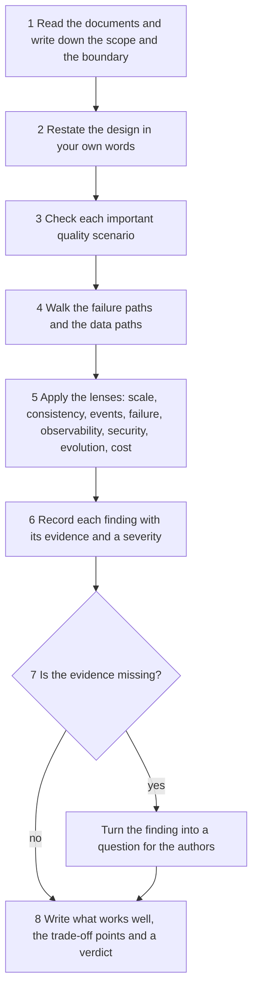

# 09. Capstone review: critique the platform and P07 designs

> **Draft: written but not yet run.** The code and the expected output in this lesson were prepared by reading the code and the official documentation. They have not been executed yet. If something does not behave as described, trust your tool's real output and report it.

## What you will be able to do
By the end of this lesson you will be able to:
- Review a written design with a fixed template: scope, strengths, findings with evidence and severity, trade-off points and a verdict.
- Apply eight lenses (scale, consistency, events, failure, observability, security, evolution, cost) to a real design document.
- Write findings that are fair to the authors: tied to a document and a section, or turned into a question when the evidence is missing.

## Recap
1. From lesson 08: what is the first thing to check about a number in a design?
   <details><summary>Answer</summary>Whether it was measured, derived or assumed, and under which conditions.</details>
2. From lesson 07: what is the default structure when there is no evidence for splitting?
   <details><summary>Answer</summary>A modular monolith: one deployable, with modules that own their data.</details>
3. From lesson 05: why do labels with unbounded values break a metrics system?
   <details><summary>Answer</summary>Each distinct value creates a new time series, so storage and query cost grow without bound.</details>

## Why it matters
Writing a design is half the work; the other half is having it reviewed by someone who did not write it. A good review finds the failure a team could not see, records what is sound so it is not "improved" away, and leaves the authors with a clear list of what to do. A poor one is a list of opinions. A design review is also the most efficient place to use everything in this track: each earlier lesson is a lens.

## What you will build
Five files: 1. `review-template.md`; 2. `review-platform.md`, a complete review of the Tasks and Teams platform design; 3. `review-p07.md`, a complete review of the P07 practice capstone brief; 4. `review-flow.mmd`, the review process; 5. your own review in the exercise.

## Before you start
- **Prerequisites:** Architecture 301 lessons [01, scaling to millions](../phase-1-scale/01-scaling-to-millions.md) to [08, cost, capacity and performance](08-cost-capacity-performance.md).
- Lessons 01 to 08 done; same editor and preview. Open `capstones/platform/TDD.md` (sections 2 to 7) and `capstones/_practice/P07-event-driven-order-processing/TDD.md` (sections 1 to 6) beside the lesson, because every finding cites them. Work folder: `code101/architecture/301-lesson09`.
- Time: 120 minutes in two sittings: about 60 minutes for Steps 1 to 5 (break after Step 5), then 60 minutes for Step 6 and the exercise.
- Source pack (optional): every file is shown in full in this lesson, so you can follow without it. The finished code, the exercise starter and the solution are in the course repository https://github.com/Uee03/Code101 under `source/architecture/301-super-hero-to-legendary/phase-3-evolution/09-capstone-review/` (on that page choose **Code, Download ZIP**, or run `git clone https://github.com/Uee03/Code101.git`).
- Pictures described below are expected, not yet rendered by the author. The reviews critique *designs written in documents*; none of the implementations was run or tested for this lesson.

## Steps
### Step 1. The eight lenses and the finding types
Each earlier lesson becomes a question:
- **Scale** (lesson 01): what is stateless, what is cached, what must read from the primary, and where is the next bottleneck?
- **Consistency** (02): which operations are strong, which eventual, and what happens when the deciding node is unreachable?
- **Events and sagas** (03): are duplicates, ordering, compensation and final states handled?
- **Failure and resilience** (04): timeouts, retries, breakers, bulkheads, degradation.
- **Observability and SLOs** (05): can you see it, and is there a target?
- **Security** (06): boundaries, STRIDE, secrets, isolation.
- **Evolution** (07): is the structure justified by evidence, and can it change safely?
- **Cost and capacity** (08): are the estimates labelled, and is there a measurement plan?

Finding types from lesson 09 of level 201: a **risk** (a decision that may make a scenario fail), a **non-risk** (a sound decision, and why), a **sensitivity point** (a small change has a large effect) and a **trade-off point** (one decision improves one quality and worsens another).

### Step 2. Save the review template
Create `review-template.md` in `code101/architecture/301-lesson09`. The angle brackets are placeholders to replace.

**File: `review-template.md`**

````markdown
# Design review: <system name>

Reviewer: <name>. Date: <date>. Documents reviewed: <list with section numbers>.

## Scope and boundary
What this review covers, what it does not cover, and which assumptions about the system boundary it makes.

## What works well
Decisions that are sound for the stated scenarios, and why (non-risks).

## Findings
| Id | Lens | Finding | Evidence (document and section) | Severity | Recommendation | Question for the authors |
|---|---|---|---|---|---|---|
| F1 | <lens> | <what you found> | <where you saw it> | <high, medium or low> | <what to do> | <what you could not tell from the documents> |

Lenses: scale, consistency, events and sagas, failure and resilience, observability and SLOs, security, evolution, cost and capacity.

Severity:
- High: could cause data loss, a security breach or a long outage, with no mitigation in the design.
- Medium: a likely problem, or a gap in the design that the authors should close before building.
- Low: an improvement, a clarification or a missing record of a decision.

## Trade-off and sensitivity points
Decisions that improve one quality and worsen another, and settings where a small change has a large effect.

## Quality scenario check
For each important quality scenario: does the design show how it is met, and is there a way to test it?

## Verdict
One of: accept, accept with conditions (list them), or rework (say what must change). Then the next steps, with owners.
````

### Step 3. Save the process diagram
**File: `review-flow.mmd`**



Create `diagram-sources.md`: these three lines, then the **File** block above.

```text
# Diagram sources, lesson 09

Each fenced block is the content of the .mmd file named above it.
```

### Step 4. Read and save the platform review
Read the review below *with the TDD open*: for each row, find the cited section and decide whether you agree. The reviewer does not claim to know more than the documents say: F1, F2, F3 and F6 ask questions.

**File: `review-platform.md`**

````markdown
# Design review: Tasks and Teams platform

Reviewer: course example. Date: 2026-11-23. Documents reviewed: capstones/platform/README.md and capstones/platform/TDD.md sections 2 to 7. Everything below comes from those sections; where they are silent the review asks a question instead of assuming.

## Scope and boundary
The review covers the platform contract and its local stack: the API contract, the database, the identity realm and the conformance checks. Production hosting is out of scope in the TDD, so findings about it are conditional on a later production use.

## What works well
- Atomic rules in database functions with row locking and a version check give strong consistency where lost updates would hurt.
- Object-level authorisation by team membership, with 404 for objects the caller cannot see, together with a limited database role and an audit trigger, gives defence in depth.
- Strong ETags with If-Match and idempotency keys protect clients from lost updates and duplicate creates.
- Contract first with a black-box conformance script makes the four backends interchangeable and testable.

## Findings
| Id | Lens | Finding | Evidence | Severity | Recommendation | Question for the authors |
|---|---|---|---|---|---|---|
| F1 | Scale | The place where rate-limit counters are kept is not stated, so with several backend instances the limit could be applied per instance | TDD section 6, rate limits | Medium | Choose a shared counter store and record fail-open or fail-closed behaviour in an ADR | Where do the counters live, and what happens if that store is unreachable? |
| F2 | Failure and resilience | The TDD describes one PostgreSQL database and no backup, restore or recovery objective | TDD sections 2 and 5 | Medium for any production use | Write a runbook with a tested restore and agree a recovery objective | Is a recovery objective expected before production use? |
| F3 | Observability and SLOs | The sections reviewed define a trace id in error responses but no metrics, service level objectives or alerts | TDD section 6, problem details | Medium | Define SLIs for the main journeys and an error budget policy | Where will the golden signals be measured? |
| F4 | Security | A revoked or leaked token stays valid until it expires, five minutes in the realm settings | TDD section 4 decisions and section 3 token lifetime | Low, accepted trade-off | Keep the trigger in the risk register and protect any operation that needs instant revocation with an extra check | Which operations, if any, need instant revocation? |
| F5 | Evolution | The conformance script runs 14 API checks while the contract has 27 operations, so some operations rely on the backend's own tests | README, status and the conformance row | Low | Track which operations are unchecked and add checks over time | How is drift in an unchecked operation detected? |
| F6 | Scale | A read replica is not described; if one is added later, reads that precede an If-Match update need a rule | TDD sections 4 and 6 | Low | Record the read-after-write rule in an ADR before adding a replica | Is a replica planned? |
| F7 | Security | The realm file is imported once, so later console changes could drift from the file in the repository | TDD section 4, Keycloak realm file decision | Low | Export and review realm changes, as the TDD already suggests for real systems | Who owns realm changes? |

## Trade-off and sensitivity points
- The five-minute access token life trades outage tolerance and fewer network calls against a longer window for a leaked token.
- Rules in database functions trade one shared implementation against harder unit testing and migrations for every change.

## Quality scenario check
- Concurrent edit, repeated create and probing another team's task: the design shows how each is met and the conformance script or backend tests can check them.
- Short identity outage: met by cached keys, but only as long as tokens are valid; no test is described.
- Listing speed: a target exists for local seed data only, which cannot predict production behaviour.

## Verdict
Accept with conditions for use as a teaching contract and local stack. Before any production use: close F1 and F2, define SLIs for F3, and record decisions F6 and F7 as ADRs.
````

### Step 5. Read the P07 review
Save the P07 review next. **Break here if you need one.**

**File: `review-p07.md`**

````markdown
# Design review: P07 event-driven order processing

Reviewer: course example. Date: 2026-11-23. Documents reviewed: capstones/_practice/P07-event-driven-order-processing/TDD.md sections 1 to 6. Everything below comes from those sections. P07 is a practice brief that learners build, so some findings are questions the learner must answer in their own ADRs.

## Scope and boundary
The review covers the stated requirements, the suggested architecture and the list of decisions. It does not review any learner's implementation.

## What works well
- The brief says what it will not claim: no exactly-once delivery, and design for at-least-once delivery with idempotency.
- Every order must end in a final state, and a consistency checker proves it after each drill.
- Timeouts, retries with backoff and jitter, and a circuit breaker are required on every outbound call, and chaos drills are required to prove them.
- Metric labels with unbounded values are listed as a decision to make, which protects the metrics system.
- No card data exists anywhere in the system.

## Findings
| Id | Lens | Finding | Evidence | Severity | Recommendation | Question for the authors |
|---|---|---|---|---|---|---|
| P1 | Events and sagas | The read model must be rebuildable by replaying events, but the broker choice is left open; queues that discard acknowledged messages cannot replay | Requirement R-11 and decision 2 | Medium | Make replay an explicit criterion in the broker ADR and keep an event history that supports it | Where does the history live and how long is it kept? |
| P2 | Events and sagas | The requirements do not say what happens when a compensation such as a refund keeps failing | R-08, R-09 and the failure matrix | Medium | Require retried, idempotent compensations, a bounded number of tries, a dead-letter path and an alert for a stuck order | Which state is an order in while a compensation is failing? |
| P3 | Failure and resilience | The scope is Docker Compose only, so the broker is presumably a single instance; the drills cover a restart but not loss of its storage | R-21, non-goals and R-22 | Low for a learning stack | State the accepted limit in an ADR | Is loss of broker storage an expected drill? |
| P4 | Security | Service-to-service identity is required, but access rules on the broker itself, who may publish or consume which event types, are not mentioned | R-20 and decision 9 | Medium | Give each service its own broker identity with the smallest rights, and consider a check of the producer field in consumers | How are broker identities created and rotated? |
| P5 | Observability and SLOs | Many metrics are required but no service level objective ties them to a user journey | R-12, R-15 and N-02 | Medium | Define an SLI and an SLO for orders reaching a final state, with an error budget policy | Which latency target becomes the SLO and who agrees it? |
| P6 | Evolution | The split into services is the learning goal; the brief itself describes problems, a slow courier call and a non-atomic stock reservation, that a modular monolith might also fix | Section 1, the brief | Low | Add a short ADR that records why services are chosen and what evidence would have justified staying modular | What measurement would have justified the split? |
| P7 | Cost and capacity | Throughput and memory targets are given for one laptop, but there is no model that links them, for example orders in flight at the target rate | N-01, N-02 and N-05 | Low | Add the in-flight estimate and the broker event rate to the capacity notes | Which resource saturates first? |

## Trade-off and sensitivity points
- Choreography keeps services independent and makes the flow harder to see; an order state owner and good traces reduce that cost.
- Retry counts and breaker thresholds are sensitivity points: small changes decide whether an outage stays small or turns into a retry storm.
- Prefetch and in-flight limits trade throughput for stable memory.

## Quality scenario check
- No double stock reservation, one charge per order and a final state for every order: each has a measurable acceptance criterion and a drill or checker.
- Slow courier: required to leave Orders unaffected, with a ten-second latency drill.
- Rebuild of the read model: a criterion exists, and P1 shows what it needs from the broker choice.

## Verdict
Accept with conditions as a practice brief: close P1, P2 and P4 in the learner's ADRs, define the SLO in P5, and record P6 so the choice of services is a decision and not a reflex.
````

### Step 6. Predict, then preview
Predict before opening: (1) which findings in the two reviews are questions rather than claims, and what do they have in common? (2) which severity does a finding get when the design has a mitigation that the authors have *accepted* as a trade-off?

## Run it
Open `diagram-sources.md` and the three Markdown reviews in your preview.

Expected result, not yet rendered: the process flowchart has nine shapes (one diamond) and nine arrows, with two paths that join before the last step. The platform review has seven findings (F1 to F7) and the P07 review has seven (P1 to P7).

Your predictions: (1) the "question for the authors" column carries them; findings F1, F2, F3 and F6 in the platform review and P1, P2 and P4 in the P07 review rest on something the documents *do not say*, so they are phrased as gaps with a question; (2) low, as F4 shows: it is kept visible but not treated as a defect.

## How it works
**Evidence first.** Every finding has a document and a section. A reviewer who writes "the design is not scalable" has an opinion. A reviewer who writes "the place where rate-limit counters are kept is not stated (TDD section 6)" has a finding the authors can check in a minute and answer.

**Questions are findings too.** When the documents are silent, the honest finding is a *gap*, phrased with a question. This keeps the review fair: the authors may have an answer you did not see, or the gap may be real. The right-hand column of the template exists to make this habit visible.

**Severity is about consequence, not about discomfort.** F2 (one database and no recovery objective) is medium *for production use* and irrelevant for a local teaching stack; the review says so rather than inflating it. F4 is low because the TDD records the trade-off knowingly. The same rule makes P6 low: the choice of services is legitimate when the goal is learning, but a record of the reason is missing.

**What works well matters.** The strengths list is not politeness. It protects good decisions from "improvements" later, and it shows the authors which of their choices to keep. Many findings in the reviews are *non-risks* stated this way.

**The lenses find different things.** Scale found F1 and F6, failure found F2 and P3, observability found F3 and P5, events found P1 and P2, security found F4, F7 and P4, evolution found F5 and P6, cost found P7. Consistency appears as a strength (strong where lost updates matter). A review that uses only one lens misses the others; that is why the process diagram has the lens step.

**Verdicts.** "Accept with conditions" is the common honest verdict: it lists what must be closed before building or before production, and it turns the review into work with owners.

**Failure modes of reviews.** Reviewing the people, not the design; vague findings; findings without evidence; severity inflation; hindsight ("obviously they should have used X"); reviewing what you would have built instead of what was written; no follow-up, so the findings are never closed.

**When not to hold a heavy review.** A small, reversible change needs a short checklist, not a document. Save the template for decisions that are expensive to change.

**Measurements to take.** How many findings were closed and how fast; how many were later proved real by an incident or a test; how many were questions answered with "already handled" (a sign the documents were unclear). These tell you whether your review practice is worth its time.

**Security and operations.** Reviews may contain sensitive information: keep them with the documents they discuss and apply the same access rules. Follow-up needs an owner and a date; record the closing of each finding.

> **Why this, not that.** A fixed template with lenses, not a free-form discussion: it makes reviews comparable, prevents the loudest concern from crowding out the others and leaves a record. And a written review, not only a meeting: writing forces evidence, and the authors can answer item by item.

**Misconceptions.** "A review's job is to find faults." It is to improve the decision quality, which includes confirming what is sound. "The reviewer must be a senior expert." The method (evidence, lenses, questions) works for anyone who reads carefully.

## Try it
### 1. Guided practice
Review the Community Library package from level 201 lesson 10. Copy `exercise/starter` as `301-lesson09-try` (rename the **copy**) or create the file below, then replace each `TODO`. Use your own solution files from 201 lesson 10, or the solution shown there. For each finding cite a file; if a file is silent, write a question.

**File: `301-lesson09-try/review-library.md` (starter)**
```markdown
# Design review: Community Library architecture package

Reviewer: TODO. Date: TODO. Documents reviewed: the Community Library files from level 201 lesson 10 (context, containers, components, ADR 0001, quality scenarios and risks).

## Scope and boundary
TODO

## What works well
TODO

## Findings
| Id | Lens | Finding | Evidence | Severity | Recommendation | Question for the authors |
|---|---|---|---|---|---|---|
| F1 | Failure and resilience | TODO | TODO | TODO | TODO | TODO |
| F2 | Security | TODO | TODO | TODO | TODO | TODO |
| F3 | Observability and SLOs | TODO | TODO | TODO | TODO | TODO |

## Verdict
TODO
```

### 2. Change practice
Add two findings from lenses not yet used (consistency and cost, for example) to the platform review, each with evidence from the TDD or a question.

### 3. Stretch (optional)
Write the one-paragraph "response from the authors" to finding F1 of the platform review: accept, decline or defer, with a reason and an owner. How does a good response differ from a defensive one?

<details><summary>Solution to guided practice</summary>

**File: `301-lesson09-try/review-library.md` (solution)**
```markdown
# Design review: Community Library architecture package

Reviewer: course example. Date: 2026-11-23. Documents reviewed: the Community Library files from level 201 lesson 10 (context, containers, components, ADR 0001, quality scenarios and risks).

## Scope and boundary
The review covers the documents only. The system is invented, so the facts in it are assumptions, not measurements.

## What works well
- The loan rule is owned by one place and one database step, which prevents a double loan, and an ADR records the cost.
- The e-mail service is drawn as external in every view.

## Findings
| Id | Lens | Finding | Evidence | Severity | Recommendation | Question for the authors |
|---|---|---|---|---|---|---|
| F1 | Failure and resilience | The Library API calls the e-mail service with no timeout, retry or fallback described, so a slow e-mail service could slow loans | containers.mmd and components.mmd | Medium | Send reminders through a queue and a separate worker, with a bounded number of tries | Do reminders run inside the loan request? |
| F2 | Security | Scenario Q2 protects member history, but no diagram shows how a member is identified or where the check lives | quality.md scenario Q2 and components.mmd | Medium | Add an identity provider to the context and a token or session check component | How do members sign in? |
| F3 | Observability and SLOs | There is no measure of whether loans succeed, only scenarios | quality.md | Low | Define an SLI such as the share of loan requests that succeed, with an owner | Who watches it? |

## Verdict
Accept with conditions: close F1 and F2 before building; define the SLI in F3 when the first version runs.
```

For change practice two sound examples: *consistency*: the platform's list reads, if served from a replica later, are eventual while updates are strong, and the TDD has no statement of that rule (question: which reads may be stale?); *cost*: the TDD's targets are local and no model links request rate to resources (question: what are the measured inputs?). For the stretch: a good response states what will change and who owns it ("accept: ADR for the counter store, owner: platform maintainers, before production"), or declines with a reason and a revisit trigger; a defensive one argues about the reviewer instead of the finding.

</details>

## Check yourself
1. Why does every finding cite a document and a section? <details><summary>Answer</summary>So the authors can check it quickly, and so the review is about the design on paper and not about opinions.</details>
2. Predict: you cannot find where a design says what happens when a partner call fails. What do you write? <details><summary>Answer</summary>A finding that names the gap and a question to the authors, not a claim that the design has no handling.</details>
3. Why does the template have a "What works well" section? <details><summary>Answer</summary>It records sound decisions so they are kept, and it shows the authors what to preserve.</details>
4. Find the flaw: "Severity high: I would have used microservices." <details><summary>Answer</summary>It is a preference, not a consequence; a high rating needs a described consequence such as data loss or an outage with no mitigation.</details>

## Common mistakes
| Symptom | Cause | Fix |
|---|---|---|
| A review that sounds like criticism of people | Findings written about the authors | Write about the document and the decision |
| Every finding rated high | No definition of severity | Use the severity table and justify each rating |
| The authors answer "we already do that" | The reviewer missed it, or the documents hid it | Record both: fix the documents so the answer is visible |
| Findings never closed | No owner or date | Add owners and review the list at the next meeting |
| A diagram preview fails on the diamond (typical: a parse error) | An unquoted label | Quote every label |

## Best practice
Review with a fixed template, tie every finding to evidence, turn gaps into questions and always list what works well. Source: arc42, [Risks and technical debt](https://docs.arc42.org/section-11/) and [Architecture decisions](https://docs.arc42.org/section-9/); AWS, [Well-Architected Framework](https://aws.amazon.com/architecture/well-architected/) for review lenses.

## Going further
Take the architecture package you built in level 201 lesson 10 for a system of your own and run this review on it, ideally swapping packages with a colleague.

## Summary
- You used a fixed review template with eight lenses, evidence, severity and a verdict.
- You read complete reviews of the platform and P07 designs and checked their evidence.
- You wrote a review of an architecture package that is fair to its authors.

## Next lesson
This is the last lesson of the Architecture 301 level. Next, take on a practice capstone and use these documents on a real design.
