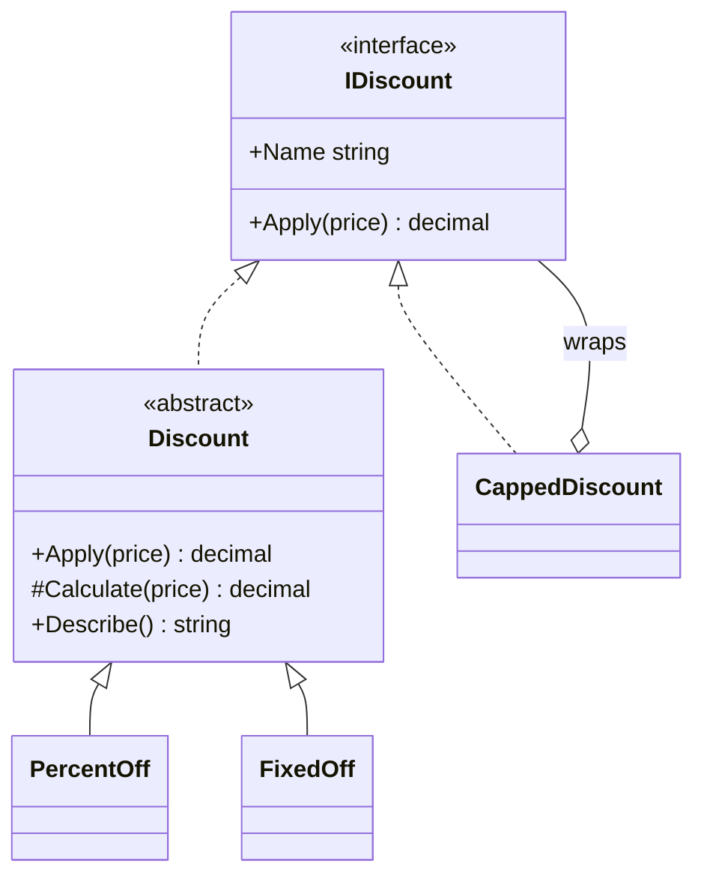

# 01. Interfaces, inheritance and polymorphism

> **Draft: written but not yet run.** The code and the expected output in this lesson were prepared by reading the code and the official documentation. They have not been executed yet. If something does not behave as described, trust your tool's real output and report it.

## What you will be able to do
By the end of this lesson you will be able to:
- Write an interface and two implementations, and call them through the interface type.
- Predict which `override` runs when the variable's type and the object's real type differ.
- Compare an interface, an abstract base class and composition for the same design problem.
- Fix a design where inheritance was used only to reuse code.

## Recap
1. In C# 101 lesson 10, what is the difference between a class and an object?
   <details><summary>Answer</summary>The class is the blueprint (fields, methods); an object is one instance built from it, with its own state.</details>
2. In C# 101 lesson 11, why do two separately created records with the same values compare equal with `==`?
   <details><summary>Answer</summary>Records compare by value (their data), not by reference.</details>

## Why it matters
A shop has many kinds of discount: a percentage, a fixed amount, a capped percentage. The checkout code should not care which kind it holds; it should only ask "what is the price after this discount?". **Polymorphism** (many forms) lets one line of code work with many types. Almost every framework you meet next (ASP.NET Core, EF Core, xUnit) is built from interfaces for exactly this reason.

## What you will build
A small console program with one interface (`IDiscount`), one abstract base class (`Discount`) with three-line shared rules, three discount types, and a loop that treats them all the same. You then add a fourth type in the exercise.



## Before you start
- Tools: .NET SDK **11.0.100** (or a later 11.0.1xx patch), editor and terminal from [C# 101 lesson 01](../../101-zero-to-hero/phase-1-foundations/01-hello-csharp.md). Check with `dotnet --version`; it prints `11.0.100` or a later 11.0.1xx version.
- Time: 50-60 min including the exercise.
- Source pack (optional): every file is shown in full in this lesson, so you can follow without it. The finished code, the exercise starter and the solution are in the
  course repository https://github.com/Uee03/Code101 under `source/csharp/201-hero-to-super-hero/phase-1-core-skills/01-interfaces-inheritance-polymorphism/` (on that page choose **Code, Download ZIP**, or run
  `git clone https://github.com/Uee03/Code101.git`).

## Steps
### Step 1. Make the lesson folder
In a new terminal run the command for your system. Level 201 keeps every lesson in `~/code101/csharp201`.

**Folder: any folder (terminal)**
```powershell
New-Item -ItemType Directory -Force "$HOME/code101/csharp201/lesson01" | Out-Null
Set-Location "$HOME/code101/csharp201/lesson01"
```
**Folder: any folder (terminal)**
```bash
mkdir -p ~/code101/csharp201/lesson01 && cd ~/code101/csharp201/lesson01
```
Expected result: no printed text. The text before the cursor now ends in `lesson01`. If you get lost, run the `Set-Location` or `cd` line again.

### Step 2. Add the SDK pin and the project file
Open the folder in your editor (**File > Open Folder**). Create two files beside each other. These two files are the same in every console lesson of this level; later lessons say "same as lesson 01" and list only what differs.

**File: `global.json`**
```json
{
  "sdk": {
    "version": "11.0.100",
    "rollForward": "latestPatch"
  }
}
```
**File: `Lesson.csproj`**
```xml
<Project Sdk="Microsoft.NET.Sdk">

  <PropertyGroup>
    <OutputType>Exe</OutputType>
    <TargetFramework>net11.0</TargetFramework>
    <ImplicitUsings>enable</ImplicitUsings>
    <Nullable>enable</Nullable>
  </PropertyGroup>

</Project>
```
`global.json` pins the SDK so every learner builds with the same compiler. `rollForward: latestPatch` accepts later patches of the same feature band (11.0.1xx). `Nullable` and `ImplicitUsings` are what you used in 101.

### Step 3. Write the interface and the types
Create `Discounts.cs` beside `Lesson.csproj`. Read it top to bottom before typing; the order is the idea.

**File: `Discounts.cs`**
```csharp
public interface IDiscount
{
    string Name { get; }

    decimal Apply(decimal price);
}

public abstract class Discount : IDiscount
{
    public abstract string Name { get; }

    public decimal Apply(decimal price)
    {
        decimal off = Calculate(price);
        return Math.Clamp(price - off, 0m, price);
    }

    protected abstract decimal Calculate(decimal price);

    public virtual string Describe() => $"Discount: {Name}";
}

public sealed class PercentOff(decimal percent) : Discount
{
    public override string Name => $"{percent}% off";

    protected override decimal Calculate(decimal price) => price * percent / 100m;
}

public sealed class FixedOff(decimal amount) : Discount
{
    public override string Name => $"{amount:F2} off";

    protected override decimal Calculate(decimal price) => amount;

    public override string Describe() => base.Describe() + " (flat amount)";
}

public sealed class CappedDiscount(IDiscount inner, decimal maxOff) : IDiscount
{
    public string Name => $"{inner.Name} (max {maxOff:F2} off)";

    public decimal Apply(decimal price)
    {
        decimal discounted = inner.Apply(price);
        return Math.Max(discounted, price - maxOff);
    }
}
```
Expected result: nothing runs yet. Your editor may underline nothing; the types are not used until Step 4.

### Step 4. Write the program that uses them
**File: `Program.cs`**
```csharp
using System.Globalization;

CultureInfo.CurrentCulture = CultureInfo.InvariantCulture;

decimal price = 80.00m;

IDiscount[] offers =
[
    new PercentOff(10m),
    new FixedOff(15m),
    new CappedDiscount(new PercentOff(50m), 20m),
];

foreach (IDiscount offer in offers)
{
    Console.WriteLine($"{offer.Name}: {offer.Apply(price):F2}");
}

IDiscount best = offers[0];
foreach (IDiscount offer in offers)
{
    if (offer.Apply(price) < best.Apply(price))
    {
        best = offer;
    }
}

Console.WriteLine($"Best for {price:F2}: {best.Name}");

Discount flat = new FixedOff(500m);
Console.WriteLine($"{flat.Describe()} -> {flat.Apply(price):F2}");
```
`CultureInfo.CurrentCulture = ...` makes decimal output use a dot on every computer, the same trick as in 101.

### Step 5. Predict, then run
Before you run it, write down on paper (1) the price after each of the three discounts and (2) which one `Best for` prints. Then run:

**Folder: `~/code101/csharp201/lesson01` (terminal)**
```powershell
dotnet run --project . --nologo
```
Expected output (not yet run; derived from the code):
```text
10% off: 72.00
15.00 off: 65.00
50% off (max 20.00 off): 60.00
Best for 80.00: 50% off (max 20.00 off)
Discount: 500.00 off (flat amount) -> 0.00
```

## How it works
1. **Interface = a contract.** `IDiscount` lists what a discount must offer (`Name`, `Apply`) and nothing about how. `offers` is an `IDiscount[]`: the loop only knows the contract, so a fourth discount type needs no change in the loop. That is polymorphism.
2. **Abstract class = a contract plus shared code.** `Discount` implements `Apply` once: it asks the subclass for the money to take off (`Calculate`), then clamps the result between 0 and the price so no subclass can produce a negative price. Subclasses cannot change `Apply` (it is not `virtual`), so the rule always holds. This is the **template method** idea: fixed outline, plug-in step.
3. **`virtual` / `override`.** `Describe` is `virtual`, so a subclass may replace it. `FixedOff` overrides it and calls `base.Describe()` to reuse the parent's text. `PercentOff` does not override it, so it inherits the parent's.
4. **Static type vs runtime type.** `Discount flat = new FixedOff(500m);` has static (compile-time) type `Discount` and runtime (real) type `FixedOff`. `flat.Describe()` runs the `FixedOff` version because the runtime type decides which override runs; that is why the last line says `(flat amount)`. The clamp turns the impossible price `-420.00` into `0.00`.
5. **`sealed`.** `sealed` forbids further inheritance. Seal classes by default unless you designed them to be extended: every class someone can extend is a promise you must keep.
6. **Composition.** `CappedDiscount` does not inherit from anything but *holds* an `IDiscount` and adds a rule around it. You can wrap any discount, including another `CappedDiscount`. It uses a **primary constructor** (`(IDiscount inner, decimal maxOff)` after the class name, C# 12): the parameters are usable in every member.

> **Misconception:** "Inheritance is how you reuse code." Inheritance means *is-a*: a `FixedOff` **is a** `Discount` everywhere a `Discount` is expected (the **Liskov substitution principle**). If the "is-a" sentence sounds wrong, hold the other object in a field instead (composition). `CappedDiscount` is not "a kind of PercentOff"; it *has* one.

### Why this, not that
| Choice | Use it when | Cost |
|---|---|---|
| **Interface** (`IDiscount`) | Callers need a contract; unrelated types may implement it; you want to fake it in tests (lesson 11) | No shared code (default interface members exist but are for evolving APIs, not everyday sharing) |
| **Abstract class** (`Discount`) | Several types share real code or an invariant (here, the clamp) | A class can have only one base class; the base can break children when it changes |
| **Composition** (`CappedDiscount`) | You add behaviour around any implementation, or combine at run time | A little more wiring; a wrapper type per behaviour |
| **Delegate** (`Func<decimal, decimal>`) | The contract is a single method and you do not need a name or state | Hard to describe, debug and register in dependency injection |

## Try it
The shop wants a rule "12.00 off, but only when the price is at least 50.00".

1. **Guided.** Copy your `lesson01` folder to `exercise01` (folder named exactly that). Add the file `ThresholdOff.cs` and replace `Program.cs` with the two files below; the `TODO` is the only code you write. Run it and compare with the unchanged-starter output.
2. **Change.** Wrap the rule in `new CappedDiscount(rule, 5m)` and print its name and the price for 80. Predict the number first; check the `Name` text too.
3. **Stretch (no single answer).** Design `CombinedDiscount` that applies several discounts one after the other. Decide: should it implement `IDiscount` and take `IDiscount[]`? Does the order matter for your numbers? Write one sentence on why you chose composition over a subclass of `Discount`.

**File: `exercise01/ThresholdOff.cs` (starter)**
```csharp
public sealed class ThresholdOff(decimal threshold, decimal amount) : Discount
{
    public override string Name => $"{amount:F2} off over {threshold:F2}";

    protected override decimal Calculate(decimal price)
    {
        // TODO: return amount when price is at least threshold, otherwise 0.
        return 0m;
    }
}
```
**File: `exercise01/Program.cs` (starter)**
```csharp
using System.Globalization;

CultureInfo.CurrentCulture = CultureInfo.InvariantCulture;

IDiscount rule = new ThresholdOff(50m, 12m);
Console.WriteLine($"{rule.Name}: {rule.Apply(80m):F2}");
Console.WriteLine($"{rule.Name}: {rule.Apply(30m):F2}");
```
Expected starter output before your change (not yet run):
```text
12.00 off over 50.00: 80.00
12.00 off over 50.00: 30.00
```
The goal after step 1: the first line shows `68.00`, the second stays `30.00`.

<details><summary>Solution</summary>

Only the body of `Calculate` changes: the discount is `amount` when the threshold is reached, otherwise nothing, and the base class does the subtraction and the clamp.

**File: `exercise01/ThresholdOff.cs` (solution)**
```csharp
public sealed class ThresholdOff(decimal threshold, decimal amount) : Discount
{
    public override string Name => $"{amount:F2} off over {threshold:F2}";

    protected override decimal Calculate(decimal price) => price >= threshold ? amount : 0m;
}
```
**File: `exercise01/Program.cs` (solution, with the change rung)**
```csharp
using System.Globalization;

CultureInfo.CurrentCulture = CultureInfo.InvariantCulture;

IDiscount rule = new ThresholdOff(50m, 12m);
Console.WriteLine($"{rule.Name}: {rule.Apply(80m):F2}");
Console.WriteLine($"{rule.Name}: {rule.Apply(30m):F2}");

IDiscount capped = new CappedDiscount(rule, 5m);
Console.WriteLine($"{capped.Name}: {capped.Apply(80m):F2}");
```
Expected output (not yet run):
```text
12.00 off over 50.00: 68.00
12.00 off over 50.00: 30.00
12.00 off over 50.00 (max 5.00 off): 75.00
```
The capped line: the rule alone gives 68.00 (12 off), but the cap allows at most 5.00 off, so the price is `max(68.00, 80.00 - 5.00)` = 75.00.

</details>

## Check yourself
1. Which `Describe` text prints for `Discount d = new PercentOff(10m);` and why? <details><summary>Answer</summary>`Discount: 10% off`. `PercentOff` does not override `Describe`, so the base version runs.</details>
2. A teammate adds `class BadDiscount : Discount` whose `Calculate` returns `1000m`. Can it produce a negative price? <details><summary>Answer</summary>No. `Apply` is defined once in `Discount` and clamps to 0, and subclasses cannot override it.</details>
3. Name one reason to choose composition instead of inheritance for `CappedDiscount`. <details><summary>Answer</summary>It works around any `IDiscount` (including other wrappers) without needing a subclass of each; "capped" is not a kind of percentage.</details>
4. Why is `new CappedDiscount(rule, 5m)` accepted where an `IDiscount` is expected? <details><summary>Answer</summary>The class implements `IDiscount`, so it fulfils the contract (substitutability).</details>

## Common mistakes
These are the typical compiler messages; the exact wording and the line numbers can differ with your SDK version.

| Symptom or error text | Cause | Fix |
|---|---|---|
| `error CS0534: 'ThresholdOff' does not implement inherited abstract member 'Discount.Calculate(decimal)'` (typical message) | The class derives from `Discount` but has no `Calculate` override. | Add `protected override decimal Calculate(decimal price)`. |
| `error CS0506: ... cannot override inherited member 'Discount.Apply(decimal)' because it is not marked virtual, abstract, or override` (typical message) | You tried to override a method the base class deliberately did not open. | Override `Calculate` instead, or make the base method `virtual` only if every subclass may change it. |
| `error CS0509: ... cannot derive from sealed type 'FixedOff'` (typical message) | You inherited from a `sealed` class. | Remove `sealed` only if you designed it for inheritance; otherwise use composition. |
| `error CS0122: 'Discount.Calculate(decimal)' is inaccessible due to its protection level` (typical message) | `Calculate` is `protected`; you called it from `Program.cs`. | Call the public `Apply` instead. |
| Output shows `,` instead of `.` in prices | The `CultureInfo` line is missing. | Keep the `CultureInfo.CurrentCulture = ...` line. |

## Best practice
Prefer small interfaces for what callers need and composition for adding behaviour; use an abstract base class only to share a real invariant, and seal everything else. Source: Microsoft Learn, Interfaces https://learn.microsoft.com/dotnet/csharp/fundamentals/types/interfaces and Polymorphism https://learn.microsoft.com/dotnet/csharp/fundamentals/object-oriented/polymorphism

## Going further
- Default interface members and why you rarely need them: https://learn.microsoft.com/dotnet/csharp/advanced-topics/interface-implementation/default-interface-methods
- The same idea returns as `ILogger<T>`, `IOptions<T>` and `IRepository` in [lesson 07](../phase-2-web-apis/07-dependency-injection-and-options.md) and in the [dotnet capstone](../../../../capstones/backend-dotnet/tutorials/phase-1-skeleton/01-skeleton.md).

## Summary
- You wrote an interface and several implementations and called them through the interface type.
- You predicted which override runs from the runtime type, not the variable type.
- You compared interface, abstract class, composition and delegate for one design problem.
- You replaced a doubtful "is-a" with composition and kept a rule safe in a sealed hierarchy.

## Next lesson
**[02. Generics and collections in depth](02-generics-and-collections.md)**: write one type that works for many types, and pick the right collection for a job.
