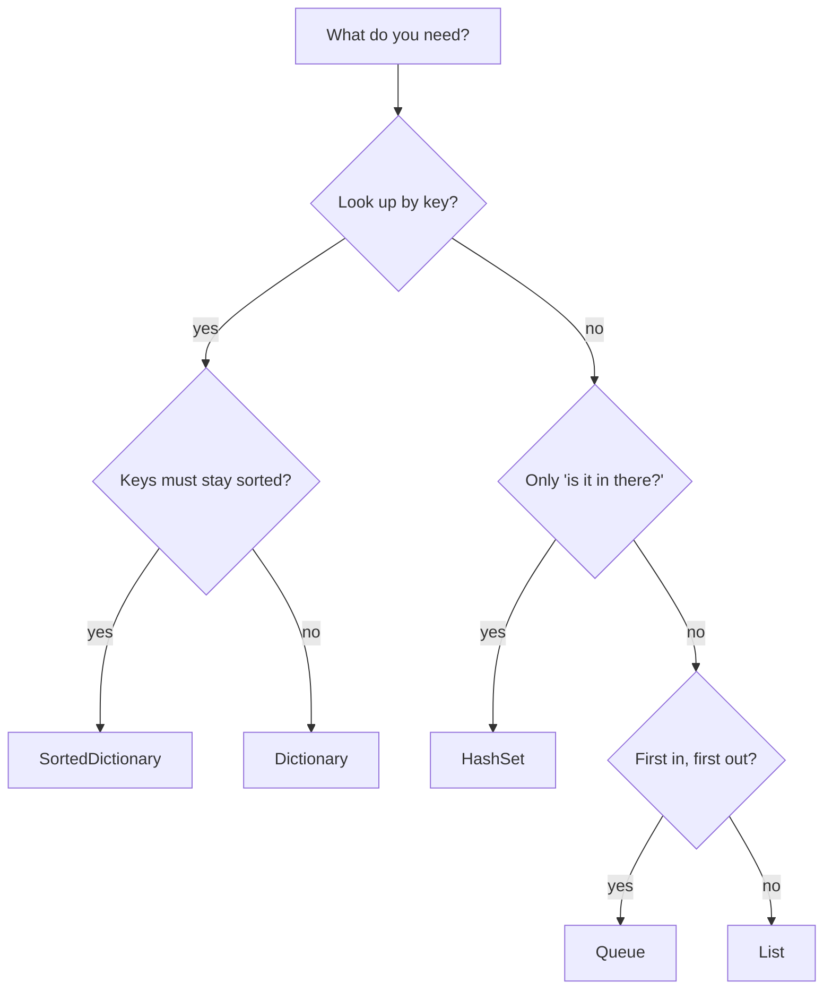

# 02. Generics and collections in depth

> **Draft: written but not yet run.** The code and the expected output in this lesson were prepared by reading the code and the official documentation. They have not been executed yet. If something does not behave as described, trust your tool's real output and report it.

## What you will be able to do
By the end of this lesson you will be able to:
- Write a generic class and a generic method with a constraint.
- Explain why `IEnumerable<Note>` can be used as `IEnumerable<IEntity>` but `List<Note>` cannot be used as `List<IEntity>`.
- Choose between `List`, `Dictionary`, `SortedDictionary`, `HashSet` and `Queue` for a stated job.
- Build a small generic collection of your own and give it a custom comparison rule.

## Recap
1. In lesson 01, why was `offers` declared as `IDiscount[]` and not `PercentOff[]`?
   <details><summary>Answer</summary>The loop only needs the contract; with the interface type it works for every implementation.</details>
2. In C# 101 lesson 07, how do you read a value from a dictionary without risking a missing-key exception?
   <details><summary>Answer</summary>`TryGetValue` (or `ContainsKey` first).</details>

## Why it matters
You can already use `List<T>` and `Dictionary<K,V>`. At level 201 you write code that others reuse: a repository that works for notes *and* tags, a helper that finds the largest item by any key. Generics give you that reuse **with** type checking at compile time, no casting and no boxing. Knowing the collection family saves you from the classic slowdown: searching a list inside a loop.

## What you will build
A console program with a generic `InMemoryRepository<T>`, a generic `Pick.LargestBy` helper, and short demonstrations of a case-insensitive sorted dictionary, a `HashSet` duplicate finder and a `Queue`.

## Before you start
- **Prerequisites:** [C# 201 lesson 01, interfaces, inheritance and polymorphism](01-interfaces-inheritance-polymorphism.md) and [C# 101 lesson 07, arrays, lists and dictionaries](../../101-zero-to-hero/phase-2-building-blocks/07-arrays-lists-and-dictionaries.md).
- Tools: .NET SDK **11.0.100** and the editor from C# 101 (same setup as [lesson 01](01-interfaces-inheritance-polymorphism.md)).
- Time: 50-60 min including the exercise.
- Source pack (optional): every file is shown in full in this lesson, so you can follow without it. The finished code, the exercise starter and the solution are in the
  course repository https://github.com/Uee03/Code101 under `source/csharp/201-hero-to-super-hero/phase-1-core-skills/02-generics-and-collections/` (on that page choose **Code, Download ZIP**, or run
  `git clone https://github.com/Uee03/Code101.git`).

## Steps
### Step 1. Make the folder and copy the shared project files
Repeat [lesson 01, Step 1](01-interfaces-inheritance-polymorphism.md#step-1-make-the-lesson-folder) with `lesson02` instead of `lesson01`. Then create `global.json` and `Lesson.csproj` exactly as in [lesson 01, Step 2](01-interfaces-inheritance-polymorphism.md#step-2-add-the-sdk-pin-and-the-project-file) (identical content; nothing changes in this lesson). Only the two C# files below are new.

### Step 2. Write the generic types
`where T : class, IEntity` is a **constraint**: the caller may only use types that are reference types *and* have an `Id`. The constraint is what lets the repository read `item.Id` without knowing the real type.

**File: `Generics.cs`**
```csharp
public interface IEntity
{
    int Id { get; }
}

public record Note(int Id, string Title) : IEntity;

public class InMemoryRepository<T> where T : class, IEntity
{
    private readonly Dictionary<int, T> _items = new();

    public void Add(T item)
    {
        if (!_items.TryAdd(item.Id, item))
        {
            throw new InvalidOperationException($"Id {item.Id} already exists.");
        }
    }

    public T? Find(int id) => _items.GetValueOrDefault(id);

    public IReadOnlyCollection<T> All() => _items.Values;
}

public static class Pick
{
    public static T LargestBy<T, TKey>(IEnumerable<T> source, Func<T, TKey> key)
        where TKey : IComparable<TKey>
    {
        using IEnumerator<T> e = source.GetEnumerator();
        if (!e.MoveNext())
        {
            throw new InvalidOperationException("The sequence is empty.");
        }

        T best = e.Current;
        TKey bestKey = key(best);
        while (e.MoveNext())
        {
            TKey candidate = key(e.Current);
            if (candidate.CompareTo(bestKey) > 0)
            {
                best = e.Current;
                bestKey = candidate;
            }
        }

        return best;
    }
}
```

### Step 3. Predict, then write the program
Read `Program.cs` once and, before running, answer on paper: (1) what prints for `Find(9)`; (2) what the `foreach` over words prints and in which order (hint: the dictionary sorts its keys and ignores letter case); (3) what `Duplicates:` shows.

**File: `Program.cs`**
```csharp
using System.Globalization;

CultureInfo.CurrentCulture = CultureInfo.InvariantCulture;

var notes = new InMemoryRepository<Note>();
notes.Add(new Note(1, "Buy milk"));
notes.Add(new Note(2, "Call Ada tomorrow"));

Console.WriteLine(notes.Find(2)?.Title ?? "missing");
Console.WriteLine(notes.Find(9)?.Title ?? "missing");

try
{
    notes.Add(new Note(1, "Duplicate"));
}
catch (InvalidOperationException ex)
{
    Console.WriteLine(ex.Message);
}

Note longest = Pick.LargestBy(notes.All(), n => n.Title.Length);
Console.WriteLine($"Longest title: {longest.Title}");

IEnumerable<IEntity> asEntities = notes.All();
int idSum = 0;
foreach (IEntity entity in asEntities)
{
    idSum += entity.Id;
}

Console.WriteLine($"Sum of ids: {idSum}");

var counts = new SortedDictionary<string, int>(StringComparer.OrdinalIgnoreCase);
foreach (string word in "the cat saw the Cat".Split(' '))
{
    counts[word] = counts.GetValueOrDefault(word) + 1;
}

foreach (var (word, count) in counts)
{
    Console.WriteLine($"{word}: {count}");
}

var seen = new HashSet<string>();
var duplicates = new List<string>();
foreach (string item in new[] { "a", "b", "a", "c", "b" })
{
    if (!seen.Add(item))
    {
        duplicates.Add(item);
    }
}

Console.WriteLine($"Duplicates: {string.Join(",", duplicates)}");

var queue = new Queue<string>();
queue.Enqueue("first");
queue.Enqueue("second");
Console.WriteLine($"Dequeued: {queue.Dequeue()}, left: {queue.Count}");
```

## Run it
**Folder: `~/code101/csharp201/lesson02` (terminal)**
```powershell
dotnet run --project . --nologo
```
Expected output (not yet run; derived from the code):
```text
Call Ada tomorrow
missing
Id 1 already exists.
Longest title: Call Ada tomorrow
Sum of ids: 3
cat: 2
saw: 1
the: 2
Duplicates: a,b
Dequeued: first, left: 1
```

## How it works
1. **Type parameters.** `InMemoryRepository<T>` is a template: the compiler builds `InMemoryRepository<Note>` with `T` replaced by `Note`. `Find` returns `Note?` and the dictionary stores `Note`, so no casts and no `object` boxing are needed. For value types such as `int`, generics also avoid boxing (the old `ArrayList` boxed every number).
2. **Constraints.** `where T : class, IEntity` states what `T` must be able to do. Without it, `item.Id` would not compile. Common constraints: `class`, `struct`, `new()` (has a parameterless constructor), `notnull`, a base type or an interface. `where TKey : IComparable<TKey>` in `LargestBy` is what allows `candidate.CompareTo(bestKey)`.
3. **Type inference.** `Pick.LargestBy(notes.All(), n => n.Title.Length)` has no `<...>`: the compiler infers `T = Note` from the first argument and `TKey = int` from the lambda's result.
4. **Covariance.** `IEnumerable<out T>` is **covariant**: a sequence of `Note` may be used where a sequence of `IEntity` is expected, because you can only *read* items out. `List<T>` is invariant: if `List<Note>` could be used as `List<IEntity>`, someone could `Add` a `Tag` to what is really a list of notes. Variance rules exist only on interfaces and delegates, and only for reference types.
5. **`SortedDictionary` with a comparer.** The comparer (`StringComparer.OrdinalIgnoreCase`) decides both equality and order, so `"Cat"` finds the existing `"cat"` and the entry keeps its first spelling. `GetValueOrDefault` returns 0 for a missing key, which turns counting into one line.
6. **`HashSet<T>.Add`** returns `false` when the item is already present, so the same call both tests and inserts.

> **Misconception:** "A `Dictionary` keeps items in the order I added them." It often looks that way, but the order is **not guaranteed**. Use `SortedDictionary` (sorted by key) or sort the output yourself when order matters, as this program does.

### Choosing a collection


| Collection | Typical cost to find or add (from the .NET docs) | Use it for |
|---|---|---|
| `List<T>` | index O(1); `Contains` O(n); add at end O(1) average | ordered items you loop over |
| `Dictionary<K,V>` | lookup, add O(1) average | find by key |
| `SortedDictionary<K,V>` | lookup, add O(log n) | key lookup plus sorted output |
| `HashSet<T>` | `Contains`, `Add` O(1) average | uniqueness, set maths |
| `Queue<T>` | `Enqueue`, `Dequeue` O(1) | first in, first out work lists |

### Why this, not that
| Choice | Use it when | Cost |
|---|---|---|
| Generic `InMemoryRepository<T>` | One storage rule for many entity types | A constraint to maintain; special cases need another class |
| `object` / casts (old style) | Never in new code | Runtime casts, boxing, errors found late |
| `List<T>.Contains` in a loop | Tiny lists (under about 20 items) | Becomes O(n²) when the list grows; use a `HashSet` instead |

## Try it
Write a `UniqueQueue<T>`: a first-in-first-out queue that ignores an item already waiting in it (a job queue that must not run the same job twice).

1. **Guided.** Copy your `lesson02` folder to `exercise02`. Replace `Program.cs` and add `UniqueQueue.cs` with the two starter files below; fill in the two `TODO` bodies. `Enqueue` returns `true` when the item was added.
2. **Change.** Let the caller pass an `IEqualityComparer<T>` to the constructor so that `"Ada"` and `"ADA"` count as the same item. Add two lines to `Program.cs` that show `True` then `False`.
3. **Stretch (no single answer).** Add a maximum size. Should `Enqueue` throw, return `false`, or drop the oldest item when the queue is full? Write down who has to handle each choice.

**File: `exercise02/UniqueQueue.cs` (starter)**
```csharp
public class UniqueQueue<T> where T : notnull
{
    private readonly Queue<T> _queue = new();
    private readonly HashSet<T> _members = new();

    public int Count => _queue.Count;

    public bool Enqueue(T item)
    {
        // TODO: return false when item is already queued; otherwise remember it, enqueue it and return true.
        return false;
    }

    public T Dequeue()
    {
        // TODO: take the next item out of the queue, forget it, and return it.
        throw new NotImplementedException();
    }
}
```
**File: `exercise02/Program.cs` (starter)**
```csharp
var queue = new UniqueQueue<string>();
Console.WriteLine(queue.Enqueue("a"));
Console.WriteLine(queue.Enqueue("b"));
Console.WriteLine(queue.Enqueue("a"));
Console.WriteLine($"Count: {queue.Count}");
Console.WriteLine($"Dequeued: {queue.Dequeue()}");
Console.WriteLine(queue.Enqueue("a"));
Console.WriteLine($"Count: {queue.Count}");
```
Starter output before your change (not yet run): `False`, `False`, `False`, `Count: 0`, then the program stops with an unhandled `NotImplementedException`. When you are done, it prints `True`, `True`, `False`, `Count: 2`, `Dequeued: a`, `True`, `Count: 2`.

<details><summary>Solution</summary>

`HashSet.Add` answers "was it new?" and the two structures stay in step: the queue keeps the order, the set answers membership. `Dequeue` must also remove the item from the set, otherwise it could never be queued again (the last `True`). The optional comparer is passed to the `HashSet`.

**File: `exercise02/UniqueQueue.cs` (solution)**
```csharp
public class UniqueQueue<T> where T : notnull
{
    private readonly Queue<T> _queue = new();
    private readonly HashSet<T> _members;

    public UniqueQueue(IEqualityComparer<T>? comparer = null)
    {
        _members = new HashSet<T>(comparer);
    }

    public int Count => _queue.Count;

    public bool Enqueue(T item)
    {
        if (!_members.Add(item))
        {
            return false;
        }

        _queue.Enqueue(item);
        return true;
    }

    public T Dequeue()
    {
        T item = _queue.Dequeue();
        _members.Remove(item);
        return item;
    }
}
```
**File: `exercise02/Program.cs` (solution)**
```csharp
var queue = new UniqueQueue<string>();
Console.WriteLine(queue.Enqueue("a"));
Console.WriteLine(queue.Enqueue("b"));
Console.WriteLine(queue.Enqueue("a"));
Console.WriteLine($"Count: {queue.Count}");
Console.WriteLine($"Dequeued: {queue.Dequeue()}");
Console.WriteLine(queue.Enqueue("a"));
Console.WriteLine($"Count: {queue.Count}");

var names = new UniqueQueue<string>(StringComparer.OrdinalIgnoreCase);
Console.WriteLine(names.Enqueue("Ada"));
Console.WriteLine(names.Enqueue("ADA"));
```
Expected output (not yet run):
```text
True
True
False
Count: 2
Dequeued: a
True
Count: 2
True
False
```

</details>

## Check yourself
1. What does `notes.Find(9)?.Title ?? "missing"` print when there is no note 9, and which part supplies the text? <details><summary>Answer</summary>`missing`. `Find` returns `null`, `?.` skips `Title` and yields `null`, and `??` supplies the fallback.</details>
2. Why does `IEnumerable<IEntity> asEntities = notes.All();` compile? <details><summary>Answer</summary>`IEnumerable<out T>` is covariant and `Note` is a reference type that implements `IEntity`.</details>
3. What is the output order of the word counts and why? <details><summary>Answer</summary>`cat`, `saw`, `the`: `SortedDictionary` sorts by key using the comparer. `cat` shows 2 because `"Cat"` matched `"cat"`.</details>
4. You must check "have I seen this id?" for 100,000 ids. List or HashSet? <details><summary>Answer</summary>`HashSet`: `Contains` is O(1) on average, while `List.Contains` is O(n) and would be O(n²) across the loop.</details>

## Common mistakes
Typical compiler messages; wording and numbers can differ with your SDK.

| Symptom or error text | Cause | Fix |
|---|---|---|
| `error CS0311: The type 'string' cannot be used as type parameter 'T' in the generic type or method 'InMemoryRepository<T>'. There is no implicit reference conversion from 'string' to 'IEntity'.` (typical message) | The type argument does not satisfy a constraint (here, `string` does not implement `IEntity`). | Use a type that implements the interface, or relax the constraint if it is not needed. |
| `error CS1061: 'T' does not contain a definition for 'Id' ...` (typical message) | The constraint `IEntity` is missing, so the compiler does not know `T` has `Id`. | Add `where T : IEntity` (or a base class that has it). |
| `Unhandled exception. System.InvalidOperationException: Id 1 already exists.` | `Add` was called with an existing id and the call is not inside `try`. | Catch the exception where you can recover, or check first with `Find`. |
| `error CS0029: Cannot implicitly convert type 'List<Note>' to 'List<IEntity>'` (typical message) | `List<T>` is invariant. | Pass `IEnumerable<IEntity>` or `IReadOnlyList<IEntity>`, which are covariant. |
| Dictionary output order changes between runs or runtimes | Order of a `Dictionary` is not specified. | Sort explicitly or use `SortedDictionary`. |

## Best practice
Constrain generics only as far as the code needs, expose the narrowest collection interface you can (`IReadOnlyCollection<T>`, `IEnumerable<T>`) and pick the collection by the operation you repeat most. Source: Microsoft Learn, Generics https://learn.microsoft.com/dotnet/csharp/fundamentals/types/generics and Selecting a collection class https://learn.microsoft.com/dotnet/standard/collections/selecting-a-collection-class

## Going further
- Variance in detail: https://learn.microsoft.com/dotnet/standard/generics/covariance-and-contravariance
- `Pick.LargestBy` exists in the library as LINQ's `MaxBy`; lesson 03 builds on this idea.

## Summary
- You wrote a generic repository and a generic helper, each with a constraint.
- You explained covariance with `IEnumerable<IEntity>` and why `List<T>` is invariant.
- You chose between `List`, `Dictionary`, `SortedDictionary`, `HashSet` and `Queue` for concrete jobs.
- You built your own generic collection and gave it a pluggable comparison rule.

## Next lesson
**[03. LINQ](03-linq.md)**: filter, shape, group and combine collections with short queries, and learn why they run late.
