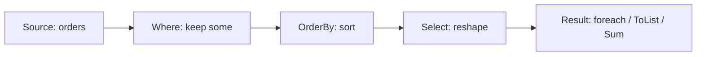

# 03. LINQ

> **Draft: written but not yet run.** The code and the expected output in this lesson were prepared by reading the code and the official documentation. They have not been executed yet. If something does not behave as described, trust your tool's real output and report it.

## What you will be able to do
By the end of this lesson you will be able to:
- Filter, shape, order, group, join and page a collection with LINQ.
- Predict when a query runs (deferred execution) and when to force it with `ToList()`.
- Choose between `First`, `FirstOrDefault`, `Single` and `Any` for a stated situation.
- Spot and fix a query that enumerates its source twice.

## Recap
1. In lesson 02, what does `IEnumerable<out T>` let you do that `List<T>` does not?
   <details><summary>Answer</summary>Use a sequence of `Note` where a sequence of `IEntity` is expected (covariance), because you can only read items out of it.</details>
2. Which collection answers "have I seen this value?" fastest for large inputs?
   <details><summary>Answer</summary>`HashSet<T>` (O(1) on average).</details>

## Why it matters
Most application code is "take these items, keep some, reshape them, summarise them". Written with loops that is a dozen lines of variables and `if`s. **LINQ** (Language Integrated Query) says the same thing in one readable pipeline, and the *same* pipeline syntax later talks to a database through EF Core (lesson 08). The price is one idea you must understand: a query is a *recipe*, not a result.

## What you will build
A console program that runs about a dozen small queries against six in-memory orders and three customers, then proves deferred execution and repeated enumeration with two tiny experiments.


Nothing on the left of the last box runs until something *consumes* the result.

## Before you start
- **Prerequisites:** [C# 201 lesson 02, generics and collections](02-generics-and-collections.md) and [C# 101 lesson 07, arrays, lists and dictionaries](../../101-zero-to-hero/phase-2-building-blocks/07-arrays-lists-and-dictionaries.md).
- Tools: .NET SDK **11.0.100** and the editor from C# 101 (same setup as [lesson 01](01-interfaces-inheritance-polymorphism.md)).
- Time: 55-65 min including the exercise.
- Source pack (optional): every file is shown in full in this lesson, so you can follow without it. The finished code, the exercise starter and the solution are in the
  course repository https://github.com/Uee03/Code101 under `source/csharp/201-hero-to-super-hero/phase-1-core-skills/03-linq/` (on that page choose **Code, Download ZIP**, or run
  `git clone https://github.com/Uee03/Code101.git`).

## Steps
### Step 1. Make the folder and copy the shared project files
Repeat [lesson 01, Step 1](01-interfaces-inheritance-polymorphism.md#step-1-make-the-lesson-folder) with `lesson03`. Create `global.json` and `Lesson.csproj` exactly as in [lesson 01, Step 2](01-interfaces-inheritance-polymorphism.md#step-2-add-the-sdk-pin-and-the-project-file) (identical; nothing changes). Only the two C# files below are new.

### Step 2. Write the data types
Records (C# 101 lesson 11) are ideal for query data: short, immutable, comparable by value. `DateOnly` is a date without a time.

**File: `Orders.cs`**
```csharp
public record Order(int Id, string Customer, string Category, decimal Total, DateOnly Date);

public record Customer(string Name, string City);
```

### Step 3. Write the queries
Read the whole file first and **predict** on paper: the ids printed on the first line, the first customer in the totals list, and what `Live:` prints. Then type it.

**File: `Program.cs`**
```csharp
using System.Globalization;

CultureInfo.CurrentCulture = CultureInfo.InvariantCulture;

List<Order> orders =
[
    new(1, "Ada", "Books", 25.50m, new DateOnly(2026, 1, 5)),
    new(2, "Grace", "Games", 60.00m, new DateOnly(2026, 1, 7)),
    new(3, "Ada", "Games", 45.00m, new DateOnly(2026, 2, 1)),
    new(4, "Linus", "Books", 12.25m, new DateOnly(2026, 2, 3)),
    new(5, "Grace", "Books", 30.00m, new DateOnly(2026, 2, 10)),
    new(6, "Ada", "Books", 8.50m, new DateOnly(2026, 3, 2)),
];

List<Customer> customers =
[
    new("Ada", "London"),
    new("Grace", "New York"),
    new("Linus", "Helsinki"),
];

IEnumerable<int> bigBooks = orders
    .Where(o => o.Category == "Books" && o.Total > 20m)
    .Select(o => o.Id);
Console.WriteLine($"Books over 20: {string.Join(",", bigBooks)}");

var over40 = from o in orders
             where o.Total > 40m
             select o.Id;
Console.WriteLine($"Over 40 (query syntax): {string.Join(",", over40)}");

var perCustomer = orders
    .GroupBy(o => o.Customer)
    .Select(g => new { Customer = g.Key, Count = g.Count(), Total = g.Sum(o => o.Total) })
    .OrderByDescending(x => x.Total);

foreach (var row in perCustomer)
{
    Console.WriteLine($"{row.Customer}: {row.Total:F2} in {row.Count} order(s)");
}

Console.WriteLine($"Average: {orders.Average(o => o.Total):F2}");
Console.WriteLine($"Any over 50: {orders.Any(o => o.Total > 50m)}");
Console.WriteLine($"All over 10: {orders.All(o => o.Total > 10m)}");

Order? nobody = orders.FirstOrDefault(o => o.Customer == "Zed");
Console.WriteLine($"Zed: {nobody?.Id.ToString() ?? "none"}");

var withCity = orders
    .Join(customers, o => o.Customer, c => c.Name, (o, c) => $"{o.Id}:{c.City}")
    .Take(3);
Console.WriteLine($"Cities: {string.Join(", ", withCity)}");

var page2 = orders.OrderBy(o => o.Date).Skip(2).Take(2).Select(o => o.Id);
Console.WriteLine($"Page 2: {string.Join(",", page2)}");

var numbers = new List<int> { 1, 2, 3 };
IEnumerable<int> evens = numbers.Where(n => n % 2 == 0);
List<int> snapshot = evens.ToList();
numbers.Add(4);
Console.WriteLine($"Live: {string.Join(",", evens)}; snapshot: {string.Join(",", snapshot)}");

int calls = 0;

IEnumerable<int> Source()
{
    calls++;
    yield return 1;
    yield return 2;
}

IEnumerable<int> source = Source();
int count = source.Count();
int sum = source.Sum();
Console.WriteLine($"count={count}, sum={sum}, source ran {calls} time(s)");
```

## Run it
**Folder: `~/code101/csharp201/lesson03` (terminal)**
```powershell
dotnet run --project . --nologo
```
Expected output (not yet run; derived from the code and the six orders):
```text
Books over 20: 1,5
Over 40 (query syntax): 2,3
Grace: 90.00 in 2 order(s)
Ada: 79.00 in 3 order(s)
Linus: 12.25 in 1 order(s)
Average: 30.21
Any over 50: True
All over 10: False
Zed: none
Cities: 1:London, 2:New York, 3:London
Page 2: 3,4
Live: 2,4; snapshot: 2
count=2, sum=3, source ran 2 time(s)
```

## How it works
1. **Where / Select.** `Where` keeps items for which the lambda (`o => ...`, "given o, return ...") is true; `Select` turns each item into something else. Books over 20 are orders 1 (25.50) and 5 (30.00).
2. **Query syntax.** `from ... where ... select` is the same query written like SQL; the compiler rewrites it into the method calls. Use whichever reads better; method syntax is more common because every operator has a method.
3. **GroupBy.** Each group has a `Key` (the customer) and holds that customer's orders; `Sum` and `Count` summarise a group. `new { ... }` creates an **anonymous type**, a throw-away read-only shape for results used only here. The decimal sums are exact (no floating-point error), so Ada is `79.00`.
4. **Average / Any / All.** `Any` stops at the first match, so it is the right way to ask "is there at least one?"; `Count() > 0` visits everything. `All` stops at the first non-match.
5. **First vs FirstOrDefault vs Single.** `First` throws when nothing matches; `FirstOrDefault` returns `null` (here, an `Order?`); `Single` throws unless **exactly one** matches; `SingleOrDefault` allows zero or one. Pick the one whose failure you want.
6. **Join, Skip, Take.** `Join` pairs items by a key (inner join: orders without a customer would vanish) and keeps the order of the first sequence. `Skip(2).Take(2)` after an `OrderBy` is paging: page 2 of size 2 is the 3rd and 4th order by date.
7. **Deferred execution.** `evens` is a recipe. Adding `4` to `numbers` *after* creating the recipe changes what the recipe returns when you finally enumerate it (`2,4`). `ToList()` ran the recipe immediately, so `snapshot` kept the old answer (`2`).
8. **Enumerating twice.** `Count()` and `Sum()` each walk the sequence from the start, so the iterator body ran twice. For an in-memory list this is only wasteful; for a database or a web request it can mean two round trips or two different results.

> **Misconception:** "LINQ is slower than a `foreach`, so avoid it." For ordinary application code the difference is rarely measurable; clear code wins until a profiler says otherwise. The real LINQ mistakes are *logic* ones: enumerating twice, calling `ToList()` inside a loop, or loading a whole table before filtering (lesson 08).

### Why this, not that
| Choice | Use it when | Cost |
|---|---|---|
| **LINQ pipeline** | Filtering, shaping, grouping, summarising | Deferred execution surprises; allocation per stage in hot loops |
| **`foreach` with `if`** | A loop with side effects, early exits or tight performance needs | More variables; every query re-invents the pattern |
| **Method syntax** | Most code; every operator is available | Complex `join`/`let` queries are a little harder to read |
| **Query syntax** | Joins and `let` with several range variables | Not every operator exists in this form |
| **`IEnumerable<T>` vs `IQueryable<T>`** | `IEnumerable` runs in memory; `IQueryable` (EF Core, lesson 08) is translated to SQL | Calling a method EF cannot translate fails at run time, or silently moves work into memory |

## Try it
1. **Guided.** Copy your `lesson03` folder to `exercise03`. Replace `Program.cs` with the starter below (it keeps the six orders and removes the rest) and the `Orders.cs` below (the `Customer` record is not needed). Fill in the two `TODO`s using `GroupBy`.
2. **Change.** After the two lines, print the total per month (month number, then total, ordered by month number) in the form `Month 1: 85.50`.
3. **Stretch (no single answer).** Write your own `MyWhere<T>(this IEnumerable<T>, Func<T,bool>)` with `yield return`, and prove with a counter that it is lazy. Then decide: would you ever write this instead of using `Where`?

**File: `exercise03/Orders.cs` (starter)**
```csharp
public record Order(int Id, string Customer, string Category, decimal Total, DateOnly Date);
```
**File: `exercise03/Program.cs` (starter)**
```csharp
using System.Globalization;

CultureInfo.CurrentCulture = CultureInfo.InvariantCulture;

List<Order> orders =
[
    new(1, "Ada", "Books", 25.50m, new DateOnly(2026, 1, 5)),
    new(2, "Grace", "Games", 60.00m, new DateOnly(2026, 1, 7)),
    new(3, "Ada", "Games", 45.00m, new DateOnly(2026, 2, 1)),
    new(4, "Linus", "Books", 12.25m, new DateOnly(2026, 2, 3)),
    new(5, "Grace", "Books", 30.00m, new DateOnly(2026, 2, 10)),
    new(6, "Ada", "Books", 8.50m, new DateOnly(2026, 3, 2)),
];

// TODO 1: names of customers whose orders add up to more than 50, sorted A to Z.
IEnumerable<string> bigSpenders = Enumerable.Empty<string>();
Console.WriteLine($"Big spenders: {string.Join(", ", bigSpenders)}");

// TODO 2: the category with the highest total revenue.
string topCategory = "?";
Console.WriteLine($"Top category: {topCategory}");
```
Starter output before your change (not yet run): `Big spenders: ` then `Top category: ?`. Goal: two correct lines (and for step 2, three `Month` lines after them).

<details><summary>Solution</summary>

Group first, filter the groups with a summary of each group, then take the key. For the top category, order the groups by their revenue, descending, and take the first.

**File: `exercise03/Program.cs` (solution, including the change rung)**
```csharp
using System.Globalization;

CultureInfo.CurrentCulture = CultureInfo.InvariantCulture;

List<Order> orders =
[
    new(1, "Ada", "Books", 25.50m, new DateOnly(2026, 1, 5)),
    new(2, "Grace", "Games", 60.00m, new DateOnly(2026, 1, 7)),
    new(3, "Ada", "Games", 45.00m, new DateOnly(2026, 2, 1)),
    new(4, "Linus", "Books", 12.25m, new DateOnly(2026, 2, 3)),
    new(5, "Grace", "Books", 30.00m, new DateOnly(2026, 2, 10)),
    new(6, "Ada", "Books", 8.50m, new DateOnly(2026, 3, 2)),
];

IEnumerable<string> bigSpenders = orders
    .GroupBy(o => o.Customer)
    .Where(g => g.Sum(o => o.Total) > 50m)
    .Select(g => g.Key)
    .OrderBy(name => name);
Console.WriteLine($"Big spenders: {string.Join(", ", bigSpenders)}");

string topCategory = orders
    .GroupBy(o => o.Category)
    .OrderByDescending(g => g.Sum(o => o.Total))
    .First()
    .Key;
Console.WriteLine($"Top category: {topCategory}");

foreach (var month in orders.GroupBy(o => o.Date.Month).OrderBy(g => g.Key))
{
    Console.WriteLine($"Month {month.Key}: {month.Sum(o => o.Total):F2}");
}
```
Expected output (not yet run):
```text
Big spenders: Ada, Grace
Top category: Games
Month 1: 85.50
Month 2: 87.25
Month 3: 8.50
```
Ada (79.00) and Grace (90.00) pass 50; Linus has 12.25. Games earn 105.00, Books 76.25.

</details>

## Check yourself
1. `numbers` is `{1,2,3}`; `var big = numbers.Where(n => n > 1);` then `numbers.Add(10);`. What does `string.Join(",", big)` print? <details><summary>Answer</summary>`2,3,10`. The query runs when it is enumerated, after the add.</details>
2. You expect exactly one order with Id 99. Which operator states that expectation and what happens if none exists? <details><summary>Answer</summary>`Single` (or `SingleOrDefault` if absence is fine); `Single` throws `InvalidOperationException` when zero or more than one match.</details>
3. Why is `orders.Any(o => o.Total > 50m)` better than `orders.Count(o => o.Total > 50m) > 0`? <details><summary>Answer</summary>`Any` stops at the first match; `Count` visits every item.</details>
4. The program printed `source ran 2 time(s)`. How do you make it run once? <details><summary>Answer</summary>Materialize once with `List<int> items = Source().ToList();` and use `items.Count` and `items.Sum()`.</details>

## Common mistakes
Typical messages (exact wording can differ with the SDK).

| Symptom or error text | Cause | Fix |
|---|---|---|
| `Unhandled exception. System.InvalidOperationException: Sequence contains no matching element` (typical message) | `First` or `Single` found nothing. | Use `FirstOrDefault` and handle `null`, or check with `Any`. |
| `Unhandled exception. System.InvalidOperationException: Sequence contains more than one matching element` (typical message) | `Single` found several. | Use `First` if any match will do, or fix the data. |
| `error CS1061: 'List<Order>' does not contain a definition for 'Where'` (typical message) | `using System.Linq;` is missing and implicit usings are off. | Keep `<ImplicitUsings>enable</ImplicitUsings>` in `Lesson.csproj`. |
| The printed number changes between two prints of the "same" query | The query is lazy and the source changed in between. | Call `ToList()` where you want a snapshot. |
| `error CS0136: A local or parameter named 'o' cannot be declared in this scope` (typical message) | A lambda parameter has the same name as a local variable. | Rename one of them. |

## Best practice
Keep each query readable (one operator per line), materialize with `ToList()` or `ToArray()` only when you need a snapshot or must enumerate more than once, and never enumerate the same lazy query twice. Source: Microsoft Learn, LINQ https://learn.microsoft.com/dotnet/csharp/linq/ and Deferred execution https://learn.microsoft.com/dotnet/csharp/linq/get-started/introduction-to-linq-queries

## Going further
- The standard query operators list: https://learn.microsoft.com/dotnet/csharp/linq/standard-query-operators/
- LINQ reappears as `IQueryable` in [lesson 08](../phase-3-data/08-ef-core-and-postgres.md); the same pipeline becomes a SQL query.

## Summary
- You filtered, shaped, grouped, joined and paged a collection with LINQ.
- You predicted deferred execution and used `ToList()` to take a snapshot.
- You chose between `First`, `FirstOrDefault`, `Single` and `Any` by the failure you want.
- You found and removed a double enumeration.

## Next lesson
**[04. async/await and Task](04-async-await-and-task.md)**: keep a program responsive while it waits, and run waits at the same time.
