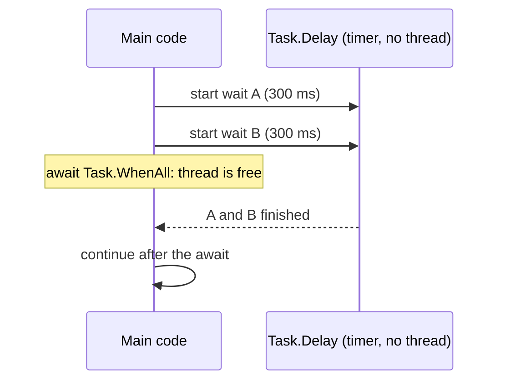

# 04. async/await and Task

> **Draft: written but not yet run.** The code and the expected output in this lesson were prepared by reading the code and the official documentation. They have not been executed yet. If something does not behave as described, trust your tool's real output and report it.

## What you will be able to do
By the end of this lesson you will be able to:
- Write an `async Task<T>` method and call it with `await`.
- Run two waits at the same time with `Task.WhenAll` and explain why that is faster than awaiting them one after the other.
- Cancel a wait with a `CancellationToken` and catch the cancellation.
- Explain why blocking with `.Result` is a bug and when `Task.Run` is the right tool.

## Recap
1. In lesson 03, why did `source ran 2 time(s)` appear?
   <details><summary>Answer</summary>`Count()` and `Sum()` each enumerated the lazy sequence from the start.</details>
2. In C# 101 lesson 09, what does a `try`/`catch` block do?
   <details><summary>Answer</summary>It runs code and, if a matching exception is thrown, jumps to the `catch` instead of crashing.</details>

## Why it matters
A cook who starts the pasta water and then chops onions finishes sooner than one who stares at the pot. A web server that asks a database a question can do the same: while the answer travels, the thread serves another request. That is what `await` does. Used correctly an ASP.NET Core API handles many more requests with the same threads; used badly (blocking calls, forgotten awaits) it hangs under load. Every endpoint you write from lesson 05 on is `async`.

## What you will build
A console program that times a sequential and a concurrent version of two 300 ms waits, cancels a slow wait after 100 ms, catches a failure from one and from two tasks, and moves a CPU-heavy sum onto the thread pool.



## Before you start
- **Prerequisites:** [C# 201 lesson 03, LINQ](03-linq.md) and [C# 101 lesson 09, handling errors](../../101-zero-to-hero/phase-3-real-programs/09-handling-errors.md).
- Tools: .NET SDK **11.0.100** and the editor from C# 101 (same setup as [lesson 01](01-interfaces-inheritance-polymorphism.md)).
- Time: 55-65 min including the exercise. The program itself runs in about one second.
- Source pack (optional): every file is shown in full in this lesson, so you can follow without it. The finished code, the exercise starter and the solution are in the
  course repository https://github.com/Uee03/Code101 under `source/csharp/201-hero-to-super-hero/phase-1-core-skills/04-async-await-and-task/` (on that page choose **Code, Download ZIP**, or run
  `git clone https://github.com/Uee03/Code101.git`).

## Steps
### Step 1. Make the folder and copy the shared project files
Repeat [lesson 01, Step 1](01-interfaces-inheritance-polymorphism.md#step-1-make-the-lesson-folder) with `lesson04`. Create `global.json` and `Lesson.csproj` exactly as in [lesson 01, Step 2](01-interfaces-inheritance-polymorphism.md#step-2-add-the-sdk-pin-and-the-project-file) (identical; nothing changes). This lesson has one C# file.

### Step 2. Write the program
Before you type, predict: (1) will the two lines starting `A done` be identical? (2) what does `Concurrent faster than sequential:` print? (3) how many failures does `WhenAll` report for two failing tasks?

`static` local functions are helpers declared at the top of a top-level file. A method marked `async` may use `await`; its return type is `Task` (no result) or `Task<T>` (a result of type `T`).

**File: `Program.cs`**
```csharp
using System.Diagnostics;

static async Task<string> FetchAsync(string name, int delayMs, CancellationToken ct = default)
{
    await Task.Delay(delayMs, ct);
    return $"{name} done";
}

static async Task FailAsync()
{
    await Task.Delay(10);
    throw new InvalidOperationException("boom");
}

var sw = Stopwatch.StartNew();
string a = await FetchAsync("A", 300);
string b = await FetchAsync("B", 300);
TimeSpan sequential = sw.Elapsed;
Console.WriteLine($"{a}, {b}");

sw.Restart();
string[] results = await Task.WhenAll(FetchAsync("A", 300), FetchAsync("B", 300));
TimeSpan concurrent = sw.Elapsed;
Console.WriteLine(string.Join(", ", results));
Console.WriteLine($"Concurrent faster than sequential: {concurrent < sequential}");

using var cts = new CancellationTokenSource(TimeSpan.FromMilliseconds(100));
try
{
    await FetchAsync("slow", 5000, cts.Token);
}
catch (OperationCanceledException)
{
    Console.WriteLine("Cancelled after the timeout");
}

try
{
    await FailAsync();
}
catch (InvalidOperationException ex)
{
    Console.WriteLine($"Caught: {ex.Message}");
}

Task both = Task.WhenAll(FailAsync(), FailAsync());
try
{
    await both;
}
catch (InvalidOperationException)
{
    Console.WriteLine($"WhenAll failures: {both.Exception!.InnerExceptions.Count}");
}

long total = await Task.Run(() =>
{
    long running = 0;
    for (int i = 1; i <= 1_000_000; i++)
    {
        running += i;
    }

    return running;
});
Console.WriteLine($"CPU work on the thread pool: {total}");
```

## Run it
**Folder: `~/code101/csharp201/lesson04` (terminal)**
```powershell
dotnet run --project . --nologo
```
Expected output (not yet run; the timings are not printed, only the comparison):
```text
A done, B done
A done, B done
Concurrent faster than sequential: True
Cancelled after the timeout
Caught: boom
WhenAll failures: 2
CPU work on the thread pool: 500000500000
```
The run takes roughly 0.6 s + 0.3 s + 0.1 s plus a few milliseconds. If the comparison line ever shows `False`, the machine was extremely busy; run again.

## How it works
1. **`await` frees the thread.** `await Task.Delay(300)` does not block a thread for 300 ms. The method *pauses*, the thread goes back to the pool (in ASP.NET Core: to serve other requests), and the method resumes on a pool thread when the timer fires. The compiler turns the method into a state machine to do this; you write straight-line code.
2. **A `Task` is a promise of a result.** Calling `FetchAsync("A", 300)` starts the work and returns a `Task<string>` immediately. `await` waits for it and gives you the `string`. If you call two methods and *then* await both, the two waits overlap.
3. **`Task.WhenAll`** takes several tasks and gives one task that completes when all are done, with the results in the order you passed them. Total time is about 300 ms instead of 600 ms.
4. **Cancellation is cooperative.** The `CancellationTokenSource` fires after 100 ms; `Task.Delay` watches the token and throws `TaskCanceledException`, a subclass of `OperationCanceledException`. Every async method that can take long should accept a `CancellationToken` and pass it down. In ASP.NET Core the framework gives each request one (`HttpContext.RequestAborted`) that fires when the client disconnects.
5. **Exceptions travel through `await`.** `await FailAsync()` rethrows the original `InvalidOperationException`, so an ordinary `catch` works. With `Task.WhenAll`, `await` rethrows only the *first* exception; the task's `Exception.InnerExceptions` holds all of them (2 here).
6. **`Task.Run` is for CPU work.** Summing a million numbers uses a processor, not a wait, so there is nothing to `await` inside; `Task.Run` moves it to a pool thread so the caller stays free. Never wrap I/O (database, HTTP, files) in `Task.Run`: use the async API of that library.

> **Misconception:** "`async` makes code run in parallel on another thread." No. `async/await` is about *not blocking while waiting*. No new thread is created for a `Task.Delay` or a network call; only `Task.Run` (or CPU-bound libraries) uses extra threads.

### Why this, not that
| Choice | Use it when | Cost |
|---|---|---|
| `await` one call after another | The second call needs the first result | Waits add up |
| `Task.WhenAll` | Independent waits (two services, three ids) | One failure still lets the others run to the end; limit the count for large lists |
| `Parallel.ForEachAsync` | Many items with a **maximum** concurrency | A bit more setup |
| `.Result` / `.Wait()` | Almost never | Blocks a thread; can deadlock where a synchronization context exists (classic UI apps); starves the thread pool in servers; wraps errors in `AggregateException` |
| `async void` | Only event handlers | Exceptions cannot be caught by the caller and can crash the process; use `async Task` |
| `ConfigureAwait(false)` | Library code that may run under a UI context | Noise in ASP.NET Core application code, which has no synchronization context |

## Try it
1. **Guided.** Copy your `lesson04` folder to `exercise04`. Replace `Program.cs` with the starter below. Run the four `SquareAsync` calls **at the same time** and print `Squares: 1, 4, 9, 16`.
2. **Change.** Give `SquareAsync` a `CancellationToken` parameter, pass it to `Task.Delay`, and add a second run with a token that cancels after 10 ms. Catch the cancellation and print `Cancelled`.
3. **Stretch (no single answer).** Imagine 10,000 inputs instead of 4. Which tool from the *Why this, not that* table would you use to limit concurrency to 8, and what happens to memory if you start all 10,000 at once?

**File: `exercise04/Program.cs` (starter)**
```csharp
static async Task<int> SquareAsync(int n)
{
    await Task.Delay(50);
    return n * n;
}

int[] inputs = [1, 2, 3, 4];

// TODO: start all four calls at once, wait for them together and print "Squares: 1, 4, 9, 16".
Console.WriteLine("Squares: TODO");
```
Starter output (not yet run): `Squares: TODO`.

<details><summary>Solution</summary>

`Select` creates the four tasks (they all start immediately), `Task.WhenAll` waits for all and returns the results in input order.

**File: `exercise04/Program.cs` (solution, including the change rung)**
```csharp
static async Task<int> SquareAsync(int n, CancellationToken ct = default)
{
    await Task.Delay(50, ct);
    return n * n;
}

int[] inputs = [1, 2, 3, 4];

int[] squares = await Task.WhenAll(inputs.Select(x => SquareAsync(x)));
Console.WriteLine($"Squares: {string.Join(", ", squares)}");

using var cts = new CancellationTokenSource(10);
try
{
    await Task.WhenAll(inputs.Select(x => SquareAsync(x, cts.Token)));
}
catch (OperationCanceledException)
{
    Console.WriteLine("Cancelled");
}
```
Expected output (not yet run):
```text
Squares: 1, 4, 9, 16
Cancelled
```
The token fires after 10 ms, long before the 50 ms waits end, so every task is cancelled and `await` throws `OperationCanceledException`.

</details>

## Check yourself
1. Method `A()` takes 2 s of waiting and `B()` takes 3 s. How long does `await A(); await B();` take, and how long does `await Task.WhenAll(A(), B());`? <details><summary>Answer</summary>About 5 s versus about 3 s (the longest).</details>
2. A teammate writes `var data = GetDataAsync().Result;` inside an endpoint. What is wrong? <details><summary>Answer</summary>It blocks a thread while waiting; under load the thread pool runs out of threads. Use `await`.</details>
3. What is the difference between `async void` and `async Task`? <details><summary>Answer</summary>A `Task` can be awaited and carries exceptions to the caller; `async void` cannot be awaited and its exceptions are raised on the synchronization context or crash the process.</details>
4. You must hash a large file's contents with a CPU-heavy algorithm. `Task.Run` or `await Task.Delay`? <details><summary>Answer</summary>`Task.Run` (CPU-bound work); the file *read* itself should still use the async file API.</details>

## Common mistakes
Typical messages (the exact wording can differ with your SDK).

| Symptom or error text | Cause | Fix |
|---|---|---|
| `warning CS4014: Because this call is not awaited, execution of the current method continues before the call is completed` (typical message) | A task-returning call was not awaited; its errors and result are lost. | Add `await`, or store the task and await it later. |
| `error CS4033: The 'await' operator can only be used within an async method` (typical message) | `await` inside a normal method. | Mark the method `async` and return `Task` / `Task<T>`. |
| `error CS1983: The return type of an async method must be void, Task, Task<T>, ...` (typical message) | Wrong return type on an `async` method. | Return `Task<string>` rather than `string`. |
| The program hangs forever in a UI or old-style app | `.Result` or `.Wait()` blocked the thread that the continuation needs. | Use `await` all the way up ("async all the way"). |
| Cancellation never happens | The token was created but not passed to the inner call. | Pass the `CancellationToken` into every awaited call. |

## Best practice
Make I/O methods `async Task`, accept and forward a `CancellationToken`, avoid blocking calls such as `.Result`, and use `Task.Run` only for CPU-bound work. Source: ASP.NET Core best practices https://learn.microsoft.com/aspnet/core/fundamentals/best-practices and Asynchronous programming https://learn.microsoft.com/dotnet/csharp/asynchronous-programming/

## Going further
- The task-based asynchronous pattern in depth: https://learn.microsoft.com/dotnet/csharp/asynchronous-programming/task-asynchronous-programming-model
- `async` returns in every endpoint from [lesson 05](../phase-2-web-apis/05-first-aspnet-core-api.md); EF Core's `ToListAsync` and `SaveChangesAsync` appear in [lesson 08](../phase-3-data/08-ef-core-and-postgres.md).

## Summary
- You wrote `async Task<T>` methods and called them with `await`.
- You ran independent waits together with `Task.WhenAll` and measured the saving.
- You cancelled a wait with a token and handled single and multiple failures.
- You explained why `.Result` blocks and when `Task.Run` is right.

## Phase 1 mixed review
Answer without looking back, then check the lesson in brackets.
1. Which of `IDiscount`, `Discount` and `CappedDiscount` would you change to forbid negative prices for every discount? Why there? (lesson 01)
2. You need "is this email already registered?" over 50,000 emails. Which collection? (lesson 02)
3. A query prints different results at two moments although the code did not change. Name the cause and the fix. (lesson 03)
4. Three independent HTTP calls take 1 s each. How do you make the total about 1 s? (lesson 04)
<details><summary>Answers</summary>1. The abstract base `Discount`: `Apply` clamps once and is not overridable. 2. `HashSet<string>` (or a `Dictionary` if you need data per email). 3. Deferred execution on a changed source; call `ToList()` for a snapshot. 4. Start all three, then `await Task.WhenAll(...)`.</details>

## Next lesson
**[05. First ASP.NET Core API](../phase-2-web-apis/05-first-aspnet-core-api.md)**: build the same small notes API with minimal APIs, controllers and FastEndpoints, side by side.
