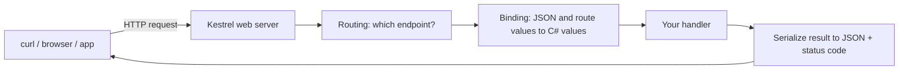

# 05. First ASP.NET Core API: minimal APIs, controllers and FastEndpoints

> **Draft: written but not yet run.** The code and the expected output in this lesson were prepared by reading the code and the official documentation. They have not been executed yet. If something does not behave as described, trust your tool's real output and report it.

## What you will be able to do
By the end of this lesson you will be able to:
- Build the same three-endpoint HTTP API with a minimal API, with controllers and with FastEndpoints.
- Call the API with `curl` and read the status code, the `Location` header and the JSON body.
- Explain the REPR pattern (Request, Endpoint, Response) and where each style keeps its routes.
- Choose a style for a given team and API size and say what you give up.

## Recap
1. In lesson 04, what does `await` do to the thread while it waits?
   <details><summary>Answer</summary>It gives the thread back (to the pool, to serve other work); the method resumes when the awaited operation finishes.</details>
2. In lesson 02, why did the repository expose `IReadOnlyCollection<T>` instead of the dictionary?
   <details><summary>Answer</summary>Callers can read but not change the internal storage; the narrowest interface is a safer contract.</details>

## Why it matters
An API is a shop counter: customers (other programs) ask in a fixed way and get answers in a fixed shape. ASP.NET Core offers three common ways to build the counter. They produce the same HTTP behaviour and differ in *where your code lives and how much ceremony it needs*. You will meet all three in real jobs, so you build one tiny API three times and compare.

## What you will build
Three small projects with the same contract, all serving an in-memory list of notes:

| Method and route | Meaning | Success | Missing note |
|---|---|---|---|
| `GET /notes` | list all notes | `200` + JSON array | n/a |
| `GET /notes/{id}` | one note | `200` + JSON object | `404` |
| `POST /notes` | create a note from `{"title": "..."}` | `201` + `Location` header + JSON object | n/a |


The three styles differ only in the *Routing* and *Your handler* boxes: where you declare the route and how the handler is shaped.

## Before you start
- Tools: .NET SDK **11.0.100** and the editor from C# 101 (same setup as [lesson 01](../phase-1-core-skills/01-interfaces-inheritance-polymorphism.md)). The first FastEndpoints build downloads the NuGet package, so you need internet access once.
- `curl`: Windows 10 and 11 ship `curl.exe`; macOS and Linux have `curl`. **In Windows PowerShell type `curl.exe`**, because plain `curl` is an alias for a different command there.
- Time: 70-80 min including the exercise. Two sittings are fine: stop after Step 6.
- Source pack (optional): every file is shown in full in this lesson, so you can follow without it. The finished code, the exercise starter and the solution are in the
  course repository https://github.com/Uee03/Code101 under `source/csharp/201-hero-to-super-hero/phase-2-web-apis/05-first-aspnet-core-api/` (on that page choose **Code, Download ZIP**, or run
  `git clone https://github.com/Uee03/Code101.git`).

## Steps
### Step 1. Make the lesson folder and the SDK pin
This lesson has three project folders inside one lesson folder.

**Folder: any folder (terminal)**
```powershell
New-Item -ItemType Directory -Force "$HOME/code101/csharp201/lesson05" | Out-Null
Set-Location "$HOME/code101/csharp201/lesson05"
New-Item -ItemType Directory -Force MinimalNotes, ControllerNotes, ReprNotes | Out-Null
```
**Folder: any folder (terminal)**
```bash
mkdir -p ~/code101/csharp201/lesson05/{MinimalNotes,ControllerNotes,ReprNotes} && cd ~/code101/csharp201/lesson05
```
Open `lesson05` in your editor. Create `global.json` (the same pin as lesson 01) and a small JSON file that the `curl` commands will send; both live in `lesson05`, beside the three folders.

**File: `global.json`**
```json
{
  "sdk": {
    "version": "11.0.100",
    "rollForward": "latestPatch"
  }
}
```
**File: `new-note.json`**
```json
{"title":"Write tests"}
```

### Step 2. The shared note and store
All three projects use the same two types. `Note` is a `record` with `init`-only properties (set when created, then read-only). `NoteStore` keeps a list in memory and uses a `Lock` (C# 13) so two requests cannot change the list at the same time; the web server handles requests on many threads. It starts with one note so a first `GET` has something to show.

Create this file in `MinimalNotes`. You will copy it unchanged into the other two folders.

**File: `MinimalNotes/Notes.cs`**
```csharp
public sealed record Note
{
    public int Id { get; init; }
    public string Title { get; init; } = "";
    public bool Done { get; init; }
}

public sealed class NoteStore
{
    private readonly Lock _gate = new();
    private readonly List<Note> _notes = [new Note { Id = 1, Title = "Learn REPR" }];
    private int _nextId = 2;

    public List<Note> All()
    {
        lock (_gate)
        {
            return [.. _notes];
        }
    }

    public Note? Find(int id)
    {
        lock (_gate)
        {
            return _notes.Find(n => n.Id == id);
        }
    }

    public Note Add(string title)
    {
        lock (_gate)
        {
            var note = new Note { Id = _nextId++, Title = title };
            _notes.Add(note);
            return note;
        }
    }
}
```
`All()` returns a copy (`[.. _notes]` copies the list) so a caller cannot change the store behind its back.

### Step 3. Style 1: the minimal API
The project file uses the **Web SDK** (`Microsoft.NET.Sdk.Web`), which adds ASP.NET Core without package references.

**File: `MinimalNotes/MinimalNotes.csproj`**
```xml
<Project Sdk="Microsoft.NET.Sdk.Web">

  <PropertyGroup>
    <TargetFramework>net11.0</TargetFramework>
    <ImplicitUsings>enable</ImplicitUsings>
    <Nullable>enable</Nullable>
  </PropertyGroup>

</Project>
```
**File: `MinimalNotes/Requests.cs`**
```csharp
public sealed record CreateNoteRequest(string Title);
```
**File: `MinimalNotes/Program.cs`**
```csharp
using Microsoft.AspNetCore.Http.HttpResults;

var builder = WebApplication.CreateBuilder(args);
builder.Services.AddSingleton<NoteStore>();

var app = builder.Build();

app.MapGet("/notes", (NoteStore store) => store.All());
app.MapGet("/notes/{id:int}", GetNote);
app.MapPost("/notes", CreateNote);

app.Run();

static Results<Ok<Note>, NotFound> GetNote(int id, NoteStore store)
{
    Note? note = store.Find(id);
    if (note is null)
    {
        return TypedResults.NotFound();
    }

    return TypedResults.Ok(note);
}

static Created<Note> CreateNote(CreateNoteRequest request, NoteStore store)
{
    Note created = store.Add(request.Title);
    return TypedResults.Created($"/notes/{created.Id}", created);
}
```
Read it once and **predict**: what status does `GET /notes/99` return? What status and header does `POST /notes` return?

### Step 4. Run and call the minimal API
**Folder: `~/code101/csharp201/lesson05` (terminal 1)**
```powershell
dotnet run --project MinimalNotes --urls http://localhost:5051
```
Typical console output (the lines can differ in wording and order):
```text
info: Microsoft.Hosting.Lifetime[14]
      Now listening on: http://localhost:5051
info: Microsoft.Hosting.Lifetime[0]
      Application started. Press Ctrl+C to shut down.
```
Leave it running and open a **second terminal** in `~/code101/csharp201/lesson05`.

**Folder: `~/code101/csharp201/lesson05` (terminal 2)**
```powershell
curl.exe -s http://localhost:5051/notes
curl.exe -s -i -H "Content-Type: application/json" -d "@new-note.json" http://localhost:5051/notes
curl.exe -s -o NUL -w "%{http_code}" http://localhost:5051/notes/99
```
On macOS and Linux type `curl` instead of `curl.exe`, and `-o /dev/null` instead of `-o NUL`. Expected result (not yet run):

```text
[{"id":1,"title":"Learn REPR","done":false}]
```
For the second command look at the top of the output: the first line is `HTTP/1.1 201 Created`, there is a header `Location: /notes/2`, and the body ends with:
```text
{"id":2,"title":"Write tests","done":false}
```
The third command prints only the status: `404`. Stop the server with **Ctrl+C** in terminal 1.

### Step 5. Style 2: controllers
Same contract, but the routes live on a class. Copy `Notes.cs` from `MinimalNotes` into `ControllerNotes` unchanged, then create the other files.

**File: `ControllerNotes/ControllerNotes.csproj`**
```xml
<Project Sdk="Microsoft.NET.Sdk.Web">

  <PropertyGroup>
    <TargetFramework>net11.0</TargetFramework>
    <ImplicitUsings>enable</ImplicitUsings>
    <Nullable>enable</Nullable>
  </PropertyGroup>

</Project>
```
**File: `ControllerNotes/Requests.cs`** (identical to the minimal project)
```csharp
public sealed record CreateNoteRequest(string Title);
```
**File: `ControllerNotes/Program.cs`**
```csharp
var builder = WebApplication.CreateBuilder(args);
builder.Services.AddSingleton<NoteStore>();
builder.Services.AddControllers();

var app = builder.Build();

app.MapControllers();

app.Run();
```
**File: `ControllerNotes/NotesController.cs`**
```csharp
using Microsoft.AspNetCore.Mvc;

[ApiController]
[Route("notes")]
public class NotesController(NoteStore store) : ControllerBase
{
    [HttpGet]
    public List<Note> ListNotes() => store.All();

    [HttpGet("{id:int}")]
    public ActionResult<Note> Get(int id)
    {
        Note? note = store.Find(id);
        if (note is null)
        {
            return NotFound();
        }

        return note;
    }

    [HttpPost]
    public ActionResult<Note> Create(CreateNoteRequest request)
    {
        Note created = store.Add(request.Title);
        return CreatedAtAction(nameof(Get), new { id = created.Id }, created);
    }
}
```
Run it on port 5052 and repeat the three `curl` commands with that port.

**Folder: `~/code101/csharp201/lesson05` (terminal 1)**
```powershell
dotnet run --project ControllerNotes --urls http://localhost:5052
```
Expected result (not yet run): the same JSON as before. Two small differences: `Location` is built by `CreatedAtAction` from the route of `Get`, and `GET /notes/99` returns a JSON **problem details** body (`"status":404`) instead of an empty body, because `[ApiController]` turns plain error results into the standard error format (lesson 06). Stop with Ctrl+C.

### Step 6. Style 3: FastEndpoints (REPR)
Now each operation is its own class, with its request type next to it. FastEndpoints is a NuGet package, so the project file has a `PackageReference`. Copy `Notes.cs` unchanged.

**File: `ReprNotes/ReprNotes.csproj`**
```xml
<Project Sdk="Microsoft.NET.Sdk.Web">

  <PropertyGroup>
    <TargetFramework>net11.0</TargetFramework>
    <ImplicitUsings>enable</ImplicitUsings>
    <Nullable>enable</Nullable>
  </PropertyGroup>

  <ItemGroup>
    <PackageReference Include="FastEndpoints" Version="9.0.0" />
  </ItemGroup>

</Project>
```
The request types are plain classes with settable properties, the shape FastEndpoints binds into.

**File: `ReprNotes/Requests.cs`**
```csharp
public sealed class GetNoteRequest
{
    public int Id { get; set; }
}

public sealed class CreateNoteRequest
{
    public string Title { get; set; } = "";
}
```
**File: `ReprNotes/Program.cs`**
```csharp
using FastEndpoints;

var builder = WebApplication.CreateBuilder(args);
builder.Services.AddSingleton<NoteStore>();
builder.Services.AddFastEndpoints();

var app = builder.Build();

app.UseFastEndpoints();

app.Run();
```
**File: `ReprNotes/ListNotesEndpoint.cs`**
```csharp
using FastEndpoints;

public sealed class ListNotesEndpoint(NoteStore store) : EndpointWithoutRequest<List<Note>>
{
    public override void Configure()
    {
        Get("/notes");
        AllowAnonymous();
    }

    public override async Task HandleAsync(CancellationToken ct)
    {
        await Send.OkAsync(store.All(), ct);
    }
}
```
**File: `ReprNotes/GetNoteEndpoint.cs`**
```csharp
using FastEndpoints;

public sealed class GetNoteEndpoint(NoteStore store) : Endpoint<GetNoteRequest, Note>
{
    public override void Configure()
    {
        Get("/notes/{id}");
        AllowAnonymous();
    }

    public override async Task HandleAsync(GetNoteRequest req, CancellationToken ct)
    {
        Note? note = store.Find(req.Id);
        if (note is null)
        {
            await Send.NotFoundAsync(ct);
            return;
        }

        await Send.OkAsync(note, ct);
    }
}
```
**File: `ReprNotes/CreateNoteEndpoint.cs`**
```csharp
using FastEndpoints;

public sealed class CreateNoteEndpoint(NoteStore store) : Endpoint<CreateNoteRequest, Note>
{
    public override void Configure()
    {
        Post("/notes");
        AllowAnonymous();
    }

    public override async Task HandleAsync(CreateNoteRequest req, CancellationToken ct)
    {
        Note created = store.Add(req.Title);
        await Send.CreatedAtAsync<GetNoteEndpoint>(new { id = created.Id }, created, cancellation: ct);
    }
}
```
**Folder: `~/code101/csharp201/lesson05` (terminal 1)**
```powershell
dotnet run --project ReprNotes --urls http://localhost:5053
```
Repeat the three `curl` commands with port 5053. Expected result (not yet run): the same bodies and statuses. Stop with Ctrl+C.

## Run it
You ran each style in its own step. As a final check, run the minimal API once more and list the notes from the second terminal:

**Folder: `~/code101/csharp201/lesson05` (terminal 1)**
```powershell
dotnet run --project MinimalNotes --urls http://localhost:5051
```
**Folder: `~/code101/csharp201/lesson05` (terminal 2)**
```powershell
curl.exe -s http://localhost:5051/notes
```
Expected output (not yet run; the in-memory list is fresh after every start, so the note you created earlier is gone):
```text
[{"id":1,"title":"Learn REPR","done":false}]
```

## How it works
1. **Request flow.** Kestrel (the built-in web server) receives bytes, routing picks the endpoint whose method and path match, **binding** turns the route value (`id`) and JSON body into C# values, your handler runs, and the returned object is written as JSON with a status code. All three styles run on this same pipeline.
2. **Dependency injection.** `AddSingleton<NoteStore>()` registers one shared store. Handlers and constructors *ask* for `NoteStore` and the framework supplies it: a parameter in the minimal API, a primary-constructor parameter in the controller and endpoint classes. Lesson 07 explains lifetimes.
3. **Results.** `TypedResults.Ok/NotFound/Created` say what the handler can return, so the compiler (and, later, OpenAPI) knows the possible responses. `Results<Ok<Note>, NotFound>` is a union of the allowed outcomes.
4. **REPR.** *Request, Endpoint, Response*: one class per operation, with its input type and output type named explicitly. There is no class that collects ten unrelated actions. Adding "delete a note" means adding a file, not editing a big one.
5. **JSON names.** ASP.NET Core serializes with camelCase by default (`id`, `title`), so the C# property `Title` becomes `"title"`.

> **Misconception:** "Minimal APIs are only for demos, controllers are the serious option." Both run on the same pipeline and are supported for production. What changes is *how you organise code*: a long `Program.cs` becomes hard to read as the API grows, so large minimal APIs group endpoints into methods or classes (you will do this in lesson 11).

### Why this, not that
| | Minimal API | Controllers | FastEndpoints (REPR) |
|---|---|---|---|
| Where routes live | `MapGet`/`MapPost` calls | `[Route]`/`[HttpGet]` attributes on a class | `Configure()` of one class per endpoint |
| Extra package | none | none | `FastEndpoints` |
| Ceremony for a first endpoint | lowest | medium | medium (a class and a request type) |
| Organisation as it grows | you must add structure yourself | one class per resource, many actions per class | one file per operation, structure enforced |
| Built-in features (filters, model validation by attributes) | endpoint filters; validation is DIY | filters, `[ApiController]` conventions | its own pre/post processors, FluentValidation validators |
| Best fit | small services, learning, high performance focus | existing MVC code, teams who know it | greenfield APIs that will grow and teams that want one structure |

Rule of thumb from the .NET docs: both minimal APIs and controllers are first-class; pick one per API and stay consistent. This course uses FastEndpoints in the [dotnet capstone](../../../../capstones/backend-dotnet/tutorials/phase-1-skeleton/01-skeleton.md) and minimal API groups in lesson 11.

## Try it
Add `DELETE /notes/{id}`: `204 No Content` when the note existed, `404` when it did not.

1. **Guided.** Copy your `MinimalNotes` folder to `exercise05`. In `Notes.cs` finish `Remove`; in `Program.cs` finish `DeleteNote`. The two `TODO` comments are the only code you write.
2. **Change.** Add the same endpoint to your `ReprNotes` project as a new file `DeleteNoteEndpoint.cs` (hint: look at the methods `Send.NoContentAsync` and `Send.NotFoundAsync`). You will write a class, not an edit to an existing one.
3. **Stretch (no single answer).** You are the lead of a team of six that will build 40 endpoints over a year. Pick a style and write three reasons and one thing you give up.

**File: `exercise05/Notes.cs` (starter: only the end of the file is shown)**
```csharp
    public bool Remove(int id)
    {
        // TODO: remove the note with this id and return true; return false when it does not exist.
        return false;
    }
```
**File: `exercise05/Program.cs` (starter: the new route and the handler)**
```csharp
app.MapDelete("/notes/{id:int}", DeleteNote);
```
```csharp
static Results<NoContent, NotFound> DeleteNote(int id, NoteStore store)
{
    // TODO: return 204 No Content when the note was removed and 404 Not Found otherwise.
    return TypedResults.NotFound();
}
```
With the unchanged starter, `DELETE /notes/1` returns `404`. When you are done it returns `204`, and a second identical call returns `404`.

<details><summary>Solution</summary>

`List<T>.RemoveAll` returns how many items it removed, so `> 0` answers "did it exist?"; the lock keeps the check and the removal together.

**File: `exercise05/Notes.cs` (solution: the new method)**
```csharp
    public bool Remove(int id)
    {
        lock (_gate)
        {
            return _notes.RemoveAll(n => n.Id == id) > 0;
        }
    }
```
**File: `exercise05/Program.cs` (solution: the handler)**
```csharp
static Results<NoContent, NotFound> DeleteNote(int id, NoteStore store)
{
    if (store.Remove(id))
    {
        return TypedResults.NoContent();
    }

    return TypedResults.NotFound();
}
```
Check (not yet run), with the server running on port 5054:
```text
curl.exe -s -o NUL -w "%{http_code}" -X DELETE http://localhost:5054/notes/1
204
```
Running the same command again prints `404`, and `GET /notes` prints `[]`.

</details>

## Check yourself
1. Which status and header does `POST /notes` return in all three styles? <details><summary>Answer</summary>`201 Created` with a `Location` header pointing to the new note (`/notes/2`).</details>
2. What does REPR stand for and what is the rule it gives you? <details><summary>Answer</summary>Request, Endpoint, Response: one class per operation with explicit input and output types.</details>
3. A teammate calls `GET /notes/abc`. In the minimal API the route is `/notes/{id:int}`. What happens? <details><summary>Answer</summary>The `:int` route constraint does not match `abc`, so no endpoint matches and the server returns `404`.</details>
4. Why does `NoteStore` use a lock? <details><summary>Answer</summary>Requests run on many threads; without a lock two requests could modify the list (and the id counter) at the same time and corrupt it.</details>

## Common mistakes
Typical messages; wording can differ with the SDK and the curl version.

| Symptom or error text | Cause | Fix |
|---|---|---|
| `curl: (7) Failed to connect to localhost port 5051` (typical message) | The server is not running (or listens on another port). | Start it in terminal 1 and check the `Now listening on:` line. |
| `Failed to bind to address http://127.0.0.1:5051: address already in use.` (typical message) | A previous server still runs on that port. | Stop it with Ctrl+C or pick another port in `--urls`. |
| `Invoke-WebRequest : Cannot bind parameter 'Headers'...` in Windows PowerShell | `curl` is an alias for `Invoke-WebRequest` there. | Type `curl.exe`. |
| POST returns `415 Unsupported Media Type` (typical status) | The `Content-Type: application/json` header is missing. | Add `-H "Content-Type: application/json"`. |
| `System.InvalidOperationException: Unable to resolve service for type 'NoteStore'...` (typical message) | `AddSingleton<NoteStore>()` is missing in `Program.cs`. | Register the store before `builder.Build()`. |
| FastEndpoints reports no endpoints were found (typical message) | The project name is in the library's excluded assembly names. | Rename the project; the names in this lesson are safe. |

## Best practice
Pick one API style per project, keep handlers thin (parse, call, map the result) and declare what an endpoint can return. Source: Microsoft Learn, Choose between controller-based APIs and minimal APIs https://learn.microsoft.com/aspnet/core/fundamentals/apis and FastEndpoints, Get started https://fast-endpoints.com/docs/get-started

## Going further
- ASP.NET Core best practices (async, no blocking, avoid large allocations): https://learn.microsoft.com/aspnet/core/fundamentals/best-practices
- The full platform contract, 27 operations in the REPR style: [dotnet capstone, chapter 01](../../../../capstones/backend-dotnet/tutorials/phase-1-skeleton/01-skeleton.md).

## Summary
- You built one three-endpoint API as a minimal API, with controllers and with FastEndpoints.
- You called it with `curl` and read status, header and body.
- You explained REPR and where each style keeps its routes.
- You compared the styles and chose one with a stated trade-off.

## Next lesson
**[06. DTOs, validation, the Result pattern and ProblemDetails](06-dtos-validation-result-problemdetails.md)**: stop trusting the request body and return errors in one standard shape.
