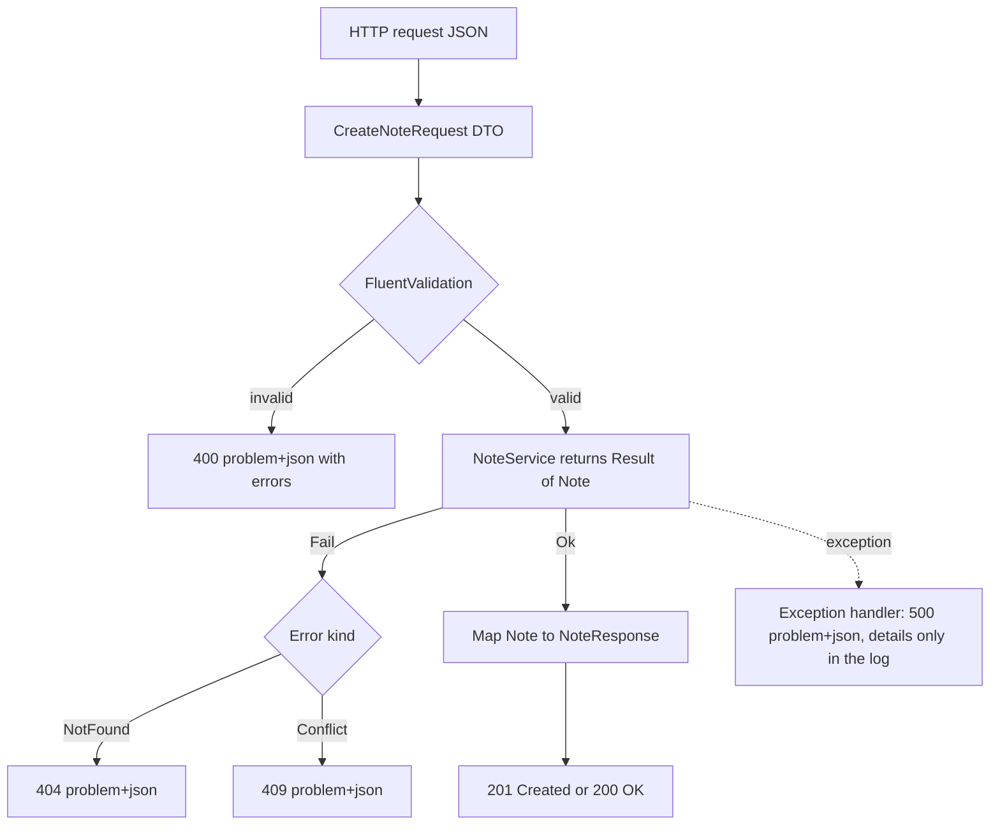

# 06. DTOs, validation, the Result pattern and ProblemDetails

> **Draft: written but not yet run.** The code and the expected output in this lesson were prepared by reading the code and the official documentation. They have not been executed yet. If something does not behave as described, trust your tool's real output and report it.

## What you will be able to do
By the end of this lesson you will be able to:
- Separate a request DTO, a response DTO and a domain model, and explain what each protects you from.
- Validate a request with FluentValidation and return the failures as a standard `400` problem response.
- Return an expected failure ("not found", "conflict") as a `Result<T>` and map it to `404` or `409`.
- Turn an unexpected exception into a safe `500` response without leaking internals.

## Recap
1. In lesson 05, which status and header does `POST /notes` return?
   <details><summary>Answer</summary>`201 Created` and a `Location` header with the URL of the new note.</details>
2. In lesson 04, why should an endpoint accept a `CancellationToken`?
   <details><summary>Answer</summary>So work stops when the client disconnects or a timeout fires, instead of wasting resources.</details>

## Why it matters
Whatever arrives over HTTP is untrusted text from a stranger. The shape you accept (the **request DTO**, *data transfer object*) must be separate from the objects your business code trusts and separate from what you send back, otherwise a client can set fields you never meant to expose (**over-posting**) and every change to your database model breaks your public contract. Errors are part of the contract too: clients (and frontends) need one predictable error format. This lesson builds the four layers that every API in the [capstone](../../../../capstones/backend-dotnet/tutorials/phase-1-skeleton/01-skeleton.md) uses.

## What you will build
A small minimal API with `POST /notes` and `GET /notes/{id}` (in memory) that

- accepts a `CreateNoteRequest` and answers with a `NoteResponse` (the domain `Note` also has an `OwnerId` the client never sees),
- rejects bad input with `400` and a field-by-field error list,
- reports "duplicate title" as `409` and "no such note" as `404`,
- hides a crash behind a generic `500`.



## Before you start
- **Prerequisites:** [C# 201 lesson 05, first ASP.NET Core API](05-first-aspnet-core-api.md).
- Tools: .NET SDK **11.0.100**, the editor, and `curl` as in [lesson 05](05-first-aspnet-core-api.md) (`curl.exe` in Windows PowerShell). One NuGet package is downloaded: FluentValidation.
- Time: 70-80 min including the exercise.
- Source pack (optional): every file is shown in full in this lesson, so you can follow without it. The finished code, the exercise starter and the solution are in the
  course repository https://github.com/Uee03/Code101 under `source/csharp/201-hero-to-super-hero/phase-2-web-apis/06-dtos-validation-result-problemdetails/` (on that page choose **Code, Download ZIP**, or run
  `git clone https://github.com/Uee03/Code101.git`).

## Steps
### Step 1. Make the folder, the pin and the project file
**Folder: any folder (terminal)**
```powershell
New-Item -ItemType Directory -Force "$HOME/code101/csharp201/lesson06" | Out-Null
Set-Location "$HOME/code101/csharp201/lesson06"
```
**Folder: any folder (terminal)**
```bash
mkdir -p ~/code101/csharp201/lesson06 && cd ~/code101/csharp201/lesson06
```
Create `global.json` (identical to [lesson 05, Step 1](05-first-aspnet-core-api.md#step-1-make-the-lesson-folder-and-the-sdk-pin)) and the project file. The only new line is the `PackageReference`: `FluentValidation.DependencyInjectionExtensions` brings FluentValidation itself plus the helper that registers validators in dependency injection.

**File: `global.json`**
```json
{
  "sdk": {
    "version": "11.0.100",
    "rollForward": "latestPatch"
  }
}
```
**File: `NotesApi.csproj`**
```xml
<Project Sdk="Microsoft.NET.Sdk.Web">

  <PropertyGroup>
    <TargetFramework>net11.0</TargetFramework>
    <ImplicitUsings>enable</ImplicitUsings>
    <Nullable>enable</Nullable>
  </PropertyGroup>

  <ItemGroup>
    <PackageReference Include="FluentValidation.DependencyInjectionExtensions" Version="12.2.0" />
  </ItemGroup>

</Project>
```

### Step 2. The three shapes of a note
The request has *nullable* fields because a client may omit them; the validator, not the type system, decides what is required. The response has only what the client may see. The domain `Note` has an `OwnerId` that no DTO exposes.

**File: `Dtos.cs`**
```csharp
public sealed record CreateNoteRequest(string? Title, string? Body);

public sealed record NoteResponse(int Id, string Title, string Body);
```

### Step 3. The Result type
A `Result<T>` is either a value or an `Error`. It is for **expected** failures (a missing note is normal business), so callers cannot forget them: you must look at `IsSuccess`. The two `MemberNotNullWhen` attributes tell the compiler "when `IsSuccess` is true, `Value` is not null; when false, `Error` is not null", so you get no false null warnings.

**File: `Result.cs`**
```csharp
using System.Diagnostics.CodeAnalysis;

public enum ErrorKind
{
    NotFound,
    Conflict,
}

public sealed record Error(ErrorKind Kind, string Code, string Message);

public sealed class Result<T>
{
    private Result(T? value, Error? error)
    {
        Value = value;
        Error = error;
    }

    public T? Value { get; }

    public Error? Error { get; }

    [MemberNotNullWhen(true, nameof(Value))]
    [MemberNotNullWhen(false, nameof(Error))]
    public bool IsSuccess => Error is null;

    public static Result<T> Ok(T value) => new(value, null);

    public static Result<T> Fail(Error error) => new(default, error);
}
```
The `Code` is a stable machine-readable string (`note.not_found`) that a frontend can switch on; `Message` is for humans and may be reworded.

### Step 4. The domain and the service
The service holds the business rule "titles are unique, ignoring case". It knows nothing about HTTP.

**File: `Notes.cs`**
```csharp
public sealed record Note(int Id, string Title, string Body, string OwnerId);

public sealed class NoteService
{
    private readonly Lock _gate = new();
    private readonly List<Note> _notes = [];
    private int _nextId = 1;

    public Result<Note> Create(string title, string body)
    {
        lock (_gate)
        {
            if (_notes.Any(n => n.Title.Equals(title, StringComparison.OrdinalIgnoreCase)))
            {
                return Result<Note>.Fail(new Error(
                    ErrorKind.Conflict,
                    "note.duplicate_title",
                    $"A note titled '{title}' already exists."));
            }

            var note = new Note(_nextId++, title, body, "demo-user");
            _notes.Add(note);
            return Result<Note>.Ok(note);
        }
    }

    public Result<Note> Get(int id)
    {
        lock (_gate)
        {
            Note? note = _notes.Find(n => n.Id == id);
            if (note is null)
            {
                return Result<Note>.Fail(new Error(
                    ErrorKind.NotFound,
                    "note.not_found",
                    $"Note {id} was not found."));
            }

            return Result<Note>.Ok(note);
        }
    }
}
```

### Step 5. Mapping: domain to response, error to HTTP
All knowledge about "which error is which status" lives in one place. `TypedResults.Problem` writes an `application/problem+json` body: the standard error format from RFC 9457 (formerly RFC 7807) with `type`, `title`, `status`, `detail` and any extra members (here `code`).

**File: `Mapping.cs`**
```csharp
public static class Mapping
{
    public static NoteResponse ToResponse(this Note note) => new(note.Id, note.Title, note.Body);

    public static IResult ToProblem(this Error error)
    {
        (int status, string title) = error.Kind switch
        {
            ErrorKind.NotFound => (StatusCodes.Status404NotFound, "Not found"),
            ErrorKind.Conflict => (StatusCodes.Status409Conflict, "Conflict"),
            _ => (StatusCodes.Status500InternalServerError, "Unexpected error"),
        };

        return TypedResults.Problem(
            detail: error.Message,
            statusCode: status,
            title: title,
            extensions: new Dictionary<string, object?> { ["code"] = error.Code });
    }
}
```

### Step 6. The validator
A FluentValidation validator is a class of rules for one DTO. It is plain C#, so it is testable without a web server (lesson 11). Custom messages keep the output stable.

**File: `CreateNoteValidator.cs`**
```csharp
using FluentValidation;

public sealed class CreateNoteValidator : AbstractValidator<CreateNoteRequest>
{
    public CreateNoteValidator()
    {
        RuleFor(x => x.Title)
            .NotEmpty().WithMessage("Title is required.")
            .MaximumLength(100).WithMessage("Title must be 100 characters or fewer.");

        RuleFor(x => x.Body)
            .MaximumLength(1000).WithMessage("Body must be 1000 characters or fewer.");
    }
}
```

### Step 7. The endpoints
Each handler does four things: validate, call the service, map the result, return. `IValidator<CreateNoteRequest>` and `NoteService` arrive by dependency injection. `Boom` exists only to trigger an unexpected exception for this lesson.

**File: `NoteEndpoints.cs`**
```csharp
using FluentValidation;
using FluentValidation.Results;

public static class NoteEndpoints
{
    public static void MapNoteEndpoints(this IEndpointRouteBuilder app)
    {
        RouteGroupBuilder group = app.MapGroup("/notes");
        group.MapPost("/", CreateNote);
        group.MapGet("/{id:int}", GetNote);

        app.MapGet("/boom", Boom);
    }

    private static async Task<IResult> CreateNote(
        CreateNoteRequest request,
        IValidator<CreateNoteRequest> validator,
        NoteService service,
        CancellationToken ct)
    {
        ValidationResult validation = await validator.ValidateAsync(request, ct);
        if (!validation.IsValid)
        {
            return TypedResults.ValidationProblem(validation.ToDictionary());
        }

        Result<Note> result = service.Create(request.Title!, request.Body ?? "");
        if (!result.IsSuccess)
        {
            return result.Error.ToProblem();
        }

        NoteResponse response = result.Value.ToResponse();
        return TypedResults.Created($"/notes/{response.Id}", response);
    }

    private static IResult GetNote(int id, NoteService service)
    {
        Result<Note> result = service.Get(id);
        if (!result.IsSuccess)
        {
            return result.Error.ToProblem();
        }

        return TypedResults.Ok(result.Value.ToResponse());
    }

    private static IResult Boom() => throw new InvalidOperationException("secret internal detail");
}
```
`request.Title!` (the `!` says "I know it is not null") is justified because the validator already rejected empty titles.

### Step 8. The exception handler
`IExceptionHandler` is called by the exception-handling middleware for any exception nobody caught. It logs the real exception (for you) and writes a generic problem response (for the client). The client never sees the message `secret internal detail`.

**File: `GlobalExceptionHandler.cs`**
```csharp
using Microsoft.AspNetCore.Diagnostics;
using Microsoft.AspNetCore.Mvc;

public sealed class GlobalExceptionHandler(
    IProblemDetailsService problemDetails,
    ILogger<GlobalExceptionHandler> logger) : IExceptionHandler
{
    public async ValueTask<bool> TryHandleAsync(
        HttpContext httpContext,
        Exception exception,
        CancellationToken cancellationToken)
    {
        logger.LogError(exception, "Unhandled exception for {Path}", httpContext.Request.Path);
        httpContext.Response.StatusCode = StatusCodes.Status500InternalServerError;

        return await problemDetails.TryWriteAsync(new ProblemDetailsContext
        {
            HttpContext = httpContext,
            ProblemDetails = new ProblemDetails
            {
                Status = StatusCodes.Status500InternalServerError,
                Title = "An unexpected error occurred.",
            },
        });
    }
}
```

### Step 9. Wire everything in Program.cs
`AddValidatorsFromAssemblyContaining<CreateNoteValidator>()` finds every validator in the assembly. `AddProblemDetails()` turns on the problem format for the framework's own errors; `UseExceptionHandler()` runs the handler; `UseStatusCodePages()` gives bodiless errors (such as an unknown route's `404`) the same format.

**File: `Program.cs`**
```csharp
using FluentValidation;

var builder = WebApplication.CreateBuilder(args);
builder.Services.AddSingleton<NoteService>();
builder.Services.AddValidatorsFromAssemblyContaining<CreateNoteValidator>();
builder.Services.AddProblemDetails();
builder.Services.AddExceptionHandler<GlobalExceptionHandler>();

var app = builder.Build();

app.UseExceptionHandler();
app.UseStatusCodePages();
app.MapNoteEndpoints();

app.Run();
```

### Step 10. Two request files
**File: `good.json`**
```json
{"title":"Buy milk","body":"2 litres"}
```
**File: `bad.json`**
```json
{"title":"","body":"x"}
```

## Run it
**Folder: `~/code101/csharp201/lesson06` (terminal 1)**
```powershell
dotnet run --project . --urls http://localhost:5061
```
Before you send anything, **predict** the status code for each of the five requests below. Then, in a second terminal in the same folder (use `curl` instead of `curl.exe` on macOS and Linux), run them in this order. (Without a launch profile `dotnet run` uses the *Production* environment, which is what we want for the last request.)

**Folder: `~/code101/csharp201/lesson06` (terminal 2)**
```powershell
curl.exe -s -H "Content-Type: application/json" -d "@good.json" http://localhost:5061/notes
curl.exe -s -H "Content-Type: application/json" -d "@good.json" http://localhost:5061/notes
curl.exe -s -H "Content-Type: application/json" -d "@bad.json" http://localhost:5061/notes
curl.exe -s http://localhost:5061/notes/42
curl.exe -s http://localhost:5061/boom
```
Expected output, in order (not yet run; the `type` URL and a `traceId` member may differ or be added, so `...` stands for them):
```text
{"id":1,"title":"Buy milk","body":"2 litres"}
{"type":"...","title":"Conflict","status":409,"detail":"A note titled 'Buy milk' already exists.","code":"note.duplicate_title"...}
{"type":"...","title":"One or more validation errors occurred.","status":400,"errors":{"Title":["Title is required."]}...}
{"type":"...","title":"Not found","status":404,"detail":"Note 42 was not found.","code":"note.not_found"...}
{"type":"...","title":"An unexpected error occurred.","status":500...}
```
The five statuses are `201`, `409`, `400`, `404`, `500`. Look at the terminal-1 log for the last request: it contains the real exception text `secret internal detail`; the client did not. Stop the server with Ctrl+C.

## How it works
1. **Three shapes, three jobs.** The request DTO is what clients may *send*; the response DTO is what they may *see*; the domain `Note` is what your rules work on. `OwnerId` exists only in the domain, so a client cannot set it by adding `"ownerId"` to the JSON (over-posting) and cannot read it either. If you later rename a database column, the public JSON does not change.
2. **Validation at the edge.** Syntax rules (required, length, format) belong next to the DTO and run before any business code. Business rules ("title must be unique") need your data, so they belong in the service. Database constraints (unique index, NOT NULL) are the last line of defence for races between two requests. Use all three.
3. **`Result<T>` vs exceptions.** A duplicate title is a normal outcome, not an exceptional one. Returning a `Result` makes the failure part of the method's signature and is cheap; throwing is slow and invisible in the signature. Reserve exceptions for the *unexpected* (a bug, a database that is down).
4. **One error format.** `ProblemDetails` gives frontends one shape to parse for *every* error: `status`, `title`, `detail`, plus your own `code`. The validation variant adds an `errors` object that maps each field name to its messages.
5. **Safe `500`.** An unhandled exception message can contain table names, file paths or SQL. Log it, return a generic body, and include a correlation id (`traceId`) so support can find the log line.

> **Misconception:** "400 is for validation, so 422 is wrong (or the other way round)." Both are used; the point is **consistency**. This course uses `400` with an `errors` map for malformed or invalid input, `404` for a missing resource and `409` for a state conflict.

### Why this, not that
| Choice | Use it when | Cost |
|---|---|---|
| **FluentValidation** (this lesson) | Rules are non-trivial, conditional or shared; you want unit tests for them | One package; rules live apart from the type |
| **Data Annotations** (`[Required]`, `[StringLength]`) | Very simple rules, and MVC controllers (where `[ApiController]` checks them automatically) | Hard to express cross-field rules; recent ASP.NET Core versions also have built-in minimal-API validation based on them |
| **Own `Result<T>`** (about 30 lines) | You want a tiny, readable rule: expected failures are values | You write the mapping yourself; libraries such as ErrorOr or FluentResults offer more features and more concepts |
| **Exceptions for expected failures** | Deep call stacks where passing results is awkward | Slow, invisible in signatures, easy to leak to clients |
| **Return the entity directly** | Never for public APIs | Leaks columns, couples the contract to the database |

In FastEndpoints (lesson 05) the validator is a class that inherits `Validator<TRequest>`, sits next to the endpoint and is discovered automatically; failures return `400` with its own error shape, which `app.UseFastEndpoints(c => c.Errors.UseProblemDetails())` switches to RFC problem details. Source: https://fast-endpoints.com/docs/validation

## Try it
The domain keeps growing. You will add the two helper methods that make `Result<T>` pleasant to use, in a tiny console project (no web server needed).

1. **Guided.** Copy the starter folder below to `exercise06` (a console project with its own `Result.cs`). Implement `Map<TOut>`: when the result failed, return a failed `Result<TOut>` with the same error; otherwise return an `Ok` with the converted value.
2. **Change.** Implement `Match<TOut>`: call `onOk` with the value on success or `onError` with the error on failure. The starter `Program.cs` already uses it.
3. **Stretch (no single answer).** Write `Bind<TOut>(Func<T, Result<TOut>> next)` so two fallible steps chain without nested `if`s. Where would you use it in `CreateNote`? Does it make the endpoint easier or harder to read for your team?

To create the starter yourself: make `exercise06` as in Step 1, copy `global.json`, create `Lesson.csproj` (the console project from [lesson 01, Step 2](../phase-1-core-skills/01-interfaces-inheritance-polymorphism.md#step-2-add-the-sdk-pin-and-the-project-file)), copy `Result.cs` from this lesson and add the two methods below inside the class.

**File: `exercise06/Result.cs` (starter: add these two methods at the end of the class)**
```csharp
    public Result<TOut> Map<TOut>(Func<T, TOut> convert)
    {
        // TODO: when this result failed, return a failed Result<TOut> with the same Error;
        // otherwise return Ok with convert(Value).
        throw new NotImplementedException();
    }

    public TOut Match<TOut>(Func<T, TOut> onOk, Func<Error, TOut> onError)
    {
        // TODO: call onOk with the value on success, onError with the error on failure.
        throw new NotImplementedException();
    }
```
**File: `exercise06/Program.cs`**
```csharp
Result<int> ok = Result<int>.Ok(20);
Result<int> failed = Result<int>.Fail(new Error(ErrorKind.NotFound, "number.missing", "No number."));

Result<string> a = ok.Map(n => $"Value is {n * 2}");
Result<string> b = failed.Map(n => $"Value is {n * 2}");

Console.WriteLine(a.Match(v => v, e => e.Code));
Console.WriteLine(b.Match(v => v, e => e.Code));
```
With the starter the program stops with an unhandled `NotImplementedException`. Goal output: `Value is 40`, then `number.missing`.

<details><summary>Solution</summary>

Check `IsSuccess` once, then use `Value` or `Error`; the `MemberNotNullWhen` attributes make the compiler accept both without `!`.

**File: `exercise06/Result.cs` (solution: the two methods)**
```csharp
    public Result<TOut> Map<TOut>(Func<T, TOut> convert)
    {
        if (!IsSuccess)
        {
            return Result<TOut>.Fail(Error);
        }

        return Result<TOut>.Ok(convert(Value));
    }

    public TOut Match<TOut>(Func<T, TOut> onOk, Func<Error, TOut> onError)
    {
        if (!IsSuccess)
        {
            return onError(Error);
        }

        return onOk(Value);
    }
```
Expected output (not yet run):
```text
Value is 40
number.missing
```

</details>

## Check yourself
1. A client sends `{"title":"Hi","ownerId":"someone-else"}`. Can it change the note's `OwnerId`? <details><summary>Answer</summary>No. `CreateNoteRequest` has no `OwnerId`, so the JSON member is ignored; the service sets the owner.</details>
2. Which status do "title missing" and "title already used" return, and why different? <details><summary>Answer</summary>`400` (the input itself is invalid, found by the validator) and `409` (the input is fine but conflicts with the current state, found by the service).</details>
3. Why is a missing note a `Result` failure and not an exception? <details><summary>Answer</summary>It is an expected outcome; a result keeps it visible in the signature and avoids the cost of throwing.</details>
4. What does the client see when `Boom` throws, and where does the real message go? <details><summary>Answer</summary>A generic `500` problem response (`An unexpected error occurred.`); the real exception goes to the log.</details>

## Common mistakes
Typical messages; wording can differ.

| Symptom or error text | Cause | Fix |
|---|---|---|
| `System.InvalidOperationException: Unable to resolve service for type 'FluentValidation.IValidator`1[CreateNoteRequest]'...` (typical message) | `AddValidatorsFromAssemblyContaining` is missing. | Register validators in `Program.cs` (Step 9). |
| The `400` body has no `errors` and the validator never runs | The endpoint did not call `ValidateAsync`: FluentValidation is not automatic for minimal APIs. | Call the validator in the handler (Step 7). |
| `400` with a body about a JSON parse error, not your messages | The body is not valid JSON, or `Content-Type` is not `application/json`. | Check the file content and header; PowerShell may mangle quotes in `-d`, so use `-d "@good.json"`. |
| `error CS8602: Dereference of a possibly null reference` on `result.Value` (typical message) | The `MemberNotNullWhen` attributes are missing or `IsSuccess` was not checked first. | Check `IsSuccess` first and keep the attributes. |
| `500` body contains the exception text | The exception handler is not registered, or the app runs in Development, which shows the developer exception page. | Keep `AddExceptionHandler` and `UseExceptionHandler`, and test in Production. |

## Best practice
Validate every request at the edge, return expected failures as values and use one standard error format; never return the database entity or an exception message to the client. Source: Microsoft Learn, Handle errors in ASP.NET Core APIs https://learn.microsoft.com/aspnet/core/fundamentals/error-handling-api and FluentValidation documentation https://docs.fluentvalidation.net/

## Going further
- Problem details in minimal APIs and `IExceptionHandler`: https://learn.microsoft.com/aspnet/core/fundamentals/error-handling
- The same four layers (DTOs, FluentValidation, results, problem details) over a real database: [dotnet capstone, chapter 02](../../../../capstones/backend-dotnet/tutorials/phase-2-data/02-data-access.md), and in miniature in [lesson 11](../phase-4-security-and-quality/11-testing-and-notes-api.md).

## Summary
- You separated request, response and domain shapes and explained over-posting.
- You validated with FluentValidation and returned a `400` with field errors.
- You returned expected failures as `Result<T>` and mapped them to `404` and `409`.
- You hid an unexpected exception behind a generic `500` and logged the real one.

## Next lesson
**[07. Dependency injection and configuration](07-dependency-injection-and-options.md)**: why `AddSingleton` mattered here, what the other lifetimes do, and how settings reach your code.
