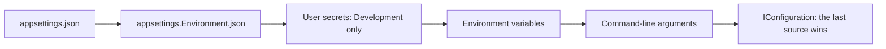

# 07. Dependency injection and configuration

> **Draft: written but not yet run.** The code and the expected output in this lesson were prepared by reading the code and the official documentation. They have not been executed yet. If something does not behave as described, trust your tool's real output and report it.

## What you will be able to do
By the end of this lesson you will be able to:
- Register a service and choose between singleton, scoped and transient lifetimes.
- Predict how many instances of each lifetime exist after one and two requests.
- Bind a settings section to a class, validate it at startup and override a value from the command line or an environment variable.
- Explain a captive dependency and why it is a bug.

## Recap
1. In lesson 06, why was `NoteService` registered with `AddSingleton`?
   <details><summary>Answer</summary>It holds the in-memory list, so every request must share the same instance.</details>
2. In lesson 01, what is the benefit of a variable typed as an interface?
   <details><summary>Answer</summary>The calling code depends on the contract, so the implementation can be replaced (for example by a test fake).</details>

## Why it matters
A restaurant kitchen does not make each cook buy their own oven: the kitchen provides one, and each order gets a clean tray. **Dependency injection** (DI) is that kitchen: classes say what they *need* (a constructor parameter) and the framework *provides* it, deciding how long each thing lives. The payoff: replaceable parts (fakes in tests, another database), one place that wires the app, and settings that change per environment without changing code. Every class from lesson 08 on arrives by DI.

## What you will build
A small web app that proves lifetimes with an instance counter, formats a heading from a validated settings section, and reads the same setting through `IOptions` and `IOptionsMonitor` so you can see the difference.

| Lifetime | One new instance per... | Typical use | Danger |
|---|---|---|---|
| **Singleton** | application | caches, clocks, stateless helpers, configuration | must be thread-safe |
| **Scoped** | HTTP request (a *scope*) | per-request work, `DbContext` | must not be held by a singleton |
| **Transient** | each time it is requested | small, stateless helpers | many allocations if overused |



## Before you start
- **Prerequisites:** [C# 201 lesson 06, DTOs, validation, Result and ProblemDetails](06-dtos-validation-result-problemdetails.md).
- Tools: .NET SDK **11.0.100**, the editor, and `curl` as in [lesson 05](05-first-aspnet-core-api.md) (`curl.exe` in Windows PowerShell).
- Time: 60-70 min including the exercise.
- Source pack (optional): every file is shown in full in this lesson, so you can follow without it. The finished code, the exercise starter and the solution are in the
  course repository https://github.com/Uee03/Code101 under `source/csharp/201-hero-to-super-hero/phase-2-web-apis/07-dependency-injection-and-options/` (on that page choose **Code, Download ZIP**, or run
  `git clone https://github.com/Uee03/Code101.git`).

## Steps
### Step 1. Folder, pin and project file
**Folder: any folder (terminal)**
```powershell
New-Item -ItemType Directory -Force "$HOME/code101/csharp201/lesson07" | Out-Null
Set-Location "$HOME/code101/csharp201/lesson07"
```
**Folder: any folder (terminal)**
```bash
mkdir -p ~/code101/csharp201/lesson07 && cd ~/code101/csharp201/lesson07
```
Create `global.json` (identical to [lesson 05, Step 1](05-first-aspnet-core-api.md#step-1-make-the-lesson-folder-and-the-sdk-pin)) and the project file. The project file is the web one from lesson 05, with no packages: options and DI are part of the ASP.NET Core framework.

**File: `global.json`**
```json
{
  "sdk": {
    "version": "11.0.100",
    "rollForward": "latestPatch"
  }
}
```
**File: `NotesApi.csproj`**
```xml
<Project Sdk="Microsoft.NET.Sdk.Web">

  <PropertyGroup>
    <TargetFramework>net11.0</TargetFramework>
    <ImplicitUsings>enable</ImplicitUsings>
    <Nullable>enable</Nullable>
  </PropertyGroup>

</Project>
```

### Step 2. The settings class
**Options** are settings bound to a class. Data Annotations (`[Required]`, `[Range]`) describe what a valid value is; the validation runs at startup, so a bad setting stops the app immediately instead of failing later in a request.

**File: `NotesOptions.cs`**
```csharp
using System.ComponentModel.DataAnnotations;

public sealed class NotesOptions
{
    public const string SectionName = "Notes";

    [Required]
    [MinLength(3)]
    public string Title { get; set; } = "";

    [Range(1, 100)]
    public int PageSize { get; set; } = 10;
}
```

### Step 3. The settings file
`appsettings.json` is read automatically by `WebApplication.CreateBuilder`. The `Notes` section matches `NotesOptions.SectionName`.

**File: `appsettings.json`**
```json
{
  "Logging": {
    "LogLevel": {
      "Default": "Information",
      "Microsoft.AspNetCore": "Warning"
    }
  },
  "AllowedHosts": "*",
  "Notes": {
    "Title": "My notes",
    "PageSize": 5
  }
}
```

### Step 4. The services
Read it before typing and **predict**: after *one* request to `/lifetimes`, how many singleton, scoped and transient instances exist? (Hint: `LifetimeProbe` needs one of each, and so does the endpoint, except for the singleton.) Each constructor reports itself to a shared `InstanceCounter`, which is the only thing that counts. A real app would not do this; here it makes the invisible visible.

**File: `Services.cs`**
```csharp
using Microsoft.Extensions.Options;

public sealed class InstanceCounter
{
    private int _singleton;
    private int _scoped;
    private int _transient;

    public int Singleton => _singleton;

    public int Scoped => _scoped;

    public int Transient => _transient;

    public void CountSingleton() => Interlocked.Increment(ref _singleton);

    public void CountScoped() => Interlocked.Increment(ref _scoped);

    public void CountTransient() => Interlocked.Increment(ref _transient);
}

public sealed class SingletonService
{
    public SingletonService(InstanceCounter counter) => counter.CountSingleton();
}

public sealed class ScopedService
{
    public ScopedService(InstanceCounter counter) => counter.CountScoped();
}

public sealed class TransientService
{
    public TransientService(InstanceCounter counter) => counter.CountTransient();
}

public sealed class LifetimeProbe(SingletonService singleton, ScopedService scoped, TransientService transient)
{
    public SingletonService Singleton { get; } = singleton;

    public ScopedService Scoped { get; } = scoped;

    public TransientService Transient { get; } = transient;
}

public interface ITitleFormatter
{
    string Format(string title);
}

public sealed class UpperTitleFormatter : ITitleFormatter
{
    public string Format(string title) => title.ToUpperInvariant();
}

public sealed class TitleService(IOptions<NotesOptions> options, ITitleFormatter formatter)
{
    public string Heading() => formatter.Format(options.Value.Title);
}
```
`TitleService` asks for an `IOptions<NotesOptions>` (the settings) and an `ITitleFormatter` (an interface): it neither knows nor cares which formatter it gets.

### Step 5. Register everything and map the endpoints
**File: `Program.cs`**
```csharp
using Microsoft.Extensions.Options;

var builder = WebApplication.CreateBuilder(args);

builder.Services
    .AddOptions<NotesOptions>()
    .BindConfiguration(NotesOptions.SectionName)
    .ValidateDataAnnotations()
    .ValidateOnStart();

builder.Services.AddSingleton<InstanceCounter>();
builder.Services.AddSingleton<SingletonService>();
builder.Services.AddScoped<ScopedService>();
builder.Services.AddTransient<TransientService>();
builder.Services.AddScoped<LifetimeProbe>();
builder.Services.AddSingleton<ITitleFormatter, UpperTitleFormatter>();
builder.Services.AddScoped<TitleService>();

var app = builder.Build();

app.MapGet("/lifetimes", (
    ScopedService scoped,
    TransientService transient,
    LifetimeProbe probe,
    InstanceCounter counter) => new
{
    scopedShared = ReferenceEquals(scoped, probe.Scoped),
    transientShared = ReferenceEquals(transient, probe.Transient),
    singletonInstances = counter.Singleton,
    scopedInstances = counter.Scoped,
    transientInstances = counter.Transient,
});

app.MapGet("/heading", (TitleService titles) => titles.Heading());
app.MapGet("/settings/static", (IOptions<NotesOptions> options) => options.Value);
app.MapGet("/settings/live", (IOptionsMonitor<NotesOptions> options) => options.CurrentValue);

app.Run();
```
`AddSingleton<ITitleFormatter, UpperTitleFormatter>()` reads "when someone asks for `ITitleFormatter`, give them an `UpperTitleFormatter`". Changing that one line changes the formatter everywhere. The `/lifetimes` handler's parameters are filled by DI, like constructor parameters.

## Run it
**Folder: `~/code101/csharp201/lesson07` (terminal 1)**
```powershell
dotnet run --project . --urls http://localhost:5071
```
In a second terminal in the same folder run the calls (use `curl` instead of `curl.exe` on macOS and Linux). Run `/lifetimes` twice, and check your prediction after the first call.

**Folder: `~/code101/csharp201/lesson07` (terminal 2)**
```powershell
curl.exe -s http://localhost:5071/lifetimes
curl.exe -s http://localhost:5071/lifetimes
curl.exe -s http://localhost:5071/heading
curl.exe -s http://localhost:5071/settings/static
```
Expected output (not yet run; derived from the code):
```text
{"scopedShared":true,"transientShared":false,"singletonInstances":1,"scopedInstances":1,"transientInstances":2}
{"scopedShared":true,"transientShared":false,"singletonInstances":1,"scopedInstances":2,"transientInstances":4}
MY NOTES
{"title":"My notes","pageSize":5}
```
Stop the server (Ctrl+C) and start it again with a **command-line override**, then ask for the setting. A value given on the command line beats `appsettings.json`.

**Folder: `~/code101/csharp201/lesson07` (terminal 1)**
```powershell
dotnet run --project . --urls http://localhost:5072 --Notes:PageSize=9
```
**Folder: `~/code101/csharp201/lesson07` (terminal 2)**
```powershell
curl.exe -s http://localhost:5072/settings/static
```
Expected output (not yet run):
```text
{"title":"My notes","pageSize":9}
```
The same override as an environment variable uses a **double underscore** for the colon: in PowerShell `$env:Notes__PageSize = "9"`, in bash `export Notes__PageSize=9`, set before `dotnet run`. (Remove it afterwards: `Remove-Item Env:Notes__PageSize` or `unset Notes__PageSize`.)

### Experiment: IOptions or IOptionsMonitor?
Start the app again without overrides (port 5071). Call `/settings/static` and `/settings/live`; both show `pageSize` 5. Now edit `appsettings.json`: change `"PageSize": 5` to `8` and **save**. Predict, then call both again. Expected output (not yet run):
```text
{"title":"My notes","pageSize":5}
{"title":"My notes","pageSize":8}
```
`IOptions<T>` was read once at startup; `IOptionsMonitor<T>.CurrentValue` follows the file. (Restore the value `5` when you are done.)

### Experiment: a bad setting stops the app
Stop the server and start it with an invalid value:

**Folder: `~/code101/csharp201/lesson07` (terminal 1)**
```powershell
dotnet run --project . --urls http://localhost:5071 --Notes:PageSize=0
```
The app must **not** start. The error ends with a message similar to this (typical message):
```text
Microsoft.Extensions.Options.OptionsValidationException: DataAnnotation validation failed for 'NotesOptions' members: 'PageSize' with the error: 'The field PageSize must be between 1 and 100.'.
```
That is `ValidateOnStart()` at work: a typo in production configuration fails the deployment, not the first customer.

## How it works
1. **Registration = a recipe.** `AddSingleton/AddScoped/AddTransient` store a recipe in the **container** (`IServiceProvider`). When a handler or constructor asks for a type, the container builds it, first building *its* dependencies (a chain: `TitleService` needs `IOptions` and `ITitleFormatter`).
2. **Scopes.** ASP.NET Core opens one **scope** per HTTP request. Scoped instances live as long as that scope; transient instances are new on every request for them; singletons live for the whole run. That is why the counters read `1/1/2` after the first request and `1/2/4` after the second.
3. **Constructor injection.** A class lists what it needs in its constructor and never creates collaborators with `new`. Primary constructors (`TitleService(IOptions<NotesOptions> options, ...)`) make this a one-liner.
4. **Options.** `BindConfiguration("Notes")` copies the `Notes` section into a `NotesOptions` object. The three accessors differ in *when* they read: `IOptions<T>` once (singleton), `IOptionsSnapshot<T>` once per request (scoped), `IOptionsMonitor<T>` live with change notifications (singleton).
5. **Configuration sources.** Later sources override earlier ones: `appsettings.json`, then `appsettings.{Environment}.json`, user secrets (Development), environment variables, command-line arguments. Hierarchy keys are written `Notes:PageSize` (nested objects in JSON files, a colon on the command line) and `Notes__PageSize` in environment variables.
6. **Secrets never go in `appsettings.json`.** Use `dotnet user-secrets` on your machine (`dotnet user-secrets init`, then `dotnet user-secrets set "Section:Key" "value"`), and environment variables or a secret manager (Key Vault, Docker secrets) when deployed. Lesson 08 uses an environment variable for the database password.

> **Misconception:** "Singleton means one global variable, so scoped is the safe default." A singleton is one *shared* instance, correct for stateless or thread-safe things. The real danger is the reverse dependency: a **singleton that holds a scoped service** (a *captive dependency*) keeps that scoped object alive for the whole run, long after its request is over. A `DbContext` captured by a singleton is shared by every request and is not thread-safe.

### Why this, not that
| Choice | Use it when | Cost |
|---|---|---|
| **Constructor injection** | Almost always | A long constructor signals a class doing too much |
| **`new Service()` inside the class** | Tiny pure helpers with no dependencies | Cannot swap or fake it; hides dependencies |
| **Service locator** (`provider.GetService<T>()` in methods) | Rare cases such as creating a scope in a background job | Hides dependencies, fails at run time instead of at startup |
| **`IOptions<T>`** | Settings that do not change while running | Needs a restart to change |
| **`IOptionsMonitor<T>`** | Settings you want to change live (log levels, feature switches) | Code must cope with values that change between two lines |
| **A static `Settings` class** | Never in app code | No validation, no override, no tests |

Keyed services (register several implementations of one interface under names, since .NET 8) solve "which formatter?" when you need more than one at the same time: https://learn.microsoft.com/dotnet/core/extensions/dependency-injection

## Try it
A console project (no web server) lets you watch DI and scopes directly. It uses the `Microsoft.Extensions.DependencyInjection` package, which ASP.NET Core already includes for you.

1. **Guided.** Create `exercise07` as in Step 1 and add `global.json`. Create the project file below (note the `PackageReference`), `Types.cs` and `Program.cs`. Fill in the two `TODO` registration lines.
2. **Change.** Register `RequestId` as **transient** instead. Predict `Same inside scope` before running (it changes), then switch back.
3. **Stretch (no single answer).** Add `public sealed class Reporter(RequestId id)` and register it as a **singleton**, then ask for it. The provider was built with `ValidateScopes = true`. Predict what happens, find out what the message says, then fix the design (hint: a singleton can take `IServiceScopeFactory` and create a scope when it needs scoped work).

**File: `exercise07/Lesson.csproj` (starter)**
```xml
<Project Sdk="Microsoft.NET.Sdk">

  <PropertyGroup>
    <OutputType>Exe</OutputType>
    <TargetFramework>net11.0</TargetFramework>
    <ImplicitUsings>enable</ImplicitUsings>
    <Nullable>enable</Nullable>
  </PropertyGroup>

  <ItemGroup>
    <PackageReference Include="Microsoft.Extensions.DependencyInjection" Version="11.0.0" />
  </ItemGroup>

</Project>
```
**File: `exercise07/Types.cs` (starter)**
```csharp
public interface IGreeter
{
    string Greet(string name);
}

public sealed class EnglishGreeter : IGreeter
{
    public string Greet(string name) => $"Hello, {name}";
}

public sealed class RequestId
{
}
```
**File: `exercise07/Program.cs` (starter)**
```csharp
using Microsoft.Extensions.DependencyInjection;

var services = new ServiceCollection();
// TODO 1: register IGreeter so that the implementation is EnglishGreeter (one shared instance).
// TODO 2: register RequestId so that every scope gets its own instance, shared inside the scope.

using ServiceProvider provider = services.BuildServiceProvider(new ServiceProviderOptions { ValidateScopes = true });

RequestId? fromFirstScope = null;

using (IServiceScope scope = provider.CreateScope())
{
    IGreeter greeter = scope.ServiceProvider.GetRequiredService<IGreeter>();
    Console.WriteLine(greeter.Greet("Ada"));

    RequestId first = scope.ServiceProvider.GetRequiredService<RequestId>();
    RequestId second = scope.ServiceProvider.GetRequiredService<RequestId>();
    Console.WriteLine($"Same inside scope: {ReferenceEquals(first, second)}");
    fromFirstScope = first;
}

using (IServiceScope scope = provider.CreateScope())
{
    RequestId other = scope.ServiceProvider.GetRequiredService<RequestId>();
    Console.WriteLine($"Same across scopes: {ReferenceEquals(fromFirstScope, other)}");
}
```
With the unfinished starter the program stops at the first `GetRequiredService` with an `InvalidOperationException` that says no service for type `IGreeter` is registered (typical message). When done it prints the three lines shown in the solution.

<details><summary>Solution</summary>

Two registrations. A singleton gives one instance for the whole provider; a scoped service gives one per `CreateScope()`.

**File: `exercise07/Program.cs` (solution: the first lines change, the rest stays)**
```csharp
using Microsoft.Extensions.DependencyInjection;

var services = new ServiceCollection();
services.AddSingleton<IGreeter, EnglishGreeter>();
services.AddScoped<RequestId>();

using ServiceProvider provider = services.BuildServiceProvider(new ServiceProviderOptions { ValidateScopes = true });

RequestId? fromFirstScope = null;

using (IServiceScope scope = provider.CreateScope())
{
    IGreeter greeter = scope.ServiceProvider.GetRequiredService<IGreeter>();
    Console.WriteLine(greeter.Greet("Ada"));

    RequestId first = scope.ServiceProvider.GetRequiredService<RequestId>();
    RequestId second = scope.ServiceProvider.GetRequiredService<RequestId>();
    Console.WriteLine($"Same inside scope: {ReferenceEquals(first, second)}");
    fromFirstScope = first;
}

using (IServiceScope scope = provider.CreateScope())
{
    RequestId other = scope.ServiceProvider.GetRequiredService<RequestId>();
    Console.WriteLine($"Same across scopes: {ReferenceEquals(fromFirstScope, other)}");
}
```
Expected output (not yet run):
```text
Hello, Ada
Same inside scope: True
Same across scopes: False
```
For the change rung: with a transient `RequestId` the second line becomes `Same inside scope: False`, because every request for the type builds a new object.

</details>

## Check yourself
1. After three requests to `/lifetimes`, what do the three counters show? <details><summary>Answer</summary>`singletonInstances` 1, `scopedInstances` 3 (one per request), `transientInstances` 6 (two per request).</details>
2. Why does `/settings/static` still show `5` after you edit the file while `/settings/live` shows `8`? <details><summary>Answer</summary>`IOptions<T>` is computed once at startup; `IOptionsMonitor<T>` listens for configuration changes.</details>
3. Which wins: `appsettings.json` says 5, an environment variable `Notes__PageSize=7` is set, and you pass `--Notes:PageSize=9`? <details><summary>Answer</summary>9: command-line arguments are the last (strongest) default source.</details>
4. What is wrong with a singleton that takes a `DbContext` in its constructor? <details><summary>Answer</summary>It is a captive dependency: the scoped `DbContext` lives as long as the singleton, is shared by all requests and is not thread-safe. With scope validation on, the container refuses it.</details>

## Common mistakes
Typical messages; the wording can differ.

| Symptom or error text | Cause | Fix |
|---|---|---|
| `System.InvalidOperationException: Unable to resolve service for type 'X' while attempting to activate 'Y'.` (typical message) | `X` was never registered. | Add `AddSingleton/AddScoped/AddTransient<X>()` before `Build()`. |
| `System.InvalidOperationException: Cannot consume scoped service 'X' from singleton 'Y'.` (typical message) | A captive dependency (the container validates this in Development). | Make `Y` scoped, or inject `IServiceScopeFactory` and create a scope. |
| `Microsoft.Extensions.Options.OptionsValidationException: DataAnnotation validation failed for 'NotesOptions' ...` (typical message) | A setting violates its attribute. | Fix the value in the file, environment variable or argument. |
| The environment variable `Notes:PageSize` has no effect | `:` is not valid in environment variable names on many shells. | Use `Notes__PageSize`. |
| `/settings/live` does not change after saving | The editor saved a different copy, or the app reads a copy in `bin`. | Run with `dotnet run` from the project folder and edit that `appsettings.json`. |
| A scoped service is the same object across two requests | It was registered as singleton by mistake. | Check the `Add...` method used. |

## Best practice
Depend on abstractions through the constructor, register each service with the *shortest lifetime that is correct*, bind settings to validated options classes and keep secrets out of source control. Source: Microsoft Learn, Dependency injection in ASP.NET Core https://learn.microsoft.com/aspnet/core/fundamentals/dependency-injection and Options pattern https://learn.microsoft.com/dotnet/core/extensions/options

## Going further
- Configuration in ASP.NET Core and the provider order: https://learn.microsoft.com/aspnet/core/fundamentals/configuration/
- Safe storage of app secrets in development: https://learn.microsoft.com/aspnet/core/security/app-secrets
- DI in a full application with a database: [lesson 11](../phase-4-security-and-quality/11-testing-and-notes-api.md).

## Phase 2 mixed review
1. A request body contains `"ownerId":"x"` and your DTO has no such property. What happens to it, and why is that good? (lesson 06)
2. You add `Delete` to the REPR style. What do you create, and what do you leave untouched? (lesson 05)
3. A class needs the current `HttpContext` user for the whole request. Which lifetime and why? (lesson 07)
4. Where do you put the rule "a title must be unique" and where "a title must be at most 100 characters"? (lesson 06)
<details><summary>Answers</summary>1. It is ignored; the client cannot set fields you do not expose. 2. One new endpoint class (plus a request type if needed); existing endpoints stay unchanged. 3. Scoped: one instance per request. 4. Uniqueness in the service (it needs data), length in the validator at the edge; add a unique index as a last line of defence.</details>

## Summary
- You registered services with three lifetimes and predicted the instance counts.
- You bound, validated and overrode a settings section from the file, the command line and the environment.
- You compared `IOptions` and `IOptionsMonitor` with a live experiment.
- You explained why a singleton must not hold a scoped service.

## Next lesson
**[08. EF Core and PostgreSQL](../phase-3-data/08-ef-core-and-postgres.md)**: replace the in-memory list with a real database, run it in Docker, and learn what the context tracks.
