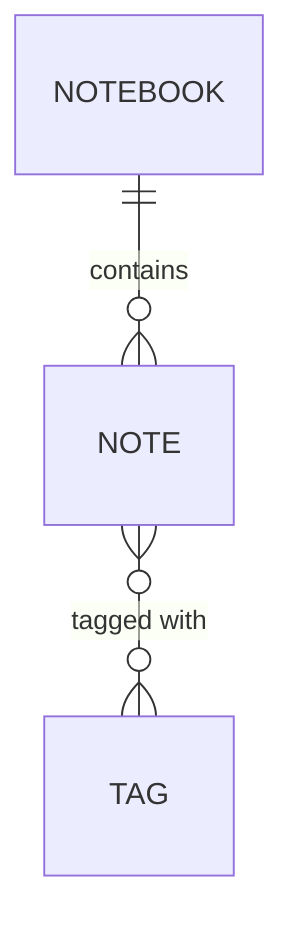
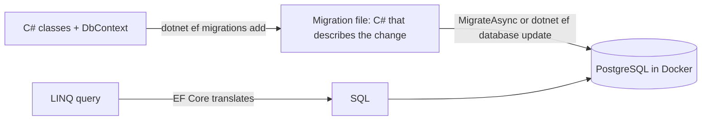

# 08. EF Core and PostgreSQL

> **Draft: written but not yet run.** The code and the expected output in this lesson were prepared by reading the code and the official documentation. They have not been executed yet. If something does not behave as described, trust your tool's real output and report it.

## What you will be able to do
By the end of this lesson you will be able to:
- Start a disposable PostgreSQL database with Docker Compose and a `.env` file.
- Model a one-to-many and a many-to-many relationship with EF Core and create the tables with a migration.
- Explain what the change tracker does and choose between a tracking query, `AsNoTracking` and `ExecuteUpdate`.
- Read a query that would run one SQL statement per row (the N+1 problem) and name two fixes.

## Recap
1. In lesson 03, why can a LINQ query print different results at two moments?
   <details><summary>Answer</summary>It is deferred: it runs when it is enumerated, against whatever the data is at that moment.</details>
2. In lesson 07, why does the connection string not belong in `appsettings.json` in source control?
   <details><summary>Answer</summary>It contains a password; secrets come from user secrets, environment variables or a secret store.</details>

## Why it matters
The in-memory list from lessons 05 to 07 disappears when the app stops. A **database** keeps data, enforces rules (unique, required, foreign keys) and answers questions over millions of rows. An **ORM** (object-relational mapper) such as **Entity Framework Core** (EF Core) lets you work with C# objects and LINQ and writes the SQL for you. You still need to know what SQL it writes, because the common performance bugs hide there; lesson 09 shows how to write SQL by hand when that is the better tool.

## What you will build
A console program with three tables (notebooks, notes, tags). A notebook has many notes (**one-to-many**); a note has many tags and a tag many notes (**many-to-many**). It creates the schema from a migration, seeds data, queries with and without tracking, and updates rows in bulk.




## Before you start
- **Prerequisites:** C# 201 lessons [03, LINQ](../phase-1-core-skills/03-linq.md), [04, async/await and Task](../phase-1-core-skills/04-async-await-and-task.md) and [07, dependency injection and options](../phase-2-web-apis/07-dependency-injection-and-options.md).
- Tools: .NET SDK **11.0.100** and the editor; **Docker** with Compose v2 (Docker Desktop on Windows and macOS, Docker Engine on Linux). Check in a terminal: `docker --version` and `docker compose version`; both must print a version. If Docker Desktop is installed but the commands fail, start Docker Desktop and wait until it says it is running.
- The database listens on host port **5433** (not the usual 5432) so it does not clash with a PostgreSQL you may already run.
- Time: 80-90 min including the exercise. Two sittings: stop after Step 8 (the database keeps its data in a Docker volume).
- Source pack (optional): every file is shown in full in this lesson, so you can follow without it. The finished code, the exercise starter and the solution are in the
  course repository https://github.com/Uee03/Code101 under `source/csharp/201-hero-to-super-hero/phase-3-data/08-ef-core-and-postgres/` (on that page choose **Code, Download ZIP**, or run
  `git clone https://github.com/Uee03/Code101.git`).

## Steps
### Step 1. Folder, SDK pin and ignore file
**Folder: any folder (terminal)**
```powershell
New-Item -ItemType Directory -Force "$HOME/code101/csharp201/lesson08" | Out-Null
Set-Location "$HOME/code101/csharp201/lesson08"
```
**Folder: any folder (terminal)**
```bash
mkdir -p ~/code101/csharp201/lesson08 && cd ~/code101/csharp201/lesson08
```
Open the folder in your editor. Create `global.json` (identical to [lesson 05, Step 1](../phase-2-web-apis/05-first-aspnet-core-api.md#step-1-make-the-lesson-folder-and-the-sdk-pin)) and `.gitignore`. The ignore file keeps the password file and build output out of Git; the leading dot means the file is hidden in some file managers (see Common mistakes).

**File: `global.json`**
```json
{
  "sdk": {
    "version": "11.0.100",
    "rollForward": "latestPatch"
  }
}
```
**File: `.gitignore`**
```text
.env
bin/
obj/
```

### Step 2. The settings file `.env.example`
Docker Compose reads variables from a file named `.env` next to `docker-compose.yml`. You ship an **example** with harmless values and each developer copies it to `.env`, which stays out of Git. The values below are disposable practice values for a database that only listens on your own machine.

**File: `.env.example`**
```text
# Disposable local practice values. Never reuse them anywhere real.
POSTGRES_DB=notes
POSTGRES_USER=notes_app
POSTGRES_PASSWORD=notes_local_only
POSTGRES_PORT=5433
```
| Line | Meaning | If you change it |
|---|---|---|
| `POSTGRES_DB` | name of the database created on first start | the connection string in Step 7 must use the same name |
| `POSTGRES_USER` | the database user created on first start | same: must match the connection string |
| `POSTGRES_PASSWORD` | that user's password | same; use a long random value for anything real |
| `POSTGRES_PORT` | port on **your** computer that forwards to the container | pick another free port if 5433 is taken |

Now copy it to `.env`:

**Folder: `~/code101/csharp201/lesson08` (terminal)**
```powershell
Copy-Item .env.example .env
```
**Folder: `~/code101/csharp201/lesson08` (terminal)**
```bash
cp .env.example .env
```
Expected result: no printed text; `.env` now exists.

### Step 3. The Compose file
**File: `docker-compose.yml`**
```yaml
services:
  db:
    image: postgres:17-alpine
    environment:
      POSTGRES_DB: ${POSTGRES_DB}
      POSTGRES_USER: ${POSTGRES_USER}
      POSTGRES_PASSWORD: ${POSTGRES_PASSWORD}
    ports:
      - "127.0.0.1:${POSTGRES_PORT:-5432}:5432"
    volumes:
      - pg_data:/var/lib/postgresql/data
    healthcheck:
      test: ["CMD-SHELL", "pg_isready -h 127.0.0.1 -U $$POSTGRES_USER -d $$POSTGRES_DB"]
      interval: 3s
      timeout: 3s
      retries: 30
      start_period: 5s

volumes:
  pg_data:
```
| Line | What it does | If you change it |
|---|---|---|
| `services: db:` | one container, named `db` | the name is how other containers would reach it |
| `image: postgres:17-alpine` | the official PostgreSQL 17 image on a small Linux (Alpine) | a newer major version needs a data migration; pin the version you test with |
| `environment:` | passes the three variables from `.env` into the container; PostgreSQL creates the database and user from them on **first** start only | changing the password in `.env` later does not change an existing database |
| `ports: "127.0.0.1:${POSTGRES_PORT:-5432}:5432"` | forwards host port `POSTGRES_PORT` (default 5432 when unset) to the container's 5432, **only on the loopback address**, so other computers on your network cannot connect | removing `127.0.0.1:` exposes the database to your network: do not |
| `volumes: pg_data:...` | stores the data in a Docker-managed volume, so it survives restarts | without it, deleting the container deletes the data |
| `healthcheck:` | runs `pg_isready` every 3 s; the container becomes `healthy` when the server accepts connections. `$$` writes a literal `$` so the *container's* shell expands the variable | without it `--wait` cannot tell when the database is ready |
| `volumes: pg_data:` (last two lines) | declares the named volume | |

### Step 4. Start the database and check it
**Folder: `~/code101/csharp201/lesson08` (terminal)**
```powershell
docker compose up -d
docker compose ps
```
`up -d` starts the container in the background (**d**etached) and downloads the image the first time (a few hundred MB). Typical output of `ps` (names and times differ):
```text
NAME           IMAGE                COMMAND                  SERVICE   CREATED          STATUS                    PORTS
lesson08-db-1  postgres:17-alpine   "docker-entrypoint.s…"   db        30 seconds ago   Up 29 seconds (healthy)   127.0.0.1:5433->5432/tcp
```
Wait until `STATUS` says `(healthy)` (repeat `docker compose ps`). To read the server's log: `docker compose logs db`; it ends with a line like `database system is ready to accept connections` (typical message).

### Step 5. Install the EF Core command-line tool, locally
`dotnet ef` creates migrations. Install it as a **local tool**: it is recorded in a manifest inside this folder, so it does not change your whole machine and every teammate gets the same version.

**Folder: `~/code101/csharp201/lesson08` (terminal)**
```powershell
dotnet new tool-manifest
dotnet tool install dotnet-ef --version 11.0.0
```
Expected result: the first command reports that a file was created; the second reports the tool was installed. Check that the file exists and looks like this:

**File: `.config/dotnet-tools.json`**
```json
{
  "version": 1,
  "isRoot": true,
  "tools": {
    "dotnet-ef": {
      "version": "11.0.0",
      "commands": [
        "dotnet-ef"
      ],
      "rollForward": false
    }
  }
}
```
On a fresh clone, `dotnet tool restore` re-installs everything listed here.

### Step 6. Project file and model
Two packages: the PostgreSQL provider for EF Core (it brings EF Core itself), and the design-time package that `dotnet ef` needs; `PrivateAssets` keeps the design package out of the running app.

**File: `NotesDb.csproj`**
```xml
<Project Sdk="Microsoft.NET.Sdk">

  <PropertyGroup>
    <OutputType>Exe</OutputType>
    <TargetFramework>net11.0</TargetFramework>
    <ImplicitUsings>enable</ImplicitUsings>
    <Nullable>enable</Nullable>
  </PropertyGroup>

  <ItemGroup>
    <PackageReference Include="Npgsql.EntityFrameworkCore.PostgreSQL" Version="11.0.0" />
    <PackageReference Include="Microsoft.EntityFrameworkCore.Design" Version="11.0.0">
      <PrivateAssets>all</PrivateAssets>
    </PackageReference>
  </ItemGroup>

</Project>
```
The **entities** are ordinary classes. `NotebookId` plus `Notebook` is a foreign key and its navigation (the "one" side); `List<Note> Notes` is the collection side. `Tags` and `Notes` on the two sides are what makes EF Core create the many-to-many join table by convention. `null!` means "EF Core will fill this in"; it silences the nullable warning.

**File: `Models.cs`**
```csharp
public class Notebook
{
    public int Id { get; set; }

    public string Name { get; set; } = "";

    public List<Note> Notes { get; set; } = [];
}

public class Note
{
    public int Id { get; set; }

    public string Title { get; set; } = "";

    public bool Done { get; set; }

    public int NotebookId { get; set; }

    public Notebook Notebook { get; set; } = null!;

    public List<Tag> Tags { get; set; } = [];
}

public class Tag
{
    public int Id { get; set; }

    public string Name { get; set; } = "";

    public List<Note> Notes { get; set; } = [];
}
```
The **DbContext** is your session with the database: its `DbSet<T>` properties are the tables, and it remembers what you changed. `OnConfiguring` reads the connection string from an environment variable (a console app has no dependency injection container; in a web app you use `AddDbContext`, lesson 11). `OnModelCreating` states rules by convention cannot guess: maximum lengths and unique indexes.

**File: `NotesContext.cs`**
```csharp
using Microsoft.EntityFrameworkCore;

public class NotesContext : DbContext
{
    public DbSet<Notebook> Notebooks => Set<Notebook>();

    public DbSet<Note> Notes => Set<Note>();

    public DbSet<Tag> Tags => Set<Tag>();

    protected override void OnConfiguring(DbContextOptionsBuilder options)
    {
        string connection = Environment.GetEnvironmentVariable("NOTES_CONNECTION")
            ?? throw new InvalidOperationException("Set the NOTES_CONNECTION environment variable (see .env.example).");
        options.UseNpgsql(connection);
    }

    protected override void OnModelCreating(ModelBuilder modelBuilder)
    {
        modelBuilder.Entity<Notebook>(e =>
        {
            e.Property(x => x.Name).HasMaxLength(100);
            e.HasIndex(x => x.Name).IsUnique();
        });

        modelBuilder.Entity<Note>(e =>
        {
            e.Property(x => x.Title).HasMaxLength(200);
            e.HasOne(x => x.Notebook).WithMany(x => x.Notes).HasForeignKey(x => x.NotebookId);
        });

        modelBuilder.Entity<Tag>(e =>
        {
            e.Property(x => x.Name).HasMaxLength(50);
            e.HasIndex(x => x.Name).IsUnique();
        });
    }
}
```

### Step 7. The program
Read it once and **predict** the last number on each of the `Tracked entries`, `State after edit` and `Marked done` lines before you run it. The program resets its own demo data every run (it deletes notebooks and tags first), so use it only against this practice database.

**File: `Program.cs`**
```csharp
using Microsoft.EntityFrameworkCore;

await using (var setup = new NotesContext())
{
    await setup.Database.MigrateAsync();
    await setup.Notebooks.ExecuteDeleteAsync();
    await setup.Tags.ExecuteDeleteAsync();

    var urgent = new Tag { Name = "urgent" };
    var writing = new Tag { Name = "writing" };
    var errands = new Tag { Name = "errands" };

    setup.Notebooks.AddRange(
        new Notebook
        {
            Name = "Work",
            Notes =
            [
                new Note { Title = "Write report", Tags = [urgent, writing] },
                new Note { Title = "Email Ada", Tags = [urgent] },
                new Note { Title = "Plan sprint" },
            ],
        },
        new Notebook
        {
            Name = "Home",
            Notes = [new Note { Title = "Buy milk", Tags = [errands] }],
        });

    await setup.SaveChangesAsync();
    Console.WriteLine($"Seeded: {await setup.Notebooks.CountAsync()} notebooks, {await setup.Notes.CountAsync()} notes, {await setup.Tags.CountAsync()} tags");
}

await using (var db = new NotesContext())
{
    var notebooks = await db.Notebooks
        .AsNoTracking()
        .OrderBy(b => b.Name)
        .Select(b => new { b.Name, Titles = b.Notes.OrderBy(n => n.Title).Select(n => n.Title).ToList() })
        .ToListAsync();

    foreach (var notebook in notebooks)
    {
        Console.WriteLine($"{notebook.Name}: {string.Join(", ", notebook.Titles)}");
    }

    var urgentTitles = await db.Tags
        .Where(t => t.Name == "urgent")
        .SelectMany(t => t.Notes)
        .OrderBy(n => n.Title)
        .Select(n => n.Title)
        .ToListAsync();
    Console.WriteLine($"Tag urgent: {string.Join(", ", urgentTitles)}");
}

await using (var untracked = new NotesContext())
{
    await untracked.Notes.AsNoTracking().ToListAsync();
    Console.WriteLine($"No-tracking entries: {untracked.ChangeTracker.Entries().Count()}");
}

await using (var tracked = new NotesContext())
{
    List<Note> notes = await tracked.Notes.OrderBy(n => n.Title).ToListAsync();
    Console.WriteLine($"Tracked entries: {tracked.ChangeTracker.Entries().Count()}");

    notes[0].Done = true;
    Console.WriteLine($"State after edit: {tracked.Entry(notes[0]).State}");

    int saved = await tracked.SaveChangesAsync();
    Console.WriteLine($"Saved changes: {saved}");
}

await using (var bulk = new NotesContext())
{
    int workId = await bulk.Notebooks.Where(b => b.Name == "Work").Select(b => b.Id).SingleAsync();
    int updated = await bulk.Notes
        .Where(n => n.NotebookId == workId)
        .ExecuteUpdateAsync(s => s.SetProperty(n => n.Done, true));
    Console.WriteLine($"Marked done by one UPDATE: {updated}");
}
```

### Step 8. Tell the app where the database is, then create the migration
The connection string uses the same values as `.env`. Set it in the terminal you will run the program in (each new terminal needs it again):

**Folder: `~/code101/csharp201/lesson08` (terminal)**
```powershell
$env:NOTES_CONNECTION = "Host=localhost;Port=5433;Database=notes;Username=notes_app;Password=notes_local_only"
```
**Folder: `~/code101/csharp201/lesson08` (terminal)**
```bash
export NOTES_CONNECTION="Host=localhost;Port=5433;Database=notes;Username=notes_app;Password=notes_local_only"
```
Now ask EF Core to compare your classes with "no database yet" and write the difference as code:

**Folder: `~/code101/csharp201/lesson08` (terminal)**
```powershell
dotnet ef migrations add InitialCreate
```
Typical output (the first run also restores packages):
```text
Build started...
Build succeeded.
Done. To undo this action, use 'ef migrations remove'
```
A new folder `Migrations` appears with three files: `<timestamp>_InitialCreate.cs` (the `Up` method creates the tables, `Down` removes them), `<timestamp>_InitialCreate.Designer.cs` and `NotesContextModelSnapshot.cs` (EF Core's memory of the model so the *next* migration knows what changed). Open `<timestamp>_InitialCreate.cs` and read `Up`: you should recognise `CreateTable` calls for notebooks, tags, notes and a join table, a unique index on the names and a foreign key with cascade delete. **Commit migration files to source control; they are code.**

## Run it
**Folder: `~/code101/csharp201/lesson08` (terminal)**
```powershell
dotnet run --project . --nologo
```
Expected output (not yet run; derived from the code and the seed data):
```text
Seeded: 2 notebooks, 4 notes, 3 tags
Home: Buy milk
Work: Email Ada, Plan sprint, Write report
Tag urgent: Email Ada, Write report
No-tracking entries: 0
Tracked entries: 4
State after edit: Modified
Saved changes: 1
Marked done by one UPDATE: 3
```
To look at the tables in the database itself:

**Folder: `~/code101/csharp201/lesson08` (terminal)**
```powershell
docker compose exec db psql -U notes_app -d notes -c "\dt"
```
Typical output: a list that includes the tables `Notebooks`, `Notes`, `Tags`, the join table `NoteTag` and `__EFMigrationsHistory` (the table EF Core uses to remember which migrations ran).

When you are done for the day: `docker compose stop` pauses the database; `docker compose down` removes the container but **keeps** the data volume; `docker compose down -v` also deletes the data (use it to start again from nothing; then run the program again, it re-applies the migration).

## How it works
1. **Code first, then migrations.** You wrote classes; `dotnet ef migrations add` diffed the model against the snapshot and generated the SQL-building code. `Database.MigrateAsync()` applies pending migrations and records them in `__EFMigrationsHistory`. A migration is a versioned, reviewable change to the schema, like a commit.
2. **Conventions.** `Id` is the primary key; `NotebookId` with a `Notebook` navigation is a required foreign key (cascade delete by default, so deleting a notebook deletes its notes; that is why `ExecuteDeleteAsync` on notebooks removes notes too); two collections pointing at each other create a many-to-many join table.
3. **LINQ becomes SQL.** `db.Notebooks...Select(...)` is an `IQueryable`: not run until `ToListAsync()`; EF Core translates the *expression* into SQL. Anything EF Core cannot translate (your own C# method inside a `Where`) fails at run time, which is the practical difference between `IQueryable` and `IEnumerable` from lesson 03.
4. **The change tracker.** A normal query registers each loaded entity and keeps a snapshot. When you change `notes[0].Done`, the tracker notices the difference, so `State` is `Modified`, and `SaveChangesAsync()` sends an `UPDATE` for just that row (it returns the number of entities saved: 1). `AsNoTracking()` skips the registration: faster and lighter for read-only data, which is why the untracked context reports 0 entries.
5. **Bulk operations.** `ExecuteUpdateAsync` and `ExecuteDeleteAsync` send one SQL statement that changes many rows without loading them. They bypass the tracker, so already loaded entities do not update.
6. **A context is short-lived.** It is a *unit of work*: create one, do one piece of work, dispose it (`await using`). It is not thread-safe and it grows with everything it tracks. In a web app you get one per request (scoped, lesson 07).

> **Misconception:** "EF Core makes the database an implementation detail." It does not. Loading related data in a loop, forgetting an index, or tracking 100,000 rows still costs you. Read the SQL when something is slow (`.ToQueryString()` on a query shows it).

### Why this, not that
| Choice | Use it when | Cost |
|---|---|---|
| **EF Core** | CRUD, relationships, migrations, many queries that are easy in LINQ | Hidden SQL; N+1 and over-fetching are easy to write |
| **Dapper / ADO.NET** (lesson 09) | Hot read paths, reports, existing stored procedures, full control of SQL | You write and test the SQL and the mapping |
| **Both in one app** | EF Core for writes and simple reads, SQL for heavy reads | Two ways to reach the data; keep each behind one class |
| **Tracking query** | You will change the entities and call `SaveChanges` | Memory and snapshot cost |
| **`AsNoTracking`** | Read-only queries, especially lists | You cannot save changes to what you loaded |
| **Projection (`Select`)** | You need only some columns | Not entities, so you cannot update through them |
| **`Include`** (eager loading) | You need entities *and* a related collection | Can fetch large duplicate row sets; consider `AsSplitQuery()` |
| **Loop with a query per item** | Never | The **N+1 problem**: one query for the list plus N more |
| **`MigrateAsync()` at startup** | Local development, demos | Several app instances racing to migrate; no review step; use a migration bundle or SQL script in production |

## Try it
Add a `Priority` number to notes. This is the real workflow for every schema change: change the model, add a migration, update the database.

1. **Guided.** Work in your `lesson08` folder (a copy would get its own, empty database, because Docker names the volume after the folder; the exercise is a normal change to a project you keep). Make sure the database is up (`docker compose ps`, or `docker compose up -d`) and `NOTES_CONNECTION` is set. In `Models.cs` add an `int Priority` property to `Note`. Then run `dotnet ef migrations add AddPriority`. Open the new migration: it contains `AddColumn`.
2. **Change.** In `Program.cs`, give "Write report" `Priority = 2` and "Email Ada" `Priority = 1` in the seed data, and at the end print how many notes have a priority above 0 in the form `Notes with a priority: N` (use `AsNoTracking` and `CountAsync`). Predict `N` before you run.
3. **Stretch (no single answer).** Make `Priority` required to be between 1 and 5 when set. Where does that rule belong: the entity, a validator from lesson 06, a database `CHECK` constraint, or all three? Write one sentence per layer on what each one protects against.

The starter shows the places to edit in your own `Models.cs` and `Program.cs` (the other files do not change). The repository's `exercise/starter` folder contains these two files complete.

**File: `exercise08/Models.cs` (starter: only the changed part of `Note`)**
```csharp
    // TODO: add an int property named Priority (the default value 0 is fine).
```
**File: `exercise08/Program.cs` (starter: the two `TODO` lines)**
```csharp
    // TODO: give "Write report" Priority = 2 and "Email Ada" Priority = 1.
```
```csharp
// TODO: print "Notes with a priority: N", counting notes whose Priority is above 0 (use AsNoTracking and CountAsync).
```
With only the TODO comments added, the program prints the same nine lines as before.

<details><summary>Solution</summary>

A new property becomes a new column; EF Core generated `AddColumn` for you. The count uses a filter inside `CountAsync`, so the database does the counting and no rows are loaded.

**File: `exercise08/Models.cs` (solution: the changed part of `Note`)**
```csharp
    public int Priority { get; set; }
```
**File: `exercise08/Program.cs` (solution: the seed lines)**
```csharp
                new Note { Title = "Write report", Priority = 2, Tags = [urgent, writing] },
                new Note { Title = "Email Ada", Priority = 1, Tags = [urgent] },
```
**File: `exercise08/Program.cs` (solution: new block at the end)**
```csharp
await using (var report = new NotesContext())
{
    int withPriority = await report.Notes.AsNoTracking().CountAsync(n => n.Priority > 0);
    Console.WriteLine($"Notes with a priority: {withPriority}");
}
```
Commands: `dotnet ef migrations add AddPriority`, then `dotnet run --project . --nologo`. Expected output (not yet run); only the last line is new:
```text
Seeded: 2 notebooks, 4 notes, 3 tags
Home: Buy milk
Work: Email Ada, Plan sprint, Write report
Tag urgent: Email Ada, Write report
No-tracking entries: 0
Tracked entries: 4
State after edit: Modified
Saved changes: 1
Marked done by one UPDATE: 3
Notes with a priority: 2
```

</details>

## Check yourself
1. What does `tracked.Entry(notes[0]).State` print after `notes[0].Done = true;` and why? <details><summary>Answer</summary>`Modified`: the tracker compared the entity with its snapshot and found a changed property.</details>
2. Why does the `AsNoTracking` context report 0 entries? <details><summary>Answer</summary>No-tracking queries do not register entities with the change tracker.</details>
3. A teammate loads 1,000 notebooks and then runs a query for each one's notes in a `foreach`. How many queries, and what are two fixes? <details><summary>Answer</summary>1,001 (N+1). Use a projection or `Include` to fetch in one statement (or a join / split query).</details>
4. You add a property to an entity. What two commands update the database? <details><summary>Answer</summary>`dotnet ef migrations add <Name>` to generate the migration, then apply it with `dotnet ef database update` or `Database.MigrateAsync()`.</details>
5. What does `docker compose down -v` do that `docker compose down` does not? <details><summary>Answer</summary>It also deletes the named volumes, so the database content is lost.</details>

## Common mistakes
Typical messages; wording and details can differ with the versions.

| Symptom or error text | Cause | Fix |
|---|---|---|
| `Set the NOTES_CONNECTION environment variable (see .env.example).` | The variable is not set in **this** terminal. | Run the `$env:NOTES_CONNECTION = ...` (or `export`) line from Step 8 in the terminal you use. |
| `Npgsql.PostgresException ... 28P01: password authentication failed for user "notes_app"` (typical message) | The connection string's user or password differs from `.env`, or the volume was created with an older `.env`. | Make them match; to reset the data run `docker compose down -v` and `docker compose up -d`. |
| `Failed to connect to 127.0.0.1:5433` or `No connection could be made...` (typical message) | The container is not running or not yet healthy; wrong port. | `docker compose ps`; wait for `healthy`; check `POSTGRES_PORT` in `.env`. |
| `Npgsql.PostgresException ... 42P01: relation "Notebooks" does not exist` (typical message) | The migration was not created or not applied. | Run Step 8's `dotnet ef migrations add`, then the program (which migrates). |
| `Your startup project 'NotesDb' doesn't reference Microsoft.EntityFrameworkCore.Design.` (typical message) | The design package is missing from the project file. | Add the `PackageReference` from Step 6. |
| `Could not execute because the specified command or file was not found` for `dotnet ef` (typical message) | The local tool is not restored. | Run `dotnet tool restore` in the folder that contains `.config`. |
| `port is already allocated` / `bind: address already in use` (typical message) | Another program uses host port 5433. | Change `POSTGRES_PORT` in `.env` (and the connection string), then `docker compose up -d`. |
| `.env` or `.gitignore` is "missing" in the file manager | Names starting with a dot are hidden. | Show hidden files, or list them with `Get-ChildItem -Force` / `ls -a`. |

## Best practice
Keep the schema under version control with migrations, keep read-only queries `AsNoTracking`, project only what you need, and never run a query inside a loop. Source: EF Core documentation, Efficient querying https://learn.microsoft.com/ef/core/performance/efficient-querying and Migrations overview https://learn.microsoft.com/ef/core/managing-schemas/migrations/

## Going further
- Tracking vs no-tracking queries: https://learn.microsoft.com/ef/core/querying/tracking
- The same context, migrations and a Postgres container behind a REPR API: [dotnet capstone, chapter 02](../../../../capstones/backend-dotnet/tutorials/phase-2-data/02-data-access.md).
- Dependency-injected `DbContext` and tests in [lesson 11](../phase-4-security-and-quality/11-testing-and-notes-api.md).

## Summary
- You started PostgreSQL with Compose and a `.env` file, and read every line of both.
- You modelled one-to-many and many-to-many relations and created the schema with a migration.
- You compared tracking, `AsNoTracking` and bulk `ExecuteUpdate`.
- You named the N+1 problem and two fixes, and changed the schema with a second migration.

## Next lesson
**[09. Stored procedures and raw SQL](09-stored-procedures-and-raw-sql.md)**: call a database function and procedure with Dapper and EF Core, pass parameters safely and see what SQL injection looks like.
