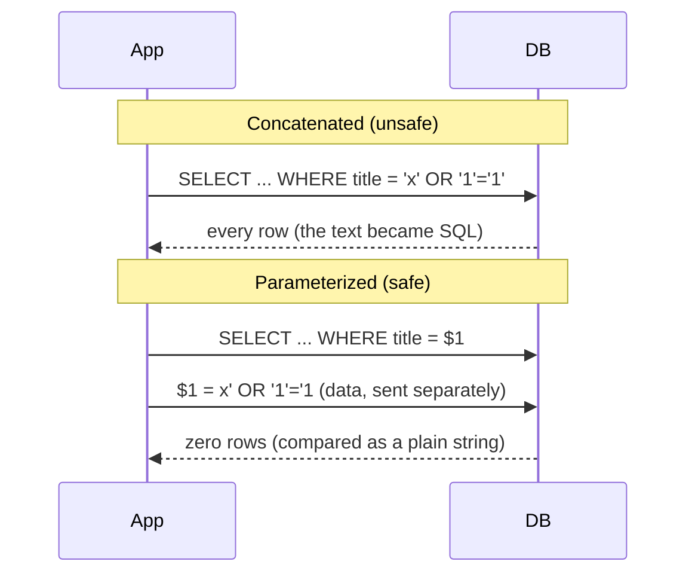

# 09. Stored procedures and raw SQL

> **Draft: written but not yet run.** The code and the expected output in this lesson were prepared by reading the code and the official documentation. They have not been executed yet. If something does not behave as described, trust your tool's real output and report it.

## What you will be able to do
By the end of this lesson you will be able to:
- Explain the difference between a PostgreSQL function and a stored procedure and call each from C#.
- Run a parameterized query with Dapper and with EF Core (`SqlQuery`, `ExecuteSql`).
- Demonstrate a SQL injection against concatenated SQL and show why the parameterized version is immune.
- Decide when hand-written SQL or a stored routine is the better tool than EF Core's LINQ.

## Recap
1. In lesson 08, what does `AsNoTracking()` change?
   <details><summary>Answer</summary>The query does not register the loaded entities in the change tracker: lighter and faster for read-only data, but you cannot save changes to them.</details>
2. In lesson 06, which layer checks that a title is at most 100 characters, and does that protect your SQL from malicious text?
   <details><summary>Answer</summary>The validator at the edge. It limits length but does not make text safe inside SQL; only parameters do.</details>

## Why it matters
LINQ cannot say everything: window functions, reports over millions of rows, a stored routine that another team already owns, a query you want to tune by hand. For those, you write SQL. The price is a new responsibility: the moment you build SQL from text a user typed, you can create a **SQL injection**, the best-known way to lose a database. The cure is one habit (parameters) that costs nothing. This lesson shows the attack once, on a throw-away database, so you recognise it forever.

## What you will build
A Postgres container that creates its own schema, one **function** (`search_notes`, returns rows) and one **procedure** (`archive_notes_older_than`, changes data) when it first starts. A console program calls them with Dapper and with EF Core, then runs the same hostile input through concatenated SQL and through a parameter.



## Before you start
- **Prerequisites:** [C# 201 lesson 08, EF Core and PostgreSQL](08-ef-core-and-postgres.md).
- Tools: .NET SDK **11.0.100**, the editor and **Docker** with Compose (same as [lesson 08](08-ef-core-and-postgres.md)). This lesson uses its own database on host port **5434**, so it can run beside lesson 08's.
- Time: 70-80 min including the exercise.
- Source pack (optional): every file is shown in full in this lesson, so you can follow without it. The finished code, the exercise starter and the solution are in the
  course repository https://github.com/Uee03/Code101 under `source/csharp/201-hero-to-super-hero/phase-3-data/09-stored-procedures-and-raw-sql/` (on that page choose **Code, Download ZIP**, or run
  `git clone https://github.com/Uee03/Code101.git`).

## Steps
### Step 1. Folder and the files you already know
**Folder: any folder (terminal)**
```powershell
New-Item -ItemType Directory -Force "$HOME/code101/csharp201/lesson09/db" | Out-Null
Set-Location "$HOME/code101/csharp201/lesson09"
```
**Folder: any folder (terminal)**
```bash
mkdir -p ~/code101/csharp201/lesson09/db && cd ~/code101/csharp201/lesson09
```
Create `global.json` (identical to [lesson 05, Step 1](../phase-2-web-apis/05-first-aspnet-core-api.md#step-1-make-the-lesson-folder-and-the-sdk-pin)) and `.gitignore` (same three lines as [lesson 08, Step 1](08-ef-core-and-postgres.md#step-1-folder-sdk-pin-and-ignore-file): `.env`, `bin/`, `obj/`).

**File: `global.json`**
```json
{
  "sdk": {
    "version": "11.0.100",
    "rollForward": "latestPatch"
  }
}
```
**File: `.gitignore`**
```text
.env
bin/
obj/
```

### Step 2. `.env.example` and `.env`
The same pattern as lesson 08 with a different database name, user, password and port. Explanations of each line: [lesson 08, Step 2](08-ef-core-and-postgres.md#step-2-the-settings-file-envexample).

**File: `.env.example`**
```text
# Disposable local practice values. Never reuse them anywhere real.
POSTGRES_DB=rawsql
POSTGRES_USER=rawsql_app
POSTGRES_PASSWORD=rawsql_local_only
POSTGRES_PORT=5434
```
**Folder: `~/code101/csharp201/lesson09` (terminal)**
```powershell
Copy-Item .env.example .env
```
**Folder: `~/code101/csharp201/lesson09` (terminal)**
```bash
cp .env.example .env
```

### Step 3. The Compose file, with one new line
Identical to [lesson 08, Step 3](08-ef-core-and-postgres.md#step-3-the-compose-file) except for the **extra volume line** `./db/init.sql:/docker-entrypoint-initdb.d/01-init.sql:ro`. The official PostgreSQL image runs every `.sql` file in `/docker-entrypoint-initdb.d` **once**, when the data directory is empty (the first start). `./db/init.sql` is the file on your computer; `:ro` mounts it read-only.

**File: `docker-compose.yml`**
```yaml
services:
  db:
    image: postgres:17-alpine
    environment:
      POSTGRES_DB: ${POSTGRES_DB}
      POSTGRES_USER: ${POSTGRES_USER}
      POSTGRES_PASSWORD: ${POSTGRES_PASSWORD}
    ports:
      - "127.0.0.1:${POSTGRES_PORT:-5432}:5432"
    volumes:
      - pg_data:/var/lib/postgresql/data
      - ./db/init.sql:/docker-entrypoint-initdb.d/01-init.sql:ro
    healthcheck:
      test: ["CMD-SHELL", "pg_isready -h 127.0.0.1 -U $$POSTGRES_USER -d $$POSTGRES_DB"]
      interval: 3s
      timeout: 3s
      retries: 30
      start_period: 5s

volumes:
  pg_data:
```

### Step 4. The database script: a table, a function and a procedure
Read the SQL; every part has a reason.

- A **function** returns a value or rows and is used *inside* a query (`SELECT * FROM search_notes('milk')`). It cannot start or end a transaction.
- A **procedure** is started with `CALL`, returns no rows and is meant for actions (changing data, in larger examples committing in steps). PostgreSQL has had procedures since version 11. (SQL Server calls both "stored procedures" and runs them with `EXEC`; other databases differ, so learn the idea, not the keyword.)
- `$$ ... $$` is "dollar quoting": it lets the body contain single quotes without escaping.
- `STABLE` tells PostgreSQL the function does not change data and returns the same result within one statement, which allows optimisations.
- `ILIKE` is a case-insensitive `LIKE`; `%` matches any text. (A user typing `%` would act as a wildcard: escape it in real search boxes.)
- Dates are relative to `now()`, so "40 days old" stays true whenever you run the lesson.

**File: `db/init.sql`**
```sql
CREATE TABLE notes (
    id integer GENERATED ALWAYS AS IDENTITY PRIMARY KEY,
    title text NOT NULL,
    archived boolean NOT NULL DEFAULT false,
    created_at timestamptz NOT NULL DEFAULT now()
);

INSERT INTO notes (title, created_at) VALUES
    ('Buy milk', now() - interval '40 days'),
    ('Call Ada', now() - interval '10 days'),
    ('Milk run plan', now() - interval '1 day'),
    ('Write report', now());

CREATE FUNCTION search_notes(term text)
RETURNS TABLE (id integer, title text, archived boolean)
LANGUAGE sql STABLE
AS $$
    SELECT n.id, n.title, n.archived
    FROM notes n
    WHERE n.title ILIKE '%' || term || '%'
    ORDER BY n.id;
$$;

CREATE PROCEDURE archive_notes_older_than(older_than_days integer)
LANGUAGE sql
AS $$
    UPDATE notes
    SET archived = true
    WHERE archived = false
      AND created_at < now() - make_interval(days => older_than_days);
$$;
```

### Step 5. Start the database and try the routines in `psql`
**Folder: `~/code101/csharp201/lesson09` (terminal)**
```powershell
docker compose up -d --wait
docker compose exec db psql -U rawsql_app -d rawsql -c "SELECT * FROM search_notes('milk');"
```
`--wait` returns when the container is healthy. `psql` is PostgreSQL's own command-line client, run inside the container. Typical output (alignment may differ):
```text
 id |     title     | archived
----+---------------+----------
  1 | Buy milk      | f
  3 | Milk run plan | f
(2 rows)
```
`f` is `false`. Notice that `psql` already shows what the C# program will do.

### Step 6. Project file and helper types
Three packages: Dapper (a **micro-ORM**: you write SQL, it maps rows to objects and C# values to parameters), Npgsql (the PostgreSQL driver) and the EF Core provider (for the EF part).

**File: `RawSql.csproj`**
```xml
<Project Sdk="Microsoft.NET.Sdk">

  <PropertyGroup>
    <OutputType>Exe</OutputType>
    <TargetFramework>net11.0</TargetFramework>
    <ImplicitUsings>enable</ImplicitUsings>
    <Nullable>enable</Nullable>
  </PropertyGroup>

  <ItemGroup>
    <PackageReference Include="Dapper" Version="2.1.100" />
    <PackageReference Include="Npgsql" Version="11.0.0" />
    <PackageReference Include="Npgsql.EntityFrameworkCore.PostgreSQL" Version="11.0.0" />
  </ItemGroup>

</Project>
```
`NoteRow` is a plain class whose property names match the column names (Dapper matches ignoring case). `RawContext` is a minimal `DbContext` with no tables at all: we use it only to send raw SQL through EF Core.

**File: `Types.cs`**
```csharp
using Microsoft.EntityFrameworkCore;

public class NoteRow
{
    public int Id { get; set; }

    public string Title { get; set; } = "";

    public bool Archived { get; set; }
}

public class RawContext(string connectionString) : DbContext
{
    protected override void OnConfiguring(DbContextOptionsBuilder options) =>
        options.UseNpgsql(connectionString);
}
```

### Step 7. The program
Read it and **predict** the two last lines (how many rows the unsafe query and the parameterized query return) before running. The unsafe query is **only** there to show the attack; the comment above it says so.

**File: `Program.cs`**
```csharp
using Dapper;
using Microsoft.EntityFrameworkCore;
using Npgsql;

string connectionString = Environment.GetEnvironmentVariable("NOTES_CONNECTION")
    ?? throw new InvalidOperationException("Set the NOTES_CONNECTION environment variable (see .env.example).");

await using var connection = new NpgsqlConnection(connectionString);

// Start from a known state so that every run prints the same numbers.
await connection.ExecuteAsync("UPDATE notes SET archived = false");

IEnumerable<NoteRow> found = await connection.QueryAsync<NoteRow>(
    "SELECT id, title, archived FROM search_notes(@term)",
    new { term = "milk" });
Console.WriteLine($"Dapper search 'milk': {string.Join(", ", found.Select(n => n.Title))}");

await connection.ExecuteAsync("CALL archive_notes_older_than(@days)", new { days = 30 });
long archivedCount = await connection.ExecuteScalarAsync<long>("SELECT count(*) FROM notes WHERE archived");
Console.WriteLine($"Archived after CALL: {archivedCount}");

await using var context = new RawContext(connectionString);

string term = "report";
List<NoteRow> viaEf = await context.Database
    .SqlQuery<NoteRow>($"""SELECT id AS "Id", title AS "Title", archived AS "Archived" FROM search_notes({term})""")
    .ToListAsync();
Console.WriteLine($"EF SqlQuery 'report': {string.Join(", ", viaEf.Select(n => n.Title))}");

int olderThanDays = 5;
await context.Database.ExecuteSqlAsync($"CALL archive_notes_older_than({olderThanDays})");
archivedCount = await connection.ExecuteScalarAsync<long>("SELECT count(*) FROM notes WHERE archived");
Console.WriteLine($"Archived after EF CALL: {archivedCount}");

string hostile = "x' OR '1'='1";

// NEVER do this: the text becomes part of the SQL command itself.
string unsafeSql = "SELECT id, title, archived FROM notes WHERE title = '" + hostile + "'";
List<NoteRow> leaked = (await connection.QueryAsync<NoteRow>(unsafeSql)).ToList();
Console.WriteLine($"Unsafe concatenation returned {leaked.Count} rows");

List<NoteRow> safe = (await connection.QueryAsync<NoteRow>(
    "SELECT id, title, archived FROM notes WHERE title = @title",
    new { title = hostile })).ToList();
Console.WriteLine($"Parameterized query returned {safe.Count} rows");
```

### Step 8. Set the connection and run
**Folder: `~/code101/csharp201/lesson09` (terminal)**
```powershell
$env:NOTES_CONNECTION = "Host=localhost;Port=5434;Database=rawsql;Username=rawsql_app;Password=rawsql_local_only"
```
**Folder: `~/code101/csharp201/lesson09` (terminal)**
```bash
export NOTES_CONNECTION="Host=localhost;Port=5434;Database=rawsql;Username=rawsql_app;Password=rawsql_local_only"
```

## Run it
**Folder: `~/code101/csharp201/lesson09` (terminal)**
```powershell
dotnet run --project . --nologo
```
Expected output (not yet run; derived from the code and the seed data):
```text
Dapper search 'milk': Buy milk, Milk run plan
Archived after CALL: 1
EF SqlQuery 'report': Write report
Archived after EF CALL: 2
Unsafe concatenation returned 4 rows
Parameterized query returned 0 rows
```
Stop and clean up: `docker compose down -v` removes the container **and** its data. (The init script runs only on the first start with an empty volume, so after editing `db/init.sql` you must run `down -v` to see the change.)

## How it works
1. **Calling a function.** A function returns a table, so you `SELECT ... FROM search_notes(@term)`. Dapper sends `@term` as a **parameter**: the SQL text stays fixed and the value travels separately.
2. **Calling a procedure.** `CALL archive_notes_older_than(@days)` runs the update inside the database; the app sends one short command instead of reading and writing many rows. Seed dates were 40, 10, 1 and 0 days old, so 30 days archives one note, then 5 days archives one more (2 in total).
3. **EF Core's raw SQL methods.** `Database.SqlQuery<T>($"...")` reads rows into any class; `Database.ExecuteSqlAsync($"...")` runs a command. They take a **`FormattableString`**: the C# compiler hands EF Core the text with its placeholders (`{term}`) and the values as separate objects, and EF Core turns each placeholder into a database parameter (`@p0`). It looks like string interpolation but behaves like Dapper's `@term`. (`FromSql` on a `DbSet` works the same way for full entities.) The `AS "Id"` aliases give the columns the exact property names EF Core expects.
4. **The attack.** `"... WHERE title = '" + hostile + "'"` builds `WHERE title = 'x' OR '1'='1'`. The quote in the input ended the string literal early, and `OR '1'='1'` is always true, so every row (4) is returned. With real attackers the text would be `'; DROP TABLE notes; --` or a `UNION SELECT` that reads other tables. The parameterized version compares the *entire* text `x' OR '1'='1` to titles, finds none and returns 0 rows.
5. **Why parameters are safe.** The database parses and plans the SQL *before* the values are attached. A value can never change the structure of the command, whatever characters it contains.

> **Misconception:** "I validate the input, so concatenation is fine." Validation is a second defence, not the first: an apostrophe is a perfectly valid character in a note title ("Ada's list"), so you cannot ban it, and one forgotten code path is enough. Parameterize **everything**, always. Identifiers (table or column names) cannot be parameters; if they must vary, choose them from a fixed allow-list in code.

> **Trap:** `FromSqlRaw($"... {x}")` and `ExecuteSqlRaw($"... {x}")` take a plain `string`: the interpolation happens *before* EF Core sees it, so the value is pasted in text and you have an injection. Use `FromSql`, `SqlQuery` and `ExecuteSql` with interpolated strings, or use the `*Raw` methods with explicit `DbParameter`s (or `{0}` placeholders plus an argument list). A compiler analyser (EF1002) warns about the unsafe form: do not ignore it.

### Why this, not that
| Choice | Use it when | Cost |
|---|---|---|
| **EF Core LINQ** | Everyday CRUD and queries that read well in C# | Less control over the exact SQL |
| **EF Core `SqlQuery` / `FromSql` / `ExecuteSql`** | A few hand-written queries inside an EF Core app; mapping to a class is enough | You own the SQL; column names must match |
| **Dapper** | Many hand-written queries, reports, hot read paths, existing procedures | No change tracking or migrations; you write SQL and the mapping |
| **Stored procedure or function** | Logic that must live next to the data, shared by several apps, permission on the routine instead of on tables, many round trips replaced by one | Logic split between two languages; harder to test and debug; tied to one database vendor; **versioning**: keep the SQL in migrations (EF Core: `migrationBuilder.Sql(...)`) or SQL files under version control, never edited by hand on a server |
| **String concatenation of user input** | Never | SQL injection |

## Try it
Extend the program in your own project. All three exercises reuse the database you already have.

1. **Guided.** Copy your `lesson09` folder to `exercise09` and stop the old database first (`docker compose down` in `lesson09`) so port 5434 is free; then in `exercise09` run `docker compose up -d --wait` (it creates its own fresh database from `db/init.sql`). Append the three `TODO` lines below to the end of `Program.cs`. Do **TODO 1**: with Dapper, call `search_notes` for `call` and print `Dapper search 'call': Call Ada`.
2. **Change.** Do **TODO 2**: with `context.Database.SqlQuery<int>`, count the notes whose title contains `milk` (a pattern `%milk%` in a parameter) and print `Notes about milk: 2`. The column must be named `Value` (`SELECT count(*)::int AS "Value" ...`); `::int` casts PostgreSQL's 64-bit count to the `int` C# expects.
3. **Stretch.** Do **TODO 3**: run the hostile string from above through `SqlQuery<NoteRow>` with an interpolated string and print `EF parameterized query returned 0 rows`. Then explain in one sentence why the same code written with `SqlQueryRaw($"...")` would return 4.

**File: `exercise09/Program.cs` (starter: the three lines to replace with code)**
```csharp
// TODO 1: with Dapper, call search_notes for "call" and print: Dapper search 'call': Call Ada
// TODO 2: with context.Database.SqlQuery<int>, count the notes whose title contains "milk" and print: Notes about milk: 2
// TODO 3: run the hostile title through context.Database.SqlQuery<NoteRow> with an interpolated string and print: EF parameterized query returned 0 rows
```
The repository's `exercise/starter/Program.cs` is the whole file with these three lines at the end. Before your changes the output is the six lines above.

<details><summary>Solution</summary>

All three reuse variables declared earlier (`connection`, `context`, `hostile`). Each interpolated `{...}` becomes a parameter, never text.

**File: `exercise09/Program.cs` (solution: the code that replaces the three TODO lines)**
```csharp
IEnumerable<NoteRow> calls = await connection.QueryAsync<NoteRow>(
    "SELECT id, title, archived FROM search_notes(@term)",
    new { term = "call" });
Console.WriteLine($"Dapper search 'call': {string.Join(", ", calls.Select(n => n.Title))}");

string pattern = "%milk%";
int milkCount = await context.Database
    .SqlQuery<int>($"""SELECT count(*)::int AS "Value" FROM notes WHERE title ILIKE {pattern}""")
    .SingleAsync();
Console.WriteLine($"Notes about milk: {milkCount}");

List<NoteRow> viaEfSafe = await context.Database
    .SqlQuery<NoteRow>($"""SELECT id AS "Id", title AS "Title", archived AS "Archived" FROM notes WHERE title = {hostile}""")
    .ToListAsync();
Console.WriteLine($"EF parameterized query returned {viaEfSafe.Count} rows");
```
Expected output with all three TODOs done (not yet run); the last three lines are new:
```text
Dapper search 'milk': Buy milk, Milk run plan
Archived after CALL: 1
EF SqlQuery 'report': Write report
Archived after EF CALL: 2
Unsafe concatenation returned 4 rows
Parameterized query returned 0 rows
Dapper search 'call': Call Ada
Notes about milk: 2
EF parameterized query returned 0 rows
```
`SqlQueryRaw($"...{hostile}")` receives a finished `string` with the text pasted in, so it would behave like the concatenated query and return 4 rows.

</details>

## Check yourself
1. What is the difference between a PostgreSQL function and a procedure? <details><summary>Answer</summary>A function returns a value or rows and is used inside a query; a procedure is started with `CALL`, returns no rows and is meant for actions.</details>
2. Why does `$"... {term}"` passed to `SqlQuery` not allow injection, while the same text passed to `SqlQueryRaw` does? <details><summary>Answer</summary>`SqlQuery` receives a `FormattableString` and turns each `{term}` into a parameter; `SqlQueryRaw` receives a finished string, so the value is already part of the SQL text.</details>
3. Why can you not fix injection by rejecting apostrophes? <details><summary>Answer</summary>Apostrophes are legitimate data (names, titles), and any missed code path stays vulnerable. Parameters make the characters irrelevant.</details>
4. Your table name comes from the URL. Can you pass it as a parameter? <details><summary>Answer</summary>No, parameters carry values only. Map the input to a fixed allow-list of known table names in code.</details>
5. You edit `db/init.sql` and nothing changes in the database. Why? <details><summary>Answer</summary>The image runs init scripts only when the data volume is empty; run `docker compose down -v` and start again.</details>

## Common mistakes
Typical messages; wording can differ with versions.

| Symptom or error text | Cause | Fix |
|---|---|---|
| `Npgsql.PostgresException ... 42P01: relation "notes" does not exist` (typical message) | The init script did not run: the volume already existed from an earlier start without it. | `docker compose down -v`, then `docker compose up -d --wait`. |
| `Npgsql.PostgresException ... 42883: function search_notes(...) does not exist` (typical message) | The argument type does not match (for example a number instead of text) or the function was not created. | Pass a `string`; check `db/init.sql` ran. |
| `System.InvalidOperationException: The required column 'Value' was not present in the results of a 'FromSql' or 'SqlQuery' operation.` (typical message) | `SqlQuery<int>` needs the column to be named `Value`. | `SELECT count(*)::int AS "Value" ...`. |
| `Npgsql.PostgresException ... 42601: syntax error at or near ...` (typical message) | Concatenated text broke the SQL (an apostrophe in the data). | Use parameters. |
| Warning EF1002 about `inserts interpolated strings directly into the SQL` (typical message) | `FromSqlRaw`/`ExecuteSqlRaw` called with an interpolated string. | Switch to `FromSql`/`ExecuteSql`, or pass `DbParameter`s. |
| `Set the NOTES_CONNECTION environment variable (see .env.example).` | The variable is not set in this terminal. | Run the export line from Step 8 again. |
| `failed: ... 5434 ... port is already allocated` (typical message) | Another container uses the port. | `docker compose down` there, or change `POSTGRES_PORT` and the connection string. |

## Best practice
Send every value as a parameter, give the application's database user only the permissions it needs, and keep stored routines in version control through migrations or SQL files. Source: EF Core documentation, SQL queries https://learn.microsoft.com/ef/core/querying/sql-queries and OWASP SQL Injection Prevention Cheat Sheet https://cheatsheetseries.owasp.org/cheatsheets/SQL_Injection_Prevention_Cheat_Sheet.html

## Going further
- Stored functions in a production-style schema and how an API calls them: [dotnet capstone, chapter 02](../../../../capstones/backend-dotnet/tutorials/phase-2-data/02-data-access.md).
- Dapper documentation: https://github.com/DapperLib/Dapper
- Transactions and when a procedure may `COMMIT`: https://www.postgresql.org/docs/current/sql-createprocedure.html

## Phase 3 mixed review
1. A list page loads 200 notebooks and then queries the notes of each in a loop. What is it called and how many queries run? (lesson 08)
2. You must change the schema of a running application. Which tool and which artefact go into source control? (lesson 08)
3. A report needs a window function over 5 million rows. EF Core, Dapper or a function? Why? (lesson 09)
4. Where do secrets such as the database password live in the three environments: your laptop, CI, production? (lessons 07 and 08)
<details><summary>Answers</summary>1. N+1: 201 queries; fix with a projection or `Include`. 2. A migration (`dotnet ef migrations add`); the migration files are committed. 3. Hand-written SQL (Dapper or `SqlQuery`) or a database function: the report needs control over the SQL and few entities. 4. User secrets or a git-ignored `.env`; the CI's secret store; the platform's secret manager or injected environment variables. Never in source control.</details>

## Summary
- You separated a function from a procedure and called both from Dapper and EF Core.
- You ran SQL with parameters and saw `FormattableString` turn `{term}` into a parameter.
- You demonstrated an injection on a throw-away database and explained why parameters stop it.
- You compared LINQ, raw SQL, Dapper and stored routines by their costs.

## Next lesson
**[10. JWT authentication and authorization](../phase-4-security-and-quality/10-jwt-authentication-and-authorization.md)**: put a login in front of the API and give each caller only the permissions they need.
