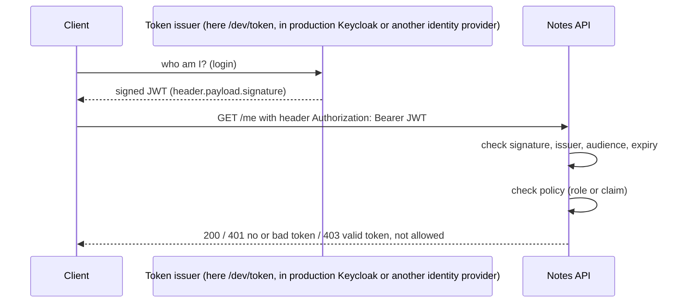

# 10. JWT bearer authentication and authorization policies

> **Draft: written but not yet run.** The code and the expected output in this lesson were prepared by reading the code and the official documentation. They have not been executed yet. If something does not behave as described, trust your tool's real output and report it.

## What you will be able to do
By the end of this lesson you will be able to:
- Explain the difference between authentication (who are you?) and authorization (what may you do?), and between status `401` and `403`.
- Configure JWT bearer validation (signature, issuer, audience, lifetime) in ASP.NET Core.
- Protect endpoints with a role, a claim policy and a resource-ownership check.
- Say what a JWT does and does not protect, and where a real identity provider such as Keycloak replaces the lesson's token endpoint.

## Recap
1. In lesson 07, which configuration source wins: `appsettings.json` or an environment variable?
   <details><summary>Answer</summary>The environment variable; later sources override earlier ones.</details>
2. In lesson 06, why did the client get a generic `500` instead of the exception text?
   <details><summary>Answer</summary>The exception handler logs the real exception and writes a generic problem response, so internals do not leak.</details>

## Why it matters
A building has two checks: the front desk looks at your badge (**authentication**: proving who you are) and each door's reader decides whether *that* badge opens *that* room (**authorization**: what you may do). An API has the same two jobs. A **JWT** (JSON Web Token) is a signed badge: the API can check it **without calling a database** because the signature proves who issued it and that nobody changed it. Almost every modern API (including the [capstone](../../../../capstones/backend-dotnet/tutorials/phase-3-identity/03-identity.md)) uses this design, with a separate identity provider issuing the tokens.

## What you will build
An API with five protected endpoints and a Development-only endpoint that issues test tokens for three demo users. The API proves, with `curl`, that the same URL answers `200`, `401`, `403` or `404` depending on who asks.

| Demo user | Role | Permissions |
|---|---|---|
| `ada` | `user` | `notes:read` |
| `grace` | `user` | `notes:read`, `notes:write` |
| `root` | `admin` | `notes:read`, `notes:write` |



## Before you start
- Tools: .NET SDK **11.0.100**, the editor and `curl` as in [lesson 05](../phase-2-web-apis/05-first-aspnet-core-api.md) (`curl.exe` in Windows PowerShell).
- Time: 70-80 min including the exercise.
- Source pack (optional): every file is shown in full in this lesson, so you can follow without it. The finished code, the exercise starter and the solution are in the
  course repository https://github.com/Uee03/Code101 under `source/csharp/201-hero-to-super-hero/phase-4-security-and-quality/10-jwt-authentication-and-authorization/` (on that page choose **Code, Download ZIP**, or run
  `git clone https://github.com/Uee03/Code101.git`).

## Steps
### Step 1. Folder, pin and project file
**Folder: any folder (terminal)**
```powershell
New-Item -ItemType Directory -Force "$HOME/code101/csharp201/lesson10" | Out-Null
Set-Location "$HOME/code101/csharp201/lesson10"
```
**Folder: any folder (terminal)**
```bash
mkdir -p ~/code101/csharp201/lesson10 && cd ~/code101/csharp201/lesson10
```
Create `global.json` (identical to [lesson 05, Step 1](../phase-2-web-apis/05-first-aspnet-core-api.md#step-1-make-the-lesson-folder-and-the-sdk-pin)) and the project file. The new line is the JWT bearer package.

**File: `global.json`**
```json
{
  "sdk": {
    "version": "11.0.100",
    "rollForward": "latestPatch"
  }
}
```
**File: `NotesApi.csproj`**
```xml
<Project Sdk="Microsoft.NET.Sdk.Web">

  <PropertyGroup>
    <TargetFramework>net11.0</TargetFramework>
    <ImplicitUsings>enable</ImplicitUsings>
    <Nullable>enable</Nullable>
  </PropertyGroup>

  <ItemGroup>
    <PackageReference Include="Microsoft.AspNetCore.Authentication.JwtBearer" Version="11.0.0" />
  </ItemGroup>

</Project>
```

### Step 2. The demo users
No passwords appear in this lesson on purpose: storing and checking passwords is a security product of its own (use ASP.NET Core Identity or an identity provider, never your own scheme). The lesson only needs three *identities* with different roles and permissions.

**File: `DemoUsers.cs`**
```csharp
public sealed record DemoUser(string Role, string[] Permissions);

public static class DemoUsers
{
    public static readonly IReadOnlyDictionary<string, DemoUser> All = new Dictionary<string, DemoUser>
    {
        ["ada"] = new("user", ["notes:read"]),
        ["grace"] = new("user", ["notes:read", "notes:write"]),
        ["root"] = new("admin", ["notes:read", "notes:write"]),
    };
}
```

### Step 3. The token issuer
A JWT has three parts separated by dots: a **header** (algorithm), a **payload** of **claims** (statements such as `sub` = subject = who, `role`, `permission`, `exp` = expiry) and a **signature** over the first two. Here the issuer signs with a shared secret key (**HS256**, symmetric: whoever can verify can also forge). Production systems use an identity provider with an asymmetric key pair (RS256 or ES256): the provider keeps the private key and your API only needs the public key.

**File: `TokenIssuer.cs`**
```csharp
using System.Security.Claims;
using Microsoft.IdentityModel.JsonWebTokens;
using Microsoft.IdentityModel.Tokens;

public sealed class TokenIssuer(SecurityKey key)
{
    public const string Issuer = "notes-api";
    public const string Audience = "notes-clients";

    public string Create(string userId, string role, IEnumerable<string> permissions)
    {
        var claims = new List<Claim>
        {
            new("sub", userId),
            new("name", userId),
            new("role", role),
        };
        claims.AddRange(permissions.Select(p => new Claim("permission", p)));

        var descriptor = new SecurityTokenDescriptor
        {
            Issuer = Issuer,
            Audience = Audience,
            Subject = new ClaimsIdentity(claims),
            Expires = DateTime.UtcNow.AddMinutes(15),
            SigningCredentials = new SigningCredentials(key, SecurityAlgorithms.HmacSha256),
        };

        return new JsonWebTokenHandler().CreateToken(descriptor);
    }
}
```
`Issuer` says who made the token, `Audience` says which API it is meant for (so a token for another service is rejected here), and `Expires` makes it valid for only 15 minutes.

### Step 4. Program.cs
Read it before typing and **predict** which of these will fail for `ada`: reading `/me`, `POST /notes`, `DELETE /notes/1`. Then type it.

- The signing key is created **randomly at startup**, so no secret is stored anywhere in the lesson. The price: restarting the app invalidates every token (see Common mistakes). In production the key (or the identity provider's public keys) comes from configuration or the provider.
- `MapInboundClaims = false` keeps claim names exactly as in the token (`sub`, `role`) instead of renaming them to long Microsoft URLs. `NameClaimType` and `RoleClaimType` tell ASP.NET Core which claims mean "name" and "role".
- `ClockSkew` is the tolerance for clocks that disagree; the default is 5 minutes, which quietly lengthens every token's life.
- The `/dev/token` endpoint exists only when the environment is `Development`.

**File: `Program.cs`**
```csharp
using System.Security.Claims;
using System.Security.Cryptography;
using Microsoft.AspNetCore.Authentication.JwtBearer;
using Microsoft.IdentityModel.Tokens;

var signingKey = new SymmetricSecurityKey(RandomNumberGenerator.GetBytes(32));

var builder = WebApplication.CreateBuilder(args);

builder.Services.AddSingleton(new TokenIssuer(signingKey));

builder.Services
    .AddAuthentication(JwtBearerDefaults.AuthenticationScheme)
    .AddJwtBearer(options =>
    {
        options.MapInboundClaims = false;
        options.TokenValidationParameters = new TokenValidationParameters
        {
            ValidateIssuer = true,
            ValidIssuer = TokenIssuer.Issuer,
            ValidateAudience = true,
            ValidAudience = TokenIssuer.Audience,
            ValidateIssuerSigningKey = true,
            IssuerSigningKey = signingKey,
            ValidateLifetime = true,
            ClockSkew = TimeSpan.FromSeconds(30),
            NameClaimType = "name",
            RoleClaimType = "role",
        };
    });

builder.Services.AddAuthorizationBuilder()
    .AddPolicy("CanWriteNotes", policy => policy.RequireClaim("permission", "notes:write"))
    .AddPolicy("AdminOnly", policy => policy.RequireRole("admin"));

var app = builder.Build();

app.UseAuthentication();
app.UseAuthorization();

Dictionary<int, string> noteOwners = new() { [1] = "ada", [2] = "grace" };

app.MapGet("/public", () => "Anyone can read this.");

app.MapGet("/me", (ClaimsPrincipal user) => new
{
    name = user.Identity?.Name,
    role = user.FindFirst("role")?.Value,
    permissions = user.FindAll("permission").Select(c => c.Value).ToArray(),
}).RequireAuthorization();

app.MapGet("/notes/{id:int}", (int id, ClaimsPrincipal user) =>
{
    if (!noteOwners.TryGetValue(id, out string? owner))
    {
        return Results.NotFound();
    }

    bool isOwner = user.FindFirst("sub")?.Value == owner;
    if (isOwner || user.IsInRole("admin"))
    {
        return Results.Ok(new { id, owner });
    }

    return Results.Forbid();
}).RequireAuthorization();

app.MapPost("/notes", (ClaimsPrincipal user) =>
    Results.Created("/notes/3", new { id = 3, owner = user.FindFirst("sub")?.Value }))
    .RequireAuthorization("CanWriteNotes");

app.MapDelete("/notes/{id:int}", (int id) => Results.NoContent())
    .RequireAuthorization("AdminOnly");

if (app.Environment.IsDevelopment())
{
    app.MapPost("/dev/token", (string who, TokenIssuer issuer) =>
        DemoUsers.All.TryGetValue(who, out DemoUser? demo)
            ? Results.Text(issuer.Create(who, demo.Role, demo.Permissions))
            : Results.NotFound());
}

app.Run();
```

## Run it
Start the API with the environment set to Development:

**Folder: `~/code101/csharp201/lesson10` (terminal 1)**
```powershell
dotnet run --project . --urls http://localhost:5081 --environment Development
```
In a second terminal in the same folder, ask for three tokens and keep them in variables:

**Folder: `~/code101/csharp201/lesson10` (terminal 2)**
```powershell
$ada = curl.exe -s -X POST "http://localhost:5081/dev/token?who=ada"
$grace = curl.exe -s -X POST "http://localhost:5081/dev/token?who=grace"
$root = curl.exe -s -X POST "http://localhost:5081/dev/token?who=root"
```
**Folder: `~/code101/csharp201/lesson10` (terminal 2)**
```bash
ada=$(curl -s -X POST "http://localhost:5081/dev/token?who=ada")
grace=$(curl -s -X POST "http://localhost:5081/dev/token?who=grace")
root=$(curl -s -X POST "http://localhost:5081/dev/token?who=root")
```
Each variable now holds a long text of three parts separated by dots. Now try the calls (macOS and Linux: `curl` instead of `curl.exe`, `-o /dev/null` instead of `-o NUL`). First, the two that return a body:

**Folder: `~/code101/csharp201/lesson10` (terminal 2)**
```powershell
curl.exe -s http://localhost:5081/public
curl.exe -s -H "Authorization: Bearer $grace" http://localhost:5081/me
```
Expected output (not yet run):
```text
Anyone can read this.
{"name":"grace","role":"user","permissions":["notes:read","notes:write"]}
```
Then see the **status code** of other calls (`-w "%{http_code}"` prints only the number):

**Folder: `~/code101/csharp201/lesson10` (terminal 2)**
```powershell
curl.exe -s -o NUL -w "%{http_code}" http://localhost:5081/me
curl.exe -s -o NUL -w "%{http_code}" -X POST -H "Authorization: Bearer $ada" http://localhost:5081/notes
curl.exe -s -o NUL -w "%{http_code}" -X POST -H "Authorization: Bearer $grace" http://localhost:5081/notes
curl.exe -s -o NUL -w "%{http_code}" -H "Authorization: Bearer $grace" http://localhost:5081/notes/1
curl.exe -s -o NUL -w "%{http_code}" -H "Authorization: Bearer $ada" http://localhost:5081/notes/1
curl.exe -s -o NUL -w "%{http_code}" -X DELETE -H "Authorization: Bearer $grace" http://localhost:5081/notes/1
curl.exe -s -o NUL -w "%{http_code}" -X DELETE -H "Authorization: Bearer $root" http://localhost:5081/notes/1
```
Expected statuses, in order (not yet run; derived from the code):

| # | Call | Status | Why |
|---|---|---|---|
| 1 | `GET /me`, no token | `401` | nobody authenticated |
| 2 | `POST /notes` as `ada` | `403` | authenticated, but no `notes:write` permission |
| 3 | `POST /notes` as `grace` | `201` | has the permission |
| 4 | `GET /notes/1` as `grace` | `403` | note 1 belongs to `ada` |
| 5 | `GET /notes/1` as `ada` | `200` | she owns it |
| 6 | `DELETE /notes/1` as `grace` | `403` | not in the `admin` role |
| 7 | `DELETE /notes/1` as `root` | `204` | admin |

To see the header that tells a client to log in, run `curl.exe -s -i http://localhost:5081/me`: the response starts with `HTTP/1.1 401 Unauthorized` and contains `WWW-Authenticate: Bearer` (typical output). Stop the server with Ctrl+C when you are done.

## How it works
1. **Authentication** is the middleware that reads `Authorization: Bearer <token>`, checks the signature with the key, the `iss` (issuer), `aud` (audience) and `exp` (expiry) and, if all pass, builds a `ClaimsPrincipal` from the payload. If anything fails (or there is no token) the user is anonymous.
2. **Authorization** runs next and decides whether *this principal* may call *this endpoint*. `RequireAuthorization()` alone means "any authenticated user"; `RequireAuthorization("CanWriteNotes")` names a **policy**, a reusable rule. A policy can require a role, a claim or any custom requirement.
3. **401 vs 403.** `401 Unauthorized` really means *unauthenticated*: no valid credentials; the client may fix it by logging in. `403 Forbidden` means authenticated but *not allowed*; logging in again will not help.
4. **Roles, claims, policies.** A role (`admin`) is one claim of a special type. A permission claim (`notes:write`) is finer-grained. A policy gives either a name you can change in one place. Prefer permission policies for features and roles for coarse groups of people.
5. **Resource-based checks.** "Grace may write notes" is not "Grace may read *Ada's* note". Whether a caller may touch a given record depends on the record, so it needs code that loads the record (`isOwner`). Policies on the route cannot know the id. Forgetting this check (an **insecure direct object reference**, a broken-access-control bug) is the most common API vulnerability.
6. **What a JWT does not do.** Its payload is only *encoded*, not encrypted: anyone who holds it can read the claims, so never put secrets in it. A stolen valid token works until it expires (anyone holding it is you), so keep lifetimes short, use HTTPS only and let clients refresh through the identity provider. A stateless token also cannot be revoked before expiry without extra machinery.

> **Misconception:** "The API sent a 403, so the attacker learned nothing." A `403` on `/notes/1` tells a stranger that note 1 exists. For sensitive resources return `404` for both "does not exist" and "not yours" (you will do this in the exercise).

### Why this, not that
| Choice | Use it when | Cost |
|---|---|---|
| **JWT bearer + external identity provider** (Keycloak, Entra ID, Auth0...) | APIs, mobile and single-page apps, several services | Another system to run; you learn its claim names |
| **Your own token issuer** (this lesson) | Learning, tests, throw-away prototypes | Security-critical code you must maintain; no passwords, MFA, reset flows |
| **Cookie sessions** | Server-rendered web apps on one domain | Needs CSRF protection; awkward for mobile and cross-service calls |
| **HS256 (shared secret)** | One service that both issues and validates | Every validator can forge tokens |
| **RS256 / ES256 (key pair)** | Production: the provider signs, APIs only verify | Key rotation and a JWKS endpoint to fetch public keys |
| **Role checks** | Few, coarse groups | Role explosion over time |
| **Permission policies** | Feature-level rules | More claims in the token |
| **Resource-based checks** | The rule depends on the record (owner, tenant) | Code in the handler or a service; easy to forget, so test it |

In FastEndpoints endpoints are secure by default (that is why lesson 05 called `AllowAnonymous()`); you restrict them in `Configure()` with `Roles("admin")` or `Policies("CanWriteNotes")`. In controllers use `[Authorize(Policy = "CanWriteNotes")]`.

**Real identity provider.** To use Keycloak you delete `/dev/token`, `TokenIssuer`, the key and `IssuerSigningKey`, and set `options.Authority` to the realm's URL and `options.Audience` to your client id; the handler downloads the public keys from the provider's discovery document. Keycloak also names claims differently (roles live in a nested `realm_access` claim), which you map in a small claims transformation. The [dotnet capstone, chapter 03](../../../../capstones/backend-dotnet/tutorials/phase-3-identity/03-identity.md) does exactly this against a Keycloak realm, so this lesson does not repeat it.

## Try it
Add a read-all endpoint, a read policy, and stop leaking which ids exist.

1. **Guided.** Copy your `lesson10` folder to `exercise10`. In `Program.cs` do **TODO 1** (add the `CanReadNotes` policy requiring `permission` = `notes:read`) and **TODO 2** (map `GET /notes` returning every note as `{ id, owner }` ordered by id, protected by that policy). An anonymous call must return `401`; `ada` must see both notes.
2. **Change.** Do **TODO 3**: answer `404` instead of `403` for someone else's note. Predict the status for `GET /notes/1` as `grace` before you run it.
3. **Stretch (no single answer).** Write down, in four lines, which parts of this program you would delete or change to use Keycloak, which claims you would need (`sub`, roles, permissions) and where in the app you would map them. Check your answer against capstone chapter 03.

**File: `exercise10/Program.cs` (starter: the three `TODO` places)**
```csharp
// TODO 1: add a policy named "CanReadNotes" that requires the claim permission = notes:read.
```
```csharp
// TODO 2: map GET /notes that returns every note as { id, owner }, ordered by id, protected by the CanReadNotes policy.
```
```csharp
    // TODO 3: answer 404 instead of 403 so that strangers cannot learn which ids exist.
    return Results.Forbid();
```
The repository's `exercise/starter/Program.cs` is the whole file with these markers. Before your changes `GET /notes` returns `404` (no such route) for everyone.

<details><summary>Solution</summary>

A policy is one more line in the builder; the endpoint names it; and the foreign-note branch returns `NotFound` like a missing id, so both look the same from outside.

**File: `exercise10/Program.cs` (solution: policy)**
```csharp
    .AddPolicy("CanReadNotes", policy => policy.RequireClaim("permission", "notes:read"))
```
**File: `exercise10/Program.cs` (solution: list endpoint)**
```csharp
app.MapGet("/notes", () => noteOwners
    .OrderBy(entry => entry.Key)
    .Select(entry => new { id = entry.Key, owner = entry.Value }))
    .RequireAuthorization("CanReadNotes");
```
**File: `exercise10/Program.cs` (solution: last line of the `/notes/{id}` handler)**
```csharp
    return Results.NotFound();
```
Expected results (not yet run): `GET /notes` without a token is `401`; with `ada`'s token it returns `[{"id":1,"owner":"ada"},{"id":2,"owner":"grace"}]`; `GET /notes/1` as `grace` is now `404`.

</details>

## Check yourself
1. A valid token for `ada` calls `DELETE /notes/1`. Which status and why? <details><summary>Answer</summary>`403`: she is authenticated but not in the `admin` role.</details>
2. What happens to all issued tokens when you restart the app, and why? <details><summary>Answer</summary>They become invalid with a signature error (`401`); the signing key is generated at startup and the new key cannot verify old signatures.</details>
3. Why is the `isOwner` check in the handler and not in a policy on the route? <details><summary>Answer</summary>It depends on the record (who owns note `id`), which a route-level policy cannot see.</details>
4. Name two things in a JWT that make it unsafe to store a password inside. <details><summary>Answer</summary>The payload is only base64url-encoded (anyone holding the token can read it) and tokens travel in every request and may be logged or stolen.</details>
5. What changes for `exp` if you remove `ClockSkew`? <details><summary>Answer</summary>The default tolerance of five minutes applies, so a token is accepted up to five minutes after it expired.</details>

## Common mistakes
Typical messages; wording can differ.

| Symptom or error text | Cause | Fix |
|---|---|---|
| `404` from `POST /dev/token` | The app runs in Production (the default for `dotnet run` without a launch profile). | Add `--environment Development`. |
| `401` with `WWW-Authenticate: Bearer error="invalid_token", error_description="The signature key was not found"` (typical message) | The app was restarted after the token was issued; the random key changed. | Request a fresh token. |
| `401` with `error_description="The audience '...' is invalid"` (typical message) | The token's `aud` differs from `ValidAudience`. | Issue and validate with the same audience string. |
| `401` with `error_description="The token expired at ..."` (typical message) | Older than 15 minutes (plus the 30 s skew). | Request a new token. |
| Every request is `401` although the token is fine | The header is wrong: it must be `Authorization: Bearer <token>` with one space. | Fix the header; in PowerShell the variable must be set (`$grace`). |
| `GET /notes/1` as the owner returns `403` | `MapInboundClaims = false` was removed, so `sub` was renamed to a long claim type and `FindFirst("sub")` finds nothing. | Keep `MapInboundClaims = false`, or read the renamed claim consistently. |
| A role check never passes | `RoleClaimType` does not match the claim name in the token. | Set `RoleClaimType = "role"`. |

## Best practice
Validate signature, issuer, audience and lifetime; keep access tokens short-lived; accept tokens only over HTTPS; prefer an external identity provider with asymmetric keys; and enforce resource ownership in code. Source: Microsoft Learn, Configure JWT bearer authentication in ASP.NET Core https://learn.microsoft.com/aspnet/core/security/authentication/configure-jwt-bearer-authentication and Policy-based authorization https://learn.microsoft.com/aspnet/core/security/authorization/policies

## Going further
- Keycloak realm, JWT validation and claims mapping for the whole platform: [dotnet capstone, chapter 03](../../../../capstones/backend-dotnet/tutorials/phase-3-identity/03-identity.md).
- Resource-based authorization with handlers: https://learn.microsoft.com/aspnet/core/security/authorization/resourcebased
- ASP.NET Core security overview: https://learn.microsoft.com/aspnet/core/security/

## Summary
- You separated authentication from authorization and `401` from `403`.
- You configured JWT bearer validation and created tokens for three demo users.
- You protected endpoints with a role, a permission policy and an ownership check.
- You named what a JWT does not protect and where a real identity provider takes over.

## Next lesson
**[11. Testing with xUnit and the notes API mini project](11-testing-and-notes-api.md)**: tie lessons 05 to 09 into one small API, test its logic and its HTTP behaviour, and ship it in a non-root container.
