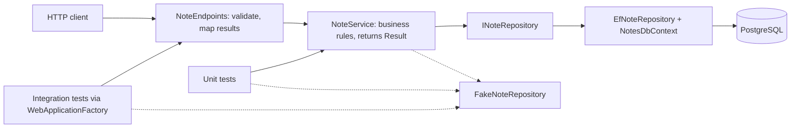

# 11. Testing with xUnit and the notes API mini project

> **Draft: written but not yet run.** The code and the expected output in this lesson were prepared by reading the code and the official documentation. They have not been executed yet. If something does not behave as described, trust your tool's real output and report it.

## What you will be able to do
By the end of this lesson you will be able to:
- Assemble one layered notes API from the parts of lessons 05 to 09 (endpoints, validation, `Result`, problem details, options, dependency injection, EF Core and PostgreSQL).
- Write xUnit unit tests (`[Fact]`, `[Theory]`) against a fake repository, and an integration test that drives the real HTTP pipeline with `WebApplicationFactory`.
- Run the tests with `dotnet test` and add a new behaviour test-first.
- Build a small, multi-stage, **non-root** Docker image and run the API and PostgreSQL together with Compose.

## Recap
1. In lesson 08, what does `dotnet ef migrations add` produce and what do you do with the files?
   <details><summary>Answer</summary>A migration (C# code describing a schema change) plus a model snapshot; you commit them to source control and apply them with `Database.MigrateAsync()` or `dotnet ef database update`.</details>
2. In lesson 10, what is the difference between `401` and `403`?
   <details><summary>Answer</summary>`401` means not authenticated (no valid credentials); `403` means authenticated but not allowed.</details>
3. In lesson 01, why did interfaces make the discount code easy to extend? How does that help tests here?
   <details><summary>Answer</summary>Callers depend on a contract, so a different implementation can be substituted; a test can substitute a fake for the database.</details>

## Why it matters
A feature without a test is a claim; a feature with a test is evidence that survives the next refactoring. Tests are also the reason you built interfaces and dependency injection: because `NoteService` asks for an `INoteRepository`, a test can give it an in-memory fake and run in milliseconds without a database. This lesson is the level-201 mini project: it joins everything in one small, shippable service and shows how to prove it works. It deliberately stops short of the full platform; the [dotnet capstone](../../../../capstones/backend-dotnet/tutorials/phase-1-skeleton/01-skeleton.md) builds the 27-operation version with Keycloak.

## What you will build
A notes API with `GET /notes` (paged), `GET /notes/{id}`, `POST /notes` and `GET /health`; twelve automated tests; and a container image that runs as an unprivileged user.


Solid arrows are production; dotted lines are what the tests swap in.

The folder layout you will create (the `Migrations` folder appears after Step 10):
```text
lesson11/
  global.json  .gitignore  .env.example  docker-compose.yml  Dockerfile  .dockerignore  new-note.json
  .config/dotnet-tools.json
  NotesApi/                     Program.cs  appsettings.json  NotesApi.csproj
    Notes/                      Note.cs  NotesOptions.cs  CreateNoteValidator.cs  NoteService.cs  NoteEndpoints.cs
    Data/                       NotesDbContext.cs  EfNoteRepository.cs
    Common/                     Result.cs  Mapping.cs  GlobalExceptionHandler.cs
  NotesApi.Tests/               NotesApi.Tests.csproj  FakeNoteRepository.cs  NoteServiceTests.cs
                                CreateNoteValidatorTests.cs  NotesApiFactory.cs  NotesApiTests.cs
```

## Before you start
- Tools: .NET SDK **11.0.100**, the editor, `curl` and **Docker** with Compose as in [lesson 08](../phase-3-data/08-ef-core-and-postgres.md). The first build downloads NuGet packages and Docker base images (a few hundred MB).
- Time: 130-160 min including the exercise. Suggested breaks: after Step 10 (the API works in code and has a migration) and after Step 15 (all tests pass).
- Source pack (optional): every file you must write is shown in full in this lesson, so you can follow without it. The finished code, the exercise starter and the solution are in the
  course repository https://github.com/Uee03/Code101 under `source/csharp/201-hero-to-super-hero/phase-4-security-and-quality/11-testing-and-notes-api/` (on that page choose **Code, Download ZIP**, or run
  `git clone https://github.com/Uee03/Code101.git`). Three small files are **identical to earlier lessons**; the lesson says which and you copy them.

## Steps
### Step 1. Folders
**Folder: any folder (terminal)**
```powershell
New-Item -ItemType Directory -Force "$HOME/code101/csharp201/lesson11/NotesApi/Notes", "$HOME/code101/csharp201/lesson11/NotesApi/Data", "$HOME/code101/csharp201/lesson11/NotesApi/Common", "$HOME/code101/csharp201/lesson11/NotesApi.Tests" | Out-Null
Set-Location "$HOME/code101/csharp201/lesson11"
```
**Folder: any folder (terminal)**
```bash
mkdir -p ~/code101/csharp201/lesson11/NotesApi/{Notes,Data,Common} ~/code101/csharp201/lesson11/NotesApi.Tests && cd ~/code101/csharp201/lesson11
```
Open `lesson11` in your editor. Every command below runs from this folder unless the caption says otherwise.

### Step 2. SDK pin with a test-runner setting, ignore file, tool manifest
`global.json` gets one extra section. Since the .NET 10 SDK, `dotnet test` can run in a mode designed for the **Microsoft.Testing.Platform** (MTP), the engine xUnit v3 uses; the setting turns that mode on for every project under this folder.

**File: `global.json`**
```json
{
  "sdk": {
    "version": "11.0.100",
    "rollForward": "latestPatch"
  },
  "test": {
    "runner": "Microsoft.Testing.Platform"
  }
}
```
**File: `.gitignore`**
```text
.env
bin/
obj/
```
Install the EF Core tool locally exactly as in [lesson 08, Step 5](../phase-3-data/08-ef-core-and-postgres.md#step-5-install-the-ef-core-command-line-tool-locally):

**Folder: `~/code101/csharp201/lesson11` (terminal)**
```powershell
dotnet new tool-manifest
dotnet tool install dotnet-ef --version 11.0.0
```
It writes this file (check that yours matches):

**File: `.config/dotnet-tools.json`**
```json
{
  "version": 1,
  "isRoot": true,
  "tools": {
    "dotnet-ef": {
      "version": "11.0.0",
      "commands": [
        "dotnet-ef"
      ],
      "rollForward": false
    }
  }
}
```

### Step 3. The API project file
`InvariantGlobalization` tells .NET not to load the ICU culture libraries. The small Alpine Linux runtime image used in Step 16 does not contain them, and without this line the container would stop at startup. It also makes `ToLower()` behave the same on every machine. `Microsoft.AspNetCore.OpenApi` produces the OpenAPI document of the API (Step 8).

**File: `NotesApi/NotesApi.csproj`**
```xml
<Project Sdk="Microsoft.NET.Sdk.Web">

  <PropertyGroup>
    <TargetFramework>net11.0</TargetFramework>
    <ImplicitUsings>enable</ImplicitUsings>
    <Nullable>enable</Nullable>
    <InvariantGlobalization>true</InvariantGlobalization>
  </PropertyGroup>

  <ItemGroup>
    <PackageReference Include="FluentValidation.DependencyInjectionExtensions" Version="12.2.0" />
    <PackageReference Include="Microsoft.AspNetCore.OpenApi" Version="11.0.0" />
    <PackageReference Include="Npgsql.EntityFrameworkCore.PostgreSQL" Version="11.0.0" />
    <PackageReference Include="Microsoft.EntityFrameworkCore.Design" Version="11.0.0">
      <PrivateAssets>all</PrivateAssets>
    </PackageReference>
  </ItemGroup>

</Project>
```

### Step 4. Settings
Only non-secret settings live here. The connection string has **no password**: it comes from the environment (Compose provides it in Step 17), as you learned in lessons 07 and 08. `Database:MigrateOnStartup` is off by default so tests and ordinary runs never touch a database.

**File: `NotesApi/appsettings.json`**
```json
{
  "Logging": {
    "LogLevel": {
      "Default": "Information",
      "Microsoft.AspNetCore": "Warning"
    }
  },
  "AllowedHosts": "*",
  "ConnectionStrings": {
    "Notes": "Host=localhost;Port=5435;Database=notes_api;Username=notes_app"
  },
  "Database": {
    "MigrateOnStartup": false
  },
  "Notes": {
    "PageSize": 10
  }
}
```

### Step 5. The domain, the DTOs and the options
`Note` is both the domain object and the EF Core entity here (one table). The two records are the public shapes from lesson 06. `NotesOptions` is lesson 07's options class with one setting.

**File: `NotesApi/Notes/Note.cs`**
```csharp
public sealed class Note
{
    public int Id { get; set; }

    public string Title { get; set; } = "";

    public string Body { get; set; } = "";

    public string OwnerId { get; set; } = "";
}

public sealed record CreateNoteRequest(string? Title, string? Body);

public sealed record NoteResponse(int Id, string Title, string Body);
```
**File: `NotesApi/Notes/NotesOptions.cs`**
```csharp
using System.ComponentModel.DataAnnotations;

public sealed class NotesOptions
{
    public const string SectionName = "Notes";

    [Range(1, 100)]
    public int PageSize { get; set; } = 10;
}
```

### Step 6. Four files copied from lesson 06
These files are **identical** to the ones you wrote in lesson 06; copy them into the folders shown (open lesson 06 and copy from the steps named). Nothing changes: `Note`, `Error`, `ErrorKind` and `NoteResponse` have the same names and members.

| Copy this file from lesson 06 | Into |
|---|---|
| `CreateNoteValidator.cs` ([Step 6](../phase-2-web-apis/06-dtos-validation-result-problemdetails.md#step-6-the-validator)) | `NotesApi/Notes/` |
| `Result.cs` ([Step 3](../phase-2-web-apis/06-dtos-validation-result-problemdetails.md#step-3-the-result-type)) | `NotesApi/Common/` |
| `Mapping.cs` ([Step 5](../phase-2-web-apis/06-dtos-validation-result-problemdetails.md#step-5-mapping-domain-to-response-error-to-http)) | `NotesApi/Common/` |
| `GlobalExceptionHandler.cs` ([Step 8](../phase-2-web-apis/06-dtos-validation-result-problemdetails.md#step-8-the-exception-handler)) | `NotesApi/Common/` |

### Step 7. The service and the repository contract
`NoteService` holds the rules and returns `Result`s. It talks to storage only through `INoteRepository`; that one interface is the seam where tests replace the database.

**File: `NotesApi/Notes/NoteService.cs`**
```csharp
using Microsoft.Extensions.Options;

public interface INoteRepository
{
    Task<Note?> FindAsync(int id, CancellationToken ct);

    Task<bool> TitleExistsAsync(string title, CancellationToken ct);

    Task AddAsync(Note note, CancellationToken ct);

    Task<IReadOnlyList<Note>> ListAsync(int skip, int take, CancellationToken ct);
}

public sealed class NoteService(INoteRepository repository, IOptions<NotesOptions> options)
{
    public async Task<Result<Note>> CreateAsync(string title, string body, CancellationToken ct)
    {
        if (await repository.TitleExistsAsync(title, ct))
        {
            return Result<Note>.Fail(new Error(
                ErrorKind.Conflict,
                "note.duplicate_title",
                $"A note titled '{title}' already exists."));
        }

        var note = new Note { Title = title, Body = body, OwnerId = "demo-user" };
        await repository.AddAsync(note, ct);
        return Result<Note>.Ok(note);
    }

    public async Task<Result<Note>> GetAsync(int id, CancellationToken ct)
    {
        Note? note = await repository.FindAsync(id, ct);
        if (note is null)
        {
            return Result<Note>.Fail(new Error(
                ErrorKind.NotFound,
                "note.not_found",
                $"Note {id} was not found."));
        }

        return Result<Note>.Ok(note);
    }

    public Task<IReadOnlyList<Note>> ListAsync(int page, CancellationToken ct)
    {
        int size = options.Value.PageSize;
        return repository.ListAsync((page - 1) * size, size, ct);
    }
}
```

### Step 8. The EF Core implementation
Compare with lesson 08: a `DbContext` that receives its options from dependency injection (a web app's way), and a repository that implements the interface with `AsNoTracking` reads. The **unique index** on `Title` is the last line of defence against two requests creating the same title at the same moment; the service's check is only a friendly early answer. (Turning the index violation into a `409` as well is the "Going further" idea.)

**File: `NotesApi/Data/NotesDbContext.cs`**
```csharp
using Microsoft.EntityFrameworkCore;

public sealed class NotesDbContext(DbContextOptions<NotesDbContext> options) : DbContext(options)
{
    public DbSet<Note> Notes => Set<Note>();

    protected override void OnModelCreating(ModelBuilder modelBuilder)
    {
        modelBuilder.Entity<Note>(e =>
        {
            e.Property(x => x.Title).HasMaxLength(100);
            e.Property(x => x.Body).HasMaxLength(1000);
            e.Property(x => x.OwnerId).HasMaxLength(100);
            e.HasIndex(x => x.Title).IsUnique();
        });
    }
}
```
**File: `NotesApi/Data/EfNoteRepository.cs`**
```csharp
using Microsoft.EntityFrameworkCore;

public sealed class EfNoteRepository(NotesDbContext db) : INoteRepository
{
    public Task<Note?> FindAsync(int id, CancellationToken ct) =>
        db.Notes.AsNoTracking().FirstOrDefaultAsync(n => n.Id == id, ct);

    public Task<bool> TitleExistsAsync(string title, CancellationToken ct) =>
        db.Notes.AnyAsync(n => n.Title.ToLower() == title.ToLower(), ct);

    public async Task AddAsync(Note note, CancellationToken ct)
    {
        db.Notes.Add(note);
        await db.SaveChangesAsync(ct);
    }

    public async Task<IReadOnlyList<Note>> ListAsync(int skip, int take, CancellationToken ct) =>
        await db.Notes.AsNoTracking().OrderBy(n => n.Id).Skip(skip).Take(take).ToListAsync(ct);
}
```

### Step 9. The endpoints
Lesson 06's handler shape, now `async` all the way, with a paged list (`?page=2`) whose size comes from `NotesOptions`.

**File: `NotesApi/Notes/NoteEndpoints.cs`**
```csharp
using FluentValidation;
using FluentValidation.Results;

public static class NoteEndpoints
{
    public static void MapNoteEndpoints(this IEndpointRouteBuilder app)
    {
        RouteGroupBuilder group = app.MapGroup("/notes");
        group.MapGet("/", ListNotes);
        group.MapGet("/{id:int}", GetNote);
        group.MapPost("/", CreateNote);
    }

    private static async Task<IResult> ListNotes(NoteService service, CancellationToken ct, int page = 1)
    {
        IReadOnlyList<Note> notes = await service.ListAsync(Math.Max(page, 1), ct);
        return TypedResults.Ok(notes.Select(n => n.ToResponse()));
    }

    private static async Task<IResult> GetNote(int id, NoteService service, CancellationToken ct)
    {
        Result<Note> result = await service.GetAsync(id, ct);
        if (!result.IsSuccess)
        {
            return result.Error.ToProblem();
        }

        return TypedResults.Ok(result.Value.ToResponse());
    }

    private static async Task<IResult> CreateNote(
        CreateNoteRequest request,
        IValidator<CreateNoteRequest> validator,
        NoteService service,
        CancellationToken ct)
    {
        ValidationResult validation = await validator.ValidateAsync(request, ct);
        if (!validation.IsValid)
        {
            return TypedResults.ValidationProblem(validation.ToDictionary());
        }

        Result<Note> result = await service.CreateAsync(request.Title!, request.Body ?? "", ct);
        if (!result.IsSuccess)
        {
            return result.Error.ToProblem();
        }

        NoteResponse response = result.Value.ToResponse();
        return TypedResults.Created($"/notes/{response.Id}", response);
    }
}
```

### Step 10. Program.cs, then the first migration
`Program.cs` is the **composition root**: the one place that decides which implementation each interface gets. `AddDbContext` registers the context as scoped (lesson 07); the migration runs at startup **only when the setting says so**. The last line makes the compiler-generated `Program` class public so the test project can name it.

**File: `NotesApi/Program.cs`**
```csharp
using FluentValidation;
using Microsoft.EntityFrameworkCore;

var builder = WebApplication.CreateBuilder(args);

builder.Services
    .AddOptions<NotesOptions>()
    .BindConfiguration(NotesOptions.SectionName)
    .ValidateDataAnnotations()
    .ValidateOnStart();

builder.Services.AddDbContext<NotesDbContext>(options =>
    options.UseNpgsql(builder.Configuration.GetConnectionString("Notes")));
builder.Services.AddScoped<INoteRepository, EfNoteRepository>();
builder.Services.AddScoped<NoteService>();
builder.Services.AddValidatorsFromAssemblyContaining<CreateNoteValidator>();
builder.Services.AddProblemDetails();
builder.Services.AddExceptionHandler<GlobalExceptionHandler>();
builder.Services.AddOpenApi();

var app = builder.Build();

if (app.Configuration.GetValue<bool>("Database:MigrateOnStartup"))
{
    using IServiceScope scope = app.Services.CreateScope();
    await scope.ServiceProvider.GetRequiredService<NotesDbContext>().Database.MigrateAsync();
}

app.UseExceptionHandler();
app.UseStatusCodePages();

if (app.Environment.IsDevelopment())
{
    app.MapOpenApi();
}

app.MapNoteEndpoints();
app.MapGet("/health", () => Results.Ok(new { status = "ok" }));

app.Run();

// Makes the generated Program class visible to the test project.
public partial class Program { }
```
Build it and create the migration (nothing connects to a database for this):

**Folder: `~/code101/csharp201/lesson11` (terminal)**
```powershell
dotnet build NotesApi
dotnet ef migrations add InitialCreate --project NotesApi
```
Typical output of the second command: `Build started...`, `Build succeeded.`, `Done. To undo this action, use 'ef migrations remove'`. A folder `NotesApi/Migrations` appears; commit it with the rest. If `dotnet build` reports errors, read the first one: it almost always names a file and line you mistyped.

**First break.** The API is complete in code. Next you prove it works.

### Step 11. The test project
xUnit **v3** test projects are executables that carry their own test runner. The test project uses the **Web SDK** because `Microsoft.AspNetCore.Mvc.Testing` (the package that starts your app in memory) requires it. `xunit.v3.mtp-v2` is xUnit v3 for the Microsoft Testing Platform; `ProjectReference` points at the API project; `<Using Include="Xunit" />` imports `Xunit` everywhere so test files stay short.

**File: `NotesApi.Tests/NotesApi.Tests.csproj`**
```xml
<Project Sdk="Microsoft.NET.Sdk.Web">

  <PropertyGroup>
    <OutputType>Exe</OutputType>
    <TargetFramework>net11.0</TargetFramework>
    <ImplicitUsings>enable</ImplicitUsings>
    <Nullable>enable</Nullable>
    <IsPackable>false</IsPackable>
    <TestingPlatformDotnetTestSupport>true</TestingPlatformDotnetTestSupport>
  </PropertyGroup>

  <ItemGroup>
    <PackageReference Include="xunit.v3.mtp-v2" Version="4.0.3" />
    <PackageReference Include="Microsoft.AspNetCore.Mvc.Testing" Version="11.0.0" />
  </ItemGroup>

  <ItemGroup>
    <ProjectReference Include="..\NotesApi\NotesApi.csproj" />
  </ItemGroup>

  <ItemGroup>
    <Using Include="Xunit" />
  </ItemGroup>

</Project>
```

### Step 12. A fake repository
A **fake** is a small working replacement (here: a list instead of a database). Unlike a *mock* (a generated object that records calls), a fake has behaviour, so tests read as "what happens" rather than "which method was called".

**File: `NotesApi.Tests/FakeNoteRepository.cs`**
```csharp
public sealed class FakeNoteRepository : INoteRepository
{
    private readonly List<Note> _notes = [];
    private int _nextId = 1;

    public Task<Note?> FindAsync(int id, CancellationToken ct) =>
        Task.FromResult(_notes.Find(n => n.Id == id));

    public Task<bool> TitleExistsAsync(string title, CancellationToken ct) =>
        Task.FromResult(_notes.Any(n => n.Title.Equals(title, StringComparison.OrdinalIgnoreCase)));

    public Task AddAsync(Note note, CancellationToken ct)
    {
        note.Id = _nextId++;
        _notes.Add(note);
        return Task.CompletedTask;
    }

    public Task<IReadOnlyList<Note>> ListAsync(int skip, int take, CancellationToken ct) =>
        Task.FromResult<IReadOnlyList<Note>>(_notes.OrderBy(n => n.Id).Skip(skip).Take(take).ToList());
}
```

### Step 13. Unit tests for the service and the validator
Each test follows **Arrange, Act, Assert**: set up, do one thing, check the result. `[Fact]` is a test that is always true; `[Theory]` runs the same test once per `[InlineData]` row. xUnit creates a **new instance of the test class for every test**, so tests cannot leak state into each other. `TestContext.Current.CancellationToken` is xUnit's token that is cancelled when the run is stopped.

**Predict before you run:** the service tests create `PageSize = 2`. After adding notes `a`, `b`, `c`, which titles are on page 2?

**File: `NotesApi.Tests/NoteServiceTests.cs`**
```csharp
using Microsoft.Extensions.Options;

public class NoteServiceTests
{
    private static NoteService CreateService() =>
        new(new FakeNoteRepository(), Options.Create(new NotesOptions { PageSize = 2 }));

    [Fact]
    public async Task Create_returns_the_note_with_an_id()
    {
        NoteService service = CreateService();

        Result<Note> result = await service.CreateAsync("Buy milk", "2 litres", TestContext.Current.CancellationToken);

        Assert.True(result.IsSuccess);
        Assert.NotNull(result.Value);
        Assert.Equal(1, result.Value.Id);
        Assert.Equal("Buy milk", result.Value.Title);
    }

    [Fact]
    public async Task Create_rejects_a_duplicate_title_ignoring_case()
    {
        NoteService service = CreateService();
        await service.CreateAsync("Buy milk", "", TestContext.Current.CancellationToken);

        Result<Note> second = await service.CreateAsync("BUY MILK", "", TestContext.Current.CancellationToken);

        Assert.False(second.IsSuccess);
        Assert.Equal("note.duplicate_title", second.Error?.Code);
    }

    [Fact]
    public async Task Get_returns_not_found_for_an_unknown_id()
    {
        NoteService service = CreateService();

        Result<Note> result = await service.GetAsync(99, TestContext.Current.CancellationToken);

        Assert.Equal(ErrorKind.NotFound, result.Error?.Kind);
    }

    [Fact]
    public async Task List_returns_one_page_at_a_time()
    {
        NoteService service = CreateService();
        foreach (string title in new[] { "a", "b", "c" })
        {
            await service.CreateAsync(title, "", TestContext.Current.CancellationToken);
        }

        IReadOnlyList<Note> page2 = await service.ListAsync(2, TestContext.Current.CancellationToken);

        Assert.Equal(new[] { "c" }, page2.Select(n => n.Title));
    }
}
```
**File: `NotesApi.Tests/CreateNoteValidatorTests.cs`**
```csharp
public class CreateNoteValidatorTests
{
    private readonly CreateNoteValidator _validator = new();

    [Theory]
    [InlineData(null)]
    [InlineData("")]
    public void Title_is_required(string? title)
    {
        var result = _validator.Validate(new CreateNoteRequest(title, "body"));

        Assert.Contains(result.Errors, e => e.PropertyName == "Title" && e.ErrorMessage == "Title is required.");
    }

    [Fact]
    public void A_title_of_101_characters_is_too_long()
    {
        var result = _validator.Validate(new CreateNoteRequest(new string('x', 101), null));

        Assert.False(result.IsValid);
    }

    [Fact]
    public void A_normal_request_is_valid()
    {
        var result = _validator.Validate(new CreateNoteRequest("Buy milk", "2 litres"));

        Assert.True(result.IsValid);
    }
}
```

### Step 14. Integration tests with WebApplicationFactory
`WebApplicationFactory<Program>` starts your real application (routing, JSON, validation, problem details) **in memory**: no port, no network. The custom factory removes the registration of `INoteRepository` and adds the fake, so the test needs no database. `IClassFixture<NotesApiFactory>` makes xUnit create **one** factory and share it between the tests of the class, which is why the tests use different titles.

**File: `NotesApi.Tests/NotesApiFactory.cs`**
```csharp
using Microsoft.AspNetCore.Mvc.Testing;
using Microsoft.Extensions.DependencyInjection.Extensions;

public sealed class NotesApiFactory : WebApplicationFactory<Program>
{
    protected override void ConfigureWebHost(IWebHostBuilder builder)
    {
        builder.ConfigureServices(services =>
        {
            services.RemoveAll<INoteRepository>();
            services.AddSingleton<INoteRepository, FakeNoteRepository>();
        });
    }
}
```
**File: `NotesApi.Tests/NotesApiTests.cs`**
```csharp
using System.Net;

public class NotesApiTests(NotesApiFactory factory) : IClassFixture<NotesApiFactory>
{
    private readonly HttpClient _client = factory.CreateClient();

    [Fact]
    public async Task Health_returns_ok()
    {
        HttpResponseMessage response = await _client.GetAsync("/health", TestContext.Current.CancellationToken);

        Assert.Equal(HttpStatusCode.OK, response.StatusCode);
    }

    [Fact]
    public async Task Post_creates_a_note_and_get_returns_it()
    {
        HttpResponseMessage created = await _client.PostAsJsonAsync(
            "/notes",
            new { title = "Integration note", body = "from a test" },
            TestContext.Current.CancellationToken);

        Assert.Equal(HttpStatusCode.Created, created.StatusCode);
        NoteResponse? note = await created.Content.ReadFromJsonAsync<NoteResponse>(TestContext.Current.CancellationToken);
        Assert.NotNull(note);
        Assert.Equal("Integration note", note.Title);

        HttpResponseMessage fetched = await _client.GetAsync($"/notes/{note.Id}", TestContext.Current.CancellationToken);
        Assert.Equal(HttpStatusCode.OK, fetched.StatusCode);
    }

    [Fact]
    public async Task Post_with_an_empty_title_returns_a_400_problem()
    {
        HttpResponseMessage response = await _client.PostAsJsonAsync(
            "/notes",
            new { title = "", body = "x" },
            TestContext.Current.CancellationToken);

        Assert.Equal(HttpStatusCode.BadRequest, response.StatusCode);
        string json = await response.Content.ReadAsStringAsync(TestContext.Current.CancellationToken);
        Assert.Contains("Title is required.", json);
    }

    [Fact]
    public async Task Get_unknown_id_returns_404()
    {
        HttpResponseMessage response = await _client.GetAsync("/notes/9999", TestContext.Current.CancellationToken);

        Assert.Equal(HttpStatusCode.NotFound, response.StatusCode);
    }
}
```

### Step 15. Run the tests
Run `dotnet test` **from the test project's folder** (this works in both test-runner modes):

**Folder: `~/code101/csharp201/lesson11/NotesApi.Tests` (terminal)**
```powershell
dotnet test
```
Expected result (not yet run; the exact summary text differs by SDK version): the run builds both projects, discovers **12 tests** (4 service tests, 4 validator tests because the `Theory` runs twice, 4 HTTP tests), and reports 12 passed, 0 failed.

Now break something on purpose to see a failing test. In `NoteService.cs` temporarily delete the `if (await repository.TitleExistsAsync(...)) { ... }` block and run `dotnet test` again. Predict first: **one** test must fail (`Create_rejects_a_duplicate_title_ignoring_case`); the output names it and shows `Assert.False() Failure` with the expected and actual values (typical wording). Put the block back and run again: green. This habit (see it fail, then pass) proves the test can actually fail.

**Second break.** The code works and is tested. The last three steps put it in a container.

### Step 16. The Dockerfile
A **multi-stage** build uses one image to *build* and a different, smaller one to *run*. The SDK image (compiler, NuGet) is large and has tools an attacker would love; the runtime image holds only what the app needs.

Create these three files in `lesson11` (not inside `NotesApi`): the build context is the whole folder, because the build needs `global.json`.

**File: `Dockerfile`**
```dockerfile
# syntax=docker/dockerfile:1

# Stage 1: build with the SDK image (compiler, NuGet; large). Only the published output leaves this stage.
FROM mcr.microsoft.com/dotnet/sdk:11.0.100-alpine3.24 AS build
WORKDIR /src

# Restore first, on its own layer: it only re-runs when the SDK pin or the project file changes.
COPY global.json ./
COPY NotesApi/NotesApi.csproj NotesApi/
RUN dotnet restore NotesApi/NotesApi.csproj

COPY NotesApi/ NotesApi/
RUN dotnet publish NotesApi/NotesApi.csproj -c Release --no-restore -o /app/publish /p:UseAppHost=false

# Stage 2: run on the small ASP.NET runtime image (no SDK, no compiler).
FROM mcr.microsoft.com/dotnet/aspnet:11.0.0-alpine3.24 AS runtime
WORKDIR /app
COPY --from=build /app/publish ./

# Listen on port 8080 inside the container; Compose decides what the host can reach.
ENV ASPNETCORE_HTTP_PORTS=8080
EXPOSE 8080

# The base image defines the unprivileged user "app" and sets APP_UID; never run the service as root.
USER $APP_UID
ENTRYPOINT ["dotnet", "NotesApi.dll"]
```
| Line | What it does | If you change it |
|---|---|---|
| `# syntax=docker/dockerfile:1` | selects the current Dockerfile syntax (BuildKit) | rarely changed |
| `FROM ...sdk:11.0.100-alpine3.24 AS build` | the build stage on Alpine Linux with SDK 11.0.100; pinned to match `global.json` | an SDK that does not satisfy `global.json` makes `dotnet restore` fail |
| `WORKDIR /src` | folder inside the image for the following commands | |
| `COPY global.json ./` and `COPY NotesApi/NotesApi.csproj NotesApi/` then `RUN dotnet restore` | copies only the files that decide the package list, then restores; Docker caches this **layer** and reuses it while those files are unchanged, so a code change does not download packages again | copying everything first makes every code change re-download packages |
| `COPY NotesApi/ NotesApi/` then `RUN dotnet publish ... -c Release --no-restore -o /app/publish /p:UseAppHost=false` | copies the source and publishes the optimized app to `/app/publish`; `UseAppHost=false` skips the native launcher we do not need because we start with `dotnet` | |
| `FROM ...aspnet:11.0.0-alpine3.24 AS runtime` | a fresh, much smaller image with only the ASP.NET runtime | using the SDK image here ships the compiler to production |
| `COPY --from=build /app/publish ./` | takes only the build output from stage 1 | |
| `ENV ASPNETCORE_HTTP_PORTS=8080` and `EXPOSE 8080` | the app listens on port 8080 (a non-root user may not bind ports below 1024); `EXPOSE` documents it | the Compose port mapping must match |
| `USER $APP_UID` | switches to the unprivileged user that Microsoft's images define (`APP_UID` is set in the image); everything after this and the running app are **not root** | without it the app runs as root and an exploit gets root inside the container |
| `ENTRYPOINT ["dotnet", "NotesApi.dll"]` | starts the app (the JSON list form means no shell, so signals such as `docker stop` reach the app) | |

**File: `.dockerignore`**
```text
**/bin/
**/obj/
.env
.git
.gitignore
*.md
docker-compose*.yml
NotesApi.Tests/
```
`.dockerignore` lists what is **not** sent to the build: build output (it is rebuilt inside), `.env` (it holds the password and must never end up in an image), the git history and the test project (not needed in production).

### Step 17. Environment file and Compose file
**File: `.env.example`**
```text
# Disposable local practice values. Never reuse them anywhere real.
POSTGRES_DB=notes_api
POSTGRES_USER=notes_app
POSTGRES_PASSWORD=notes_api_local_only
POSTGRES_PORT=5435
API_PORT=8085
```
Copy it to `.env` (`Copy-Item .env.example .env` in PowerShell, `cp .env.example .env` in bash). The `db` service is lesson 08's, explained there; the new part is the `api` service.

**File: `docker-compose.yml`**
```yaml
services:
  db:
    image: postgres:17-alpine
    environment:
      POSTGRES_DB: ${POSTGRES_DB}
      POSTGRES_USER: ${POSTGRES_USER}
      POSTGRES_PASSWORD: ${POSTGRES_PASSWORD}
    ports:
      - "127.0.0.1:${POSTGRES_PORT:-5432}:5432"
    volumes:
      - pg_data:/var/lib/postgresql/data
    healthcheck:
      test: ["CMD-SHELL", "pg_isready -h 127.0.0.1 -U $$POSTGRES_USER -d $$POSTGRES_DB"]
      interval: 3s
      timeout: 3s
      retries: 30
      start_period: 5s

  api:
    build:
      context: .
      dockerfile: Dockerfile
    depends_on:
      db:
        condition: service_healthy
    environment:
      ConnectionStrings__Notes: Host=db;Port=5432;Database=${POSTGRES_DB};Username=${POSTGRES_USER};Password=${POSTGRES_PASSWORD}
      Database__MigrateOnStartup: "true"
    ports:
      - "127.0.0.1:${API_PORT:-8080}:8080"
    cap_drop:
      - ALL
    security_opt:
      - no-new-privileges:true
    healthcheck:
      test: ["CMD-SHELL", "wget -qO- http://127.0.0.1:8080/health || exit 1"]
      interval: 3s
      timeout: 3s
      retries: 30
      start_period: 5s

volumes:
  pg_data:
```
| Line (api service) | What it does | If you change it |
|---|---|---|
| `build: context: . dockerfile: Dockerfile` | builds the image from the `Dockerfile` in this folder | |
| `depends_on: db: condition: service_healthy` | starts the API only after the database reports healthy | without it the API may start before the database accepts connections |
| `ConnectionStrings__Notes: Host=db;...` | overrides the setting `ConnectionStrings:Notes` (double underscore = colon, lesson 07). `db` is the other service's name, which Compose makes resolvable inside its network. The password comes from `.env`, so it is in no file you commit and not in the image | a wrong password gives the `28P01` error |
| `Database__MigrateOnStartup: "true"` | turns on the startup migration for this local stack (see the trade-off table) | |
| `ports: "127.0.0.1:${API_PORT:-8080}:8080"` | publishes the API on your own machine only | removing `127.0.0.1:` exposes it to your network |
| `cap_drop: - ALL` | removes all Linux capabilities from the container; a web app on port 8080 needs none | |
| `security_opt: no-new-privileges:true` | the process cannot gain more privileges, for example through a setuid program | |
| `healthcheck ... wget ...` | asks `/health` every 3 s; the Alpine image has `wget` but not `curl` | |

### Step 18. Build, start and check
**Folder: `~/code101/csharp201/lesson11` (terminal)**
```powershell
docker compose up -d --build --wait
docker compose ps
```
`--build` builds the image first (several minutes the first time), `--wait` returns when the services are healthy. Typical `ps` output: two services, both `Up ... (healthy)`.

**Folder: `~/code101/csharp201/lesson11` (terminal)**
```powershell
curl.exe -s http://localhost:8085/health
curl.exe -s -H "Content-Type: application/json" -d "@new-note.json" http://localhost:8085/notes
curl.exe -s http://localhost:8085/notes
docker compose exec api id
```
(macOS and Linux: `curl` instead of `curl.exe`.) Create `new-note.json` first:

**File: `new-note.json`**
```json
{"title":"Buy milk","body":"2 litres"}
```
Expected output (not yet run; derived from the code on a fresh database):
```text
{"status":"ok"}
{"id":1,"title":"Buy milk","body":"2 litres"}
[{"id":1,"title":"Buy milk","body":"2 litres"}]
```
The last command prints the user inside the container; typical output is `uid=1654(app) gid=1654(app) groups=1654(app)`: the numbers can differ, but `uid` must **not** be `0` (root). Show the log of the API with `docker compose logs api`; for a failed start it contains the exception (see Common mistakes).

## Run it
Everything together, from a clean state:

**Folder: `~/code101/csharp201/lesson11/NotesApi.Tests` (terminal)**
```powershell
dotnet test
```
**Folder: `~/code101/csharp201/lesson11` (terminal)**
```powershell
docker compose up -d --build --wait
curl.exe -s http://localhost:8085/notes
docker compose down -v
```
Expected: the tests pass (12 of 12), the list call prints `[]` on a fresh database (or the notes you created), and `docker compose down -v` removes the containers **and** the database volume. The image stays on your disk until you run `docker image rm` (or `docker compose down -v --rmi local`).

## How it works
1. **Layers and seams.** Endpoints translate HTTP to calls and results back to HTTP; the service holds the rules; the repository hides storage. Each layer talks to the next through types (`Result<T>`, `INoteRepository`), so each can be tested alone. The seam that matters for tests is the interface: production registers `EfNoteRepository`, the test factory registers `FakeNoteRepository`.
2. **Unit vs integration.** A **unit test** checks one class with its collaborators replaced (fast, many, precise failure messages). An **integration test** checks several parts working together (slower, fewer, finds wiring mistakes such as a missing registration or a wrong route). The usual shape is a **pyramid**: many unit tests, some integration tests, very few end-to-end tests.
3. **What these tests do not cover.** The fake repository proves the service and HTTP behaviour, not the SQL. `EfNoteRepository`, the migration and the unique index are only exercised when you run the real stack (Step 18). Testing them automatically needs a real PostgreSQL started by the test, for example with the Testcontainers library; that is level 301 material.
4. **Why the factory needs `public partial class Program { }`.** Top-level statements compile into an `internal` `Program` class. `WebApplicationFactory<Program>` is in another assembly, so it needs the class to be `public`.
5. **The image.** The runtime stage contains only the published files and the ASP.NET runtime. It runs as user `app`, listens on port 8080 (above 1024, so no privilege is needed), has no password inside, and the container has no extra Linux capabilities. Each of these removes something an attacker could use if the app had a bug.
6. **Startup migrations.** `MigrateOnStartup` is convenient for a local stack. With several instances starting together, two could migrate at once, and a bad migration would block every start. For production prefer one explicit step in the deployment pipeline: a migration **bundle** (`dotnet ef migrations bundle`) or a reviewed SQL script (`dotnet ef migrations script`).

> **Misconception:** "100% of lines covered means the code works." Coverage shows which lines *ran*, not whether anything was *checked*. A test with no assertion covers lines and proves nothing. Choose tests by risk (rules, error paths, boundaries) and make each assertion meaningful.

### Why this, not that
| Choice | Use it when | Cost |
|---|---|---|
| **Hand-written fake** (this lesson) | Small interfaces; you want readable behaviour | You maintain the fake alongside the interface |
| **Mocking library** (Moq, NSubstitute) | Many small interactions, verifying that a call happened | Tests describe *how*, not *what*; break on refactoring |
| **EF Core InMemory provider** | Quick demos | Not a relational database: no constraints or SQL translation, so tests can pass while production fails (Microsoft advises against it for testing) |
| **SQLite in-memory** | A closer relational check without Docker | Different SQL dialect from PostgreSQL |
| **Real PostgreSQL in a container (Testcontainers)** | Testing queries, constraints and migrations | Slower and needs Docker on the machine running the tests |
| **xUnit v3 / NUnit / MSTest** | All are supported by `dotnet test` | Pick one per solution; xUnit is the most common in new .NET code |
| **One big end-to-end test** | A smoke test of a deployed system | Slow and hard to diagnose; keep very few |

## Try it
Add a behaviour **test-first**: titles are trimmed, so `"  Buy milk  "` is stored as `"Buy milk"`.

1. **Guided.** In `NotesApi.Tests/NoteServiceTests.cs` add the new test below (the repository's `exercise/starter` folder contains the whole file). Run `dotnet test` and watch exactly one test **fail**: this is the "red" step. Then change `NoteService.CreateAsync` so the test passes ("green").
2. **Change.** Write a second test, `Create_rejects_a_duplicate_that_differs_only_by_spaces`: after creating `"Buy milk"`, creating `" buy milk "` must fail with `note.duplicate_title`. Predict whether it passes with your change from step 1 before you run it (hint: which value does the duplicate check receive?).
3. **Stretch (no single answer).** Should `NotesApiTests` also cover `GET /notes?page=2`, or is the `Theory`-style unit test of `ListAsync` enough? Write down which bug each of the two tests would catch that the other would not.

**File: `NotesApi.Tests/NoteServiceTests.cs` (starter: the new test, added at the end of the class)**
```csharp
    [Fact]
    public async Task Create_trims_whitespace_around_the_title()
    {
        NoteService service = CreateService();

        Result<Note> result = await service.CreateAsync("  Buy milk  ", "", TestContext.Current.CancellationToken);

        Assert.True(result.IsSuccess);
        Assert.Equal("Buy milk", result.Value?.Title);
    }
```
With the unchanged service, `dotnet test` reports 1 failed test out of 13 (typical wording: `Assert.Equal() Failure` with the expected and actual strings).

<details><summary>Solution</summary>

Trim once at the top of `CreateAsync` and use the trimmed value everywhere after it, including in the duplicate check, otherwise `" buy milk "` would slip past the check.

**File: `NotesApi/Notes/NoteService.cs` (solution: the changed method; the rest of the file is unchanged)**
```csharp
    public async Task<Result<Note>> CreateAsync(string title, string body, CancellationToken ct)
    {
        string cleanTitle = title.Trim();
        if (await repository.TitleExistsAsync(cleanTitle, ct))
        {
            return Result<Note>.Fail(new Error(
                ErrorKind.Conflict,
                "note.duplicate_title",
                $"A note titled '{cleanTitle}' already exists."));
        }

        var note = new Note { Title = cleanTitle, Body = body, OwnerId = "demo-user" };
        await repository.AddAsync(note, ct);
        return Result<Note>.Ok(note);
    }
```
**File: `NotesApi.Tests/NoteServiceTests.cs` (solution: the second test)**
```csharp
    [Fact]
    public async Task Create_rejects_a_duplicate_that_differs_only_by_spaces()
    {
        NoteService service = CreateService();
        await service.CreateAsync("Buy milk", "", TestContext.Current.CancellationToken);

        Result<Note> second = await service.CreateAsync(" buy milk ", "", TestContext.Current.CancellationToken);

        Assert.Equal("note.duplicate_title", second.Error?.Code);
    }
```
Expected result (not yet run): all 14 tests pass.

</details>

## Check yourself
1. What is the difference between a unit test and an integration test, and which is `NotesApiTests`? <details><summary>Answer</summary>A unit test checks one class with collaborators replaced; an integration test checks several parts together. `NotesApiTests` are integration tests (real routing, JSON, validation, problem details; fake storage).</details>
2. Why can the unit tests run without Docker or a database? <details><summary>Answer</summary>`NoteService` depends on `INoteRepository`, and the tests pass a `FakeNoteRepository`.</details>
3. A test shows `Assert.Equal() Failure`. What does that tell you to look at first? <details><summary>Answer</summary>The printed expected and actual values: decide whether the code or the expectation is wrong.</details>
4. Name two security-related lines in the Dockerfile or Compose file and what each prevents. <details><summary>Answer</summary>`USER $APP_UID` (the app does not run as root); `cap_drop: ALL` / `no-new-privileges` (no extra Linux powers); `127.0.0.1:` in `ports` (only your machine can reach it); `.env` in `.dockerignore` (the password never enters an image).</details>
5. Why is the password not in `appsettings.json`, the Dockerfile or the image? <details><summary>Answer</summary>Anything in source control or in an image is copied everywhere; the password comes from `.env` at run time through the environment.</details>

## Common mistakes
Typical messages; wording can differ with versions.

| Symptom or error text | Cause | Fix |
|---|---|---|
| `error CS0122: 'Program' is inaccessible due to its protection level` (typical message) | The last line of `NotesApi/Program.cs` is missing, so `Program` is `internal`. | Add `public partial class Program { }`. |
| `The type or namespace name 'Xunit' could not be found` (typical message) | The `<Using Include="Xunit" />` item or the `xunit.v3.mtp-v2` package is missing. | Check `NotesApi.Tests.csproj` against Step 11. |
| `dotnet test` finds no tests, or says the project is not a test project (typical message) | The runner is not set to the Microsoft Testing Platform, or you ran it from a folder without a test project. | Keep the `test` section in `global.json` and run `dotnet test` inside `NotesApi.Tests`. |
| `System.InvalidOperationException: Unable to resolve service for type 'INoteRepository' ...` (typical message) | The registration is missing (production) or `RemoveAll` removed it without adding the fake (tests). | Check `AddScoped<INoteRepository, EfNoteRepository>()` and the factory. |
| A test passes alone but fails with the others (typical symptom) | Tests share state through the shared factory (same titles). | Use unique data per test, or create a factory per test. |
| `Couldn't find a valid ICU package installed on the system` (typical message) in `docker compose logs api` | `InvariantGlobalization` is missing; Alpine has no ICU libraries. | Add it to `NotesApi.csproj` and rebuild. |
| `Npgsql.PostgresException ... 42P01: relation "Notes" does not exist` (typical message) | The migration was not created before the image was built, so `MigrateAsync` had nothing to apply. | Run the `dotnet ef migrations add` command from Step 10, then `docker compose up -d --build --wait`. |
| `28P01: password authentication failed` (typical message) | `.env` changed after the database volume was created. | `docker compose down -v`, then up again. |
| `api` stays `unhealthy` (typical symptom) | The app crashed or `wget` cannot reach port 8080. | `docker compose logs api`; check `ASPNETCORE_HTTP_PORTS` and the port in the healthcheck. |

## Best practice
Test behaviour through the seams you designed (interfaces), keep unit tests fast and independent, add a few integration tests for wiring, and ship with a multi-stage, non-root, pinned-version image that carries no secrets. Source: Microsoft Learn, Integration tests in ASP.NET Core https://learn.microsoft.com/aspnet/core/test/integration-tests and Docker for .NET, best practices https://learn.microsoft.com/dotnet/core/docker/build-container

## Going further
- Turn the unique-index violation into the same `409` response (catch `DbUpdateException` in the repository and return a `Result`).
- Add authentication from [lesson 10](10-jwt-authentication-and-authorization.md) with `RequireAuthorization()` and test it with a token created in the test factory.
- The full platform with all the layers and a Keycloak realm: [dotnet capstone, chapter 04, run and ship](../../../../capstones/backend-dotnet/tutorials/phase-4-run-and-ship/04-run-and-ship.md).
- xUnit.net v3 documentation: https://xunit.net/docs/getting-started/v3/getting-started

## Phase 4 mixed review
1. A valid token reaches `DELETE /notes/1` but the caller is not an admin. Which status? (lesson 10)
2. `GET /notes?page=2` returns the same rows as page 1. Which layer do you open first, and which test would have caught it? (lessons 08 and 11)
3. Which two things in this project make the unit tests possible without a database? (lessons 01, 07, 11)
4. Why do the migration files go into source control but `.env` does not? (lessons 08 and 11)
<details><summary>Answers</summary>1. `403`. 2. `NoteService.ListAsync`/the repository `Skip` (the page-to-skip arithmetic); a unit test like `List_returns_one_page_at_a_time` (it is in this lesson). 3. The `INoteRepository` interface and constructor injection of it. 4. Migrations are code that describes the schema every environment needs; `.env` holds a machine-specific secret.</details>

## Level 201 wrap-up
You can now write the three layers of a typical .NET service (core language, web API, data), secure it with bearer tokens, prove it with tests and ship it in a hardened container. Where to go next: the [dotnet capstone](../../../../capstones/backend-dotnet/tutorials/phase-1-skeleton/01-skeleton.md) rebuilds a 27-operation platform contract in five chapters with Keycloak, and C# 301 covers clean architecture, performance, observability and resilience.

## Summary
- You assembled a layered notes API from the pieces of lessons 05 to 09.
- You wrote unit tests with a fake repository and integration tests with `WebApplicationFactory`, and saw a test fail on purpose.
- You added a behaviour test-first and made it pass.
- You built a multi-stage, non-root image and ran the API with PostgreSQL through Compose.

## Next lesson
This is the last lesson of C# 201. Continue with the **[dotnet capstone](../../../../capstones/backend-dotnet/tutorials/phase-1-skeleton/01-skeleton.md)** or, when it is available, C# 301.