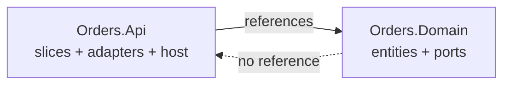

# 01. Clean architecture and vertical slices

> **Draft: written but not yet run.** The code and the expected output in this lesson were prepared by reading the code and the official documentation. They have not been executed yet. If something does not behave as described, trust your tool's real output and report it.

## What you will be able to do
By the end of this lesson you will be able to:
- Explain the dependency rule and show which project may reference which, and why the compiler can enforce it.
- Build two vertical slices (request, validation, handler, response in one folder) on top of a framework-free domain project.
- Decide, in writing, between layers-by-technology, clean architecture and vertical slices using an ADR with explicit trade-offs.
- Find a dependency-rule violation in a pull request by reading project references and `using` lines.

## Recap
Two questions from earlier levels. Open the answer only after you have written yours.
1. In ASP.NET Core dependency injection, what is the difference between a singleton and a scoped service, and which one is the in-memory order store in this lesson?
   <details><summary>Answer</summary>A singleton lives for the whole process; a scoped service lives for one request. The store keeps all orders in memory, so it must be a singleton, otherwise every request would see an empty store.</details>
2. In a FastEndpoints endpoint, what do `Configure` and `HandleAsync` do?
   <details><summary>Answer</summary><code>Configure</code> runs once at startup and declares the route, verb and security. <code>HandleAsync</code> runs once per request and receives the bound, validated request.</details>

## Why it matters
Every system starts tidy and then each new feature touches five folders. Architecture is the set of rules that keeps a change **local**: you edit one feature and nothing else moves. Two ideas do most of the work. The **dependency rule** (clean architecture) says source code dependencies point only inward, toward business rules. **Vertical slices** say you group code by feature, not by technical layer. This lesson combines them in the smallest way that still holds up in production.

## What you will build
A small orders service with two projects: `Orders.Domain` (no references at all) and `Orders.Api` (FastEndpoints, one folder per feature, an in-memory adapter). You will place an order with `curl`, read it back, then add a third slice yourself.

## Before you start
- **Prerequisites:** C# 201 lessons [04, async/await and Task](../../201-hero-to-super-hero/phase-1-core-skills/04-async-await-and-task.md), [05, first ASP.NET Core API with FastEndpoints](../../201-hero-to-super-hero/phase-2-web-apis/05-first-aspnet-core-api.md) and [07, dependency injection and options](../../201-hero-to-super-hero/phase-2-web-apis/07-dependency-injection-and-options.md); [C# 101 lesson 12, expense tracker](../../101-zero-to-hero/phase-3-real-programs/12-expense-tracker.md).
- Tools: .NET SDK **11.0.100**, `curl` (preinstalled on Windows 10 and later as `curl.exe`, and on macOS and most Linux distributions), a terminal and an editor.
- Time: 70-90 minutes including the exercise. Two sittings are fine; break after Step 9.
- You need the C# 201 lessons listed above (FastEndpoints in [lesson 05](../../201-hero-to-super-hero/phase-2-web-apis/05-first-aspnet-core-api.md), dependency injection in [lesson 07](../../201-hero-to-super-hero/phase-2-web-apis/07-dependency-injection-and-options.md), async in [lesson 04](../../201-hero-to-super-hero/phase-1-core-skills/04-async-await-and-task.md)). This lesson does not repeat them.
- Source pack (optional): every file is shown in full in this lesson, so you can follow without it. The finished code, the exercise starter and the solution are in the
  course repository https://github.com/Uee03/Code101 under `source/csharp/301-super-hero-to-legendary/phase-1-architecture/01-clean-architecture-and-vertical-slices/` (on that page choose **Code, Download ZIP**, or run
  `git clone https://github.com/Uee03/Code101.git`).

## Steps
### Step 1. Make the folders
**PowerShell (Windows)**, run from any folder:
```powershell
mkdir $HOME\code101\csharp301\lesson01\src\Orders.Domain
mkdir $HOME\code101\csharp301\lesson01\src\Orders.Api\Infrastructure
mkdir $HOME\code101\csharp301\lesson01\src\Orders.Api\Features\PlaceOrder
mkdir $HOME\code101\csharp301\lesson01\src\Orders.Api\Features\GetOrder
mkdir $HOME\code101\csharp301\lesson01\requests
cd $HOME\code101\csharp301\lesson01
```
**Bash or zsh (macOS, Linux)**:
```bash
mkdir -p ~/code101/csharp301/lesson01/src/Orders.Domain
mkdir -p ~/code101/csharp301/lesson01/src/Orders.Api/Infrastructure
mkdir -p ~/code101/csharp301/lesson01/src/Orders.Api/Features/PlaceOrder
mkdir -p ~/code101/csharp301/lesson01/src/Orders.Api/Features/GetOrder
mkdir -p ~/code101/csharp301/lesson01/requests
cd ~/code101/csharp301/lesson01
```
Expected result: `mkdir` on Windows PowerShell prints a small table per folder; on bash it prints nothing. Your terminal is now inside `lesson01`. Every later command runs from this folder (the one that contains `src` and `requests`). If a command says it cannot find a project, you are in the wrong folder; `cd` back.

### Step 2. Pin the SDK
**File: `global.json`** (in `lesson01`)
```json
{
  "sdk": {
    "rollForward": "latestFeature",
    "version": "11.0.100"
  }
}
```
`version` is the SDK the repository was written against. `rollForward: latestFeature` accepts a newer feature band or patch of the same major.minor but never jumps to .NET 12. Without a pin, a new SDK on a build server can change analyzer behavior between two builds of the same commit.

### Step 3. The domain project (no references)
**File: `src/Orders.Domain/Orders.Domain.csproj`**
```xml
<Project Sdk="Microsoft.NET.Sdk">

  <PropertyGroup>
    <TargetFramework>net11.0</TargetFramework>
    <Nullable>enable</Nullable>
    <ImplicitUsings>enable</ImplicitUsings>
  </PropertyGroup>

</Project>
```
There is **no** `PackageReference` and no `ProjectReference`. That is the whole architecture rule in one file: this project cannot use ASP.NET, EF Core or FastEndpoints because the compiler cannot see them. `Microsoft.NET.Sdk` (not `.Web`) means it does not even reference the ASP.NET shared framework.

**File: `src/Orders.Domain/Order.cs`**
```csharp
namespace Orders.Domain;

public sealed record OrderLine(string Sku, int Quantity, int UnitPriceCents);

public sealed class Order
{
    private readonly List<OrderLine> lines;

    private Order(int id, string customer, List<OrderLine> lines)
    {
        Id = id;
        Customer = customer;
        this.lines = lines;
    }

    public int Id { get; }

    public string Customer { get; }

    public IReadOnlyList<OrderLine> Lines => lines;

    public int TotalCents => lines.Sum(line => line.Quantity * line.UnitPriceCents);

    public static Order Place(int id, string customer, IEnumerable<OrderLine> lines)
    {
        if (string.IsNullOrWhiteSpace(customer))
        {
            throw new ArgumentException("A customer is required.", nameof(customer));
        }

        var copy = lines.ToList();
        if (copy.Count == 0)
        {
            throw new ArgumentException("An order needs at least one line.", nameof(lines));
        }

        return new Order(id, customer.Trim(), copy);
    }
}
```
Three decisions to notice. The constructor is private and `Place` is the only way in, so an invalid order cannot exist. `Lines` is exposed as `IReadOnlyList`, so callers cannot add lines behind the rules' back. Money is an `int` of **cents**, never a `double`; lesson 03 turns that into a proper value object.

**File: `src/Orders.Domain/IOrderStore.cs`**
```csharp
namespace Orders.Domain;

// Owned by the inner circle: the domain states what it needs, and the outer circle adapts to it.
public interface IOrderStore
{
    int NextId();

    void Save(Order order);

    Order? Find(int id);
}
```
This is **dependency inversion**: the interface lives in the inner project; the implementation lives in the outer one. The arrow in the source code points inward even though at run time the domain "calls" the database.

### Step 4. The API project
**File: `src/Orders.Api/Orders.Api.csproj`**
```xml
<Project Sdk="Microsoft.NET.Sdk.Web">

  <PropertyGroup>
    <TargetFramework>net11.0</TargetFramework>
    <Nullable>enable</Nullable>
    <ImplicitUsings>enable</ImplicitUsings>
  </PropertyGroup>

  <ItemGroup>
    <PackageReference Include="FastEndpoints" Version="9.0.0" />
  </ItemGroup>

  <ItemGroup>
    <ProjectReference Include="..\Orders.Domain\Orders.Domain.csproj" />
  </ItemGroup>

</Project>
```
The reference goes **API to Domain**, never the other way. FastEndpoints 9.0.0 is the version the backend-dotnet capstone uses. If you ever add `Orders.Api` as a reference of `Orders.Domain`, MSBuild reports a circular dependency, which is the compiler helping you.

**File: `src/Orders.Api/appsettings.json`**
```json
{
  "Urls": "http://127.0.0.1:5301",
  "Logging": {
    "LogLevel": {
      "Default": "Information",
      "Microsoft.AspNetCore": "Warning"
    }
  },
  "AllowedHosts": "localhost;127.0.0.1"
}
```
`Urls` binds Kestrel to the loopback address only, so the service is not reachable from other machines while you experiment. Port 5301 is this lesson's port; if it is busy, change it here and in the `curl` commands. `AllowedHosts` rejects requests whose `Host` header is not `localhost` or `127.0.0.1`.

### Step 5. The adapter (outer circle)
**File: `src/Orders.Api/Infrastructure/InMemoryOrderStore.cs`**
```csharp
using System.Collections.Concurrent;
using Orders.Domain;

namespace Orders.Api.Infrastructure;

public sealed class InMemoryOrderStore : IOrderStore
{
    private readonly ConcurrentDictionary<int, Order> orders = new();
    private int lastId;

    public int NextId() => Interlocked.Increment(ref lastId);

    public void Save(Order order) => orders[order.Id] = order;

    public Order? Find(int id) => orders.TryGetValue(id, out var order) ? order : null;
}
```
`ConcurrentDictionary` and `Interlocked.Increment` make the adapter safe when two requests arrive at once. It is registered as a singleton; a scoped store would forget everything after each request.

### Step 6. Slice one: place an order
**File: `src/Orders.Api/Features/PlaceOrder/PlaceOrderEndpoint.cs`**
```csharp
using FastEndpoints;
using FluentValidation;
using Orders.Domain;

namespace Orders.Api.Features.PlaceOrder;

public sealed class PlaceOrderRequest
{
    public string Customer { get; set; } = "";
    public List<PlaceOrderLine> Lines { get; set; } = [];
}

public sealed class PlaceOrderLine
{
    public string Sku { get; set; } = "";
    public int Quantity { get; set; }
    public int UnitPriceCents { get; set; }
}

public sealed class PlaceOrderResponse
{
    public int Id { get; set; }
    public string Customer { get; set; } = "";
    public int TotalCents { get; set; }
}

public sealed class PlaceOrderValidator : Validator<PlaceOrderRequest>
{
    public PlaceOrderValidator()
    {
        RuleFor(x => x.Customer).NotEmpty().MaximumLength(100);
        RuleFor(x => x.Lines).NotEmpty().Must(lines => lines.Count <= 50).WithMessage("must have at most 50 lines");
        RuleForEach(x => x.Lines).ChildRules(line =>
        {
            line.RuleFor(l => l.Sku).NotEmpty().MaximumLength(40);
            line.RuleFor(l => l.Quantity).InclusiveBetween(1, 1000);
            line.RuleFor(l => l.UnitPriceCents).GreaterThan(0);
        });
    }
}

// POST /orders: the whole slice (request, rules, handler, response) lives in this one folder.
public sealed class PlaceOrderEndpoint(IOrderStore store) : Endpoint<PlaceOrderRequest, PlaceOrderResponse>
{
    public override void Configure()
    {
        Post("/orders");
        AllowAnonymous();
    }

    public override async Task HandleAsync(PlaceOrderRequest req, CancellationToken ct)
    {
        var lines = req.Lines.Select(l => new OrderLine(l.Sku, l.Quantity, l.UnitPriceCents));
        var order = Order.Place(store.NextId(), req.Customer, lines);
        store.Save(order);

        var response = new PlaceOrderResponse { Id = order.Id, Customer = order.Customer, TotalCents = order.TotalCents };
        await Send.ResponseAsync(response, StatusCodes.Status201Created, ct);
    }
}
```
This one file is the **REPR** pattern (Request, Endpoint, Response): one request type, one endpoint class, one response type. Two layers of rules exist on purpose. The validator rejects bad **input** with a 4xx before the handler runs; `Order.Place` protects the **invariants** even when someone calls the domain from a job or a test. `AllowAnonymous()` is explicit because this lesson has no identity; the capstone chapter adds Keycloak.

### Step 7. Slice two: get an order
**File: `src/Orders.Api/Features/GetOrder/GetOrderEndpoint.cs`**
```csharp
using FastEndpoints;
using Orders.Domain;

namespace Orders.Api.Features.GetOrder;

public sealed class GetOrderRequest
{
    public int Id { get; set; }
}

public sealed class GetOrderResponse
{
    public int Id { get; set; }
    public string Customer { get; set; } = "";
    public int TotalCents { get; set; }
    public int LineCount { get; set; }
}

// GET /orders/{id}: a second slice. It shares the domain and the port, never another slice's code.
public sealed class GetOrderEndpoint(IOrderStore store) : Endpoint<GetOrderRequest, GetOrderResponse>
{
    public override void Configure()
    {
        Get("/orders/{id}");
        AllowAnonymous();
    }

    public override async Task HandleAsync(GetOrderRequest req, CancellationToken ct)
    {
        var order = store.Find(req.Id);
        if (order is null)
        {
            await Send.NotFoundAsync(ct);
            return;
        }

        var response = new GetOrderResponse
        {
            Id = order.Id,
            Customer = order.Customer,
            TotalCents = order.TotalCents,
            LineCount = order.Lines.Count,
        };
        await Send.OkAsync(response, ct);
    }
}
```
Notice that `GetOrderResponse` is **not** `PlaceOrderResponse`, even though they look alike today. They change for different reasons (a client of the read side asks for a new field; the write side does not care). Duplicating a small DTO is cheaper than coupling two slices.

### Step 8. The composition root
**File: `src/Orders.Api/Program.cs`**
```csharp
using FastEndpoints;
using Orders.Api.Infrastructure;
using Orders.Domain;

var builder = WebApplication.CreateBuilder(args);

// The composition root is the only place that knows both the port (IOrderStore) and its adapter.
builder.Services.AddSingleton<IOrderStore, InMemoryOrderStore>();
builder.Services.AddFastEndpoints();

var app = builder.Build();

app.UseFastEndpoints();

app.Run();
```
`AddFastEndpoints` scans the assembly and registers every endpoint and validator. `UseFastEndpoints` maps the routes. Swapping `InMemoryOrderStore` for an EF Core store later changes **one line** here and no slice.

### Step 9. A sample request
**File: `requests/order.json`**
```json
{
  "customer": "Ada",
  "lines": [
    { "sku": "BOOK-1", "quantity": 2, "unitPriceCents": 1250 }
  ]
}
```
Keeping the body in a file avoids quoting problems with JSON inside PowerShell and bash. You are done writing code; your tree should look like this:

```text
lesson01/
  global.json
  requests/order.json
  src/
    Orders.Domain/  Orders.Domain.csproj, Order.cs, IOrderStore.cs
    Orders.Api/     Orders.Api.csproj, Program.cs, appsettings.json,
                    Infrastructure/InMemoryOrderStore.cs,
                    Features/PlaceOrder/PlaceOrderEndpoint.cs,
                    Features/GetOrder/GetOrderEndpoint.cs
```

## Run it
**Terminal 1** (in `lesson01`): build, then run. The first build restores the NuGet packages, so it needs internet access once; this also creates the `obj` folders and a `project.assets.json` (there is no lockfile to copy).
```text
dotnet build src/Orders.Api
dotnet run --project src/Orders.Api --no-build
```
The server logs that it is listening on `http://127.0.0.1:5301`.

**Predict before you run.** The order has one line: 2 books at 1250 cents. What `totalCents` will the POST return, and what status code? Write it down, then run Terminal 2.

**Terminal 2** (in `lesson01`). On Windows PowerShell call `curl.exe`, because `curl` is an alias for `Invoke-WebRequest` there.
```text
curl.exe -s -X POST http://127.0.0.1:5301/orders -H "Content-Type: application/json" --data "@requests/order.json"
curl.exe -s http://127.0.0.1:5301/orders/1
```
On macOS and Linux use `curl` instead of `curl.exe`. Expected output (not yet run; derived from the code):
```text
{"id":1,"customer":"Ada","totalCents":2500}
{"id":1,"customer":"Ada","totalCents":2500,"lineCount":1}
```
Add `-i` to the first command to see the status line `HTTP/1.1 201 Created`. Stop the server in Terminal 1 with Ctrl+C.

## How it works

**The dependency rule.** Source code dependencies point inward only. The domain knows nothing about HTTP, JSON or storage. The API knows the domain. At run time data flows both ways; the rule is about who may *name* whom in source code. The interface `IOrderStore` is how the inner circle asks the outer circle for something without naming it.

**Layers versus slices.** A classic layered project has `Controllers/`, `Services/`, `Repositories/`. Adding "cancel order" touches all three and the change is spread across the tree. In a vertical slice layout the folder `Features/CancelOrder/` holds everything that feature needs. Rule of thumb: **high cohesion inside a slice, low coupling between slices**; share only the domain and a few ports. Duplication between slices is acceptable; accidental sharing is how a layered codebase grew its coupling.

**Common misconception.** "Clean architecture means four projects named Domain, Application, Infrastructure and Presentation." The projects are a tool, not the idea. The idea is the direction of dependencies. Two projects that respect it beat four that do not. Many small teams add an `Application` project later, when a second host (a worker, a CLI) needs the same use cases.

### ADR-001: Two projects, slices inside the API
| Field | Content |
|---|---|
| Context | One team, one deployable, a domain that is still being discovered. Features change weekly. |
| Decision | `Orders.Domain` has zero references. `Orders.Api` is organized by feature folder and keeps the adapters in `Infrastructure/`. No `Application` project yet. |
| Consequences | + Compiler enforces the most valuable rule (domain isolation). + A new feature is one new folder. - Slices can still reach `Infrastructure/` by mistake; this needs a review rule or an architecture test. - If a worker host appears, use cases must move out of the API project. |
| Revisit when | A second host needs the same use cases, or a slice grows past about 300 lines and wants internal structure. |

## When not to use this
- A throw-away prototype, a one-endpoint webhook, or a script: a single `Program.cs` is clearer, and you can promote it later because the slices are easy to lift out.
- A pure CRUD admin screen with no business rules: the domain project adds ceremony without protection (see lesson 03 for the same warning about DDD).
- A team that does not review dependencies: the structure decays silently. Enforce it (project references first, then an architecture test) or do not pretend you have it.

## Failure modes
- **Shared "Common" project:** it starts with two helpers and ends as the dependency everything references. Prefer copying five lines to creating `Common`.
- **Anemic domain, fat endpoint:** the endpoint contains the rules and the domain only holds data. The symptom is that you cannot test a rule without an HTTP call.
- **Infrastructure types in the domain:** an `[Table]` attribute or a `DbSet` in `Orders.Domain` makes the domain depend on EF Core. Mapping belongs to the outer circle (lesson 03 shows value-object mapping).
- **Slice calls slice:** `PlaceOrderEndpoint` calling `GetOrderEndpoint` hides a dependency. If two slices need the same logic, move that logic **inward** into the domain.
- **One handler per tiny class:** ten files for a four-line feature is ceremony. Keep request, validator, endpoint and response together in one file until the file hurts.

## Measurements to take
Do not claim a layout "performs" better; measure what architecture actually changes:
- **Files touched per feature:** count them in the last ten pull requests (`git log --stat`). A healthy slice layout usually touches one folder.
- **Cross-slice references:** search for `using Orders.Api.Features.` inside a different slice folder; the number should be zero.
- **Build time of the domain project alone** (`dotnet build src/Orders.Domain`): record it; it is your fastest feedback loop for rules.
Record the numbers in your own notes; the lesson does not publish figures because they depend on your repository.

## Production checklist
- [ ] `Orders.Domain` has no `PackageReference` and no `ProjectReference` (check the csproj in review).
- [ ] Every endpoint declares its security explicitly (`AllowAnonymous()` here, a policy in the capstone).
- [ ] Input validation (validator) and invariants (domain) are separate and both tested.
- [ ] The composition root is the only file that names concrete adapters.
- [ ] A rule or test fails the build when a slice references another slice's namespace.
- [ ] `global.json` pins the SDK, and the Docker base image tag matches it (lesson 10).

## Try it
Add a third slice, **ListOrders** (`GET /orders`), that returns every order's id, customer and total, oldest first.

Where: copy your finished `lesson01` folder to `exercise01`, then replace or add the starter files shown below (they are also in the `exercise/starter` folder of the source pack).

1. **Guided.** Starter files with four TODOs:

**File: `src/Orders.Domain/IOrderStore.cs`**
```csharp
namespace Orders.Domain;

// Owned by the inner circle: the domain states what it needs, and the outer circle adapts to it.
public interface IOrderStore
{
    int NextId();

    void Save(Order order);

    Order? Find(int id);

    // TODO 1: add a method that returns every saved order, oldest first: IReadOnlyList<Order> All();
}
```
**File: `src/Orders.Api/Infrastructure/InMemoryOrderStore.cs`**
```csharp
using System.Collections.Concurrent;
using Orders.Domain;

namespace Orders.Api.Infrastructure;

public sealed class InMemoryOrderStore : IOrderStore
{
    private readonly ConcurrentDictionary<int, Order> orders = new();
    private int lastId;

    public int NextId() => Interlocked.Increment(ref lastId);

    public void Save(Order order) => orders[order.Id] = order;

    public Order? Find(int id) => orders.TryGetValue(id, out var order) ? order : null;

    // TODO 2: implement All() so the list is sorted by Id.
}
```
**File: `src/Orders.Api/Features/ListOrders/ListOrdersEndpoint.cs`** (create the `ListOrders` folder first)
```csharp
using FastEndpoints;
using Orders.Domain;

namespace Orders.Api.Features.ListOrders;

public sealed class OrderSummary
{
    public int Id { get; set; }
    public string Customer { get; set; } = "";
    public int TotalCents { get; set; }
}

public sealed class ListOrdersResponse
{
    public List<OrderSummary> Orders { get; set; } = [];
}

// GET /orders: a third slice. Keep it inside this folder; do not call GetOrderEndpoint.
public sealed class ListOrdersEndpoint(IOrderStore store) : EndpointWithoutRequest<ListOrdersResponse>
{
    public override void Configure()
    {
        // TODO 3: map GET /orders and allow anonymous callers (this lesson has no identity).
    }

    public override async Task HandleAsync(CancellationToken ct)
    {
        // TODO 4: build the response from the order list returned by the store, then send it with Send.OkAsync.
        await Send.OkAsync(new ListOrdersResponse(), ct);
    }
}
```
Goal: after placing two orders, `curl.exe -s http://127.0.0.1:5301/orders` returns both. Expected shape: `{"orders":[{"id":1,...},{"id":2,...}]}`. The starter builds, but the route is not mapped until you finish TODO 3.

2. **Change.** Add a rule to the domain: an order may have at most 20 lines. Where does the check belong, in the validator, in `Order.Place`, or in both? Write one sentence defending your choice.
3. **Stretch (no single answer).** Write an architecture test (a unit test that reads `typeof(Order).Assembly.GetReferencedAssemblies()`) that fails if `Orders.Domain` ever references `Microsoft.AspNetCore` or `FastEndpoints`. Which test library will you use, and what else should the test also guard?

<details><summary>Solution (rungs 1 and 2)</summary>

**File: `src/Orders.Domain/IOrderStore.cs`**
```csharp
namespace Orders.Domain;

// Owned by the inner circle: the domain states what it needs, and the outer circle adapts to it.
public interface IOrderStore
{
    int NextId();

    void Save(Order order);

    Order? Find(int id);

    IReadOnlyList<Order> All();
}
```
**File: `src/Orders.Api/Infrastructure/InMemoryOrderStore.cs`** (only the new line differs from the finished store)
```csharp
    public IReadOnlyList<Order> All() => orders.Values.OrderBy(order => order.Id).ToList();
```
**File: `src/Orders.Api/Features/ListOrders/ListOrdersEndpoint.cs`** (the two changed members)
```csharp
    public override void Configure()
    {
        Get("/orders");
        AllowAnonymous();
    }

    public override async Task HandleAsync(CancellationToken ct)
    {
        var response = new ListOrdersResponse
        {
            Orders = store.All()
                .Select(order => new OrderSummary { Id = order.Id, Customer = order.Customer, TotalCents = order.TotalCents })
                .ToList(),
        };
        await Send.OkAsync(response, ct);
    }
```
The complete solution files are in `exercise/solution/` of the source pack. Rung 2: put the "at most 20 lines" check in **both**. The validator gives the client a precise 4xx message; `Order.Place` guarantees the invariant for every other caller (a job, an import, a test). The validator is convenience; the domain is the guarantee.
</details>

## Check yourself
1. Which project is allowed to have a `ProjectReference` to the other: `Orders.Domain` to `Orders.Api`, or the reverse? Why can the compiler enforce it?
   <details><summary>Answer</summary>Only <code>Orders.Api</code> references <code>Orders.Domain</code>. A reference in the other direction would be circular, and MSBuild rejects circular project references.</details>
2. **Find the bug.** A developer adds `using Orders.Api.Features.PlaceOrder;` to `GetOrderEndpoint.cs` to reuse `PlaceOrderLine`. What rule does this break and what is the fix?
   <details><summary>Answer</summary>Slice-to-slice coupling. Create the type the read slice needs in its own folder, or, if both slices truly need it, move it inward into the domain.</details>
3. Why is `IOrderStore` in `Orders.Domain` and not next to `InMemoryOrderStore`?
   <details><summary>Answer</summary>Dependency inversion: the inner circle owns the interface so source code points inward; the adapter implements it from the outside.</details>
4. Give one situation in which you would not create a domain project.
   <details><summary>Answer</summary>A CRUD-only admin screen or a one-endpoint webhook with no business rules; the project would add ceremony without protecting any invariant.</details>

## Common mistakes
| Symptom or error text | Cause | Fix |
|---|---|---|
| `MSB1003: Specify a project or solution file. The current working directory does not contain a project or solution file.` | You ran `dotnet build` from the wrong folder without a project path. | `cd` into `lesson01` and use `dotnet build src/Orders.Api`. |
| `Failed to bind to address http://127.0.0.1:5301: address already in use` (typical message) | Another process, or a previous run you did not stop, uses port 5301. | Stop the old run with Ctrl+C or change `Urls` in `appsettings.json`. |
| POST returns status 400 with an `errors` object naming `customer` (typical message) | `customer` is empty, or the JSON body is missing. | Check `requests/order.json` and that you send `Content-Type: application/json`. |
| On Windows PowerShell `curl` prints a security warning or different output | `curl` is an alias for `Invoke-WebRequest`. | Type `curl.exe`. |
| GET returns 404 | The id does not exist: the store is in memory, so a restart empties it. | Place the order again after restarting. |

## Best practice
Keep source-code dependencies pointing toward the business rules, and let the compiler (project references) enforce the most important direction. Source: Common web application architectures, Microsoft Learn https://learn.microsoft.com/dotnet/architecture/modern-web-apps-azure/common-web-application-architectures and ASP.NET Core best practices https://learn.microsoft.com/aspnet/core/fundamentals/best-practices

## Going further
- The backend-dotnet capstone uses the same REPR slices with security and a database: `capstones/backend-dotnet/tutorials/phase-1-skeleton/01-skeleton.md`.
- Read the FastEndpoints documentation on endpoint types and the REPR pattern: https://fast-endpoints.com/
- Lesson 02 splits slices into commands and queries; lesson 03 makes the domain richer.

## Summary
- You explained the dependency rule and enforced it with a project that has no references.
- You built two vertical slices (REPR) that share only the domain and one port.
- You wrote an ADR that states the trade-off of two projects against four.
- You listed the failure modes (Common project, anemic domain, slice-to-slice calls) and a checklist to review them.

## Next lesson
02. CQRS without ceremony: separate commands that change state from queries that read it, with plain handler interfaces and no mediator library.
