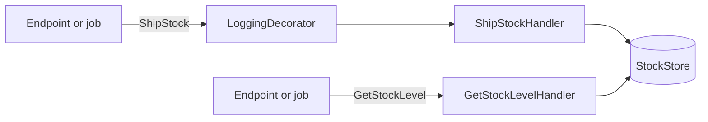

# 02. CQRS without ceremony

> **Draft: written but not yet run.** The code and the expected output in this lesson were prepared by reading the code and the official documentation. They have not been executed yet. If something does not behave as described, trust your tool's real output and report it.

## What you will be able to do
By the end of this lesson you will be able to:
- Explain the difference between a command and a query, and name the three levels of CQRS.
- Write command and query handlers with two plain interfaces and compose them by hand, with a decorator for one cross-cutting concern.
- Predict the output of a small command and query program.
- Defend, in an ADR, why you did or did not add a mediator library.

## Recap
1. (Lesson 01) Which project owns the `IOrderStore` interface, and why?
   <details><summary>Answer</summary><code>Orders.Domain</code>. The inner circle owns the interface so that source code dependencies point inward.</details>
2. (Lesson 01) What is a vertical slice?
   <details><summary>Answer</summary>All the code of one feature (request, validation, handler, response) in one folder, so a change touches one place.</details>

## Why it matters
Reads and writes have different shapes. A write must enforce rules and be consistent; a read wants a fast, flat, screen-shaped answer. When one class and one model serve both, the write model grows read-only fields and the read path pays for rules it does not need. **CQRS** (Command Query Responsibility Segregation) separates the two **in code first**. The popular belief is that CQRS needs two databases, event sourcing and a mediator library. It needs none of them.

## What you will build
A stock ledger console program. Two commands (`ReceiveStock`, `ShipStock`), two queries (`GetStockLevel`, `ListLowStock`), two handler interfaces, one logging decorator and a hand-written composition root. No package is installed.

## Before you start
- **Prerequisites:** [C# 301 lesson 01, clean architecture and vertical slices](01-clean-architecture-and-vertical-slices.md); C# 201 lessons [02, generics and collections](../../201-hero-to-super-hero/phase-1-core-skills/02-generics-and-collections.md) and [04, async/await and Task](../../201-hero-to-super-hero/phase-1-core-skills/04-async-await-and-task.md).
- Tools: .NET SDK **11.0.100**, a terminal and an editor. Time: 60-80 minutes.
- Folder: repeat lesson 01 Step 1 for the folder name `lesson02` under `~/code101/csharp301` (`mkdir` and `cd`), but create only `lesson02` itself, no `src` folders. All files go directly in `lesson02`. `global.json` is identical to lesson 01 Step 2; copy it into `lesson02`.
- Source pack (optional): every file is shown in full in this lesson, so you can follow without it. The finished code, the exercise starter and the solution are in the
  course repository https://github.com/Uee03/Code101 under `source/csharp/301-super-hero-to-legendary/phase-1-architecture/02-cqrs-without-ceremony/` (on that page choose **Code, Download ZIP**, or run
  `git clone https://github.com/Uee03/Code101.git`).

## Steps
### Step 1. The project file
**File: `Ledger.csproj`**
```xml
<Project Sdk="Microsoft.NET.Sdk">

  <PropertyGroup>
    <OutputType>Exe</OutputType>
    <TargetFramework>net11.0</TargetFramework>
    <Nullable>enable</Nullable>
    <ImplicitUsings>enable</ImplicitUsings>
  </PropertyGroup>

</Project>
```
`OutputType` `Exe` makes it a console program. The assembly name defaults to the file name, `Ledger`.

### Step 2. A tiny result type
**File: `Result.cs`**
```csharp
namespace Ledger;

public readonly record struct Result(bool IsSuccess, string? Error)
{
    public static Result Ok() => new(true, null);

    public static Result Fail(string error) => new(false, error);
}
```
Expected failures (not enough stock) are values, not exceptions. Exceptions stay for the unexpected. A `record struct` keeps the result allocation-free.

### Step 3. The two interfaces
**File: `Abstractions.cs`**
```csharp
namespace Ledger;

// A command changes state and answers only "did it work?". It never returns data to display.
public interface ICommandHandler<in TCommand>
{
    Task<Result> HandleAsync(TCommand command, CancellationToken ct);
}

// A query returns data and must not change state.
public interface IQueryHandler<in TQuery, TResult>
{
    Task<TResult> HandleAsync(TQuery query, CancellationToken ct);
}
```
`in` makes the interfaces contravariant in the message type, which lets one decorator handle many commands. These two interfaces are the **entire** framework.

### Step 4. The store
**File: `StockStore.cs`**
```csharp
namespace Ledger;

public sealed record StockLine(string Sku, int Quantity);

// Not thread-safe on purpose: this demo is single-threaded. A real store would be a database.
public sealed class StockStore
{
    private readonly Dictionary<string, int> levels = new(StringComparer.OrdinalIgnoreCase);

    public int Get(string sku) => levels.TryGetValue(sku, out var level) ? level : 0;

    public void Set(string sku, int level) => levels[sku] = level;

    public IReadOnlyList<StockLine> All() => levels
        .Select(pair => new StockLine(pair.Key.ToUpperInvariant(), pair.Value))
        .OrderBy(line => line.Sku, StringComparer.Ordinal)
        .ToList();
}
```
Keys are case-insensitive and are shown in upper case, ordered with an ordinal comparer so the output does not depend on the machine's culture.

### Step 5. Commands
**File: `Commands.cs`**
```csharp
namespace Ledger;

public sealed record ReceiveStock(string Sku, int Quantity);

public sealed record ShipStock(string Sku, int Quantity);

public sealed class ReceiveStockHandler(StockStore store) : ICommandHandler<ReceiveStock>
{
    public Task<Result> HandleAsync(ReceiveStock command, CancellationToken ct)
    {
        if (command.Quantity <= 0)
        {
            return Task.FromResult(Result.Fail("Quantity must be positive."));
        }

        store.Set(command.Sku, store.Get(command.Sku) + command.Quantity);
        return Task.FromResult(Result.Ok());
    }
}

public sealed class ShipStockHandler(StockStore store) : ICommandHandler<ShipStock>
{
    public Task<Result> HandleAsync(ShipStock command, CancellationToken ct)
    {
        var available = store.Get(command.Sku);
        if (command.Quantity <= 0 || command.Quantity > available)
        {
            return Task.FromResult(Result.Fail($"Only {available} in stock, cannot ship {command.Quantity}."));
        }

        store.Set(command.Sku, available - command.Quantity);
        return Task.FromResult(Result.Ok());
    }
}
```
A command is named in the **imperative** (`ShipStock`) and is a plain immutable record. One handler handles exactly one command, so you find the code by the name.

### Step 6. Queries
**File: `Queries.cs`**
```csharp
namespace Ledger;

public sealed record GetStockLevel(string Sku);

public sealed record ListLowStock(int Threshold);

public sealed class GetStockLevelHandler(StockStore store) : IQueryHandler<GetStockLevel, int>
{
    public Task<int> HandleAsync(GetStockLevel query, CancellationToken ct) => Task.FromResult(store.Get(query.Sku));
}

public sealed class ListLowStockHandler(StockStore store) : IQueryHandler<ListLowStock, IReadOnlyList<StockLine>>
{
    public Task<IReadOnlyList<StockLine>> HandleAsync(ListLowStock query, CancellationToken ct)
    {
        IReadOnlyList<StockLine> low = store.All().Where(line => line.Quantity < query.Threshold).ToList();
        return Task.FromResult(low);
    }
}
```
A query is named as a question and never writes. Here both sides use the same store (CQRS **level 1**). Nothing stops a query handler from reading a different, read-optimized source later.

### Step 7. A decorator
**File: `LoggingDecorator.cs`**
```csharp
namespace Ledger;

// A decorator wraps a handler of the same interface and adds one cross-cutting concern.
public sealed class LoggingDecorator<TCommand>(ICommandHandler<TCommand> inner, TextWriter output) : ICommandHandler<TCommand>
{
    public async Task<Result> HandleAsync(TCommand command, CancellationToken ct)
    {
        var result = await inner.HandleAsync(command, ct);
        var name = typeof(TCommand).Name;
        output.WriteLine(result.IsSuccess ? $"{name}: ok" : $"{name}: failed ({result.Error})");
        return result;
    }
}
```
This is what a mediator's "pipeline behavior" does, without the mediator: a class with the same interface that calls the inner handler. Stack decorators for validation, transactions, authorization or metrics.

### Step 8. The composition root
**File: `Program.cs`**
```csharp
using Ledger;

var ct = CancellationToken.None;
var store = new StockStore();

// Composition by hand: the dependencies are visible and the compiler checks every one of them.
ICommandHandler<ReceiveStock> receive = new LoggingDecorator<ReceiveStock>(new ReceiveStockHandler(store), Console.Out);
ICommandHandler<ShipStock> ship = new LoggingDecorator<ShipStock>(new ShipStockHandler(store), Console.Out);
IQueryHandler<GetStockLevel, int> level = new GetStockLevelHandler(store);
IQueryHandler<ListLowStock, IReadOnlyList<StockLine>> lowStock = new ListLowStockHandler(store);

await receive.HandleAsync(new ReceiveStock("PEN", 10), ct);
await receive.HandleAsync(new ReceiveStock("CUP", 3), ct);
await ship.HandleAsync(new ShipStock("PEN", 7), ct);
await ship.HandleAsync(new ShipStock("PEN", 9), ct);
await receive.HandleAsync(new ReceiveStock("CUP", 0), ct);

Console.WriteLine($"PEN level: {await level.HandleAsync(new GetStockLevel("PEN"), ct)}");
var low = await lowStock.HandleAsync(new ListLowStock(5), ct);
Console.WriteLine($"Low stock (below 5): {string.Join(", ", low.Select(line => $"{line.Sku}={line.Quantity}"))}");
```
In an ASP.NET Core app you register each handler with `AddScoped<ICommandHandler<ShipStock>, ShipStockHandler>()` and inject `ICommandHandler<ShipStock>` straight into the endpoint from lesson 01. The endpoint depends on one specific interface, not on a dispatcher.

## Run it
**Predict first.** Starting from empty, PEN receives 10 then ships 7, then ships 9. Which line will say `failed`, and what number will it print? What will the low-stock line list?

In `lesson02`:
```text
dotnet run --project . --nologo
```
Expected output (not yet run; derived from the code):
```text
ReceiveStock: ok
ReceiveStock: ok
ShipStock: ok
ShipStock: failed (Only 3 in stock, cannot ship 9.)
ReceiveStock: failed (Quantity must be positive.)
PEN level: 3
Low stock (below 5): CUP=3, PEN=3
```
The first run also restores and builds. `CUP` comes before `PEN` because the list is sorted by ordinal SKU.

## How it works

**Command Query Separation** (Bertrand Meyer) is the method-level rule: a method either changes state or returns data. **CQRS** lifts it to the model level. Three levels, each with a cost:

| Level | What is separate | Cost | Use when |
|---|---|---|---|
| 1. Code paths | Handlers and DTOs; same database and model | Almost none | Almost always a good default for non-trivial write rules |
| 2. Read model | A separate, denormalized read store (view, table, cache) updated by the write side | Eventual consistency, a projection to maintain | Reads dominate and joins are expensive (measure first) |
| 3. Separate stores and event sourcing | Different engines; events as the source of truth | High: versioning, replay, operational complexity | Audit or temporal requirements that justify it |

**Misconception:** "CQRS means eventual consistency." Only levels 2 and 3 introduce it. Level 1 is immediately consistent because it is the same database.

### ADR-002: Plain handlers, no mediator library
| Field | Content |
|---|---|
| Context | Slices from lesson 01 each need one entry point. Cross-cutting concerns: logging, validation, metrics. |
| Decision | Two interfaces, one handler per message, decorators for cross-cutting behavior, composition in the DI container. |
| Alternatives | A mediator library (one `Send` method that resolves handlers at run time), or a source-generated mediator. |
| Consequences | + "Go to definition" from an endpoint lands on the handler. + A missing handler is a compile or startup error, not a run-time `InvalidOperationException`. + No dependency to license or upgrade. - Decorators for open generics need a few lines of DI code or a small helper. - Each endpoint declares the handlers it needs. |
| Revisit when | You have many handlers and a dozen behaviors that must apply to all of them, and a library's generated or tested pipeline is cheaper than your decorator wiring. Several well-known mediator libraries changed their license terms in recent years: read the current license before adopting any. |

## When not to use this
- **A CRUD screen:** `GetCustomer` and `UpdateCustomer` with no rules is just a table editor. Two handlers per field edit is ceremony.
- **When a query needs a command's result in the same call:** returning the created id from a command is fine and normal. Do not contort the design to keep it "pure".
- **Levels 2 and 3 without a measured problem:** a read model you do not need is a consistency bug you have bought in advance.

## Failure modes
- **Queries that write:** a "get next ticket" query that increments a counter breaks caching, retries and idempotency. Name it as a command.
- **Anemic handlers:** if each handler is `repository.Save(dto)`, the rules live nowhere. Put invariants in the domain (lesson 03) and let the handler orchestrate.
- **Decorator order:** validation must run before the transaction opens; logging should wrap everything. The order in which you nest `new` calls is the order of execution.
- **Level 2 without monitoring:** a stale read model is silent. Track projection lag.
- **Handler explosion:** one file per command and per handler, plus a validator, plus a DTO, for a three-line feature. Keep related types in one file until it hurts.

## Measurements to take
- **Projection lag** (level 2 only): the time between a committed write and the matching read-model update. Record the maximum per day.
- **Read/write ratio:** count queries and commands per minute from your logs before you decide a level-2 read model is justified.
- **Handler time** per message type with a metric (lesson 08), not with a stopwatch in the code.

## Production checklist
- [ ] Every command returns a `Result` for expected failures; exceptions are for bugs and outages.
- [ ] No query handler writes (review the diff or give query handlers a read-only database connection).
- [ ] Decorator order is written down in one place (the composition root).
- [ ] Commands carry the caller's identity and idempotency key where retries can happen (lessons 06 and 07).
- [ ] Any level-2 read model has a rebuild procedure and a lag metric.

## Try it
Add a `ListOutOfStock` query that returns every SKU whose level is exactly 0.
1. **Guided.** Copy your finished `lesson02` folder to `exercise02` and add the starter file:

**File: `OutOfStock.cs`**
```csharp
namespace Ledger;

public sealed record ListOutOfStock;

// TODO: return every SKU whose level is exactly 0, in the order StockStore.All() returns them.
public sealed class ListOutOfStockHandler(StockStore store) : IQueryHandler<ListOutOfStock, IReadOnlyList<StockLine>>
{
    public Task<IReadOnlyList<StockLine>> HandleAsync(ListOutOfStock query, CancellationToken ct)
    {
        IReadOnlyList<StockLine> none = [];
        return Task.FromResult(none);
    }
}
```
Then append these lines to `Program.cs` (after the last `Console.WriteLine`):
```csharp
IQueryHandler<ListOutOfStock, IReadOnlyList<StockLine>> outOfStock = new ListOutOfStockHandler(store);
await ship.HandleAsync(new ShipStock("PEN", 3), ct);
var empty = await outOfStock.HandleAsync(new ListOutOfStock(), ct);
Console.WriteLine($"Out of stock: {string.Join(", ", empty.Select(line => line.Sku))}");
```
Expected new last lines: `ShipStock: ok` and `Out of stock: PEN`.

2. **Change.** Write a `CountingDecorator<TCommand>` that counts failures and a line at the end of `Program.cs` that prints `Failures: 2` (two commands fail in this program). Which object must be shared between the decorators for the count to be total?
3. **Stretch.** Sketch (in words or a diagram) how you would move to CQRS level 2 for `ListLowStock`: what event triggers the projection, where is it stored, and what does a caller see if the projection is 2 seconds late?

<details><summary>Solution (rung 1)</summary>

**File: `OutOfStock.cs`**
```csharp
namespace Ledger;

public sealed record ListOutOfStock;

public sealed class ListOutOfStockHandler(StockStore store) : IQueryHandler<ListOutOfStock, IReadOnlyList<StockLine>>
{
    public Task<IReadOnlyList<StockLine>> HandleAsync(ListOutOfStock query, CancellationToken ct)
    {
        IReadOnlyList<StockLine> empty = store.All().Where(line => line.Quantity == 0).ToList();
        return Task.FromResult(empty);
    }
}
```
Rung 2: the decorators must share one counter object (a small class with an `int` you pass to each decorator), because each decorator instance is created per message type. Use `Interlocked.Increment` if handlers can run in parallel.
</details>

## Check yourself
1. What is the difference between a command and a query in this lesson's interfaces?
   <details><summary>Answer</summary>A command changes state and returns only a <code>Result</code>; a query returns data and never changes state.</details>
2. **Predict:** what does `await ship.HandleAsync(new ShipStock("PEN", 0), ct)` print if PEN has 3 in stock?
   <details><summary>Answer</summary><code>ShipStock: failed (Only 3 in stock, cannot ship 0.)</code> because the check <code>command.Quantity &lt;= 0</code> fails first and reuses the same message.</details>
3. Name one cost of using a mediator library.
   <details><summary>Answer</summary>Indirection (go-to-definition stops at the dispatcher), run-time resolution errors for missing handlers, and a dependency whose license or API can change.</details>
4. Which CQRS level introduces eventual consistency?
   <details><summary>Answer</summary>Level 2 (a separate read model) and level 3. Level 1 reads the same database.</details>

## Common mistakes
| Symptom or error text | Cause | Fix |
|---|---|---|
| `MSB1003: Specify a project or solution file. The current working directory does not contain a project or solution file.` | You ran `dotnet run` in a folder without `Ledger.csproj`. | `cd` into `lesson02`, or pass `--project <folder>`. |
| Compiler error CS0246 (type or namespace `Ledger` could not be found) | `Program.cs` has no `using Ledger;` or a file uses another namespace. | Add the `using` line or fix the `namespace Ledger;` at the top of the file. |
| A command prints `failed` for a valid shipment | The SKU spelling differs, so the level reads as 0. | Keys are case-insensitive but not trimmed: check for spaces. |
| `Low stock` shows nothing | The threshold is not larger than the quantities. | Use a threshold above the level you expect (`ListLowStock(5)` lists levels below 5). |

## Best practice
Separate reads from writes in code before you separate them in infrastructure, and add the next level only when a measured problem asks for it. Source: CQRS pattern, Azure Architecture Center https://learn.microsoft.com/azure/architecture/patterns/cqrs and ASP.NET Core best practices https://learn.microsoft.com/aspnet/core/fundamentals/best-practices

## Going further
- The capstone `backend-dotnet` keeps one slice per operation: `capstones/backend-dotnet/tutorials/phase-1-skeleton/01-skeleton.md`.
- Lesson 07 turns a command's side effects into reliable messages with the outbox pattern.

## Summary
- You explained commands, queries and the three levels of CQRS.
- You wrote handlers with two plain interfaces and composed them without a library.
- You added a cross-cutting concern with a decorator.
- You recorded an ADR that says when a mediator library would be worth it.

## Next lesson
03. Domain-driven design essentials: entities, value objects, aggregates and domain events that carry the rules your handlers should not contain.
