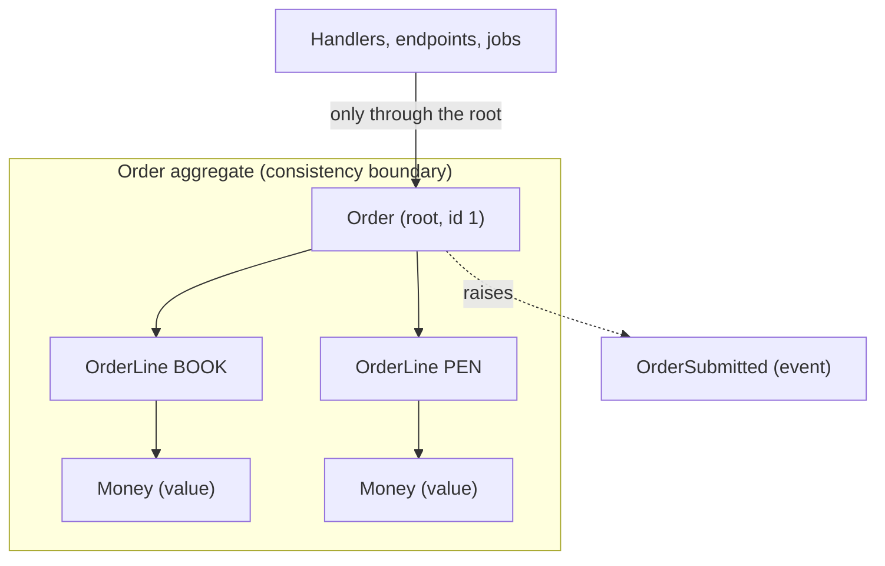

# 03. Domain-driven design essentials

> **Draft: written but not yet run.** The code and the expected output in this lesson were prepared by reading the code and the official documentation. They have not been executed yet. If something does not behave as described, trust your tool's real output and report it.

## What you will be able to do
By the end of this lesson you will be able to:
- Tell an entity, a value object, an aggregate root and a domain event apart, and say what each protects.
- Write a value object that cannot be created invalid and an aggregate that enforces its own invariants.
- Predict the exact output of a program that breaks four business rules.
- Decide when a domain model is worth its cost and when plain CRUD is the better answer.

## Recap
1. (Lesson 01) Why does `Order.Place` validate even though the validator already checked the request?
   <details><summary>Answer</summary>The validator protects the API boundary; the domain method protects the invariants for every caller (jobs, imports, tests).</details>
2. (Lesson 02) Which side of CQRS should enforce business rules, and why?
   <details><summary>Answer</summary>The command side (handlers calling the domain). Queries must not change state, so there is nothing to protect.</details>

## Why it matters
Most expensive bugs are business-rule bugs ("a shipped order was edited", "two currencies were added together"), and they hide when the rules are scattered across endpoints and services. **Domain-driven design** (DDD) puts the rules in one place, in the language the business uses, and makes illegal states impossible to build. You do not need all of DDD. You need five tactical tools and one strategic habit.

## What you will build
A console program with a `Money` value object, an `Order` aggregate (with a local `OrderLine`), domain events and a script that tries to break four rules. No packages.

## Before you start
- **Prerequisites:** C# 301 lessons [01, clean architecture and vertical slices](01-clean-architecture-and-vertical-slices.md) and [02, CQRS without ceremony](02-cqrs-without-ceremony.md); [C# 101 lesson 11, null safety and records](../../101-zero-to-hero/phase-3-real-programs/11-null-safety-and-records.md).
- Tools: .NET SDK **11.0.100**. Time: 70-90 minutes.
- Folder: create `lesson03` as in lesson 01 Step 1 (only the `lesson03` folder, files directly inside). Copy `global.json` from lesson 01 Step 2.
- Source pack (optional): every file is shown in full in this lesson, so you can follow without it. The finished code, the exercise starter and the solution are in the
  course repository https://github.com/Uee03/Code101 under `source/csharp/301-super-hero-to-legendary/phase-1-architecture/03-domain-driven-design-essentials/` (on that page choose **Code, Download ZIP**, or run
  `git clone https://github.com/Uee03/Code101.git`).

## Vocabulary first (the whole toolbox)
| Term | One-sentence meaning | In this lesson |
|---|---|---|
| Ubiquitous language | The words the business and the code share, down to method names | `Submit`, `AddLine`, `OrderSubmitted` |
| Entity | An object with an identity that persists while its values change | `Order` (id), `OrderLine` (SKU within one order) |
| Value object | No identity; equal when all values are equal; immutable | `Money` |
| Aggregate | A cluster of objects changed together as one consistency unit | `Order` with its lines |
| Aggregate root | The one object outsiders may call; it guards the invariants | `Order` |
| Invariant | A rule that must be true every time the aggregate is saved | "at most 3 lines", "same currency" |
| Domain event | A past-tense fact the domain raises | `OrderSubmitted` |
| Bounded context | The boundary inside which one model and one language are consistent | "Sales" here; "Shipping" would be another |

## Steps
### Step 1. The project
**File: `Sales.csproj`**
```xml
<Project Sdk="Microsoft.NET.Sdk">

  <PropertyGroup>
    <OutputType>Exe</OutputType>
    <TargetFramework>net11.0</TargetFramework>
    <Nullable>enable</Nullable>
    <ImplicitUsings>enable</ImplicitUsings>
  </PropertyGroup>

</Project>
```
The project has no packages: the model must run (and be tested) with nothing but .NET.

### Step 2. The rule-violation exception
**File: `DomainException.cs`**
```csharp
namespace Sales;

// Thrown when a business rule (an invariant) would be broken. Callers translate it into a 4xx answer, not a 500.
public sealed class DomainException(string message) : Exception(message);
```
A dedicated type lets an outer layer map "the caller broke a rule" to a 4xx answer and everything else to a 500 (the capstone does this with ProblemDetails).

### Step 3. The value object
**File: `Money.cs`**
```csharp
namespace Sales;

// A value object: no identity, equal when its values are equal, immutable, and impossible to build invalid.
public sealed record Money
{
    private Money(long cents, string currency)
    {
        Cents = cents;
        Currency = currency;
    }

    public long Cents { get; }

    public string Currency { get; }

    public static Money Of(long cents, string currency)
    {
        if (cents < 0)
        {
            throw new DomainException("Money cannot be negative.");
        }

        if (currency is not { Length: 3 } || !currency.All(char.IsAsciiLetterUpper))
        {
            throw new DomainException("A currency is three upper-case letters, for example EUR.");
        }

        return new Money(cents, currency);
    }

    public static Money Zero(string currency) => Of(0, currency);

    public Money Add(Money other)
    {
        if (other.Currency != Currency)
        {
            throw new DomainException("Currencies differ.");
        }

        return new Money(checked(Cents + other.Cents), Currency);
    }

    public Money Times(int factor) => new(checked(Cents * factor), Currency);

    public override string ToString() => $"{Cents / 100}.{Cents % 100:00} {Currency}";
}
```
Why a `sealed record` **class** and not a `record struct`? A struct can always be created with `default`, which skips the factory and yields `Currency == null`. A class with a private constructor cannot be built any other way than `Of`. `record` gives value equality for free. `checked` turns a silent overflow into an `OverflowException`. Money is held as `long` cents; never use `double` for money.

### Step 4. The aggregate base and the event marker
**File: `AggregateRoot.cs`**
```csharp
namespace Sales;

public interface IDomainEvent
{
}

// The base of every aggregate root: it records what happened and lets the caller collect it after saving.
public abstract class AggregateRoot
{
    private readonly List<IDomainEvent> events = [];

    protected void Raise(IDomainEvent domainEvent) => events.Add(domainEvent);

    public IReadOnlyList<IDomainEvent> PullEvents()
    {
        var copy = events.ToList();
        events.Clear();
        return copy;
    }
}
```
The aggregate **records** events; it does not publish them. Publishing happens after the aggregate is saved successfully (in lesson 07 the same transaction also stores them in an outbox). `PullEvents` empties the list so an event is delivered once.

### Step 5. The aggregate
**File: `Order.cs`**
```csharp
namespace Sales;

public enum OrderStatus
{
    Draft,
    Submitted,
}

// Local entity inside the Order aggregate: it is identified by its SKU within one order only.
public sealed record OrderLine(string Sku, int Quantity, Money UnitPrice)
{
    public Money Subtotal => UnitPrice.Times(Quantity);
}

// Domain events are facts in the past tense. Other parts of the system react to them.
public sealed record OrderLineAdded(int OrderId, string Sku, int Quantity) : IDomainEvent;

public sealed record OrderSubmitted(int OrderId, Money Total) : IDomainEvent;

// The aggregate root: the only way to change an order and the boundary of one consistency rule set.
public sealed class Order : AggregateRoot
{
    public const int MaxLines = 3;

    private readonly List<OrderLine> lines = [];

    private Order(int id, string currency)
    {
        Id = id;
        Currency = currency;
    }

    public int Id { get; }

    public string Currency { get; }

    public OrderStatus Status { get; private set; } = OrderStatus.Draft;

    public IReadOnlyList<OrderLine> Lines => lines;

    public Money Total => lines.Aggregate(Money.Zero(Currency), (sum, line) => sum.Add(line.Subtotal));

    public static Order Start(int id, string currency)
    {
        Money.Zero(currency);
        return new Order(id, currency);
    }

    public void AddLine(string sku, int quantity, Money unitPrice)
    {
        EnsureDraft();

        if (unitPrice.Currency != Currency)
        {
            throw new DomainException($"Prices must be in {Currency}.");
        }

        if (quantity is < 1 or > 99)
        {
            throw new DomainException("Quantity must be between 1 and 99.");
        }

        if (lines.Any(line => line.Sku == sku))
        {
            throw new DomainException($"{sku} is already on the order.");
        }

        if (lines.Count >= MaxLines)
        {
            throw new DomainException($"An order can have at most {MaxLines} lines.");
        }

        lines.Add(new OrderLine(sku, quantity, unitPrice));
        Raise(new OrderLineAdded(Id, sku, quantity));
    }

    public void Submit()
    {
        EnsureDraft();

        if (lines.Count == 0)
        {
            throw new DomainException("Cannot submit an empty order.");
        }

        Status = OrderStatus.Submitted;
        Raise(new OrderSubmitted(Id, Total));
    }

    private void EnsureDraft()
    {
        if (Status != OrderStatus.Draft)
        {
            throw new DomainException("A submitted order cannot change.");
        }
    }
}
```
Walk through the shape: the constructor is private; `Start` is the only door in. `Status` has a **private setter**, so only `Submit` can move the state forward. `Lines` is read-only, so nobody can add a line without the rules. Each public method **checks every rule before it changes anything**, so a failure leaves the aggregate untouched. `OrderLine` is an entity local to the aggregate: only the root may be loaded or saved by id. `MaxLines` is 3 here only so you can trigger the rule in a few lines; a real limit comes from the business.

### Step 6. The script
**File: `Program.cs`**
```csharp
using Sales;

var order = Order.Start(1, "EUR");
order.AddLine("BOOK", 2, Money.Of(1250, "EUR"));
order.AddLine("PEN", 10, Money.Of(150, "EUR"));
Console.WriteLine($"Total: {order.Total}");

TryRule("USD line", () => order.AddLine("MUG", 1, Money.Of(500, "USD")));
TryRule("quantity 100", () => order.AddLine("MUG", 100, Money.Of(500, "EUR")));

order.Submit();
Console.WriteLine($"Status: {order.Status}");
TryRule("add after submit", () => order.AddLine("MUG", 1, Money.Of(500, "EUR")));
TryRule("empty order", () => Order.Start(2, "EUR").Submit());

Console.WriteLine($"Money equality: {Money.Of(100, "EUR") == Money.Of(100, "EUR")}");

// In a real app the repository saves the aggregate first, then the events are published.
foreach (var domainEvent in order.PullEvents())
{
    var text = domainEvent switch
    {
        OrderLineAdded added => $"event OrderLineAdded: {added.Quantity} x {added.Sku}",
        OrderSubmitted submitted => $"event OrderSubmitted: total {submitted.Total}",
        _ => $"event {domainEvent.GetType().Name}",
    };
    Console.WriteLine(text);
}

static void TryRule(string name, Action action)
{
    try
    {
        action();
        Console.WriteLine($"{name}: allowed (unexpected)");
    }
    catch (DomainException ex)
    {
        Console.WriteLine($"{name}: rejected ({ex.Message})");
    }
}
```
`TryRule` runs an action and reports whether the domain rejected it. The local function sits at the bottom; top-level statements may call a local function declared later.

## Run it
**Predict first.** Which of the four `TryRule` lines will say `allowed (unexpected)`? How many events will the loop print, given that failed calls raise nothing?

In `lesson03`:
```text
dotnet run --project . --nologo
```
Expected output (not yet run; derived from the code):
```text
Total: 40.00 EUR
USD line: rejected (Prices must be in EUR.)
quantity 100: rejected (Quantity must be between 1 and 99.)
Status: Submitted
add after submit: rejected (A submitted order cannot change.)
empty order: rejected (Cannot submit an empty order.)
Money equality: True
event OrderLineAdded: 2 x BOOK
event OrderLineAdded: 10 x PEN
event OrderSubmitted: total 40.00 EUR
```
None says "allowed". Three events: two lines and the submit; the four rejected calls raised nothing because every rule check runs before the state change and the `Raise` call.

## How it works

**Aggregate rules of thumb.** (1) One transaction changes one aggregate. (2) Other aggregates are referenced **by id**, never by object (an order holds a `CustomerId`, not a `Customer`). (3) Keep aggregates small: load cost and lock contention grow with size. (4) Cross-aggregate consistency is **eventual**, driven by domain events (lessons 07 and 09).

**Misconception:** "Entities are the classes with an `Id`." Identity is a modeling decision: a `Money` with a database key would stop being a value. Ask "does the business care *which one* it is, or only *what it contains*?"

**Persistence.** The domain stays framework-free; mapping is the outer circle's job. With EF Core, value objects are commonly mapped as owned types or complex types, and domain events are typically collected from tracked aggregates and published after `SaveChanges` succeeds, or written to an outbox in the same transaction. Check the EF Core documentation for the current mapping API before you copy any snippet.

### ADR-003: Rich domain for orders, plain CRUD for lookups
| Field | Content |
|---|---|
| Context | Order rules change often and cost money when wrong. Country and category lookups are static reference data. |
| Decision | Model `Order` as an aggregate with invariants and events. Keep lookups as plain tables and DTOs with no domain classes. |
| Consequences | + Rules are testable without a database or HTTP. + The language is explicit. - More types and a mapping layer. - Developers must resist adding setters "just for the importer". |
| Revisit when | A "lookup" grows rules (for example prices with validity periods): promote it. |

## When not to use this
- **CRUD with no rules:** a settings page, a reference-data editor, an admin grid. Use records and a table.
- **Short-lived projects and reports:** the language and aggregates pay off over years, not weeks.
- **When you have no access to a domain expert:** the model becomes the developers' guess. Prefer a simple model you can change.
- **Data-pipeline or ETL code:** the work is transformation, not behavior. Functions over data are clearer.

## Failure modes
- **God aggregate:** `Customer` containing all orders, addresses and payments. Every change loads and locks everything. Split by transactional boundary.
- **Aggregate references by object:** `order.Customer.Address.City` hides loading and couples aggregates. Hold ids; load through the repository.
- **Primitive obsession:** `string sku`, `int cents` everywhere lets a SKU be passed where a currency belongs (the exercise fixes this).
- **Events as data transport:** an event carrying the whole order couples every subscriber to the order's shape. Send ids and the facts that changed.
- **Domain events for everything:** if nobody reacts, you are logging. Raise an event when another part of the system must act or must be able to.
- **Shared kernel creep:** two bounded contexts sharing one `Order` class are one context pretending to be two.

## Measurements to take
- **Aggregate size:** log the number of child rows loaded per command; a growing p95 means the aggregate is too big.
- **Concurrency conflicts:** count `DbUpdateConcurrencyException` (or your version check) per aggregate type; frequent conflicts mean a hot aggregate.
- **Rule-violation rate:** count `DomainException` by message; a spike after a release shows a UI or contract mismatch, not an attack.

## Production checklist
- [ ] The domain project has no framework references (lesson 01 checklist).
- [ ] Every aggregate has one public factory and private constructors; state changes only through methods.
- [ ] Money uses integer minor units or `decimal`, with the currency attached, and checked arithmetic.
- [ ] Events are published after a successful save, preferably through an outbox (lesson 07).
- [ ] `DomainException` maps to a 4xx ProblemDetails, never a 500.
- [ ] Optimistic concurrency (a version column or ETag) protects aggregates that two users can edit.

## Try it
Remove primitive obsession: make the SKU a value object.
1. **Guided.** Copy your finished `lesson03` to `exercise03`, add this starter file and complete the TODO.

**File: `Sku.cs`**
```csharp
namespace Sales;

// TODO: make Sku a value object like Money: private constructor, a static Of(string value) factory, and record equality.
public sealed record Sku
{
    private Sku(string value)
    {
        Value = value;
    }

    public string Value { get; }

    public static Sku Of(string value)
    {
        // TODO: reject anything that is not 3 to 12 upper-case letters, digits or hyphens.
        // Throw new DomainException("A SKU is 3 to 12 upper-case letters, digits or hyphens.")
        return new Sku(value);
    }

    public override string ToString() => Value;
}
```
Append to `Program.cs` (before the local function `TryRule`, which must stay last; it is fine to place them just after the `Money equality` line):
```csharp
TryRule("bad sku", () => Sku.Of("bad sku"));
Console.WriteLine($"Sku equality: {Sku.Of("BOOK-1") == Sku.Of("BOOK-1")}");
```
Expected new lines: `bad sku: rejected (A SKU is 3 to 12 upper-case letters, digits or hyphens.)` and `Sku equality: True`.

2. **Change.** Make `Order.AddLine` accept a `Sku` instead of a `string` and `OrderLine`, `OrderLineAdded` carry a `Sku`. What does the compiler now prevent that it did not before?
3. **Stretch.** A `Customer` places many orders and wants a loyalty discount after the fifth. Where does that rule live: in `Order`, in a new `Customer` aggregate, or in a domain service? What events cross the boundary? Write your reasoning in four sentences.

<details><summary>Solution (rung 1)</summary>

**File: `Sku.cs`**
```csharp
namespace Sales;

public sealed record Sku
{
    private Sku(string value)
    {
        Value = value;
    }

    public string Value { get; }

    public static Sku Of(string value)
    {
        var valid = value.Length is >= 3 and <= 12
            && value.All(c => char.IsAsciiLetterUpper(c) || char.IsAsciiDigit(c) || c == '-');
        if (!valid)
        {
            throw new DomainException("A SKU is 3 to 12 upper-case letters, digits or hyphens.");
        }

        return new Sku(value);
    }

    public override string ToString() => Value;
}
```
`"bad sku"` contains a lower-case letter and a space, so the rule rejects it. Rung 2: the compiler now refuses to pass a currency code or a customer name where a SKU is expected. Rung 3 hint: the discount depends on **history across orders**, so it belongs to a `Customer` (or a loyalty context) reacting to `OrderSubmitted`; `Order` should not load other orders.
</details>

## Check yourself
1. Why is `Money` a class with a private constructor and not a `record struct`?
   <details><summary>Answer</summary>A struct can be created with <code>default</code>, bypassing validation and leaving the currency null. A class can only be built through <code>Of</code>.</details>
2. **Find the bug.** A teammate adds `public OrderStatus Status { get; set; }` "for the importer". What breaks?
   <details><summary>Answer</summary>Any code can mark an order submitted (or draft again) without the rules in <code>Submit</code> and <code>EnsureDraft</code>, so invariants are no longer guaranteed. Provide a named method that applies the rules instead.</details>
3. Why does `Order` hold a customer id and not a `Customer` object?
   <details><summary>Answer</summary>Aggregates are consistency boundaries; referencing by id keeps transactions small and avoids hidden loading and coupling.</details>
4. When would you choose plain CRUD over this model?
   <details><summary>Answer</summary>When there are no meaningful rules or behavior (reference data, admin grids) or no domain expert to shape the language.</details>

## Common mistakes
| Symptom or error text | Cause | Fix |
|---|---|---|
| Compiler error CS0272 or CS0200 mentioning a `private set` or read-only property when you edit `Status` from `Program.cs` | The setter is private on purpose. | Call `Submit()` instead of assigning the property. |
| The program stops with an unhandled `Sales.DomainException: Money cannot be negative.` | You passed negative cents to `Money.Of`; only `Program.cs` calls inside `TryRule` are caught. | Pass a value of zero or more, or wrap the call in `try`/`catch (DomainException)` where the caller can answer with a 4xx. |
| A rule did not fire | The check is placed after the state change in your edit. | Run all rule checks first, then change state, then raise the event. |
| `System.OverflowException` (Arithmetic operation resulted in an overflow.) | `checked` arithmetic caught an overflow. | Validate sizes earlier or use a larger numeric type. |

## Best practice
Make illegal states unrepresentable: private constructors, factory methods that validate, and state changes only through intention-revealing methods. Source: Microsoft Learn, Domain model layer validations and Tackling business complexity in a microservice with DDD and CQRS https://learn.microsoft.com/dotnet/architecture/microservices/microservice-ddd-cqrs-patterns/

## Going further
- The platform capstone's `complete_task` rules live in the database; compare that trade-off with a domain model in `capstones/platform/TDD.md`.
- Eric Evans's book and Vaughn Vernon's "Effective Aggregate Design" (three short papers) are the reference texts for aggregate sizing.
- Lesson 07 stores `OrderSubmitted` in an outbox so it survives a crash.

## Summary
- You separated entities, value objects, aggregates and events and said what each protects.
- You built a value object and an aggregate that cannot be put in an invalid state.
- You predicted and read the output of four rejected rule violations.
- You recorded when DDD pays off and when plain CRUD wins.

## Next lesson
04. Performance fundamentals: measure allocations and time with BenchmarkDotNet before you change a line.
