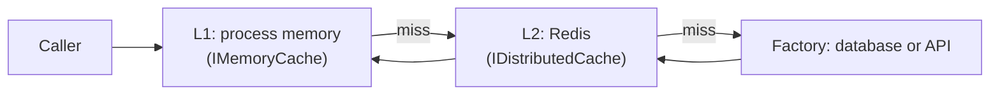

# 05. Caching

> **Draft: written but not yet run.** The code and the expected output in this lesson were prepared by reading the code and the official documentation. They have not been executed yet. If something does not behave as described, trust your tool's real output and report it.

## What you will be able to do
By the end of this lesson you will be able to:
- Choose between `IMemoryCache`, `HybridCache` and a distributed cache, and say what each costs.
- Predict what a cache stampede does with `IMemoryCache` and what `HybridCache` does instead.
- Invalidate entries by key and by tag, and explain why staleness is a product decision.
- Review a cache key scheme for cross-tenant leaks and key-injection risks.

## Recap
1. (Lesson 04) Why do you record a baseline before optimizing?
   <details><summary>Answer</summary>Without a baseline you cannot tell whether a change helped, or whether the difference is just noise.</details>
2. (Lesson 04) Name one situation in which a faster function does not make the system faster.
   <details><summary>Answer</summary>When I/O (a database or HTTP call) dominates the request time.</details>

## Why it matters
Caching is the cheapest way to remove I/O, and the easiest way to ship wrong data. Every cache is a **second copy of the truth** with its own lifetime. Phil Karlton's joke ("two hard things: cache invalidation and naming things") is a design warning: before you add a cache, decide how stale a reader may see data, who is allowed to see which entry, and how you will know the cache is working.

## What you will build
A console program that runs five experiments against a fake "slow catalog" (every load takes about 50 ms and is counted): `IMemoryCache` sequential calls, an `IMemoryCache` stampede, a `HybridCache` stampede, a deliberately stale read, and invalidation by tag and by key. An optional Docker Compose file starts Redis so you can add a second cache level.

## Before you start
- **Prerequisites:** [C# 301 lesson 04, performance fundamentals](04-performance-fundamentals.md); C# 201 lessons [04, async/await and Task](../../201-hero-to-super-hero/phase-1-core-skills/04-async-await-and-task.md) and [07, dependency injection and options](../../201-hero-to-super-hero/phase-2-web-apis/07-dependency-injection-and-options.md).
- Tools: .NET SDK **11.0.100**. Docker is **optional** (only for the Redis part, Steps 7 and 8). Time: 80-100 minutes.
- Folder: create `lesson05` as in lesson 01 Step 1 (only `lesson05`, files directly inside) and copy `global.json` from lesson 01 Step 2.
- Source pack (optional): every file is shown in full in this lesson, so you can follow without it. The finished code, the exercise starter and the solution are in the
  course repository https://github.com/Uee03/Code101 under `source/csharp/301-super-hero-to-legendary/phase-2-performance/05-caching/` (on that page choose **Code, Download ZIP**, or run
  `git clone https://github.com/Uee03/Code101.git`).

## Steps
### Step 1. The project
**File: `Caching.csproj`**
```xml
<Project Sdk="Microsoft.NET.Sdk">

  <PropertyGroup>
    <OutputType>Exe</OutputType>
    <TargetFramework>net11.0</TargetFramework>
    <Nullable>enable</Nullable>
    <ImplicitUsings>enable</ImplicitUsings>
  </PropertyGroup>

  <ItemGroup>
    <PackageReference Include="Microsoft.Extensions.Hosting" Version="11.0.0" />
    <PackageReference Include="Microsoft.Extensions.Caching.Memory" Version="11.0.0" />
    <PackageReference Include="Microsoft.Extensions.Caching.Hybrid" Version="11.0.1" />
    <PackageReference Include="Microsoft.Extensions.Caching.StackExchangeRedis" Version="11.0.0" />
  </ItemGroup>

</Project>
```
`Hosting` gives you the generic host: dependency injection, configuration and logging in one package. `Caching.Memory` is `IMemoryCache`. `Caching.Hybrid` is the two-level `HybridCache`. `StackExchangeRedis` is an `IDistributedCache` backed by Redis. Versions are exact so everyone gets the same behavior.

### Step 2. The fake slow data source
**File: `SlowCatalog.cs`**
```csharp
namespace Caching;

public sealed record Product(int Id, string Name, int PriceCents);

// Stands in for a database: every load takes about 50 ms and is counted.
public sealed class SlowCatalog
{
    private int loads;

    public int Loads => Volatile.Read(ref loads);

    public int PriceCents { get; set; } = 1000;

    public async Task<Product> LoadAsync(int id, CancellationToken ct)
    {
        Interlocked.Increment(ref loads);
        await Task.Delay(50, ct);
        return new Product(id, $"Product {id}", PriceCents);
    }
}
```
`Loads` is the experiment's measuring instrument: a good cache **reduces the number of loads**. `PriceCents` is mutable so you can simulate "the database changed behind the cache's back".

### Step 3. The program
**File: `Program.cs`**
```csharp
using Caching;
using Microsoft.Extensions.Caching.Hybrid;
using Microsoft.Extensions.Caching.Memory;
using Microsoft.Extensions.DependencyInjection;
using Microsoft.Extensions.Hosting;
using Microsoft.Extensions.Logging;

var ct = CancellationToken.None;
var redis = Environment.GetEnvironmentVariable("REDIS_CONFIGURATION");

var builder = Host.CreateApplicationBuilder(args);
builder.Logging.ClearProviders();
builder.Services.AddMemoryCache();
if (!string.IsNullOrEmpty(redis))
{
    // When an IDistributedCache is registered, HybridCache uses it as its second level (L2) automatically.
    builder.Services.AddStackExchangeRedisCache(options => options.Configuration = redis);
}

builder.Services.AddHybridCache(options =>
{
    options.DefaultEntryOptions = new HybridCacheEntryOptions
    {
        Expiration = TimeSpan.FromMinutes(5),
        LocalCacheExpiration = TimeSpan.FromMinutes(1),
    };
});

using var host = builder.Build();
var memory = host.Services.GetRequiredService<IMemoryCache>();
var hybrid = host.Services.GetRequiredService<HybridCache>();
Console.WriteLine(string.IsNullOrEmpty(redis) ? "L2 cache: none (memory only)" : "L2 cache: Redis");

// 1. IMemoryCache: simple and fast, but one process only and no protection against a stampede.
var memoryCatalog = new SlowCatalog();
for (var i = 0; i < 3; i++)
{
    await memory.GetOrCreateAsync("product:1", entry =>
    {
        entry.AbsoluteExpirationRelativeToNow = TimeSpan.FromMinutes(1);
        return memoryCatalog.LoadAsync(1, ct);
    });
}

Console.WriteLine($"IMemoryCache, 3 sequential calls: {memoryCatalog.Loads} load(s)");

// 2. Five callers ask for the same missing key at the same moment (a cache stampede).
var stampedeCatalog = new SlowCatalog();
await Task.WhenAll(Enumerable.Range(0, 5).Select(_ => memory.GetOrCreateAsync("product:2", entry =>
{
    entry.AbsoluteExpirationRelativeToNow = TimeSpan.FromMinutes(1);
    return stampedeCatalog.LoadAsync(2, ct);
})));
Console.WriteLine($"IMemoryCache, 5 parallel callers: {stampedeCatalog.Loads} load(s) (usually more than 1; varies between runs)");

// 3. HybridCache runs the factory once per key per process and makes the other callers wait for it.
var hybridCatalog = new SlowCatalog();
await Task.WhenAll(Enumerable.Range(0, 5).Select(_ => hybrid.GetOrCreateAsync(
    "hybrid:product:3",
    token => new ValueTask<Product>(hybridCatalog.LoadAsync(3, token)),
    cancellationToken: ct).AsTask()));
Console.WriteLine($"HybridCache, 5 parallel callers: {hybridCatalog.Loads} load(s)");

// 4. Staleness and invalidation. The run id keeps keys from an earlier run (kept by Redis) out of this run.
var runId = Guid.NewGuid().ToString("N")[..8];
var catalog = new SlowCatalog();

ValueTask<Product> Read(int id) => hybrid.GetOrCreateAsync(
    $"catalog:{runId}:product:{id}",
    token => new ValueTask<Product>(catalog.LoadAsync(id, token)),
    tags: ["catalog"],
    cancellationToken: ct);

_ = await Read(7);
_ = await Read(7);
Console.WriteLine($"HybridCache, 2 sequential calls: {catalog.Loads} load(s)");

catalog.PriceCents = 1200;
var stale = await Read(7);
Console.WriteLine($"Price in the database: {catalog.PriceCents}, price served from cache: {stale.PriceCents}");

await hybrid.RemoveByTagAsync("catalog", ct);
var fresh = await Read(7);
Console.WriteLine($"After RemoveByTagAsync: price {fresh.PriceCents}, {catalog.Loads} load(s)");

await hybrid.RemoveAsync($"catalog:{runId}:product:7", ct);
_ = await Read(7);
Console.WriteLine($"After RemoveAsync: {catalog.Loads} load(s)");
```
Read it in five blocks:
1. **Registration.** `AddMemoryCache` registers `IMemoryCache`. If `REDIS_CONFIGURATION` is set, `AddStackExchangeRedisCache` registers an `IDistributedCache`, and `AddHybridCache` picks it up as the second level **without any other code change**. `Expiration` is how long the entry lives in the distributed cache; `LocalCacheExpiration` is the shorter life in each process's memory.
2. **`IMemoryCache.GetOrCreateAsync`** looks up the key, runs the factory on a miss and stores the result. It does **not** lock: if five callers miss at the same moment, all five run the factory.
3. **`HybridCache.GetOrCreateAsync`** does the same lookup but guarantees that only one caller per key (per process) runs the factory while the others wait for its result.
4. **Tags.** A tag groups entries, so one call can invalidate a whole family.
5. **Logging off.** `ClearProviders()` keeps the console output limited to what the program prints, so the expected output below is exact.

## Run it
**Predict first.** (a) How many loads for three sequential `IMemoryCache` calls? (b) For five *parallel* `IMemoryCache` callers, will it be 1, 5 or something in between? (c) For five parallel `HybridCache` callers? (d) After the database price changes to 1200, what price does the cache return?

In `lesson05`:
```text
dotnet run --project . --nologo
```
Expected output without Redis (not yet run; derived from the code and the HybridCache documentation). The value of N varies:
```text
L2 cache: none (memory only)
IMemoryCache, 3 sequential calls: 1 load(s)
IMemoryCache, 5 parallel callers: N load(s) (usually more than 1; varies between runs)
HybridCache, 5 parallel callers: 1 load(s)
HybridCache, 2 sequential calls: 1 load(s)
Price in the database: 1200, price served from cache: 1000
After RemoveByTagAsync: price 1200, 2 load(s)
After RemoveAsync: 3 load(s)
```
Why N is not exact: `IMemoryCache.GetOrCreateAsync` has no per-key lock, so the number of factory runs depends on how the five tasks interleave. All five start within a millisecond and the load takes about 50 ms, so you will most likely see 5, but the API does not promise it. The deterministic lines are the point: `HybridCache` is exactly 1, and the stale line proves a cache can serve old data for as long as you let it.

### Add a second level with Redis (optional)
You need Docker running. First the compose file.

**File: `docker-compose.yml`**
```yaml
services:
  redis:
    image: redis:8.8-alpine
    environment:
      REDIS_PASSWORD: ${REDIS_PASSWORD:?Copy .env.example to .env first}
    command:
      - sh
      - -c
      - exec redis-server --save "" --appendonly no --maxmemory 64mb --maxmemory-policy allkeys-lru --requirepass "$$REDIS_PASSWORD"
    ports:
      - "127.0.0.1:6379:6379"
    healthcheck:
      test: ["CMD-SHELL", "redis-cli -a \"$$REDIS_PASSWORD\" --no-auth-warning ping | grep -q PONG"]
      interval: 3s
      timeout: 3s
      retries: 20
```
Line by line:
- `image: redis:8.8-alpine` pins a minor version of the small Alpine image. Do not use `latest` in anything you want to reproduce. Check the Redis license terms for your use before you pick a Redis distribution; Valkey is a compatible alternative.
- `REDIS_PASSWORD: ${REDIS_PASSWORD:?...}` takes the password from your `.env` file and **stops compose with the message** if it is missing, so Redis can never start without a password by accident.
- `command` runs a shell that `exec`s `redis-server`. `--save ""` and `--appendonly no` turn persistence off (this is a cache: it may lose everything). `--maxmemory 64mb` with `--maxmemory-policy allkeys-lru` makes Redis **evict least-recently-used keys** instead of growing without bound. `--requirepass` enforces the password. `$$` is how compose writes a literal `$`, so the shell inside the container expands `REDIS_PASSWORD`.
- `ports: "127.0.0.1:6379:6379"` publishes Redis **only on your loopback interface**. Without the `127.0.0.1:` prefix any machine on your network could try to reach it. Change the left port if 6379 is taken.
- `healthcheck` runs `redis-cli ping` with the password; compose marks the service healthy when it prints `PONG`.

**File: `.env.example`**
```text
REDIS_PASSWORD=change-me-local-only
```
Copy it to `.env` in the same folder (`copy .env.example .env` on Windows, `cp .env.example .env` on macOS and Linux) and **change the value**. Never commit `.env`.

Start Redis and wait until it is healthy:
```text
docker compose up -d --wait
docker compose ps
```
`--wait` returns when the health check passes. `docker compose ps` should list `redis` as `running (healthy)`. Then set the connection setting for this terminal only and run the program again.

PowerShell:
```powershell
$env:REDIS_CONFIGURATION = "localhost:6379,password=change-me-local-only,abortConnect=false"
dotnet run --project . --nologo
```
bash or zsh:
```bash
export REDIS_CONFIGURATION="localhost:6379,password=change-me-local-only,abortConnect=false"
dotnet run --project . --nologo
```
Use the password you put in `.env`. Expected change (not yet run): the first line becomes `L2 cache: Redis`; the other lines have the same shape. `abortConnect=false` lets the client keep retrying instead of failing at startup if Redis is slow to accept connections. Clean up when you are done:
```text
docker compose down -v
```
`-v` removes the (empty) volume and the network. Close the terminal or unset the variable (`Remove-Item Env:REDIS_CONFIGURATION` in PowerShell, `unset REDIS_CONFIGURATION` in bash).

## How it works

**Choosing a cache.**

| Option | Shared across instances | Stampede protection | Serialization cost | Use when |
|---|---|---|---|---|
| `IMemoryCache` | No (per process) | No | None (objects by reference) | One instance, or data that may differ per instance, small hot sets |
| `IDistributedCache` (Redis) | Yes | No | Yes (bytes) | Several instances must share, or the cache must survive restarts |
| `HybridCache` | L2 shared, L1 per process | Yes (per process) | Only with an L2 | Default choice for new code: both levels and single-flight |
| HTTP caching, output caching | Depends | Depends | None | Whole responses; see the ASP.NET Core caching overview |

**Invalidation strategies and their cost.**
- **Time to live (TTL) only:** simplest. The price is staleness up to the TTL. Add random jitter to TTLs so entries created together do not all expire together (an "avalanche").
- **Explicit remove on write:** `RemoveAsync` after the database commit. Fast, but you can forget a write path, and in a multi-instance setup the *other* instances' L1 copies live until `LocalCacheExpiration` ends.
- **Tags:** `RemoveByTagAsync` invalidates a family. The documentation notes this is a **logical** operation ("ignore anything created before this point"); old bytes stay in the stores until they expire.
- **Versioned keys:** put a version or row version in the key (`product:7:v12`) so a change creates a new key. No invalidation call, but old keys occupy memory until evicted.
- **Event-driven:** publish an event on change (lesson 07's outbox) and have each instance remove the entry. Most accurate; most moving parts.

**Misconception:** "A cache only makes things faster." It also adds failure modes: stale data, cold starts that overload the source, and memory pressure. A cache that hides a slow query keeps the slow query.

### ADR-005: HybridCache with a short L1 and a longer L2
| Field | Content |
|---|---|
| Context | Three API instances read a product catalog that changes a few times a day. The database is the bottleneck at peak. |
| Decision | `HybridCache` with `LocalCacheExpiration` of 1 minute, `Expiration` of 5 minutes, tag `catalog`, and `RemoveByTagAsync("catalog")` after any catalog write. |
| Consequences | + Single-flight per instance. + Shared L2 prevents N instances from each loading the same row. - A reader on another instance can see old data for up to the L1 lifetime after a write. - Redis is a new dependency to run and monitor. |
| Revisit when | Readers need read-your-writes consistency (then bypass the cache for the writer's next read) or the hit ratio is low. |

## When not to use this
- **Data that must be exactly current:** account balances, stock reservations, permissions after a revocation. Read the source of truth; or cache with a TTL of seconds and a clear stale-data decision.
- **Per-user data under a shared key:** a cached "my profile" response served to the next user is a data breach, not a bug.
- **When the source is already fast:** a primary-key read on a warm database may cost less than a Redis round trip plus serialization.
- **To hide a missing index or an N+1 query:** fix the query ([Databases 201 lesson 07, indexes and EXPLAIN](../../../databases/201-hero-to-super-hero/phase-2-querying/07-indexes-and-explain.md)) first.
- **Large objects:** `HybridCache` refuses payloads above `MaximumPayloadBytes` (1 MB default); a cache full of huge values evicts everything useful.

## Failure modes
- **Stampede:** many callers miss together and all hit the source. `HybridCache` protects within one process only; across instances use a staggered TTL, jitter or a lock if the source cannot take N parallel loads.
- **Penetration:** requests for keys that do not exist bypass the cache every time. Cache the "not found" answer for a short time (negative caching), and validate ids before you build keys.
- **Avalanche:** a restart or a mass expiry sends the whole traffic to the database at once. Warm critical keys, add TTL jitter, and load-test a cold start.
- **Stale after write:** the writer's own next read shows old data. Invalidate before returning, or read from the source for the writer.
- **Key collisions and leaks:** `$"order{customerId}{orderId}"` makes 42+123 equal to 421+23. Use delimiters, put the **tenant** and, where relevant, the **user** in the key, and never build keys from raw user input (the official guidance warns about key flooding and aliasing).
- **Serialization drift:** a deploy that changes `Product` while old bytes sit in Redis makes deserialization fail or silently drop fields. Version your cache keys on a breaking shape change.
- **Cache as database:** nothing in this design survives a Redis restart, and it must not need to.
- **`IMemoryCache` without a size limit:** it grows until the process runs out of memory. If you set `SizeLimit`, every entry must set a `Size` (typical error: "Cache entry must specify a value for Size when SizeLimit is set").
- **Unbounded redundant caching:** every layer caching the same thing makes invalidation impossible to reason about. Cache at one layer per datum.

## Measurements to take
- **Hit ratio** per cache name: hits divided by lookups. Count hits and misses with a counter metric (lesson 08). A hit ratio you never look at is a guess.
- **Origin load:** database or API requests per second before and after; this, not the hit ratio, is the goal.
- **Latency of hit and miss paths separately** (p50 and p99). A cache that makes the miss path slower (serialize, write to Redis, then load) needs that cost accounted for.
- **Eviction count and memory** in Redis (`INFO stats`, `INFO memory`) and the process's heap size for L1.
- **Staleness:** the time between a source change and the first correct read; compare with the number you agreed with the product owner.

## Production checklist
- [ ] A written staleness budget per cached datum, agreed with the owner of the data.
- [ ] Keys include tenant (and user where relevant), use delimiters, and never contain raw user input.
- [ ] TTLs have jitter; `maxmemory` and an eviction policy are set on Redis; Redis requires a password or network ACLs and is not exposed publicly.
- [ ] Redis loss is a performance event, not an outage: the app still works with the cache empty (test it).
- [ ] Hit ratio, origin load and eviction metrics are on a dashboard with an alert.
- [ ] Cache keys include a version when the cached shape changes.
- [ ] `RemoveByTagAsync`/`RemoveAsync` is called after every write path of that data (grep for the write sites in review).

## Try it
Protect a multi-tenant key. Copy your finished `lesson05` to `exercise05` and add this starter file.
1. **Guided.** Complete the TODO.

**File: `TenantKeys.cs`**
```csharp
namespace Caching;

public static class TenantKeys
{
    // TODO: throw ArgumentException unless tenantId is 1 to 32 letters or digits (it becomes part of a cache key).
    public static string ProductKey(string tenantId, int productId) => $"catalog:{tenantId}:product:{productId}";
}
```
Append these lines to `Program.cs`:
```csharp
Console.WriteLine(TenantKeys.ProductKey("acme", 7));
try
{
    TenantKeys.ProductKey("acme:admin", 7);
}
catch (ArgumentException)
{
    Console.WriteLine("Rejected tenant id");
}
```
Expected last two lines: `catalog:acme:product:7` and `Rejected tenant id`. Without the TODO the second `TenantKeys` call succeeds and nothing is printed for it. Why is `acme:admin` dangerous in a key?

2. **Change.** Use `TenantKeys.ProductKey` in the `Read` function so every entry is tenant-scoped, and add a second tenant. Show that invalidating `"catalog"` by tag clears both tenants, then change the tag to `$"catalog:{tenantId}"` so you can invalidate one tenant only.
3. **Stretch.** Add negative caching: when the catalog returns "not found", cache a marker for 10 seconds. What attack does this stop, and what new staleness problem does it create?

<details><summary>Solution (rung 1)</summary>

**File: `TenantKeys.cs`**
```csharp
namespace Caching;

public static class TenantKeys
{
    public static string ProductKey(string tenantId, int productId)
    {
        var valid = tenantId.Length is >= 1 and <= 32 && tenantId.All(char.IsAsciiLetterOrDigit);
        if (!valid)
        {
            throw new ArgumentException("A tenant id is 1 to 32 letters or digits.", nameof(tenantId));
        }

        return $"catalog:{tenantId}:product:{productId}";
    }
}
```
`acme:admin` contains the key delimiter, so an attacker who controls the tenant id could craft `acme:admin` and collide with, or probe, another tenant's key space. An allow-list (letters and digits, bounded length) removes both the collision and the "flood the cache with arbitrary keys" problem.
</details>

## Check yourself
1. What is the difference between `Expiration` and `LocalCacheExpiration` in `HybridCacheEntryOptions`?
   <details><summary>Answer</summary><code>Expiration</code> is the entry's lifetime in the distributed cache (L2); <code>LocalCacheExpiration</code> is how long each process keeps its in-memory (L1) copy.</details>
2. **Predict:** after `RemoveByTagAsync("catalog")`, are the old bytes deleted from Redis?
   <details><summary>Answer</summary>No. The documentation describes tag invalidation as logical: entries created before the invalidation are treated as misses, and the old values stay until they expire.</details>
3. Why does `IMemoryCache.GetOrCreateAsync` not give you exactly one load for five parallel callers?
   <details><summary>Answer</summary>It has no per-key locking around the factory, so every caller that misses before the first factory completes runs it.</details>
4. Give two reasons a user's profile should not be cached under the key `profile`.
   <details><summary>Answer</summary>It would be shared by all users (a data leak), and the key cannot be invalidated for one user. Include the user (and tenant) identity in the key.</details>

## Common mistakes
| Symptom or error text | Cause | Fix |
|---|---|---|
| A compose error saying the required variable `REDIS_PASSWORD` is missing a value, followed by "Copy .env.example to .env first" (typical wording) | `docker compose` found no `.env` with that variable. | Copy `.env.example` to `.env` in the folder that holds `docker-compose.yml`. |
| The program hangs or prints a Redis connection failure after you set `REDIS_CONFIGURATION` (typical message mentions it was unable to connect) | Redis is not running, not healthy, the port differs, or the password does not match `.env`. | `docker compose ps`, `docker compose logs redis`, and compare the password in the setting with `.env`. |
| The first line still says `L2 cache: none (memory only)` | The variable was set in a different terminal, or has an empty value. | Set it in the terminal where you run `dotnet run`. |
| `IMemoryCache, 5 parallel callers` prints exactly 1 | The five tasks ran one after another by chance. | It is allowed; run it a few times. The API does not promise a number. |
| Compiler error CS1503 or a type error on the factory of `GetOrCreateAsync` | The factory returns the wrong type for the overload. | `HybridCache` needs `Func<CancellationToken, ValueTask<T>>`; wrap a `Task<T>` with `new ValueTask<T>(task)`. |

## Best practice
Prefer `HybridCache` for new code, give every entry a lifetime, scope keys by tenant and user, and treat Redis as disposable. Source: HybridCache library in ASP.NET Core https://learn.microsoft.com/aspnet/core/performance/caching/hybrid and Caching overview https://learn.microsoft.com/aspnet/core/performance/caching/overview

## Going further
- Output caching and response caching: https://learn.microsoft.com/aspnet/core/performance/caching/output
- The backend-dotnet capstone's ETag and conditional-request handling is HTTP-level caching: `capstones/backend-dotnet/tutorials/phase-5-hardening/05-hardening.md`.
- Lesson 08 shows how to emit the hit and miss counters this lesson tells you to watch.

## Summary
- You compared `IMemoryCache`, a distributed cache and `HybridCache`, and chose between them with a table.
- You observed the difference between no stampede protection and single-flight loading.
- You invalidated by key and by tag and saw a stale read.
- You reviewed a key scheme for tenant leaks and wrote the staleness budget into an ADR.

## Next lesson
06. Resilience with Polly: retry, timeout, circuit breaker and bulkhead, and why each can make an outage worse.
