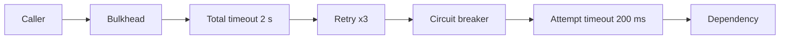

# 06. Resilience with Polly

> **Draft: written but not yet run.** The code and the expected output in this lesson were prepared by reading the code and the official documentation. They have not been executed yet. If something does not behave as described, trust your tool's real output and report it.

## What you will be able to do
By the end of this lesson you will be able to:
- Build retry, timeout, circuit breaker and bulkhead pipelines with Polly v8 and explain what each protects against.
- Order strategies in one pipeline and say why the order changes behavior.
- Predict which calls reach a failing dependency once a circuit opens.
- Explain how retries can turn a small outage into a large one, and which safeguards stop it.

## Recap
1. (Lesson 05) What is a cache stampede and which cache in lesson 05 protects against it?
   <details><summary>Answer</summary>Many callers miss the same key together and all hit the source. <code>HybridCache</code> runs the factory once per key per process.</details>
2. (Lesson 02) What is a decorator and why is it a natural home for cross-cutting behavior?
   <details><summary>Answer</summary>A class with the same interface that wraps another and adds one concern. Resilience strategies are exactly this idea, packaged.</details>

## Why it matters
Every network call you make will, sooner or later, be slow, fail or hang. Resilience code decides what your service does then. Done well, a failing dependency makes one feature degrade. Done badly (unbounded retries, no timeouts), your service becomes the thing that takes the dependency down and then falls over itself.

## What you will build
A console program with five experiments against a fake flaky dependency: retry (it fails twice, then works), timeout, a circuit breaker (it opens after four failures and rejects the rest), a bulkhead (five callers, two run, one waits, two are rejected) and a combined pipeline. At the end, a short section shows the same ideas on an `HttpClient` with one line of code.

## Before you start
- **Prerequisites:** [C# 301 lesson 05, caching](../phase-2-performance/05-caching.md); C# 201 lessons [04, async/await and Task](../../201-hero-to-super-hero/phase-1-core-skills/04-async-await-and-task.md) and [07, dependency injection and options](../../201-hero-to-super-hero/phase-2-web-apis/07-dependency-injection-and-options.md) (`HttpClient` registration).
- Tools: .NET SDK **11.0.100**. No Docker. Time: 70-90 minutes.
- Folder: create `lesson06` as in lesson 01 Step 1 (only `lesson06`, files directly inside) and copy `global.json` from lesson 01 Step 2.
- Source pack (optional): every file is shown in full in this lesson, so you can follow without it. The finished code, the exercise starter and the solution are in the
  course repository https://github.com/Uee03/Code101 under `source/csharp/301-super-hero-to-legendary/phase-3-resilience-and-messaging/06-resilience-with-polly/` (on that page choose **Code, Download ZIP**, or run
  `git clone https://github.com/Uee03/Code101.git`).

## Steps
### Step 1. The project
**File: `Resilience.csproj`**
```xml
<Project Sdk="Microsoft.NET.Sdk">

  <PropertyGroup>
    <OutputType>Exe</OutputType>
    <TargetFramework>net11.0</TargetFramework>
    <Nullable>enable</Nullable>
    <ImplicitUsings>enable</ImplicitUsings>
  </PropertyGroup>

  <ItemGroup>
    <PackageReference Include="Polly.Core" Version="8.9.1" />
    <PackageReference Include="Polly.RateLimiting" Version="8.9.1" />
  </ItemGroup>

</Project>
```
`Polly.Core` has retry, timeout, circuit breaker and fallback. The bulkhead (a concurrency limiter) lives in `Polly.RateLimiting`, because it is built on `System.Threading.RateLimiting`.

### Step 2. A dependency that misbehaves on purpose
**File: `FlakyService.cs`**
```csharp
namespace Resilience;

public sealed class TransientException(string message) : Exception(message);

// A dependency that fails a fixed number of times and then works.
public sealed class FlakyService(int failuresBeforeSuccess)
{
    private int calls;

    public int Calls => Volatile.Read(ref calls);

    public Task<string> CallAsync(CancellationToken ct)
    {
        var call = Interlocked.Increment(ref calls);
        if (call <= failuresBeforeSuccess)
        {
            throw new TransientException($"call {call} failed");
        }

        return Task.FromResult($"ok on call {call}");
    }
}
```
`TransientException` stands for "worth retrying": a timeout, a 503, a connection reset. Real code must also have **permanent** errors (400, 401, 404, validation failures) that are never retried. `Calls` counts how often the dependency was actually reached, which is how you will see the circuit breaker working.

### Step 3. The pipelines
**File: `Pipelines.cs`**
```csharp
using Polly;
using Polly.CircuitBreaker;
using Polly.RateLimiting;
using Polly.Retry;

namespace Resilience;

public static class Pipelines
{
    private static RetryStrategyOptions RetryOptions(Action<string> log) => new()
    {
        MaxRetryAttempts = 3,
        Delay = TimeSpan.FromMilliseconds(20),
        BackoffType = DelayBackoffType.Exponential,
        UseJitter = false,
        ShouldHandle = new PredicateBuilder().Handle<TransientException>(),
        OnRetry = args =>
        {
            log($"retry {args.AttemptNumber + 1} after {args.Outcome.Exception?.Message}");
            return default;
        },
    };

    private static CircuitBreakerStrategyOptions BreakerOptions(int minimumThroughput, CircuitBreakerStateProvider? provider) => new()
    {
        FailureRatio = 0.5,
        MinimumThroughput = minimumThroughput,
        SamplingDuration = TimeSpan.FromSeconds(10),
        BreakDuration = TimeSpan.FromSeconds(1),
        ShouldHandle = new PredicateBuilder().Handle<TransientException>(),
        StateProvider = provider,
    };

    // Retry: ask again after a growing delay. Jitter is off here only so the demo is repeatable; turn it on in production.
    public static ResiliencePipeline Retry(Action<string> log) =>
        new ResiliencePipelineBuilder().AddRetry(RetryOptions(log)).Build();

    // Timeout: stop waiting after a fixed time by cancelling the token you pass to the work.
    public static ResiliencePipeline Timeout() =>
        new ResiliencePipelineBuilder().AddTimeout(TimeSpan.FromMilliseconds(100)).Build();

    // Circuit breaker: after enough recent failures, stop calling the dependency for a while.
    public static ResiliencePipeline CircuitBreaker(CircuitBreakerStateProvider provider) =>
        new ResiliencePipelineBuilder().AddCircuitBreaker(BreakerOptions(4, provider)).Build();

    // Bulkhead: at most 2 calls run at once, 1 may wait, everything else is rejected immediately.
    public static ResiliencePipeline Bulkhead() =>
        new ResiliencePipelineBuilder().AddConcurrencyLimiter(permitLimit: 2, queueLimit: 1).Build();

    // The order matters: the first strategy added is the outermost one.
    public static ResiliencePipeline Combined() =>
        new ResiliencePipelineBuilder()
            .AddConcurrencyLimiter(permitLimit: 10, queueLimit: 10)
            .AddTimeout(TimeSpan.FromSeconds(2))
            .AddRetry(RetryOptions(_ => { }))
            .AddCircuitBreaker(BreakerOptions(10, null))
            .AddTimeout(TimeSpan.FromMilliseconds(200))
            .Build();
}
```
What each option means:
- **Retry.** `MaxRetryAttempts = 3` means one first try plus up to three retries. `Delay` and `BackoffType.Exponential` wait roughly 20 ms, then 40 ms, then 80 ms. `UseJitter` adds randomness to each delay so that many clients do not retry in lock step; it is **off here only** to make the demo repeatable. `ShouldHandle` is an allow-list: only `TransientException` is retried; everything else passes through immediately. `OnRetry` is a hook for logging and metrics; `AttemptNumber` starts at 0.
- **Timeout.** `AddTimeout` creates a cancellation token and cancels it after the time. It only works if the work **observes the token** (pass it to `HttpClient`, to database calls, to `Task.Delay`). Work that ignores the token keeps running in the background after the caller gets `TimeoutRejectedException`.
- **Circuit breaker.** It watches a sample of recent calls. `SamplingDuration = 10 s` is the window; `MinimumThroughput = 4` means it does not judge before it has seen at least four calls; `FailureRatio = 0.5` means it opens when half or more of the sample failed; `BreakDuration = 1 s` is how long it stays open. After that it lets **one probe** through (half-open): success closes it, failure re-opens it. While open, every call fails immediately with `BrokenCircuitException` and the dependency is not touched. The 1-second break is for the demo; production values are usually tens of seconds.
- **Bulkhead.** `AddConcurrencyLimiter(2, 1)` allows two concurrent executions and one waiting; the next callers get `RateLimiterRejectedException` instantly. The name comes from ship compartments: one flooded compartment must not sink the ship. In a service it stops one slow dependency from using every thread, connection or request slot.
- **Order.** The first strategy added is the outermost. In `Combined` the bulkhead guards everything, the 2-second timeout is the **total** budget for all attempts, the retry wraps the circuit breaker (so each retry is counted by it), and the 200 ms timeout limits **one attempt**. This is also the order Microsoft's standard HTTP resilience handler uses (limiter, total timeout, retry, circuit breaker, attempt timeout).

### Step 4. The program
**File: `Program.cs`**
```csharp
using Polly.CircuitBreaker;
using Polly.RateLimiting;
using Polly.Timeout;
using Resilience;

var ct = CancellationToken.None;

// 1. Retry: the dependency fails twice, then works.
var flaky = new FlakyService(failuresBeforeSuccess: 2);
var retry = Pipelines.Retry(Console.WriteLine);
var answer = await retry.ExecuteAsync(async token => await flaky.CallAsync(token), ct);
Console.WriteLine($"retry demo: {answer} ({flaky.Calls} calls)");

// 2. Timeout: the work would take 5 seconds, the pipeline gives it 100 ms.
try
{
    await Pipelines.Timeout().ExecuteAsync(async token => await Task.Delay(TimeSpan.FromSeconds(5), token), ct);
}
catch (TimeoutRejectedException)
{
    Console.WriteLine("timeout demo: TimeoutRejectedException after the 100 ms limit");
}

// 3. Circuit breaker: the dependency is down. After 4 failures the circuit opens and calls 5 and 6 never reach it.
var provider = new CircuitBreakerStateProvider();
var breaker = Pipelines.CircuitBreaker(provider);
var down = new FlakyService(failuresBeforeSuccess: int.MaxValue);
for (var i = 1; i <= 6; i++)
{
    try
    {
        await breaker.ExecuteAsync(async token => await down.CallAsync(token), ct);
    }
    catch (TransientException)
    {
        Console.WriteLine($"breaker call {i}: dependency failed");
    }
    catch (BrokenCircuitException)
    {
        Console.WriteLine($"breaker call {i}: rejected without calling the dependency");
    }
}

Console.WriteLine($"dependency calls: {down.Calls}, circuit state: {provider.CircuitState}");

// After the break duration (1 second) the next call is a probe. A healthy answer closes the circuit.
await Task.Delay(TimeSpan.FromMilliseconds(1200), ct);
var healthy = new FlakyService(failuresBeforeSuccess: 0);
var probe = await breaker.ExecuteAsync(async token => await healthy.CallAsync(token), ct);
Console.WriteLine($"after the break duration: {probe}, circuit {provider.CircuitState}");

// 4. Bulkhead: five callers arrive together. Two run, one waits in the queue, two are turned away.
var bulkhead = Pipelines.Bulkhead();
var callers = Enumerable.Range(1, 5).Select(async _ =>
{
    try
    {
        await bulkhead.ExecuteAsync(async token => await Task.Delay(200, token), ct);
        return true;
    }
    catch (RateLimiterRejectedException)
    {
        return false;
    }
});
var outcomes = await Task.WhenAll(callers);
Console.WriteLine($"bulkhead: {outcomes.Count(done => done)} completed, {outcomes.Count(done => !done)} rejected");

// 5. All together, in the recommended order.
var combinedFlaky = new FlakyService(failuresBeforeSuccess: 2);
var combined = await Pipelines.Combined().ExecuteAsync(async token => await combinedFlaky.CallAsync(token), ct);
Console.WriteLine($"combined demo: {combined}");
```
The `CircuitBreakerStateProvider` lets you **read** the circuit state (Closed, Open, HalfOpen, Isolated) for health checks and dashboards. Task.WhenAll over a lazily evaluated `Select` starts the five callers one after another without awaiting in between, so all five reach the bulkhead within a few milliseconds, long before the first 200 ms job finishes.

## Run it
**Predict first.** (a) In experiment 3, how many times will the dependency actually be called? (b) In experiment 4, how many of the five callers complete? Why is the answer not 2?

In `lesson06`:
```text
dotnet run --project . --nologo
```
Expected output (not yet run; derived from the code and the Polly documentation):
```text
retry 1 after call 1 failed
retry 2 after call 2 failed
retry demo: ok on call 3 (3 calls)
timeout demo: TimeoutRejectedException after the 100 ms limit
breaker call 1: dependency failed
breaker call 2: dependency failed
breaker call 3: dependency failed
breaker call 4: dependency failed
breaker call 5: rejected without calling the dependency
breaker call 6: rejected without calling the dependency
dependency calls: 4, circuit state: Open
after the break duration: ok on call 1, circuit Closed
bulkhead: 3 completed, 2 rejected
combined demo: ok on call 3
```
The program takes a little over 2 seconds (the 1.2 second pause and the 200 ms jobs). Answers: (a) 4, because calls 5 and 6 are rejected by the open circuit. (b) 3: two run immediately and the **queued** one runs when a slot frees, so three complete; only the two that found the queue full are rejected.

## How it works

**Why failures cascade.** If service A calls B with 3 retries and B calls C with 3 retries, one slow C produces up to 3 x 3 = 9 calls to C per original request, from callers that are all waiting on each other. Add no timeouts and the waiting callers hold threads and connections until the whole tree is exhausted. This is a **retry storm**. The safeguards, in order of importance:
1. A **timeout on every outbound call** (the most common missing piece).
2. **Retries only for transient and idempotent operations**, with exponential backoff, **jitter** and a small maximum.
3. A **circuit breaker**, so a sick dependency gets quiet time to recover.
4. A **bulkhead**, so one slow dependency cannot use all your capacity.
5. **Retry in one layer only.** Decide who retries (the client, the gateway, or the service) and turn the others off.

**Idempotency.** Retrying `POST /payments` after a timeout can charge twice: the first request may have succeeded. Retry only operations that are safe to repeat (GET, PUT, DELETE by id), or make them safe with an **idempotency key** that the server stores (the platform capstone's contract does this for create operations).

**What a circuit breaker really is.** It is a decision to **fail fast and tell the user something useful** instead of waiting. It needs a story for what the caller does with `BrokenCircuitException`: show cached data, hide a feature, queue the work (lesson 07) or return a clear 503 with `Retry-After`. A breaker without a fallback plan just fails faster.

**On `HttpClient`.** You rarely hand-build these pipelines for HTTP. The package `Microsoft.Extensions.Http.Resilience` adds a ready-made one:
```csharp
// In Program.cs of an ASP.NET Core app (snippet for reading, not part of the lesson folder).
builder.Services
    .AddHttpClient<PaymentsClient>(client => client.BaseAddress = new Uri("https://payments.internal/"))
    .AddStandardResilienceHandler();
```
`AddStandardResilienceHandler` applies a rate limiter, total timeout, retry, circuit breaker and attempt timeout, in the order above, with defaults you can change through its options. Read the defaults in the Microsoft documentation before you ship; do not assume they match your SLA. It is built on the Polly v8 types you just used. Do **not** use the older `Microsoft.Extensions.Http.Polly` package with Polly v7 policies in new code.

### ADR-006: Standard handler for HTTP, custom pipelines for everything else
| Field | Content |
|---|---|
| Context | Five outbound HTTP integrations and one flaky legacy file share. Teams copy-paste retry loops. |
| Decision | Use `AddStandardResilienceHandler` on every typed `HttpClient`; tune per client from configuration. Use a hand-built `ResiliencePipeline` (registered once, injected) for non-HTTP calls. Retries only on idempotent calls; non-idempotent calls carry an idempotency key. |
| Consequences | + One vocabulary, one set of metrics. + Defaults tested by Microsoft. - Defaults may not match each dependency's latency profile; each needs measuring. |
| Revisit when | A dependency needs hedging or a custom strategy the handler does not offer. |

## When not to use this
- **Inside a single process** (calls between your own classes): there is no network to fail. Resilience wrappers add overhead and hide bugs.
- **Non-idempotent operations without an idempotency key:** a retry is a duplicate. Fail the request instead.
- **As a substitute for capacity:** a retry cannot fix a dependency that is simply too small for your load; the breaker will only open.
- **When the caller will retry anyway** (a browser, a message broker with redelivery): stacking another retry loop multiplies the traffic.
- **Fallbacks that return wrong data silently:** a price fallback of 0 is worse than an error.

## Failure modes
- **Missing timeout:** the default `HttpClient.Timeout` is 100 seconds. Nothing in this lesson protects a call that does not use a pipeline or a token.
- **Retry on non-transient errors:** retrying a 400 or a 401 only generates load. Make `ShouldHandle` an allow-list.
- **No jitter:** all clients retry at the same instants and re-create the spike.
- **Breaker thresholds that never trip or always trip:** `MinimumThroughput` higher than your real traffic means it never evaluates; too low means one error opens it. Choose values from measured traffic.
- **Timeout that ignores cancellation:** the caller moves on, the work and its resources continue. Pass the token.
- **Shared breaker state across unrelated dependencies:** one bad endpoint opens the circuit for good ones. Use one pipeline instance per dependency (or per endpoint class).
- **Bulkhead without a queue plan:** a queue of 100 with 5 permits adds 20 waits of latency before a rejection. Keep queues short.
- **Swallowed `BrokenCircuitException`:** a user sees a blank screen with no explanation. Map it to a clear status and message.
- **Untested behavior:** resilience that has never been exercised fails the first time it is needed. Inject failures in a test environment.

## Measurements to take
- **Retry rate** and **retries per request** per dependency. A rising retry rate is an early warning before errors appear.
- **Circuit state changes** (how often it opens, how long it stays open) and **rejections** per minute.
- **Attempt latency vs. total latency** (p50, p99): the gap is time spent in backoff and waiting.
- **Bulkhead queue length and rejections** per dependency.
- **Load on the dependency during an incident** compared with normal: if your retries doubled it, the policy is making things worse.
Polly emits telemetry (events and metrics) that you can export with OpenTelemetry (lesson 08); enable it before you need it.

## Production checklist
- [ ] Every outbound call has a total timeout and a per-attempt timeout, and the work observes the cancellation token.
- [ ] Retries: allow-listed transient errors, exponential backoff **with jitter**, a small cap, idempotent operations or idempotency keys only.
- [ ] One layer retries; the others do not (written down).
- [ ] A circuit breaker per dependency with thresholds taken from measured traffic, and a defined user-facing behavior when open.
- [ ] Bulkhead limits for expensive or slow dependencies; queue short.
- [ ] Pipeline events and metrics exported and graphed; alerts on retry rate and open circuits.
- [ ] A game day or test that actually takes the dependency down and checks the behavior.

## Try it
Add a **fallback**: when the dependency fails with a `TransientException`, return a default value instead of an error.
1. **Guided.** Copy your finished `lesson06` to `exercise06` and add this starter file.

**File: `Fallbacks.cs`**
```csharp
using Polly;

namespace Resilience;

public static class Fallbacks
{
    public static ResiliencePipeline<string> Create()
    {
        // TODO: AddFallback(new FallbackStrategyOptions<string> { ... }) so that a TransientException is replaced
        // by the text "default price list". Use PredicateBuilder<string>().Handle<TransientException>() and
        // FallbackAction = _ => Outcome.FromResultAsValueTask("...").
        return new ResiliencePipelineBuilder<string>().Build();
    }
}
```
Append to `Program.cs`:
```csharp
var fallback = Fallbacks.Create();
var degraded = await fallback.ExecuteAsync(async token => await new FlakyService(failuresBeforeSuccess: int.MaxValue).CallAsync(token), ct);
Console.WriteLine($"fallback demo: {degraded}");
```
Expected last line: `fallback demo: default price list`. Without the TODO the program stops with an unhandled `TransientException`.

2. **Change.** Switch the retry demo to `UseJitter = true`. Run it three times. What changes in the output, and why is that a reason to avoid asserting on exact delays in tests?
3. **Stretch.** Your service calls an inventory API (idempotent GET) and a payment API (POST). Write down, for each, the timeout, whether to retry, the circuit settings and the fallback, and the one metric you would alert on.

<details><summary>Solution (rung 1)</summary>

**File: `Fallbacks.cs`**
```csharp
using Polly;
using Polly.Fallback;

namespace Resilience;

public static class Fallbacks
{
    public static ResiliencePipeline<string> Create() =>
        new ResiliencePipelineBuilder<string>()
            .AddFallback(new FallbackStrategyOptions<string>
            {
                ShouldHandle = new PredicateBuilder<string>().Handle<TransientException>(),
                FallbackAction = _ => Outcome.FromResultAsValueTask("default price list"),
            })
            .Build();
}
```
The generic builder (`ResiliencePipelineBuilder<string>`) is needed because a fallback must produce a value of the pipeline's result type. Rung 2: the printed `retry` lines stay the same (the delay is not printed), but the real waiting time varies between runs. Tests should assert on the number of attempts, not on elapsed time, or use a fake `TimeProvider`.
</details>

## Check yourself
1. Why must the work you wrap observe the cancellation token for `AddTimeout` to be effective?
   <details><summary>Answer</summary>The strategy cancels a token after the time; if the work ignores it, the call keeps running and holding resources although the caller already got an exception.</details>
2. **Predict:** the breaker opens after 4 failures. A fifth call happens 100 ms later. Is the dependency called?
   <details><summary>Answer</summary>No. The circuit is open for the 1-second break duration; the call fails immediately with <code>BrokenCircuitException</code>.</details>
3. Why is retrying `POST /payments` dangerous and how do you make it safe?
   <details><summary>Answer</summary>The first request may have succeeded before the timeout, so a retry can duplicate the effect. Use an idempotency key that the server stores and honors.</details>
4. In `Combined`, why is the retry outside the circuit breaker?
   <details><summary>Answer</summary>So every attempt is seen (and counted) by the breaker; if the breaker were outside the retry it would count one failure for three attempts.</details>

## Common mistakes
| Symptom or error text | Cause | Fix |
|---|---|---|
| Compiler error CS1061 saying `ResiliencePipelineBuilder` does not contain a definition for `AddConcurrencyLimiter` | The `Polly.RateLimiting` package or `using Polly.RateLimiting;` is missing. | Add the package reference from Step 1 and the using. |
| The retry demo ends with an unhandled `TransientException` | `MaxRetryAttempts` is lower than the number of failures, or `ShouldHandle` does not include the exception type. | Check the allow-list and the attempt count. |
| `Polly.CircuitBreaker.BrokenCircuitException` stops the program | The call was made while the circuit is open and nothing catches it. | Catch `BrokenCircuitException` and decide the user-facing behavior. |
| The timeout demo takes 5 seconds, no exception | The callback does not use the token that the pipeline passes in. | Pass `token` to `Task.Delay` (or to your real I/O). |
| `bulkhead: 5 completed, 0 rejected` | The callers did not start together (for example you awaited each one in a loop). | Start all callers first, then `await Task.WhenAll`. |

## Best practice
Put a timeout on every outbound call, retry only idempotent transient failures with jittered backoff, and give each dependency its own breaker and bulkhead. Source: Polly documentation https://www.pollydocs.org/ and Build resilient HTTP apps, Microsoft Learn https://learn.microsoft.com/dotnet/core/resilience/http-resilience

## Going further
- Polly strategy reference (retry, circuit breaker, timeout, rate limiter, fallback, hedging): https://www.pollydocs.org/strategies/index.html
- Introduction to resilient apps: https://learn.microsoft.com/dotnet/core/resilience/
- The backend-dotnet capstone protects its own API with rate limiting and timeouts: `capstones/backend-dotnet/tutorials/phase-5-hardening/05-hardening.md`.

## Summary
- You built retry, timeout, circuit breaker and bulkhead pipelines and read their behavior from output you predicted.
- You ordered strategies from outermost to innermost and said why the order matters.
- You explained retry storms and idempotency, and the safeguards that stop them.
- You wrote an ADR for HTTP resilience with the standard handler.

## Next lesson
07. Background services, the outbox pattern and sagas: deliver messages reliably when the process can crash between "saved" and "sent".
