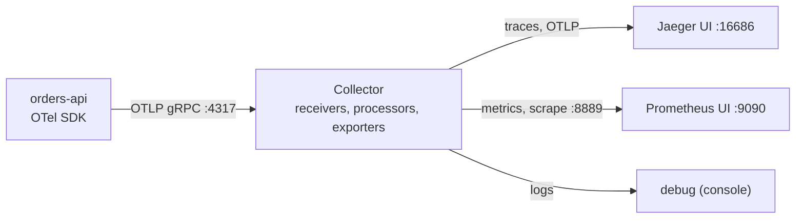

# 08. Observability with OpenTelemetry

> **Draft: written but not yet run.** The code and the expected output in this lesson were prepared by reading the code and the official documentation. They have not been executed yet. If something does not behave as described, trust your tool's real output and report it.

## What you will be able to do
By the end of this lesson you will be able to:
- Instrument an ASP.NET Core service with traces, metrics and logs using the OpenTelemetry .NET SDK and export them over OTLP.
- Add a custom span, a custom counter and a structured log, and say which signal answers which question.
- Read and explain a Docker Compose stack with a collector, a trace backend and a metrics backend, line by line.
- Spot the three classic mistakes: high-cardinality tags, personal data in telemetry and unmeasured overhead.

## Recap
1. (Lesson 07) Which metric is the best health signal for an outbox, and why?
   <details><summary>Answer</summary>The age of the oldest unprocessed row. A count can look fine while one message is stuck for an hour.</details>
2. (Lesson 06) What would you want to see on a dashboard to know a retry policy is making an outage worse?
   <details><summary>Answer</summary>Retries per request and the load on the dependency compared with normal.</details>

## Why it matters
When something is wrong in production you will ask three questions in order: **Is something wrong?** (metrics), **Where?** (traces), **Why?** (logs). Monitoring answers questions you thought of in advance; **observability** is being able to answer questions you did not. You cannot add it during the incident. OpenTelemetry (OTel) is the vendor-neutral standard for producing the data, so that you can change the backend without rewriting the code.

## What you will build
A small orders API (`ObservedApi`) that exports traces, metrics and logs over OTLP to an OpenTelemetry **Collector**, which forwards traces to **Jaeger**, exposes metrics to **Prometheus** and prints logs to its own console. The API runs on your machine with `dotnet run`; the three backends run in Docker Compose.

## Before you start
- **Prerequisites:** C# 301 lessons [01, clean architecture and vertical slices](../phase-1-architecture/01-clean-architecture-and-vertical-slices.md) and [07, background services, outbox and sagas](07-background-services-outbox-and-sagas.md); C# 201 lessons [05, first ASP.NET Core API](../../201-hero-to-super-hero/phase-2-web-apis/05-first-aspnet-core-api.md) and [07, dependency injection and options](../../201-hero-to-super-hero/phase-2-web-apis/07-dependency-injection-and-options.md); [Docker 101 lesson 06, networks and Compose](../../../docker/101-zero-to-hero/phase-2-compose/06-networks-and-compose.md).
- Tools: .NET SDK **11.0.100**; Docker with Compose (Docker Desktop on Windows and macOS, Docker Engine on Linux); `curl`. Time: 80-100 minutes. Break after Step 8.
- The compose stack uses ports **4317, 4318, 9090 and 16686** on `127.0.0.1`; the API uses **5308**. Free them or edit the files.
- Folder: create `lesson08` as in lesson 01 Step 1 (only `lesson08`, files directly inside) and copy `global.json` from lesson 01 Step 2.
- Source pack (optional): every file is shown in full in this lesson, so you can follow without it. The finished code, the exercise starter and the solution are in the
  course repository https://github.com/Uee03/Code101 under `source/csharp/301-super-hero-to-legendary/phase-3-resilience-and-messaging/08-observability-with-opentelemetry/` (on that page choose **Code, Download ZIP**, or run
  `git clone https://github.com/Uee03/Code101.git`).

## Steps
### Step 1. The project
**File: `ObservedApi.csproj`**
```xml
<Project Sdk="Microsoft.NET.Sdk.Web">

  <PropertyGroup>
    <TargetFramework>net11.0</TargetFramework>
    <Nullable>enable</Nullable>
    <ImplicitUsings>enable</ImplicitUsings>
  </PropertyGroup>

  <ItemGroup>
    <PackageReference Include="OpenTelemetry.Extensions.Hosting" Version="1.21.0" />
    <PackageReference Include="OpenTelemetry.Exporter.OpenTelemetryProtocol" Version="1.21.0" />
    <PackageReference Include="OpenTelemetry.Instrumentation.AspNetCore" Version="1.21.0" />
    <PackageReference Include="OpenTelemetry.Instrumentation.Http" Version="1.21.0" />
    <PackageReference Include="OpenTelemetry.Instrumentation.Runtime" Version="1.21.0" />
  </ItemGroup>

</Project>
```
Five packages, all `1.21.0` so their internals match: `Extensions.Hosting` plugs the SDK into the host; the OTLP exporter sends data; the three **instrumentation** packages produce telemetry automatically for incoming HTTP requests (`AspNetCore`), outgoing HTTP calls (`Http`) and runtime health such as garbage collections and thread-pool use (`Runtime`).

### Step 2. Your own instruments
**File: `Telemetry.cs`**
```csharp
using System.Diagnostics;
using System.Diagnostics.Metrics;

namespace ObservedApi;

// Names are part of your contract with the dashboards: change them deliberately, never by accident.
public static class Telemetry
{
    public const string ActivitySourceName = "ObservedApi";
    public const string MeterName = "ObservedApi";

    public static readonly ActivitySource Source = new(ActivitySourceName);

    private static readonly Meter Meter = new(MeterName);

    public static readonly Counter<long> OrdersRead =
        Meter.CreateCounter<long>("orders.read", unit: "{order}", description: "Orders read through the API.");
}
```
.NET already has the telemetry primitives built in: `ActivitySource` and `Activity` are .NET's traces (an `Activity` is a **span**), and `Meter` with `Counter<T>` are .NET's metrics. OpenTelemetry does not replace them; it **listens** to them and exports the data. That is why this file needs no OpenTelemetry package. A source or meter that the SDK is not told about (`AddSource`, `AddMeter` below) produces nothing.

### Step 3. The program
**File: `Program.cs`**
```csharp
using ObservedApi;
using OpenTelemetry.Logs;
using OpenTelemetry.Metrics;
using OpenTelemetry.Resources;
using OpenTelemetry.Trace;

const string serviceName = "orders-api";
const string serviceVersion = "1.0.0";

var builder = WebApplication.CreateBuilder(args);

// Logs: every log line also goes to the collector, carrying the trace id of the request that wrote it.
builder.Logging.AddOpenTelemetry(logging =>
{
    logging.IncludeFormattedMessage = true;
    logging.IncludeScopes = true;
    logging.SetResourceBuilder(ResourceBuilder.CreateDefault().AddService(serviceName, serviceVersion: serviceVersion));
    logging.AddOtlpExporter();
});

// Traces and metrics. The endpoint comes from OTEL_EXPORTER_OTLP_ENDPOINT (default http://localhost:4317).
builder.Services.AddOpenTelemetry()
    .ConfigureResource(resource => resource.AddService(serviceName, serviceVersion: serviceVersion))
    .WithTracing(tracing => tracing
        .AddAspNetCoreInstrumentation()
        .AddHttpClientInstrumentation()
        .AddSource(Telemetry.ActivitySourceName)
        .AddOtlpExporter())
    .WithMetrics(metrics => metrics
        .AddAspNetCoreInstrumentation()
        .AddHttpClientInstrumentation()
        .AddRuntimeInstrumentation()
        .AddMeter(Telemetry.MeterName)
        .AddOtlpExporter());

var app = builder.Build();

app.MapGet("/orders/{id:int}", (int id, ILogger<Program> logger) =>
{
    // A custom span inside the request span the framework already created.
    using var activity = Telemetry.Source.StartActivity("pricing.calculate");
    var totalCents = id * 1250;
    activity?.SetTag("order.id", id);
    activity?.SetTag("order.total_cents", totalCents);

    // A metric tag must have few distinct values. Never use an order id, user id or URL here.
    Telemetry.OrdersRead.Add(1, new KeyValuePair<string, object?>("order.kind", id % 2 == 0 ? "even" : "odd"));

    // Structured logging: the template stays constant, the values become searchable fields.
    logger.LogInformation("Priced order {OrderId} at {TotalCents} cents", id, totalCents);
    return Results.Ok(new { id, totalCents });
});

app.MapGet("/fail", (ILogger<Program> logger) =>
{
    logger.LogWarning("About to fail on purpose");
    throw new InvalidOperationException("demo failure");
});

app.Run();
```
Explanation in the order the code runs:
- **Resource.** `AddService("orders-api", "1.0.0")` attaches `service.name` and `service.version` to every signal. Without a service name every backend shows `unknown_service`.
- **Logs.** `IncludeFormattedMessage` keeps the rendered text next to the structured fields; `IncludeScopes` includes `BeginScope` data. The existing console logger keeps working, so you still see logs in your terminal.
- **Traces.** The ASP.NET Core instrumentation creates a **server span** for each request and propagates the W3C `traceparent` header; the HttpClient instrumentation creates **client spans** and injects `traceparent` into outgoing calls, so a trace continues across services without any code from you.
- **Metrics.** The built-in instrumentation produces request counts and durations (histograms); `AddRuntimeInstrumentation` adds GC and thread-pool metrics; `AddMeter` adds yours.
- **The endpoint** shows all three signals at the point of use. `StartActivity` returns `null` when nobody listens, hence `activity?.`. Tags on spans may carry identifiers (it is one trace, not a time series), but **metric tags are different**: every distinct tag combination is a separate time series, so a tag with an unbounded value set (an order id) is a way to destroy your metrics bill and backend.
- **Structured logging.** `{OrderId}` in the template is a **named placeholder**, not string interpolation: the value is stored as a field you can filter on, and the message template is constant, so you can group identical events. Do not write `$"Priced order {id}"`.
- **`/fail`** throws on purpose so you can see an error trace. The framework turns the exception into a 500 response; the instrumentation marks the span as an error and records the exception.

### Step 4. Settings
**File: `appsettings.json`**
```json
{
  "Urls": "http://127.0.0.1:5308",
  "Logging": {
    "LogLevel": {
      "Default": "Information",
      "Microsoft.AspNetCore": "Warning"
    }
  },
  "AllowedHosts": "localhost;127.0.0.1"
}
```
`Microsoft.AspNetCore: Warning` silences the framework's per-request `Information` logs; the **trace** already records each request, so logging it again doubles cost without adding information.

### Step 5. The collector configuration
**File: `otel-collector.yaml`**
```yaml
receivers:
  otlp:
    protocols:
      grpc:
        endpoint: 0.0.0.0:4317
      http:
        endpoint: 0.0.0.0:4318

processors:
  memory_limiter:
    check_interval: 1s
    limit_mib: 200
  batch: {}

exporters:
  debug:
    verbosity: basic
  otlp/jaeger:
    endpoint: jaeger:4317
    tls:
      insecure: true
  prometheus:
    endpoint: 0.0.0.0:8889

service:
  pipelines:
    traces:
      receivers: [otlp]
      processors: [memory_limiter, batch]
      exporters: [otlp/jaeger, debug]
    metrics:
      receivers: [otlp]
      processors: [memory_limiter, batch]
      exporters: [prometheus, debug]
    logs:
      receivers: [otlp]
      processors: [memory_limiter, batch]
      exporters: [debug]
```
The Collector is a pipeline of **receivers** (how data comes in), **processors** (what happens in between) and **exporters** (where it goes), wired together under `service.pipelines`, one pipeline per signal.
- `receivers.otlp` listens for OTLP over gRPC on 4317 and HTTP on 4318. `0.0.0.0` means "all interfaces **inside the container**"; the compose file decides what the host may reach.
- `memory_limiter` drops data instead of letting the Collector run out of memory (`limit_mib: 200`); it must be **first** in the processor list. `batch` groups data into larger sends, which is cheaper for the network and the backend.
- `debug` prints a summary of what passed through to the Collector's own console, handy for the first test. `verbosity: basic` prints counts; `detailed` prints every item (noisy, and it may print sensitive attribute values).
- `otlp/jaeger` forwards traces to the service named `jaeger` on the compose network, port 4317. `tls.insecure: true` is acceptable **only** inside a local network like this one; production uses TLS. The name after the slash is just a label for this instance.
- `prometheus` opens an HTTP endpoint (8889) in Prometheus text format that Prometheus **scrapes** (pulls).
- Logs only go to `debug` here: this lesson has no log database (Loki, Elasticsearch...). In production you would add one exporter for logs.

### Step 6. Prometheus configuration
**File: `prometheus.yml`**
```yaml
global:
  scrape_interval: 5s

scrape_configs:
  - job_name: otel-collector
    static_configs:
      - targets: ["otel-collector:8889"]
```
Prometheus asks `otel-collector:8889` for its metrics every 5 seconds (a short interval so you see results quickly; 15 to 60 seconds is typical). The host name `otel-collector` works because compose puts all services on one network with DNS by service name.

### Step 7. The compose file
**File: `docker-compose.yml`**
```yaml
services:
  otel-collector:
    image: otel/opentelemetry-collector-contrib:0.165.0
    volumes:
      - ./otel-collector.yaml:/etc/otelcol-contrib/config.yaml:ro
    ports:
      - "127.0.0.1:4317:4317"
      - "127.0.0.1:4318:4318"
    depends_on:
      - jaeger
  jaeger:
    image: jaegertracing/jaeger:2.23.0
    ports:
      - "127.0.0.1:16686:16686"
  prometheus:
    image: prom/prometheus:v3.16.0
    volumes:
      - ./prometheus.yml:/etc/prometheus/prometheus.yml:ro
    ports:
      - "127.0.0.1:9090:9090"
    depends_on:
      - otel-collector
```
Line by line:
- `image: ...:0.165.0`, `2.23.0`, `v3.16.0`: exact versions, never `latest`, so your lab and mine behave alike. `-contrib` is the Collector build that includes the `prometheus` exporter. Check for newer releases when you reuse this.
- `volumes: ./otel-collector.yaml:/etc/otelcol-contrib/config.yaml:ro` mounts your file read-only at the path the contrib image reads by default; a wrong path means the container starts with its built-in default config and ignores your file.
- `ports: "127.0.0.1:4317:4317"` publishes OTLP on loopback only, so the API on your machine reaches it and nobody else can. Jaeger's own 4317 is **not** published: the Collector reaches it by name on the internal network. Only Jaeger's UI (16686) and Prometheus's UI (9090) are published, again on loopback.
- `depends_on` orders start-up only; it does not wait for readiness. If the Collector starts before Jaeger accepts data, it retries.
- There are **no volumes for data**: when you run `docker compose down` all traces and metrics disappear. That is right for a lab and wrong for production.

### Step 8. Start the stack, then the API
In `lesson08`:
```text
docker compose up -d
docker compose ps
```
Expected: three services listed with state `running`. If a container exits, read its log: `docker compose logs otel-collector` (a YAML mistake is reported there). Then build and start the API in a **second terminal** (also in `lesson08`):
```text
dotnet run --nologo
```
The API logs that it is listening on `http://127.0.0.1:5308`. The first build restores the packages and needs internet access.

## Run it
**Predict first.** You will call `/orders/7` twice and `/orders/8` once. What `totalCents` does id 7 return? Which values will the `order.kind` tag take, and how many counter increments does each value get?

In a **third terminal** (use `curl.exe` on Windows PowerShell):
```text
curl -s http://127.0.0.1:5308/orders/7
curl -s http://127.0.0.1:5308/orders/7
curl -s http://127.0.0.1:5308/orders/8
```
Expected output (not yet run; derived from the code):
```text
{"id":7,"totalCents":8750}
{"id":7,"totalCents":8750}
{"id":8,"totalCents":10000}
```
Then the failing endpoint. Print only the status code (use `-o NUL` on Windows, `-o /dev/null` on macOS and Linux):
```text
curl -s -o NUL -w "%{http_code}" http://127.0.0.1:5308/fail
```
Expected output: `500`. In the **API terminal** the console logger prints lines like the following for each priced order (format of the default console logger; not yet run):
```text
info: Program[0]
      Priced order 7 at 8750 cents
```

### Look at the three signals
- **Traces.** Open http://localhost:16686 (Jaeger). Choose the service `orders-api` and press Find Traces. Open one trace: you should see a server span for the request with a child span `pricing.calculate` carrying the `order.id` tag, and for `/fail` a span flagged as an error with the exception recorded. Span names and tags follow OpenTelemetry's semantic conventions and vary by library version; trust what you see.
- **Metrics.** Open http://localhost:9090 (Prometheus), type `orders` in the expression box and use the autocomplete to find the counter (typically named `orders_read_total`, with `order_kind` as a label). Run it and you should see one series for `odd` (value 2) and one for `even` (value 1), possibly after a scrape interval of a few seconds. Also try the built-in request-duration histogram: its exact name depends on the instrumentation version, so search for `http_server`.
- **Logs.** Run `docker compose logs otel-collector`. With the `debug` exporter you see lines saying the Collector received traces, metrics and logs, with counts (wording varies by version). To look at an individual log record, change `verbosity` to `detailed` in `otel-collector.yaml`, run `docker compose restart otel-collector`, and call the API again. A log record produced inside the request carries the same **trace id** as the span: that link is how you jump from a slow trace to its log lines.

### Clean up
Stop the API with Ctrl+C, then:
```text
docker compose down -v
```
This removes the containers, the network and any anonymous volumes. All the telemetry you just collected is gone.

## How it works

**Signals and the question each answers.**

| Signal | Shape | Answers | Cost driver |
|---|---|---|---|
| Metrics | Numbers over time, aggregated in the process | "Is it healthy? Is it getting worse?" (alerts, dashboards) | Number of distinct label combinations (cardinality) |
| Traces | A tree of timed spans for one request across services | "Where did the time go? Which dependency failed?" | Volume of requests x spans per request (sampling) |
| Logs | Timestamped events with fields | "What exactly happened in this case?" | Volume and size of messages |

**What to alert on.** For a service, start with the **RED** method: **R**ate (requests per second), **E**rrors (failed fraction), **D**uration (latency percentiles). For a resource (queue, pool, disk) use **USE**: **U**tilization, **S**aturation, **E**rrors. Alert on symptoms users feel (error ratio, p99 latency), not on causes (CPU 80 percent), and write down who is called and what they do.

**Why a Collector at all?** The SDK can export straight to a backend. A Collector adds: one place to change backends, batching and retry out of your process, redaction and sampling without redeploying apps, and a buffer when the backend is down. The cost is one more component to run, monitor and secure. For a single small service, direct export is fine.

**Sampling.** Recording every trace is affordable in a lab and expensive at scale. **Head sampling** (decide at the start of the request, for example 10 percent) is cheap but may drop the rare failing request. **Tail sampling** (decide after the trace is complete, in the Collector: keep all errors and slow traces) keeps the interesting ones but needs the Collector to hold traces in memory. The SDK's sampler is configurable (`OTEL_TRACES_SAMPLER`); decide with measured volume, not guesses.

**Misconception:** "Logs are enough." Logs tell you what the code decided to say. They cannot show the time a request spent waiting inside a library, and grepping a million lines for one request does not scale. Traces and metrics make the first five minutes of an incident shorter.

### ADR-008: OpenTelemetry SDK, OTLP, and a Collector between app and backends
| Field | Content |
|---|---|
| Context | Three services, two teams, and an undecided backend. Logs only today; incidents take hours to localize. |
| Decision | Instrument with the OpenTelemetry .NET SDK and `System.Diagnostics` primitives. Export OTLP to a Collector per environment. Trace and metric backends are chosen later and can change without touching application code. |
| Consequences | + Backend choice is reversible. + Redaction and sampling are central. - The Collector is another thing to operate. - Instrumentation package versions must be kept in step. |
| Revisit when | The team standardizes on one vendor SDK that gives the same data with less to run. |

## When not to use this
- **A single small internal tool:** structured console logs and the built-in `/healthz` may be enough. Observability costs money and attention.
- **Tracing every internal method call:** thousands of tiny spans cost more than they teach. Span the boundaries (HTTP, database, queue), not the loops.
- **Telemetry as an audit log:** telemetry is sampled, lossy and not tamper-proof. Audit trails need their own durable store.
- **High-cardinality metric labels** such as user id, order id, URL with ids, or free text. Put those in traces and logs.

## Failure modes
- **Cardinality explosion:** a label with unbounded values multiplies time series until the backend is slow or the bill arrives. Review every metric tag in code review.
- **Personal data in telemetry:** emails, tokens, full request bodies and connection strings written to logs or span tags are a data leak that you replicated into three systems. Allow-list what you record; scrub in the Collector as a second line.
- **`detailed` debug exporter in shared environments:** prints attribute values to stdout.
- **Telemetry backpressure:** when the Collector or backend is down, the SDK queues and then **drops** data. That is the correct failure mode (telemetry must never take the app down) but it means gaps exist. Alert on the Collector's own drop metrics.
- **Unnamed or renamed instruments:** a rename breaks every dashboard and alert using the old name. Treat metric names and attributes as an API.
- **Missing context propagation:** work moved to a background thread, a queue or a message loses the trace unless you pass the context (lesson 07's outbox can store the `traceparent` in the message).
- **Unsampled blindness:** if you sample at 1 percent you will often have **no** trace for the one failing request. Keep error and slow traces (tail sampling).
- **Clock skew and `unknown_service`:** services with the wrong time or no `service.name` produce confusing graphs.
- **Overhead you never measured:** instrumentation is cheap, not free. Measure request throughput and p99 with and without it (lesson 04 method).

## Measurements to take
- **Your SLIs:** request rate, error ratio, p50/p95/p99 latency per route (from the built-in server metrics).
- **Telemetry overhead:** run the same load test with the SDK enabled and disabled and compare throughput and p99 (record both; do not guess).
- **Telemetry volume:** spans per second, log bytes per day, active time series per metric. These are the numbers that drive cost.
- **Collector health:** queue size, dropped items and exporter failures (it exports its own metrics).
- **Mean time to detect and to localize** during incidents: the numbers that tell you whether this investment is working.

## Production checklist
- [ ] `service.name`, `service.version` and `deployment.environment` set on every service.
- [ ] Context propagation works across HTTP, queues and background jobs; one trace spans a whole user action.
- [ ] A metric-tag review: only bounded value sets; request-path labels use the route template, not the raw URL.
- [ ] A redaction policy for logs, span tags and the Collector; no secrets or personal data in telemetry.
- [ ] Sampling decided from measured volume; errors and slow traces kept.
- [ ] Alerts on RED symptoms with an owner and a runbook; dashboards link to traces and logs.
- [ ] Collector sized, secured with TLS and authentication between components, and monitored; telemetry failure never blocks requests.
- [ ] Telemetry retention and cost reviewed quarterly.

## Try it
Add a **latency histogram** for pricing.
1. **Guided.** Copy your finished `lesson08` to `exercise08` and replace `Telemetry.cs` with the starter below. Complete the TODO.

**File: `Telemetry.cs`**
```csharp
using System.Diagnostics;
using System.Diagnostics.Metrics;

namespace ObservedApi;

// Names are part of your contract with the dashboards: change them deliberately, never by accident.
public static class Telemetry
{
    public const string ActivitySourceName = "ObservedApi";
    public const string MeterName = "ObservedApi";

    public static readonly ActivitySource Source = new(ActivitySourceName);

    private static readonly Meter Meter = new(MeterName);

    public static readonly Counter<long> OrdersRead =
        Meter.CreateCounter<long>("orders.read", unit: "{order}", description: "Orders read through the API.");

    // TODO: add a Histogram<double> named "orders.pricing.duration" with unit "ms" and a description,
    // created with Meter.CreateHistogram<double>(...). Then record it from Program.cs.
}
```
Then, in `Program.cs`, inside the `/orders/{id:int}` handler, take the time around the price calculation and record it. Add the first line at the top of the handler and the second just before the log call:
```csharp
var started = Stopwatch.GetTimestamp();
Telemetry.PricingDuration.Record(Stopwatch.GetElapsedTime(started).TotalMilliseconds);
```
(`Stopwatch` needs `using System.Diagnostics;` at the top of `Program.cs`.) Call the endpoint a few times, then find `orders_pricing_duration` in Prometheus (typically with `_bucket`, `_sum` and `_count` series).

2. **Change.** Add an `order.kind` style tag to the histogram and one to a **counter of failures** on `/fail`. For each tag, write the maximum number of distinct values it can take.
3. **Stretch.** Design the alert for "the orders API is too slow". Which metric, which percentile, which threshold and for how long, and who gets paged? Why is "average latency" a poor basis?

<details><summary>Solution (rung 1)</summary>

**File: `Telemetry.cs`**
```csharp
using System.Diagnostics;
using System.Diagnostics.Metrics;

namespace ObservedApi;

// Names are part of your contract with the dashboards: change them deliberately, never by accident.
public static class Telemetry
{
    public const string ActivitySourceName = "ObservedApi";
    public const string MeterName = "ObservedApi";

    public static readonly ActivitySource Source = new(ActivitySourceName);

    private static readonly Meter Meter = new(MeterName);

    public static readonly Counter<long> OrdersRead =
        Meter.CreateCounter<long>("orders.read", unit: "{order}", description: "Orders read through the API.");

    public static readonly Histogram<double> PricingDuration =
        Meter.CreateHistogram<double>("orders.pricing.duration", unit: "ms", description: "Time spent pricing one order.");
}
```
A **histogram** is the right instrument for latency: it keeps bucket counts, so the backend can compute percentiles later. An average hides the slow tail that users complain about. The value is recorded in milliseconds to match the declared unit.
</details>

## Check yourself
1. Why can an `Activity` span carry an order id as a tag, while a metric tag must not?
   <details><summary>Answer</summary>A span tag is attached to one trace; a metric tag creates a separate time series for every distinct value, so unbounded values explode storage and query cost.</details>
2. **Find the bug.** `logger.LogInformation($"Priced order {id}")`. What is lost?
   <details><summary>Answer</summary>The message template is no longer constant and the value is not a structured field, so you cannot group by event or filter by `OrderId`. Use `{OrderId}` with an argument.</details>
3. What does `AddSource` do and what happens if you forget it?
   <details><summary>Answer</summary>It tells the SDK to listen to your `ActivitySource`; without it your custom spans are created but never exported.</details>
4. Why is the Collector's `memory_limiter` listed first?
   <details><summary>Answer</summary>So that it can refuse data before the other processors use memory on it; it protects the Collector from running out of memory.</details>

## Common mistakes
| Symptom or error text | Cause | Fix |
|---|---|---|
| Jaeger shows no service `orders-api` | The API cannot reach port 4317, the stack is not running, or the API was started before the Collector and the export failed (the SDK retries, but check). | `docker compose ps`; restart the API; check `docker compose logs otel-collector`. |
| The Collector container exits at start; its log mentions a configuration error (typical message) | A YAML mistake, or a component name that your image version does not know. | Read `docker compose logs otel-collector`; compare with Step 5; check the Collector release notes. |
| Prometheus has no `orders_*` series | No scrape yet (wait one interval), a typo in `prometheus.yml`, or you did not call the endpoint after the stack was up. | Open Status, Targets in the Prometheus UI and check `otel-collector:8889` is up; call the API again. |
| `curl` prints nothing for `/orders/7` | The API is not running or runs on another port. | Check the API terminal and `Urls` in `appsettings.json`. |
| Compiler error CS1061 for `AddOtlpExporter` or `AddRuntimeInstrumentation` | A missing package or a missing `using` (`OpenTelemetry.Trace`, `OpenTelemetry.Metrics`, `OpenTelemetry.Logs`). | Add the package from Step 1 and the usings from Step 3. |

## Best practice
Instrument the boundaries, keep metric labels bounded, keep personal data out of telemetry, and export through a Collector you control. Source: OpenTelemetry .NET documentation https://opentelemetry.io/docs/languages/dotnet/ and Microsoft Learn, .NET observability with OpenTelemetry https://learn.microsoft.com/dotnet/core/diagnostics/observability-with-otel

## Going further
- OpenTelemetry Collector configuration: https://opentelemetry.io/docs/collector/configuration/
- OpenTelemetry semantic conventions for HTTP and databases: https://opentelemetry.io/docs/specs/semconv/
- The ASP.NET Core metrics reference: https://learn.microsoft.com/aspnet/core/log-mon/metrics/metrics
- The backend-dotnet capstone writes JSON console logs with the user id and trace id: `capstones/backend-dotnet/tutorials/phase-5-hardening/05-hardening.md`.

## Summary
- You instrumented an API for traces, metrics and logs and exported them over OTLP.
- You added a custom span, counter and structured log and explained which signal answers which question.
- You read a Collector, Prometheus and Compose configuration line by line.
- You listed cardinality, privacy, sampling and overhead as the production risks and wrote the numbers to measure.

## Next lesson
09. Modular monolith to microservices: when to split, how to draw the boundary, and how services authenticate to each other with Keycloak.
