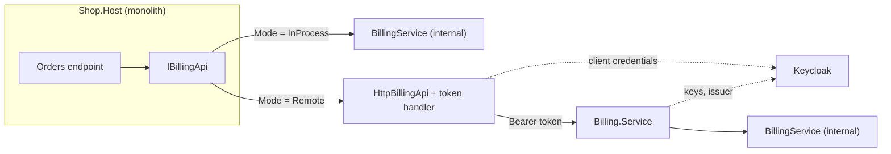

# 09. Modular monolith to microservices

> **Draft: written but not yet run.** The code and the expected output in this lesson were prepared by reading the code and the official documentation. They have not been executed yet. If something does not behave as described, trust your tool's real output and report it.

## What you will be able to do
By the end of this lesson you will be able to:
- Decide, with criteria, whether a module should become a service, and say what you give up when it does.
- Draw a module boundary with a public contract and internal implementation, and move the module behind HTTP without changing its callers.
- Secure service-to-service calls with a Keycloak client-credentials token, an audience and a role, and explain why "authenticated" is not "authorized".
- Name the failure modes of a distributed monolith.

## Recap
1. (Lesson 06) Which two protections would you add to the HTTP client that calls the new billing service?
   <details><summary>Answer</summary>A timeout on every call and a retry only for idempotent operations (a charge needs an idempotency key); plus a circuit breaker so a sick billing service does not exhaust the caller.</details>
2. (Lesson 07) Why does an order service that calls billing and then messages shipping need an outbox or saga?
   <details><summary>Answer</summary>There is no distributed transaction across services; the outbox makes "save and announce" atomic, and a saga compensates when a later step fails.</details>

## Why it matters
Microservices solve an organizational and scaling problem (many teams, independent deployment, very different load), and pay for it with a distributed-systems problem: network failures, partial outages, versioned contracts, security between services and an operations bill. The most common regret in the industry is a **distributed monolith**: services that must be deployed together and fail together, with all the costs and none of the benefits. The cheap path that keeps the option open is the **modular monolith**: one deployable, hard module boundaries, and an interface you can later turn into HTTP.

## What you will build
A shop with an order feature and a billing module in four projects:
- `Shop.Contracts`: the public interface `IBillingApi` and its DTOs.
- `Shop.Billing`: the module; its implementation is `internal`.
- `Shop.Host`: the monolith (orders). A setting decides whether billing runs **in process** or **over HTTP**.
- `Billing.Service`: the same module hosted as its own service, validating Keycloak tokens.

You will run the monolith, then split billing out without touching the order code, and call it with a service-account token.

## Before you start
- **Prerequisites:** C# 301 lessons [01, clean architecture and vertical slices](../phase-1-architecture/01-clean-architecture-and-vertical-slices.md), [06, resilience with Polly](../phase-3-resilience-and-messaging/06-resilience-with-polly.md) and [07, background services, outbox and sagas](../phase-3-resilience-and-messaging/07-background-services-outbox-and-sagas.md); [C# 201 lesson 10, JWT authentication and authorization](../../201-hero-to-super-hero/phase-4-security-and-quality/10-jwt-authentication-and-authorization.md); [Docker 101 lesson 06, networks and Compose](../../../docker/101-zero-to-hero/phase-2-compose/06-networks-and-compose.md).
- Tools: .NET SDK **11.0.100**; for the split part Docker with Compose and `curl`. Time: 90-120 minutes in **two sittings**; break after "Run it, part 1".
- Ports: **5309** (host), **5319** (billing service), **8180** (Keycloak, the same port the capstone uses: stop that stack first).
- Folder: create `lesson09` as in lesson 01 Step 1 (only `lesson09`, with the folders listed in Step 1 below). Copy `global.json` from lesson 01 Step 2.
- Source pack (optional): every file is shown in full in this lesson, so you can follow without it. The finished code, the exercise starter and the solution are in the
  course repository https://github.com/Uee03/Code101 under `source/csharp/301-super-hero-to-legendary/phase-4-production/09-modular-monolith-to-microservices/` (on that page choose **Code, Download ZIP**, or run
  `git clone https://github.com/Uee03/Code101.git`).

## Steps
### Step 1. Create the folders
PowerShell (Windows):
```powershell
mkdir $HOME\code101\csharp301\lesson09\src\Shop.Contracts
mkdir $HOME\code101\csharp301\lesson09\src\Shop.Billing
mkdir $HOME\code101\csharp301\lesson09\src\Billing.Service
mkdir $HOME\code101\csharp301\lesson09\src\Shop.Host\Remote
mkdir $HOME\code101\csharp301\lesson09\keycloak
mkdir $HOME\code101\csharp301\lesson09\requests
cd $HOME\code101\csharp301\lesson09
```
bash or zsh (macOS, Linux):
```bash
mkdir -p ~/code101/csharp301/lesson09/src/{Shop.Contracts,Shop.Billing,Billing.Service,Shop.Host/Remote}
mkdir -p ~/code101/csharp301/lesson09/{keycloak,requests}
cd ~/code101/csharp301/lesson09
```
Every command below runs in `lesson09` unless it says otherwise. Copy `global.json` from lesson 01 Step 2 into this folder (the content is identical).

### Step 2. The contract (public)
**File: `src/Shop.Contracts/Shop.Contracts.csproj`**
```xml
<Project Sdk="Microsoft.NET.Sdk">

  <PropertyGroup>
    <TargetFramework>net11.0</TargetFramework>
    <Nullable>enable</Nullable>
    <ImplicitUsings>enable</ImplicitUsings>
  </PropertyGroup>

</Project>
```
**File: `src/Shop.Contracts/IBillingApi.cs`**
```csharp
namespace Shop.Contracts;

public sealed record ChargeRequest(int OrderId, int AmountCents);

public sealed record ChargeResult(int OrderId, string Status, string Reference);

// The module's public face. Everything else about billing is internal to the Billing module.
public interface IBillingApi
{
    Task<ChargeResult> ChargeAsync(ChargeRequest request, CancellationToken ct);
}
```
The contract project has no dependencies and contains **only** what another module is allowed to know: one interface and its messages. Treat it as an API: adding fields is cheap, renaming or removing them breaks callers.

### Step 3. The Billing module (internal implementation)
**File: `src/Shop.Billing/Shop.Billing.csproj`**
```xml
<Project Sdk="Microsoft.NET.Sdk">

  <PropertyGroup>
    <TargetFramework>net11.0</TargetFramework>
    <Nullable>enable</Nullable>
    <ImplicitUsings>enable</ImplicitUsings>
  </PropertyGroup>

  <ItemGroup>
    <FrameworkReference Include="Microsoft.AspNetCore.App" />
  </ItemGroup>

  <ItemGroup>
    <ProjectReference Include="..\Shop.Contracts\Shop.Contracts.csproj" />
  </ItemGroup>

</Project>
```
`FrameworkReference` makes ASP.NET Core types (routing, `Results`) available to a class library without turning it into a web project.

**File: `src/Shop.Billing/BillingModule.cs`**
```csharp
using Microsoft.AspNetCore.Builder;
using Microsoft.AspNetCore.Http;
using Microsoft.AspNetCore.Routing;
using Microsoft.Extensions.DependencyInjection;
using Shop.Contracts;

namespace Shop.Billing;

// Nothing outside this assembly can name this class: the only way in is IBillingApi.
internal sealed class BillingService : IBillingApi
{
    private int charges;

    public Task<ChargeResult> ChargeAsync(ChargeRequest request, CancellationToken ct)
    {
        var number = Interlocked.Increment(ref charges);
        return Task.FromResult(new ChargeResult(request.OrderId, "Paid", $"chg-{number}"));
    }
}

public static class BillingModule
{
    public static IServiceCollection AddBillingModule(this IServiceCollection services) =>
        services.AddSingleton<IBillingApi, BillingService>();

    // The same endpoint is hosted by the monolith (no policy) or by the Billing service (with a policy).
    public static IEndpointRouteBuilder MapBillingEndpoints(this IEndpointRouteBuilder endpoints, string? requiredPolicy)
    {
        var charges = endpoints.MapPost("/billing/charges", async (ChargeRequest request, IBillingApi billing, CancellationToken ct) =>
        {
            if (request.AmountCents <= 0)
            {
                return Results.ValidationProblem(new Dictionary<string, string[]> { ["amountCents"] = ["must be positive"] });
            }

            return Results.Ok(await billing.ChargeAsync(request, ct));
        });

        if (requiredPolicy is not null)
        {
            charges.RequireAuthorization(requiredPolicy);
        }

        return endpoints;
    }
}
```
The boundary is enforced by the compiler in two ways: `BillingService` is `internal`, so no other project can `new` it or depend on its details, and the module exposes exactly two entry points, `AddBillingModule` (register) and `MapBillingEndpoints` (expose over HTTP). This fake service only counts charges; a real one would own its **own tables or schema** that no other module reads. Validation sits at the HTTP edge, because in-process callers already pass typed data.

### Step 4. The monolith host with orders
**File: `src/Shop.Host/Shop.Host.csproj`**
```xml
<Project Sdk="Microsoft.NET.Sdk.Web">

  <PropertyGroup>
    <TargetFramework>net11.0</TargetFramework>
    <Nullable>enable</Nullable>
    <ImplicitUsings>enable</ImplicitUsings>
  </PropertyGroup>

  <ItemGroup>
    <ProjectReference Include="..\Shop.Billing\Shop.Billing.csproj" />
  </ItemGroup>

</Project>
```
It still **references** `Shop.Billing` so that in-process mode works. The day billing is deployed only as a service, delete this reference: the build then proves that nothing in orders depended on billing internals.

**File: `src/Shop.Host/appsettings.json`**
```json
{
  "Urls": "http://127.0.0.1:5309",
  "Billing": {
    "Mode": "InProcess",
    "Remote": {
      "BaseAddress": "http://127.0.0.1:5319",
      "TokenEndpoint": "http://localhost:8180/realms/shop/protocol/openid-connect/token",
      "ClientId": "orders-service"
    }
  },
  "AllowedHosts": "localhost;127.0.0.1"
}
```
`Billing:Mode` is the switch. `ClientId` is not a secret; the **client secret** is deliberately absent and comes from an environment variable (Step 7).

**File: `src/Shop.Host/Program.cs`**
```csharp
using Microsoft.Extensions.Options;
using Shop.Billing;
using Shop.Contracts;
using Shop.Host.Remote;

var builder = WebApplication.CreateBuilder(args);

// One setting decides where billing lives. Nothing else in this file or in the order code changes.
if (builder.Configuration["Billing:Mode"] == "Remote")
{
    builder.Services.Configure<RemoteBillingOptions>(builder.Configuration.GetSection("Billing:Remote"));
    builder.Services.AddSingleton(TimeProvider.System);
    builder.Services.AddSingleton<ServiceTokenProvider>();
    builder.Services.AddTransient<ServiceTokenHandler>();
    builder.Services.AddHttpClient("token");
    builder.Services.AddHttpClient<IBillingApi, HttpBillingApi>((services, client) =>
            client.BaseAddress = new Uri(services.GetRequiredService<IOptions<RemoteBillingOptions>>().Value.BaseAddress))
        .AddHttpMessageHandler<ServiceTokenHandler>();
}
else
{
    builder.Services.AddBillingModule();
}

var app = builder.Build();
var lastOrderId = 0;

app.MapPost("/orders", async (CreateOrder request, IBillingApi billing, CancellationToken ct) =>
{
    if (string.IsNullOrWhiteSpace(request.Customer) || request.AmountCents <= 0)
    {
        return Results.ValidationProblem(new Dictionary<string, string[]> { ["order"] = ["customer and a positive amountCents are required"] });
    }

    var orderId = Interlocked.Increment(ref lastOrderId);
    var charge = await billing.ChargeAsync(new ChargeRequest(orderId, request.AmountCents), ct);
    return Results.Created($"/orders/{orderId}", new OrderResponse(orderId, request.Customer.Trim(), charge.Status, charge.Reference));
});

app.Run();

public sealed record CreateOrder(string Customer, int AmountCents);

public sealed record OrderResponse(int Id, string Customer, string PaymentStatus, string ChargeReference);
```
Look at the `MapPost` handler: it receives an `IBillingApi` and has no idea whether the call is a method call or an HTTP request. That is what a **good boundary** buys you. In `Remote` mode the typed `HttpClient` is registered **as** `IBillingApi`, with a message handler that adds the token. The handler does not retry; see "Failure modes" for what you must add before real traffic. In-memory order ids are a stand-in for the order database.

### Step 5. The HTTP implementation and the token code (Remote mode)
**File: `src/Shop.Host/Remote/HttpBillingApi.cs`**
```csharp
using Shop.Contracts;

namespace Shop.Host.Remote;

// Same interface as the in-process module, now over HTTP: the order code cannot tell the difference.
public sealed class HttpBillingApi(HttpClient client) : IBillingApi
{
    public async Task<ChargeResult> ChargeAsync(ChargeRequest request, CancellationToken ct)
    {
        using var response = await client.PostAsJsonAsync("/billing/charges", request, ct);
        response.EnsureSuccessStatusCode();
        return await response.Content.ReadFromJsonAsync<ChargeResult>(ct)
            ?? throw new InvalidOperationException("The billing service returned an empty body.");
    }
}
```
**File: `src/Shop.Host/Remote/ServiceToken.cs`**
```csharp
using System.Net.Http.Headers;
using System.Text.Json;
using Microsoft.Extensions.Options;

namespace Shop.Host.Remote;

public sealed class RemoteBillingOptions
{
    public string BaseAddress { get; set; } = "";
    public string TokenEndpoint { get; set; } = "";
    public string ClientId { get; set; } = "";

    // Never put the secret in a file: supply it as the environment variable Billing__Remote__ClientSecret.
    public string ClientSecret { get; set; } = "";
}

// Gets a service-account token with the client credentials grant and reuses it until shortly before it expires.
public sealed class ServiceTokenProvider(IHttpClientFactory clients, IOptions<RemoteBillingOptions> options, TimeProvider time)
{
    private readonly SemaphoreSlim gate = new(1, 1);
    private string? token;
    private DateTimeOffset expiresAt;

    public async Task<string> GetTokenAsync(CancellationToken ct)
    {
        await gate.WaitAsync(ct);
        try
        {
            if (token is not null && time.GetUtcNow() < expiresAt)
            {
                return token;
            }

            var settings = options.Value;
            using var form = new FormUrlEncodedContent(new Dictionary<string, string>
            {
                ["grant_type"] = "client_credentials",
                ["client_id"] = settings.ClientId,
                ["client_secret"] = settings.ClientSecret,
            });
            using var response = await clients.CreateClient("token").PostAsync(settings.TokenEndpoint, form, ct);
            response.EnsureSuccessStatusCode();

            using var document = JsonDocument.Parse(await response.Content.ReadAsStringAsync(ct));
            token = document.RootElement.GetProperty("access_token").GetString()!;
            var lifetimeSeconds = document.RootElement.GetProperty("expires_in").GetInt32();
            expiresAt = time.GetUtcNow().AddSeconds(Math.Max(lifetimeSeconds - 30, 1));
            return token;
        }
        finally
        {
            gate.Release();
        }
    }
}

// Adds "Authorization: Bearer <token>" to every outgoing call of the billing client.
public sealed class ServiceTokenHandler(ServiceTokenProvider tokens) : DelegatingHandler
{
    protected override async Task<HttpResponseMessage> SendAsync(HttpRequestMessage request, CancellationToken cancellationToken)
    {
        request.Headers.Authorization = new AuthenticationHeaderValue("Bearer", await tokens.GetTokenAsync(cancellationToken));
        return await base.SendAsync(request, cancellationToken);
    }
}
```
How the pieces work:
- **Client credentials grant.** There is no human. The calling service proves *who it is* with `client_id` and `client_secret` and gets an **access token** whose subject is a **service account**. This is the standard OAuth 2.0 flow for machine-to-machine calls.
- **Cache.** Asking Keycloak for a token on every call would make Keycloak a bottleneck and add latency to every request. The provider keeps the token until 30 seconds before `expires_in`. The `SemaphoreSlim` makes sure that when 100 requests arrive with an empty cache, **one** fetches the token and the others wait (the stampede problem from lesson 05).
- **`TimeProvider`** is injected so tests can move time forward without waiting.
- The token request uses a separate named client, `token`, so the handler that adds tokens is not applied to the call that fetches them (that would recurse).
- `EnsureSuccessStatusCode` throws `HttpRequestException` with the status code only; the secret is never part of the message. Keep it that way in logs.

### Step 6. The Billing service (token validation and authorization)
**File: `src/Billing.Service/Billing.Service.csproj`**
```xml
<Project Sdk="Microsoft.NET.Sdk.Web">

  <PropertyGroup>
    <TargetFramework>net11.0</TargetFramework>
    <Nullable>enable</Nullable>
    <ImplicitUsings>enable</ImplicitUsings>
  </PropertyGroup>

  <ItemGroup>
    <PackageReference Include="Microsoft.AspNetCore.Authentication.JwtBearer" Version="11.0.0" />
  </ItemGroup>

  <ItemGroup>
    <ProjectReference Include="..\Shop.Billing\Shop.Billing.csproj" />
  </ItemGroup>

</Project>
```
**File: `src/Billing.Service/appsettings.json`**
```json
{
  "Urls": "http://127.0.0.1:5319",
  "Auth": {
    "Issuer": "http://localhost:8180/realms/shop",
    "MetadataAddress": "http://localhost:8180/realms/shop/.well-known/openid-configuration",
    "Audience": "billing-service",
    "RequireHttpsMetadata": false
  },
  "AllowedHosts": "localhost;127.0.0.1"
}
```
`RequireHttpsMetadata: false` exists **only** because the local Keycloak speaks plain HTTP. In any shared environment keep it `true` (the default in the code) and use TLS.

**File: `src/Billing.Service/Program.cs`**
```csharp
using System.Security.Claims;
using System.Text.Json;
using Microsoft.AspNetCore.Authentication.JwtBearer;
using Microsoft.IdentityModel.Tokens;
using Shop.Billing;

var builder = WebApplication.CreateBuilder(args);
var auth = builder.Configuration.GetSection("Auth");

builder.Services.AddBillingModule();

// Validate Keycloak access tokens: signature (keys come from the discovery document), issuer, audience and lifetime.
builder.Services.AddAuthentication(JwtBearerDefaults.AuthenticationScheme).AddJwtBearer(options =>
{
    options.MetadataAddress = auth["MetadataAddress"]!;
    options.RequireHttpsMetadata = auth.GetValue("RequireHttpsMetadata", true);
    options.MapInboundClaims = false;
    options.TokenValidationParameters = new TokenValidationParameters
    {
        ValidateIssuer = true,
        ValidIssuer = auth["Issuer"],
        ValidateAudience = true,
        ValidAudience = auth["Audience"],
        ValidateLifetime = true,
        ClockSkew = TimeSpan.FromSeconds(30),
        ValidAlgorithms = [SecurityAlgorithms.RsaSha256],
    };
});

// Authenticated is not enough: the caller must hold the "charge" role on this service's client in Keycloak.
builder.Services.AddAuthorizationBuilder()
    .AddPolicy("billing-charge", policy => policy
        .RequireAuthenticatedUser()
        .RequireAssertion(context => HasClientRole(context.User, "billing-service", "charge")));

var app = builder.Build();

app.UseAuthentication();
app.UseAuthorization();
app.MapBillingEndpoints("billing-charge");
app.Run();

static bool HasClientRole(ClaimsPrincipal user, string client, string role)
{
    var claim = user.FindFirst("resource_access")?.Value;
    if (claim is null)
    {
        return false;
    }

    try
    {
        using var document = JsonDocument.Parse(claim);
        return document.RootElement.TryGetProperty(client, out var entry)
            && entry.TryGetProperty("roles", out var roles)
            && roles.EnumerateArray().Any(item => item.GetString() == role);
    }
    catch (JsonException)
    {
        return false;
    }
}
```
Four separate checks protect this endpoint, and each stops a different attack:
1. **Signature** (from Keycloak's published keys): the token was really issued by your Keycloak.
2. **Issuer and algorithm:** only your realm, only `RS256`; no `none`, no algorithm switching.
3. **Audience** (`aud` must be `billing-service`): a token minted for another API cannot be replayed here. This stops the **confused deputy** problem, where a service uses a token meant for someone else.
4. **Authorization:** `RequireAuthenticatedUser` only says "someone valid". The policy additionally demands the `charge` role from the token's `resource_access` claim, so a valid token for a different service account that lacks the role gets **403 Forbidden**, not 200. `HasClientRole` fails closed: a missing or malformed claim is a denial.
`MapInboundClaims = false` keeps the claim names as they appear in the token (`resource_access`, not a renamed one).

### Step 7. Keycloak: compose, secrets and realm
**File: `docker-compose.yml`**
```yaml
services:
  keycloak:
    image: quay.io/keycloak/keycloak:26.8.2
    command: ["start-dev", "--import-realm"]
    environment:
      KC_BOOTSTRAP_ADMIN_USERNAME: ${KEYCLOAK_ADMIN:?Copy .env.example to .env first}
      KC_BOOTSTRAP_ADMIN_PASSWORD: ${KEYCLOAK_ADMIN_PASSWORD:?Copy .env.example to .env first}
      ORDERS_CLIENT_SECRET: ${ORDERS_CLIENT_SECRET:?Copy .env.example to .env first}
      KC_HOSTNAME: http://localhost:8180
      KC_HOSTNAME_BACKCHANNEL_DYNAMIC: "true"
      KC_HEALTH_ENABLED: "true"
    ports:
      - "127.0.0.1:8180:8080"
    volumes:
      - ./keycloak/realm-shop.json:/opt/keycloak/data/import/realm-shop.json:ro
    healthcheck:
      test: ["CMD", "bash", "-c", "exec 3<>/dev/tcp/127.0.0.1/9000 && printf 'GET /health/ready HTTP/1.1\\r\\nHost: localhost\\r\\nConnection: close\\r\\n\\r\\n' >&3 && grep -q UP <&3"]
      interval: 5s
      timeout: 5s
      retries: 60
      start_period: 30s
```
Line by line:
- `image: quay.io/keycloak/keycloak:26.8.2`: the exact version the capstone uses.
- `command: ["start-dev", "--import-realm"]`: **development mode** (HTTP allowed, in-memory H2 database, relaxed caching). It is never a production setting. `--import-realm` imports every JSON file in `/opt/keycloak/data/import` at start.
- `KC_BOOTSTRAP_ADMIN_*`: creates the first admin user, read from your `.env`. The `:?` form stops compose with the message if the variable is missing.
- `ORDERS_CLIENT_SECRET`: passed into the container so the realm file can use it as `${ORDERS_CLIENT_SECRET}`: Keycloak replaces environment placeholders when it imports a realm file, so the secret never has to be written in the JSON.
- `KC_HOSTNAME: http://localhost:8180` makes Keycloak build every URL, and the token `iss` claim, with that address regardless of how the request arrived; the API checks the issuer string you configured. `KC_HOSTNAME_BACKCHANNEL_DYNAMIC: "true"` lets server-to-server calls use the address they came from. A mismatch between the issuer you configure and the one in the tokens is the classic reason every token is rejected.
- `KC_HEALTH_ENABLED` turns on the health endpoints used by the health check.
- `ports: "127.0.0.1:8180:8080"` publishes only on loopback (container port 8080, host port 8180).
- `volumes` mounts the realm file read-only into the import folder.
- `healthcheck` waits until the management port (9000) reports `UP`; it uses bash's built-in TCP so no extra tool is needed in the image. Keycloak needs about half a minute to start, hence `start_period` and many retries.

**File: `.env.example`**
```text
KEYCLOAK_ADMIN=admin
KEYCLOAK_ADMIN_PASSWORD=change-me-local-only
ORDERS_CLIENT_SECRET=change-me-too-local-only
```
Copy to `.env` (`copy .env.example .env` on Windows, `cp .env.example .env` elsewhere) and **change both passwords**. `.env` must never be committed.

**File: `keycloak/realm-shop.json`**
```json
{
  "realm": "shop",
  "enabled": true,
  "sslRequired": "none",
  "registrationAllowed": false,
  "clients": [
    {
      "clientId": "billing-service",
      "name": "Billing service",
      "enabled": true,
      "protocol": "openid-connect",
      "bearerOnly": true
    },
    {
      "clientId": "orders-service",
      "name": "Shop host (orders)",
      "enabled": true,
      "protocol": "openid-connect",
      "publicClient": false,
      "secret": "${ORDERS_CLIENT_SECRET}",
      "standardFlowEnabled": false,
      "implicitFlowEnabled": false,
      "directAccessGrantsEnabled": false,
      "serviceAccountsEnabled": true,
      "protocolMappers": [
        {
          "name": "billing-audience",
          "protocol": "openid-connect",
          "protocolMapper": "oidc-audience-mapper",
          "consentRequired": false,
          "config": {
            "included.client.audience": "billing-service",
            "id.token.claim": "false",
            "access.token.claim": "true"
          }
        }
      ]
    }
  ],
  "roles": {
    "client": {
      "billing-service": [
        {
          "name": "charge",
          "description": "May create charges"
        }
      ]
    }
  },
  "users": [
    {
      "username": "service-account-orders-service",
      "enabled": true,
      "serviceAccountClientId": "orders-service",
      "clientRoles": {
        "billing-service": ["charge"]
      }
    }
  ]
}
```
What it declares:
- Realm `shop` with `sslRequired: none` (**local only**; production uses `external` or `all`).
- Client `billing-service`: `bearerOnly` means it never logs anyone in; it exists to be an **audience** and to own the `charge` role.
- Client `orders-service`: a **confidential** client (it has a secret) that can only use the client-credentials flow: browser flows and the password grant are all switched off, so a stolen secret cannot be used for anything else. `serviceAccountsEnabled` is what allows client credentials.
- The **audience mapper** adds `billing-service` to the token's `aud` claim, so the Billing service accepts it. (Keycloak can also add audiences for clients whose roles the token carries; the explicit mapper makes the intent visible.)
- The client role `charge` is granted to the service-account user of `orders-service`. Granting a role to the **caller**, and checking it in the **callee**, is how you give each service only the permissions it needs (**least privilege**).
- Realm import can differ between Keycloak versions in small ways; if the import logs an error, read it (`docker compose logs keycloak`) and compare with the Keycloak documentation for realm import.

**File: `requests/order.json`**
```json
{
  "customer": "Ada",
  "amountCents": 2500
}
```
**File: `requests/charge.json`**
```json
{
  "orderId": 1,
  "amountCents": 2500
}
```

## Run it
### Part 1: the monolith (in process)
```text
dotnet build src/Shop.Host
dotnet run --project src/Shop.Host --no-build
```
In a second terminal (use `curl.exe` on Windows PowerShell):
```text
curl -s -X POST http://127.0.0.1:5309/orders -H "Content-Type: application/json" --data "@requests/order.json"
```
**Predict:** what is the charge reference of the first order? Expected output (not yet run; derived from the code):
```text
{"id":1,"customer":"Ada","paymentStatus":"Paid","chargeReference":"chg-1"}
```
Stop the host with Ctrl+C. **Break here if you want to end the first sitting.**

### Part 2: split billing out
1. Create `.env` from `.env.example` and set your own values. Start Keycloak and wait until it is healthy:
```text
docker compose up -d --wait
docker compose ps
```
`--wait` returns when the health check passes (this can take a minute on the first start while the image downloads). Expected: `keycloak` listed as `running (healthy)`.
2. Start the Billing service in terminal A:
```text
dotnet run --project src/Billing.Service
```
3. Start the monolith in **Remote** mode in terminal B. The secret must be the same as `ORDERS_CLIENT_SECRET` in `.env`.

PowerShell:
```powershell
$env:Billing__Mode = "Remote"
$env:Billing__Remote__ClientSecret = "change-me-too-local-only"
dotnet run --project src/Shop.Host
```
bash or zsh:
```bash
export Billing__Mode=Remote
export Billing__Remote__ClientSecret=change-me-too-local-only
dotnet run --project src/Shop.Host
```
(Use the value you put in `.env`.) The double underscore `__` is how environment variables spell the `:` of a configuration path. Environment variables override `appsettings.json`.
4. Terminal C: the same request as before.
```text
curl -s -X POST http://127.0.0.1:5309/orders -H "Content-Type: application/json" --data "@requests/order.json"
```
Expected output is **identical** to Part 1 (not yet run):
```text
{"id":1,"customer":"Ada","paymentStatus":"Paid","chargeReference":"chg-1"}
```
The order code did not change; the call now crosses HTTP with a token.

### Part 3: prove the security checks work
Call the Billing service **directly without a token** (status code only; use `-o /dev/null` instead of `-o NUL` on macOS and Linux):
```text
curl -s -o NUL -w "%{http_code}" -X POST http://127.0.0.1:5319/billing/charges -H "Content-Type: application/json" --data "@requests/charge.json"
```
Expected output: `401`. Now get a token as the orders service and call with it (replace the secret; the token is long, so keep it in a shell variable):

bash or zsh:
```bash
TOKEN=$(curl -s -X POST http://localhost:8180/realms/shop/protocol/openid-connect/token -d grant_type=client_credentials -d client_id=orders-service -d client_secret=change-me-too-local-only | python3 -c "import sys,json; print(json.load(sys.stdin)['access_token'])")
curl -s -X POST http://127.0.0.1:5319/billing/charges -H "Authorization: Bearer $TOKEN" -H "Content-Type: application/json" --data "@requests/charge.json"
```
PowerShell:
```powershell
$response = Invoke-RestMethod -Method Post -Uri http://localhost:8180/realms/shop/protocol/openid-connect/token -Body @{ grant_type = "client_credentials"; client_id = "orders-service"; client_secret = "change-me-too-local-only" }
curl.exe -s -X POST http://127.0.0.1:5319/billing/charges -H "Authorization: Bearer $($response.access_token)" -H "Content-Type: application/json" --data "@requests/charge.json"
```
Expected output of the second call: `{"orderId":1,"status":"Paid","reference":"chg-2"}` (the second charge on this service instance, because the order in Part 2 was the first). To see a **403**, remove the `charge` role from the service account in the Keycloak admin console (http://localhost:8180, log in with the admin account from `.env`), get a fresh token and repeat: the token is still valid, but the policy refuses it.

### Clean up
Stop the three `dotnet` processes with Ctrl+C, clear the variables (`Remove-Item Env:Billing__Mode, Env:Billing__Remote__ClientSecret` in PowerShell; `unset Billing__Mode Billing__Remote__ClientSecret` in bash), then:
```text
docker compose down -v
```

## How it works

**When to split.** Split a module into a service when you can name the *reason* and measure it:
- **Independent scaling:** billing needs 20 instances at month end and orders needs 2 (measure per-module CPU and memory).
- **Independent deployment and ownership:** one team must ship daily without coordinating with the others.
- **Fault isolation:** a crash or leak in one capability must not take down the rest.
- **Different technology or compliance scope:** the card-handling code must sit in a separate, audited boundary.
"We might need it" and "it is what everyone does" are not reasons.

**What you pay for the split.** A method call becomes a network call: latency, timeouts, partial failure and retries (lesson 06). A transaction becomes a saga (lesson 07). A debugger session becomes distributed tracing (lesson 08). A refactor becomes a versioned contract. A deploy becomes N deploys plus compatibility. Security moves from one process to **every hop**.

**Drawing boundaries.** Cut along **business capabilities** and data ownership (billing, inventory, ordering), not along technical layers. Each module owns its data: no other module reads its tables. A test you can run on paper: if two modules must change together for most features, or share tables, they are one module. Domain-driven design's bounded contexts (lesson 03) are the starting point.

**Service-to-service auth options.**

| Option | What it gives | Cost |
|---|---|---|
| Network trust only ("it is on the private network") | Nothing | One compromised service or a misconfigured route reaches everything |
| Mutual TLS (mTLS) | Strong identity of the calling workload at transport level | Certificate issuing and rotation (usually a mesh or platform) |
| OAuth 2.0 client credentials with JWT (this lesson) | Caller identity, audience, roles, short lifetime, central revocation of the client | A token endpoint dependency, caching, secret handling |
| Token exchange / on-behalf-of | Carries the **end user's** identity across hops | More moving parts; needed when the callee must make per-user decisions |

Use service identity when the callee needs to know *which service* called; forward or exchange the **user's** token when the callee must decide *for that user*. Never let a service reuse a user's token as its own identity or accept a token whose audience is not itself.

**Misconception:** "Microservices are modular, so splitting makes the code more modular." Modularity is a design property you can have in one process; the network only adds failure modes. A badly separated monolith becomes a worse distributed monolith.

### ADR-009: Modular monolith first, extract billing on evidence
| Field | Content |
|---|---|
| Context | Two teams, one codebase, one database. Billing must be audited separately next year; orders traffic is spiky. |
| Decision | Keep one deployable. Billing is a module with an `internal` implementation, a contract project and its own schema. Extract it to a service only when a measured trigger fires (separate audit scope, or independent scaling data). The `Mode` switch proves the contract works over HTTP before the day it is needed. |
| Consequences | + Cheap now, reversible later. + No distributed failure modes in the common path. - Discipline needed: no cross-module table reads, enforced by review and a dependency test. - Two deployment shapes to keep working. |
| Revisit when | A trigger fires, or the module boundary leaks (cross-module queries appear). |

## When not to use this
- **A small team and a single product:** the operational cost of services (pipelines, observability, on-call, contract tests) exceeds the benefit. Stay modular and monolithic.
- **A shared database "for now":** two services reading the same tables are one service with extra latency.
- **A chain of synchronous calls:** A calls B calls C calls D means the availability of A is the product of all four. Use events (lesson 07) or merge.
- **Inside the same bounded context:** do not split `Order` and `OrderLine` into services.
- **client credentials for user-specific decisions:** if the callee must know the end user, forward or exchange the user's token.

## Failure modes
- **Distributed monolith:** services deployed together, changed together, sharing a database or a "common" library of DTOs and logic. Symptom: a feature needs coordinated changes in three repositories.
- **Chatty boundaries:** N calls per request (the N+1 problem across the network). Design coarse operations or move the data.
- **Retry and timeout amnesia:** the `HttpBillingApi` here has neither. Add the resilience handler from lesson 06, and make `POST /billing/charges` idempotent with a key before retrying it.
- **Token fetch on the hot path:** without the cache and the lock in `ServiceTokenProvider`, every request calls Keycloak and an outage there becomes an outage everywhere. Also decide what happens when Keycloak is down but the cached token is still valid (the cached token keeps working until it expires).
- **Overlong token lifetime:** a long-lived token is a long-lived breach. Keep access-token lifetimes short (minutes) and let the cache refresh them.
- **Secret in the repository or the image:** the client secret belongs in a secret store or environment injected at deploy time, rotated on a schedule, and different per environment.
- **Missing audience or role check:** "valid signature" alone lets any service of the same realm call any other.
- **Issuer or hostname mismatch:** every token rejected after a hostname change. Test the full flow in each environment.
- **Contract breaks:** renaming a field breaks the old caller during a rolling deploy. Add fields, never remove or repurpose them in one step (expand, migrate, contract).
- **Shared clock assumptions:** `ClockSkew` of 30 seconds tolerates small drift; large drift rejects fresh tokens.
- **No contract tests:** the in-process and HTTP implementations drift apart. Run the same tests against both.

## Measurements to take
- **Per-module resource use** (CPU, memory, requests per second) **before** you split: evidence for a scaling trigger.
- **Added latency per hop** after the split (p50 and p99) for the same operation, compared with the in-process call.
- **Availability of the composite operation** and the dependency's error rate; check that it matches the product of the parts you expect.
- **Token endpoint latency and cache hit ratio** of the service token provider.
- **Deployment frequency and lead time** per module, **change coupling** (how often two modules change in the same commit): the evidence that a boundary is right or wrong.

## Production checklist
- [ ] Each module owns its data; no cross-module table access (tested or reviewed).
- [ ] The contract project contains only interfaces and messages; changes follow expand-migrate-contract.
- [ ] Service-to-service calls carry a short-lived token with the right audience and a role per operation; the callee **authorizes**, not just authenticates.
- [ ] Client secrets live in a secret store, differ per environment, and are rotated; they never appear in logs.
- [ ] Every outbound call has a timeout, safe retries, a breaker and a bulkhead (lesson 06); non-idempotent operations carry idempotency keys.
- [ ] Traces cross the boundary (lesson 08) and logs carry the trace id.
- [ ] Keycloak (or your identity provider) runs in production mode with TLS, a real database and a hostname set; `sslRequired` is not `none`.
- [ ] A rollback plan for the split exists (the `Mode` switch is one).

## Try it
Parse an `aud` claim correctly. A JWT `aud` is either one string or an array of strings.
1. **Guided.** In a new folder `exercise09` create the three files below (`RoleCheck.csproj`, `Audience.cs`, `Program.cs`) and complete the TODO.

**File: `RoleCheck.csproj`**
```xml
<Project Sdk="Microsoft.NET.Sdk">

  <PropertyGroup>
    <OutputType>Exe</OutputType>
    <TargetFramework>net11.0</TargetFramework>
    <Nullable>enable</Nullable>
    <ImplicitUsings>enable</ImplicitUsings>
  </PropertyGroup>

</Project>
```
**File: `Audience.cs`**
```csharp
using System.Text.Json;

namespace RoleCheck;

public static class Audience
{
    // TODO: return true when the "aud" claim, given as JSON text, names the expected audience.
    // A JWT "aud" claim is either a JSON string or a JSON array of strings. Anything else, or invalid JSON, means false.
    public static bool Includes(string audienceClaimJson, string expected)
    {
        return false;
    }
}
```
**File: `Program.cs`**
```csharp
using RoleCheck;

Console.WriteLine(Audience.Includes("\"billing-service\"", "billing-service"));
Console.WriteLine(Audience.Includes("[\"account\",\"billing-service\"]", "billing-service"));
Console.WriteLine(Audience.Includes("[\"account\"]", "billing-service"));
Console.WriteLine(Audience.Includes("42", "billing-service"));
Console.WriteLine(Audience.Includes("not json", "billing-service"));
```
Run `dotnet run --project .` in `exercise09`. Expected output when you are done: `True`, `True`, `False`, `False`, `False`, one per line.

2. **Review exercise (the 301 kind).** A pull request proposes, in one go: (a) `Shop.Host` references `Shop.Billing`'s `BillingService` class directly "to save a call", (b) `Shop.Billing` reads the `orders` table to show the customer name on invoices, (c) the Billing service accepts any valid token from the realm, (d) the host retries `POST /billing/charges` three times on any error, (e) the client secret is added to `appsettings.json` "for convenience". For each, say whether it violates a rule from this lesson, which rule, and the smallest fix.
3. **Stretch.** Add a second role `refund` and a `POST /billing/refunds` endpoint protected by its own policy. Which service account gets the role? What do you change in the realm file, and which test proves that the orders service **cannot** refund?

<details><summary>Solution (rung 1 and the review)</summary>

**File: `Audience.cs`**
```csharp
using System.Text.Json;

namespace RoleCheck;

public static class Audience
{
    public static bool Includes(string audienceClaimJson, string expected)
    {
        try
        {
            using var document = JsonDocument.Parse(audienceClaimJson);
            var root = document.RootElement;
            return root.ValueKind switch
            {
                JsonValueKind.String => root.GetString() == expected,
                JsonValueKind.Array => root.EnumerateArray().Any(item => item.ValueKind == JsonValueKind.String && item.GetString() == expected),
                _ => false,
            };
        }
        catch (JsonException)
        {
            return false;
        }
    }
}
```
Review answers: (a) violates the boundary (it is `internal`, so it will not even compile; the fix is to use `IBillingApi`). (b) violates data ownership: call the Orders module's contract or carry the name in the `ChargeRequest`. (c) violates the audience and role checks: set `ValidateAudience` and the `billing-charge` policy. (d) violates the idempotency rule: retry only with an idempotency key, and never on non-transient errors. (e) a secret in a file: use an environment variable or secret store and rotate the exposed one.
</details>

## Check yourself
1. Why is `BillingService` `internal`?
   <details><summary>Answer</summary>So no other project can depend on its details; the compiler enforces that callers go through `IBillingApi`, which is what makes extraction safe.</details>
2. A valid token issued by your realm for a different client calls the Billing service. Which checks reject it, and with which status?
   <details><summary>Answer</summary>The audience check rejects it with 401 if `aud` is not `billing-service`; if the audience is right but the role is missing, the policy returns 403.</details>
3. Why is the token cached with a lock?
   <details><summary>Answer</summary>To avoid calling Keycloak on every request and to make one caller fetch while the others wait when the cache is empty (a stampede).</details>
4. Give two valid reasons to split a module and one invalid reason.
   <details><summary>Answer</summary>Valid: independent scaling shown by measurement; a separate audit or compliance boundary; independent team deployment. Invalid: "microservices are modern" or "we might need it".</details>

## Common mistakes
| Symptom or error text | Cause | Fix |
|---|---|---|
| Every call to Billing returns 401 although the token request works | Issuer, audience or discovery address mismatch (the token `iss` differs from `Auth:Issuer`), or Keycloak was not healthy when the service started. | Decode the token (paste into a JWT viewer **only for local test tokens**), compare `iss` and `aud` with `appsettings.json`; check `KC_HOSTNAME`. |
| `403` instead of `200` for the orders service | The service account does not hold the `charge` role (the realm import failed, or the role was removed). | Check the user `service-account-orders-service` in the admin console, Role mapping. |
| Orders returns 500 and the host log mentions a failed token request (typical message: the response status code does not indicate success) | The client secret in `Billing__Remote__ClientSecret` does not match `ORDERS_CLIENT_SECRET`, or Keycloak is not running. | Use the same value in both places; `docker compose ps`. |
| `docker compose` says the required variable is missing a value (typical wording) | No `.env` file. | Copy `.env.example` to `.env`. |
| Compiler error CS0122 (`BillingService` is inaccessible due to its protection level) | You tried to use the internal class from another project. | Use `IBillingApi` through `AddBillingModule`. That error is the boundary working. |
| The host runs in-process although you set `Billing__Mode` | The variable was set in another terminal, or has a typo (single underscore). | Set it in the same terminal as `dotnet run`, with two underscores. |

## Best practice
Keep the modular monolith until a measured trigger justifies a service, authenticate and **authorize** every service call with a short-lived token scoped by audience and role, and never put secrets in files. Source: Microservices architecture design, Azure Architecture Center https://learn.microsoft.com/azure/architecture/microservices/ and ASP.NET Core best practices https://learn.microsoft.com/aspnet/core/fundamentals/best-practices

## Going further
- The platform and backend capstones show Keycloak, JWT validation and role-based policies end to end: `capstones/backend-dotnet/tutorials/phase-3-identity/03-identity.md`.
- Keycloak documentation: service accounts and the client credentials grant, and importing a realm: https://www.keycloak.org/documentation
- Martin Fowler's "MonolithFirst" and "Microservice Premium" articles are short readings for the decision.

## Summary
- You separated a module behind a contract with an internal implementation and ran it in process and over HTTP with no change to the order code.
- You secured the HTTP hop with a client-credentials token, an audience and a role, and cached the token safely.
- You listed measurable reasons to split and the costs you accept when you do.
- You reviewed the failure modes of a distributed monolith and wrote an ADR that keeps the split reversible.

## Next lesson
10. Native AOT, analyzers and EditorConfig, and a production readiness checklist with a review exercise.
