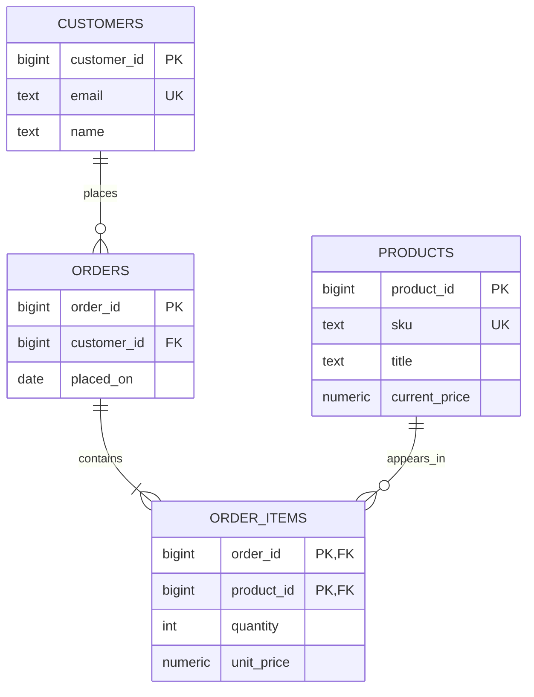

# 01. Data modeling and normalization to 3NF

> **Draft: written but not yet run.** The code and the expected output in this lesson were prepared by reading the code and the official documentation. They have not been executed yet. If something does not behave as described, trust your tool's real output and report it.

## What you will be able to do
- Design a four-table order model in third normal form.
- Explain which dependencies cause update anomalies.
- Prove that a price snapshot preserves a historical total.

## Recap
- Why keep a foreign key instead of a copied customer name?
  <details><summary>Answer</summary>It identifies the referenced customer and prevents dangling references; names are not stable keys.</details>
- Does a transaction make a bad model normalized?
  <details><summary>Answer</summary>No. It makes a set of changes atomic, not the underlying facts independent.</details>

## Why it matters
A small stationery shop exports one spreadsheet row per order line. Customer details and catalogue prices repeat, so one edit can leave conflicting copies. You will separate ownership of facts without losing the price the customer actually paid.

## What you will build
A four-table stationery shop with three orders, four line items and a report that stays at 23.00 after a catalogue price change.

## Before you start
- Finished [Databases 101](../../101-zero-to-hero/phase-3-designing/12-library-project.md): Docker PostgreSQL, psql/IDE connections, joins, transactions and basic indexes. No host PostgreSQL or psql install is needed.
- Docker in Linux-container mode with Compose, a text editor, and the same `postgres:17-alpine` image as 101. Docker/Compose versions above are the inherited authoring baseline, not a new runtime check. The tag pins major version/flavour, not a patch digest.
- Time: 55 minutes including reading, typing and exercise. Two sittings are reasonable: save the feature files before Step 5, then return for the run and exercise.
- Source pack (optional): every file is shown in full in this lesson, so you can follow without it. The finished code, the exercise starter and the solution are in the course repository https://github.com/Uee03/Code101 under `source/databases/201-hero-to-super-hero/phase-1-schema-design/01-data-modeling-and-3nf/` (on that page choose **Code, Download ZIP**, or run `git clone https://github.com/Uee03/Code101.git`). Generated phase pack: `databases-201-phase-1-schema-design.zip`.
- **One database lab at a time:** stop the previous 101/201 or capstone lab before using 127.0.0.1:5432. Do not stop unrelated services. These lessons are independent; do not carry a schema forward.
- All reset scripts/passwords are disposable local examples. Never aim them at work data. `learner` is the official image's initial administrative user, not an application login design.
- SQL, Docker, negative cases and IDE steps have not been run for this lesson. Result rows are derived by hand; variable tool output is described, not invented.

## Steps
### Step 1. Prepare the lesson workspace
1. In your home folder create `code101` with your file manager. Obtain the source folder from the repository link above, or extract the phase ZIP: Windows **right-click > Extract All**; macOS double-click; Linux use your archive manager's **Extract Here**. Move `databases-201-phase-1-schema-design` into `code101`. Keep `01-data-modeling-and-3nf/code` and its sibling `exercise` together.
2. Without a pack, create the same `databases-201-phase-1-schema-design/01-data-modeling-and-3nf/code` structure and sibling `exercise/starter` and `exercise/solution` folders using **New Folder**. You will create every file shown below. Leave the finished solution unopened until you try the exercise.
3. Open a terminal (Windows: type `powershell` in File Explorer's address bar in the code folder; macOS/Linux: open Terminal). Do not type a prompt's `>` or `$`. The text before the prompt shows your current directory. Recover to this exact folder if needed:

**Terminal (PowerShell; folder: this lesson `code/`)**
```powershell
Set-Location "$HOME\code101\databases-201-phase-1-schema-design\01-data-modeling-and-3nf\code"
```

**Terminal (macOS/Linux; folder: this lesson `code/`)**
```bash
cd "$HOME/code101/databases-201-phase-1-schema-design/01-data-modeling-and-3nf/code"
```

Expected result, not yet run: the prompt is in this lesson code folder; Set-Location/cd normally print no text. Using the repository directly is also fine: open its matching source code folder and use the same subsequent relative commands.

4. Open that folder in your editor. For each file caption choose **File > New File > Save As** at the shown path relative to the lesson root (`code/` is where your terminal is). If supplied, open and compare instead of creating duplicates. Create displayed subfolders first. Save as UTF-8 without BOM; use LF for shell files. On Windows enable **View > Show > File name extensions** so `.sql.txt` cannot hide. Save with Ctrl+S (Cmd+S on macOS); an editor-tab dot often means unsaved changes.

### Step 2. Save the complete Compose configuration
**File: `code/docker-compose.yml`**
```yaml
services:
  db:
    image: postgres:17-alpine
    environment:
      POSTGRES_DB: ${POSTGRES_DB}
      POSTGRES_USER: ${POSTGRES_USER}
      POSTGRES_PASSWORD: ${POSTGRES_PASSWORD}
      PGDATABASE: ${POSTGRES_DB}
      PGUSER: ${POSTGRES_USER}
    ports:
      - "127.0.0.1:5432:5432"
    volumes:
      - pg_data:/var/lib/postgresql/data
      - .:/scripts:ro
      - ../exercise:/exercises:ro
    healthcheck:
      test: ["CMD-SHELL", "pg_isready -U $$POSTGRES_USER -d $$POSTGRES_DB"]
      interval: 2s
      timeout: 3s
      retries: 30
      start_period: 5s
volumes:
  pg_data:
```

| Configuration line(s) | Meaning and consequence of changing it |
|---|---|
| `services:`, `db:` | Define one service named db; commands below must use that name. |
| `image: postgres:17-alpine` | Use the unchanged official image. A different major version changes the data-directory compatibility contract. |
| `environment:` and POSTGRES_DB/USER/PASSWORD | Initialize the database/admin/password from .env only when the data volume is empty. |
| `PGDATABASE`, `PGUSER` | Set container-client defaults; commands also name user/database explicitly for clarity. |
| `ports:` with `127.0.0.1:5432:5432` | Publish only IPv4 loopback on host port 5432, not every host interface. Host tools use 127.0.0.1; another Compose service would use db. |
| `volumes:` and `pg_data:/var/lib/postgresql/data` | Keep data in this project's named volume. Removing the container alone does not erase it. |
| `.:/scripts:ro` | Mount this code folder read-only; saved host edits are visible to psql. It is not a writable backup location. |
| `../exercise:/exercises:ro` | Mount the sibling exercise folder read-only. Flattening the pack breaks the path. |
| `healthcheck:` and `test:` | Run pg_isready inside db. `$$` defers variable expansion to its shell, not Compose. Readiness is not a password/security test. |
| `interval: 2s`, `timeout: 3s` | Check every two seconds, allowing three seconds per probe. |
| `retries: 30`, `start_period: 5s` | Allow startup time before declaring failure; --wait uses health status. |
| Final `volumes:`, `pg_data:` | Declare the volume, scoped by the explicit project name. |

Indent with spaces. No Dockerfile/.dockerignore: nothing is built. No art is used (`assets: []`).

### Step 3. Create the local environment file
**File: `code/.env.example`**
```dotenv
# Disposable local practice only. Never reuse this password elsewhere.
POSTGRES_DB=code101
POSTGRES_USER=learner
POSTGRES_PASSWORD=learn_local_only
```

The comment marks local-only credentials. POSTGRES_DB names the initial database, POSTGRES_USER its administrator, and POSTGRES_PASSWORD its disposable password. Compose substitutes `${...}` in YAML using a file named exactly `.env`.

**Terminal (PowerShell; folder: this lesson `code/`)**
```powershell
Copy-Item .env.example .env
```

**Terminal (macOS/Linux; folder: this lesson `code/`)**
```bash
cp .env.example .env
```

Expected output, not yet run: a successful copy prints no text. The complete generated local file is:

**File: `code/.env`** (local copy, not shipped)
```dotenv
# Disposable local practice only. Never reuse this password elsewhere.
POSTGRES_DB=code101
POSTGRES_USER=learner
POSTGRES_PASSWORD=learn_local_only
```

**File: `code/.gitignore`**
```gitignore
.env
*.dump
```

These patterns exclude .env and dump archives from Git; they do not encrypt them or remove already tracked files. Editing .env later does not change an initialized database password. Reset only this disposable volume if reinitializing.

### Step 4. Model the feature, then save its files
Start with the business rules: a customer can place many orders; an order has many products; each product appears at most once per order in this simplified shop. Email and SKU are business keys; generated IDs are surrogate keys (identifiers without business meaning).

A **functional dependency** X -> Y means each X determines exactly one Y. In the flat export `(order_id, product_id, customer_id, customer_name, sku, title, quantity, unit_price)`, the candidate key is `(order_id, product_id)`. A **candidate key** is a minimal set of columns that uniquely identifies a row.

| Stage | Problem removed | Concrete split |
|---|---|---|
| 1NF: first normal form | Repeating groups / lists inside a cell | One product per order line, not `N1,P1` |
| 2NF: second normal form | Partial dependency on part of a candidate key | Order date/customer belong to orders; SKU/title to products |
| 3NF: third normal form | Transitive dependency through a non-key fact | customer_id -> name/email belong to customers, not orders |

A **superkey** is any set of columns that uniquely identifies a row; unlike a candidate key, it need not be minimal. For this model all candidate keys have been considered. Formally, 3NF requires that for every nontrivial dependency X -> A, X is a superkey or A belongs to some candidate key. The practical non-key-dependency shortcut works for these tables. It is not a proof for every possible schema.

**Diagram: shop entities**

The diagram expresses the business intention that an order has a line. Foreign keys alone do not enforce that minimum: a draft order can temporarily have zero lines. Enforcing a checkout workflow belongs in an application transaction or a deliberate database routine (lesson 09).

Read/save all files before running. SQL ends statements with semicolons. Backslash commands are **psql client commands**, not server SQL: ON_ERROR_STOP stops at the first unexpected error; `\ir` includes relative to its containing script; unaligned format uses `|` between columns; footer off removes row-count footers; the null setting displays SQL NULL as `(null)`. Use psql for whole scripts; in an IDE select server SQL, not the backslash commands. The entry script arranges setup automatically. Never execute sample reset files on valuable data.

Defines the isolated example and seed. DROP SCHEMA app CASCADE removes the sample schema and its dependent objects. Use a disposable database.

**File: `code/setup.sql`**
```sql
DROP SCHEMA IF EXISTS app CASCADE;
CREATE SCHEMA app;
CREATE TABLE app.customers (
    customer_id bigint GENERATED ALWAYS AS IDENTITY,
    email text NOT NULL,
    name text NOT NULL,
    CONSTRAINT pk_customers PRIMARY KEY (customer_id),
    CONSTRAINT uq_customers_email UNIQUE (email)
);
CREATE TABLE app.products (
    product_id bigint GENERATED ALWAYS AS IDENTITY,
    sku text NOT NULL,
    title text NOT NULL,
    current_price numeric(10,2) NOT NULL,
    CONSTRAINT pk_products PRIMARY KEY (product_id),
    CONSTRAINT uq_products_sku UNIQUE (sku),
    CONSTRAINT ck_products_price CHECK (current_price >= 0)
);
CREATE TABLE app.orders (
    order_id bigint GENERATED ALWAYS AS IDENTITY,
    customer_id bigint NOT NULL,
    placed_on date NOT NULL,
    CONSTRAINT pk_orders PRIMARY KEY (order_id),
    CONSTRAINT fk_orders_customers FOREIGN KEY (customer_id)
        REFERENCES app.customers (customer_id) ON DELETE RESTRICT
);
CREATE TABLE app.order_items (
    order_id bigint NOT NULL,
    product_id bigint NOT NULL,
    quantity integer NOT NULL,
    unit_price numeric(10,2) NOT NULL,
    CONSTRAINT pk_order_items PRIMARY KEY (order_id, product_id),
    CONSTRAINT fk_order_items_orders FOREIGN KEY (order_id)
        REFERENCES app.orders (order_id) ON DELETE RESTRICT,
    CONSTRAINT fk_order_items_products FOREIGN KEY (product_id)
        REFERENCES app.products (product_id) ON DELETE RESTRICT,
    CONSTRAINT ck_order_items_quantity CHECK (quantity > 0),
    CONSTRAINT ck_order_items_price CHECK (unit_price >= 0)
);
CREATE INDEX ix_orders_customer_id ON app.orders (customer_id);
CREATE INDEX ix_order_items_product_id ON app.order_items (product_id);
INSERT INTO app.customers (email, name)
VALUES ('ava@example.test', 'Ava'), ('ben@example.test', 'Ben');
INSERT INTO app.products (sku, title, current_price)
VALUES ('N1', 'Notebook', 5.00), ('P1', 'Pen', 2.00);
INSERT INTO app.orders (customer_id, placed_on)
VALUES (1, DATE '2026-01-10'), (1, DATE '2026-01-11'), (2, DATE '2026-01-11');
INSERT INTO app.order_items (order_id, product_id, quantity, unit_price)
VALUES (1, 1, 2, 5.00), (1, 2, 1, 2.00), (2, 2, 3, 2.00), (3, 1, 1, 5.00);
```

The entry script includes setup or the migration driver, then performs the worked example.

**File: `code/lesson.sql`**
```sql
\set ON_ERROR_STOP on
\pset format unaligned
\pset footer off
\pset null '(null)'
\ir setup.sql
SELECT o.order_id, c.name, SUM(i.quantity * i.unit_price)::numeric(10,2) AS total
FROM app.orders AS o
JOIN app.customers AS c USING (customer_id)
JOIN app.order_items AS i USING (order_id)
GROUP BY o.order_id, c.name
ORDER BY o.order_id;
BEGIN;
UPDATE app.products SET current_price = 6.00 WHERE product_id = 1;
SELECT SUM(quantity * unit_price)::numeric(10,2) AS historical_total
FROM app.order_items;
ROLLBACK;
```

### Step 5. Start and inspect PostgreSQL
From this code folder use project `code101-db201-01` consistently. `-p` isolates names/volumes, not the shared host port. Keep Docker Desktop running. `up -d --wait` starts the service and waits for readiness; an initial image download takes extra time.

**Terminal (all OS; folder: this lesson `code/`)**
```powershell
docker compose -p code101-db201-01 up -d --wait
```

Expected output, not yet run: Compose creates the network, volume and db container, then reports healthy readiness. Progress order, IDs and timings vary; no startup transcript is claimed.

**Terminal (all OS; folder: this lesson `code/`)**
```powershell
docker compose -p code101-db201-01 ps --format "{{.Service}} {{.State}} {{.Health}}"
```

**Expected output, not yet run:**

```text
db running healthy
```

**Terminal (all OS; folder: this lesson `code/`)**
```powershell
docker compose -p code101-db201-01 logs --no-log-prefix --tail 10 db
```

Expected output, not yet run: timestamped PostgreSQL log lines indicating readiness to accept connections. Exact timestamps/process IDs are unpredictable. Read real logs if startup fails.

### Step 6. Connect using the existing 101 IDE pattern (optional)
The psql command below is sufficient. Repeat [101 lesson 02's IDE steps](../../101-zero-to-hero/phase-1-first-queries/02-connect-with-a-tool.md) with these fields; the differences are this lesson workspace and display name. No server install or Azure sign-in is needed for local access.

| Field | Value |
|---|---|
| Host / Server | `127.0.0.1` (IPv4 localhost) |
| Port | `5432` |
| Database | `code101` |
| User | `learner` |
| Password | `learn_local_only` (local only) |
| Authentication | Password / User & Password |
| SSL mode | Disable, only for this loopback lab |
| SSH tunnel | off |
| Display name | `Code101 DB201 01` |

- JetBrains: **Database / Database Explorer > + > Data Source > PostgreSQL**; enter General fields, **Download missing driver files** if offered, then **SSH/SSL** off for this local lab, **Test Connection > OK > New Query Console**. Run selected SQL with Ctrl+Enter (Cmd+Enter on macOS).
- VS Code: Microsoft's **PostgreSQL** extension (`ms-ossdata.vscode-pgsql`), **PostgreSQL > Connections > + / Add New Connection > Parameters**; enter fields, **Advanced** port/SSL, then **Test Connection > Save & Connect > New Query**. Run selected SQL with Ctrl+Shift+E (Cmd+Shift+E on macOS). UI labels may vary; 101 links the vendor directions.
- Visual Studio is not VS Code. Built-in SQL Server Object Explorer is not a PostgreSQL tool; Npgsql alone does not install a Server Explorer provider. Use the existing provider if available, or the terminal/IDE routes above.

Run only selected queries after setup; do not casually reapply destructive setup. A socket connection inside db does not prove a host-network password works. Require TLS for remote production connections; disabling SSL is only for local practice.

## Run it
**Predict first:** Before reading the result, predict whether changing Notebook current_price to 6.00 changes the historical total. Which column is actually multiplied?


From this code folder run the entry file. `exec -T` runs the container client without a pseudo-terminal; `-X` ignores psql startup customization; `-q` suppresses routine tags; ON_ERROR_STOP fails fast; `-U`/`-d` name role/database; `-f` is the container file path. Quiet mode does not hide server errors/notices on stderr.

**Terminal (all OS; folder: this lesson `code/`)**
```powershell
docker compose -p code101-db201-01 exec -T db psql -X -q -v ON_ERROR_STOP=1 -U learner -d code101 -f /scripts/lesson.sql
```

**Expected output, not yet run:**

```text
order_id|name|total
1|Ava|12.00
2|Ava|6.00
3|Ben|5.00
historical_total
23.00
```

Order 1 is 2 x 5.00 + 1 x 2.00 = 12.00; order 2 is 3 x 2.00 = 6.00; order 3 is 1 x 5.00 = 5.00. The historical query reads order_items.unit_price, so it remains 23.00.

These are hand-derived unaligned result tables, not captured output. Missing-schema/dependency notices may appear on stderr; they are not data rows. An unexpected error means stop and inspect the first failing file/statement before continuing.

## How it works
The setup creates parents before children, then seeds them in that order. The order_items composite key is the many-to-many bridge and enforces the one-line-per-product rule. The `(order_id, product_id)` key already supports order_id lookups; the separate product_id index serves the other direction.

`unit_price` is a fact about a particular sale, not a duplicate of the mutable catalogue fact `current_price`. This deliberate snapshot is not the update anomaly we removed. An update anomaly means one logical fact can contradict its repeated copies. The transaction changes the current catalogue price and rolls it back after checking the total.

**Why this, not that:** normalize customer contact details rather than copying them per order. Keep a separate shipping-address snapshot if the business needs the address as sold. Do not normalize mechanically or store a mutable order total unless you have an explicit consistency strategy.

## Try it
Keep db running after Run it. The starter resets the disposable schema, except lesson 03 which expects the already-applied migrations and rolls back its trial column.

1. **Guided:** Report total spending per customer from the three tables. Guided TODOs are in the starter. Return Ava 18.00 and Ben 5.00, in customer ID order.
2. Copy the single starter file into your code folder. This is a file copy, not a folder copy; setup includes use the absolute container /scripts path. Without a pack create the file from the complete starter listing. Edit only your working copy and save it.

**Terminal (PowerShell; folder: this lesson `code/`)**
```powershell
Copy-Item ..\exercise\starter\exercise.sql .\exercise.sql
```

**Terminal (macOS/Linux; folder: this lesson `code/`)**
```bash
cp ../exercise/starter/exercise.sql ./exercise.sql
```

Expected output, not yet run: no text after a successful copy.

**File: `exercise/starter/exercise.sql`** (copy to `code/exercise.sql`)
```sql
\set ON_ERROR_STOP on
\pset format unaligned
\pset footer off
\pset null '(null)'
\ir /scripts/setup.sql
-- TODO: join customers -> orders -> order_items.
-- TODO: return name, SUM(quantity * unit_price)::numeric(10,2) AS spent.
-- TODO: group by customer_id and name; order by customer_id.
```

3. Fill the TODOs, save, then run your working file from this code folder.

**Terminal (all OS; folder: this lesson `code/`)**
```powershell
docker compose -p code101-db201-01 exec -T db psql -X -q -v ON_ERROR_STOP=1 -U learner -d code101 -f /scripts/exercise.sql
```

Target after completing the TODOs:

**Expected output, not yet run:**

```text
name|spent
Ava|18.00
Ben|5.00
```

The target is for the completed program, not the untouched starter, which deliberately may return no rows or an uncorrected value.

4. **Change:** Add an unsold product, then design a product revenue report that also returns that product with zero. Reuse the LEFT JOIN and COALESCE patterns from 101.
5. **Stretch (optional):** Decide whether repeated lines for the same product should be allowed when discounts differ. State how your key would change.

<details><summary>Solution (open after trying)</summary>

**File: `exercise/solution/exercise.sql`**
```sql
\set ON_ERROR_STOP on
\pset format unaligned
\pset footer off
\pset null '(null)'
\ir /scripts/setup.sql
SELECT c.name, SUM(i.quantity * i.unit_price)::numeric(10,2) AS spent
FROM app.customers AS c
JOIN app.orders AS o USING (customer_id)
JOIN app.order_items AS i USING (order_id)
GROUP BY c.customer_id, c.name
ORDER BY c.customer_id;
```

The solution implements the guided TODOs using the worked example's constructs. Compare its rows with the target above. To compare in your workspace, repeat the starter-copy step with only the source directory changed from starter to solution, then run the exact exercise command above:

**Terminal (PowerShell; folder: this lesson `code/`)**
```powershell
Copy-Item ..\exercise\solution\exercise.sql .\exercise.sql
```

**Terminal (macOS/Linux; folder: this lesson `code/`)**
```bash
cp ../exercise/solution/exercise.sql ./exercise.sql
```

</details>

### Stop and clean up before the next lab
Close IDE connections first. These commands apply only to this named disposable project.

**Terminal (all OS; folder: this lesson `code/`)**
```powershell
docker compose -p code101-db201-01 stop
docker compose -p code101-db201-01 ps -a --format "{{.Service}} {{.State}}"
```

Expected output, not yet run: variable stop progress, then:

```text
db exited
```

**Terminal (all OS; folder: this lesson `code/`)**
```powershell
docker compose -p code101-db201-01 down -v --remove-orphans
```

Expected output, not yet run: Compose removes this project container/network and saved volume; exact progress text varies. **-v destroys saved database data**, including the restored target in lesson 11. It does not erase other projects or the host dump file. Never use it on valuable data.

**Terminal (all OS; folder: this lesson `code/`)**
```powershell
docker compose -p code101-db201-01 ps -a --format "{{.Service}} {{.State}}"
```

Expected output, not yet run: no service rows; port 5432 is no longer held by this project.

## Check yourself
1. Which dependency makes customer_name inappropriate in orders?
   <details><summary>Answer</summary>order_id -> customer_id -> customer_name is transitive; store the current customer name in customers.</details>
2. Would a comma-separated product list satisfy 1NF here?
   <details><summary>Answer</summary>No. Products are independent line facts and must be rows, not a list that SQL must parse.</details>
3. Predict the historical total after changing current_price.
   <details><summary>Answer</summary>23.00: the sale snapshot is unit_price on each order line.</details>

## Common mistakes
No new error transcript has been captured. These are symptoms; wording marked typical message is illustrative, not observed output.

| Symptom | Cause | Fix |
|---|---|---|
| Compose cannot find its configuration (typical message) | Terminal is in the wrong folder | Recover to code using Step 1; keep code/exercise siblings. |
| Old behavior persists | Unsaved file, hidden .sql.txt extension or wrong project | Save, check filename extensions and use the exact -p name in every command. |
| Startup cannot claim 5432 (typical message) | Another lab owns the host port | Stop the previous lab from its own code folder; never kill unrelated processes. |
| The same product cannot appear twice in an order | The composite primary key implements the stated rule | Combine quantities, or deliberately change the model if separate discount lines are required. |
| Old totals change when the catalogue changes | The report used products.current_price | Multiply order_items.quantity by its saved unit_price. |
| An IDE rejects a backslash line (typical message) | psql meta-commands were sent as SQL | Use psql for whole scripts; select only server SQL in an IDE. |

## Best practice
Choose relationships and keys from business rules before adding indexes. Source: [PostgreSQL 17: constraints](https://www.postgresql.org/docs/17/ddl-constraints.html).

## Going further
Official PostgreSQL **17** references checked for this draft:
- [PostgreSQL 17: constraints](https://www.postgresql.org/docs/17/ddl-constraints.html)

This returns in [lesson 11](../phase-4-operations-and-security/11-roles-rls-backup-and-pooling.md): every schema/query/routine decision also needs a permission and recovery story.

## Summary
- You worked through how to design a four-table order model in third normal form.
- You worked through how to explain which dependencies cause update anomalies.
- You worked through how to prove that a price snapshot preserves a historical total.
- The code and derived output remain written but not run; the draft notice is intentional.

## Next lesson
[02. Constraints, domains, enums and types done right](../phase-1-schema-design/02-constraints-domains-and-types.md): Choose between a CHECK, domain, enum and lookup table.
